## 17

## 部署 Spring Boot 和 Angular 应用

在上一章中，我们学习了 `frontend-maven-plugin` 的作用以及我们使用它的原因。然后，我们学习了在 Spring Boot 应用中运行 Angular 应用所需的配置。之后，我们学习了如何将两个应用打包成一个文件。最后，我们学习了如何运行带有 Angular 的 Spring Boot 应用。

本章将教你 GitHub Actions 的基础知识、Heroku 的基础知识，以及如何使用 Heroku 部署应用。

在本章中，我们将涵盖以下主题：

- 了解 GitHub Actions
- GitHub Actions 的组件
- 设置 Heroku
- 创建 CI 工作流或流水线

## 技术要求

以下链接将带你到本章的完成版本：https://github.com/PacktPublishing/Spring-Boot-and-Angular/tree/main/Chapter-17/superheroes。

## 了解 GitHub Actions

让我们先定义 **GitHub Actions**。该平台为开发者提供工作流自动化，并为 **持续集成和持续交付 (CI/CD)** 提供运营支持。它可以在有人创建拉取请求、创建问题、作为贡献者加入、合并拉取请求等时，使用脚本运行一系列操作。简而言之，你的 GitHub 工作流中有多个事件，你可以利用这些事件运行一组特定的操作或脚本。

现在，让我们回顾一下 GitHub Actions 的一些组件。

## GitHub Actions 的组件

现在我们已经了解了 GitHub Actions 是什么，让我们看看帮助我们进行 DevOps 并在事件触发时运行工作流的 GitHub Actions 组件。

以下是 GitHub Actions 的组件：

- **工作流**：这是一个存储在仓库目录中的可配置 YAML 文件，例如 `.github/workflows`，它可以手动运行作业、自动触发事件，或按计划执行。
- **事件**：事件是仓库中的活动，会导致你的工作流开始运行。在工作流文件中常见的事件有 `pull_request`、`push` 和 `schedule`。然而，根据你的需求，其他事件也可能很有用。
- **作业**：作业是工作流中的一组步骤（脚本或操作）。特定作业在整个步骤中都在同一个运行器上执行。
- **操作**：操作执行手头的任务或你需要的任何事情，例如检出你的仓库、构建你的应用、测试你的应用、扫描你的代码是否存在漏洞，或部署你的应用。
- **运行器**：运行器只是服务器。你可以在 GitHub Actions 中选择 Ubuntu Linux、Microsoft Windows 或 macOS 运行器。然而，你并不限于这三种操作系统。你也可以拥有自托管运行器。

这些是我们在 *创建 CI 工作流或流水线* 部分后面会使用的 GitHub Actions 组件。但在此之前，我们将设置 Heroku，在那里我们将部署我们的全栈应用。

## 设置 Heroku

在本节中，我们将使用 Heroku。它是一种 **平台即服务 (PaaS)**，让我们能够在云中构建和运行应用。让我们学习如何设置 Heroku 和我们的应用。

## 创建 GitHub 和 Heroku 账号

在本节中，我们将为 GitHub 创建一个账号，然后创建 Heroku 账号。

首先，我们必须通过访问 https://github.com/ 创建一个 GitHub 账号。我们将使用它作为我们项目的仓库。

然后，我们必须通过访问 https://www.heroku.com/ 创建一个 Heroku 账号。这就是我们将部署应用并创建数据库实例的地方。

## 在 Heroku 中创建新应用

登录 Heroku 后，点击页面右上角的 **New** 按钮，然后点击 **Create new app** 按钮以创建一个没有流水线的应用：

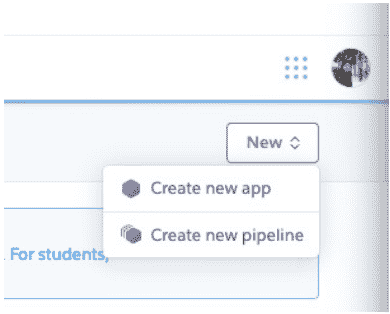

图 17.1 – 创建新应用

*图 17.1* 是为全栈应用创建新应用的地方。为应用命名任何你喜欢的名称并选择一个区域，但不要添加流水线。

接下来，我们将为我们的全栈应用添加一个数据库。

## 添加 Postgres 数据库

现在，让我们添加一个 Postgres 数据库：

1. 转到 **Resources** 选项卡并点击 **Find more add-ons** 按钮：

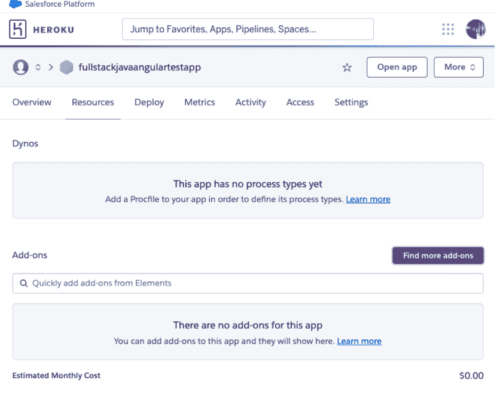

图 17.2 – 查找更多插件

*图 17.2* 显示了可以找到 **Find more add-ons** 按钮的位置。在这里你可以找到 Heroku 插件以及用于开发、扩展和运营应用的各种工具和服务。一个例子可以在 *图 17.3* 中看到：

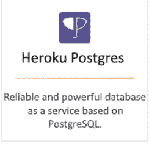

图 17.3 – Heroku Postgres

*图 17.3 显示了 Heroku Postgres 插件，它是一种基于 PostgreSQL 的 **数据库即服务 (DaaS)**。点击它，安装它，然后选择免费计划并将 Heroku Postgres 插件配置到你之前创建的全栈应用中。然后，点击 **Submit Order Form** 按钮。*

2. 返回到应用的 **Resources** 选项卡。你应该能看到 Heroku Postgres 插件。点击 Heroku Postgres 中的 Heroku 部分；将打开一个新标签页。

我们几乎完成了数据库的添加。我们只需要添加一个 Dataclip，它将让我们为数据库创建 SQL 查询。

3. 继续点击 **Create Dataclip** 按钮。然后，添加以下 SQL 查询：

```
set transaction read write;

CREATE EXTENSION IF NOT EXISTS "uuid-ossp";

CREATE TABLE user_entity
(
    id uuid PRIMARY KEY DEFAULT uuid_generate_v4(),
    username VARCHAR(50) UNIQUE NOT NULL,
    password VARCHAR(50) NOT NULL,
    email VARCHAR(255) UNIQUE NOT NULL
);

CREATE TABLE anti_hero_entity
(
    id uuid PRIMARY KEY DEFAULT uuid_generate_v4(),
    firstName VARCHAR(50) UNIQUE NOT NULL,
    lastName VARCHAR(50) UNIQUE NOT NULL,
    house VARCHAR(50) NULL,
    knownAs VARCHAR(50) NULL,
    createdAt TIMESTAMP NULL
);
```

4. 添加这些 SQL 查询到编辑器后，点击 **Save & Run**。

这样，数据库就创建好了。现在，让我们创建一个 `system.properties` 文件，在其中声明 Java 运行时版本和 Maven 版本。

3. 添加 CLIENT_URL 作为 Key 并添加应用的 URL 作为 Value：

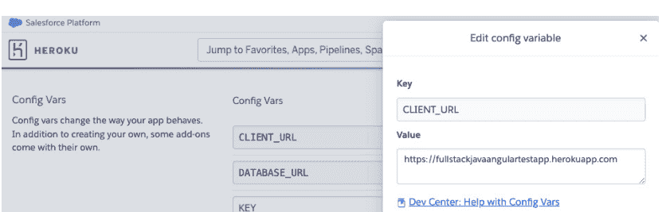

图 17.6 – 编辑配置变量

图 17.6 显示了在添加环境变量或配置变量后表单的样子。

不要忘记为你的 JWT secret 添加一个值。但是，请注意你的开发环境和生产环境应该有所不同。

4. 现在，打开 environment.prod.ts 文件并添加以下代码：

```
export const environment = {
  production: true,
  // your Spring API URL
  apiURL: "https://full stack
          javaangulartestapp.herokuapp.com/api/v1",
  // your heroku URL
  authURL: "https://full stack
          javaangulartestapp.herokuapp.com"
};
```

上述代码将在生产环境中将 Angular 应用中 apiURL 和 authURL 的先前 localhost:8080 地址替换掉。

接下来，我们需要将全栈应用仓库发布到 GitHub，因为我们将通过 GitHub 源代码控制部署应用。

## Heroku 手动部署

在本节中，我们将检查应用在部署后是否能无问题运行。请按照以下步骤操作：

1. 为此，转到 Heroku 仪表板中应用的 **Deploy** 选项卡：

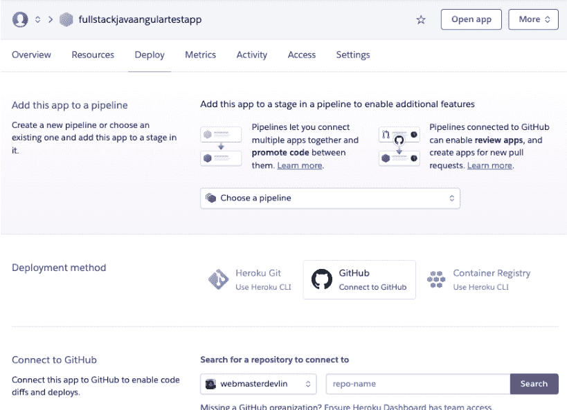

图 17.7 – 部署应用

*图 17.7 显示了如何通过 Heroku 仪表板手动部署应用。使用 GitHub 作为部署方法，然后搜索你的仓库。*

2. 选择你的全栈应用仓库后，滚动到页面底部，在那里你会找到 **Manual deploy** 部分。然后，按下 **Deploy Branch** 按钮开始在 Heroku 中部署和运行应用：

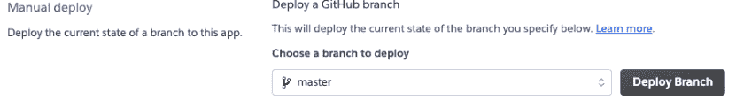

*图 17.8* 显示了 Heroku 的 **Manual deploy** 部分。

3. 要检查一切是否正常工作，请等待部署完成，然后转到应用的 URL。

4. 注册一个新用户并尝试登录。确保打开浏览器的 **Network** 选项卡；你会看到请求是通过应用的 URL 发送的。请注意，来自服务器的响应具有 **Status Code** **200** 或 **201**：

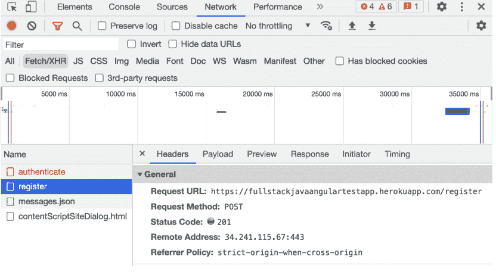

*图 17.9* 显示了 Google Chrome 开发者工具中的 **Network** 选项卡。在这里，你可以看到 **register** 请求返回 **Status Code 201**。Angular、Spring Boot 和 Heroku Postgres 数据库完美运行。

现在我们已经完成了全栈应用的手动部署，让我们使用 GitHub Actions 中的工作流创建自动部署。


## 创建 CI 工作流或流水线

在本节中，我们将使用 GitHub Actions 中的工作流来自动化部署我们的全栈应用程序。请按照以下步骤操作：

- 1. 进入你项目的 GitHub 仓库，然后点击 Actions 选项卡。搜索 Publish Java Package 并选择 Maven 工作流：

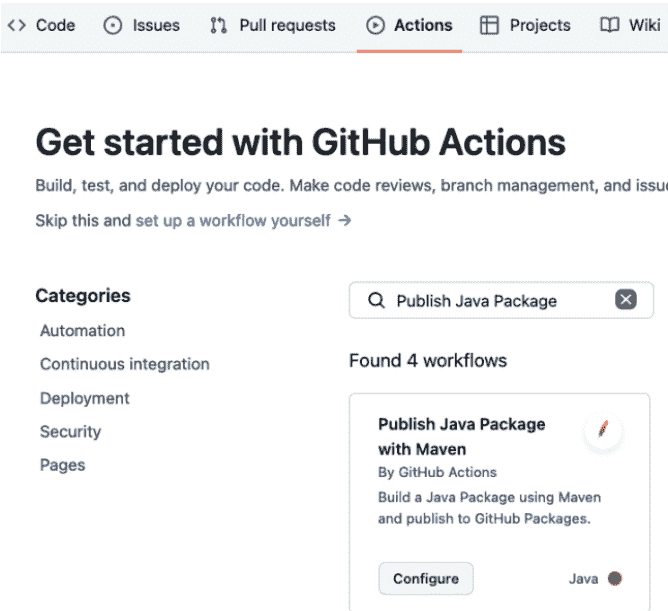

图 17.10 显示了用于构建 Maven 项目的基础且现成的 Maven 工作流。

- 2. 通过用以下 YAML 配置替换它来更改编辑器中 YAML 文件的内容：

```
name: CICD

on:
  push:
```
```
branches:
  - master

jobs:
  test:
    name: Build and Test
    runs-on: ubuntu-latest
    steps:
      - uses: actions/checkout@v2
      - name: Set up JDK 17
        uses: actions/setup-java@v2
        with:
          java-version: '17.0.*'
          distribution: 'temurin'
          cache: maven
      - name: test with Maven
        run: mvn test

  deploy:
    name: Deploy to Heroku
    runs-on: ubuntu-latest
    needs: test
    steps:
      - uses: actions/checkout@v2
        # This is the action
      - uses: akhileshns/heroku-deploy@v3.12.12
        with:
          heroku_api_key: ${{secrets.HEROKU_API_KEY}}
          heroku_app_name: "appname" #Must be unique
                          #in Heroku
          heroku_email: "email"
```

前面的代码是我们全栈应用程序的 CI/CD 工作流。它被称为 CI CD，因为这就是该工作流的用途。

工作流有一个事件 push，如果 master 分支有推送，工作流就会运行。

工作流还包含两个作业：test 和 deploy。test 作业的步骤是检出代码、使用 Java 17 构建应用程序并运行测试。另一方面，deploy 作业的步骤是检出代码并使用 Heroku deploy 动作，该动作需要 Heroku API 密钥、应用程序名称和 Heroku 账户的电子邮件。

- 3. 对于 Heroku API 密钥，你需要进入 Heroku 仪表板上你的个人资料的 Account settings 菜单：


图 17.11 显示了 Heroku 仪表板上我的个人资料下的 Account settings 菜单。

- 4. 点击 Account settings，然后进入 API Key 并生成一个 API 密钥：


图 17.12 显示了你可以在哪里生成 Heroku API 密钥。

复制 Heroku API 密钥，因为你需要为 GitHub Actions 创建一个新的 Actions secret。

- 5. 为此，进入你应用程序的 GitHub 仓库并打开一个新浏览器标签页以打开 **Settings** 选项卡，这样你就不会丢失你的工作流配置。
- 6. 然后，在文本区域中添加 API 密钥并将其命名为 HEROKU_API_KEY。这是你在工作流的 deploy 作业中将使用的密钥：

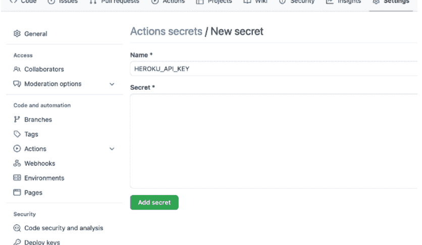

图 17.13 – Actions secrets 表单

*图 17.13 显示了你可以在哪里添加新的 Actions secret，以防止你的敏感值被任何人复制或读取。*

7. 添加新 secret 后，返回到你开始编辑工作流的浏览器标签页。然后，提交你正在编辑的文件：

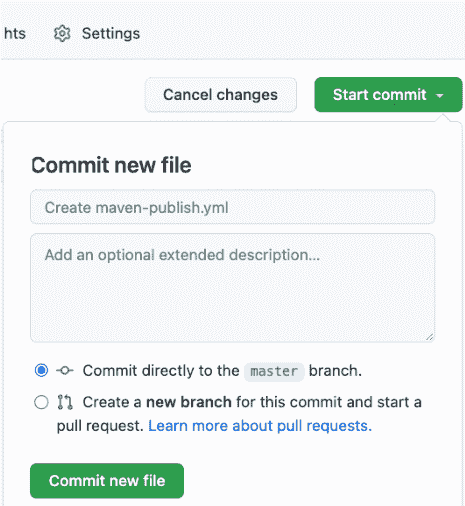

图 17.14 – 提交工作流

图 17.14 显示了 Start commit 下拉菜单，你可以在其中提交新的工作流。新的 YAML 文件将被添加到你的仓库中，这意味着你以后可以 git pull 它，这样它就会在你的本地机器上。

8. 在你提交工作流后，CI/CD 将启动。你可以通过进入 Actions 选项卡来查看 CI/CD 工作流的进度：

## 图 17.15 – 工作流状态

图 17.15 显示了 CI/CD 工作流的当前状态。你可以看到它正在运行 Build and Test 作业。

- 9. 你也可以通过点击左侧边栏菜单中的作业名称来查看特定作业中正在发生的事情：

## 图 17.16 – 步骤和操作状态

```
16060 [INFO]
16061 [INFO] added 979 packages, and audited 980 packages in 22s
16062
16063 [INFO] 105 packages are looking for funding
16064 [INFO] run 'npm fund' for details
```

图 17.16 显示了 Build and Test 作业中每个步骤的输出日志。你也可以使用 GitHub Actions 的这一部分来调试导致作业和操作失败的错误。

- 10. 在运行你创建的 CI/CD 工作流中的所有作业后，你会看到工作流旁边有一个绿色勾号图标，这意味着工作流已通过，一切正常：

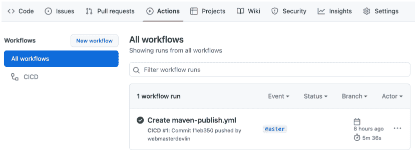

图 17.17 – 步骤和操作状态

图 17.17 显示了仓库 Actions 选项卡上通过的 GitHub 工作流。

- 11. 最后，为了检查部署自动化是否已在 Heroku 云中部署我们的应用程序，我们必须返回到 Heroku 的概览仪表板并查找最新的活动：

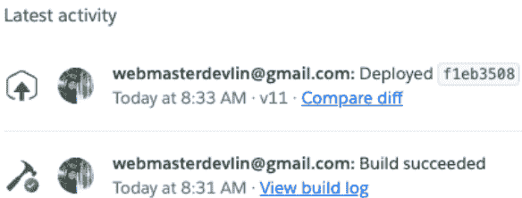

图 17.18 – Heroku 账户中 Latest activity 区域的构建成功

图 17.18 显示了由 GitHub Actions 触发的构建已成功。你可以看到应用程序正在正确运行。

至此，我们已经使用 GitHub Actions 自动化了我们的 CI/CD 工作流。现在，让我们总结一下本章中学到的内容。

## 总结

至此，我们已经到达本书的最后一章；让我们回顾一下本章中你学到的宝贵内容。

首先，你了解到 GitHub Actions 使自动化所有软件工作流和执行 CI/CD 变得容易。你可以直接从 GitHub 构建、测试和部署代码。你还了解到 Heroku 是一个 PaaS，让你可以在云中完全构建、运行和操作应用程序。Heroku Postgres 是 Heroku 直接提供的托管 SQL 数据库服务，你可以将其用于你的应用程序。

所以，你已经坚持到这里。感谢你完成本书；我为你和你对学习新工具和事物的热情感到自豪。你可以将这里学到的知识应用到一个项目中，前提是你的项目的需求与本书中你学到的关于问题和解决方案相匹配。

本课程教会了你如何作为一名高级开发人员构建 Spring Boot 2 应用程序和 Angular 13 应用程序，为你的公司、客户和客户带来价值。

作为下一步，我的建议是购买一本关于独立 Spring Boot 2 或 Spring Boot 3 的 Packt 书籍，或一本 Angular 书籍，以巩固你从本书中学到的知识。

代表 Packt 团队和编辑，我们祝愿你在职业生涯和生活的各个阶段一切顺利。
