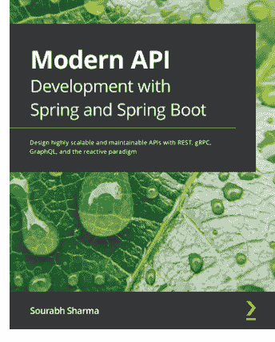
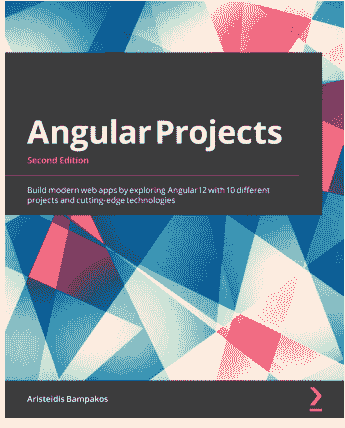

## 索引

## A

action 278, 279
  implementing 286, 287
  rules 286
  writing 286
Angular 9
  framework's comeback 10
  history 9
  problem, with action 10
  The Great Rewrite 10
Angular 2.0 10
Angular2-Switcher 19
Angular, advantages 10
  Angular CLI 12
  component-based framework 14
  cross-platform enabled 14
  early spotted bugs 12
  IDE support 11
  large enterprise applications 12
  lazy loading 14, 15
  maintainability 11
  modules 13
  object-oriented programming (OOP) 12
  predictability 11
  progressive web apps (PWAs) 12
single-page application (SPA) 12
static type data 11
TypeScript-based framework 10, 11
web components 14
Angular app
  adding, to Spring Boot project 374, 375
Angular binding
  one-way binding 215
  two-way binding 216
Angular CLI 210
  commands 211
  reference link 211
Angular DevTools 29, 31
  installing 31
Angular elements 14
Angular features 214
  component 214
  dependency injection 219, 220
  directives 216
  modules 218
  one-way binding 215
  organizing 209
  reference link 214
  services 219, 220
  two-way binding 216
Angular Files 19

## Angular folder structure
  core module 222
  creating 220
  feature module 220, 221
  implementing 222
  root module 220
  shared module 221, 222

## AngularJS 9

## Angular Language Service 19

## Angular Material
  adding 236, 237
  anti-hero list component 244-246
  button component 238, 239
  command bar component 246-248
  configuring 237, 238
  form field component 241-243
  icon component 239
  implementing 238
  navbar component 244
  table component 239, 240
  toolbar component 240, 241

## Angular Material, components
  reference link 243

## Angular modules 218
  creating 218
  organizing 209

## Angular project
  generating 210-214
  NgRx, adding to 283

## annotations 50, 185, 187
  core annotations 51-53
  in Lombok 179
  REST annotations 54, 55
  Spring Boot annotations 54
  stereotype annotations 53, 54
  types 50

## annotations, for controllers
  @DeleteMapping 99
  @GetMapping 99
  @PathVariable 99
  @PostMapping 99
  @PutMapping 99
  @RequestMapping 99
  @RestController 99
  @Valid 99

## anti-hero list component 244-246

## antiHero property 287

## API calling 340
  actions, creating 341
  component, dispatching 345, 346
  component, selecting 345, 346
  effects, creating 341, 342
  reducers, creating 343
  selectors, creating 343, 344
  synchronizing, in local storage 344, 345

## APIs, for handling off-heap data
  ByteBuffer API 8
  Foreign Function and Memory API 8
  Sun.misc.Unsafe.API 8

## Applet API 9

## application-level components 228

## Archive Files (.tar.gz) 24

## assertions
  in JUnit 185

## AssertJ 181, 187
  using 187
  versus JUnit 187

## Atom 11

## attribute directives 217
  ngClass 217
  ngStyle 217

## authentication 136

## authentication API 320, 321


## B

authentication form component
  creating 323
  login and register page, creating 324, 325

authentication module
  creating 322, 323

authorization 136

Azure Active Directory 166
  reference link 166

banana in a box 216

basic IDaaS 165

beans 50, 55-57

beforeEach function 365

blocks
  creating, under core module 227
  creating, under features module 223-225
  creating, under shared module 225, 227

boolean assertions 188
  methods 188

built-in validators 267, 268

button component 238, 239

ByteBuffer API 8

## C

CanActivate
  guard, creating 332, 333
  guard, using 333
  method signature 332

CanActivateChild
  guard, creating 333, 334
  guard, using 334
  method signature 333

CanDeactivate
  guard, creating 335, 336
  guard, using 336
  implementing, in application 338
  method signature 335

CanLoad
  guard, creating 334
  guard, using 335
  implementing, in application 336, 337
  method signature 334

CDK data table 239
  reference link 239

character assertions 188
  methods 188

CI workflow
  used, for automating full-stack application deployment in GitHub Actions 392-398

class assertions 189
  methods 189

Code Spell Check 18

command bar component 246-248

component, Angular 214

component-level architecture 228

components, of Angular
  dumb/presentation components 228, 230-232
  smart components 228-230
  structuring 227

config variables
  adding 388, 389

constructor-based dependency injection 45-47

container components 228

continuous integration and continuous delivery (CI/CD) 384

controllers 99
  creating 99-105

controls
  generating, with FormBuilder service 265, 266

core annotations 51-53

## core module 222
  blocks, creating under 227

## CORS application for each method 130

## CORS application on controller level 130

## CORS application on method level 131

## CORS policy
  adding 130

## createEffect() function
  parameters 289

## Create, Read, Update, and Delete (CRUD) 36, 68, 133, 222

## Cross-Origin Resource Sharing (CORS) 125, 126
  response headers 127

## Cross-Site Request Forgery (CSRF) 140

## D

## Data Access Object (DAO) 37

## database
  connecting, with PS QL container 60

## Database-as-a-Service (DaaS) 387

## data binding 214

## data management 276

## Data Transfer Object (DTO) 85, 143

## dependency injection (DI) 44, 219, 220

## E

## Eclipse 11

## Eclipse Code Formatter 21

## effect 280

enterprise IDaaS 165
  characteristics 166
  requisites 165, 166
event logging 167
experimental Java-based ahead-of-time (AOT) 9
extractAllClaims() method 155

F
feature module 220, 221
  blocks, creating under 223-225
feature state
  selecting 293
field-based dependency injection 50
file assertions 190, 191
  methods 190
Finder window 23
fixture 359
fixtures, types
  setUp() 182
  tearDown() 183
Foreign Function and Memory API 8
foreign memory 8
form arrays 260
  creating 263-265
FormBuilder service
  using, to generate controls 265, 266
FormComponent route
  implementing, in application 339, 340
form controls 255
  events, listening to 259
  grouping 260
  initializing 257, 258
  methods 256, 257
  resetting 258, 259
form field component 241-243
form groups 260
  creating 260, 261
form input
  built-in validators 267, 268
  custom validators 268, 269
  validating 267
frontend-maven-plugin 374
  using 376, 377
full-stack application
  deployment, automating with CI workflow in GitHub Actions 392-398

G
getAntiHeroList 286
Git 32
Git Bash Environment (MinGW) 27
GitHub
  URL 385
GitHub accounts
  creating 385
GitHub Actions 384
  CI workflow, used for automating full-stack application deployment 392-398
  components 384
GitHub Actions, components
  actions 384
  events 384
  jobs 384
  runners 384
  workflows 384
gitignore 21
Git Version Control
  installing 32
global configuration 132
global libraries 358
global state 278

Google Chrome
  reference link 285
Google Cloud Identity 166
  reference link 166
Groovy 26
guards, Angular
  CanActivate 332
  CanActivateChild 333
  CanDeactivate 335
  CanLoad 334
H
H2 database 80, 192
  repository, testing 198, 199
  service, testing 193-197
  testing with 192, 193
Heroku
  config variables, adding 388, 389
  manual deployment 390, 391
  new app, creating 385
  Postgres database, adding 385-387
  setting up 384
  system properties, adding 388
  URL 385
Heroku accounts
  creating 385
HTTP headers
  request headers 126
HTTP interceptor 321
  implementing 321, 322
HTTP requests
  intercepting 358-369
HTTP responses
  mocking 358-369
HttpSecurity
  standard methods 140
HyperText Transfer Protocol (HTTP) 99
I
icon component 239
Identity Access Management (IAM) 165
Identity as a Service (IDaaS) 125, 164
  basic IDaaS 165
  enterprise IDaaS 165
  types 165
initial state 290
integrated development environment (IDE) 80
IntelliJ
  using, for Spring Boot 80-85
IntelliJ IDEA
  advanced refactoring 19
  duplicates, deleting 20
  installing 19, 20
  IntelliSense 19
  navigation and search 19
  quick fixes 19
  setting up, with Java 17 27
  Spring Initializr, using via 43
  terminal 19
IntelliJ IDEA installer
  download link 20
interpolation 215
Inversion of Control (IoC) 44
iterable assertions 189, 190
  methods 189, 190
J
JAR file
  running 381, 382
Java 17 7, 21
  64-Bit, on RPM-based Linux platforms 25
  Applet API 9
  experimental AOT 9
for 64-bit Linux platforms 24
Foreign Function and Memory API 8
installing, on Linux 24
installing, on macOS 23
installing, on Windows 21, 22
IntelliJ IDEA, setting up 27
just-in-time (JIT) compilers 9
pattern matching, with switch statements 9
sealed classes 8
using, on existing projects 28, 29
using, on new projects 28
Java Archive (JAR) files 137
Java Development Kit (JDK) 21
Java EE framework 5
Java Native Interface (JNI) 8
Java Persistence API (JPA) 143
Java Virtual Machines (JVMs) 4, 36
JPA repository
  creating 93-96
  runtime exceptions 96-98
JSON Web Token (JWT) 125, 150
  example 150, 151
  implementing 151
  need for 150
JSON Web Token (JWT) implementation
  authentication controller, creating 158
  authentication filters, creating 159-164
  authentication models, creating 151-153
  authentication service, creating 156, 157
  authentication utilities, creating 153-155
JUnit 181, 182
  assertion 185
  features 182-184
  versus AssertJ 187
Junit 5 Mockito Code Generator 21
just-in-time (JIT) compilers 9
JWT extension
  methods 154
K
Kotlin 26
L
Lightweight Directory Access Protocol (LDAP) 61
Linux
  Java 17, installing on 24
  SDKMAN, installing on 26
Log4j
  setting up 174
Log4j2 167
  Appenders 172
  configuring 176, 177
  filters 174
  layouts 173
  Logger 172
  markers 173, 174
  used, for logging 172
Logback
  configuring 175
logging framework
  features 168
  formatter 168
  handler 168
  logger 168
  severity levels 168
logs
  using 177-179
Lombok 20, 87
  annotations 179
  models, creating with 87, 88
long-term support (LTS) 7, 21

## M

macOS
  used, for installing Java 17 23
  used, for installing Redis server 105
  used, for installing SDKMAN 26
map assertions 191, 192
  methods 191, 192
maven-antrun-plugin
  using 377, 378
Maven Helper 20
memorization 279
Message Authentication Code (MAC) 150
Mocking tests 358
Mockito 200
  behavior, adding 200, 201
  behavior, verifying 201
  exception handling 203
  expecting calls 201, 202
  implementing, for writing unit tests in Spring Boot application 203-205
  usage, benefits 200
  used, for writing unit tests in service 200
model-driven forms 253
models
  adding 85
  creating 85
  creating, with DTOs 86
  creating, with Lombok 87, 88
Model-View-Controller (MVC) 37
Model View Whatever (MVW)
  framework 209
Mozilla Firefox
  reference link 285
Multi-Factor Authentication (MFA) 164
MVC Configuration 7

## N

navbar component 244
nested form groups
  creating 261, 262
NgRx
  adding, to Angular project 283
  setting up 283
NgRx DevTools
  installing 284, 285
NgRx without side effect
  action, dispatching 303-305
  delete action, creating 302
  delete reducer, creating 302, 303
  item, removing 301, 302
NgRx with side effect
  action, dispatching 310, 311, 314-316
  actions, creating 307, 308, 311, 312
  action type, creating 305
  delete effect, creating 306
  dispatch, modifying 306, 307
  effect, creating 308, 309, 312, 313
  item, adding 307
  item, removing 305
  item, updating 311
  reducer, creating 309, 310, 313, 314

## O

object-oriented programming (OOP) 11, 44
off-heap data 8
Okta Workforce Identity 166
  reference link 166
one-way binding 215
  interpolation 215
  property binding 215


## P

分页信息
  在 Swagger UI 中显示 121-123

PagingAndSortingRepository 68

parseClaimsJWS() 方法 155

模式匹配 9
  使用 switch 语句 9, 29

普通旧 Java 对象 (POJOs) 85

平台即服务 (PaaS) 384

穷人的分析器 169

Postgres 数据库
  添加 385-387

PostgreSQL 60
  特性 60, 61
  用例 60

PostgreSQL 数据库 82

PostgreSQL 驱动 80

PostgreSQL，安装方法 61
  常规方法 62-65
  在 Docker 容器上 66, 67

预检请求 128, 129

Prettier 18

主键 (PK) 90

概念验证 192

属性绑定 215

PSQL 容器
  用于连接数据库 60

发布/订阅 (Pub/Sub) 105

## R

响应式表单 250, 253
  在项目中实现 269-273
  模板驱动方法 250
  使用 253-255

Reactive Relational Database Connectivity (R2DBC) 驱动 80

Red Hat Package Manager (RPM) 24

Redis 105
  添加，用于缓存 105
  在 Spring Boot 上配置 106-108
  安装 105
  在 macOS 上安装 105
  在 Ubuntu Linux 上安装 105
  在 Windows 上安装 106

Redis 配置 106

reducer 279
  初始状态 290
  状态接口 290
  编写 290

reducer 函数 291

回归测试 182

表述性状态转移 (REST) 控制器 38, 39, 99

请求头 126

响应头 127
  预检请求 128, 129
  简单请求 128

REST 注解 54, 55

Rest APIs 5

REST Client 19, 29
  在 VS Code 中安装 30, 31

根模块 220

根状态
  选择 292

路由
  保护 332, 335

路由模块 325
  创建 325-328
  注销实现 329-332
  令牌验证 328

RPM 包 (.rpm) 24

运行时检查 295
  strictActionImmutability 296
  strictActionSerializability 298

strictActionTypeUniqueness 299
strictActionWithinNgZone 298
strictStateImmutability 296
strictStateSerializability 297
运行时异常
IllegalArgumentException 96
IndexOutOfBoundsException 96
NullPointerException 97

## S

SDKMAN (Software Development Kit Manager) 25
命令 26
特性 26
在 Linux 上安装 26
在 macOS 上安装 26
在 Windows 上安装 27
密封类 8, 29
Security Support Provider Interface (SSPI) 61
selector 279, 280
在组件中分发 292
选择特性状态 293
实现 293-295
选择根状态 292
使用 292
编写 292
服务器
启动 80
服务 219, 220
职责 219
编写 93
setAntiHeroList 286
基于 setter 的依赖注入 47-49
共享模块 221, 222
块，在其下创建 225, 227
简单请求 128
单一职责原则 50
单一事实来源 276
SLF4J 167
优点 168
特性 170
LoggerFactory 类 169
logger 接口 169
方法和类 169
参数化日志 170, 171
Profiler 类 169
分析 171, 172
设置 174
用于日志记录 168
智能代码补全 19
智能组件 221, 228-230
在项目中实现 232-236
Spring
依赖示例 5-7
Spring 注解 50
Spring Boot 4, 36
优点 4, 36
架构 36
身份验证 138
实现身份验证 138-142
授权 138
添加配置 374
配置 138-142
依赖示例 5-7
流程架构 37
JSON Web Token (JWT) 150
打包 379, 380
REST 38, 39
创建用户端点 142
与 Spring 5 对比
Spring Boot Actuator 5
Spring Boot 注解 54

Spring Boot 应用
添加依赖 74, 75
使用 IntelliJ 80-85
实现 Mockito 用于编写单元测试 203-205
添加模型 88-92
配置 Redis 106-108
实现路由保护 336-340
编写单元测试 192
Spring Boot 架构
业务层 36
数据库层 36
持久层 36
表示/显示层 36
Spring Boot 项目
添加 Angular 应用 374, 375
Spring Data JPA 67, 80
在 Spring Boot 上 69-71
用于连接数据库 77, 78
Spring Data JPA，优点
样板代码减少 68
生成的查询 68
无代码仓库 67
Spring Data JPA，仓库 68
CrudRepository 68
JpaRepository 68
PagingAndSortingRepository 68
springdoc-openapi
配置 114-116
插件 111
属性 110, 111
设置 109, 110
springdoc-openapi-gradle-plugin 113, 114
springdoc-openapi-maven-plugin 111-113
Spring Framework 4
Spring Initializr 80
添加依赖 72-74
URL 40
使用 39
通过 IntelliJ IDEA 使用 43, 44
使用基于 Web 的界面 40-42
Spring JDBC
用于连接数据库 76, 77
Spring Security 135
特性 136, 137
Java Archive (JAR) 文件 137
Spring Starter 4
Spring Web 5
Spring Web MVC 5
状态接口 290
状态管理 276, 278
action 278, 279
effect 280
reducer 279
selector 279, 280
store 278
刻板印象注解 53, 54
store 278
配置 295
运行时检查 295
strictActionImmutability 296
strictActionSerializability 298
strictActionTypeUniqueness 299
strictActionWithinNgZone 298
strictStateImmutability 296
strictStateSerializability 297
结构指令 216, 217
Sun.misc.Unsafe.API 8
Swagger UI 116
安装 116-118
显示分页信息 121-123
使用 116-120
语法精美样式表 (SASS) 211
跨域身份管理系统 (SCIM) 166

## T

系统属性
  添加 388

表格组件 239, 240

Tabnine 21

tarball 24

模板驱动表单 250
  创建 251, 252
  场景 253

The Great Rewrite 10

工具栏组件 240, 241

转译器 12

双向绑定 216
  ngModel 指令 216

TypeScript 11

## U

Ubuntu Linux
  安装 Redis 服务器 105

统一资源标识符 (URI) 38

统一资源定位符 (URL) 107

通用唯一 ID (UUID) 358

单元测试
  使用 Mockito 在服务中编写 200
  在 Spring Boot 应用中编写 192

单元测试 182
  优点 182

通用唯一标识符 (UUIDs) 60

用户身份验证
  添加 319

用户控制器
  创建 148, 149

用户 DTO
  创建 143

用户端点
  创建 142
  创建用户控制器 148, 149
  创建用户 DTO 143
  创建用户实体 142, 143
  创建用户仓库 144
  创建用户服务 144, 145

用户实体
  创建 142, 143

用户仓库
  创建 144

用户服务
  创建 144, 145

## V

Visual Studio Code (VS Code) 11
  安装 18
  安装 REST Client 30, 31

VS Code 安装程序
  参考链接 18

## W

Web Initializer 7

WebMvcConfigure
  实现 378, 379

Windows
  用于安装 Java 17 21, 22
  用于安装 Redis 服务器 106
  用于安装 SDKMAN 27

## 你可能喜欢的其他书籍

如果你喜欢这本书，你可能对 Packt 出版的其他这些书籍感兴趣：



### 使用 Spring 和 Spring Boot 进行现代 API 开发

Sourabh Sharma

ISBN: 978-1-80056-247-9

+   - 了解 RESTful API 开发、其设计范式和最佳实践
+   - 熟悉 Spring 实现 RESTful Web 服务的核心组件
+   - 实现响应式 API 并探索异步 API 开发
+   - 应用 Spring Security 使用 JWT 进行身份验证和请求授权
+   - 开发基于 React 的 UI 以消费 API
+   - 实现 gRPC 服务间通信
+   - 通过理解工作流和工具设计基于 GraphQL 的 API
+   - 深入了解如何保护、测试、监控和部署你的 API



### Angular 项目 – 第二版

Aristeidis Bampakos

ISBN: 978-1-80020-526-0

+   - 使用 Angular CLI 和 Nx Console 设置 Angular 应用
+   - 使用 Jamstack 和 SPA 技术创建个人博客
+   - 使用 Angular 和 Electron 构建桌面应用
+   - 使用 PWA 技术在离线模式下增强用户体验 (UX)
+   - 使用服务器端渲染使网页对 SEO 友好
+   - 使用 Nx 工具和 NgRx 进行状态管理创建单体仓库应用
+   - 专注于使用 Ionic 进行移动应用开发
+   - 通过扩展 Angular CLI 开发自定义 schematics

## Packt 正在寻找像你这样的作者

如果你有兴趣成为 Packt 的作者，请访问 `authors.packtpub.com` 并申请。今天我们已与数千名开发者和技术专业人士合作，帮助他们与全球技术社区分享见解。你可以提交通用申请、申请我们正在招聘作者的特定热门主题，或提交你自己的想法。

## 分享你的想法

现在你已经读完了 *Spring Boot 3 和 Angular*，我们很想听听你的想法！如果你是从 Amazon 购买的书籍，请选择 `https://www.amazon.in/review/create-review/?asin=183024321X` 为本书分享反馈或在你购买的网站上留下评论。

你的评论对我们和技术社区都很重要，将帮助我们确保提供优质的内容。


## 免费下载本书的 PDF 副本

感谢您购买本书！

您是否喜欢在旅途中阅读，但又无法随身携带纸质书？

您购买的电子书是否与您选择的设备不兼容？

别担心，现在每本Packt图书都会随书附赠一份无DRM的PDF版本，完全免费。

可在任何地点、任何设备上阅读。直接搜索、复制并粘贴您喜爱的技术图书中的代码到您的应用程序中。

福利不止于此，您还可以独享折扣、订阅资讯，每天在收件箱中获取精彩的免费内容。

按照以下简单步骤即可获取这些福利：

1. 扫描二维码或访问以下链接

   

   ```
   https://packt.link/free-ebook/9781803243214
   ```

2. 提交您的购买凭证
3. 大功告成！我们会将免费PDF和其他福利直接发送到您的邮箱。

