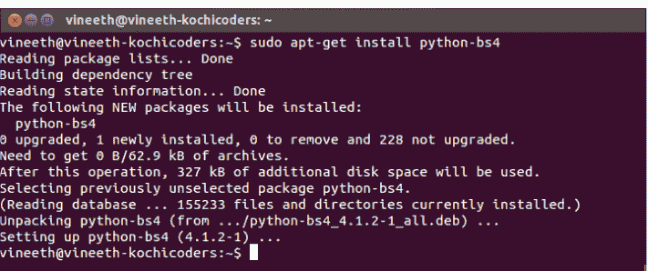
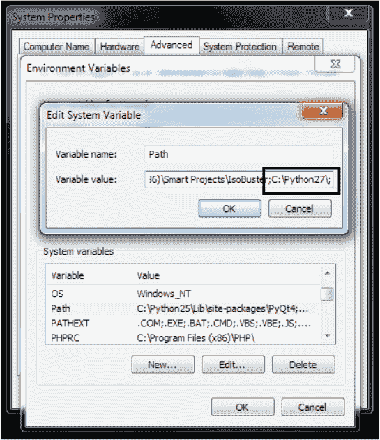

## 1 安装 Beautiful Soup

在开始使用 Beautiful Soup 之前，我们应确保它已正确安装在我们的机器上。所需步骤非常简单，任何用户都可以迅速完成安装。在本章中，我们将涵盖以下主题：

- 安装 Beautiful Soup
- 验证 Beautiful Soup 的安装

### 安装 Beautiful Soup

Python 支持安装第三方模块，如 Beautiful Soup。在最佳情况下，我们可以期望模块开发者可能已准备好平台特定的安装程序，例如在 Windows 的情况下为可执行安装程序；在 Red Hat 为基础的 Linux 操作系统（如 Red Hat、Open Suse 等）的情况下为 rpm 包；在 Debian 为基础的操作系统（如 Debian、Ubuntu 等）的情况下为 Debian 包。但这并不总是如此，如果平台特定的安装程序不可用，我们应了解替代方案。我们将讨论在不同操作系统（如 Linux、Windows 和 Mac OS X）中可用的不同 Beautiful Soup 安装选项。我们将在后面的示例中使用的 Python 版本为 Python 2.7.5，用于安装 Beautiful Soup 的说明可能与 Python 3 不同。你可以直接前往对应操作系统的安装部分。

### 在 Linux 中安装 Beautiful Soup

在 Linux 机器上安装 Beautiful Soup 非常简单直接。对于 Debian 或 Ubuntu 的最新版本，Beautiful Soup 可作为包提供，我们可以使用系统包管理器进行安装。对于 Debian 或 Ubuntu 的其他版本，如果 Beautiful Soup 不作为包提供，我们可以使用替代方法进行安装。


通常，在Linux机器上安装Beautiful Soup有以下三种方式：

- 使用包管理器
- 使用pip
- 使用easy_install

这些选择根据复杂程度排序，以避免反复试验。最简单的方法始终是使用包管理器，因为它需要用户付出的努力较少，所以我们将首先介绍这种方法。如果一步安装成功，我们就不需要执行下一步，因为前面提到的三种方式所做的是同一件事。

### 使用包管理器安装Beautiful Soup

Linux机器通常自带包管理器来安装各种软件包。在较新版本的Debian或Ubuntu中，由于Beautiful Soup以软件包形式提供，我们将使用系统包管理器进行安装。在Ubuntu和Debian等Linux机器中，默认的包管理器基于apt-get，因此我们将使用apt-get来完成此任务。

只需打开终端并输入以下命令：

```
sudo apt-get install python-bs4
```

上述命令将在我们的Linux操作系统中安装Beautiful Soup版本4。在系统中安装新软件包通常需要root用户权限，这就是为什么我们在apt-get命令前加上sudo的原因。如果我们没有添加sudo，最终会遇到权限拒绝错误。如果软件包已经更新，我们将在命令行中看到以下成功消息：



由于我们使用的是较新版本的Ubuntu或Debian，`python-bs4` 会列在`apt`仓库中。但如果上述命令失败并显示`Package Not Found Error`，则表示软件包列表不是最新的。这通常发生在我们刚刚安装操作系统且尚未从软件包仓库下载软件包列表时。在这种情况下，我们需要首先使用以下命令更新软件包列表：

```
sudo apt-get update
```

上述命令将从在线软件包仓库更新必要的软件包列表。之后，我们需要再次尝试前面安装Beautiful Soup的命令。

在较旧版本的Linux操作系统中，即使运行了`apt-get update`命令，也可能无法安装Beautiful Soup，因为仓库中可能没有它。在这种情况下，我们可以依靠其他安装方法，使用`pip`或`easy_install`。

### 使用pip或easy_install安装Beautiful Soup

`pip`和`easy_install`是用于管理和安装Python包的工具。两者都可以用来安装Beautiful Soup。

### 使用pip安装Beautiful Soup

在终端中，输入以下命令：

```
sudo pip install beautifulsoup4
```

上述命令将从`http://pypi.python.org/`下载必要的软件包后在系统中安装Beautiful Soup版本4。

### 使用easy_install安装Beautiful Soup

`easy_install`工具从**Python包索引**（PyPI）安装软件包。因此，在终端中输入以下命令：

```
sudo easy_install beautifulsoup4
```

### 安装Beautiful Soup

如果你没有有效的网络连接，前面所有在Linux中安装Beautiful Soup的方法都将无法工作。所以，如果一切方法都失败，我们仍然可以安装Beautiful Soup。最后一个选项是使用从pypi.python.org下载的每个Python包附带的`setup.py`脚本。这种方法也推荐用于在Windows和Mac OS X机器上安装Beautiful Soup。因此，我们将在*在Windows中安装Beautiful Soup*一节中讨论这种方法。

### 在Windows中安装Beautiful Soup

在Windows中，我们将使用https://pypi.python.org/packages/source/b/beautifulsoup4/上可用的最新Beautiful Soup Python包，并使用`setup.py`脚本来安装Beautiful Soup。但在执行此操作之前，如果将Python的路径添加到系统路径中，操作会更容易。下一节将讨论在Windows机器上设置Python路径。

### 验证Windows中的Python路径

在Windows中，python.exe的路径通常不会默认添加到环境变量中。因此，为了从Windows命令行提示符检查这一点，你需要输入以下命令：

```
python
```

如果Python的路径已经添加到环境路径变量中，或者我们已经在Python安装目录内，上述命令将无错误地运行。但是，最好检查一下路径变量中是否有Python目录条目。

如果路径变量中不存在，我们必须找出实际路径，这完全取决于你安装Python的位置。对于Python 2.x，默认路径为C:\Python2x；对于Python 3.x，默认路径为C:\Python3x。

我们必须将其添加到Windows机器的*Path*环境变量中。为此，右键单击**我的电脑 | 属性 | 环境变量 | 系统变量**。

选择Path变量，并将以下内容添加到Path变量中：

```
;C:\PythonXY 例如 C:\Python27
```

如下截图所示：



在Windows中添加Python路径（本例中使用Python 2.7）

Python路径就绪后，我们就可以按照步骤在Windows机器上安装Beautiful Soup。

> 下一节将讲解的通过`setup.py`安装Beautiful Soup的方法在Linux、Windows和Mac OS X操作系统中是相同的。

### 使用setup.py安装Beautiful Soup

我们可以使用`setup.py`脚本来安装Python包，该脚本随从Python包索引网站`https://pypi.python.org/`下载的每个Python包一起提供。以下步骤用于使用`setup.py`安装Beautiful Soup：

- 1. 从https://pypi.python.org/packages/source/b/beautifulsoup4/下载最新的tarball。
- 2. 将其解压到一个文件夹（例如`BeautifulSoup`）。
- 3. 打开命令行提示符，并导航到解压后的文件夹，如下所示：
  `cd BeautifulSoup`
  `python setup.py install`
- 4. `python setup.py install`命令将在我们的系统中安装Beautiful Soup。

> 我们还没有穷尽使用Beautiful Soup的所有可能选项。即使目前列出的所有选项都失败，我们仍然可以在应用程序中使用Beautiful Soup。

### 无需安装即可使用Beautiful Soup

我们迄今讨论的安装过程通常会将模块内容复制到选定的安装目录。这因操作系统而异，在Debian等Linux操作系统中，路径通常是`/usr/local/lib/pythonX.Y/site-packages`，在Windows中则是`C:\PythonXY\Lib\site-packages`（其中X和Y表示相应的版本，如Python 2.7）。当我们在Python解释器或Python脚本中使用import语句时，Python解释器通常会在预定义的Python `Path`变量中查找这些目录中的模块。因此，安装实际上就是将模块内容复制到预定义目录，或者将其复制到其他位置并将该位置添加到Python路径中。以下无需安装即可使用Beautiful Soup的方法适用于任何操作系统，例如Windows、Linux或Mac OS X：

- 1. 从https://pypi.python.org/packages/source/b/beautifulsoup4/下载最新版本的Beautiful Soup包。
- 2. 解压该软件包。
- 3. 将`bs4`目录复制到我们希望存放所有Python Beautiful Soup脚本的目录中。

执行完上述所有步骤后，我们就可以使用Beautiful Soup了。在这种情况下，要导入Beautiful Soup，我们需要在包含bs4目录的目录中打开终端，或者将该目录添加到Python Path变量中；否则，我们将收到模块未找到的错误。这个额外步骤是必需的，因为该方法特定于包含bs4目录的项目。但对于安装方法，正如我们前面所看到的，Beautiful Soup将是全局可用的，可以在任何项目中使用，因此不需要这些额外步骤。

### 验证安装

要验证安装，请执行以下步骤：

- 1. 在终端中使用以下命令打开Python解释器：
  `python`
- 2. 现在，我们可以使用以下命令发出一个简单的import语句来检查我们是否成功安装了Beautiful Soup：
  `from bs4 import BeautifulSoup`

如果我们没有安装Beautiful Soup，而是将bs4目录复制到了工作区，则在使用上述命令之前，我们必须切换到放置bs4目录的目录。

### 快速参考

下表是命令及其含义的概述：

| 命令 | 描述 |
|---|---|
| `sudo apt-get install python-bs4` | 该命令用于在Linux中使用包管理器安装Python包。 |
| `sudo pip install beautifulsoup4` | 该命令用于使用pip安装Python包。 |
| `sudo easy_install beautifulsoup4` | 该命令用于使用easy_install安装Python包。 |
| `python setup.py install` | 该命令用于使用setup.py安装Python包。 |
| `from bs4 import BeautifulSoup` | 该命令用于验证安装。 |


