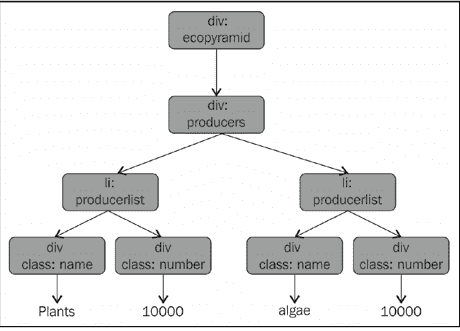
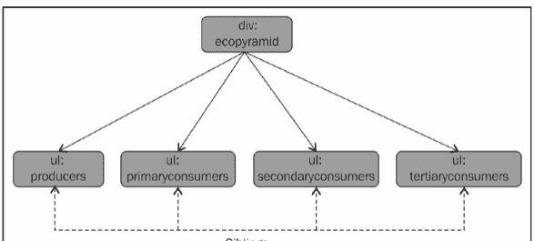
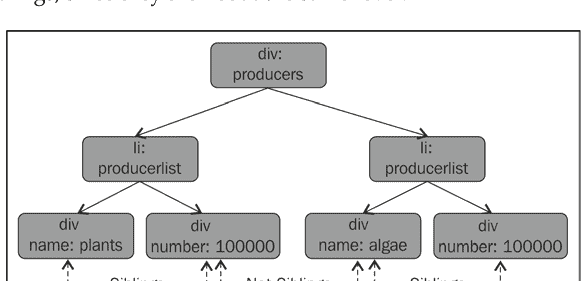
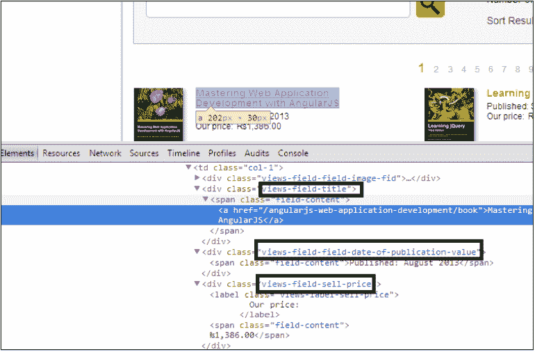

## 3 使用 Beautiful Soup 搜索

我们在第二章“创建 BeautifulSoup 对象”中看到了 BeautifulSoup 对象以及其他对象（如 Tag 和 NavigableString）的创建。HTML/XML 文档被转换为这些对象，以便在文档中轻松搜索和导航。

在本章中，我们将学习 Beautiful Soup 提供的不同搜索方法，这些方法可以基于标签名称、标签的属性值、文档中的文本、正则表达式等进行搜索。最后，我们将利用这些搜索方法从一个在线网页中抓取数据。

### 在 Beautiful Soup 中搜索

Beautiful Soup 帮助从网页中抓取信息。有用的信息以文本或不同标签的属性值形式分散在网页中。为了抓取此类页面，有必要根据属性值、标签名称或文档中的文本在整个页面中搜索不同的标签。为方便起见，Beautiful Soup 内置了以下搜索方法：

- `find()`
- `find_all()`
- `find_parent()`
- `find_parents()`
- `find_next_sibling()`
- `find_next_siblings()`
- `find_previous_sibling()`
- `find_previous_siblings()`
- `find_previous()`
- `find_all_previous()`
- `find_next()`
- `find_all_next()`

### 使用 find() 搜索

在本章中，我们将使用以下 HTML 代码来解释使用 Beautiful Soup 进行搜索。我们可以将其保存为 HTML 文件 `ecologicalpyramid.html`，放在上一章创建的 Soup 目录中。

```html
<html>
  <body>
  <div class="ecopyramid">
    <ul id="producers">
      <li class="producerlist">
        <div class="name">plants</div>
        <div class="number">100000</div>
      </li>
      <li class="producerlist">
        <div class="name">algae</div>
        <div class="number">100000</div>
      </li>
    </ul>
    <ul id="primaryconsumers">
      <li class="primaryconsumerlist">
        <div class="name">deer</div>
        <div class="number">1000</div>
      </li>
      <li class="primaryconsumerlist">
        <div class="name">rabbit</div>
        <div class="number">2000</div>
      </li>
    </ul>
    <ul id="secondaryconsumers">
      <li class="secondaryconsumerlist">
        <div class="name">fox</div>
        <div class="number">100</div>
      </li>
      <li class="secondaryconsumerlist">
        <div class="name">bear</div>
        <div class="number">100</div>
      </li>
    </ul>
    <ul id="tertiaryconsumers">
      <li class="tertiaryconsumerlist">
        <div class="name">lion</div>
        <div class="number">80</div>
      </li>
      <li class="tertiaryconsumerlist">
        <div class="name">tiger</div>
        <div class="number">50</div>
      </li>
    </ul>
  </div>
  </body>
</html>
```

上述 HTML 是生态金字塔的简单表示。要查找第一个生产者、初级消费者或次级消费者，我们可以使用 Beautiful Soup 搜索方法。通常，要查找 BeautifulSoup 对象中任何标签的第一次出现，我们可以使用 `find()` 方法。

### 查找第一个生产者

对于 HTML 内容的生态金字塔示例，我们可以很容易地识别出生产者位于第一个 `<ul>` 标签内。由于生产者在整个 HTML 文档中是 `<ul>` 标签的第一个条目，因此使用 `find()` 方法很容易找到第一个生产者。表示第一个生产者的 HTML 树如下图所示：



现在，我们可以使用以下命令切换到 Soup 目录：

```bash
cd Soup
```

我们可以将以下代码保存为 `ecologicalpyramid.py`，并使用 `python ecologicalpyramid.py` 运行它，或者我们可以在 Python 解释器中运行该代码。使用以下代码，我们将使用 `ecologicalpyramid.html` 文件创建一个 BeautifulSoup 对象：

```python
from bs4 import BeautifulSoup
with open("ecologicalpyramid.html","r") as ecological_pyramid:
    soup = BeautifulSoup(ecological_pyramid,"lxml")
producer_entries = soup.find("ul")
print(producer_entries.li.div.string)
```

输出：

```
plants
```

由于生产者是 `<ul>` 标签的第一个条目，我们可以使用 `find()` 方法，它通常只搜索 BeautifulSoup 对象中特定标签的第一次出现。我们将其存储在 `producer_entries` 中。下一行打印第一个生产者的名称。从前面的 HTML 图中，我们可以理解第一个生产者存储紧跟在第一个 `<ul>` 标签之后的第一个 `<li>` 标签内的第一个 `<div>` 标签中，如下代码所示：

```html
<ul id="producers">
    <li class="producerlist">
        <div class="name">plants</div>
        <div class="number">100000</div>
    </li>
</ul>
```

因此，运行上述代码后，我们将得到 `plants`，即第一个生产者，作为输出。

### 解释 find()

此时，我们知道 `find()` 用于搜索 BeautifulSoup 对象中任何项目的第一次出现。`find()` 方法的签名如下：

```text
find(name,attrs,recursive,text,**kwargs)
```

### 搜索文本

如果我们使用 `find()` 方法传递一个字符串进行搜索，默认情况下它将搜索具有给定名称的标签。但是，如果我们只想搜索 BeautifulSoup 对象中的文本，我们可以像下面这样使用它：

```python
search_for_stringonly = soup.find(text="fox")
```

输出：

```
fox
```

上述代码将搜索生态金字塔中 `fox` 文本的出现。使用 Beautiful Soup 搜索文本是区分大小写的。例如，`case_sensitive_string = soup.find(text="Fox")` 将返回 `None`。

### 基于正则表达式搜索

`find()` 方法可以基于正则表达式进行搜索。当我们有一个没有像前面生产者示例那样规律的 HTML 页面时，这通常会派上用场。

让我们举一个例子：给定一个包含电子邮件 ID 的页面，如下代码所述，要求我们找到第一个电子邮件 ID：

```html
<br/>
<div>The below HTML has the information that has email ids.</div>
    abc@example.com
<div>xyz@example.com</div>
<span>foo@example.com</span>
```

这里，电子邮件 ID 分散在页面中，一个在 `<div>` 标签内，另一个在 `<span>` 标签内，第一个则没有被任何标签包围。在这里很难找到第一个电子邮件 ID。但是如果我们可以使用正则表达式来表示电子邮件 ID，`find()` 就可以基于该表达式进行搜索，从而获得第一个电子邮件 ID。

因此，在这种情况下，我们只需要为电子邮件 ID 构造正则表达式，并将其传递给 `find()` 方法。`find()` 方法将使用正则表达式的 `match()` 方法来查找与给定正则表达式的匹配。

让我们使用以下代码找到第一个电子邮件 ID：

```python
import re
from bs4 import BeautifulSoup
email_id_example = """<br/>
<div>The below HTML has the information that has email ids.</div>
    abc@example.com
```


<div>xyz@example.com</div>
<span>foo@example.com</span>
"""
soup = BeautifulSoup(email_id_example,"lxml")
emailid_regexp = re.compile("\w+@\w+\.\w+")
first_email_id = soup.find(text=emailid_regexp)
print(first_email_id)

#output
abc@example.com
```

在前面的代码中，我们在 emailid_regexp 变量中创建了用于电子邮件 ID 的正则表达式。我们之前使用的模式是 \w+@\w+\.。\w+ 符号表示一个或多个字母数字字符，后跟 @，然后再次后跟一个或多个字母数字字符，然后是一个 . 符号，以及一个或多个字母数字字符。这与前面的示例中的电子邮件 ID 相匹配。然后我们将 emailid_regexp 变量传递给 find() 方法，以查找与前面模式匹配的第一个文本。

### 基于标签属性值的搜索

我们可以使用 find() 基于标签的属性值进行搜索。在之前的生态金字塔示例中，我们可以看到初级消费者位于具有 primaryconsumers ID 的 <ul> 标签内。在这种情况下，很容易使用 find() 并将参数作为我们要查找的属性值。

### 查找第一个初级消费者

查找生产者是一项简单的任务，因为它是 <ul> 标签的第一个条目。但第一个初级消费者呢？它不在第一个 <ul> 标签内。通过仔细分析，我们可以看到初级消费者位于第二个具有 id="primaryconsumers" 属性的 <ul> 标签内。在这种情况下，我们可以使用 Beautiful Soup 基于属性值进行搜索，假设我们已经创建了 soup 对象。在下面的代码中，我们将具有 id ="primaryconsumers" 属性的标签的第一次出现存储在 primary_consumers 中：

```
primary_consumers = soup.find(id="primaryconsumers")
print(primary_consumers.li.div.string)

#output
deer
```

### 使用 Beautiful Soup 搜索

如果我们分析 HTML，我们可以看到第一个初级消费者存储如下：

```html
<ul id="primaryconsumers">
    <li class="primaryconsumerlist">
        <div class="name">deer</div>
        <div class="number">1000</div>
    </li>
</ul>
```

我们可以看到第一个初级消费者存储在第一个 `<li>` 标签的第一个 `<div>` 标签内。第二行打印存储在此 `<div>` 标签内的字符串，即第一个初级消费者名称，即 deer。

基于属性值的搜索适用于大多数属性，例如 id、style 和 title。但在以下几种属性的情况下存在一些例外：

- 自定义属性
- Class

在这些情况下，虽然我们不能直接使用基于属性值-搜索，但我们可以使用可以传递给 find() 方法的 attrs 参数。

### 基于自定义属性的搜索

在 HTML5 中，可以向标签添加自定义属性，例如 data-custom。如果我们想让 Beautiful Soup 基于这些属性进行搜索，就不可能像在 id 属性的情况下那样使用它。

对于基于 id 属性的搜索，我们使用了以下代码行：

```python
soup.find(id="primaryconsumer")
```

但是，如果我们以相同的方式对以下 HTML 使用属性值，代码将抛出错误，因为关键字不能是表达式：

```python
customattr = """<p data-custom="custom">custom attribute
    example</p>"""
customsoup = BeautifulSoup(customattr,'lxml')
customSoup.find(data-custom="custom")
```

会抛出错误，因为 Python 变量不能包含 - 字符，而我们传递的 data-custom 变量包含了 - 字符。

在这种情况下，我们需要将关键字参数作为字典传递到 `attrs` 参数中，如下所示：

```
using_attrs = customsoup.find(attrs={'data-custom':'custom'})
print(using_attrs)

#output
'<p data-custom="custom">custom attribute example</p>'
```

### 基于 CSS 类的搜索

`class` 参数是 Python 中的保留关键字，因此我们将无法使用关键字参数 `class`。因此在 CSS 类的情况下，我们也可以使用与自定义属性相同的方法，如以下代码所示：

```
css_class = soup.find(attrs={'class':'primaryconsumerlist'})
print(css_class)

#output
<li class="primaryconsumerlist">
    <div class="name">deer</div>
    <div class="number">1000</div>
</li>
```

由于基于 `class` 的搜索是很常见的，Beautiful Soup 有一个特殊的关键字参数可以传递以匹配 CSS 类。我们可以使用的是 `class_`，并且由于这不是 Python 中的保留关键字，因此不会抛出错误。

第 1 行：

```
css_class = soup.find(class_ = "primaryconsumers" )
```

第 2 行：

```
css_class = soup.find(attrs={'class':'primaryconsumers'})
```

前两行代码相同。

### 使用定义的函数搜索

我们可以将函数传递给 `find()` 方法，以便根据函数内定义的条件进行搜索。函数应返回 true 或 false 值。由函数定义的相应标签将被 BeautifulSoup 对象找到。

让我们以使用 find() 方法中的函数查找次级消费者为例：

```
def is_secondary_consumers(tag):
    return tag.has_attr('id') and tag.get('id') ==
        'secondaryconsumers'
```

该函数检查标签是否具有 id 属性以及其值是否为 secondaryconsumers。如果满足两个条件，函数将返回 true，因此我们在以下代码中将获得我们正在寻找的特定标签：

```
secondary_consumer = soup.find(is_secondary_consumers)
print(secondary_consumer.li.div.string)

#output
fox
```

我们使用 find() 方法传递返回 true 或 false 的函数，因此返回 true 的标签将被显示，在我们的例子中，对应于第一个次级消费者。

### 组合应用搜索方法

我们看到了如何基于文本、标签、属性值、正则表达式等进行搜索。Beautiful Soup 还帮助我们基于这些方法的任意组合进行搜索。

在前面的示例中，我们讨论了基于属性值的搜索。由于属性值只存在于一种类型的标签上，因此很容易，例如在 id='secondaryconsumers' 中，值只存在于 <ul> 标签上。

但是，如果有多个标签具有相同的属性值怎么办？例如，参考以下代码：

```
<p class="identical">
    Example of p tag with class identical
</p>
<div class="identical">
    Example of div tag with class identical
</div>
```

这里，我们有一个 div 标签和一个 p 标签，其 class 属性值相同，都是 "identical"。在这种情况下，如果我们只想搜索 class 属性值 = identical 的 div 标签，我们可以结合使用标签和属性值搜索在 find() 方法中使用。

让我们看看如何基于前面的组合进行搜索：

```
identical_div= soup.find("div",'class_='identical')
print(identical_div)

#output
<div class="identical">
    Example of div tag with class identical
</div>
```

同样，我们可以有搜索方法的任何组合。

### 使用 find_all() 搜索

find() 方法用于在应用于 BeautifulSoup 对象的特定搜索条件内找到第一个结果。顾名思义，find_all() 将为我们提供与我们定义的搜索条件匹配的所有项目。我们在 find() 中看到的不同过滤器可以在 find_all() 方法中使用。事实上，这些过滤器可以在任何搜索方法中使用，例如 find_parents() 和 find_siblings()。

让我们考虑一个使用 find_all() 的示例。

### 查找所有三级消费者

我们看到了如何找到第一个和第二个初级消费者。如果我们需要找到所有三级消费者，就不能使用 find()。在这种情况下，find_all() 会很有用。

```
all_tertiaryconsumers =
    soup.find_all(class_="tertiaryconsumerslist")
```

前面的代码行查找所有具有 = "tertiaryconsumerlist" 类的标签。如果对该变量进行类型检查，我们可以看到它只不过是一个标签对象的列表，如下所示：

```
print(type(all_tertiaryconsumers))

#output
<class 'list'>
```

我们可以通过使用以下代码遍历此列表来显示所有三级消费者名称：

```
for tertiaryconsumer in all_tertiaryconsumers:
    print(tertiaryconsumer.div.string)
```


### 使用 Beautiful Soup 进行搜索

```
```text
#output
lion
tiger
```
```

### 了解 find_all() 使用的参数

与 `find()` 类似，`find_all()` 方法也有一组相似的参数，并额外增加了一个参数 `limit`，如下代码行所示：

```
```python
find_all(name,attrs,recursive,text,limit,**kwargs)
```
```

`limit` 参数用于指定我们获取的结果数量上限。例如，从我们看到的电子邮件 ID 示例中，我们可以使用 `find_all()` 获取所有电子邮件 ID。请参考以下代码：

```
```python
email_ids = soup.find_all(text=emailid_regexp)
print(email_ids)

#output
[u'abc@example.com',u'xyz@example.com',u'foo@example.com']
```
```

这里，如果我们传入 `limit`，它会将结果集限制为我们设定的上限，如以下示例所示：

```
```python
email_ids_limited = soup.find_all(text=emailid_regexp,limit=2)
print(email_ids_limited)

#output
[u'abc@example.com',u'xyz@example.com']
```
```

从输出中可以看出，结果被限制为两个。

> > 💡 `find()` 方法相当于 `find_all()` 且 `limit=1`。

我们可以向查找方法传递 True 或 False 值。如果向 `find_all()` 传递 True，它将返回 soup 对象中的所有标签。对于 `find()` 来说，它将是对象内的第一个标签。`print(soup.find_all(True))` 代码行将打印出与 soup 对象关联的所有标签。

在搜索文本时，传递 True 将返回文档中的所有文本，如下所示：

```
all_texts = soup.find_all(text=True)
print(all_texts)

#output
[u'\n', u'\n', u'\n', u'\n', u'\n', u'plants', u'\n', u'100000',
    u'\n', u'\n', u'\n', u'algae', u'\n', u'100000', u'\n', u'\n',
    u'\n', u'\n', u'\n', u'deer', u'\n', u'1000', u'\n', u'\n',
    u'\n', u'rabbit', u'\n', u'2000', u'\n', u'\n', u'\n',
    u'\n', u'\n', u'fox', u'\n', u'100', u'\n', u'\n', u'\n', u'\n',
    u'bear', u'\n', u'100', u'\n', u'\n', u'\n', u'\n', u'\n',
    u'\n', u'lion', u'\n', u'80', u'\n', u'\n', u'\n',
    u'tiger', u'\n', u'50', u'\n', u'\n', u'\n', u'\n',
    u'\n']
```

前面的输出打印了 soup 对象内的所有文本内容，包括换行符。

此外，在文本的情况下，我们可以传递一个字符串列表，find_all() 将查找列表中定义的每个字符串：

```
all_texts_in_list = soup.find_all(text=["plants","algae"])
print(all_texts_in_list)

#output
[u'plants', u'algae']
```

在搜索标签、标签属性值、自定义属性和 css 类时也是如此。

要查找所有 div 和 li 标签，我们可以使用以下代码行：

```
div_li_tags = soup.find_all(["div","li"])
```

同样，要查找具有 producerlist 和 primaryconsumerlist 类的标签，我们可以使用以下代码行：

```
all_css_class =
    soup.find_all(class_=["producerlist","primaryconsumerlist"])
```

`find()` 和 `find_all()` 都搜索对象的后代（即在树中在其之后出现的所有子节点）、它们的子节点，等等。我们可以通过使用 recursive 参数来控制此行为。如果 recursive = False，搜索仅在对象的直接子节点上进行。

例如，在以下代码中，搜索仅在 div 和 li 标签的直接子节点处进行。由于 soup 对象的直接子节点是 html，以下代码将给出一个空列表：

```
div_li_tags = soup.find_all(["div","li"],recursive=False)
print(div_li_tags)

#output
[]
```

如果 find_all() 找不到结果，它将返回一个空列表，而 find() 返回 None。

### 按关系搜索标签

使用 find() 和 find_all() 方法在 HTML 页面中搜索内容很容易。在复杂的网络抓取项目中，用户很容易访问后续标签或父标签以获取额外信息。

我们打算访问的这些标签将与我们已搜索的标签直接相关。例如，我们可能需要找到特定标签的直接父标签。也有情况需要找到前一个标签、下一个标签、同级标签等。在这些情况下，BeautifulSoup 对象提供了搜索方法，例如 find_parents()、find_next_siblings() 等。通常，我们使用这些方法后跟 find() 或 find_all() 方法，因为这些方法用于查找特定标签，而我们有兴趣查找与该标签相关的其他标签。

### 搜索父标签

我们可以通过使用 find_parents() 或 find_parent() 方法找到与标签关联的父标签。同样，find_all() 和 find() 仅在返回结果数量上有所不同。find_parents() 方法返回所有匹配的父标签，而 find_parent() 返回第一个直接父标签。我们在 find() 中讨论的搜索方法可用于 find_parent() 和 find_parents()。

在初级消费者示例中，我们可以按如下方式找到与 primaryconsumer 关联的直接父标签：

```
primaryconsumers = soup.find_all(class_="primaryconsumerlist")
primaryconsumer = primaryconsumers[0]
parent_ul = primaryconsumer.find_parents('ul')
print(parent_ul)
```

```
#output
<ul id="primaryconsumers">

    <li class="primaryconsumerlist">

        <div class="name">deer</div>

        <div class="number">1000</div>

    </li>

    <li class="primaryconsumerlist">

        <div class="name">rabbit</div>

        <div class="number">2000</div>

    </li>

</ul>
```

第一行将把所有初级消费者存储在 primaryconsumers 变量中。我们取第一个条目并将其存储在 primaryconsumer 中。我们试图找到 <ul> 标签，它们是我们在 primaryconsumer 列表中找到的父标签。从前面的输出中，我们可以理解结果将包含父级的整个结构，这也将包括我们为其找到父级的标签。我们可以使用 find_parent() 方法找到标签的直接父级。

```
parent_p = primaryconsumer.find_parent("p")
```

前面的代码将搜索第一个 <p> 标签，它是生态金字塔示例中具有 primaryconsumerlist 类的 <li> 标签的直接父级。

获取特定标签的直接父标签的一种简便方法是使用不带任何参数的 find_parent() 方法，如下所示：

```
immediateprimary_consumer_parent = primary_consumer.find_parent()
```

结果将与 primary_consumer.find_parent('ul') 相同，因为 ul 是直接父标签。

### 搜索同级标签

在特定的 html 文档中，如果标签处于同一级别，我们可以说这些标签是同级标签。例如，在生态金字塔中，所有 <ul> 标签都在同一级别，如果我们定义关系，它们就是同级。我们可以从以下图表中理解这一点，该图表表示第一个 div 标签与 ul 标签之间的关系：



这意味着在我们的示例中，具有 classes producers、primaryconsumers、secondaryconsumers 和 teritiaryconsumers 的 ul 标签是同级。

此外，在以下生产者的图表中，我们可以看到 plants 值，即第一个生产者，和 algae，即第二个生产者，不能被视为同级，因为它们不在同一级别：



但是，具有值 plants 的 div 和值为 10000 的数字可以被视为同级，因为它们处于同一级别。

Beautiful Soup 提供了帮助我们查找同级的方法。

`find_next_siblings()` 方法允许查找下一个同级，而 `find_next_sibling()` 允许查找下一个同级。在以下示例中，我们可以找出 producers 的同级：

```
producers= soup.find(id='producers')
next_siblings = producers.find_next_siblings()
print(next_siblings)

#output
[<ul id="primaryconsumers">

    <li class="primaryconsumerlist">

        <div class="name">deer</div>

        <div class="number">1000</div>

    </li>

    <li class="primaryconsumerlist">

        <div class="name">rabbit</div>

        <div class="number">2000</div>

    </li>

</ul>, <ul id="secondaryconsumers">

    <li class="secondaryconsumerlist">

        <div class="name">fox</div>

        <div class="number">100</div>

    </li>

    <li class="secondaryconsumerlist">

        <div class="name">bear</div>
```


```html
<div class="number">100</div>

</li>

</ul>
<ul id="tertiaryconsumers">

<li class="tertiaryconsumerlist">

<div class="name">lion</div>

<div class="number">80</div>

</li>

<li class="tertiaryconsumerlist">

<div class="name">tiger</div>

<div class="number">50</div>

</li>

</ul>
```

所以，我们找到生产者的下一个兄弟节点，它们是初级消费者、次级消费者和三级消费者。

我们可以使用 `find_previous_siblings()` 和 `find_previous_sibling()` 分别查找之前的兄弟节点和之前的兄弟节点。

与其他查找方法一样，我们可以为这些方法传递不同的过滤器，例如文本、正则表达式、属性值和标签名，以便相应地查找兄弟节点。

### 搜索下一个

对于每个标签，都存在一个下一个元素，它可以是可导航字符串、Tag 对象或任何其他 BeautifulSoup 对象。 所谓下一个元素，是指在当前元素之后立即解析的元素。 这与兄弟节点不同。 我们有方法可以为特定 Tag 对象查找下一个对象。 `find_all_next()` 方法有助于找到标签之后出现的所有对象，而 `find_next()` 找到在 Tag 对象之后出现的第一个对象。 在此方法中，我们也可以像在 `find()` 中一样使用不同的搜索方法。

例如，我们可以使用以下代码找到第一个 `div` 标签之后出现的所有 `li` 标签：

```python
first_div = soup.div
all_li_tags = first_div.find_all_next("li")

#output
[<li class="producerlist">
    <div class="name">plants</div>
    <div class="number">100000</div>
</li>, <li class="producerlist">
    <div class="name">algae</div>
    <div class="number">100000</div>
</li>, <li class="primaryconsumerlist">
    <div class="name">deer</div>
    <div class="number">1000</div>
</li>, <li class="primaryconsumerlist">
    <div class="name">rabbit</div>
    <div class="number">2000</div>
</li>, <li class="secondaryconsumerlist">
    <div class="name">fox</div>
    <div class="number">100</div>
</li>, <li class="secondaryconsumerlist">
    <div class="name">bear</div>
    <div class="number">100</div>
</li>, <li class="tertiaryconsumerlist">
    <div class="name">lion</div>
    <div class="number">80</div>
</li>, <li class="tertiaryconsumerlist">
    <div class="name">tiger</div>
    <div class="number">50</div>
</li>]
```

### 搜索上一个

搜索上一个是下一个的相反情况，我们可以在特定对象关联的上下文中找到上一个对象。 我们可以使用 `find_all_previous()` 方法找到与当前对象关联的所有上一个对象，并使用 `find_previous()` 找到与当前对象关联的上一个对象。

### 使用搜索方法从网页抓取信息

在 *第 2 章，创建 BeautifulSoup 对象* 中，我们讨论了获取 Packt Publishing 出版的所有书籍的信息，这些书籍可在链接 `http://www.packtpub.com/books` 获取。 在以下练习中，我们将使用 Beautiful Soup 搜索方法抓取前述 URL 的所有书籍。 我们将从前述 URL 抓取书籍名称、出版日期和价格。

此练习的第一步是分析 HTML 文档并理解其逻辑结构。 这将帮助我们理解所需信息如何在 HTML 文档中存储。

我们可以使用 Google Chrome 开发者工具来理解页面的逻辑结构。 让我们通过执行以下步骤来完成此操作：

1. 在 Google Chrome 浏览器中打开页面。
2. 右键单击它并选择 **Inspect Element** 选项。
3. 现在，我们可以在页面底部看到 **Developer tools** 窗口。

在 Google Chrome 开发者工具下，前述 URL 的内容将如下所示，针对特定书籍标题：



前述屏幕截图是在撰写本书时前述 URL 的表示。 由于这是一个在线页面，数据将定期更新。

我们可以看到每个书籍标题都存储在具有 `class="field-content"` 的 `<span>` 标签下。 如果仔细观察，我们可以看到出版日期信息和价格信息也存储在具有相同 `class="field-content"` 的类似 `<span>` 标签内。 为了唯一标识前述数据，我们不能仅取 `<span>` 标签，因为三条信息都存储在具有相同类的 `<span>` 标签下。 因此，更好地识别每个信息唯一包含的另一个标签。 在这种情况下，我们可以看到对应于书籍标题的 `<span>` 标签存储在具有 `class="views-field-title"` 的 `<div>` 标签内。 同样，对于出版日期信息，对应的 `<span>` 标签存储在具有 `class="views-field-field-date-of-publication-value"` 的 `<div>` 标签内。 同样，价格的 `<span>` 标签存储在具有 `class="views-field-sell-price"` 的 `<div>` 标签内。 从网页源代码中，我们可以看到结构如下，并且支持我们之前的发现：

```html
<div class="views-field-title">
    <span class="field-content">
        <a href="/angularjs-web-application-development/book">
            Mastering Web Application Development with AngularJS</a>
    </span>
</div>
<div class="views-field-field-date-of-publication-value">
    <span class="field-content">Published: August 2013</span>
</div>
<div class="views-field-sell-price">
    <label class="views-label-sell-price">
        Our price:
    </label>
    <span class="field-content">
        1,386.00</span>
</div>
```

4. 要找到对应标题的价格，我们应该搜索下一个具有 `class="views-field-sell-price"` 的 `<div>` 标签。 从逻辑结构中，我们可以看到对于出版日期，我们也应该获取 `<span>` 标签内的字符串。

我们可以对页面内的所有标题应用前述解析策略。 下一步是将此转换为脚本，以便我们从页面获取与书籍标题相关的所有信息。

我们将首先根据上一章的示例，通过以下方式基于网页创建 `BeautifulSoup` 对象：

```python
import urllib2
from bs4 import BeautifulSoup
url = "http://www.packtpub.com/books"
page = urllib2.urlopen(url)
soup_packtpage = BeautifulSoup(page)
page.close()
```

首先，我们将搜索具有 `class="views-view-grid"` 的表格，如下所示：

```python
all_books_table = soup_packtpage.find("table", class_="views-view-grid")
```

然后，我们将在此表格标签内搜索所有具有 `views-field-title` 类的 `div` 标签，如下所示：

```python
all_book_titles = all_books_table.find_all("div", class_="views-field-title")
```

作为下一步，我们将遍历这些标签对象，它们代表书籍标题，并为每个标题找到出版日期和价格，如下所示：

```python
for book_title in all_book_titles:
    book_title_span = book_title.span
    print("Title Name is :"+book_title_span.a.string)
    published_date = book_title.find_next("div", class_="views-field-field-date-of-publication-value")
    print("Published Date is :"+published_date.span.string)
    price = book_title.find_next("div", class_="views-field-sell-price")
    print("Price is :"+price.span.string)

#output
Title Name is :Mastering Web Application Development with AngularJS
```

### 快速参考

在这里，我们将看到 Beautiful Soup 中的以下搜索方法：

- `find()`: 此函数用于查找第一次出现
- `find('p')`: 此函数用于查找标签的第一次出现
- `find(text="newtext")`: 此函数用于查找文本的第一次出现
- `find(attrs={'id':'value'})`: 此函数用于根据属性值查找属性的第一次出现
- `find(class_='value')`: 此函数用于查找具有 CSS 类值的第一次出现
- `find_all()`: 此函数用于根据过滤条件查找所有出现
- `find_parent()`: 此函数用于在父标签中查找第一次出现
- `find_parents()`: 此函数用于在父标签中查找所有出现
- `find_sibling()`: 此函数用于在兄弟标签中查找第一次出现
- `find_siblings()`: 此函数用于在兄弟标签中查找所有出现
- `find_next()`: 此函数用于查找在当前标签之后立即解析的标签的第一次出现
- `find_all_next()`: 此函数用于查找在当前标签之后立即解析的所有标签的出现
- `find_previous()`: 此函数用于查找在当前标签之前立即解析的标签的第一次出现
- `find_all_previous()`: 此函数用于查找在当前标签之前立即解析的所有标签的出现


### 摘要

在本章中，我们处理了 Beautiful Soup 中的各种搜索方法，例如 `find()`、`find_all()` 和 `find_next()`。这些方法可用的不同参数也通过示例代码进行了说明。本章还讨论了搜索方法的不同过滤器的组合以及在关系中查找标签。我们还研究了形成逻辑结构和解析策略，以便使用不同的搜索方法从在线网页中查找与书籍标题相关的所有信息。

在下一章中，我们将学习 Beautiful Soup 中的不同导航方法。
