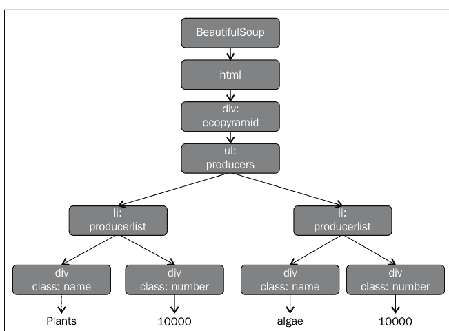
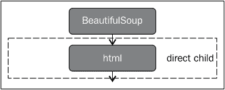
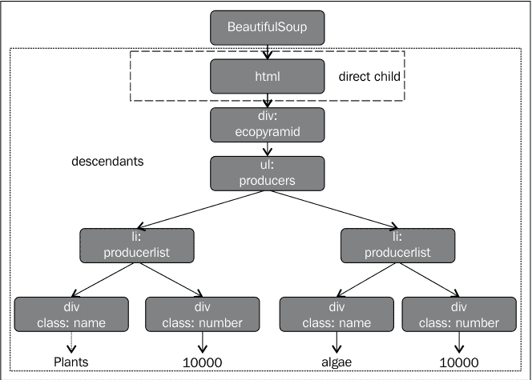

## 4 使用 Beautiful Soup 进行导航
使用
Beautiful Soup 进行导航

在第 3 章《使用 Beautiful Soup 搜索》中，我们看到了如何应用搜索方法在 HTML 文档中搜索标签、文本等。Beautiful Soup 做的远不止搜索。Beautiful Soup 还可用于在 HTML/XML 文档中导航。Beautiful Soup 提供了有助于导航的属性。我们可以使用搜索方法找到相同的信息直到某个级别，但在某些情况下由于页面的结构，我们必须结合搜索和导航机制才能获得所需的结果。在这些情况下，导航技术非常有用。在本章中，我们将详细了解使用 Beautiful Soup 进行导航。

### 使用 Beautiful Soup 进行导航

Beautiful Soup 中的导航几乎与搜索方法相同。在导航中，代替方法，有某些属性促进导航。正如我们在第 2 章《创建 BeautifulSoup 对象》中已经看到的，Beautiful Soup 使用不同的 TreeBuilder 来构建 HTML/XML 树。因此，每个 Tag 或 NavigableString 对象都将是 resulting 树的成员，BeautifulSoup 对象位于顶部，其他对象作为树的节点。

以下代码片段是 HTML 树的示例：

```
html_markup = """<div class="ecopyramid">
    <ul id="producers">
        <li class="producerlist">
            <div class="name">plants</div>
            <div class="number">100000</div>
        </li>
    </ul>
</div>"""
```

```
<li class="producerlist">
    <div class="name">algae</div>
    <div class="number">100000</div>
</li>
</ul>
</div>""
```

对于之前的代码片段，形成了以下 HTML 树：



在前一幅图中，我们可以看到 Beautiful Soup 是树的根，Tag 对象构成树的各个节点，而 NavigableString 对象构成树的叶子。

Beautiful Soup 中的导航旨在帮助我们访问此 HTML/XML 树的节点。从特定节点，可以：

- 向下导航到子节点
- 向上导航到父节点
- 横向导航到兄弟节点
- 导航到解析的下一个和上一个对象

我们将使用之前的 html_markup 作为示例来讨论使用 Beautiful Soup 的不同导航。

### 向下导航

任何具有子节点的对象，例如 Tag 或 BeautifulSoup，都可以使用此导航。向下导航可以通过两种方式实现。

### 使用子标签的名称

BeautifulSoup 或 Tag 对象可以使用子标签的名称导航到它。即使有多个同名子节点，此方法也只会导航到第一个实例。例如，我们可以考虑生态金字塔示例中讨论的 BeautifulSoup 对象。

```
soup = BeautifulSoup(html_markup,"lxml")
producer_entries = soup.ul
print(producer_entries)
```

在之前的代码中，通过使用 soup.ul，我们导航到 soup 对象子节点中的第一个 ul 标签的条目。

这也可以通过以下代码对 Tag 对象执行：

```
first_producer = producer_entries.li
print(first_producer)
```

```
#output
<li class="producerlist">
<div class="name">plants</div>
<div class="number">100000</div>
</li>
```

之前的代码对标签对象 producer_entries 使用了导航，以找到 <li> 标签的第一个条目。我们可以从输出中验证这一点。但这不能用于 NavigableString 对象，因为它没有任何子节点。

```
producer_name = first_producer.div.string
```

这里我们将 NavigableString plants 存储在 producer_name 中。从 producer_name 向下导航将导致错误。

```
producer_name.li
```

这将抛出以下 AttributeError，因为 NavigableString 不能有任何子对象：

```
AttributeError: 'NavigableString' object has no attribute 'li'
```

### 使用预定义属性

Beautiful Soup 将子节点存储在预定义属性中。有两种类型的子节点。

- **直接子节点**：这些在 HTML 树中紧跟在节点之后。例如，在下图中，**html** 是 **BeautifulSoup** 的直接子节点。



- **后代**：这些包含特定节点的全部子节点，包括直接子节点。例如，在下面的图像中，我们可以看到 **BeautifulSoup** 的直接子节点和后代。



后代包括 Beautiful Soup 下的所有标签。

基于之前的分类，有以下不同的属性用于导航到子节点：

- `.contents`
- `.children`
- `.descendants`

这些属性将存在于所有 Tag 对象和 BeautifulSoup 对象中，以促进对子节点的导航。

### .contents 属性

Tag 对象或 BeautifulSoup 对象的子节点以列表形式存储在属性 `.contents` 中。

```
```python
print(type(soup.contents))
#output
<class 'list'>
```
```

从输出中，我们知道类型是一个列表，其中保存子节点。在这种情况下，BeautifulSoup 对象的子节点数量可以从以下代码片段中了解：

```
```python
print len(soup.contents)

#output
1
```
```

我们也可以在 `.contents` 上使用 Python 中的任何类型的列表导航。例如，我们可以使用以下代码打印所有子节点的名称：

```
```python
for tag in soup.contents:
    print(tag.name)

#output
html
```
```

现在让我们在 Tag 对象 producer_entries 的情况下使用以下代码片段查看：

```
```python
for child in producer_entries.contents:
    print(child)
#output
<li class="producerlist">
    <div class="name">plants</div>
    <div class="number">100000</div>
```
```

```
</li>
<li class="producerlist">
    <div class="name">algae</div>
    <div class="number">100000</div>
```

### .children 属性

.children 属性几乎与 .contents 属性相同。但它不像 .contents 那样是列表，而是 Python 生成器，我们可以迭代它以获取每个子节点。

```
print type(soup.children)

#output
<class 'list_generator'>
```

我们可以迭代 BeautifulSoup 对象的 .children，并像以下示例代码那样获取子节点：

```
for tag in soup.children:
    print(tag.name)

#output
html
```

### .descendants 属性

.contents 和 .children 属性只考虑直接子节点，即 soup.contents 或 soup.children 只返回根 HTML 标签。

使用 .descendants 可以导航到特定对象的所有子节点。

```
print(len(list(soup.descendants)))
#output
13
```

从输出中，我们可以看到 .descendants 给出 13，而 .contents 或 .children 只给出 1。

现在让我们打印此情况下的所有后代。

```
from bs4.element import NavigableString
for tag in soup.descendants:
    if isinstance(tag, NavigableString):
        print(tag)
    else:
        print(tag.name)
```

```
```text
#output
html
body
p
ul
li
div
plants
div
100000
li
div
algae
div
100000
```
```

这里我们正在迭代 soup 对象的全部后代。由于 `NavigableString` 没有 `.name` 属性，我们正在检查它并在之前的代码中打印字符串本身。但对于 Tag 对象，我们只打印 `.name` 属性。

使用 `.contents` 或 `.children` 时的代码输出与此完全不同。

### 用于向下导航的特殊属性

获取特定标签内的文本数据是 scraping 中的常见用例。Beautiful Soup 提供了特殊属性来使用属性 `.string` 和 `.strings` 导航到每个 Tag 对象中包含的字符串。

### .string 属性

如果标签只有 `NavigableString` 作为唯一子节点，或者如果它有另一个标签，该标签的子节点是 `NavigableString` 对象，我们可以使用 `.string` 属性导航到 `NavigableString`。正如我们所知，`NavigableString` 表示存储在标签内的文本；使用 `.string`，我们导航到存储在标签内的文本。

```
```python
first_producer = soup.div
print(first_producer.string)

#output
plants
```
```


### .strings 属性

即使存在由字符串和其他标签组成的多个子对象，我们仍然可以使用 `.strings` 生成器获取每个子对象的字符串。在之前的示例中，我们有 `<li>` 标签，其下有两个 `<div>` 标签作为子元素。这些 `<div>` 标签包含字符串。我们可以使用 `.strings` 生成器从父级 `<li>` 标签获取这些字符串，如下所示：

```
for string in li.strings:
    print(string)
#output
plants
10000
```

### 向上导航

与向下导航查找子元素类似，Beautiful Soup 允许用户查找特定 Tag/NavigableString 对象的父级。向上导航使用 `.parent` 和 `.parents`。

### .parent 属性

从第一幅图可知，所有 Tag 和 NavigableString 对象都有父级。特定 Tag 对象的父级可通过属性 `.parent` 找到。

```
producer_entries = soup.ul
print(producer_entries.parent)

#output
div
```

最顶层 `<html>`/`<xml>` 标签的 `.parent` 属性是 BeautifulSoup 对象本身。

```
html_tag = soup.html
print(html_tag.parent.name)

#output
u' [document] '
```

由于 soup 对象位于树的根部，它没有父级。因此对 soup 对象使用 `.parent` 将返回 None。

```
print(soup.parent)

#output
None
```

### `.parents` 属性

`.parents` 属性是一个生成器，包含特定 Tag/`NavigableString` 的父级。

```
third_div = soup.find_all("div")[2]
```

在之前的代码中，我们将第三个 `<div>` 条目，即 `<div class="name">algae</div>` 存储在 `third_div` 中。

利用它我们可以遍历该标签的父级。

```
for parent in third_div.parents:
    print(parent.name)
#output

li
ul
body
html
[document]
```

在之前的代码中，我们导航到 `<li>` 标签，它是 `third_div` 的直接父对象，然后导航到 `<li>` 标签的父级 `<ul>` 标签。同样地，导航到 html 标签，最后到 `[document]`，它代表 soup 对象。

### 横向导航到兄弟节点

除了在 HTML 树中上下导航内容外，Beautiful Soup 还提供了查找对象兄弟节点的方法。导航到兄弟节点可使用 `.next_sibling` 和 `.previous_sibling`。

### .next_sibling 属性

在生产者列表中，我们可以使用以下代码片段获取第一个生产者 plants 的兄弟节点：

```
soup = BeautifulSoup(html_markup)
first_producer = soup.find("li")
second_producer = first_producer.next_sibling
second_producer_name = second_producer.div.string
print(second_producer_name)

#output
u'algae'
```

这里 second_producer 是通过从 first_producer 导航到下一个兄弟节点得到的，first_producer 代表页面内的第一个 <li> 标签。

### .previous_sibling 属性

`.previous_sibling` 属性用于导航到上一个兄弟节点。为在前一个示例中查找上一个兄弟节点，我们可以使用以下代码片段：

```
print(second_producer.previous_sibling)

#output
<li class="producerlist"><div class="name">plants</div><div class="number">100000</div></li>
```

如果一个标签没有上一个兄弟节点，它将返回 None，即 print(first_producer.previous_sibling) 将给出我们 None，因为该标签没有上一个兄弟节点。

我们有 next_siblings 和 previous_siblings 生成器来遍历从特定对象开始的下一个和上一个兄弟节点。

```
for previous_sibling in second_producer.previous_siblings:
    print(previous_sibling.name)
```

前面的代码片段只会给出 <li> 标签，它是唯一的上一个兄弟节点。同样的方法可用于 next_siblings 以查找对象之后出现的兄弟节点。

### 导航到解析的前一个和后一个对象

我们看到了导航到子节点、兄弟节点和父节点的不同方法。有时我们可能需要导航到与标签没有直接关系的对象，例如子节点、兄弟节点或父节点。因此，为了找到解析后紧跟当前对象的元素，可以使用 .next_element。

例如，解析在第一个 <li> 标签之后立即出现的元素是 <div> 标签。

```
first_producer = soup.li
print(first_producer.next_element)

#output
<div class="name">plants</div>
```

前面的代码打印出下一个元素，即 <div class="name">plants</div>。

> .next_element 和 .next_sibling 完全不同。 .next_element 指向解析后紧跟当前对象的对象，而 .next_sibling 指向树中同一层级的对象。

同样，`.previous_element` 可用于查找特定标签或字符串之前立即解析的元素。

```
second_div = soup.find_all("div")[1]
print(second_div.previous_element)

#output
plants
```

从输出可以看出，在第二个 <div> 标签之前立即解析的是字符串 plants。

### 快速参考

以下命令可帮助您向下导航树：

- tag.name: 这使用名称导航到子节点
- tag.contents: 这列出子节点
- tag.children: 这是子节点的生成器
- `tag.descendants`: 这是后代的生成器
- `tag.string`: 这使用 `.string` 导航到字符串
- `tag.strings`: 这是字符串的生成器

以下命令可帮助您向上导航树：

- `tag.parent`: 这导航到父级
- `tag.parents`: 这是父级的生成器

以下命令可帮助您横向导航：

- `tag.next_sibling`: 这导航到下一个兄弟节点
- `tag.next_siblings`: 这是下一个兄弟节点的生成器
- `tag.previous_sibling`: 这导航到上一个兄弟节点
- `tag.previous_siblings`: 这是上一个兄弟节点的生成器

以下命令可帮助您导航到前一个或下一个元素：

- `tag.next_element`: 这导航到解析的下一个元素
- `tag.previous_element`: 这导航到解析的前一个元素

### 总结

在本章中，我们讨论了 Beautiful Soup 中的各种导航技术。我们讨论了四种导航方式，即向上、向下、横向导航，以及使用示例导航到下一个和前一个元素。

在下一章中，我们将学习通过添加新内容，例如标签、字符串、修改标签和删除现有内容等，以不同方式修改解析后的 HTML 树。
