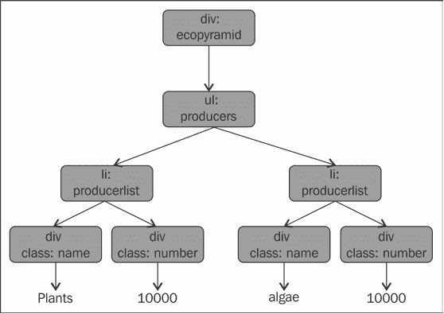
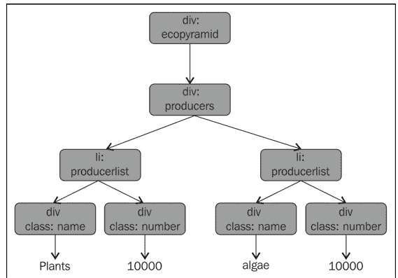

## 5 使用 Beautiful Soup 修改内容
### 使用 Beautiful Soup 修改内容

Beautiful Soup 可有效用于在 HTML/XML 文档中搜索或导航。除此之外，我们还可以使用 Beautiful Soup 来更改 HTML/XML 文档的内容。修改内容意味着添加或删除新标签、更改标签名、修改标签属性值、更改文本内容等。这在需要解析 HTML/XML 文档、更改其结构并将其写回为修改后的 HTML/XML 文档的情况下很有用。

考虑一种情况，我们有一个包含 <table> 标签的 HTML 文档，其中包含约 1,000 行或更多行（<tr> 标签），每行现有两列（<td> 标签）。我们希望为每一行添加一组新的两个 <td> 标签。手动为每个 <tr> 标签添加这些 <td> 标签是不合适的。在这种情况下，我们可以使用 Beautiful Soup 搜索和/或导航每个 <tr> 标签以添加这些 <td> 标签。然后我们可以将这些更改保存为新的 HTML 文档，该文档将为每个 <tr> 标签包含四个 <td> 标签。本章通过考虑我们在前几章中使用的生态金字塔示例，介绍使用 Beautiful Soup 修改内容的各种方法。

### 使用 Beautiful Soup 修改标签

Beautiful Soup 具有完全更改 HTML/XML 标签不同属性的能力。我们知道 Beautiful Soup 中的每个标签都表示为 Tag 对象，并且可以执行以下任务：

- 修改 Tag 的 name 属性
- 修改 Tag 的属性值
- 添加新标签


- 删除现有标签
- 修改字符串内容

### 修改 Tag 的 name 属性

Beautiful Soup 的 Tag 对象始终与一个 .name 属性相关联；例如 a、div 等。修改 .name 属性的新值将按如下方式修改 HTML 标签：

```python
html_markup = """<div class="ecopyramid">
<ul id="producers">
    <li class="producerlist">
        <div class="name">plants</div>
        <div class="number">100000</div>
    </li>
    <li class="producerlist">
        <div class="name">algae</div>
        <div class="number">100000</div>
    </li>
</ul>"""

soup = BeautifulSoup(html_markup, "lxml")
producer_entries = soup.ul
print(producer_entries.name)

#output
'ul'
```

从前面的输出中，我们可以看到 producer_entries 的名称是 ul；我们可以通过修改 .name 属性轻松更改它。

HTML 树的表示在以下图表中给出：



让我们将值修改为 div，如以下代码所示：

```python
producer_entries.name = "div"
print(producer_entries.prettify())

#output
<html>
  <body>
    <div class="ecopyramid">
      <div id="producers">
        <li class="producerlist">
          <div class="name">
            plants
          </div>
          <div class="number">
            100000
          </div>
        </li>
        <li class="producerlist">
          <div class="name">
            algae
          </div>
          <div class="number">
            100000
          </div>
        </li>
      </div>
    </div>
  </body>
</html>
```

这也导致 HTML 树发生变化，如以下图表所示：



我们可以使用 prettify() 方法来显示格式化的输出，如前面的代码所示。正如我们所见，更改 Tag 对象的 name 属性也会更改 HTML 树。因此，在重命名标签时应谨慎，因为它可能导致格式错误的 HTML 标签。

### 修改 Tag 的属性值

Beautiful Soup 还可用于修改与标签关联的属性值，例如 class、id 和 style。由于属性以字典形式存储，因此与处理普通的 Python 字典一样简单。

### 更新 Tag 的现有属性值

在之前的生态金字塔示例中，ul 标签具有 id 属性，其值为 producers。我们可以按如下方式将其更改为 producers_new_value：

```python
producer_entries['id'] = "producers_new_value"
```

现在，如果我们打印 `producer_entries` 对象，我们可以看到更改已生效，如下所示：

```python
print(producer_entries.prettify())

#output
<div id="producers_new_value">
    <li class="producerlist">
        <div class="name">
            plants
        </div>
        <div class="number">
            100000
        </div>
    </li>
    <li class="producerlist">
        <div class="name">
            algae
        </div>
        <div class="number">
            100000
        </div>
    </li>
</div>
```

### 向 Tag 添加新的属性值

我们可以向 Tag 对象添加新属性。在前面的示例中，ul 标签没有 class 属性。我们可以按如下方式添加它：

```python
producer_entries['class'] = 'newclass'
```

前面的代码将在属性不存在时添加新属性，或在 HTML 树中已存在该属性时更新属性值。

```python
print(producer_entries.prettify())
#output
<div class="newclass" id="producers_new_value">
    <li class="producerlist">
        <div class="name">
            plants
        </div>
        <div class="number">
            100000
        </div>
    </li>
    <li class="producerlist">
        <div class="name">
            algae
        </div>
        <div class="number">
            100000
        </div>
    </li>
</div>
```

### 添加新标签

我们已经看到了更改 Tag 对象的 .name 属性以及修改 Tag 属性的几种不同方法。Beautiful Soup 还允许我们向现有 HTML/XML 文档添加新标签。new_tag() 方法在 soup 对象内创建新标签。然后我们可以使用 append()、insert()、insert_after() 或 insert_before() 方法将这些标签添加到树中。

### 使用 new_tag() 和 append() 添加新的生产者

在我们的生态金字塔示例中，我们已经有 plants 和 algae 作为生产者。让我们再向 HTML 中添加一个生产者，例如 phytoplankton。如果我们分析 HTML，可以看到我们需要先向父 ul 标签添加一个 li 标签。为此，我们需要先创建 li 标签。

### 使用 new_tag() 创建新标签

Beautiful Soup 的 new_tag() 方法将帮助我们创建新标签。new_tag() 方法只能在 BeautifulSoup 对象上调用。因此，这里我们需要创建一个新标签 li，并带有 producerlist 类。为此，请参考以下代码：

```python
soup = BeautifulSoup(html_markup, "lxml")
new_li_tag = soup.new_tag("li")
```

前面的代码将创建新的 li 标签并将其存储在 new_li_tag 变量中。new_tag() 方法只需要标签名作为必需参数。我们可以传递属性值或其他属性作为可选参数。也就是说，我们可以有以下代码：

```python
new_a_tag = soup.new_tag("a", href="www.example.com")
```

在前面的示例中，我们通过给出名称以及 href 属性及其值创建了 <a> 标签。

也可以使用以下代码向之前创建的 li 标签添加新属性值：

```python
new_li_tag.attrs = {'class': 'producerlist'}
```

### 使用 append() 添加新标签

我们已经创建了 li 标签，但需要将其固定到正确的位置。Beautiful Soup 允许我们使用 append() 方法将标签添加到另一个标签或 soup 对象。append() 方法将新创建的标签添加到 .contents 的末尾。这可以像在 Python 列表中调用 append() 方法一样调用，如下所示：

```python
producer_entries = soup.ul
producer_entries.append(new_li_tag)
```

前面的代码将新创建的 li 标签附加到 ul 标签的 .contents。因此，li 标签现在将成为 ul 标签的子级。ul 标签结构将如下所示：

```python
print(producer_entries.prettify())

#output
<ul id="producers">
    <li class="producerlist">
        <div class="name">
            plants
        </div>
        <div class="number">
            100000
        </div>
    </li>
    <li class="producerlist">
        <div class="name">
            algae
        </div>
        <div class="number">
            100000
        </div>
    </li>
    <li class="producerlist">
    </li>
</ul>
```

从前面的输出中，我们可以看到新创建的 li 标签已作为 ul 的新子级添加。现在，我们必须向此 li 标签中添加两个 div 标签。

### 使用 insert() 向 li 标签添加新的 div 标签

与 append() 类似，insert() 方法也可以用于向 HTML 树中添加新标签。正如我们所知，append() 将新创建的标签添加到 .contents 的末尾。但 insert() 另一方面，并不插入到 .contents 的末尾；相反，我们需要指定要插入标签的位置。这与 Python 中的列表 insert() 操作相同。请参考以下代码：

```python
new_div_name_tag = soup.new_tag("div")
new_div_name_tag["class"] = "name"
new_div_number_tag = soup.new_tag("div")
new_div_number_tag["class"] = "number"
```

前面的代码行将创建两个新的 div 标签，并带有相应的 class 属性，如下所示：

```python
new_li_tag.insert(0, new_div_name_tag)
new_li_tag.insert(1, new_div_number_tag)
print(new_li_tag.prettify())

#output
<li class="producerlist">
  <div class="name">
  </div>
  <div class="number">
  </div>
</li>
```

现在，我们可以看到新标签已插入到 li 标签中。但这些标签中缺少相应的字符串。

### 修改字符串内容

在前面的示例中，我们向 HTML 树添加了两个 div 标签，但没有内容。我们需要在 div 标签的 name 属性中添加相应的字符串，也需要在 div 标签的 number 属性中添加字符串。这也可以通过多种方式使用 Beautiful Soup 来完成。


### 使用 .string 修改字符串内容

我们可以使用标签的 `.string` 属性来修改字符串内容。因此，我们可以使用以下代码添加或修改字符串值：

```python
new_div_name_tag.string="phytoplankton"
print(producer_entries.prettify())
```

输出：

```html
<ul id="producers">
    <li class="producerlist">
        <div class="name">
            plants
        </div>
        <div class="number">
            100000
        </div>
    </li>
    <li class="producerlist">
        <div class="name">
            algae
        </div>
        <div class="number">
            100000
        </div>
    </li>
    <li class="producerlist">
        <div class="name">
            phytoplankton
        </div>
        <div class="number">
        </div>
    </li>
</ul>
```

我们可以看到，在前面的代码示例中，字符串已经被添加。

### 使用 .append()、insert() 和 new_string() 添加字符串

我们可以使用 `.append()` 或 `.insert()` 方法向现有标签添加更多字符串。它们的行为与添加新标签时相同。对于字符串内容，`append()` 方法会追加到 `.string` 的末尾，而 `insert()` 方法则会将字符串插入到 `.string` 的特定位置。例如，我们可以使用以下代码向 `div` 标签的 name 属性添加一个新字符串：

```python
new_div_name_tag.append("producer")
print(soup.prettify())
```

输出：

```html
<html>
  <body>
    <div class="ecopyramid">
      <ul id="producers">
        <li class="producerlist">
          <div class="name">
            plants
          </div>
          <div class="number">
            100000
          </div>
        </li>
        <li class="producerlist">
          <div class="name">
            algae
          </div>
          <div class="number">
            100000
          </div>
        </li>
        <li class="producerlist">
          <div class="name">
            phytoplankton
            producer
          </div>
          <div class="number">
          </div>
        </li>
      </ul>
    </div>
  </body>
</html>
```

还有另一种方法，`new_string()`，它可以帮助创建新字符串，如下所示：

```python
new_string_toappend = soup.new_string("producer")
new_div_name_tag.append(new_string_toappend)
```

前面的代码会创建新字符串，现在我们可以使用 `append()` 或 `insert()` 将新创建的字符串添加到树中。

与 `append()` 类似，我们也可以使用 `insert()` 来插入字符串，如下所示：

```python
new_string_toinsert = soup.new_string("10000")
new_div_number_tag.insert(0, new_string_toinsert)
```

添加了 producer 之后的树将如下所示：

```html
<html>
    <body>
        <div class="ecopyramid">
            <ul id="producers">
                <li class="producerlist">
                    <div class="name">
                        plants
                    </div>
                    <div class="number">
                        100000
                    </div>
                </li>
                <li class="producerlist">
                    <div class="name">
                        algae
                    </div>
                    <div class="number">
                        100000
                    </div>
                </li>
                <li class="producerlist">
                    <div class="name">
                        phytoplankton
                        producer
                    </div>
                    <div class="number">
                        10000
                    </div>
                </li>
            </ul>
        </div>
    </body>
</html>
```

### 从 HTML 文档中删除标签

Beautiful Soup 也允许从文档中移除标签。这可以通过 `decompose()` 和 `extract()` 方法实现。

### 使用 decompose() 删除 producer

我们添加了一个新的 producer，即 phytoplankton。

我们可以通过先移除 `div` 标签，然后再从 `ul` 标签中移除 `li` 标签来删除这个 producer 条目。我们将使用 `decompose()` 方法移除 `class="name"` 的 `div` 标签。

```python
third_producer = soup.find_all("li")[2]
div_name = third_producer.div
div_name.decompose()
print(third_producer.prettify())
```

输出：

```html
<li class="producerlist">
  <div class="number">
    10000
  </div>
</li>
```

在前面的代码中，我们使用了 `find_all()` 来查找所有的 `li` 条目，并将第三个 producer 存储到 `third_producer` 变量中。然后，我们找到了第一个 `div` 标签，并使用 `decompose()` 方法将其移除。

> `decompose()` 方法用于从 HTML/XML 文档中移除标签。它会移除该标签及其子节点。

同样，我们也可以移除 `class="number"` 的 `div` 标签。参考以下代码：

```python
third_producer = soup.find_all("li")[2]
div_number= third_producer.div
div_number.decompose()
print(third_producer.prettify())
```

输出：

```html
<li class="producerlist">
</li>
```

### 使用 extract() 删除 producer

我们已经使用 `decompose()` 方法从 `li` 标签中移除了两个 `div` 标签。但是仅移除 `div` 标签本身并不能保证第三个 producer 被删除；为此，我们还需要移除 `li` 标签。我们也可以使用 `decompose()` 方法来完成。不过，Beautiful Soup 还有另一种有助于移除标签的方法。

`extract()` 方法用于从 HTML 树中移除一个标签或字符串。此外，它还会返回被移除的标签或字符串的句柄。与 `decompose()` 不同，`extract()` 也可以用于字符串。如下所示：

```python
third_producer_removed=third_producer.extract()
print(soup.prettify())
```

输出：

```html
<html>
<body>
    <div class="ecopyramid">
        <ul id="producers">
            <li class="producerlist">
                <div class="name">
                    plants
                </div>
                <div class="number">
                    100000
                </div>
            </li>
            <li class="producerlist">
                <div class="name">
                    algae
                </div>
                <div class="number">
                    100000
                </div>
            </li>
        </ul>
    </div>
</body>
</html>
```

执行前面的代码后，我们可以看到，第三个 producer（即 phytoplankton）已从生态金字塔示例中移除。

### 使用 Beautiful Soup 删除标签的内容

标签的子节点可以是 `NavigableString` 对象，也可以是 `Tag` 对象。可以使用 `clear()` 来删除这些子对象。

例如，我们可以使用 `clear()` 方法从 `li` 标签中移除包含 plants 的 `<div>` 标签以及对应的带有 class number 的 `<div>` 标签；如下所示：

```python
li_plants=soup.li
```

由于这是第一个 `li` 标签，我们可以通过名称来选择它；如下所示：

```python
li_plants.clear()
```

这将移除标签的所有 `.contents`。因此，`clear()` 会移除特定标签内的所有字符串和子节点。如下所示：

```python
print(li_name)
```

输出：

```html
<li class="producerlist"></li>
```

```html
<div class="number">
    100000
</div>
</li>
</ul>
</div>
</body>
</html>
```

在这里，我们创建了一个新的 `div` 标签，并将字符串 `soil` 追加到其中。我们使用 `insert_after()` 方法将标签插入到正确的位置。同样，我们可以使用 `insert_before()` 在树中的其他内容之前插入一个 `Tag` 或 `NavigableString` 对象。

- `replace_with()` 方法：

`replace_with()` 方法用于在文档中将一个标签或字符串替换为新的标签或字符串。`replace_with()` 方法接受一个标签或字符串对象作为输入。例如，我们可以使用 `replace_with()` 方法将第一个 producer 的字符串更改为 phytoplankton。`replace_with()` 方法会返回被替换的标签或字符串。

```python
soup = BeautifulSoup(html_markup,"lxml")
div_name =soup.div
div_name.string.replace_with("phytoplankton")
print(soup.prettify())
```

输出：

```html
<html>
    <body>
        <div class="ecopyramid">
            <ul id="producers">
                <li class="producerlist">
                    <div class="name">
                        phytoplankton
                    </div>
                    <div class="number">
                        100000
                    </div>
                    <div class="ecosystem">
                        soil
                    </div>
                </li>
```


```html
<li class="producerlist">
    <div class="name">
        algae
    </div>
    <div class="number">
        100000
    </div>
</li>
</ul>
</div>
</body>
</html>
```

`replace_with()` 方法也可以用来完全替换一个标签。

### `wrap()` 和 `unwrap()` 方法

`wrap()` 方法用于用我们传入的另一个标签包裹一个标签或字符串。例如，我们可以用下面的示例中的另一个 `<div>` 标签包裹 `li` 标签中的全部内容：

```python
li_tags = soup.find_all("li")
for li in li_tags:
    new_divtag = soup.new_tag("div")
    li.wrap(new_divtag)
print(soup.prettify())
#output
<html>
<body>
    <div class="ecopyramid">
        <ul id="producers">
            <div>
                <li class="producerlist">
                    <div class="name">
                        phytoplankton
                    </div>
                    <div class="number">
                        100000
                    </div>
                    <div class="ecosystem">
                        soil
                    </div>
                </li>
            </div>
            <div>
                <li class="producerlist">
                    <div class="name">
                        algae
                    </div>
                    <div class="number">
                        100000
                    </div>
                </li>
            </div>
        </ul>
    </div>
</body>
</html>
```

从前面的输出可以看出，我们用另一个 `div` 标签包裹了 `li` 标签。

`unwrap()` 方法与 `wrap()` 相反，用于按如下方式解包内容：

```python
soup = BeautifulSoup(html_markup,"lxml")
li_tags = soup.find_all("li")
for li in li_tags:
    li.div.unwrap()
print(soup.prettify())
#output
<html>
<body>
    <div class="ecopyramid">
        <ul id="producers">
            <li class="producerlist">
                plants
                <div class="number">
                    100000
                </div>
                <div class="ecosystem">
                    soil
                </div>
            </li>
        </div>
        <div>
            <li class="producerlist">
                algae
                <div class="number">
                    100000
                </div>
            </li>
        </div>
    </ul>
</div>
</body>
</html>
```

这里，第一个 `div` 标签将被解包，即 `class="name"` 的 `div` 标签。

> `unwrap()` 方法与 `replace_with()` 类似，会返回被替换的标签。

### 快速参考

- 修改标签名：
  以下代码行修改 name 属性：
  - `tag.name = "newvalue"`: 此行代码将 Tag 名称修改为 newvalue
- 修改标签属性：
  以下代码行更改属性：
  - `tag["attr"] = "newvalue"`: 此行代码修改 Tag 属性
  - `del tag["attr"]`: 此行代码删除 Tag 属性
- 添加新标签：
  以下代码行对应内容的添加：
  - `newtag = soup.new_tag('tagname')`: 此行代码创建 newtag
  - `oldtag.append(newtag)`: 此行代码将 newtag 追加到 oldtag.contents
  - `oldtag.insert(0,newtag)`: 此行代码将 newtag 插入到 oldtag.contents 的索引 0 处
- 修改字符串内容：
  以下代码行用于修改字符串内容：
  - `tag.string = "helloworld"`: 此行代码修改 `tag.string`
  - `tag.append("helloworld")`: 此行代码将 "helloworld" 追加到现有的 `tag.string`
  - `newstring = soup.new_string("helloworld")`: 此行代码创建一个新的 `NavigableString` 对象
  - `tag.insert(0,newstring)`: 此行代码将 `newstring` 插入到 `tag.string` 的索引 `0` 处
- 删除现有标签：
  以下代码行有助于删除现有标签属性：
  - `tag.decompose()`: 此行代码移除标签及其子节点
  - `tag.extract()`: 此行代码移除并返回标签或字符串
  - `tag.clear()`: 此行代码移除子节点
- 特殊函数：
  以下为用于添加或更改标签的特殊函数：
  - `oldtag.insert_after(newtag)`: 此函数在 `oldtag` 之后插入 `newtag`
  - `oldtag.insert_before(newtag)`: 此函数在 `oldtag` 之前插入 `newtag`
  - `oldtag.replace_with(newtag)`: 此函数用 `newtag` 替换 `oldtag`
  - `oldtag.wrap(newtag)`: 此函数用 `newtag` 包裹 `oldtag`
  - `oldtag.unwrap(newtag)`: 此函数解包 `oldtag` 内的 `newtag`
