## 7 Beautiful Soup 中的输出
### Beautiful Soup 中的输出

Beautiful Soup 不仅搜索、导航和修改 HTML/XML，还以良好的格式输出内容。Beautiful Soup 可以处理不同类型的打印，例如：

- 格式化打印
- 非格式化打印

除此之外，Beautiful Soup 还提供不同的格式化程序来格式化输出。由于 HTML 树在创建后可能会发生修改，这些输出方法有助于查看修改后的 HTML 树。

此外，本章中我们还将讨论一种从网页中获取仅存储的文本的简单方法。

### 格式化打印

Beautiful Soup 有两种支持的打印方式。第一种是格式化打印，它将当前的 Beautiful Soup 对象打印为格式化的 Unicode 字符串。每个标签都在单独的行中打印，并带有良好的缩进，这导致了正确的外观和感觉。Beautiful Soup 有内置的 prettify() 方法用于格式化打印。例如：

```
html_markup = """<p class="ecopyramid">
<ul id="producers">
    <li class="producerlist">
        <div class="name">plants</div>
        <div class="number">100000</div>
    </li>
    <li class="producerlist">
        <div class="name">algae</div>
```

```
<div class="number">100000</div>
</li>
</ul>"""
soup = BeautifulSoup(html_markup,"lxml")
print(soup.prettify())
```

以下截图显示了输出：

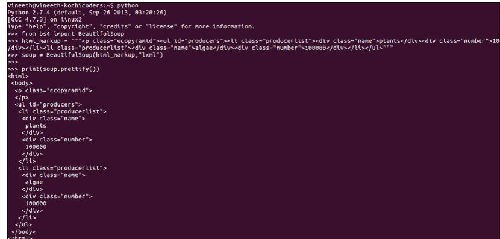

在输出中，我们可以看到 <html><body> 被附加了。这是因为 Beautiful Soup 使用 lxml 解析器，并且它默认将传递的任何字符串识别为 HTML，并在附加额外标签后执行打印。

prettify() 方法可以调用在 Beautiful Soup 对象或任何标签对象上。例如：

```
producer_entry = soup.ul
print(producer_entry.prettify())
```

### 非格式化打印

Beautiful Soup 支持 BeautifulSoup 和 Tag 对象的纯文本打印。这将仅返回纯字符串而没有任何格式。

这可以通过使用 str() 或 unicode() 方法来完成。

### Beautiful Soup 中的输出

```
<th>&amp;</th>
    <td align="center">&amp;amp;</td>
    <td align="center">ampersand</td>
</tr>
<tr>
    <th>&cent;</th>
    <td align="center">&amp;cent;</td>
    <td align="center">cent</td>
</tr>
<tr>
    <th>&copy;</th>
    <td align="center">&amp;copy;</td>
    <td align="center">copyright</td>
</tr>
<tr>
    <th>&#247;</th>
    <td align="center">&amp;divide;</td>
    <td align="center">divide</td>
</tr>
<tr>
    <th>&gt;</th>
    <td align="center">&amp;gt;</td>
    <td align="center">greater than</td>
</tr>
</table>
</body>
</html>
```

此 HTML 代码将如下所示的截图中所示：

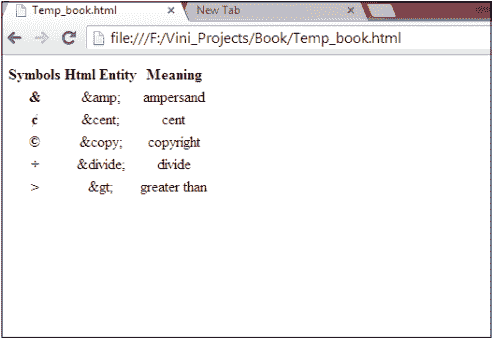

最左边的列代表符号，对应的 HTML 实体在下一列中表示。对于符号 &，对应的 HTML 实体代码是 &amp; 同样对于符号 ©，代码是 &copy;。

Beautiful Soup 中的输出方法仅转义 >, < 和 & 的 HTML 实体，分别转义为 &gt;、&lt; 和 &amp;。其余特殊实体在构建 BeautifulSoup 对象时被转换为 Unicode，并在使用 prettify() 或其他方法输出时，我们只得到 HTML 实体的 UTF-8 字符串。我们不会得到 HTML 实体返回（除了 &、> 和 <）。

```
html_markup = """<html>
<body>& &amp; ampersand
¢ &cent; cent
© &copy; copyright
÷ &divide; divide
> &gt; greater than
</body>
</html>
"""
soup = BeautifulSoup(html_markup,"lxml")
print(soup.prettify())
```

这里我们基于浏览器中 HTML 页面文本内容创建了 soup 对象，该内容在浏览器中具有 & 符号而不是 &amp; 代码。同样，对于 prettify() 方法中的其他实体，输出如下所示：

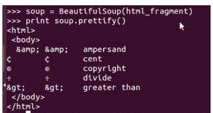

我们可以理解其他 HTML 实体被转换为 Unicode 表示。Beautiful Soup 允许输出格式化程序控制此行为。以下是可用的四种格式化程序类型：

- minimal
- html
- None
- function


我们可以将不同的格式化器作为参数传递给任何输出方法，例如 `prettify()`、`encode()` 和 `decode()`。

### 最小格式化器

在此格式化模式下，字符串将被处理到足以生成有效的 HTML 代码。这是默认的格式化器，被转义的 HTML 实体是 `&amp;`、`&gt;` 和 `&lt;`。输出将类似于上一张截图中所示的内容。

### html 格式化器

在此格式化模式下，Beautiful Soup 将把 Unicode 字符转换为 HTML 实体。

```
print(soup.prettify(formatter="html"))
```

以下截图显示了使用 `minimal` 和 `html` 格式化器的区别：

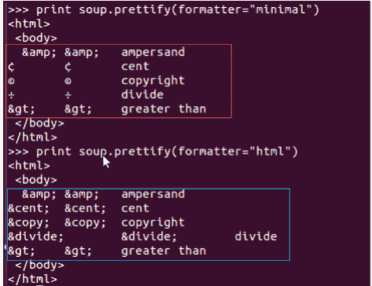

从上一张截图我们可以看出，格式化器 `html` 会将尽可能多的 Unicode 字符转换回 HTML 实体。

### None 格式化器

在这种情况下，Beautiful Soup 不会修改字符串。这可能导致生成无效的 HTML 代码。

`print(soup.prettify(formatter=None))` 代码行产生的输出类似于以下截图：

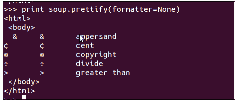

### 函数格式化器

我们可以指定一个 Python 函数来处理每个字符串和属性值。

```
def remove_chara(markup):
    return markup.replace("a", "")
```

这里我们定义一个函数，从传递的字符串中删除字符 a。

```
print(soup.prettify(formatter=remove_chara))
```

我们使用此函数从输出中删除 a 字符。需要注意的是，这不会转义输出中的三个特殊字符 &amp;、&gt; 和 &lt;，如以下截图所示：

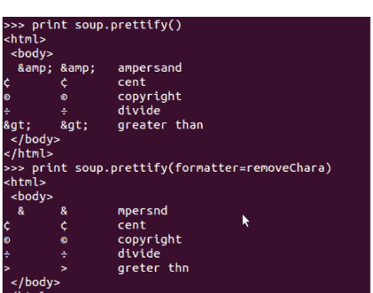

### 使用 get_text()

从网站获取纯文本是常见的任务。Beautiful Soup 为此提供了 `get_text()` 方法。

如果我们只想获取 Beautiful Soup 或 Tag 对象的文本，可以使用 `get_text()` 方法。例如：

```
html_markup = """<p class="ecopyramid">
<ul id="producers">
    <li class="producerlist">
        <div class="name">plants</div>
        <div class="number">100000</div>
    </li>
    <li class="producerlist">
        <div class="name">algae</div>
        <div class="number">100000</div>
    </li>
</ul>"""
soup = BeautifulSoup(html_markup,"lxml")
print(soup.get_text())

#output
plants
100000

algae
100000
```

`get_text()` 方法以单个 Unicode 字符串的形式返回 Beautiful Soup 或 Tag 对象内部的文本。但 `get_text()` 在处理网页时存在问题。网页通常包含 JavaScript 代码，而 `get_text()` 方法也会返回 JavaScript 代码。例如，在第 3 章《使用 Beautiful Soup 搜索》中，我们看到了从 packtpub.com 抓取图书详情的示例。

```
import urllib2
from bs4 import BeautifulSoup
url = "http://www.packtpub.com/books"
page = urllib2.urlopen(url)
soup_packtpage = BeautifulSoup(page,"lxml")
```

我们可以使用 `get_text()` 打印页面内的文本；这在以下代码片段中显示：

```
print(soup_packtpage.get_text())
```

使用上一行代码，我们也会在输出中得到 JavaScript 代码，如下所示：

```
$(window).load(function() {
  $("img[data-original]").addClass("lazy");
  $("img.lazy").lazyload();
  setTimeout(function() {
    addthis_config = Drupal.settings.addthis.config_default;
    addthis_share = Drupal.settings.addthis.share_default;
    if (typeof pageTracker != "undefined")
    {addthis_config.data_ga_tracker = pageTracker;}
    var at = document.createElement("script"); at.type =
      "text/javascript"; at.async = true;
    at.src = "//dgdsbygo8mp3h.cloudfront.net/sites/default/
      files/addthis/addthis_widget.js";
    var s = document.getElementsByTagName("script")[0];
    s.parentNode.insertBefore(at, s);
  }, 5);
});
```

删除 JavaScript 并仅打印文档中的文本，可以通过以下代码行实现：

```
[x.extract() for x in soup_packtpage.find_all('script')]
```

上一行代码将从文档中删除所有 script 元素。之后，`print(soup_packtpage.get_text())` 代码行将仅打印页面中存储的文本。

### 快速参考

您可以查看以下参考资料以获得概览：

- 格式化打印：以下方法给出格式化输出：
  - soup.prettify(): 此方法用于带缩进和格式的输出
- 非格式化打印：这些方法给出不带任何格式或缩进的输出：
  - str(soup)
  - soup.encode()
  - soup.decode()
- 格式化器：这些方法能够控制输出的行为：
  - `soup.prettify(formatter="minimal")`
  - `soup.prettify(formatter="html")`
  - `soup.prettify(formatter="None")`
  - `soup.prettify(formatter=already_defined_func)`
- get_text(): 此方法为您提供对象或标签的所有内容：
  - `soup.get_text()`: 此方法用于获取 BeautifulSoup 或 Tag 对象中的所有文本内容

### 总结

本章介绍了 Beautiful Soup 中的不同输出方法。我们看到了 BeautifulSoup 对象中的格式化和非格式化打印，以及用于控制输出格式的不同输出格式化器。我们还看到了从网页中仅获取文本的方法。

在下一章中，我们将使用本書迄今为止所研究的搜索、导航和其他技术创建一个网络抓取器。

## 8 创建网络抓取器

### 创建网络抓取器

在本章中，我们将使用前几章研究的不同的搜索和导航技术创建一个网站抓取器。抓取器将访问三个网站，根据 ISBN 查找图书的售价。我们将首先从 packtpub.com 找到图书列表和售价。我们还将从 packtpub.com 找到图书的 ISBN，并基于此 ISBN 在 www.amazon.com 和 www.barnesandnoble.com 等其他网站上进行搜索。通过这样做，我们将自动化在三个网站上查找图书售价的过程，并将获得为这些网站实现抓取器的实践经验。由于网站结构可能会在以后发生变化，本章中使用的代码示例和图像也可能变得无效。因此，最好将示例作为参考并相应地更改代码。访问这些网站以获得更好的理解是很好的。

### 从 PacktPub.com 获取图书详情

从 www.packtpub.com 获取图书详情是创建抓取器的第一步。我们需要从 PacktPub.com 找到以下详情：

- 书名
- 售价
- ISBN

我们在第 3 章《使用 Beautiful Soup 搜索》中看到了如何从 packtpub.com 抓取书名和售价。该章中讨论的示例仅考虑了第一页，未包含也包含图书列表的其他页面。因此，在下一个主题中，我们将找到包含图书列表的不同页面。

### 查找包含图书列表的页面

www.packtpub.com/books 页面上有下一个和上一个导航链接，用于在包含图书列表的页面之间前后移动，如以下截图所示：

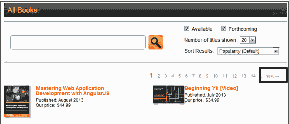

因此，我们需要找到一种获取包含图书列表的多个页面的方法。逻辑上，似乎要查看当前页面中 next 元素指向的页面。使用 Google Chrome 开发工具查看 next 元素，对于第 49 页，我们可以看到它实际上指向下一页链接，即 /books?page=49。如果我们使用 Google Chrome 开发工具观察不同的页面，可以看到下一页的链接实际上具有 /books?page=n 的模式，对于第 n+1 页，即 n=49 表示第 50 页，如以下截图所示：

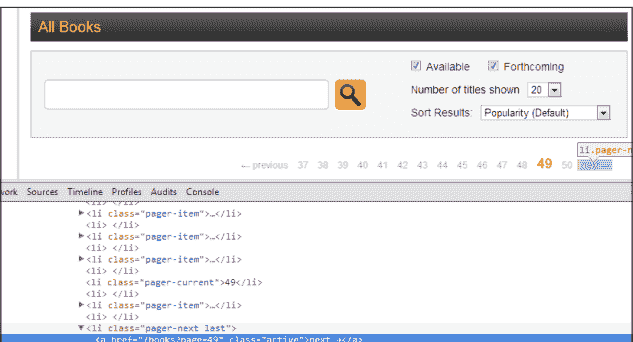

从前面的截图中，我们可以进一步理解 next 元素位于 class="pager-next last" 的 <li> 标签内。在 <li> 标签内，有一个 <a> 标签保存着指向下一页的链接。在这种情况下，对应的值为 /books?page=49，指向第 50 页。我们必须将 www.packtpub.com 添加到此值以构成有效的 URL，即 www.packtpub.com/books?page=49。


如果我们分析 packtpub.com 网站，可以看到已出版书籍的列表在第 50 页结束。因此，我们需要确保我们的程序在此页停止。程序可以在无法找到下一个元素时停止查找更多页面。

例如，如以下屏幕截图所示，对于第 50 页，我们没有下一个元素：

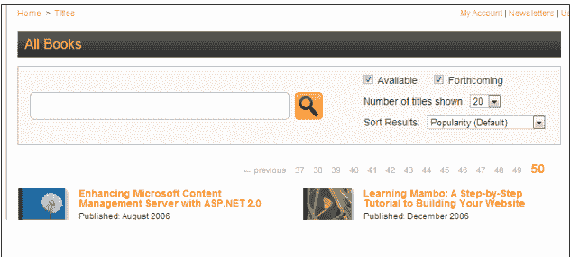

因此，在这一点上，我们可以停止查找后续页面。

我们获取页面的逻辑应如下：

+   1. 从第一页开始。
+   2. 检查它是否有下一个元素：
+      - 如果有，存储下一个页面 URL
+      - 如果没有，停止查找后续页面
+   3. 加载 URL 处的页面并重复前述步骤。

我们可以使用以下代码来查找包含 packtpub.com 书籍列表的页面：

```
import urllib2
import re
from bs4 import BeautifulSoup
packtpub_url = "http://www.packtpub.com/"
```

我们将 http://packtpub.com 存储在 packtpub_url 变量中。每个下一个元素链接都应以 packtpub_url 为前缀以形成有效 URL，http://www.packtpub.com/book?page=n，如以下代码所示：

```
def get_bookurls(url):
    page = urllib2.urlopen(url)
    soup_packtpage = BeautifulSoup(page,"lxml")
```

```
page.close()
next_page_li = soup_packtpage.find("li", class_="pager-next
    last")
if next_page_li is None :
    next_page_url = None
else:
    next_page_url = packtpub_url+next_page_li.a.get('href')

return next_page_url
```

前述 get_bookurls() 函数在提供当前页面 URL 时返回下一页 URL。对于最后一页，它返回 None。

在 get_bookurls() 中，我们基于 URL 输入创建了一个 BeautifulSoup 对象 soup_packtpage，然后搜索具有 pager-next last 类的 li 标签。如果 find() 返回一个标签，我们可以使用 next_page_li.a.get('href') 获取下一页的链接。我们将此值与 packtpub_url 前缀并返回。

我们需要此类页面 URL 的列表（例如 www.packtpub.com/books、www.packtpub.com/books?page=2 等）来收集这些页面上所有书籍的详细信息。

为了创建此列表以收集这些详细信息，请使用以下代码：

```
start_url = "www.packtpub.com/books"
continue_scrapping = True
books_url = [start_url]
while continue_scrapping:
    next_page_url= get_bookurls(start_url)
    if next_page_url is None:
        continue_scraping = False
    else:
        books_url.append(next_page_url)
    start_url = next_page_url
```

在前述代码中，我们从 URL www.packtpub.com/books 开始并将其存储在 books_url 列表中。我们使用一个标志 continue_scraping 来控制函数的执行，我们可以看到当 get_bookurls 返回 None 时循环将终止。

print(books_url) 条目打印从 www.packtpub.com/books 到 www.packtpub.com/books?page=49 的不同 URL。

### 查找书籍详情

现在，是时候让我们查找每本书的详细信息，例如书名、售价和 ISBN。书名和售价可以从包含书籍列表的主页找到。但 ISBN 只能在每本书的详情页找到。因此，从主页面，例如 www.packtpub.com/books，我们必须找到相应的链接以获取每本书的详细信息。

我们可以使用以下代码来查找每本书的详细信息：

```
def get_bookdetails(url):
    page = urllib2.urlopen(url)
    soup_packtpage = BeautifulSoup(page,"lxml")
    page.close()
    all_books_table = soup_packtpage.find("table",class_="views-view-grid")
    all_book_titles =all_books_table.find_all("div",class_="views-field-title")
    isbn_list = []
    for book_title in all_book_titles:
        book_title_span = book_title.span
        print("Title Name:"+book_title_span.a.string)
        print("Url:"+book_title_span.a.get('href'))
        price = book_title.find_next("div",class_="views-field-sell-price")
        print("Packtpub Price:"+price.span.string)
        isbn_list.append(get_isbn(book_title_span.a.get('href')))
    return isbn_list
```

前述代码与我们在第 3 章《使用 Beautiful Soup 搜索》中用于获取书籍详情的代码相同。增加的是使用 isbn_list 来保存 ISBN 号码以及返回特定书籍 ISBN 的 get_isbn 函数。

### 创建网络爬虫

书籍的 ISBN 存储在书籍的详情页中，如以下屏幕截图所示：

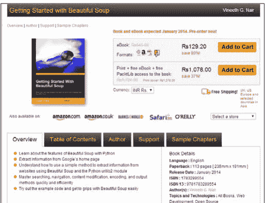

在前述 get_bookdetails() 函数中，book_title_span.a.get('href') 函数保存了每本书详情页的 URL。我们将前述值传递给 get_isbn() 函数以获取 ISBN。

通过开发者工具查看的书籍详情页具有 ISBN，如以下屏幕截图所示：

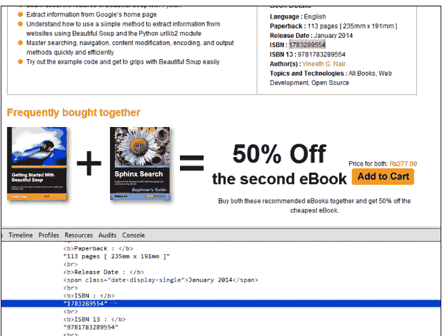

从前述屏幕截图中，我们可以看到 **ISBN** 号码存储为 b 标签内 ISBN 后跟的文本。

现在，在以下代码中，让我们看看如何使用 `get_isbn()` 函数找到 ISBN：

```
def get_isbn(url):
    book_title_url = packtpub_url + url
    page = urllib.urlopen(book_title_url)
    soup_bookpage = BeautifulSoup(page,"lxml")
    page.close()
    isbn_tag = soup_bookpage.find('b',text=re.compile("ISBN :"))
    return isbn_tag.next_sibling
```

在前述代码中，我们搜索了 b 标签，其文本与模式 ISBN : 匹配。ISBN 是 b 标签的 `next_sibling`。

在每个主页面中，将会有书籍列表，对于每本书，将会有 ISBN。因此，我们需要对 `books_url` 列表中的每个调用 `get_bookdetails()` 方法，如下所示：

```
isbns = []
for bookurl in books_url:
    isbns+= get_bookdetails(bookurl)
```

`print(isbns)` 函数将打印 packtpub.com 当前出版的所有书籍的 ISBN 列表。

我们从 PacktPub 网站抓取了售价、书名和 ISBN。我们将使用 ISBN 在 `www.amazon.com` 和 `www.barnesandnoble.com` 两者中搜索相同书籍的售价。这样，我们的爬虫就完成了。

### 从 Amazon 获取售价

我们可以根据其 ISBN 在 Amazon 上搜索书籍。通常，我们将使用 Amazon 上的默认搜索页面并输入 ISBN。我们可以手动执行此操作，但从程序或爬虫中，我们应根据 ISBN 知道要请求的 URL。让我们转到 Amazon 网站并使用以下屏幕截图所示的 ISBN 搜索此书：


Amazon 搜索后生成的页面将具有如下 URL 结构：

```
http://www.amazon.com/s/ref=nb_sb_noss?url=search-alias%3Daps&field-keywords=1783289554
```

如果我们基于另一个 ISBN 搜索，即 http://www.amazon.com/s/ref=nb_sb_noss?url=search-alias%3Daps&field-keywords=1847195164，我们将看到它根据 1847195164 ISBN 返回给我们详细信息。

从中，我们可以得出结论，如果我们用相应的 ISBN 替换 URL 的 field-keywords，我们将获得该 ISBN 的详细信息。

从 http://www.amazon.com/s/ref=nb_sb_noss?url=search-alias%3Daps&field-keywords=1783289554 页面，我们必须找到书籍的售价。我们可以遵循相同的方法使用 Google Chrome 开发者工具查看哪个标签保存售价。

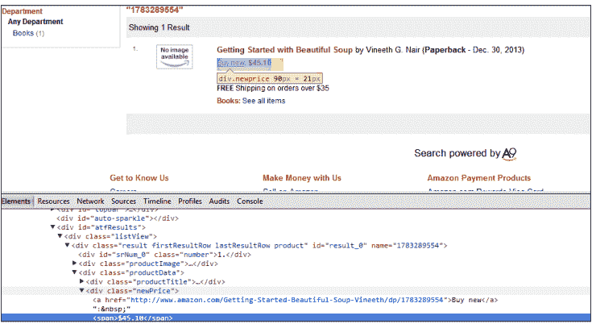

从前述屏幕截图中，我们可以看到价格存储在具有 newPrice 类的 div 标签内。我们可以使用以下代码从 Amazon 找到售价：

```
def get_sellingprice_amazon(isbn):
    url_foramazon = "http://www.amazon.com/s/ref=nb_sb_noss?url=search-alias%3Daps&field-keywords="
    url_for_isbn_inamazon = url_foramazon+isbn
    page = urllib2.urlopen(url_for_isbn_inamazon)
    soup_amazon = BeautifulSoup(page, "lxml")
```

```
page.close()
selling_price_tag = soup_amazon.find('div',class_="newPrice")
if selling_price_tag:
    print ("Amazon Price"+selling_price_tag.span.string)
```

我们基于 URL 创建了 soup 对象。创建 soup 对象后，我们找到了具有 newPrice 类的 div 标签。售价存储在 `<span>` 标签内，我们使用 `print (selling_price_tag.span.string)` 打印它。

### 从 Barnes and Noble 获取售价

我们必须使用与 Amazon 相同的策略在 Barnes and Noble 网站上找到售价。为此，我们需要执行以下步骤：

+   1. 查找每个 ISBN 的 URL
+   2. 找到一种抓取售价的方法

可用于 Barnes and Noble 的 URL 为 `http://www.barnesandnoble.com/s/ISBN`，其中 ISBN 是 ISBN 值，例如 `http://www.barnesandnoble.com/s/1904811590`。

现在，我们必须从页面找到售价。Barnes and Noble 上的页面将在以下屏幕截图所示的具有 price 类的 div 标签中列出售价（突出显示）：

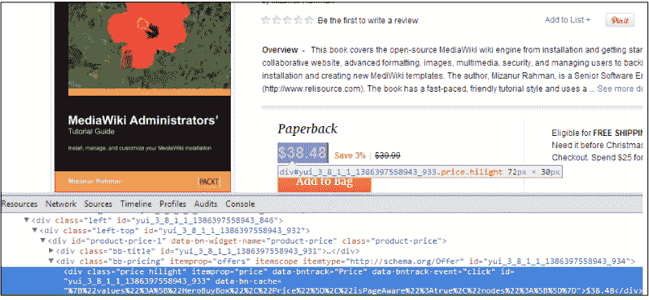


### 创建网页抓取器

我们可以使用以下代码从 Barnes and Noble 找到售价：

```python
def get_sellingprice_barnes(isbn):
    url_forbarnes = "http://www.barnesandnoble.com/s/"
    url_for_isbn_barnes = url_forbarnes+isbn
    page = urllib2.urlopen(url_for_isbn_barnes)
    soup_barnes = BeautifulSoup(page, "lxml")
    page.close()
    selling_price_tag = soup_barnes.find('div', class_="price hlight")
    if selling_price_tag:
        print("Barnes Price" + selling_price_tag.string)
```

创建网页抓取器的完整代码可在代码包中找到。

> 💡 之前的抓取器可从库中免费下载

### 小结

在本章中，我们使用 Beautiful Soup 创建了一个示例抓取器。我们使用 Beautiful Soup 的搜索和导航方法，从 packtpub.com、amazon.com 和 barnesandnoble.com 获取信息。

## 索引

### 符号

- `.children` 属性 58
- `.contents` 属性 57
- `.descendants` 属性 58
- `.next_sibling` 属性 62
- `.parent` 属性 60
- `.parents` 属性 61
- `.previous_sibling` 属性 62
- `.string` 属性 59
- `.strings` 属性 60

### A

- **append() 方法**
    - 使用 71, 75

### B

- **Beautiful Soup**
    - 编码 88
    - 格式化打印 93
    - 验证安装 13
    - 安装 7
    - 在 Linux 中安装 7
    - 在 Windows 中安装 10
    - 导航 53
    - 输出 93
    - 输出编码 90
    - 输出格式化器 95
    - 搜索 27
    - 搜索方法 27
    - TreeBuilders 19
    - 非格式化打印 94
    - 无需安装即可使用 12, 13
- **Beautiful Soup 在 Linux 中的安装**
    - 使用 easy_install 9
    - 使用包管理器 8, 9
    - 执行安装 7, 8
    - 使用 pip 9
- **Beautiful Soup 在 Windows 中的安装**
    - 执行安装 10
    - 验证 Python 路径 10, 11
    - 使用 setup.py 12
- **BeautifulSoup 对象**
    - 创建 15
    - 创建用于 XML 解析 18
    - 从类文件对象创建 16, 17
    - 从字符串创建 16
    - features 参数 19

### C

- **clear() 方法**
    - 使用 79

### D

- **decode() 函数** 95
- **decompose() 方法**
    - 使用 77
- **后代** 56
- **直接子节点** 56

### E

- **easy_install** 9
- **encode() 方法** 91, 95
- **extract() 方法**
    - 使用 78

### F

- **features 参数** 19-22
- **类文件对象**
    - 关于 16
    - 从类文件对象创建 BeautifulSoup 对象 16, 17
- **使用 find_all() 方法搜索**
    - 关于 37
    - 使用参数 38, 39
    - 搜索三级消费者 37
- **find_all_previous() 方法** 45
- **find() 方法** 30
- **使用 find() 方法搜索**
    - 基于正则表达式的搜索 32
    - 使用函数搜索 35, 36
    - 组合应用搜索方法 36
    - 基于标签属性值的搜索 33
    - 搜索标签 31
    - 搜索文本 32
- **find_next_sibling() 方法** 43
- **find_next_siblings() 方法** 43
- **find_parents() 方法** 37
- **find_previous_sibling() 方法** 44
- **find_previous_siblings() 方法** 44
- **find_siblings() 方法** 37
- **格式化打印** 93
- **函数格式化器** 99
- **用于内容修改的函数**
    - insert_after() 80
    - insert_before() 80
    - replace_with() 方法 81
    - unwrap() 方法 82
    - wrap() 方法 82

### G

- **get_bookurls() 函数** 106
- **get_text()**
    - 关于 100
    - 使用 100, 101

### H

- **html5lib 解析器**
    - 使用 21
- **HTML 文档**
    - 指定编码 89, 90
- **html 格式化器** 98
- **html.parser**
    - 使用 21

### I

- **insert_after() 方法** 80
- **insert() 方法**
    - 使用 73
- **安装**
    - Beautiful Soup 7

### L

- **limit 参数（find_all() 方法）** 38

### M

- **最小格式化器** 98

### N

- **NavigableString 对象** 24, 53
- **向下导航**
    - 关于 55
    - 使用子标签名 55
    - 使用预定义属性 56
    - 特殊属性 59
- **横向导航至兄弟节点**
    - .next_sibling 属性 62
    - .previous_sibling 属性 62
- **向上导航**
    - 关于 60
    - .parent 属性 60
    - .parents 属性 61
- **Beautiful Soup 导航**
    - 关于 53, 54
    - 向下导航 55
    - 横向导航至兄弟节点 61
    - 导航至解析后的下一个和上一个对象 63
    - 向上导航 60
- **新标签**
    - 使用 append() 方法添加 72
    - 使用 new_tag() 方法添加 72
    - 使用 new_tag() 方法创建 71
    - 向 li 标签添加新的 div 标签 73
    - 使用 new_tag() 和 append() 添加新的生产者 71
- **new_tag() 方法**
    - 使用 71
- **下一个兄弟节点**
    - 查找 44
- **None 格式化器** 99

### O

- **输出编码** 90, 91
- **输出格式化器**
    - 关于 95-97
    - 函数格式化器 99
    - html 格式化器 98
    - 最小格式化器 98
    - None 格式化器 99

### P

- **参数（find_all() 方法）**
    - limit 参数 38
- **pip** 9
- **用于向下导航的预定义属性**
    - 关于 56
    - .children 属性 58
    - .contents 属性 57
    - 后代 56
    - .descendants 属性 58
    - 直接子节点 56
- **prettify() 方法** 91-94
- **上一个兄弟节点**
    - 查找 45
- **Python 包索引（PyPI）** 9

### R

- **replace_with() 方法** 81

### S

- **在 Beautiful Soup 中搜索**
    - 关于 27
    - 使用 find_all() 方法 37
    - 使用 find() 方法 28, 29
    - 搜索下一个兄弟节点 44
    - 搜索父标签 40
    - 搜索上一个兄弟节点 45
    - 搜索兄弟节点 42, 44
    - 搜索标签 40
- **搜索方法**
    - 关于 27
    - 用于从网页抓取信息 46-50
- **使用 find() 搜索**
    - 查找第一个生产者 29, 30
    - 执行搜索 28, 29
- **setup.py 脚本**
    - 使用 12
- **兄弟节点**
    - 搜索 42-44
- **soup.original_encoding** 89
- **修改字符串内容**
    - 关于 73
    - 使用 .string 属性 74
    - 使用 .append() 方法添加字符串 75
    - 使用 insert() 方法添加字符串 76
    - 使用 new_string() 方法添加字符串 76
- **str() 方法** 95

### T

- **使用 find() 方法基于标签属性值搜索**
    - 关于 33
    - 基于 CSS 类的搜索 35
    - 基于自定义属性的搜索 34
    - 查找第一个初级消费者 33
- **使用 Beautiful Soup 修改标签**
    - 添加属性值 69
    - 修改属性值 68
    - 更新属性值 68
    - 修改 name 属性 66-68
    - 添加新标签 71
    - 删除标签属性 70
- **Tag 对象**
    - 关于 22
    - 从 BeautifulSoup 访问 22
    - 属性 23
    - name 23
- **标签**
    - 使用 Beautiful Soup 删除内容 79
    - 从 HTML 文档中删除 77
    - 搜索父标签 40, 41
    - 使用 decompose() 删除生产者 77
    - 使用 extract() 删除生产者 78
    - 搜索 40

### U

- **非格式化打印** 94
- **UnicodeDammit 库** 89
- **unicode() 方法** 94
- **unwrap() 方法** 83
- **UTF-8** 87
- **UTF-8 编码** 89

### W

- **网页抓取器**
    - 查找书籍详细信息 107-109
    - 获取书籍详细信息 103
    - 创建 103, 106
    - 查找包含书籍列表的页面 104-106
    - 从 Barnes and Noble 获取售价 111
    - 在 Amazon 上搜索售价 109, 110
- **wrap() 方法** 82


## 感谢购买

## Beautiful Soup 入门

## 关于 Packt Publishing

Packt，发音为“packed”，于 2004 年 4 月出版了其第一本书《Mastering phpMyAdmin for Effective MySQL Management》，此后一直专注于出版针对特定技术和解决方案的高聚焦度图书。

我们的图书和出版物分享了您的 IT 同行在适应和定制当今系统、应用程序和框架方面的经验。我们基于解决方案的图书为您提供定制所使用软件和技术以完成工作的知识与能力。Packt 的图书比您过去见过的 IT 图书更具体、更少泛泛而谈。我们独特的商业模式使我们能够为您带来更有针对性的信息，让您获得更多需要知道的内容，减少不需要的内容。

Packt 是一家现代而独特的出版公司，专注于为开发者、管理员和新手等群体出版高质量的前沿图书。欲了解更多信息，请访问我们的网站：www.packtpub.com。

## 关于 Packt Open Source

2010 年，Packt 推出了两个新品牌：Packt Open Source 和 Packt Enterprise，以继续专注于专业化领域。本书属于 Packt Open Source 品牌，该品牌专注于出版围绕开源许可证构建的软件相关图书，并为从高级开发者到初出茅庐的网页设计师等各类人群提供信息。该开源品牌还运营 Packt 的开源版税计划（Open Source Royalty Scheme），根据该计划，Packt 会向每本图书所涉及软件对应的开源项目支付版税。

## 为 Packt 撰稿

我们欢迎所有对写作感兴趣的人前来咨询。图书提案请发送至 author@packtpub.com。如果您的图书想法尚处于早期阶段，希望在撰写正式提案之前先进行讨论，请联系我们；我们的一位策划编辑将与您联系。

我们不仅仅寻找已出版图书的作者；如果您拥有扎实的技术技能但缺乏写作经验，我们经验丰富的编辑可以帮助您发展写作事业，或者让您的专业知识获得额外回报。


[PACKT] PUBLISHING open source community experience distilled


## PySide GUI Application Development

ISBN: 978-1-84969-959-4      Paperback: 140 pages

Develop more dynamic and robust GUI applications using an open source cross-platform UI framework

- 1. Designed for beginners to help them get started with GUI application development
- 2. Develop your own applications by creating customized widgets and dialogs
- 3. Written in a simple and elegant structure to help you easily understand how to program various GUI components

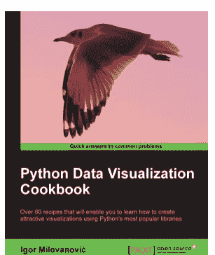

## Python Data Visualization Cookbook

ISBN: 978-1-78216-336-7      Paperback: 280 pages

Over 60 recipes that will enable you to learn how to create attractive visualizations using Python's most popular libraries

- 1. Learn how to set up an optimal Python environment for data visualization
- 2. Understand the topics such as importing data for visualization and formatting data for visualization
- 3. Understand the underlying data and how to use the right visualizations

Please check www.PacktPub.com for information on our titles

[PACKT] PUBLISHING open source community experience distilled

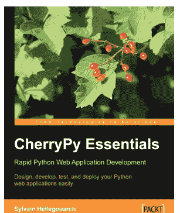

## CherryPy Essentials: Rapid Python Web Application Development

ISBN: 978-1-90481-184-8      Paperback: 272 pages

Design, develop, test, and deploy your Python web applications easily

- 1. Walks through building a complete Python web application using CherryPy 3
- 2. The CherryPy HTTP:Python interface
- 3. Use CherryPy with other Python libraries
- 4. Design, security, testing, and deployment


## Mobile First Design with HTML5 and CSS3

ISBN: 978-1-84969-646-3      Paperback: 122 pages

Roll out rock-solid, responsive mobile first designs quickly and reliably

- 1. Make websites that will look great and be usable on almost any device that displays web pages
- 2. Learn best practices for responsive design
- 3. Discover how to make designs that will be lean and fast on small screens without sacrificing a tablet or desktop experience

Please check www.PacktPub.com for information on our titles

