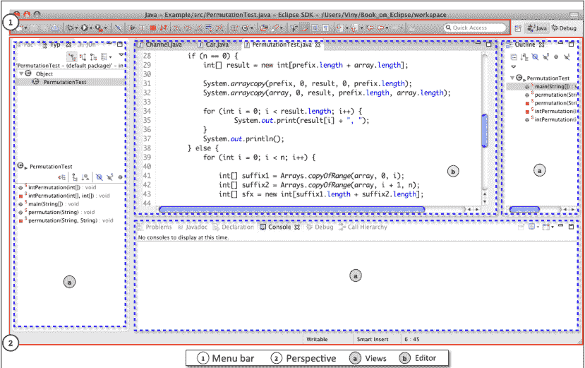
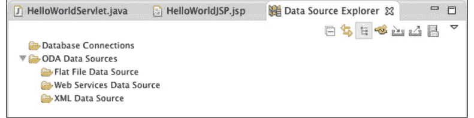
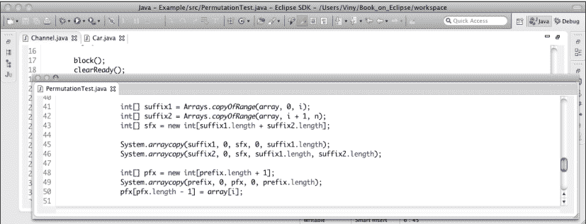
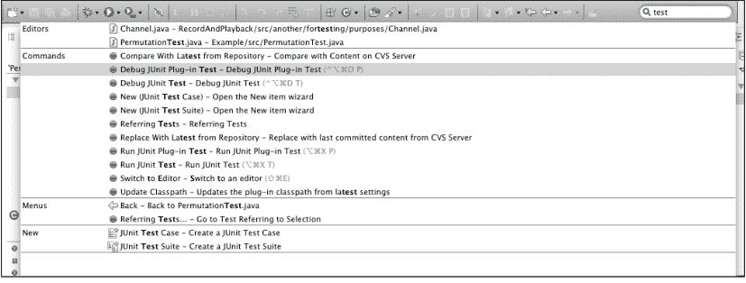
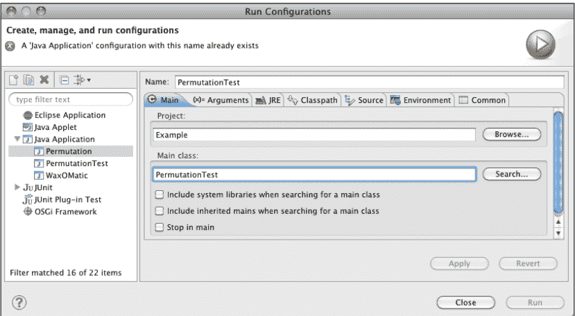
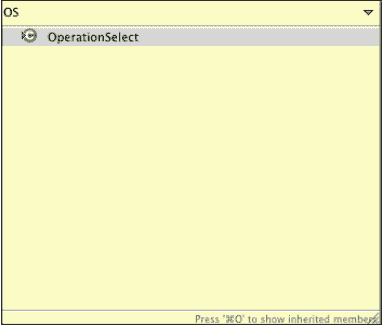
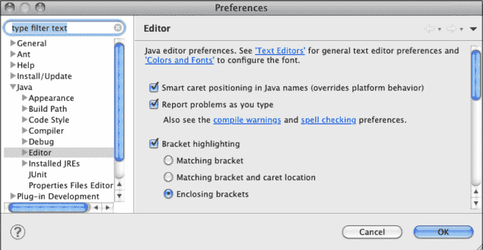
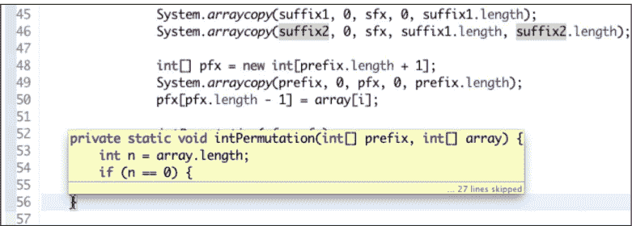
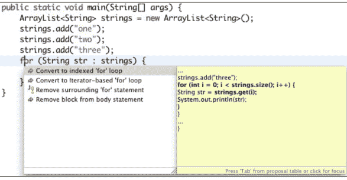

# 1 引言
# 1 引言

本章为后续章节奠定基础。在这里我们介绍如何启动并运行 Eclipse。此外，我们还简要介绍了这个新版本 **集成开发环境（IDE）** 的新内容。如果您对 Eclipse 新增的功能不感兴趣，可以安全地跳过本章。

我们还介绍了如何阅读本书，其中回答了诸如“是否需要按书中出现的顺序阅读章节？”和“本书充斥着提示框，是否需要阅读每一个？”等问题。

Summing up, the contents of this chapter are as follows:
总之，本章内容如下：

- Downloading Eclipse
- Installing Eclipse
- New and noteworthy features in Eclipse Juno
- 下载 Eclipse
- 安装 Eclipse
- Eclipse Juno 的新功能和值得注意的功能

## 如何使用本书
## 如何使用本书

如前所述，我们假设您了解 Java（我们期望您至少了解基础知识），更重要的是，您对计算机有实际操作知识。毕竟，我们不会涵盖解压文件、创建目录、查找文件、启动程序和配置环境变量等细节。

正如您将看到的，每个章节中都有包含有关 Eclipse、Java 以及有时是主题本身的提示和陷阱的方框。这些方框旨在帮助您充分利用底层章节的内容，因此请不要跳过它们。

虽然本书采用类似教程的方式，但你不必按照书中出现的顺序阅读章节。所有章节都是自成体系的。你可以按任意顺序阅读本书的章节。

## 下载和安装 Eclipse

Eclipse 是一个 Java 程序；这意味着要使用 Eclipse，首先需要安装一个 **Java 虚拟机 (JVM)** 的版本。基本上实现这一点有两种方法：你可以安装 **Java 运行时环境 (JRE)** 或 **Java 开发工具包 (JDK)**。实际上，你应该安装什么取决于你打算用 Eclipse 实现什么。由于你想用 Eclipse 进行 Java 开发，你应该安装 JDK（除了 JVM 之外，JDK 还包含其他有用的东西；例如标准 Java 库的源代码）。要运行 Eclipse Juno，建议你安装 JDK 6 或更高版本（许多 Eclipse 用户一直在使用更新的版本 – Java 7）。要了解如何在你的操作系统上安装 JVM 的版本，请导航到 `http://www.oracle.com/technetwork/java/javase/index-137561.html`。

如果你已经安装了 JVM，下载和安装 Eclipse 将非常简单：

- 1. 首先，从 Eclipse 下载页面 `http://www.eclipse.org/downloads/` 下载 Eclipse Juno。我们强烈建议你下载 **Eclipse IDE for Java Developers** 版本。此外，请确保下载适合你的平台和 Java 版本的版本（有两个版本：32 位和 64 位）。实际上，下载站点足够智能，可以检测你正在运行的操作系统，因此它会默认选择适用于你平台的下载选项。你将以压缩文件形式获得 Eclipse（它可能是 `.zip` 或 `.tar.gz` 文件）。值得一提的是，IDE 有多个发行版；每个发行版都针对特定目的而定制。因此，每个发行版附带的插件集各不相同。一些发行版有 Eclipse IDE for Java EE Developers、Eclipse for Mobile Developers、Eclipse Modeling Tools 和 Eclipse for Testers。
- 2. 其次，将此文件解压到你选择的目录中。结果，你将得到一个名为 `eclipse` 的子目录，其中包含许多子目录在其下。解压后，你就可以开始使用了。不需要进一步的配置。简单吧？

当前版本的 Windows 随附的内置解压缩实用程序存在一个已知问题。因此，在解压缩 Eclipse 时最好使用另一个解压缩实用程序。如果你是正在寻找更强大的解压缩实用程序的 Windows 用户，可以试试 7-Zip（http://www.7-zip.org/download.html）。此外，有些人报告说 Eclipse 在目录路径名称中包含空格时会遇到问题。因此，如果可能，请避免在包含空格的目录路径中解压 Eclipse。

要启动 Eclipse，双击包含 Eclipse 图标的文件（该文件在 Windows 上名为 `eclipse.exe`，在 Linux 和 Mac 系统上名为 `eclipse`）。Eclipse 会提示你选择一个工作区。在此上下文中以及 Eclipse 的术语里，工作区是你 Eclipse 项目将被放置的目录。你最好创建一个新目录并将其命名为 `eclipse_workspace`（或类似名称）并将 Eclipse 指向你最近创建的目录的位置。然而，值得一提的是，你可以使用任何目录作为 Eclipse 工作区。你也可以直接在工作区提示中输入目录名称，Eclipse 会负责为你创建它。

安装 Eclipse 后，你已经可以通过添加自己选择的插件来增强它。为此，请导航到 **Help | Install new software....** 我们将在后面的章节中介绍插件的安装。目前，你只需要记住 Eclipse 可以立即扩展。

在下一节中，我们将重点介绍 Eclipse 所经历的一些变化。当然，变化很多。然而，让我们不要陷入技术细节。因此，在下一节中，我们将只集中描述最重要的和最有用的改进（你得相信我们这一点）。如果你是那种渴望完整性的人，你会很高兴知道我们也会提到可以获取完整改进列表的地方。

## Eclipse Juno – 新功能与亮点

本次发布包含了两种 Eclipse Juno 版本：4.2 和 3.8。这两种版本的基本区别在于，4.2 建立在 e4（Eclipse 4）平台之上并经历了大量 GUI 更改，但 3.8 基于平台的第 3 版。可以说，3.8 版本专注于稳定性和错误修复，而 Eclipse Juno 4.2 强调新功能的引入。

### Introduction

平台用户界面的默认外观已重新设计。此次视觉更新的主要目标是采用更现代的视觉风格。Eclipse Juno 具有全新的外观的工作台，如以下屏幕截图所示。为了更好地理解此屏幕截图以及 Eclipse 中事物的视觉组织方式，我们需要介绍一些概念。术语 workbench 指的是桌面开发环境。因此，如屏幕截图所示，workbench 涵盖了几乎所有其他内容。workbench 内部的元素在 Eclipse 的术语中被分组为透视图（屏幕截图中用 2 指示的包围区域）。透视图反过来包含视图和编辑器（在以下屏幕截图中，字母 a 代表视图，而字母 b 代表编辑器）。它们控制 workbench 中显示的内容。每个透视图都提供了执行特定任务所需的一切。例如，Debug 透视图包含调试 Java 程序时使用的功能集。此功能被拆分为视图。

属于 Debug 透视图的一个视图示例是 Breakpoint 视图。（如果你在此之前从未听说过断点，请不要担心。我们将在后面的章节中介绍有关它们的一切。）至于编辑器，大多数透视图包含多个视图和一个编辑器。在 Eclipse 中，可以同时打开任意数量的编辑器。然而，一次只能有一个处于活动状态。随着你在书中的进展，你将非常频繁地切换透视图。此外，你将学习如何使用最重要的视图和编辑器。

一目了然，熟悉 Eclipse 的读者一定会注意到两个变化，即调试控制命令（`Resume`、`Stop`、`Step Into` 等）。由于这些命令已从 **Debug** 视图移至全局工具栏（我们将在 *第 3 章，使用 JUnit 进行单元测试和调试* 中介绍调试），我们现在在右上角有一个全局搜索栏。这些元素可以在之前的屏幕截图中编号为 1 的区域看到（即菜单栏或全局工具栏）。

你是否曾经想过并排使用视图和编辑器？现在，在 Eclipse Juno 中，也可以堆叠视图和编辑器。例如，如果你有一个视图，其信息在显示时会占用太多空间，你可以将其堆叠在编辑器区域以提供更多空间。为此，只需按住鼠标左键拖动视图的标题栏即可。当你将视图在 workbench 中移动时，鼠标指针会指示如果释放鼠标左键，视图将位于何处以及采用何种形状。当视图位于你想要的位置时（例如在两个编辑器选项卡之间），释放鼠标左键。以下屏幕截图显示了一个视图（**Data Source Explorer** 视图）已停靠在编辑器区域。你可以用任何视图执行相同的操作。还值得一提的是，你几乎可以在任何地方放置视图。

## 引言

另一个有用的改进是编辑器现在可以分离到自己的窗口中。更妙的是，分离后的编辑器会保留其属性；这意味着它将与仍附加到工作台窗口的编辑器完全相同地表现。此改进在以下截图中显示。要从 Eclipse 分离编辑器，只需将其从 Eclipse 的工作台窗口（主窗口）拖出即可。

如果你是一名试图在不离开键盘的情况下尽可能多完成工作的开发者，你会发现新的全局搜索栏很有趣且实用（全局搜索栏位于工作台的右上角）。它允许你仅通过输入名称即可快速访问类、视图、透视图、命令、菜单等。以下截图展示了全局搜索栏的使用情况。要在不使用鼠标的情况下访问搜索栏，请按 Ctrl + 3。

在 Eclipse 的早期版本中，引入了一种轻量级刷新机制。该机制使工作区的内容与文件系统保持同步；不同步的文件会被自动异步刷新。然而，在 IDE 的早期版本中，你必须启用此功能。

现在，它默认已启用。如果你想禁用它，请导航到 **首选项 | 通用 | 工作区**，并取消选择 **访问时刷新**。除非你有非常充分的理由，否则应保持启用状态。

**调试**透视图的一部分已移至主菜单栏。更具体地说，常见的调试控制命令（即 `Resume`、`Stop` 等）已移至主菜单栏（如以下截图所示）。如果你不喜欢这种方式，可以对其进行自定义。导航到 **窗口 | 自定义透视图...**。在这里，你可以添加更多调试命令或完全将其从主菜单栏中移除。

> 如果你有点怀旧，想要一切恢复原样，即没有调试命令到处都是，那么旧的外观可以恢复。为此，首先在 **调试** 视图的菜单中切换 **显示调试工具栏** 选项，然后在 **自定义透视图** 对话框中禁用调试工具栏。此外，如果你想返回经典外观（保留新功能），可以导航到 **首选项 | 通用 | 外观** 并从 **主题** 中选择 **经典**。

Eclipse Juno 提供了改进的启动配置支持。从现在开始，如果你创建的启动配置与现有启动配置同名，则冲突启动配置的类型将在错误消息中显示。以下截图显示了当你尝试创建与之前同名的启动配置时收到的错误消息。（你将在下一章学习如何为 Java 项目创建启动配置。）

如果你已经熟悉 Eclipse，你可能已经使用过 **快速大纲** (*Ctrl + O*) 和 **快速层次结构** (*Ctrl + T*) 视图。这些实用的节省时间的视图在 Eclipse Juno 中更好用：它们现在支持元素名称的 CamelCase 匹配。例如，要搜索 ByteArrayOutputStream，只需输入 `BAOS`。以下截图显示了一个使用示例：

> 如果你是 Mac OS X 用户，请使用命令按钮（⌘）来访问 **快速大纲** 和 **快速层次结构** 视图，而不是 *Ctrl*。

另一个有用的改进是 Java 编辑器中改进的括号匹配支持。现在此编辑器支持封闭括号的高亮显示。可以通过前往首选项页面 **Java | 编辑器** 然后选择 **封闭括号** 选项来配置，如以下截图所示：

启用此选项后，进入 Navigate 菜单并选择 Go To | Matching Bracket (Ctrl + Shift + P)，现在此选项在 Java 文件中的任何位置都有效。当位于一对括号内部时，按 Ctrl + Shift + P 会将光标导航到最近的封闭结束括号。再次按下同一按钮时，光标会导航到对应的开始括号。此外，当你将鼠标悬停在闭合大括号上时，Eclipse 会显示匹配的开始大括号附近的源代码（如以下截图中突出显示的那样）。

这里描述的内容远不止这些。然而，深入概述每项改进都不会带来任何好处。你最好开始迈向 Eclipse 精通的旅程。Eclipse 所经历的所有表面改进都记录在 http://archive.eclipse.org/eclipse/downloads/drops4/R-4.2-201206081400/news/eclipse-news-part1.html。

许多非 GUI 相关的改进也已完成。例如，现在你可以使用快速辅助（Ctrl + 1）将增强的 for 循环转换为索引 for 循环或基于迭代器的循环。将 for 循环转换为索引 for 循环的选项适用于遍历数组或基于列表类型的表达式。将 for 循环转换为基于迭代器的 for 循环的选项仅适用于类型为 iterable 的表达式。以下截图展示了新的快速辅助功能的使用情况：

正如我们在 *第 3 章，JUnit 和调试的单元测试* 中将看到的，Eclipse 现在随附 JUnit 4.10。此外，Eclipse 支持最新的 servlet 应用程序编程接口（3.0），我们将在 *第 7 章，使用 Eclipse WTP 进行 Web 开发* 中简要讨论。改进的完整列表可在 http://help.eclipse.org/juno/index.jsp?topic=%2Forg.eclipse.platform.doc.user%2FwhatsNew%2Fplatform_whatsnew.html 获取。

## 摘要

Eclipse 无疑是最受欢迎的 Java IDE（也许这就是你买这本书的原因；你觉得是时候加入这个潮流了）。在本章中，我们介绍了 Eclipse Juno 以及这个新版本的 IDE 带来了什么。正如你所见，Eclipse 经历了许多变化。

除了介绍 Eclipse，本章为整本书奠定了基础。我们强调了新版本 IDE 的一些变化。我们本可以花更多篇幅描述新内容，但对于那些迫不及待想要开始使用 Eclipse 的人来说，这并不合适。最重要的是，最重要的变化已经在其他地方有记录（如前所述）。

下一章深入我们的实践教程，描述如何使用 Eclipse 开发 Java 应用程序。祝阅读愉快，并确保不要被社交网络网站分心。
