# 2 Java 开发

IDE 已经进化到难以想象不用它们编写 Java 代码的地步。当然，始终可以使用文本编辑器或非常简单的 IDE，但 Eclipse 提供了许多功能使编写代码变得更容易、更快，一旦你习惯了它，很可能你再也不会回头。

鉴于像 Eclipse 这样的 IDE 可能带来的生产力提升，掌握它几乎与掌握 Java 编程本身一样重要。本章的目标是介绍 Eclipse 为 Java 程序员提供的最重要的功能。

在本章结束时，你将能够：

- 创建新的 Java 项目或导入现有项目
- 快速在代码中导航
- 有效使用 Java 视图
- 以简单安全的方式重构代码
- 让 Eclipse 生成代码并修复代码问题

### 创建 Java 项目

要创建新的 Java 项目，请导航到 文件 | 新建 | 项目。你将看到以下截图中显示的新建项目向导窗口：

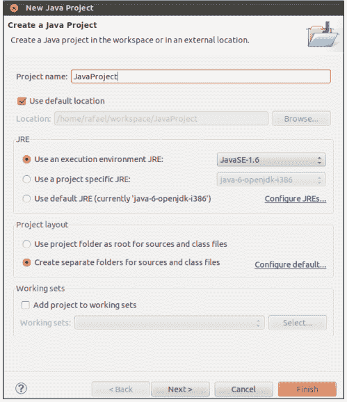

选择 Java Project 选项，然后单击下一步。向导的下一页包含你要创建的项目的基本配置。JRE 部分允许你使用特定的 JRE 来编译和运行你的项目。Project layout 部分允许你选择源文件和二进制文件是否都创建在项目的根文件夹中，或是否分离到不同的文件夹（默认情况下为 src 和 bin）。后者是默认选项。

你可以在工作集中创建项目。如果你工作区中有太多项目并希望保持组织有序，这是一个好主意。查看本章的 创建工作集 部分，了解如何使用和管理工作集的更多信息。

向导的下一页包含构建路径选项。在本章的 管理项目构建路径 部分，我们将更详细地讨论这些选项。你现在可以保留所有默认设置，并在项目创建后进行必要的更改。


## 创建 Java 类

要创建新的 Java 类，请在 Package Explorer 视图中右键单击项目并导航到 **New** | **Class**。您将看到 **New Java Class** 窗口，在其中输入有关类的信息。您可以更改类的超类，并添加其实现的接口，以及为从接口和抽象超类继承的抽象方法添加存根、从超类添加构造函数，并添加 main 方法。

要在包内创建类，只需在相应字段中输入其名称，或单击旁边的 **Browse** 按钮并选择包。如果您输入的包名不存在，Eclipse 会为您创建它。新的包也可以通过在 Package Explorer 中右键单击项目并导航到 **New** | **Package** 来创建。在 Project Explorer 中右键单击包而不是项目并导航到 **New** | **Class** 将导致类在该包内创建。

## 创建工作集

工作集提供了一种将工作区中的项目组织成子集的方式。当工作区中的项目太多时，很难在 **Package Explorer** 视图中找到所需的项目。例如，您当前未处理的项目可以保存在单独的工作集中。它们不会妨碍您当前的工作，但在需要时仍可使用。

要创建新的工作集，请打开 Package Explorer 的视图菜单（视图右上角的白色三角形），并选择 **Select Working Set**。单击 **New** 并选择工作集将包含的项目类型（本例中为 **Java**）。在下一页中，输入工作集的名称，并选择其将包含的项目。工作集创建后，选择 **Selected Working Sets** 选项，并标记您的工作集。单击 **OK**，Package Explorer 将仅显示您刚刚创建的工作集中的项目。

工作集创建后，它们会列在 Package Explorer 的视图菜单中。选择其中一个将使其成为 Package Explorer 中唯一可见的工作集。要同时查看多个工作集，请选择 **Select Working Set** 选项并标记要显示的项目。要再次查看整个工作区，请在视图菜单中选择 **Deselect Workspace**。您还可以通过将工作集选为 **Package Explorer** 视图的顶级元素来查看所有工作集及其嵌套项目。为此，请在视图菜单中导航到 **Top Level Elements** | **Working Sets**。

虽然在选择工作集时看不到属于其他工作集的项目，但它们仍加载在工作区中，因此会占用机器资源。为避免浪费这些资源，您可以通过右键单击它们并选择 Close Project 来关闭不相关的项目。您可以使用 Ctrl + A 键盘快捷键选择工作集中的所有项目。

如果您有大量项目，但从不同时处理所有项目（个人/业务项目、不同客户的项目等），您还可以为每个项目集创建特定的工作区。要创建新的工作区，请在菜单中导航到 File | Switch Workspace | Other，输入新工作区的[content]
## 创建 Java 类

要创建新的 Java 类，请在 Package Explorer 视图中右键单击项目并导航到 **New** | **Class**。您将看到 **New Java Class** 窗口，在其中输入有关类的信息。您可以更改类的超类，并添加其实现的接口，以及为从接口和抽象超类继承的抽象方法添加存根、从超类添加构造函数，并添加 main 方法。

要在包内创建类，只需在相应字段中输入其名称，或单击旁边的 **Browse** 按钮并选择包。如果您输入的包名不存在，Eclipse 会为您创建它。新的包也可以通过在 Package Explorer 中右键单击项目并导航到 **New** | **Package** 来创建。在 Project Explorer 中右键单击包而不是项目并导航到 **New** | **Class** 将导致类在该包内创建。

## 创建工作集

工作集提供了一种将工作区中的项目组织成子集的方式。当工作区中的项目太多时，很难在 **Package Explorer** 视图中找到所需的项目。例如，您当前未处理的项目可以保存在单独的工作集中。它们不会妨碍您当前的工作，但在需要时仍可使用。

要创建新的工作集，请打开 Package Explorer 的视图菜单（视图右上角的白色三角形），并选择 **Select Working Set**。单击 **New** 并选择工作集将包含的项目类型（本例中为 **Java**）。在下一页中，输入工作集的名称，并选择其将包含的项目。工作集创建后，选择 **Selected Working Sets** 选项，并标记您的工作集。单击 **OK**，Package Explorer 将仅显示您刚刚创建的工作集中的项目。

工作集创建后，它们会列在 Package Explorer 的视图菜单中。选择其中一个将使其成为 Package Explorer 中唯一可见的工作集。要同时查看多个工作集，请选择 **Select Working Set** 选项并标记要显示的项目。要再次查看整个工作区，请在视图菜单中选择 **Deselect Workspace**。您还可以通过将工作集选为 **Package Explorer** 视图的顶级元素来查看所有工作集及其嵌套项目。为此，请在视图菜单中导航到 **Top Level Elements** | **Working Sets**。

虽然在选择工作集时看不到属于其他工作集的项目，但它们仍加载在工作区中，因此会占用机器资源。为避免浪费这些资源，您可以通过右键单击它们并选择 Close Project 来关闭不相关的项目。您可以使用 Ctrl + A 键盘快捷键选择工作集中的所有项目。

如果您有大量项目，但从不同时处理所有项目（个人/业务项目、不同客户的项目等），您还可以为每个项目集创建特定的工作区。要创建新的工作区，请在菜单中导航到 File | Switch Workspace | Other，输入新工作区的文件夹名称，然后单击 OK。您可以在 Copy Settings 部分选择是否复制当前工作区的布局和工作集。

## 导入 Java 项目

如果您要处理现有项目，则可以根据项目源代码的获取方式以多种不同的方式将其导入 Eclipse。要打开导入向导，请导航到 File | Import。让我们介绍一下 General 类别下的选项：

- Archive file: 如果您要处理的项目已存在于工作区中，并且只想导入包含新资源的归档文件，请选择此选项。导入向导将列出归档文件中的所有资源，以便您可以选择要导入的资源。要选择资源将导入到哪个项目，请单击 Browse 按钮。您还可以选择资源将被包含到的文件夹。完成后单击 Finish。导入的资源将被解压缩并复制到项目的[content]
## 创建 Java 类

要创建新的 Java 类，请在 Package Explorer 视图中右键单击项目并导航到 **New** | **Class**。您将看到 **New Java Class** 窗口，在其中输入有关类的信息。您可以更改类的超类，并添加其实现的接口，以及为从接口和抽象超类继承的抽象方法添加存根、从超类添加构造函数，并添加 main 方法。

要在包内创建类，只需在相应字段中输入其名称，或单击旁边的 **Browse** 按钮并选择包。如果您输入的包名不存在，Eclipse 会为您创建它。新的包也可以通过在 Package Explorer 中右键单击项目并导航到 **New** | **Package** 来创建。在 Project Explorer 中右键单击包而不是项目并导航到 **New** | **Class** 将导致类在该包内创建。

## 创建工作集

工作集提供了一种将工作区中的项目组织成子集的方式。当工作区中的项目太多时，很难在 **Package Explorer** 视图中找到所需的项目。例如，您当前未处理的项目可以保存在单独的工作集中。它们不会妨碍您当前的工作，但在需要时仍可使用。

要创建新的工作集，请打开 Package Explorer 的视图菜单（视图右上角的白色三角形），并选择 **Select Working Set**。单击 **New** 并选择工作集将包含的项目类型（本例中为 **Java**）。在下一页中，输入工作集的名称，并选择其将包含的项目。工作集创建后，选择 **Selected Working Sets** 选项，并标记您的工作集。单击 **OK**，Package Explorer 将仅显示您刚刚创建的工作集中的项目。

工作集创建后，它们会列在 Package Explorer 的视图菜单中。选择其中一个将使其成为 Package Explorer 中唯一可见的工作集。要同时查看多个工作集，请选择 **Select Working Set** 选项并标记要显示的项目。要再次查看整个工作区，请在视图菜单中选择 **Deselect Workspace**。您还可以通过将工作集选为 **Package Explorer** 视图的顶级元素来查看所有工作集及其嵌套项目。为此，请在视图菜单中导航到 **Top Level Elements** | **Working Sets**。

虽然在选择工作集时看不到属于其他工作集的项目，但它们仍加载在工作区中，因此会占用机器资源。为避免浪费这些资源，您可以通过右键单击它们并选择 Close Project 来关闭不相关的项目。您可以使用 Ctrl + A 键盘快捷键选择工作集中的所有项目。

如果您有大量项目，但从不同时处理所有项目（个人/业务项目、不同客户的项目等），您还可以为每个项目集创建特定的工作区。要创建新的工作区，请在菜单中导航到 File | Switch Workspace | Other，输入新工作区的文件夹名称，然后单击 OK。您可以在 Copy Settings 部分选择是否复制当前工作区的布局和工作集。

## 导入 Java 项目

如果您要处理现有项目，则可以根据项目源代码的获取方式以多种不同的方式将其导入 Eclipse。要打开导入向导，请导航到 File | Import。让我们介绍一下 General 类别下的选项：

- Archive file: 如果您要处理的项目已存在于工作区中，并且只想向其导入包含新资源的归档文件，请选择此选项。导入向导将列出归档文件中的所有资源，以便您可以选择要导入的资源。要选择资源将导入到哪个项目，请单击 Browse 按钮。您还可以选择资源将被包含到的文件夹。完成后单击 Finish。导入的资源将被解压缩并复制到项目的[content]
## 创建 Java 类

要创建新的 Java 类，请在 Package Explorer 视图中右键单击项目并导航到 **New** | **Class**。您将看到 **New Java Class** 窗口，在其中输入有关类的信息。您可以更改类的超类，并添加其实现的接口，以及为从接口和抽象超类继承的抽象方法添加存根、从超类添加构造函数，并添加 main 方法。

要在包内创建类，只需在相应字段中输入其名称，或单击旁边的 **Browse** 按钮并选择包。如果您输入的包名不存在，Eclipse 会为您创建它。新的包也可以通过在 Package Explorer 中右键单击项目并导航到 **New** | **Package** 来创建。在 Project Explorer 中右键单击包而不是项目并导航到 **New** | **Class** 将导致类在该包内创建。

## 创建工作集

工作集提供了一种将工作区中的项目组织成子集的方式。当工作区中的项目太多时，很难在 **Package Explorer** 视图中找到所需的项目。例如，您当前未处理的项目可以保存在单独的工作集中。它们不会妨碍您当前的工作，但在需要时仍可使用。

要创建新的工作集，请打开 Package Explorer 的视图菜单（视图右上角的白色三角形），并选择 **Select Working Set**。单击 **New** 并选择工作集将包含的项目类型（本例中为 **Java**）。在下一页中，输入工作集的名称，并选择其将包含的项目。工作集创建后，选择 **Selected Working Sets** 选项，并标记您的工作集。单击 **OK**，Package Explorer 将仅显示您刚刚创建的工作集中的项目。

工作集创建后，它们会列在 Package Explorer 的视图菜单中。选择其中一个将使其成为 Package Explorer 中唯一可见的工作集。要同时查看多个工作集，请选择 **Select Working Set** 选项并标记要显示的项目。要再次查看整个工作区，请在视图菜单中选择 **Deselect Workspace**。您还可以通过将工作集选为 **Package Explorer** 视图的顶级元素来查看所有工作集及其嵌套项目。为此，请在视图菜单中导航到 **Top Level Elements** | **Working Sets**。

虽然在选择工作集时看不到属于其他工作集的项目，但它们仍加载在工作区中，因此会占用机器资源。为避免浪费这些资源，您可以通过右键单击它们并选择 Close Project 来关闭不相关的项目。您可以使用 Ctrl + A 键盘快捷键选择工作集中的所有项目。

如果您有大量项目，但从不同时处理所有项目（个人/业务项目、不同客户的项目等），您还可以为每个项目集创建特定的工作区。要创建新的工作区，请在菜单中导航到 File | Switch Workspace | Other，输入新工作区的文件夹名称，然后单击 OK。您可以在 Copy Settings 部分选择是否复制当前工作区的布局和工作集。

## 导入 Java 项目

如果您要处理现有项目，则可以根据项目源代码的获取方式以多种不同的方式将其导入 Eclipse。要打开导入向导，请导航到 File | Import。让我们介绍一下 General 类别下的选项：

- Archive file: 如果您要处理的项目已存在于工作区中，并且只想向其导入包含新资源的归档文件，请选择此选项。导入向导将列出归档文件中的所有资源，以便您可以选择要导入的资源。要选择资源将导入到哪个项目，请单击 Browse 按钮。您还可以选择资源将被包含到的文件夹。完成后单击 Finish。导入的资源将被解压缩并复制到项目的[content]
## 创建 Java 类

要创建新的 Java 类，请在 Package Explorer 视图中右键单击项目并导航到 **New** | **Class**。您将看到 **New Java Class** 窗口，在其中输入有关类的信息。您可以更改类的超类，并添加其实现的接口，以及为从接口和抽象超类继承的抽象方法添加存根、从超类添加构造函数，并添加 main 方法。

要在包内创建类，只需在相应字段中输入其名称，或单击旁边的 **Browse** 按钮并选择包。如果您输入的包名不存在，Eclipse 会为您创建它。新的包也可以通过在 Package Explorer 中右键单击项目并导航到 **New** | **Package** 来创建。在 Project Explorer 中右键单击包而不是项目并导航到 **New** | **Class** 将导致类在该包内创建。

## 创建工作集

工作集提供了一种将工作区中的项目组织成子集的方式。当工作区中的项目太多时，很难在 **Package Explorer** 视图中找到所需的项目。例如，您当前未处理的项目可以保存在单独的工作集中。它们不会妨碍您当前的工作，但在需要时仍可使用。

要创建新的工作集，请打开 Package Explorer 的视图菜单（视图右上角的白色三角形），并选择 **Select Working Set**。单击 **New** 并选择工作集将包含的项目类型（本例中为 **Java**）。在下一页中，输入工作集的名称，并选择其将包含的项目。工作集创建后，选择 **Selected Working Sets** 选项，并标记您的工作集。单击 **OK**，Package Explorer 将仅显示您刚刚创建的工作集中的项目。

工作集创建后，它们会列在 Package Explorer 的视图菜单中。选择其中一个将使其成为 Package Explorer 中唯一可见的工作集。要同时查看多个工作集，请选择 **Select Working Set** 选项并标记要显示的项目。要再次查看整个工作区，请在视图菜单中选择 **Deselect Workspace**。您还可以通过将工作集选为 **Package Explorer** 视图的顶级元素来查看所有工作集及其嵌套项目。为此，请在视图菜单中导航到 **Top Level Elements** | **Working Sets**。

虽然在选择工作集时看不到属于其他工作集的项目，但它们仍加载在工作区中，因此会占用机器资源。为避免浪费这些资源，您可以通过右键单击它们并选择 Close Project 来关闭不相关的项目。您可以使用 Ctrl + A 键盘快捷键选择工作集中的所有项目。

如果您有大量项目，但从不同时处理所有项目（个人/业务项目、不同客户的项目等），您还可以为每个项目集创建特定的工作区。要创建新的工作区，请在菜单中导航到 File | Switch Workspace | Other，输入新工作区的文件夹名称，然后单击 OK。您可以在 Copy Settings 部分选择是否复制当前工作区的布局和工作集。

## 导入 Java 项目

如果您要处理现有项目，则可以根据项目源代码的获取方式以多种不同的方式将其导入 Eclipse。要打开导入向导，请导航到 File | Import。让我们介绍一下 General 类别下的选项：

- Archive file: 如果您要处理的项目已存在于工作区中，并且只想向其导入包含新资源的归档文件，请选择此选项。导入向导将列出归档文件中的所有资源，以便您可以选择要导入的资源。要选择资源将导入到哪个项目，请单击 Browse 按钮。您还可以选择资源将被包含到的文件夹。完成后单击 Finish。导入的资源将被解压缩并复制到项目的[content]
## 创建 Java 类

要创建新的 Java 类，请在 Package Explorer 视图中右键单击项目并导航到 **New** | **Class**。您将看到 **New Java Class** 窗口，在其中输入有关类的信息。您可以更改类的超类，并添加其实现的接口，以及为从接口和抽象超类继承的抽象方法添加存根、从超类添加构造函数，并添加 main 方法。

要在包内创建类，只需在相应字段中输入其名称，或单击旁边的 **Browse** 按钮并选择包。如果您输入的包名不存在，Eclipse 会为您创建它。新的包也可以通过在 Package Explorer 中右键单击项目并导航到 **New** | **Package** 来创建。在 Project Explorer 中右键单击包而不是项目并导航到 **New** | **Class** 将导致类在该包内创建。

## 创建工作集

工作集提供了一种将工作区中的项目组织成子集的方式。当工作区中的项目太多时，很难在 **Package Explorer** 视图中找到所需的项目。例如，您当前未处理的项目可以保存在单独的工作集中。它们不会妨碍您当前的工作，但在需要时仍可使用。

要创建新的工作集，请打开 Package Explorer 的视图菜单（视图右上角的白色三角形），并选择 **Select Working Set**。单击 **New** 并选择工作集将包含的项目类型（本例中为 **Java**）。在下一页中，输入工作集的名称，并选择其将包含的项目。工作集创建后，选择 **Selected Working Sets** 选项，并标记您的工作集。单击 **OK**，Package Explorer 将仅显示您刚刚创建的工作集中的项目。

工作集创建后，它们会列在 Package Explorer 的视图菜单中。选择其中一个将使其成为 Package Explorer 中唯一可见的工作集。要同时查看多个工作集，请选择 **Select Working Set** 选项并标记要显示的项目。要再次查看整个工作区，请在视图菜单中选择 **Deselect Workspace**。您还可以通过将工作集选为 **Package Explorer** 视图的顶级元素来查看所有工作集及其嵌套项目。为此，请在视图菜单中导航到 **Top Level Elements** | **Working Sets**。

虽然在选择工作集时看不到属于其他工作集的项目，但它们仍加载在工作区中，因此会占用机器资源。为避免浪费这些资源，您可以通过右键单击它们并选择 Close Project 来关闭不相关的项目。您可以使用 Ctrl + A 键盘快捷键选择工作集中的所有项目。

如果您有大量项目，但从不同时处理所有项目（个人/业务项目、不同客户的项目等），您还可以为每个项目集创建特定的工作区。要创建新的工作区，请在菜单中导航到 File | Switch Workspace | Other，输入新工作区的文件夹名称，然后单击 OK。您可以在 Copy Settings 部分选择是否复制当前工作区的布局和工作集。

## 导入 Java 项目

如果您要处理现有项目，则可以根据项目源代码的获取方式以多种不同的方式将其导入 Eclipse。要打开导入向导，请导航到 File | Import。让我们介绍一下 General 类别下的选项：

- Archive file: 如果您要处理的项目已存在于工作区中，并且只想向其导入包含新资源的归档文件，请选择此选项。导入向导将列出归档文件中的所有资源，以便您可以选择要导入的资源。要选择资源将导入到哪个项目，请单击 Browse 按钮。您还可以选择资源将被包含到的文件夹。完成后单击 Finish。导入的资源将被解压缩并复制到项目的[content]
## 创建 Java 类

要创建新的 Java 类，请在 Package Explorer 视图中右键单击项目并导航到 **New** | **Class**。您将看到 **New Java Class** 窗口，在其中输入有关类的信息。您可以更改类的超类，并添加其实现的接口，以及为从接口和抽象超类继承的抽象方法添加存根、从超类添加构造函数，并添加 main 方法。

要在包内创建类，只需在相应字段中输入其名称，或单击旁边的 **Browse** 按钮并选择包。如果您输入的包名不存在，Eclipse 会为您创建它。新的包也可以通过在 Package Explorer 中右键单击项目并导航到 **New** | **Package** 来创建。在 Project Explorer 中右键单击包而不是项目并导航到 **New** | **Class** 将导致类在该包内创建。

## 创建工作集

工作集提供了一种将工作区中的项目组织成子集的方式。当工作区中的项目太多时，很难在 **Package Explorer** 视图中找到所需的项目。例如，您当前未处理的项目可以保存在单独的工作集中。它们不会妨碍您当前的工作，但在需要时仍可使用。

要创建新的工作集，请打开 Package Explorer 的视图菜单（视图右上角的白色三角形），并选择 **Select Working Set**。单击 **New** 并选择工作集将包含的项目类型（本例中为 **Java**）。在下一页中，输入工作集的名称，并选择其将包含的项目。工作集创建后，选择 **Selected Working Sets** 选项，并标记您的工作集。单击 **OK**，Package Explorer 将仅显示您刚刚创建的工作集中的项目。

工作集创建后，它们会列在 Package Explorer 的视图菜单中。选择其中一个将使其成为 Package Explorer 中唯一可见的工作集。要同时查看多个工作集，请选择 **Select Working Set** 选项并标记要显示的项目。要再次查看整个工作区，请在视图菜单中选择 **Deselect Workspace**。您还可以通过将工作集选为 **Package Explorer** 视图的顶级元素来查看所有工作集及其嵌套项目。为此，请在视图菜单中导航到 **Top Level Elements** | **Working Sets**。

虽然在选择工作集时看不到属于其他工作集的项目，但它们仍加载在工作区中，因此会占用机器资源。为避免浪费这些资源，您可以通过右键单击它们并选择 Close Project 来关闭不相关的项目。您可以使用 Ctrl + A 键盘快捷键选择工作集中的所有项目。

如果您有大量项目，但从不同时处理所有项目（个人/业务项目、不同客户的项目等），您还可以为每个项目集创建特定的工作区。要创建新的工作区，请在菜单中导航到 File | Switch Workspace | Other，输入新工作区的文件夹名称，然后单击 OK。您可以在 Copy Settings 部分选择是否复制当前工作区的布局和工作集。

## 导入 Java 项目

如果您要处理现有项目，则可以根据项目源代码的获取方式以多种不同的方式将其导入 Eclipse。要打开导入向导，请导航到 File | Import。让我们介绍一下 General 类别下的选项：

- Archive file: 如果您要处理的项目已存在于工作区中，并且只想向其导入包含新资源的归档文件，请选择此选项。导入向导将列出归档文件中的所有资源，以便您可以选择要导入的资源。要选择资源将导入到哪个项目，请单击 Browse 按钮。您还可以选择资源将被包含到的文件夹。完成后单击 Finish。导入的资源将被解压缩并复制到项目的[content]
## 创建 Java 类

要创建新的 Java 类，请在 Package Explorer 视图中右键单击项目并导航到 **New** | **Class**。您将看到 **New Java Class** 窗口，在其中输入有关类的信息。您可以更改类的超类，并添加其实现的接口，以及为从接口和抽象超类继承的抽象方法添加存根、从超类添加构造函数，并添加 main 方法。

要在包内创建类，只需在相应字段中输入其名称，或单击旁边的 **Browse** 按钮并选择包。如果您输入的包名不存在，Eclipse 会为您创建它。新的包也可以通过在 Package Explorer 中右键单击项目并导航到 **New** | **Package** 来创建。在 Project Explorer 中右键单击包而不是项目并导航到 **New** | **Class** 将导致类在该包内创建。

## 创建工作集

工作集提供了一种将工作区中的项目组织成子集的方式。当工作区中的项目太多时，很难在 **Package Explorer** 视图中找到所需的项目。例如，您当前未处理的项目可以保存在单独的工作集中。它们不会妨碍您当前的工作，但在需要时仍可使用。

要创建新的工作集，请打开 Package Explorer 的视图菜单（视图右上角的白色三角形），并选择 **Select Working Set**。单击 **New** 并选择工作集将包含的项目类型（本例中为 **Java**）。在下一页中，输入工作集的名称，并选择其将包含的项目。工作集创建后，选择 **Selected Working Sets** 选项，并标记您的工作集。单击 **OK**，Package Explorer 将仅显示您刚刚创建的工作集中的项目。

工作集创建后，它们会列在 Package Explorer 的视图菜单中。选择其中一个将使其成为 Package Explorer 中唯一可见的工作集。要同时查看多个工作集，请选择 **Select Working Set** 选项并标记要显示的项目。要再次查看整个工作区，请在视图菜单中选择 **Deselect Workspace**。您还可以通过将工作集选为 **Package Explorer** 视图的顶级元素来查看所有工作集及其嵌套项目。为此，请在视图菜单中导航到 **Top Level Elements** | **Working Sets**。

虽然在选择工作集时看不到属于其他工作集的项目，但它们仍加载在工作区中，因此会占用机器资源。为避免浪费这些资源，您可以通过右键单击它们并选择 Close Project 来关闭不相关的项目。您可以使用 Ctrl + A 键盘快捷键选择工作集中的所有项目。

如果您有大量项目，但从不同时处理所有项目（个人/业务项目、不同客户的项目等），您还可以为每个项目集创建特定的工作区。要创建新的工作区，请在菜单中导航到 File | Switch Workspace | Other，输入新工作区的文件夹名称，然后单击 OK。您可以在 Copy Settings 部分选择是否复制当前工作区的布局和工作集。

## 导入 Java 项目

如果您要处理现有项目，则可以根据项目源代码的获取方式以多种不同的方式将其导入 Eclipse。要打开导入向导，请导航到 File | Import。让我们介绍一下 General 类别下的选项：

- Archive file: 如果您要处理的项目已存在于工作区中，并且只想向其导入包含新资源的归档文件，请选择此选项。导入向导将列出归档文件中的所有资源，以便您可以选择要导入的资源。要选择资源将导入到哪个项目，请单击 Browse 按钮。您还可以选择资源将被包含到的文件夹。完成后单击 Finish。导入的资源将被解压缩并复制到项目的[content]
## 创建 Java 类

要创建新的 Java 类，请在 Package Explorer 视图中右键单击项目并导航到 **New** | **Class**。您将看到 **New Java Class** 窗口，在其中输入类的信息。您可以更改超类，添加实现的接口，为接口和抽象超类继承的抽象方法添加存根，从超类添加构造函数，并添加 main 方法。

要在包内创建类，只需在相应字段输入名称，或单击旁边的 **Browse** 按钮选择包。若输入的包名不存在，Eclipse 会为您创建。新的包也可通过在 Package Explorer 中右键单击项目并导航到 **New** | **Package** 创建。在 Project Explorer 中右键单击包而非项目并导航到 **New** | **Class**，类将在该包内创建。

## 创建工作集

工作集用于将工作区项目组织成子集。项目过多时，在 **Package Explorer** 视图中查找项目会困难。例如，未处理的项目可放入单独工作集，不会干扰当前工作但仍可使用。

要创建新工作集，请打开 Package Explorer 视图菜单（视图右上角白色三角形），选择 **Select Working Set**。单击 **New** 并选择工作集包含的项目类型（本例为 **Java**）。在下一页输入工作集名称并选择包含的项目。创建后选择 **Selected Working Sets** 选项并标记工作集。单击 **OK**，Package Explorer 仅显示该工作集中的项目。

工作集创建后会列在 Package Explorer 视图菜单中。选择其一则该工作集为唯一可见工作集。要同时查看多个工作集，请选择 **Select Working Set** 并标记要显示的项目。要恢复整个工作区，请在视图菜单选择 **Deselect Workspace**。也可将工作集设为 **Package Explorer** 视图的顶级元素以查看所有工作集及其嵌套项目。为此在视图菜单导航到 **Top Level Elements** | **Working Sets**。

选择工作集时虽看不到其他工作集的项目，但它们仍加载在工作区中会占用资源。为避免浪费，可右键单击并选择 Close Project 关闭无关项目。可使用 Ctrl + A 快捷键选择工作集中的所有项目。

若项目很多但从不同时使用全部，可为每个项目集创建特定工作区。要创建新工作区，请在菜单导航到 File | Switch Workspace | Other，输入新工作区文件夹名称并单击 OK。可在 Copy Settings 部分选择是否复制当前工作区布局和工作集。

## 导入 Java 项目

处理现有项目时，可根据源代码获取方式以多种方式导入 Eclipse。打开导入向导请导航到 File | Import。以下介绍 General 类别下的选项：

- Archive file: 若项目已存在于工作区且只想导入包含新资源的归档文件，请选择此选项。导入向导会列出归档文件中的所有资源供选择。要选择导入目标项目请单击 Browse 按钮。也可选择资源包含的文件夹。完成后单击 Finish。导入资源将被解压缩并复制到项目文件夹。
- Existing Projects into Workspace: 若要导入新项目，请在导入向导中选择此选项。若项目源文件已压缩为归档文件（.zip、.tar、.jar 或 .tgz 格式），无需解压，只需在向导下一页标记 Select archive file 选项并指向归档文件。若已解压代码，请标记 Select root directory 并指向项目。向导会列出文件夹或归档文件中找到的 Eclipse 项目。选择要导入的项目并单击 Finish。可将导入项目添加到特定工作集并选择是否复制到工作区文件夹。强烈建议这样做以提高简洁性和可移植性；您知道所有 Eclipse 项目所在位置，易于备份或迁移到其他机器。
- **File System**: 若工作区已有项目且想添加文件系统中的现有资源，请使用此向导。下一页中通过勾选选择要导入的资源。单击 **Browse** 按钮选择项目和资源导入的文件夹。单击 **Finish** 按钮后，资源将被复制到工作区中项目的文件夹。
- **Preferences**: 通过选择此选项可将 Eclipse 首选项文件导入工作区。首选项文件包含代码风格和编译器首选项、已安装 JRE 列表以及 **Problems** 视图配置。可从所选配置文件中选择要导入的首选项。

## 从版本控制服务器导入项目

存储在版本控制服务器中的项目可直接导入 Eclipse。有多种版本控制软件，各有优缺点，大多数均可通过插件被 Eclipse 支持。GIT 是最常用的版本控制软件之一；将在 *Chapter 4, Managing a Project* 中详细介绍其在 Eclipse 中的高效使用方法。**CVS** 是默认唯一支持的版本控制系统。要导入由其管理的项目，请在导入向导中导航到 **CVS | Projects**。在下一页填写服务器信息，然后单击 **Finish**。

## 介绍 Java 视图

如 *Chapter 1, Introduction* 中所述，Eclipse 用户界面由称为视图的元素组成。以下部分将介绍与 Java 开发相关的[content]
## 创建 Java 类

要创建新的 Java 类，请在 Package Explorer 视图中右键单击项目并导航到 **New** | **Class**。会打开 **New Java Class** 窗口，输入类信息。可更改超类，添加实现的接口，为接口和抽象超类继承的抽象方法添加存根，从超类添加构造函数，并添加 main 方法。

要在包内创建类，可在相应字段输入名称，或单击旁边的 **Browse** 按钮选择包。若包名不存在，Eclipse 会自动创建。新的包也可通过在 Package Explorer 中右键单击项目并导航到 **New** | **Package** 创建。在 Project Explorer 中右键单击包而非项目并导航到 **New** | **Class**，类将在该包内创建。

## 创建工作集

工作集用于将工作区项目组织成子集。项目过多时，在 **Package Explorer** 视图中查找项目会困难。例如未处理的项目可放入单独工作集，不干扰当前工作但仍可使用。

要创建新工作集，请打开 Package Explorer 视图菜单（视图右上角白色三角形），选择 **Select Working Set**。单击 **New** 并选择工作集包含的项目类型，本例为 **Java**。在下一页输入工作集名称并选择包含的项目。创建后选择 **Selected Working Sets** 选项并标记工作集。单击 **OK**，Package Explorer 仅显示该工作集项目。

工作集创建后会列在视图菜单中。选择其一则该工作集为唯一可见工作集。要同时查看多个工作集，请选择 **Select Working Set** 并标记要显示的项目。要恢复整个工作区，请在视图菜单选择 **Deselect Workspace**。也可将工作集设为 **Package Explorer** 视图的顶级元素以查看所有工作集及其嵌套项目。为此在视图菜单导航到 **Top Level Elements** | **Working Sets**。

选择工作集时虽看不到其他工作集的项目，但它们仍加载会占用资源。为避免浪费，可右键单击并选择 Close Project 关闭无关项目。可使用 Ctrl + A 快捷键选择工作集中的所有项目。

若项目很多但从不同时使用全部，可为每个项目集创建特定工作区。要创建新工作区，请在菜单导航到 File | Switch Workspace | Other，输入新工作区文件夹名称并单击 OK。可在 Copy Settings 部分选择是否复制当前工作区布局和工作集。

## 导入 Java 项目

处理现有项目时，可根据源代码获取方式以多种方式导入 Eclipse。打开导入向导请导航到 File | Import。以下介绍 General 类别选项：

- Archive file: 若项目已存在于工作区且只想导入包含新资源的归档文件，请选择此选项。导入向导会列出归档文件中的所有资源供选择。要选择导入目标项目请单击 Browse 按钮。也可选择资源包含的文件夹。完成后单击 Finish。导入资源将被解压缩并复制到项目文件夹。
- Existing Projects into Workspace: 若要导入新项目，请在导入向导中选择此选项。若项目源文件已压缩为归档文件（.zip、.tar、.jar 或 .tgz 格式），无需解压，只需在向导下一页标记 Select archive file 选项并指向归档文件。若已解压代码，请标记 Select root directory 并指向项目。向导会列出文件夹或归档文件中找到的 Eclipse 项目。选择要导入的项目并单击 Finish。可将导入项目添加到特定工作集并选择是否复制到工作区文件夹。强烈建议这样做以提高简洁性和可移植性。
- **File System**: 若工作区已有项目且想添加文件系统中的现有资源，请使用此向导。下一页通过勾选选择要导入的资源。单击 **Browse** 按钮选择项目和资源导入的文件夹。单击 **Finish** 按钮后，资源将被复制到工作区中项目的文件夹。
- **Preferences**: 通过选择此选项可将 Eclipse 首选项文件导入工作区。首选项文件包含代码风格和编译器首选项、已安装 JRE 列表以及 **Problems** 视图配置。可从所选配置文件中选择要导入的首选项。

## 从版本控制服务器导入项目

存储在版本控制服务器中的项目可直接导入 Eclipse。有多种版本控制软件，各有优缺点，大多数均可通过插件被 Eclipse 支持。GIT 是最常用的版本控制软件之一；将在 *Chapter 4, Managing a Project* 中详细介绍其在 Eclipse 中的高效使用方法。**CVS** 是默认唯一支持的版本控制系统。要导入由其管理的项目，请在导入向导中导航到 **CVS | Projects**。在下一页填写服务器信息，然后单击 **Finish**。

## 介绍 Java 视图

如 *Chapter 1, Introduction* 中所述，Eclipse 用户界面由称为视图的元素组成。以下部分将介绍与 Java 开发相关的[content]
## 创建 Java 类

要创建新 Java 类，在 Package Explorer 视图中右键单击项目并导航到 **New** | **Class**。打开 **New Java Class** 窗口输入类信息。可更改超类，添加实现的接口，为抽象方法添加存根，从超类添加构造函数，并添加 main 方法。

要在包内创建类，可在相应字段输入名称，或单击 **Browse** 按钮选择包。若包名不存在，Eclipse 会自动创建。新的包也可通过右键项目并导航到 **New** | **Package** 创建。右键包而非项目并导航到 **New** | **Class**，类将在该包内创建。

## 创建工作集

工作集用于将工作区项目组织成子集。项目过多时在 **Package Explorer** 视图中查找困难。未处理的项目可放入单独工作集，不干扰当前工作但仍可使用。

创建新工作集：打开 Package Explorer 视图菜单，选择 **Select Working Set**，单击 **New** 选择项目类型 **Java**，输入名称并选择项目。创建后选择 **Selected Working Sets** 并标记工作集，单击 **OK**，Package Explorer 仅显示该工作集项目。

工作集会列在视图菜单中。选择其一则唯一可见。要同时查看多个工作集，选择 **Select Working Set** 并标记项目。要恢复整个工作区，选择 **Deselect Workspace**。也可将工作集设为 **Package Explorer** 顶级元素查看所有工作集及其嵌套项目，导航到 **Top Level Elements** | **Working Sets**。

选择工作集时其他工作集项目仍加载会占用资源。可右键选择 Close Project 关闭无关项目。可使用 Ctrl + A 选择工作集中所有项目。

项目很多但不同时使用全部时，可为每个项目集创建特定工作区。创建新工作区：菜单 File | Switch Workspace | Other，输入文件夹名称并单击 OK。可在 Copy Settings 部分选择是否复制当前布局和工作集。

## 导入 Java 项目

处理现有项目时可根据源代码获取方式导入 Eclipse。打开导入向导：File | Import。General 类别选项如下：

- Archive file: 项目已存在于工作区且只想导入归档文件中的新资源时选择。向导会列出归档文件资源供选择。单击 Browse 按钮选择导入目标项目，也可选择资源包含的文件夹。完成后单击 Finish，资源将被解压缩并复制到项目文件夹。
- Existing Projects into Workspace: 导入新项目时选择。若源文件已压缩为 .zip、.tar、.jar 或 .tgz，无需解压，标记 Select archive file 并指向归档文件。若已解压，标记 Select root directory 并指向项目。向导会列出找到的 Eclipse 项目，选择后单击 Finish。可将项目添加到特定工作集并选择是否复制到工作区文件夹，强烈建议这样做。
- **File System**: 工作区已有项目且想添加文件系统中现有资源时使用。下一页勾选选择资源，单击 **Browse** 选择项目和导入文件夹。单击 **Finish** 后资源复制到工作区项目文件夹。
- **Preferences**: 选择此选项可导入 Eclipse 首选项文件。文件包含代码风格、编译器首选项、已安装 JRE 列表及 **Problems** 视图配置。可选择要导入的首选项。

## 从版本控制服务器导入项目

版本控制服务器中的项目可直接导入 Eclipse。多种版本控制软件各有优缺点，大多数可通过插件支持。GIT 是最常用的之一，将在 *Chapter 4, Managing a Project* 中详细介绍。**CVS** 是默认唯一支持的系统。导入其管理的项目：导入向导中导航到 **CVS | Projects**，填写服务器信息后单击 **Finish**。

## 介绍 Java 视图

如 *Chapter 1, Introduction* 所述，Eclipse UI 由视图组成。以下介绍与 Java 开发相关的[content]
## 创建 Java 类

在 Package Explorer 视图中右键项目，导航到 **New** | **Class**。打开 **New Java Class** 窗口输入信息。可改超类，添加接口，为抽象方法加存根，从超类加构造函数，加 main 方法。

要在包内创建类，输入名称或点 **Browse** 选择包。包不存在时 Eclipse 会创建。新建包：右键项目，**New** | **Package**。右键包再 **New** | **Class**，类将在该包内创建。

## 创建工作集

工作集用于将工作区项目分组。项目多时在 **Package Explorer** 难找。可把未用项目放单独工作集，不干扰当前工作。

创建工作集：打开 Package Explorer 视图菜单，选 **Select Working Set**，点 **New** 选类型 **Java**，输入名称并选项目。创建后选 **Selected Working Sets** 标记工作集，点 **OK**，仅显示该工作集项目。

工作集列在视图菜单。选其一则唯一可见。要看多个，选 **Select Working Set** 标记项目。要看全部工作区，选 **Deselect Workspace**。也可将工作集设为 **Package Explorer** 顶级元素，导航 **Top Level Elements** | **Working Sets**。

工作集选中时其他项目仍加载占用资源。可右键选 Close Project 关闭无关项目。Ctrl + A 可全选工作集项目。

项目多但不同时用，可为每组建工作区。菜单 File | Switch Workspace | Other，输入文件夹名点 OK。可在 Copy Settings 复制布局和工作集。

## 导入 Java 项目

处理现有项目可按获取方式导入 Eclipse。打开向导：File | Import。General 选项：

- Archive file: 项目已在工作区，只想导入归档新资源时选。向导列出资源，点 Browse 选目标项目，可选文件夹。点 Finish，资源解压复制到项目文件夹。
- Existing Projects into Workspace: 导入新项目时选。若已压缩为 .zip/.tar/.jar/.tgz，无需解压，选 Select archive file 并指向文件。若已解压，选 Select root directory 并指向项目。向导列出 Eclipse 项目，选后点 Finish。可加到工作集并选是否复制到工作区，强烈建议。
- **File System**: 工作区已有项目，想加文件系统资源时用。勾选资源，点 **Browse** 选项目和文件夹。点 **Finish** 后资源复制到项目文件夹。
- **Preferences**: 可导入 Eclipse 首选项文件。含代码风格、编译器首选项、JRE 列表及 **Problems** 视图配置。可选要导入项。

## 从版本控制服务器导入项目

版本控制服务器项目可直接导入 Eclipse。多种软件各有优缺点，多可通过插件支持。GIT 最常用，将在 *Chapter 4, Managing a Project* 详细介绍。**CVS** 为默认唯一支持系统。导入其项目：向导中 **CVS | Projects**，填服务器信息后点 **Finish**。

## 介绍 Java 视图

如 *Chapter 1, Introduction* 所述，Eclipse UI 由视图组成。以下介绍 Java 开发相关视图。

## Package Explorer 视图

**Package Explorer** 视图为显示项目内容的默认视图。按包层次显示类，不论实际文件层次。也显示项目构建路径。

以下为 Package Explorer 视图截图：

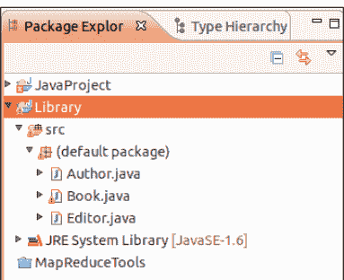

## Java Editor 视图

Java Editor 用于编辑 Java 源文件，为 Java 透视图中主视图，位于屏幕中间。

以下为 Java Editor 视图截图：

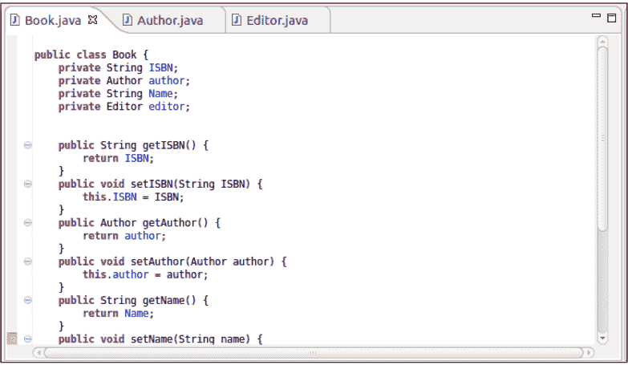

Java Editor 不止普通文本编辑器，含多项功能，便于新手写代码并提升资深程序员[content]
## 创建 Java 类

右键 Package Explorer 中的项目，选 **New** | **Class**。打开 **New Java Class** 窗口输入信息。可改超类，加接口，为抽象方法加存根，加构造函数，加 main 方法。

要在包内创建，输入名称或点 **Browse** 选包。包不存在 Eclipse 会创建。新建包：右键项目 **New** | **Package**。右键包选 **New** | **Class**，类在该包内创建。

## 创建工作集

工作集用于分组工作区项目。项目多时在 **Package Explorer** 难找。未用项目可放单独工作集。

创建：视图菜单选 **Select Working Set**，点 **New** 选 **Java**，输入名称选项目。创建后选 **Selected Working Sets** 标记，点 **OK**，仅显示该工作集。

工作集列在视图菜单。选其一则唯一可见。选 **Select Working Set** 可多选。选 **Deselect Workspace** 看全部。导航 **Top Level Elements** | **Working Sets** 可以工作集为顶级元素查看。

工作集选中时其他项目仍加载。可右键 Close Project 关闭无关项目。Ctrl + A 全选工作集项目。

项目多但不同时用，可建多个工作区。File | Switch Workspace | Other，输入文件夹名点 OK。可在 Copy Settings 复制布局和工作集。

## 导入 Java 项目

File | Import 打开向导。General 选项：

- Archive file: 项目已在工作区，只导入归档新资源。向导列出资源，点 Browse 选目标项目和文件夹。点 Finish 解压复制。
- Existing Projects into Workspace: 导入新项目。已压缩则选 Select archive file，未解压则选 Select root directory。向导列出项目，点 Finish。可加工作集并选是否复制到工作区。
- **File System**: 向工作区项目添加文件系统资源。勾选资源，点 **Browse** 选项目和文件夹。点 **Finish** 复制。
- **Preferences**: 导入 Eclipse 首选项。含代码风格、编译器、JRE 列表、**Problems** 视图配置。可选导入项。

## 从版本控制服务器导入项目

版本控制服务器项目可直接导入。多种软件可通过插件支持。GIT 最常用，详见 *Chapter 4, Managing a Project*。**CVS** 为默认支持。导入：向导 **CVS | Projects**，填服务器信息点 **Finish**。

## 介绍 Java 视图

如 *Chapter 1, Introduction* 所述，Eclipse UI 由视图组成。以下介绍 Java 相关视图。

## Package Explorer 视图

**Package Explorer** 为默认显示项目内容的视图。按包层次显示类，也显示构建路径。

截图：


## Java Editor 视图

Java Editor 用于编辑 Java 源文件，为 Java 透视图主视图，位于屏幕中间。

截图：


Java Editor 不止文本编辑器，含多项功能，便于新手写代码并提升资深程序员生产力。以下介绍部分功能。


## 编译错误和警告标注

如你在“构建和运行”部分中将更详细地看到，Eclipse 默认会在每次保存修改后自动构建你的代码。这使得 Eclipse 能够获取 Java 编译器的输出并在代码中标记错误和警告，从而更容易发现和纠正它们。警告以下划线黄色显示，错误则为红色。

## 内容辅助

这可能是初学者和经验丰富的 Java 程序员都最常用的 Java 编辑器功能。它允许你列出给定实例可调用的所有方法以及其文档。该功能默认适用于所有 Java 类以及工作区中的类。要为外部库启用它，你需要为项目配置构建路径。我们将在本章的“管理项目构建路径”部分进一步讨论构建路径。

要查看此功能的工作方式，请打开一个 Java 编辑器，并创建一个新的 String 实例。

```
String s = new String();
```

现在添加对该 String 实例的引用，后跟一个点，然后按 Ctrl + Space 键。你将看到所有 String() 和 Object() 方法的列表。这比在 Java 文档中搜索类的 API 或死记硬背要实用得多。

以下屏幕截图显示了内容辅助功能的工作情况：

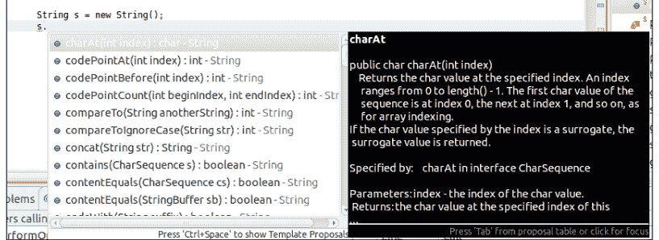

此列表可以通过在点之后输入方法名称的开头来过滤。假设你想替换此 String 实例中的某些字符。作为一名初级 Java 程序员，你不确定是否有这样的方法；如果有，你也不确定它接收哪些参数。合理猜测该方法名称可能以 replace 开头，对吧？那么请继续输入：

```
s.replace
```

当你按下 Ctrl 键并同时按空格键时，你将获得所有名称以 replace 开头的 String() 方法的列表。通过选择其中一个并按 Enter，编辑器会用方法的其余名称及其参数完成代码。它甚至会建议代码中你可能想要用作参数的某些变量，如以下屏幕截图所示：

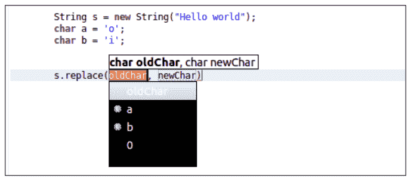

内容辅助将适用于项目类路径中的所有类。你可以通过在首选项窗口中取消选中“启用自动激活”，并导航到 Java | 编辑器 | 内容辅助 来禁用内容辅助的自动激活。

## 代码导航

当你正在处理的项目足够大的时候，在程序包资源管理器中查找类可能会很麻烦。你经常会问自己：“那个类又在哪个包里？”你可以将正在处理的类的源代码留在不同的标签页中打开，但很快你就会打开比想要的更多的标签页。

Eclipse 对此有一个简单的解决方案。在工具栏中，选择 **Navigate | Open Type**。现在，只需输入类名，然后单击 **OK**。如果不记得类的全名，可以使用通配符 ?（匹配一个字符）和 *（匹配任意数量的字符）。你也可以仅使用驼峰命名法的字母大写（例如 `SIOOBE` 代表 `StringIndexOutOfBoundsException`）。**Open Type** 对话框的快捷键是 *Ctrl + Shift + T*。还有一个等效功能可用于查找和打开除 Java 类之外的资源，例如 HTML 文件、图像和纯文本文件。**Open Resource** 对话框的快捷键是 *Ctrl + Shift + R*。

你也可以按住 *Ctrl* 并在代码中单击对该类的引用来导航到类的源文件。要直接导航到方法的实现或定义，请按住 *Ctrl* 并单击方法调用。

另一个便于浏览项目源文件的有用功能是 **Package Explorer** 视图中的 **Link With Editor** 功能，如以下屏幕截图所示：


启用后，Package Explorer 中选中的资源将始终是编辑器中打开的那个。将此功能与 Open Type 结合使用，绝对是在 Package Explorer 中查找资源的最简单方法。

## 快速修复

每当代码中有错误或警告标记时，Eclipse 可能会提供一些消除它的建议。要打开包含建议的 **Quick Fix** 菜单，请将插入点放在与错误或警告相关的标记代码上，右键单击它，然后选择 **Quick Fix**。你也可以使用快捷键 *Ctrl + 1*，将插入点放在标记的代码上。

以下屏幕截图显示了快速修复功能建议你删除未使用的变量，为其创建 getter 和 setter，或添加 SuppressWarnings 注解：

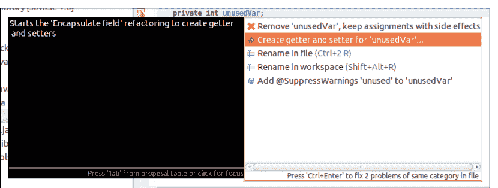

让我们看看 Eclipse 提供的一些最常用的快速修复。你可以利用这些快速修复来加快代码编写。例如，你可以故意在没有 try/catch 块的情况下调用抛出异常的方法，并使用快速修复来生成它，而不是自己编写 try/catch 块。

- **未处理的异常：** 当调用抛出异常的方法且异常未被捕获或抛出时，Eclipse 会将该调用标记为错误。你可以使用快速修复功能自动将代码用适当的 try/catch 块包围。只需打开 **Quick Fix** 菜单，然后选择 **Surround with Try/Catch**。它将生成一个 `catch` 块，然后调用所抛异常的 `printStackTrace()` 方法。如果方法已在 `try` 块内，你也可以选择 **Add catch clause to the surrounding try** 选项。如果异常不应在当前方法中处理，你也可以使用 **Add throws declaration** 快速修复。
- **对不存在的方法和变量的引用：** Eclipse 可以使用快速修复为代码中引用的不存在的方法创建存根。为了说明此功能的有用性，假设你正在处理一个类的代码，并意识到你需要一个方法，使用两个整数执行特定操作并返回另一个整数值。你可以简单地使用该方法，假装它存在：

```
int b = 4;
int c = 5;
int a = performOperation(b,c);
```

方法调用将被标记为错误，提示 `performOperation is undefined`。要为此方法创建存根，请将插入点放在方法名称上，打开 **Quick Fix** 菜单，然后选择 **create method** `performOperation(int, int)`。将创建一个私有方法，具有正确的参数和返回类型，并在其中包含一个 TODO 标记，提醒你必须实现该方法。你也可以使用快速修复在其他类中创建方法。使用相同的上一个示例，你可以在不同的类中创建 `performOperation()` 方法，例如以下内容：

```
OperationPerformer op = new OperationPerformer();
int a = op.performOperation(b,c);
```

说到类，如果你添加对不存在的类构造函数的调用，快速修复也可以创建类。

不存在的变量也可以通过快速修复创建。与方法创建类似，只需引用一个仍不存在的变量，将插入点放在其上，然后打开 **Quick Fix** 菜单。你可以创建变量作为局部变量、字段或参数。
- **删除死代码**：未使用的方法、构造函数和私有可见性的字段都会被标记为警告。虽然为未使用的方法和构造函数提供的快速修复是最明显的（删除死代码），但也可以使用快速修复为未使用的私有字段生成 getter 和 setter。

## 自定义编辑器

与 Eclipse 中的几乎所有内容一样，你可以自定义 Java 编辑器的外观和行为。**Preferences** 窗口（**Window** | **Preferences**）中有大量配置，肯定可以让你根据需要定制编辑器。与外观相关的配置大多位于 **General** | **Appearance** | **Colors and Fonts** 下，而行为和功能配置大多位于 **General** | **Editors** | **Text Editors** 下。由于存在大量不同的类别和配置，**Preferences** 窗口中的过滤文本可能有助于你找到想要的内容。你最有可能想要更改的偏好设置简短列表如下：

- **颜色和字体**：导航到 **General** | **Appearance**。在 **Colors and Fonts** 配置屏幕中，你可以看到选项按类别组织。**Basic** 和 **Java** 类别中的选项将影响 Java 编辑器。
- **启用/禁用拼写检查**：Eclipse 编辑器自带拼写检查器。虽然在某些情况下它可能有用，但在许多其他情况下你可能不会用到它。要禁用或配置它，请导航到 **General** | **Editors** | **Text Editors** | **Spelling**。


-   **注解：** 你可以通过在 **首选项** 窗口中导航到 **常规 | 编辑器 | 文本编辑器 | 注解** 来编辑注解（警告和错误等）在编辑器中显示的方式。你可以更改颜色、注解在代码中高亮显示的方式（下划线、波浪线、方框等），以及它们是否显示在代码之前的垂直栏中。
-   **显示行号：** 要在编辑器左侧显示行号，请通过导航到 **常规 | 编辑器 | 文本编辑器** 勾选相应的复选框。在编辑器左侧栏上右键单击会弹出一个对话框，在其中你也可以启用/禁用行号。

## 问题视图

正如我们在 Java 编辑器描述中所看到的，Eclipse 使用类的自动编译输出在整个代码中标记编译器的错误和警告信息。这些信息也列在 **问题** 视图中。以下截图显示了该视图的外观：

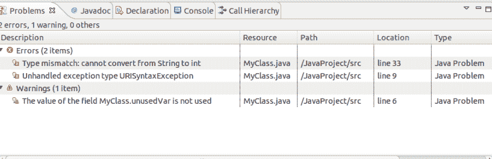

默认情况下，它显示当前工作区中所有打开项目中的所有错误和警告。如你所见，每个条目都包含编译器错误/警告信息以及问题所在的位置。双击条目后，将打开 Java 编辑器的新标签页（用于包含问题的资源，除非该标签页已存在），并且插入点将被放置在问题的行上。

## 自定义问题视图

**问题** 视图允许大量自定义设置以便于浏览其条目。例如，你可以通过进入 **视图** 菜单（视图右上角的白色三角形）并选择 **分组依据** 条目来按严重程度和类型对它们进行分组。

当工作区中打开的项目太多时，显示所有项目的所有错误和警告可能不是一个好主意。幸运的是，你可以自定义 **问题** 视图将显示的内容。为此，请在视图菜单中打开 **配置内容** 窗口。

窗口左侧有一个问题配置列表。你可以选择显示与全部或任意配置匹配的项目。可以通过单击 **新建** 按钮添加新配置。四个默认配置不能被删除或重命名，但可以像你创建的那些一样进行编辑。

你可以修改配置将在其中搜索问题的范围以及配置包含的问题类型（其中一些类型可能不涉及 Java 代码）。你还可以筛选包含或不包含某些文本的问题。

**问题** 视图的另一个有助于组织问题列表的功能是创建其他视图。要创建另一个视图，请打开视图菜单并选择 **新建问题** 视图。每个视图都有自己的配置，因此你可以创建多个视图并让每个视图显示一种类型的问题。

## 大纲视图

**大纲** 视图提供所选类的概述。默认情况下，它显示类的字段和方法列表。你可以配置视图以隐藏静态元素、字段、非公共成员和本地类型。

以下截图显示了 Book 类的大纲：

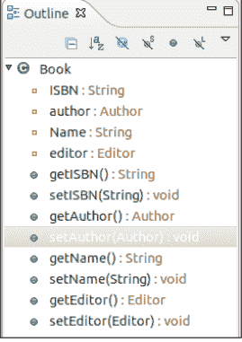

## 类型层次结构视图

**类型层次结构** 视图用于可视化类的超类和扩展。要在此视图中加载类的类型层次结构，请在 Java 编辑器中选择类名的引用，右键单击它并选择 **打开类型层次结构**；或者，你可以使用 *F4* 键盘快捷键。当你有一个接口并想列出其所有实现时，此工具会很有用。

以下截图包含 **类型层次结构** 视图，显示 `java.awt.Button` 类的超类型层次结构：

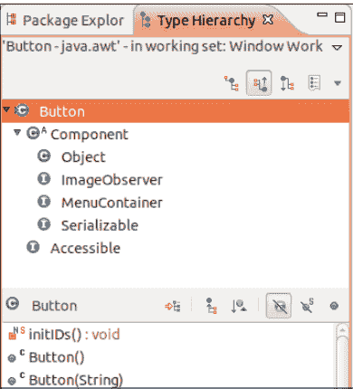

**类型层次结构** 视图的替代方案名为 **快速类型层次结构**。它不会加载并显示 **类型层次结构** 视图，而是在弹出窗口中显示类的层次结构。**快速类型层次结构** 的键盘快捷键是 *Ctrl + T*。

## 调用层次结构视图

要查看项目中对特定方法所做的所有调用，请在 Java 编辑器中选择方法名的引用，右键单击它并选择 **打开调用层次结构**；或者使用 *Ctrl + Alt + H* 键盘快捷键。该视图提供了所选方法调用的完整递归层次结构，如以下截图所示：

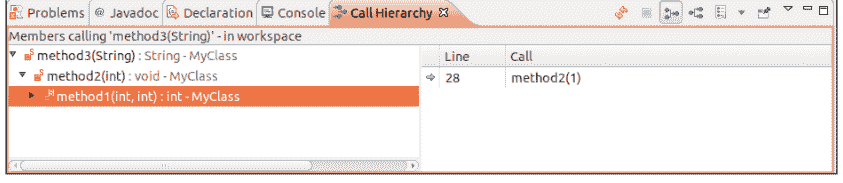

## 组织导入

Eclipse 使管理类的导入变得容易。通过在 Java 编辑器上右键单击并导航到 **源代码 | 组织导入**，所有在代码中没有引用的未使用导入和导入类将被删除。你也可以使用 *Ctrl + Shift + O* 快捷键来组织导入。

为了说明此功能的有用性，假设你想在代码中添加一个 `ArrayList` 实例。与其导入 `ArrayList` 并使用它（你可能知道也可能不知道 `ArrayList` 的包名），你可以简单地写：

```
ArrayList a;
```

或者，你也可以按 *Ctrl + Shift + O* 来添加导入。

如果类名在当前类路径中的多个包中出现，你将被提示选择你要引用的那个包。

## 保存操作

你可以定义每次保存 Java 源文件时要执行的操作。为此，在工具栏中导航到 **窗口 | 首选项**；然后在左侧菜单中导航到 **Java | 编辑器**，并选择 **保存操作**。勾选 **在保存时执行所选操作** 复选框，并选择你想要执行的操作。可以自动组织导入以删除未使用的导入、添加缺失的注解、格式化源代码并强化代码风格。

你也可以为每个项目定义特定的保存操作，方法是右键单击包资源管理器中项目的条目并单击 **属性**。然后在新窗口中导航到 **Java 编辑器 | 保存操作**，并勾选 **启用项目特定设置**。

## 使用格式化程序强制执行编码风格

一些公司和开源项目对编码风格要求非常严格。它们对何时跳行、何处放置空白、缩进应如何显示等有明确的指导。所有这些指导都可以在 Eclipse 的 Formatter 工具中实现，该工具帮助开发人员在无忧的情况下设置代码样式。格式化程序将修改你的代码以符合一组编码风格规则。要运行格式化程序，请在工具栏中导航到 源代码 | 格式化 或使用 Ctrl + Shift + F 快捷键。你也可以使用保存操作强制 Eclipse 在文件保存后运行格式化程序。

要编辑工作区的格式化设置，请转到首选项窗口（窗口 | 首选项），并在左侧菜单中导航到 Java | 代码风格 | 格式化程序。格式化程序的设置保存在配置文件下，可以保存、导入和导出。编辑按钮会打开大量设置，可满足大多数代码样式需求。

你也可以定义项目特定的格式规则。在项目属性窗口中（在包资源管理器中右键单击项目并选择属性），在左侧菜单中导航到 Java 代码风格 | 格式化程序，并勾选启用项目特定设置。

## 生成代码

在 Java 中，你最终会发现自己一遍又一遍地编写相似的代码片段。尽管良好的设计原则使用倾向于最小化这种情况，但某些方法，例如 getters、setters 和 constructors，在大多数情况下看起来完全相同。Eclipse 可以通过为这些简单方法生成代码来帮助你。

你可以通过在 Java 编辑器中的任何位置右键单击并选择 源代码 条目来查看 Eclipse 可以生成的所有代码。此菜单也可以使用 Alt + Shift + S 快捷键打开。

## 生成 getters 和 setters

Getters 和 setters 通常相同。它们通过返回其值或分配新值来提供对类的某些私有字段的访问。为了避免这种显而易见的任务并节省时间来编写真正的代码，请从 源代码 条目中选择 生成 Getters 和 Setters。你将看到一个窗口，如以下截图所示：

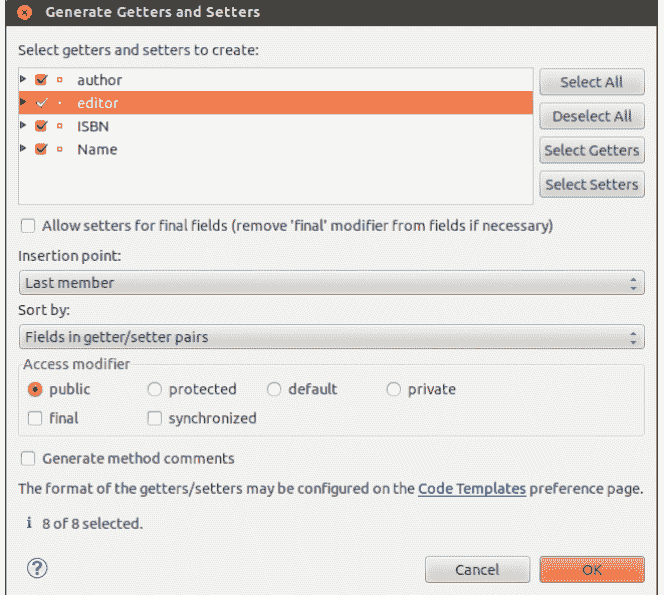

在 **生成 Getter 和 Setter** 窗口中，你可以确定要为哪些字段生成 getter 和 setter，以及选择它们的访问修饰符和在代码中插入的位置。

## 生成构造器

与 getter 和 setter 一样，类构造器也有一个非常典型的模板，它接收要分配给类字段的值并调用超类的构造器。你也可以通过在 **源** 菜单项中点击 **使用字段生成构造器** 来跳过这个繁琐的任务。你会看到一个与 **生成 Getter 和 Setter** 类似的窗口，在其中会被提示选择哪些字段的值将由构造器初始化，以及构造器将在代码中的何处插入等。

## 生成 hashCode() 和 equals() 方法

在某些情况下，你需要重写从 Object 类继承的 equals() 和 hashCode() 方法，以便当它们具有相同的参数值时，将两个不同的实例视为相等。

Eclipse 也为这两个方法提供了模板。通过在 源 菜单项中选择 Generate hashCode() and equals()，你将能够生成利用你选择的字段来比较两个实例并生成实例哈希码的方法。equals() 方法的模板将检查另一个对象是否为空，是否属于同一类的实例，以及所选参数是否相等。

## 生成 toString() 方法

要生成一个 toString() 方法以以人类可读的形式返回类字段的值，请选择 Generate toString() 选项。与之前的生成器一样，此生成器也允许你选择希望 toString() 方法包含哪些字段。

## 生成方法注释

Eclipse 中可以轻松生成 Javadoc 格式的方法注释。为此，右键单击所需的方法，并导航到 Source | Generate Element Comment，或使用快捷键 Alt + Shift + J，同时将光标定位在方法的签名行。这些注释将在用户将鼠标悬停在方法调用上时或使用内容辅助功能时在 Eclipse 中显示。

生成的注释包含方法参数和返回类型。你只需要添加对方法用法的简单描述，并在需要时对参数进行一些说明。以下截图中展示了生成的注释示例：


> 这些快捷键看起来可能没用且难以记忆，但一旦你习惯了它们，它们就会变得非常方便，并且会显著提高你的编码速度，因为当你熟记最常用的快捷键时，你很少需要把手从键盘上移开。附录、键盘快捷键 包含本书中介绍的所有快捷键的详尽列表。

```java
/**
 * @param isbn
 * @param author
 * @param name
 * @param editor
 */
public Book(String isbn, Author author, String name, Editor editor) {
    super();
    this.isbn = isbn;
    this.author = author;
    this.name = name;
    this.editor = editor;
}
```

## 编辑代码和注释模板

尽管这些模板在大多数情况下都能正常工作，但你的项目可能有一些特殊之处，需要特定类型的构造器。你仍然可以通过编辑模板并根据需要对其进行定制来利用代码和注释生成。为此，右键单击 Package Explorer 中项目的条目并选择 **属性**。在左侧菜单中展开 **Java 代码风格** 条目并选择 **代码模板**。以下窗口将打开：

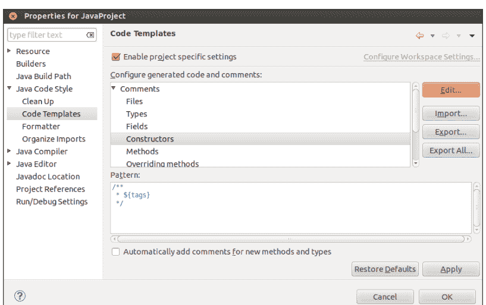

通过选择一种生成的代码或注释类型并点击 **编辑**，你将能够向模板添加代码和变量。你还可以选择自动为新生成的方法和类型添加注释。

在此窗口中编辑的代码模板设置是项目特定的。设置保存在项目文件夹内的元数据文件中，因此当项目被导入时，编码风格设置会自动设置。这使你能够在项目的所有开发人员之间强制执行项目的编码风格。如果你想为整个工作区编辑默认代码模板，请打开 **首选项** 窗口并导航到 **Java | 代码风格 | 代码模板**。不包含模板特定设置的项目将使用这些设置。

## 重构

代码重构可能是一件很痛苦的事。随着项目的增长，为方法添加参数或重命名它可能会变成一场噩梦。Eclipse 有一些重构工具，使此类任务变得轻松自如。

### 重命名变量

手动重命名变量可能很繁琐且耗时。你可以求助于查找/替换来使其不那么痛苦。但由于变量名可能在代码的其他地方匹配，你必须逐一检查变量名的每个匹配项并验证是否需要修改它（尝试在一个足够大的类中重命名名为 x 的变量，你就会明白）。如果变量是公共的，你还必须扫描整个项目中该变量的引用。

幸运的是，Eclipse 会为你完成此操作。只需右键单击代码中变量的任何出现位置并导航到 **重构 | 重命名**。输入新变量的名称并按 *回车*。

你可以看到，即使变量名在代码的其他部分出现，也只有变量名内的文本被修改。Eclipse 能够做到这一点是因为它编译代码并使用此过程中的信息来知道代码中哪些是变量的引用。由于它依赖于编译后的代码，因此无法在存在编译错误的类中重命名变量。Eclipse 也不会允许你将变量名更改为同一上下文中已存在的名称。重命名也适用于其他元素，例如类、方法和接口。


> 不要让 Eclipse 的功能让你变软！仅仅因为重命名变量变得超级容易，你就不应该随意忽视良好的编码实践，例如变量封装。好的代码就是好的代码，无论使用什么 IDE。

### 修改方法签名

修改方法签名与重命名变量一样会带来类似的不便。Eclipse 也能在该任务中提供帮助。右键单击方法名并导航到 **重构 | 更改方法签名**。你将看到一个窗口，允许你更改方法的访问修饰符、返回类型、方法名，并添加/删除参数。

在修改方法签名时，对该方法的调用也会被修改。当你在签名中添加新参数时，可以选择一个默认值，该值将被添加到调用中。

## 构建和运行项目

默认情况下，Eclipse 会在每次保存修改后自动构建项目的代码。它使用一个定制的内部编译器，具有一些有趣的功能，例如即使类包含错误也能执行类以及增量编译（允许仅编译项目的一部分）。修改重新编译后，它可以即时突出显示代码中的问题。你可以在 **问题** 视图中看到这些错误的列表。如果视图当前在工作区中不可见，可以通过导航到 **Window | Show View | Problems** 来打开它。

然而，如果你正在处理一个太大的项目，或者你使用的是资源较低的机器，自动构建可能会减慢速度。要禁用它，请点击 **项目** 并取消选中 **自动构建** 选项。一旦这样做，项目将只在你导航到 **Project | Build Project** 或 **Project | Build All** 时才会被构建。

要运行你的项目，请在 **Package Explorer** 视图中选择它，然后点击工具栏中的绿色播放按钮，或从 **运行** 选项卡中选择 **运行**。这将无需任何进一步配置即可启动你的项目。如果你的项目包含一个带有 `public static void main(String[] args)` 方法的类，它将被执行。如果有多个类包含它，你将能够选择要运行的类。你可以在 **控制台** 选项卡中看到你的程序的输出（如果有的话）。


## 创建启动配置

如果你的项目需要自定义，例如运行时的参数或特定的类路径配置来运行，你可以创建一个启动配置来满足这些需求。为此，导航到 运行 | 运行配置。以下截图显示了启动配置窗口：

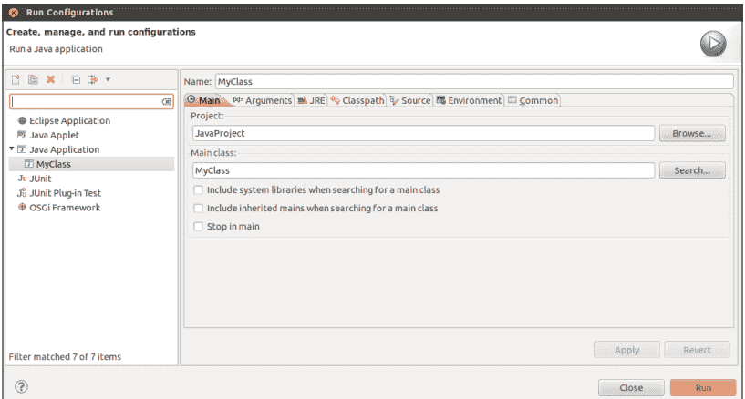

在 Run Configurations 窗口的左侧，你有一份所有启动配置类别的列表。要为 Java 项目创建新的启动配置，双击 Java Application 类别。如果你已经使用运行按钮运行过一次应用程序，则该类别中将有一个默认配置。

通过选择配置，你将看到包含启动配置的选项卡。以下是每个选项卡的简要说明：

- **Main**：在这里你将选择项目和主类。**Main class** 文本字段旁边的 **Search** 按钮允许浏览项目中所有带有 main 方法的类。
- **Arguments**：此选项卡让你为 main 类本身和 JVM 设置参数。
- **JRE**：此选项卡让你选择用于运行类的 JRE。
- **Classpath**：编辑此选项卡以创建具有特定类路径配置的启动配置。修改此选项卡的配置不会修改项目的类路径配置。
- **Source**：此选项卡让你更改源查找路径。与 **Classpath** 选项卡一样，这些配置不会修改项目本身，仅对该启动配置有效。
- **Environment**：此选项卡允许你为此运行配置定义环境变量。
- **Common**：此选项卡包含启动的通用配置。它允许你选择为启动分配控制台并将输出写入文件而不是控制台。**Save as** 部分指的是启动配置文件。

## 管理项目构建路径

构建路径是 Eclipse 用于解析依赖项的 JAR、类和源文件文件夹的列表。你可以通过进入项目的属性并选择 **Java Build Path** 来编辑项目的构建路径。配置选项已分为四个选项卡：

- **Source**：此选项卡包含管理项目源文件夹的选项。它允许你创建新的源文件夹并在文件系统中添加对外部源的链接。
- **Projects**：你可以在此选项卡中管理项目在工作区中对其他项目的依赖。当你向另一个项目添加依赖时，默认情况下你将完全访问其所有类。然而，其中一些类在项目在 Eclipse 外编译和执行时可能不可见。你可能会得到一个在 Eclipse 内部工作但在外部运行 JAR 文件时不起作用的项目。为了避免这些令人困惑的问题，你可以为外部项目创建访问规则，以防止它们使用其他项目的内部包。为此，展开所需项目，选择 **Access Rules**，并点击 **Edit**。点击 **Add Access Rule** 并添加 **Rule Pattern**。你可以阻止访问（编译但显示警告）或禁止访问（编译时出现错误）。
- **Libraries**：在此选项卡中，你可以编辑将添加到项目构建路径的库。你可以从工作区内部或外部添加 JAR 和类文件夹，也可以添加库和变量。你可以从库添加链接到其 Javadoc。这将允许你拥有带有描述其用法的注释的方法和类，就像它们在你的工作区中一样。要为库添加 Javadoc，展开列表中的条目，选择 **Javadoc location**，并点击 **Edit** 按钮。输入 Javadoc 的路径并点击 **OK**。如果你有访问权限，也可以指向库的源代码。
- **Order and Export:** 在这里你将定义项目的哪些源文件夹和库将被导出，以便其他项目可以导入它们。此选项卡还允许你选择库在运行时加载的顺序。顺序将决定在两个不同的库提供同一类时将加载哪个类。要提高或降低库的优先级，选择它并按 **Up** 和 **Down** 按钮。

## 总结

本章中，我们涵盖了使用 Eclipse 进行 Java 开发的基础知识：创建和导入 Java 项目、在工作集中组织项目、添加新类等。我们浏览了 Eclipse 用于 Java 开发的所有视图，了解了它们如何用于浏览代码、查找错误、警告等。特别关注了 Java 编辑器，涵盖了其最有用的功能。我们还涵盖了一些更高级的主题，例如创建代码生成模板和项目设置，这些可以由团队中的开发人员共享以强制执行代码风格和最佳实践。

在下一章中，你将学习 Eclipse 如何帮助你调试 Java 应用程序以及使用 JUnit 测试它们。
