# 3 使用 JUnit 进行单元测试和调试

到目前为止，你已经过了基础阶段，应该熟悉使用 Eclipse IDE 开发 Java 应用程序。虽然你一定对最近获得的技能感到非常自信，但在继续之前，你应该知道，代码越多，引入 bug 的可能性就越高。即使 Eclipse 提供了所有功能，随着 Java 应用程序规模的扩大，事情也注定会出错。因此，当我们的应用程序代码开始变得难以管理时，我们需要建立一个安全网。一种方法是测试我们的程序，而测试正是本章要涵盖的内容之一。

在理想世界中，我们测试检测到的所有问题都很容易追踪和修复。然而，这并不总是如此。事实证明，讨厌的 bug 可能会进入我们的代码。如前所述，拥有良好的测试集有助于我们发现问题，然而，有时测试集提供的反馈不足，我们需要深入挖掘以发现问题。理解软件为何行为不正常并为其制定修复方案的行为称为 **debugging**。调试将在本章后面介绍。

在测试和调试 Java 程序方面，Eclipse 提供了全方位的支持。它内置了自动化创建和执行 JUnit 测试的功能，并提供了一个令人印象深刻的 Java 调试器。

本章将涵盖以下主题：

- 在 Eclipse 中配置 JUnit
- 使用 Eclipse 内部的 JUnit 组织、开发和运行单元测试
- 在出现 bug 时使用 Eclipse 内置调试器，并理解仅测试方法不足以确定问题原因

## 使用 JUnit 进行测试 – 入门

在描述 JUnit 之前，我们认为有必要先谈谈单元测试。在进行单元测试活动时，重点放在代码的小块上。换句话说，你并不是试图用一个测试覆盖整个程序。相反，你通过为每个类编写一套测试、每个方法编写一个或多个测试来测试程序的基础。在处理代码时编写测试有很多好处。例如，单元测试时更容易找到 bug。这是因为每个单元测试都应评估一个功能单元，这使得需要追踪 bug 的范围远小于在整个程序中搜索 bug。然而，根据 Robert C. Martin，要充分利用单元测试的好处，你的测试套件必须遵守以下原则（也称为 FIRST 首字母缩写）：

- **Fast**：测试应该是完全自动的，并且能够检查自己的结果。但最重要的是，你应该能够快速执行它们，以便可以频繁执行。
- **Independent**：测试不应相互依赖。你应该能够以任何特定顺序运行测试。
- **Repeatable**：你应该能够在任何环境（不仅是生产环境）中以所需的频率执行测试。
- **Self-validating**：测试应产生布尔结果，即它们要么通过要么失败；中间不应有任何状态。实际上，这归结为避免需要手动评估的主观输出。
- **Timely**：根据 Robert C. Martin，单元测试应在代码实现其评估的功能之前编写。据他说，在实现生产代码后编写测试更困难。从学术角度来看，关于在实现代码之前编写测试与之后编写测试的好处之间并没有实质性证据。这显然是一个有争议的话题，我们不寻求影响你偏向特定方法。尝试在实现代码之前和之后编写测试，看看哪种方法最适合你。


> 如果你认为在实现代码之前编写测试更适合你，你应该阅读关于测试驱动开发（TDD）的资料。在此期间，你可能还想学习重构，即在不改变其外部行为的情况下改进代码。


现在你已经对支撑单元测试的哲学有了基本了解，你已准备好迈出下一步，开始编写自己的测试——学习如何使用单元测试框架。鉴于 JUnit 可谓 Java 社区中最流行的测试框架，我们将在此介绍它。

更具体地说，JUnit 是一个开源测试框架，最初由 Kent Beck 和 Erich Gamma 创建（www.junit.org）。截至本文撰写时，该框架（也是 IDE 中捆绑的版本）的最新稳定版本是 4.10 版。由于 Erich 主导了 Eclipse Java 开发工具（JDT）的设计，JUnit 已与 IDE 很好地集成。Eclipse 已随附捆绑的 JUnit JAR。因此，只要你计划使用 JUnit 4.10，就没有太多关于安装的内容需要说明。然而，也可以使用不同版本的 JUnit。设置默认和非默认 JUnit JAR 的步骤将在以下章节中介绍。

尽管 JUnit 和 Eclipse 这对组合支持并自动化了大部分测试过程，你仍需手动编写自己的测试文件。由于 Eclipse 将测试文件的组织方式交由你决定，有必要说明一下如何组织这些文件。

基于 JUnit 的测试文件可以按以下方式组织。假设你的应用程序有一个名为 MyAppClass 的类，并且你想对其进行测试。为此，你需要将测试放在另一个名为 MyAppClassTest 的类中。通常，测试类与常规代码分开存放。惯例是将它们放在名为 test 的子包中。于是，假设 MyAppClass 位于名为 org.myapp 的包中，与该类相关的测试需要放在名为 org.myapp.test 的子包中。至于测试本身，它们以 Java 方法的形式分组在 MyAppClassTest 中，并会进行一些稍后的说明的轻微修改。以下截图展示了这种典型组织的概览，其中使用了一个名为 MyTestProject 的假设 Java 项目来说明这种组织方式：

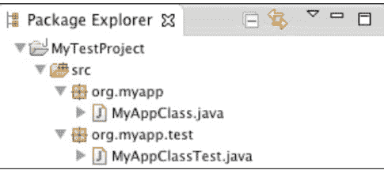

> 值得一提的是，JUnit 和 Eclipse 都不会强制执行这种命名约定。为测试创建单独的文件夹/子包也不是强制性的。然而，遵循这些约定是一种良好的编程实践。还值得一提的是，组织测试代码的另一种广泛使用的约定是 Maven 约定。遵循此约定，你需要为常规 Java 代码和测试代码创建单独的文件夹，`src/main/java` 和 `src/test/java`。此外，测试类应放在与它们所测试的类相同的包中。

## 设置 JUnit

为了在 Eclipse 中使用 JUnit，你需要将 `junit.jar` 添加到项目的构建路径中。为此，右键单击你的项目，并导航到 **Build Path | Add Libraries...**，如下图所示：

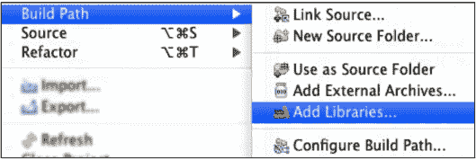

以下截图显示了 Eclipse 列出的选项。选择第二个选项 **JUnit**。你可以选择 JUnit 版本 3 或版本 4。

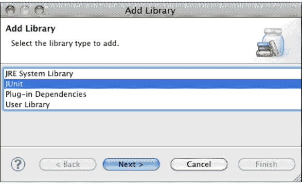

在本章中，我们将使用 JUnit 4（更具体地说是 4.10）；因此请继续选择 JUnit 4，如下图所示：

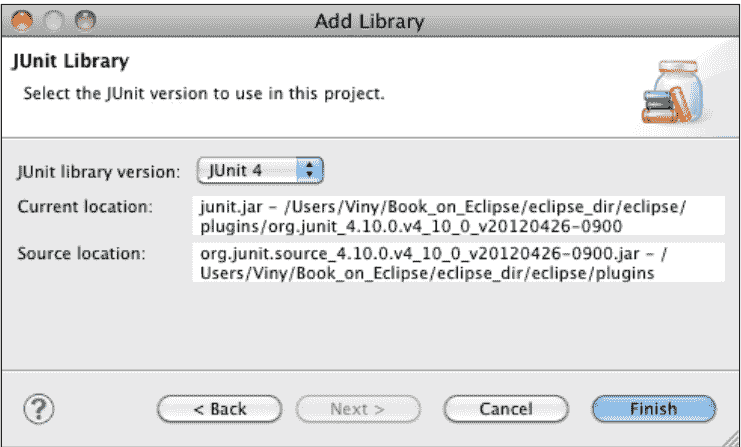

JUnit 3 和 JUnit 4 之间存在显著差异，主要是因为 JUnit 4 大量依赖于最新版本 Java 引入的新特性。更具体地说，JUnit 3 和 JUnit 4 的主要区别在于后者依赖于注解而不是层次结构和方法名约定。如果你熟悉 JUnit 3，但尚未使用过 JUnit 4，你会发现后者比前者更简单、更易于使用。

通过选择 JUnit 4，Eclipse 会将 JUnit 4.10 添加到你的项目构建路径中。如果你需要使用不同版本的 JUnit，可以从 JUnit 网站下载该特定版本并将其添加到项目的构建路径中。为此，从 JUnit 网站下载所需版本，右键单击你的项目名称，并导航到 Build Path | Configure Build Path...，如下图所示：

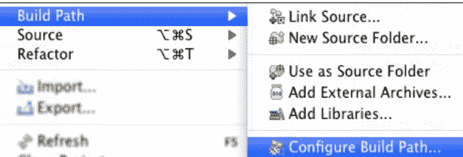

项目属性窗口将会出现，显示项目的构建路径当前配置（如下图所示）。选择 Libraries 选项卡，单击 Add External JARs...，找到并选择你最近下载的 JAR，然后单击 OK。再次单击 OK 关闭属性窗口。完成，现在 JUnit 已运行。我们已准备好创建基于 JUnit 的测试。值得一提的是，通过项目属性窗口，你也可以通过单击 Add Library... 选项来添加 JUnit 4。选择此选项会打开前面截图中显示的弹出窗口。

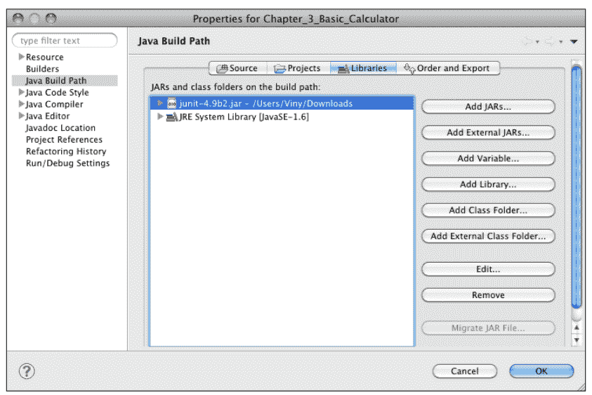

将新的 JAR 添加到构建路径可以通过多种方式完成。在本节中我们只介绍了两种。如果你采用了第一种方法，JUnit JAR 文件将被放置在 JUnit 4 下，如下图所示的 (a) 所示。否则，JAR 文件将出现在 Referenced Libraries 下，如 (b) 所示。继续阅读以发现设置 JUnit 的更简单方法。


## 使用 JUnit 进行测试

使用 JUnit，编写可重复的测试非常简单。事实上，从第一天起，易于使用就是 Kent 和 Erich 做出的一项关键设计决策。据他们说，如果 JUnit 不易于学习和执行，程序员实际上不会使用它。

基本上，当你需要使用 JUnit 测试某物时，你执行以下基本操作：

- 1. 创建将包含所有测试的 Java 类。确保按照上一节中描述的约定对其命名。
- 2. 创建一个方法并用 `@org.junit.Test` 为其注解。
- 3. 在之前创建的方法内部编写与你想要测试的行为相关的代码。
- 4. 为了检查被测代码是否产生预期结果，静态导入 `org.junit.Assert`，并调用 Assert 系列中的一个方法（`assertTrue`、`assertEquals` 等）来比较测试结果与预期结果。

JUnit 框架还有其他几个特性，但这些是你入门需要理解的特性。因此，让我们通过测试一个实现基本计算器的 Java 类来深入了解这些基本特性的技术细节。

首先，我们需要为计算器类创建一个新的 Java 项目。因此，在 Eclipse 中导航到 **File** | **New** | **Java Project**。要为项目命名，在 **Project name** 字段中输入 `BasicCalculatorProject`，然后单击 **Finish**。你可能会被提示切换到 Java Perspective。如果发生这种情况，请回答 **Yes**。完成所有这些步骤后，**Package Explorer** 视图应显示你的新 Java 项目。然而，如果出现问题，你可能会遇到困难，请返回上一章并回顾如何创建 Java 项目。

在我们最近创建的 Java 项目中，创建一个新包。要创建名为 `chapter3.basiccalc` 的包，选择 `src` 文件夹，右键单击它，并导航到 **New** | **Package**。输入包名，然后单击 **Finish** 按钮。

让我们创建一个名为 BasicCalculator 的类。右键单击你最近创建的包并导航到 New | Class。我们要测试的类如下：

```java
package chapter3.basiccalc;

public class BasicCalculator {
    private static int[] tempVars; //acts as an array of temp variables
    private static int result;

    public void add(int n) {
        result += n;
    }

    public void subtract(int n) {
        result -= n;
    }

    public void addResultToTempAt(int index) {
        tempVars[index] = result;// BUG: tempVars wasn't initialized properly
    }

    public void squareRoot(int n) {
        //not implemented yet
    }

    public void divide(int n) {
        result /= n;
    }

    public void multiply(int n) {
        result = n * n;
    }

    public void clear() {
        result = 0;
    }

    public void clearTemps() {
        for (int i =0; i < tempVars.length; i++) {
            tempVars[i] = 0;
        }
    }
}
```

```
public int getResult() {
    return result;
}
}
```

## 下载示例代码

你可以从你的账户 http://www.PacktPub.com 下载所有已购买的 Packt 书籍的示例代码文件。如果你是在其他地方购买本书，可以访问 http://www.PacktPub.com/support 并注册以便直接将文件发送到你的邮箱。


我们的计算器实现包含两个错误，但暂时不用担心。使用有缺陷的实现会使我们的示例更有趣。

BasicCalculator 类的目的是执行基本算术运算（加法、减法、乘法和除法）并计算平方根；在每次运算后存储结果。除了 result 变量外，还使用一个数组来存储中间结果；使其可以在后续计算中重复使用。用于重用此数组中存储的值的方法尚未实现。到目前为止，我们的计算器只能存储中间结果（保存在 tempVars 数组中）并清除其内存（通过将 tempVars 的所有元素赋值为零）。此外，请注意，应该计算平方根的方法也尚未实现。


好吧，我们的类应该计算平方根，然而，正如你所见，这一特定功能尚未实现。不要担心，我们出于演示目的没有实现这一特定功能。本章后面我们将向你展示如何让 JUnit 跳过测试用例，而该用例要么没有实现，要么当前实现出现问题。

由于我们坚持上一节介绍的命名约定，在测试 BasicCalculator 之前，你应该创建一个名为 chapter3.basiccalc.test 的包。包含所有测试用例的类应在此包内创建。

现在你已经设置好 Java 项目并处理了测试代码周围的所有脚手架，你可以按照上述说明将 JUnit 添加到项目构建路径中，也可以继续阅读并发现添加 JUnit 到构建路径的更简单方法（正如我们提到的，在 Eclipse 中执行操作有多种方式）。

## 使用 JUnit 进行单元测试和调试

右键单击 BasicCalculator 并导航到 New | JUnit Test Case。
以下截图中显示的窗口将会出现：

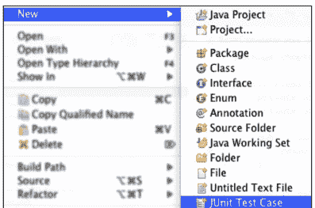

选择 JUnit Test Case 选项后，将弹出一个新窗口，测试用例的名称已自动填入（BasicCalculatorTest）。它还显示了被测试的类（BasicCalculator）。你只需要在 Package 字段中输入测试包名。因此，继续输入 chapter3.basiccalc.test，就像我们在以下截图中所做的那样（或点击 Browse 按钮并选择所需包）。

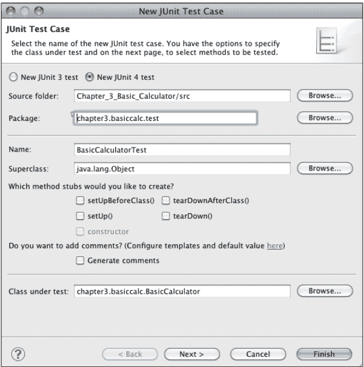

## 实现 Eclipse 生成的测试方法

请注意我们取消选中 setUp() 和 tearDown() 选项。我们稍后会解释这些术语的含义。但目前，我们不希望 Eclipse 自动为我们生成这些方法。取消选中这些选项（如果默认情况下未取消选中），点击 Next 并选择你想要测试的方法，如以下截图所示。这里 Eclipse 提示你选择应为其生成存根的方法。

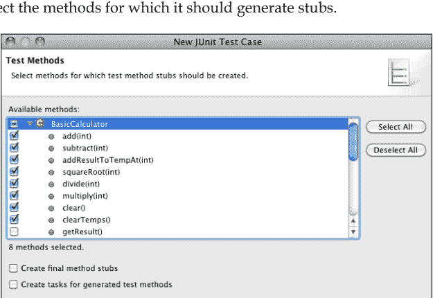

当你点击 Finish 时，如果尚未将 JUnit 添加到项目构建路径，Eclipse 将提示你将 JUnit 4 添加到构建路径（如下图所示）。你应通过点击 OK 来响应。

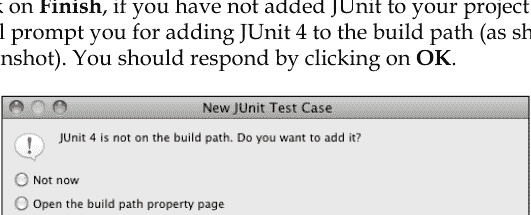

然后 Eclipse 将为你生成以下代码：

```java
package chapter3.basiccalc.test;

import static org.junit.Assert.*;
import org.junit.Test;

public class BasicCalculatorTest {

    @Test
    public void testAdd() {
        fail("Not yet implemented");
    }

    @Test
    public void testSubtract() {
        fail("Not yet implemented");
    }

    @Test
    public void testAddResultToTempAt() {
        fail("Not yet implemented");
    }

    @Test
    public void testSquareRoot() {
        fail("Not yet implemented");
    }

    @Test
    public void testDivide() {
        fail("Not yet implemented");
    }

    @Test
    public void testMultiply() {
        fail("Not yet implemented");
    }
}
```

```
@Test
public void testClear() {
    fail("Not yet implemented");
}

@Test
public void testClearTemps() {
    fail("Not yet implemented");
}
}
```

正如你所见，Eclipse 自动生成了大量样板代码。更具体地说，Eclipse 为我们被测试类的每个方法生成了所有测试方法（每个方法一个），并用 org.junit.Test（@Test）对其进行注释，并静态导入了断言方法。

@Test 注解用于指示 JUnit 将带注解的方法作为测试用例运行。在运行每个测试用例之前，JUnit 会创建该类的一个实例，然后在该实例上调用测试用例方法。本章后面我们将看到 JUnit 如何允许程序员利用这一特性，在需要对象创建后才能执行的测试方法之前初始化测试方法的上下文。

如果测试抛出异常，JUnit 会将其报告为失败。正如你可能已经猜到的，Eclipse 生成的所有测试方法存根都是失败的测试方法。事实上，我们的测试方法失败是因为它们调用了 org.junit.Assert 中的 fail() 方法，该方法通过抛出 AssertionError 来表示测试方法的失败。

为了执行基于 JUnit 的测试类，右键单击它并导航到 Run As | JUnit Test，如以下截图所示：

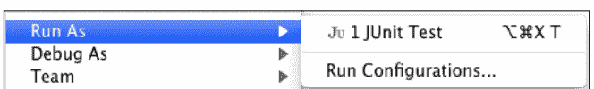

按照刚才所示的方法，尝试运行 `BasicCalculatorTest`。测试结果在以下截图中显示在 **JUnit Runner** 视图中。每当你运行基于 JUnit 的类时，此视图会显示在当前透视图中。此视图会显示失败列表和测试套件的树结构。失败的测试用红色条指示。（如下图所示，我们有八个失败的测试）。下一节将提供有关此窗口每个工具栏的更多信息。

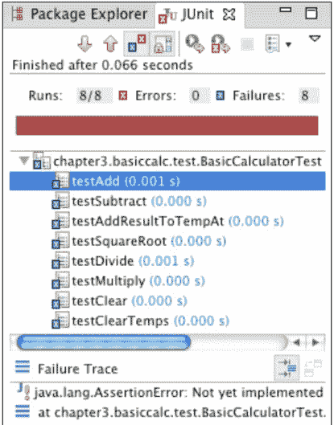

到目前为止，你应该已经习惯于在 Eclipse 中可以用不同方式执行相同的操作。运行测试用例也不例外。以下是你可以运行测试用例的一些方法：

- 假设你想运行单个测试方法。从 Outline 或 Package Explorer 中右键单击该测试方法，并导航到 **Run As | JUnit Test**
- 要重新运行单个测试，请在 **JUnit Runner** 视图中选择一个测试，右键单击它并选择 **Run**
- 要运行项目或包中的所有测试，请选择该包，右键单击它并导航到 **Run As | JUnit Test**

为了查看通过的测试是什么样子的，请按以下代码片段注释 testAdd() 方法的主体，并使用上面描述的方法仅运行 testAdd()：

```
@Test
public void testAdd() {
    //fail("Not yet implemented");
}
```

你应该会看到绿色条；如下图所示。更具体地说，它显示 testAdd() 是一个通过的测试方法，而其他测试方法未被执行。

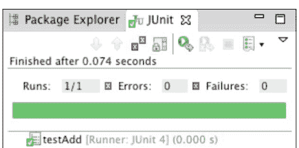

在实现真正评估计算器行为的测试之前，值得更仔细地查看 JUnit Runner 视图，因为你将在本章中 throughout 与其交互。

## Eclipse JUnit Runner 视图概述

执行基于 JUnit 的类后，将显示 JUnit Runner 视图。除了指示最近运行的测试是否成功或失败之外，此视图还显示失败的测试为何失败以及一些有用的工具栏命令。JUnit Runner 视图有两个窗格，测试窗格和失败跟踪窗格。测试窗格以树形列出所有已执行的测试。选择失败的测试后，失败跟踪窗格会显示所选测试失败的原因。以下表格介绍了测试窗格中每个工具栏命令的描述：

| 图标 | 描述 |
|------|-------------|
| ↓ | 将选择移动到下一个失败的测试 |
| ↓ | 将选择移动到上一个失败的测试 |


| 图标 | 描述 |
|------|-------------|
|  | 仅显示失败的测试（如有） |
|  | 保持测试列表不滚动 |
|  | 重新运行所有测试 |
|  | 仅重新运行所有失败的测试 |
|  | 停止当前执行 |
|  | 显示测试运行历史 |

下表描述了 **Failure Trace** 面板中可用的选项。要从某个失败导航到相关的源代码，请在 **Failure Trace** 面板中双击相应的行。

| 图标 | 描述 |
|------|-------------|
|  | 通过移除不需要的堆栈帧来过滤堆栈跟踪 |
|  | 比较字符串比较的实际结果和预期结果 |

## 创建测试用例

到目前为止，我们几乎没有输入什么内容；Eclipse 已经为我们完成了所有工作。然而，现在轮到我们进行一些输入了。为了实现我们的测试用例，我们将逐步进行。首先，我们需要注释掉尚未实现的测试用例。事实证明，JUnit 提供了一种更好的方法来禁用未完成的测试方法，即通过使用 `@Ignore` 对其进行注解。用 `@Test` 和 `@Ignore` 注解的方法根本不会被 JUnit 执行。JUnit 将它们视为已注释掉一样。当使用 `@Ignore` 注解方法时，您还可以提供一个字符串来解释为什么底层测试方法被忽略。

要使用 `@Ignore`，您必须导入 `org.junit.Ignore`。导入后，`@Ignore` 可用于注解方法，如以下代码所示。在以下代码中，我们告诉 JUnit 忽略 `testSubtract`，因为它尚未正确实现。请继续将除 `testAdd()` 之外的所有方法都标记为 `@Ignore`。现在执行我们的测试套件将不会出现任何失败。

```java
@Ignore("Not implemented yet")
@Test
public void testSubtract() {
    fail("Not yet implemented");
}
```

现在其他测试用例不会妨碍我们，让我们开始实现 `testAdd()`。幸运的是，编写单元测试非常简单。您只需要调用应用程序代码的片段，获取结果，然后检查它们是否完全符合预期。使用 JUnit 时，不必编写大量 if 语句来比较结果，您可以依赖断言方法。使用断言方法，您指定预期结果，然后传递从调用应用程序代码获得的实际结果。

例如，我们可以通过执行以下代码所示的简单加法运算来实现 `testAdd()` 方法。首先，我们需要创建一个 `BasicCalculator` 的实例。其次，我们调用正在尝试测试的代码片段，即 `add()` 方法。最后，我们使用断言方法来评估调用 `add()` 方法的结果，参数两次都为 2。`assertEquals()` 方法期望 `getResult()` 返回 4。运行我们的测试用例后，我们可以看到被测方法似乎工作正常，因为 `getResult()` 返回了 4，正如预期的那样。以下是我们实现 `testAdd()` 的方式：

```java
@Test
public void testAdd() {
    BasicCalculator calculator = new BasicCalculator();
    calculator.add(2);
    calculator.add(2);
    // result should be 4
    assertEquals(4 /*expected*/, calculator.getResult() /*actual*/);
    calculator.clear();
}
```


> 通常，编写单元测试应该是容易的。如果编写它们花费的时间太长，可能意味着您的设计需要改进；您应该考虑重构代码。

在实现更多测试之前，有必要再说几句关于断言方法的话。如前例所示，assertEquals() 接受两个参数，预期结果和要与预期结果进行比较的值。在我们的代码中，我们通过静态导入引用此方法（请查看 Eclipse 为我们自动生成的静态导入语句）。如果我们不通过静态导入使用 assertEquals()，我们就需要输入更多内容：Assert.assertEquals(4, calculator.getResult())。

减法操作的测试与加法操作的测试类似。同样，我们创建被测类的实例，调用被测代码片段，并检查调用的代码是否产生了预期结果。请继续按照以下代码片段实现 testSubtract()。请注意，我们的 testSubtract() 方法依赖于 add() 来为 subtract() 做好准备。更具体地说，add() 被调用以将值 35 存储到计算器的 result 变量中。然后我们从结果中减去 5，并使用断言方法来评估执行这些算术运算后结果是否包含值 30。

```java
@Test
public void testSubtract() {
    BasicCalculator calculator = new BasicCalculator();
    calculator.add(35);
    calculator.subtract(5);
    assertEquals(30, calculator.getResult());
    calculator.clear();
}
```

如您所见，所有测试都从创建 BasicCalculator 的实例开始（在该实例上调用被测方法），并以调用 calculator.clear() 结束（以便清除 result 中存储的值，从而不会干扰其他测试方法产生的结果）。从应用程序和测试代码中消除重复代码始终是一个好主意。我们可以将这段重复代码提取到一个执行测试环境所有初始化和配置的方法中，以及一个包含清理代码的方法中。在 JUnit 4 中，为了让一个方法在每个测试用例之前执行，只需用 @Before (org.junit.Before) 标记它。以下是我们如何消除部分重复代码的方法：

```java
private BasicCalculator calculator;

@Before
public void setup() {
    calculator = new BasicCalculator();
}

@Test
public void testAdd() {
    calculator.add(2);
    calculator.add(2);
    // result should be 4
    assertEquals(4/*expected*/, calculator.getResult()/*actual*/);
    calculator.clear();
}
```

请注意，calculator 现在是一个实例变量，testAdd() 和 testSubtract()（代码片段中未显示）都不需要实例化 BasicCalculator 的本地版本；它们只需使用 calculator 实例变量即可。另请注意，所有初始化代码都已移至 setup 方法，JUnit 会确保在执行每个测试方法之前调用它。通常，包含对被测程序进行测试所需初始化代码的方法命名为 setup。同样，包含清理代码的方法命名为 teardown。鉴于每个测试用例现在都使用自己的 BasicCalculator 实例，如果 result 不是静态变量，我们就不需要在这些实例上调用 clear()。因此，我们可以安全地去掉所有对 clear() 的调用。然而，由于它是一个静态变量，我们仍需要在每个测试方法之后调用 clear()。

> 由于带有 @Before 注解的方法在每个测试用例之前运行，因此测试运行之间没有副作用。

在我们的示例中，清理代码应提取到用 @After 标记的方法中。这样，该方法将在每个测试用例之后执行。请继续按照如下方式实现清理代码：

```java
@After
public void teardown() {
    calculator.clear();
    calculator = null; //this isn't really necessary
}
```

仔细查看我们的代码，我们可以看到在执行测试方法之前不需要新的 BasicCalculator 对象。只要我们在每个测试方法执行后对该实例调用 clear()，我们就可以重用一个 BasicCalculator 实例。您可能想知道如何使用 JUnit 实现这一点。实际上，这非常简单。JUnit 提供了一个注解，允许我们指定在运行所有测试方法之前必须执行的方法。实现这一点的注解是 @BeforeClass。要用 @BeforeClass 注解，方法必须声明为 public 且 static，并且不能接受参数。我们不再需要之前的 setup() 方法，因此让我们对其进行调整，使其仅为所有测试用例执行一次（请注意，我们的 teardown() 方法仍在每个测试方法之后被调用以重置计算器的结果）：

```java
private static BasicCalculator calculator;

@BeforeClass
public static void setup() {
    calculator = new BasicCalculator();
}

@After
public void teardown() {
    calculator.clear();
}
```

现在，让我们继续进行更具挑战性的算术运算。让我们开始着手测试 multiply() 和 divide() 方法。幸运的是，对我们来说，测试 multiply 是很直接的，如以下代码片段所示：

```java
@Test
public void testMultiply() {
    calculator.add(10);
    calculator.multiply(3);
    assertEquals(30, calculator.getResult());
}
```

虽然 testMultiply() 看起来很简单，但在运行它时，我们发现了一个 bug。如以下屏幕截图所示，getResult() 返回的不是 30，而是 9。请注意，错误消息如何使用期望值和实际值来告知我们测试失败。

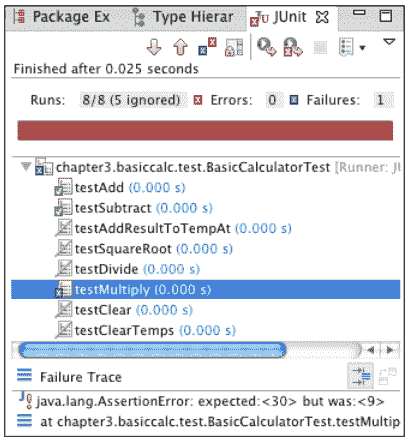

困惑之下，我们查看了 multiply 的实现，发现它并没有将 `result` 与参数 `n` 相乘，而是将 `n` 自身相乘并将该值赋给 `result`。幸运的是，修复方法很简单：

```
public void multiply(int n) {
    result *= n;
}
```

正如你所见，即使是简单的测试方法也是对抗潜伏在我们代码中的 bug 的有效武器。尽管如此，到目前为止，我们只是编写了测试我们 `BasicCalculator` 代码的 happy path 的测试方法。有时我们需要编写测试方法来测试被测代码块的边界情况。在 Java 中，导致某个方法抛出异常的输入可以被视为边界情况。例如，我们的计算器必须应对的边界情况之一是除以零。

在 Java 中，尝试将整数除以零将导致 `ArithmeticException`。如果期望我们的计算器在除以零时抛出 `ArithmeticException`，我们需要在测试中明确说明这一期望。

幸运的是，JUnit 提供了有效处理这些边界情况和相关预期异常的方法。`@Test` 注解支持两个可选参数。第一个 `expected` 指定测试方法应抛出异常。如果底层方法未抛出异常或抛出的异常与指定的不同，测试将失败。

例如，我们可以使用此注解来实现 `testDivision()` 方法的边界情况，如以下代码所示。它指定 `BasicCalculator` 中的方法 `divide()` 在发生除以零时应抛出异常（`ArithmeticException`）。请注意，我们不需要使用任何断言方法，因为我们期望的唯一结果是 `ArithmeticException`。值得一提的是，作为参数传递给 `expected` 的类必须是 `java.lang.Throwable` 的子类。

```
@Test(expected=ArithmeticException.class)
public void testDivide() {
    calculator.add(10);
    calculator.divide(0);
}
```

还有另一种实现相同行为的方法。你可以通过 JUnit 的 ExpectedException 规则来声明预期异常。首先，让我们给你一个关于 JUnit 规则的速成课程。

在测试框架的早期版本中，不可能修改或增强 JUnit 对给定测试套件的内部知识。使用当前版本，我们可以使用规则来修改测试结果、在运行测试前以某种方式更改测试，并向测试结果添加信息。我们将使用 @Rule 注解来告知 JUnit 对底层测试应用哪些规则。

通过将 ExpectedException 与 @Rule 结合使用，你可以指定针对特定测试方法应抛出的异常的测试内期望。虽然比预期需要多打一些字，但如图所示，你对期望的内容有更大的控制权。例如，你甚至可以指定预期异常应包含的消息。

```java
@Rule
public ExpectedException thrown = ExpectedException.none();

@Test
public void testDivide() {
    thrown.expect(ArithmeticException.class);
    thrown.expectMessage("/ by zero"); //specify the expected message
    calculator.add(10);
    calculator.divide(0);
}
```

至于 @Test 的第二个可选参数 timeout，如果测试方法执行时间超过指定的毫秒数，则会导致测试失败。为了举例说明，假设我们将 testSquareRoot 实现为一个无限循环，并在 1 秒后失败。运行以下代码时，你应该会得到一个红色条以及一个包含以下消息的 java.lang.Exception："test timed out after 1000 milliseconds"。

```java
@Test(timeout=1000)
public void testSquareRoot() {
    while(true);
}
```

好吧，到目前为止，我们相信你已经掌握了使用 JUnit 和 Eclipse 编写测试方法的大致思路。我们甚至能够在计算器中发现一个 bug。 granted，它是一个非常简单、易于发现的 bug。

很抱歉地说，并非每个 bug 都很容易发现。有时你可能会遇到一个红色条，让你束手无策，不知道如何解决问题。换句话说，当测试失败时，即使花了相当多的时间盯着代码也无法弄清楚原因时，你需要求助于调试器。为了说明这一点，让我们实现测试方法 testAddResultToTempAt。addResultToTemp 方法应执行以下操作：根据作为参数传递的索引，将存储在变量 result 中的当前值添加到 tempVars 数组中的某个位置。在实现此测试方法期间，我们意识到我们没有实现一个方法来获取这个临时结果数组。在实现单元测试时，意识到自己遗忘了某些东西的情况屡见不鲜。为了解决这个问题，我们添加了一个简单的 get 方法，名为 getTemps，它只是返回变量 tempVars。

```
public int[] getTemps() {
    return tempVars;
}
```

至于我们的测试方法，它使用了我们最近实现的 getTemps，我们将其实现如下：

```
@Test
public void testAddResultToTempAt() {
    calculator.add(9);
    calculator.addResultToTempAt(1);
    int[] temps = calculator.getTemps();
    assertEquals(9, temps[1]);
}
```

正如你所见，我们再次使用 add 将值 9 存储到变量 `result` 中。之后，为了将 9 存储到临时内存的槽号 1 中，我们调用 `addResultToTempAt` 并传递 1 作为参数。预期的行为是代表计算器临时内存的数组现在在索引 1 处包含值 9。然而，测试失败了（如以下屏幕截图所示）。与预期行为不同，我们得到一个 `NullPointerException`。通过观察 **Failure Trace** 面板获得的唯一线索是异常是在我们的 `BasicCalculator` 类的第 16 行抛出的。仅凭查看这一行，无法猜出出了什么问题（好吧，这也取决于你的 Java 经验）。调试器就是为这类问题而存在的。因此，我们不会破坏发现此问题根本原因的乐趣。相反，我们将介绍专业工具。也就是说，我们将解释如何使用 Eclipse 内置的 Java 调试器，以便你自己找到并修复此 bug。

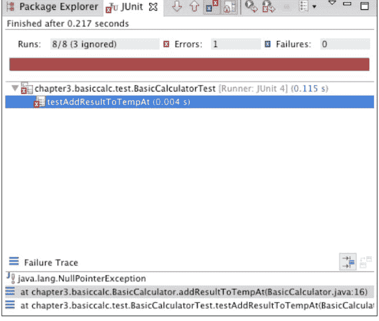

## 问题出现时的调试

如果你已经编程一段时间了，你很可能熟悉一种经典的调试技术，称为 trace code。如果你不熟悉 trace code，让我们为你分解一下。在这种调试技术中，我们在被检查的代码中引入 `println` 或 `print` 语句，以便显示有关变量的信息或程序是否已采取某条路径。考虑到这个定义，你可能会想，为什么需要调试器？答案很简单，有两方面。首先，使用调试器，你可以在不费太多周折的情况下达到同样的效果。应用 trace code 时，你需要包含打印语句，重新编译程序（或被检查的特定部分），运行并分析 trace code 的输出。此外，在找到 bug 后，你必须删除所有 trace code。更不用说每当出现 bug 时，你都必须重复整个过程。Trace code 是一种繁琐的技术。相比之下，使用调试器时，实现所有这些只需几次点击即可。其次，你可以从调试器中获得更多；它们允许你查看仅通过查看输出就很难弄清楚的程序方面。

正如我们提到的，Eclipse 配备了完整的调试器。此内置 Java 调试器提供所有调试支持功能；可以逐步执行程序、设置断点、检查变量和值，以及暂停和恢复线程。

有多种方法可以在调试模式下启动 Java 程序。一个选项是在 **Package Explorer** 视图中选择要调试的包含 main 方法的 Java 类文件，然后单击工作台工具栏中的 **Debug** [*] 按钮（或从工作台菜单栏选择 **Run | Debug**）。也可以通过从工作台菜单栏选择 **Run | Debug as | Java Application**，或在 **Package Explorer** 弹出菜单或 **Debug** 工具栏按钮的下拉菜单中单击 **Debug as | Java Application** 来实现同样的效果。在调试活动期间，Eclipse 会切换到 Debug Perspective，但在切换之前，以下屏幕截图中显示的窗口会询问你是否要从当前透视图更改为 Debug Perspective。


运行配置和调试配置是共享的，也就是说，你用来运行应用程序的任何运行配置都应该在调试相关菜单中可用。

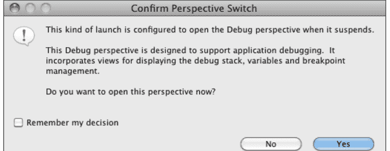

当你点击 **yes** 时，调试透视图会出现，如以下截图所示。此透视图允许你控制正在检查的程序的所有执行线程。在调试透视图中：左上角的调用栈指示了你的程序中被调用的方法，右上角你可以管理断点并检查变量的内容。随着你通过逐步执行其执行并添加和移除断点与正在运行的程序交互，这些视图会得到更新。

与调试器交互的基本方式是通过设置断点。断点是一种指示调试器在你想要暂停执行的那行代码的方式。要设置断点，在 Java 透视图中，选择你想要调试的源代码文件并在编辑器中打开它（通过双击）。浏览代码并将光标放在标记栏上，该标记栏位于编辑器区域的左侧边缘，放在你想要停止执行的那一行上。然后双击以设置断点。或者，你也可以右键单击此位置并选择 **Toggle Breakpoint**。

除了常规断点之外，还有条件断点。条件断点在与其关联的布尔表达式求值为 true 时被激活。

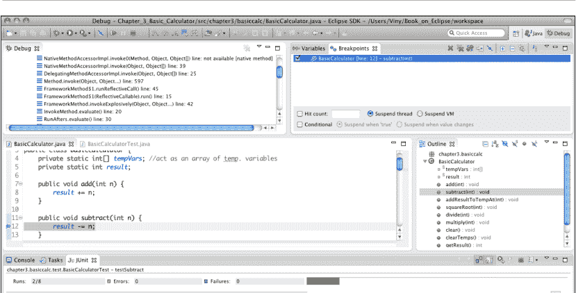

一旦断点被命中，Eclipse 会暂停执行，并且包含断点的行会被高亮显示，这会给你提供下一个将被执行的行的视觉反馈。这给了你一个机会来检查变量的状态等等。

> 如果你在包含断点的行之前或之后添加代码，Eclipse 会确保将该断点与其相应的行一起移动。因此你可以添加代码而无需担心改变断点的定位。

要命中断点后恢复执行，请单击 Debug 视图工具栏中的 Resume 按钮。此按钮使程序执行直到完成或继续直到它到达下一个断点。

> 你甚至可以在调试会话期间添加断点；你不需要暂停或停止程序的执行。另外，请记住由于你不能在一行设置多个断点，因此在一行上放置多个语句很重要。如果你这样做，你将无法正确检查这些行。还值得一提的是，如果没有断点，执行将不会暂停，你的程序将正常执行，就像你在 Java 透视图中运行它一样。

旨在检查你的程序的行为，Eclipse 调试器允许你逐行逐步进入程序执行。这可以通过两个命令完成：step into（F5）和 step over（F6）。这两个命令之间的区别只有在下一条指令是方法调用时才明显。选择 step over 会使调试器执行该方法（而不进入它）并继续到方法调用之后的下一条语句。值得一提的是，即使调试器不显示方法的主体，它仍会正常执行。另一方面，如果你选择 step into 命令，调试器将继续到底层方法的第一行。

进入方法调用后仍然可以跳过其余部分：使用 step return 命令（F7）。调试器将继续到方法调用之后的下一行。下面的表格概述了 Debug 工具栏中的主要命令。

| Icon | Description |
|------|-------------|
|  | 禁用所有断点。 |
|  | 恢复执行。 |
|  | 通过终止当前执行来停止当前的调试会话。 |
|  | 进入程序检查的下一条语句。如果下一条语句是方法调用，此命令将进入方法主体代码。 |
|  | 进入程序检查的下一条语句。如果下一条语句是方法调用，此命令将在不进入的情况下执行方法主体。 |
|  | 退出当前方法并转到调用代码。 |
|  | 重新进入 Debug 视图中选定的栈帧。由于它依赖于栈帧的存在，因此在调试本地方法时无法使用此选项。 |

随着你逐步执行程序，你也可以浏览和修改程序的状态。你可以通过查看 **Variables** 窗口来检查局部变量、参数和可见字段的内容。你也可以通过在 Java 编辑器中将鼠标指针悬停在变量上来调查变量的内容。对于非原始变量，它们可以展开以检查其各个元素。除了检查变量的值之外，你还可以在 Debug 透视图的编辑器中检查 Java 表达式的值。选择一个表达式，然后右键单击它并选择 **Display**。Eclipse 会评估所选表达式，同时考虑当前作用域，并在弹出窗口中显示结果。

在调试会话期间，你也可以修改变量的值。为此，在 **Variables** 视图中选择你想要修改的变量；这会使其值出现在 **Variables** 视图的下半部分窗口中，以便你可以编辑它。编辑后，右键单击并选择 **Assign Value**。

假设在你的调试会话中你发现了一个错误，幸运的是，你也知道如何立即修复它。你需要停止调试会话才能开始修复程序吗？答案是否定的。得益于称为热代码替换的功能，编辑和调试可以同时进行；你可以在不必停止调试会话的情况下编辑程序。唯一的副作用是，在修改方法后，Eclipse 必须丢弃之前的栈帧并从第一行重新开始该方法。

> 很可能你使用的是 Java 虚拟机 1.5 或更高版本，但我们应该警告你，热代码替换仅由 1.4.2 之后的 Java 虚拟机支持。

我们已经介绍了调试器的主要功能，现在，[content]
运行配置和调试配置是共享的，也就是说，你用来运行应用程序的任何运行配置都应该在调试相关菜单中可用。


当你点击 **yes** 时，调试透视图会出现，如以下截图所示。此透视图允许你控制正在检查的程序的所有执行线程。在调试透视图中：左上角的调用栈指示了你的程序中被调用的方法，右上角你可以管理断点并检查变量的内容。随着你通过逐步执行其执行并添加和移除断点与正在运行的程序交互，这些视图会得到更新。

与调试器交互的基本方式是通过设置断点。断点是一种指示调试器在你想要暂停执行的那行代码的方式。要设置断点，在 Java 透视图中，选择你想要调试的源代码文件并在编辑器中打开它（通过双击）。浏览代码并将光标放在标记栏上，该标记栏位于编辑器区域的左侧边缘，放在你想要停止执行的那一行上。然后双击以设置断点。或者，你也可以右键单击此位置并选择 **Toggle Breakpoint**。

除了常规断点之外，还有条件断点。条件断点在与其关联的布尔表达式求值为 true 时被激活。


一旦断点被命中，Eclipse 会暂停执行，并且包含断点的行会被高亮显示，这会给你提供下一个将被执行的行的视觉反馈。这给了你一个机会来检查变量的状态等等。

> 如果你在包含断点的行之前或之后添加代码，Eclipse 会确保将该断点与其相应的行一起移动。因此你可以添加代码而无需担心改变断点的定位。

要命中断点后恢复执行，请单击 Debug 视图工具栏中的 Resume 按钮。此按钮使程序执行直到完成或继续直到它到达下一个断点。

> 你甚至可以在调试会话期间添加断点；你不需要暂停或停止程序的执行。另外，请记住由于你不能在一行设置多个断点，因此在一行上放置多个语句很重要。如果你这样做，你将无法正确检查这些行。还值得一提的是，如果没有断点，执行将不会暂停，你的程序将正常执行，就像你在 Java 透视图中运行它一样。

旨在检查你的程序的行为，Eclipse 调试器允许你逐行逐步进入程序执行。这可以通过两个命令完成：step into（F5）和 step over（F6）。这两个命令之间的区别只有在下一条指令是方法调用时才明显。选择 step over 会使调试器执行该方法（而不进入它）并继续到方法调用之后的下一条语句。值得一提的是，即使调试器不显示方法的主体，它仍会正常执行。另一方面，如果你选择 step into 命令，调试器将继续到底层方法的第一行。

进入方法调用后仍然可以跳过其余部分：使用 step return 命令（F7）。调试器将继续到方法调用之后的下一行。下面的表格概述了 Debug 工具栏中的主要命令。

| Icon | Description |
|------|-------------|
|  | 禁用所有断点。 |
|  | 恢复执行。 |
|  | 通过终止当前执行来停止当前的调试会话。 |
|  | 进入程序检查的下一条语句。如果下一条语句是方法调用，此命令将进入方法主体代码。 |
|  | 进入程序检查的下一条语句。如果下一条语句是方法调用，此命令将在不进入的情况下执行方法主体。 |
|  | 退出当前方法并转到调用代码。 |
|  | 重新进入 Debug 视图中选定的栈帧。由于它依赖于栈帧的存在，因此在调试本地方法时无法使用此选项。 |

随着你逐步执行程序，你也可以浏览和修改程序的状态。你可以通过查看 **Variables** 窗口来检查局部变量、参数和可见字段的内容。你也可以通过在 Java 编辑器中将鼠标指针悬停在变量上来调查变量的内容。对于非原始变量，它们可以展开以检查其各个元素。除了检查变量的值之外，你还可以在 Debug 透视图的编辑器中检查 Java 表达式的值。选择一个表达式，然后右键单击它并选择 **Display**。Eclipse 会评估所选表达式，同时考虑当前作用域，并在弹出窗口中显示结果。

在调试会话期间，你也可以修改变量的值。为此，在 **Variables** 视图中选择你想要修改的变量；这会使其值出现在 **Variables** 视图的下半部分窗口中，以便你可以编辑它。编辑后，右键单击并选择 **Assign Value**。

假设在你的调试会话中你发现了一个错误，幸运的是，你也知道如何立即修复它。你需要停止调试会话才能开始修复程序吗？答案是否定的。得益于称为热代码替换的功能，编辑和调试可以同时进行；你可以在不必停止调试会话的情况下编辑程序。唯一的副作用是，在修改方法后，Eclipse 必须丢弃之前的栈帧并从第一行重新开始该方法。

> 很可能你使用的是 Java 虚拟机 1.5 或更高版本，但我们应该警告你，热代码替换仅由 1.4.2 之后的 Java 虚拟机支持。

我们已经介绍了调试器的主要功能，现在， armed with this debugging knowledge, go back and try to pinpoint the problem with `testAddResultToTempAt`。

## 摘要

在本章中，我们介绍了使用 Eclipse 和 JUnit 创建单元测试的基础知识。你看到了 Eclipse 如何能够生成测试方法存根并通过无缝集成 JUnit 来自动化这些方法的执行。此外，我们还概述了 JUnit 的主要功能，例如最常用的注解。除了单元测试之外，本章还简要介绍了如何使用 Java 内置的 Eclipse 调试器。

请记住，本章中我们没有涵盖一些与测试相关的话题。早些时候在章节中，我们提到测试需要彼此独立，以便你可以按任意顺序重新运行它们。有时，对象会与其他对象交互，这使得创建独立的测试方法变得更加复杂。在单元测试中，当存在可能损害测试独立性的对象或其复杂性使得使用真实对象不切实际时，就会使用模拟对象。这些模拟对象模拟真实对象的行为。幸运的是，有框架可以自动化创建模拟对象所涉及的大部分过程。我们鼓励感兴趣的读者阅读关于 Mockito（http://code.google.com/p/mockito/）的内容。

除了一个好的测试方法集合之外，每当你着手开发一个合理规模的应用程序时，你都需要有一个备份策略。通常，对于代码项目而言，此策略包括使用版本控制程序。跟踪程序不同版本的程序称为版本控制系统。下一章描述了一个版本控制系统的示例，即 Git。


