# 4 版本控制系统

**源代码管理**，或 **版本控制**，是管理代码修订（并附带注释）的实践，以便代码可以轻松检索。**版本控制系统（VCS）** 的概念由来已久。最早的实现是面向文件的、集中的，并且没有网络访问能力。

进化伴随着 **Concurrent Versions System (CVS)** 而来，它专为协作开发而设计，采用合并机制而非基于锁定的机制。最新一代带来了重大的概念修改，即完全去中心化。

这显然更合适，因为如今基于网络的系统在不久的将来很可能会成为最常用的系统。一个良好的版本控制系统至少应提供以下功能：

- 添加、删除、重命名或删除文件的可能性
- 查找哪些文件被哪个用户在何时更改的可能性
- 跟踪产品多个版本的提供
- 在版本之间前后切换的可能性
- 合并代码的可能性
- 撤销修改的提供（回溯历史）

在本章中，我们将介绍 VCS 的主要特征以及如何在 **Eclipse** 平台中使用三种最流行的版本控制系统，即 CVS、**Subversion (SVN)**，和 **Git**。

## CVS

产品的开发通常由多名软件工程师完成。CVS 等版本控制系统通常用于管理与开发相关的文件。虽然版本控制系统通常应用于编程项目，但它们并不限于此目的，可用于任何涉及数据文件管理的任务。

CVS 基于分支的概念，其中每个开发人员都可以将自己的修改提交到同一组资源中。主分支 HEAD 通常在确定实现稳定时使用。可以随时使用多个分支并将文件合并到主分支。

CVS 仓库维护了随时间推移对资源所做的每次提交更改的历史记录。资源可以与任何先前的现有修订进行比较或替换。

Eclipse 提供了合并、提交和访问项目历史的设施。在以下各节中，我们将介绍有关使用 CVS 技术的基本功能。

### 仓库

首先需要做的是将 Eclipse 工作区连接到 CVS 仓库。此操作可以通过导航到 文件 | 新建 | CVS | CVS 仓库位置 来执行。如下图所示的窗口将会出现：

### 添加新的 CVS 仓库

将新的 CVS 仓库添加到 CVS 仓库视图

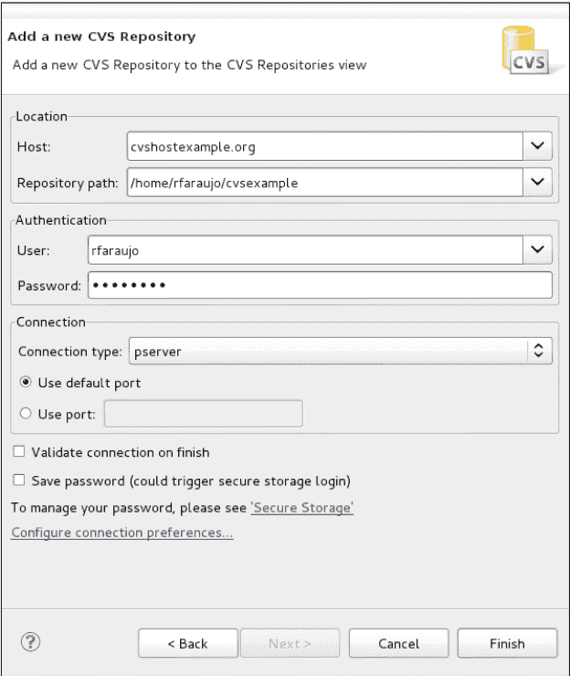

需要选择所需仓库的主机、仓库路径、用户名和密码。仓库将被添加到工作区，并将看到 CVS 仓库视图的以下截图：

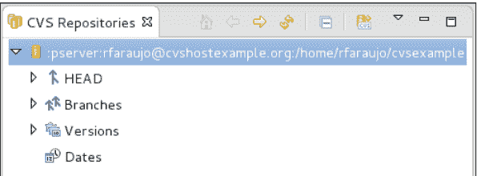

### 检出项目

要检出项目，请展开 **HEAD** 标签，选择下面的项目，右键单击它，然后转到 **Checkout**。这将把项目加载到工作区。

也可以通过导航到 **文件 | 新建 | CVS | 来自 CVS 的项目** 使用向导。您可以选择 **仓库位置**，然后在第二页中选择您想要工作的项目列表。

### 同步

在编辑项目的资源时，您有时会想要将其提交回仓库。为此，您可以单击资源并选择 **Synchronize with Repository**。

一个 **synchronize** 视图将被打开。其中有三个选项：

- **Incoming** 模式，视图仅显示传入的更改
- **Outgoing** 模式，显示传出的更改
- **Both modes together**

要将更改提交到仓库，您可以导航到 **outgoing changes** 选项并选择 **Commit**。要将任何可能的更改加载到工作区，请右键单击 **incoming changes** 选项并选择 **Update** 选项。

在提交或更新时可能会发生冲突；例如，假设您和另一位开发人员修改了同一资源。在这种情况下，可以使用 **merge** 工具来选择要保留的版本。

### 分支

例如，当需要保留产品的多个版本时，建议创建分支；可以通过执行以下步骤完成：

- 1. 右键单击项目后，转到 **Branch** 选项。
- 2. 在随后的窗口中，保持 **start working in the branch** 复选框被选中。
  CVS 将自动提出一个版本名称，可稍后用于合并目的。
- 3. 在 **CVS repository** 视图中，可以在 **Branches** 节点下看到创建的分支。

## SVN

SVN 或 Subversion，允许多个开发人员在同一项目上工作。项目通常保存在服务器上，正在其上工作的开发人员会从服务器检出（创建本地副本）文件。也可以将修改后的文件提交回服务器。为了执行任何操作，需要连接到服务器。

与 CVS 相比，SVN 不仅可以跟踪文件更改历史，还可以跟踪有关共享项目的全部更改，例如允许添加、删除或移除所有资源而不创建新项目，并且不会丢失有关已删除项目的信息。SVN 中的提交操作是绝对原子的，即仓库永远不会处于不一致状态，并且支持版本化属性。

Eclipse 默认情况下不集成 SVN 客户端。需要安装额外的插件，即 **Subversive project**。尽管如此，它在 Eclipse 门户中作为 Eclipse 项目维护。另一个选项是使用 **Subclipse project** (http://subclipse.tigris.org/)。Subversive 插件旨在将 Subversion 版本控制系统与 Eclipse 平台集成。该插件允许直接从 Eclipse 工作台以与 CVS 和 Git 等其他 Eclipse 版本控制提供程序类似的方式处理存储在 Subversion 仓库中的项目。

该项目由 Polarion 公司于 2005 年作为开源项目启动，后于 2007 年迁移到 Eclipse 旗下，成为官方 Eclipse 项目。如今，Subversive 项目包括作为 Eclipse 开源项目开发的 Eclipse 用 Subversive 插件，以及作为外部开源项目开发的 Subversion 连接器。

Subversive 被设计为功能齐全的 SVN 客户端，因此可以从 Eclipse 环境直接更新、提交、合并更改、使用 SVN 属性、查看更改历史记录并执行其他 SVN 操作。此外，Subversive 与 Subversion 项目一起发展，为 Eclipse 用户提供在 SVN 实现新版本中出现的特性。

插件的 **Juno version** 可以使用 update-site http://download.eclipse.org/technology/subversive/1.0/update-site-1.0.1/ 进行安装。

## 版本控制系统

要安装它，只需导航到 **Help | Install new Software** 并按以下截图所示添加更新站点：

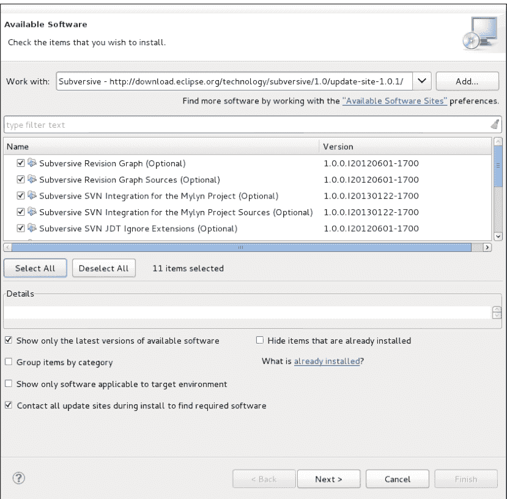

为了举例说明 SVN 的使用，我们将以 **Apache Hadoop repository** 为基础。要将仓库与 Eclipse 工作区关联，您需要导航到 **File | New | SVN | Repository Location** 并用服务器位置 `http://svn.apache.org/repos/asf/hadoop/common/` 填写以下屏幕。请看以下截图：


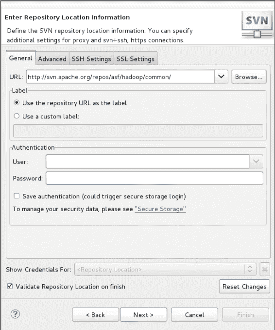

点击 **Finish** 后，仓库将被添加到 **SVN Repositories** 视图中，并且可以在此处查看 **trunk**、**branches** 和 **tags** 节点。在 **trunk** 节点中，您将看到所有维护的文件和早期版本。可以选择特定版本来指定起点。

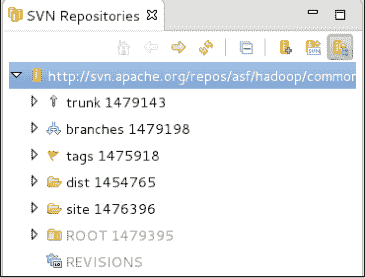

可能在给定的版本控制系统中存在多个分支，可以在 **branch** 节点中进行选择。

**tags** 通常被定义以便更轻松地转到产品的特定版本，并将其与提交关联；例如，指定产品版本号。

与 **Checkout**、**Update** 和 **Commit** 相关的操作与我们在 CVS 部分介绍的内容非常相似。

## Git

Git 与 SVN 的工作方式略有不同。它不会复制仓库，而是克隆它。在这种情况下，由于完整的仓库可用，可以在不连接互联网的情况下执行任何操作。可以执行多个操作，例如分支、合并或提交。

Git 与 SVN 之间的一些差异如下：

- Git 是分布式的
- Git 存储的是元数据而不是实际文件以及现有提交
- 由于操作在本地执行，Git 可以在没有活动互联网连接的情况下工作

Eclipse 自带一个预装插件来处理 Git 程序。**EGit** 是 Eclipse 插件，提供 Git 版本控制系统。如前所述，由于 Git 是分布式源代码管理器，每个开发人员都拥有代码每个版本历史的完整副本，使得对历史的查询非常快速和灵活。

如果需要安装它，用户可以导航到 **Help | Install New Software** 并添加仓库 http://download.eclipse.org/egit/updates，如以下屏幕截图所示：

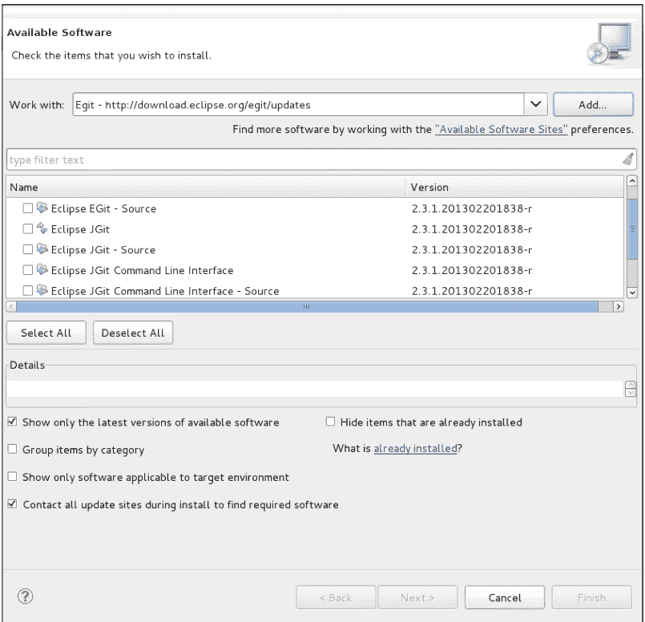

使用 EGit 插件时，可以将透视图更改为 EGit 透视图。为此，只需导航到 **Window** | **Open Perspective** 并选择 **Git Repository Exploring**。

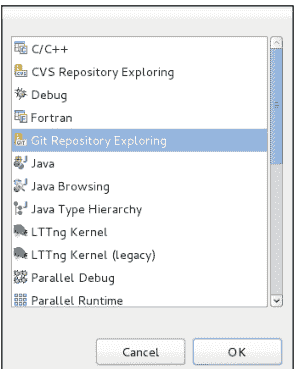

要创建 **Git repository**，可以导航到 **File** | **New** | **Git** | **Git Repository**。如果需要，可以创建本地仓库。另一个选项是从已存在的项目导入文件，方法是导航到 **File** | **Import** | **Git** | **Projects from Git**，如下图所示：

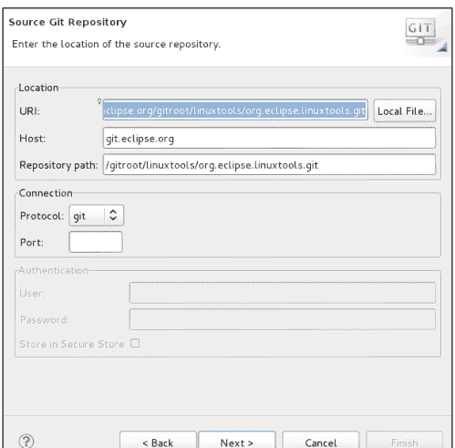

在此示例中，我们使用 Eclipse 项目的仓库和 Linux 工具，可以使用以下 URL 克隆

```
git://git.eclipse.org/gitroot/linuxtools/org.eclipse.linuxtools.git.
```

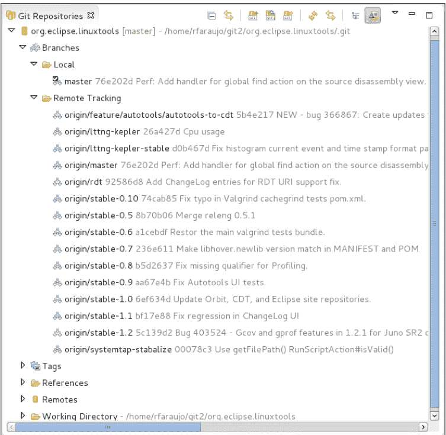

仓库克隆后，**Local** 和 **Remote Tracking** 会在 **Git** 透视图中显示。主要的 **Branches** 节点是 master 节点；不过，其他分支也可以在透视图的 **Branches** 节点中创建和可视化。通过支持分支，Git 允许您并行处理资源集合的不同版本。可以在一个不同的分支上处理 bug 修复，并在工作完成后将其合并回主分支。Git 中的 **Branches** 是本地的。从另一个仓库克隆的本地仓库中创建的分支不需要在 **remote repository** 中有对应项。**Local** 分支可以与充当另一个远程仓库中分支状态代理的 **Remote Tracking** 分支进行比较。

像 SVN 和 CVS 一样，也可以通过转到以下屏幕截图中显示的 **History** 选项卡来查看更改历史记录：

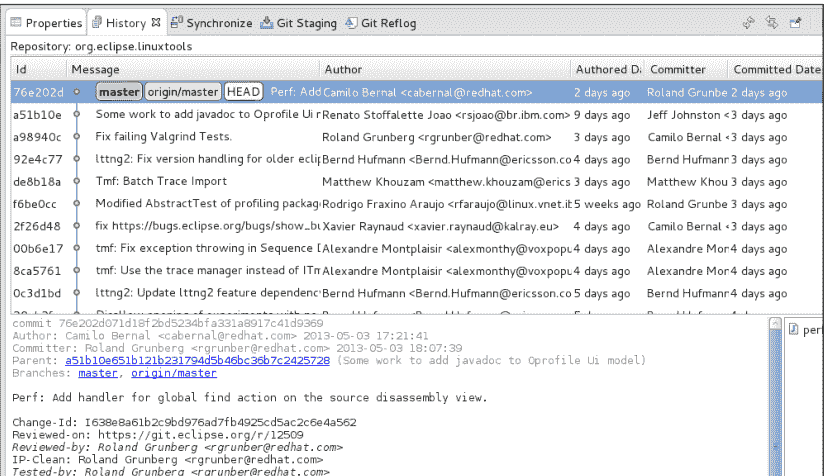

在之前的屏幕截图中，可以看到最近的提交，以及 **Author**、**Committer** 和 **Committed Date** 的详细信息。如果选择 **commit**，就可以可视化更多信息。也可以通过右键单击特定提交并选择 **Rebase** 选项，将资源重新定位到该提交的位置。

通过右键单击某个分支并转到 **Checkout** 选项检出该分支后，项目将在 Eclipse 工作区中可用。当您修改某个文件时，通常需要将该修改添加到本地提交，以便将其推送到远程仓库。通常在提交到 **Git repository** 之前，您需要标记应提交的更改。此操作称为将文件添加到暂存区。然而，在 EGit 插件中，您可以在右键单击正在使用的分支时选择 **commit** 选项，从而在 **GUI interface** 中选择要提交的文件。之后，需要输入提交消息描述所执行的修改。

执行此操作后，可以使用 **push** 选项将此修改推送到上游。在某些情况下，当其他人也修改了同一资源时，可能会出现合并冲突；它们可以借助 EGit 的合并工具解决。右键单击包含当前分支（本例中为 **master**）的节点时可以看到 **commit** 选项。

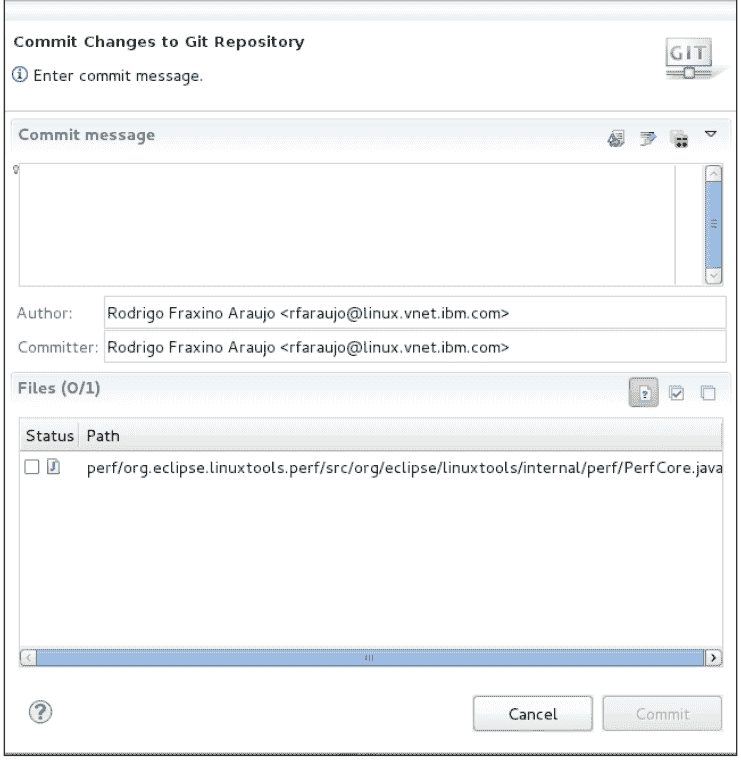

另一个可以执行的操作是 checkout。此操作允许您在仓库的分支之间跳转。在 EGit 中，只需右键单击所需分支并选择 **Checkout** 选项即可。记住检查您是否已提交在上一个分支中执行的任何更改，否则如果您将其暂存（丢弃），它们可能会丢失。

当使用 **remote repository** 更新本地仓库时，您需要使用 **fetch** 选项。之后，您可以选择使用 **rebase** 选项将上游仓库与您的仓库 **rebase** 或 **merge**；这意味着仓库将被克隆，您尚未上游的可能提交稍后将应用于树。另一个选项是将本地提交中存在的文件与 **remote repository** 合并。如果选择使用 **pull** 选项，默认情况下它会执行 **fetch** 和 **merge** 操作。

## Summary

本章中，我们讨论了一种组织和跟踪源文件修改的方法，这对于软件项目的开发通常是必要的。
我们介绍了 CVS、SVN 和 Git 版本控制系统，它们可以被认为是当今最流行的系统。我们特别关注了 Git，这是一种趋势技术，因为它是一种最近引入的分布式选项。

在下一章中，我们将讨论如何使用 Eclipse 最常用的 API 之一：SWT 来处理图形编程。
