# 5 SWT

**Standard Widget Toolkit (SWT)** 由 Eclipse 项目开发人员创建的一组工具组成，用于轻松构建 **Graphical User Interface (GUI)** 应用程序。此开源小部件工具包通过专注于目标操作系统，提供对用户界面设施的高效和可移植访问。

尽管 Java 通过使用 **Abstract Windowing Toolkit (AWT)** 和 Java 基础类（swing）提供了 GUI 应用程序开发的支持，但两者都无法与目标操作系统无缝集成。

SWT 支持使用操作系统特定库的小部件，并通过一组负责与本地代码通信的 Java 类授予对其的访问权限。其结果是与本地代码实现更好的性能，同时保留仅编写一次所需代码的能力，以便可在多个平台上使用。由于代码是本地的，应用程序的外观和感觉遵循目标平台，绘制图形的任务由编译代码执行，该代码不是 **Java Virtual Machine (JVM)** 的一部分。一个小缺点是需要为每个将执行应用程序的平台部署运行时库。

本章讨论以下主题：

- 设置用于开发 SWT 应用程序的环境
- 小部件和显示
- 各种用户界面元素（控件），例如标签、文本、列表、按钮和组合框
- 布局样式


## 入门

如前所述，SWT 是 Java 的部件工具包。部件是为与用户交互而开发的 GUI 元素。文本、标签、列表和按钮都是部件的例子。为了使用部件并开始 SWT 应用的开发，必须执行一些配置，如下一节所述。

## 设置

尽管 SWT 已作为 Eclipse 插件 API 的一部分集成，但对于旧版本或独立应用程序的开发，可能需要下载独立的 SWT。

为此，必须前往 www.eclipse.org/swt。选择适当的版本后（在本例中为 swt-4.2.1-gtk-linux-x86.zip），需要通过 文件 | 导入... | 将现有项目导入工作区 | 选择归档文件 将下载的文件导入 Eclipse，并点击 浏览 按钮定位 SWT 库文件，如以下截图所示：

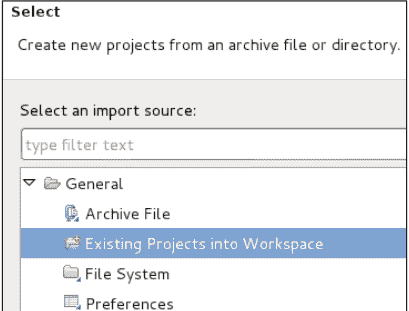

(a) 导入源

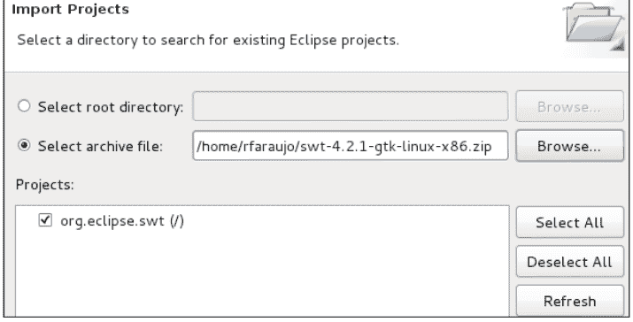

(b) SWT 库归档文件

完成这些初始步骤后，需要将库包含在工作项目的 Java 构建路径中。以下展示了一个示例 Hello World SWT 程序的源代码，我们在解释如何将库添加到路径时使用它：

```
import org.eclipse.swt.widgets.*;
public class HelloWorld {
    public static void main(String[] args) {
        Display display = new Display();
        Shell shell = new Shell(display);
        shell.setText("Hello, World.");
        shell.open();
        while (!shell.isDisposed()) {
            if (!display.readAndDispatch())
                display.sleep();
        }
        display.dispose();
    }
}
```

在此示例代码中展示了 SWT 应用的基础，该代码的输出如以下截图所示。Display 对象创建了与平台窗口系统的连接，Shell 对象使用该连接构建一个包含文本 Hello, World. 的窗口。随后在循环中，窗口系统等待用户执行会导致应用程序终止的操作。


要正确运行和编译此示例 SWT 程序，您需要将 SWT 库项目添加为依赖项。此操作可以通过打开 Java 项目的属性对话框，并在 Java 构建路径 页面中包含 org.eclipse.swt 项目来完成，如以下截图所示：

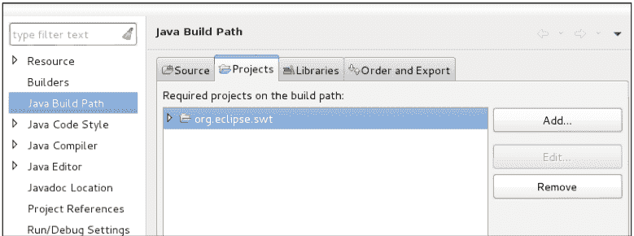

## 部件

部件是负责维护与用户交互的 GUI 元素，根据执行的运算保持并重绘其状态。当事件发生时，该事件可能是用户操作或程序代码内部操作的结果，部件会重绘自身以显示新的状态。

使用标准构造函数创建部件。如 *设置* 节代码片段所示，当不再需要它们时，它们会被显式释放。与传统的 Java 类不同，您可以注意到这种行为，因为部件使用必须手动释放以避免资源泄漏的操作系统资源。Java 垃圾回收器不会释放操作系统资源。

在此上下文中，当创建 SWT 对象或调用基于 SWT 资源的 对象时，需要手动释放它。如果资源有父级，释放它也会导致其子级被释放。

在 SWT 中，使用一组部件实例构建用户界面。为此我们有控制元素，即包含在应用程序窗口（称为 Shell）中的用户界面。诸如 Buttons、Texts、Labels 和 Tables 等多个普通元素继承自抽象类 Control。

为了处理操作，而不是通过子类化来实现对 GUI 修改做出反应的代码，建议程序员使用适当添加到部件的事件和监听器。监听器用于在事件发生时通知程序。

您必须了解部件的最后一个主要特性是其应用程序数据。由于不鼓励使用子类化（由于可能因超类修改后子类未重新编译而导致的行为不当），应用程序数据可用于将任何对象与部件关联。setData 和 getData 方法可用于此目的，如下例所示：

```
widget.setData("Doctor", "Walter Bishop");
if ("Walter Bishop".equals(widget.getData("Doctor"))) {
    System.out.println("I'm perfectly sane!");
}
```

在此示例中，我们将数据作为键/值对存储在部件中，其中键用于获取/查找值对象，即 Doctor 键对应于 Walter Bishop 对象，如果 if 语句返回 true，则打印 I'm perfectly sane 消息。

实际情况下可能需要工厂来促进数据的存储，如 *部件* 节所示。

## 显示

`Display` 类负责将 SWT 与底层窗口系统连接。它不是一个部件；尽管如此，*部件* 节中讨论的一些原则仍然相同，例如事件、监听器和应用程序数据的处理。`Display` 的生命周期也类似于部件，应由程序员显式创建和释放。

其中最重要的一个方法是 `readAndDispatch` 方法，可读取和分发事件。该方法从原生部件读取事件并将其分发到 SWT 事件系统。此连续循环一直执行到主 shell 关闭为止。如果循环被中断，应用程序会立即终止。它在用户界面线程中被调用，许多部件方法也在其中被调用。如 *设置* 节所示，独立应用程序可以在其 `main` 方法内部创建并调用显示事件处理类。

还可以通过 `setAppName` 方法为应用程序命名，该方法接受单个 `String` 作为参数。

## 控件

控件是属于更高层窗口的用户界面元素。在本节中，我们将详细介绍其中的一些基本控件，例如标签、文本、列表、布局、按钮和组合框。这些简单控件在开发使用 SWT 的应用程序时常用。在下一章中，我们将使用更高级的控件和示例扩展本节。

### 标签部件

标签是静态部件，表示不可修改或选择的 对象，可充当字符串、图像或分隔符。它们通常放置在屏幕左侧以描述文本字段，作为不相关字段之间的分隔符或放置图像。

创建标签时可以选择以下样式，并可使用 `|` 运算符组合：

- `SWT.SEPARATOR`: 绘制分隔符
- `SWT.HORIZONTAL`: 水平绘制分隔符
- `SWT.VERTICAL`: 垂直绘制分隔符
- `SWT.SHADOW_IN`: 带内阴影效果的分隔符
- `SWT.SHADOW_OUT`: 带外阴影效果的分隔符
- `SWT.SHADOW_NONE`: 无阴影效果的分隔符
- `SWT.CENTER`: 将标签对齐到中心
- `SWT.LEFT`: 将标签左对齐
- `SWT.RIGHT`: 将标签右对齐
- `SWT.WRAP`: 自动换行文本以适应容器

创建标签部件时使用的主要方法有：

- `setText(String string)`: 设置标签的文本
- `getText()`: 返回标签的文本
- `setImage(Image image)`: 设置包含在标签中的图像
- `getImage()`: 返回标签的图像

以下是使用标签的示例代码，以及表示它的部件：

```
Display display = new Display();
Shell shell = new Shell(display);
shell.setText("Label Sample");
shell.setSize(300,200);
Label label = new Label(shell, SWT.CENTER);
label.setText("Nothing But The Rain");
label.setSize(300,300);
```

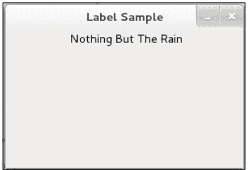

需要注意的是，继承的 `setSize` 方法以像素为单位接受水平和垂直尺寸作为参数。


## 文本控件

文本控件是用于字符串的可编辑文本字段。这些字符串可以包含一行或多行，可用于密码字段。用户也可以对其进行选择。

创建文本控件时可用的样式如下：

- SEARCH：搜索行为，可与图标组合
- ICON_CANCEL：显示 **取消** 图标
- ICON_SEARCH：显示 **搜索** 图标
- MULTI：允许多行
- SINGLE：允许单行
- PASSWORD：显示密码字段行为
- CENTER：将文本内容对齐到中心
- RIGHT：将文本内容右对齐
- LEFT：将文本内容左对齐
- READ_ONLY：使字段只读
- WRAP：换行文本而不是滚动行为

文本控件仅支持纯文本，这意味着字符必须具有相同的字体和大小。如果需要更灵活的文本控件，可以使用一个 `StyledText` 控件，它不是 SWT 的原生控件。

在 SWT 程序中使用文本字段时，控件在应用程序中具有某种功能的情况相当常见。程序员通常需要检测文本何时发生变化或过滤正在输入的字符串。为此，可能需要监听器处理以下文本控件事件：

- `DefaultSelection`：按下 *回车*
- `Modify`：文本被修改
- `Verify`：文本待验证
- `OrientationChange`：方向已更改

在下面的示例中，我们展示如何处理上述提到的其中一个事件，SWT.Modify。为此，我们创建一个文本控件，并为 SWT.Modify 事件添加一个监听器。此事件在用户输入任何字符时发送。此类监听器中代码的目的是计算已输入的字符数。消息显示在文本控件下方的标签中。

```
Display display = new Display();
Shell shell = new Shell(display);
shell.setSize(200,200);
final Text text = new Text(shell, SWT.CENTER | SWT.BORDER);
text.setSize(200,25);
final Label label = new Label(shell, SWT.CENTER);
label.setLocation(0,100);
label.setSize(200,25);
text.addListener(SWT.Modify, new Listener() {
  public void handleEvent(Event event) {
    label.setText(Integer.toString(text.getText().length()));
  }
});
shell.pack();
shell.open();
while (!shell.isDisposed()) {
  if (!display.readAndDispatch()) display.sleep();
}
display.dispose();
```

以下截图显示了与此代码片段相关的 GUI 输出：

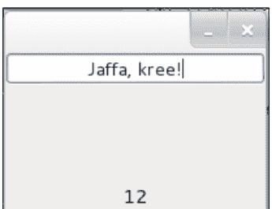

需要说明的是，在此示例中我们还使用了 setSize 和 setLocation 方法，它们分别负责设置控件的大小及其位置，以像素为单位的 x 和 y 坐标。pack() 方法也用于将控件自动调整为其首选大小。

## 按钮控件

按钮在桌面应用程序中经常使用，因为这些应用程序通常使用鼠标设备。当用户选择一个选项时，可以处理选择事件。按钮可以填充文本或图像，但不能同时使用，并且屏幕上没有获取多行文本的选项。

创建按钮控件时可用的样式如下：

- `ARROW`：以箭头外观绘制按钮
- `CHECK`：复选按钮行为
- `PUSH`：按下按钮行为
- `RADIO`：显示单选按钮行为
- `TOGGLE`：切换按钮行为
- `FLAT`：以扁平外观绘制按钮
- `UP`：绘制上箭头
- `DOWN`：绘制下箭头
- `LEFT`：绘制左箭头或左对齐
- `RIGHT`：绘制右箭头或右对齐
- `CENTER`：绘制中心箭头或居中对齐

唯一可用的事件是 SWT.Selection 事件，当按钮被点击时触发。

我们展示了如何使用按钮控件的示例，随后是应用程序输出如下：

```java
Display display = new Display ();
Shell shell = new Shell (display);
Label label = new Label (shell, SWT.NONE);
label.setText ("Enter your name:");
Text text = new Text (shell, SWT.BORDER);
text.setLayoutData (new RowData (100, SWT.DEFAULT));
final Label resultLabel = new Label(shell, SWT.BORDER);
resultLabel.setText("Nothing pressed");
Button ok = new Button (shell, SWT.PUSH);
ok.setText ("OK");
ok.addListener(SWT.Selection, new Listener() {
    public void handleEvent(Event event) {
        resultLabel.setText("OK pressed");
    }
});
Button cancel = new Button (shell, SWT.PUSH);
cancel.setText ("Cancel");
cancel.addListener(SWT.Selection, new Listener() {
    public void handleEvent(Event event) {
        resultLabel.setText("Cancel pressed");
    }
});
shell.setLayout (new RowLayout ());
shell.pack ();
shell.open ();
while (!shell.isDisposed ()) {
    if (!display.readAndDispatch ()) display.sleep ();
}
display.dispose ();
```


在此示例中，我们创建了两个按下按钮，即 OK 和 Cancel，并添加了两个监听器，当每个按钮被按下时触发，显示消息 OK pressed，或 Cancel pressed。在实际应用中，此类应用程序的可能用途之一是在按下 OK 按钮时读取文本控件中输入的名称以进行记录。

## 列表控件

列表可用于显示用户可选择的一组字符串。它们以单列呈现，并且有用于从中选择、添加和删除项目的方法。列表的内容可以通过 setItems(String[] items) 方法设置。当需要设置或替换特定项目时，可以使用 setItem(int index, String item)。

类似于 setItem 方法，该控件通过使用 getItem 或 getItems 方法来获取列表中的一个或多个项目。

项目也可以通过 add 方法添加，并使用 remove 方法删除。

setSelection 和 getSelection 方法通常在需要执行与项目选择相关的操作时使用。

列表控件可用的样式如下：

- SINGLE：只能选择一个项目
- MULTI：可选择多个项目

每个样式的描述相当直接。我们按如下方式列出此控件可用的事件：

- SWT.Selection：选择了一个项目
- SWT.DefaultSelection：双击了一个项目

使用 SWT.Selection 方法的代码示例如下所述，其后是 GUI 结果如下：

```
Display display = new Display();
Shell shell = new Shell (display);
final List list = new List (shell, SWT.BORDER | SWT.MULTI | SWT.V_SCROLL);
for (int i=0; i<10; i++) list.add ("Item " + i);
list.setSize(200, 200);
list.addListener (SWT.Selection, new Listener () {
    public void handleEvent (Event e) {
        String string = "";
        int [] selection = list.getSelectionIndices();
        for (int i=0; i<selection.length; i++)
            string += selection[i] + " ";
        System.out.println ("Selected: " + string);
    }
});
shell.pack ();
shell.open ();
while (!shell.isDisposed ()) {
    if (!display.readAndDispatch ()) display.sleep ();
}
display.dispose ();
```

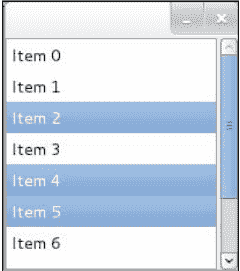

在此示例中，我们使用 add 方法向列表添加了 10 个项目，并处理了事件 `SWT.Selection`。当选择我们示例中的这三个项目时，应用程序将以下字符串输出到控制台：**Selected: 2 4 5.**

## 组合框控件

一个 `Combo` 控件， commonly known as combo box， 是 `Text` 控件和 `List` 控件的组合。`Combo` 控件通常在用户点击 `Combo` 控件中的小图标时显示为下拉列表。

用户可以输入文本字段或从列表中选择项目，但如果需要，组合框可以设置为只读，此时只能选择预定义的项目值。

`Combo` 控件的方法是 `Text` 控件和 `List` 控件方法的组合。

`Combo` 控件可用的样式如下：

- `SIMPLE`：组合框始终具有可见列表
- `DROP_DOWN`：组合框是下拉列表
- `READ_ONLY`：组合框不可编辑

`Combo` 控件可用的事件如下：

- `DefaultSelection`：项目被双击或按下 *回车*
- `Modify`：文本已被修改
- `Selection`：项目被选中


我们展示一个如何使用组合框的示例，之后是 GUI 输出。

```
Display display = new Display ();
Shell shell = new Shell (display);
Combo combo = new Combo (shell, SWT.SIMPLE | SWT.READ_ONLY);
combo.setItems(new String [] {"Three", "Six", "Eight"});
combo.setSize(200, 50);
shell.pack ();
shell.open ();
while (!shell.isDisposed ()) {
    if (!display.readAndDispatch ()) display.sleep ();
}
display.dispose ();
```

在此示例中，使用简单样式与只读样式合并创建了一个组合框。添加了三个项目，且未处理任何事件。

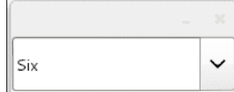

## 布局

布局是用于在顶层窗口内定位和调整控件大小的类。它们是平台无关的，并且不与小部件共享相同的行为。

在开发 SWT 应用程序时使用布局不是强制性的；不过，强烈建议使用布局。布局是一种便于管理和定位实际应用程序控件的方式，因为在大型程序中使用 setSize 和 setLocation 方法会成为负担。

与手工定位相比，布局提供了一些优势。它们通常能够计算控件的初始大小，并在发生调整大小操作时重新定位它们。

布局类有两种类型：
- 提供特定 API 给其实现的布局类
- 与特定布局数据算法一起工作的布局类，该算法可为复合控件的每个子控件分配

布局数据遵循一种算法，该算法利用有关控件应如何定位的额外信息。使用这种类型的布局时，我们需要将复合控件与布局类关联，并将复合控件的子控件与布局数据关联。

无论如何，每个布局都呈现不同的底层算法，在以下各节中我们将描述可用的 SWT 布局。

### FillLayout

最简单的布局类是 FillLayout，它不与布局数据一起工作。它使用可用空间将控件定位在单行或单列中，并为每个控件划分和分配相同的空间。如果未指定任何内容，它假定控件将与最高的一个一样高，与最宽的一个一样宽。FillLayout 通常在应用程序只有一个子控件时使用，因为它将完全填充 shell。

FillLayout 提供以下公共字段：
- `type`：布局方向，可以是 `SWT.HORIZONTAL` 或 `SWT.VERTICAL`
- `marginWidth`：沿布局左右边缘放置的边距像素数
- `marginHeight`：沿布局顶部和底部边缘放置的边距像素数
- `spacing`：控件之间空间的像素数

我们按如下方式展示如何定位 10 个 Text 小部件的元素示例。请注意，当应用程序被调整大小时，控件也会由 FillLayout 调整大小。

```java
Display display = new Display();
Shell shell = new Shell(display);
shell.setLayout(new FillLayout());
for (int i=0; i<10; i++) {
    Text text = new Text(shell, SWT.BORDER);
    text.setText("Fill" + i);
}
shell.pack();
shell.open();
while (!shell.isDisposed()) {
    if (!display.readAndDispatch()) display.sleep();
}
display.dispose();
```

以下显示了此代码片段的输出：

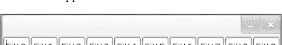

以下图像显示了调整大小的行为：

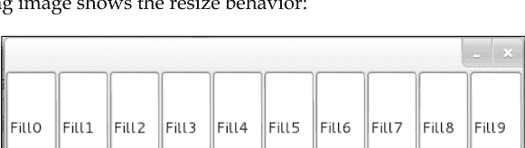

### RowLayout

RowLayout 根据实例化方式将控件定位在行（水平）或列（垂直）中。它与 FillLayout 不同，因为它不会填充所有可用空间，并且提供了一个名为 RowData 的布局数据类来单独配置每个控件。可以指定它们在复合控件中定位时的高度和宽度。

以下公共字段可用：
- center：指定控件是否应居中
- fill：指定水平布局中行中的所有控件是否应具有相同的高度，或垂直布局中是否应具有相同的宽度
- justify：指定是否应将任何剩余空间分配给控件之间
- marginBottom：指定布局底部边缘的像素数
- marginHeight：指定布局顶部和底部边缘的像素数
- marginLeft：指定布局左侧边缘的像素数
- marginRight：指定布局右侧边缘的像素数
- marginTop：指定布局顶部边缘的像素数
- marginWidth：指定布局左右边缘的像素数
- `pack`：指定所有控件是否可以采用其首选大小
- `spacing`：指定单元格边缘之间的像素数
- `type`：指定布局是否使用行或列
- `wrap`：指定如果没有可用空间，控件是否应换行到下一行

RowLayout 可用于在列和行中定位控件。尽管其名称如此，如果程序员将字段设置为 SWT.VERTICAL，布局方向将遵循此模式。

在以下示例中，我们展示如何使用 RowLayout 和 RowData 定位几个按钮。在以下示例中，请注意，在后两个按钮中，我们使用 RowData 类通过定义高度和宽度来指定按钮的大小：

```
Display display = new Display();
Shell shell = new Shell(display);
RowLayout layout = new RowLayout(SWT.HORIZONTAL);
layout.wrap = true;
layout.fill = false;
layout.justify = true;
shell.setLayout(layout);
Button b = new Button(shell, SWT.PUSH);
b.setText("Button 1");
b = new Button(shell, SWT.PUSH);
b.setText("Button 2");
RowData data = new RowData();
b.setLayoutData(data);
b = new Button(shell, SWT.PUSH);
b.setText("150 vertical");
data = new RowData();
data.height = 150;
b.setLayoutData(data);
b = new Button(shell, SWT.PUSH);
b.setText("150 horizontal");
data = new RowData();
data.width = 150;
b.setLayoutData(data);
shell.pack();
shell.open();
while (!shell.isDisposed()) {
    if (!display.readAndDispatch())
        display.sleep();
}
display.dispose();
```

样本应用程序的输出显示如下：

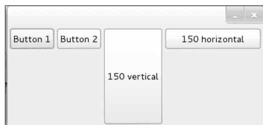

### GridLayout

GridLayout 是处理布局的绝佳选择。它有多个配置字段，并且可以通过将每个控件与 GridData 类提供的布局数据对象关联来组织复合控件的控件。

在 GridLayout 中，需要指定网格的列数。小部件按创建顺序分配给列，从左到右移动。当没有更多列可用时，下一个控件将放置在下一行。它提供了很大的灵活性，因为每个控件也可以水平和垂直跨越单元格。

GridLayout 可用的以下公共字段：
- horizontalSpacing：指定单元格水平边缘之间的像素数
- makeColumnsEqualWidth：指定所有列是否需要具有相同的宽度
- marginBottom：指定单元格底部边缘垂直边距中的像素数
- marginHeight：指定单元格底部和顶部边缘垂直边距中的像素数
- marginLeft：指定单元格左侧边缘水平边距中的像素数
- marginRight：指定单元格右侧边缘水平边距中的像素数
- marginTop：指定单元格顶部边缘垂直边距中的像素数
- `marginWidth`：指定单元格左右边缘水平边距中的像素数
- `numColumns`：指定 `Layout` 小部件中单元格列数
- `verticalSpacing`：指定单元格垂直边缘之间的像素数

当应用 `GridLayout` 来定位应用程序的元素时，需要创建 `GridData` 对象以提供有关此定位将如何执行的进一步信息。我们展示 `GridData` 类可用的主要公共字段如下：
- `verticalAlignment`：指定垂直对齐方式
- `horizontalAlignment`：指定水平对齐方式
- `widthHint`：指定用作单元格宽度默认值的像素空间量
- `heightHint`：指定用作单元格高度默认值的像素空间量
- `horizontalIndent`：指定放置在单元格左侧的像素数
- `horizontalSpan`：指定单元格将填充的列数
- `verticalSpan`：指定单元格将填充的行数
- `grabExcessHorizontalSpace`：如果有可用空间则抓取水平剩余空间
- `grabExcessVerticalSpace`：如果有可用空间则抓取垂直剩余空间

我们按如下方式展示如何使用 `GridLayout` 和 `GridData` 的示例：

```
Display display = new Display ();
Shell shell = new Shell (display);
GridLayout layout = new GridLayout(4, false);
shell.setLayout(layout);
Button b = new Button(shell, SWT.PUSH);
b.setText("LEFT, TOP");
b.setLayoutData(new GridData(SWT.LEFT, SWT.TOP, true, true, 1, 1));
b = new Button(shell, SWT.PUSH);
b.setText("LEFT, CENTER");
b.setLayoutData(new GridData(SWT.LEFT, SWT.CENTER, true, true, 1, 1));
b = new Button(shell, SWT.PUSH);
b.setText("LEFT, BOTTOM");
b.setLayoutData(new GridData(SWT.LEFT, SWT.BOTTOM, true, true, 1, 1));
b = new Button(shell, SWT.PUSH);
```

```
b.setText("LEFT, FILL");
 b.setLayoutData(new GridData(SWT.LEFT, SWT.FILL, true, true, 1, 1));
 b = new Button(shell, SWT.PUSH);
 b.setText("FILL, TOP");
 b.setLayoutData(new GridData(SWT.FILL, SWT.TOP, true, true, 1, 1));
 b = new Button(shell, SWT.PUSH);
 b.setText("FILL, CENTER");
 b.setLayoutData(new GridData(SWT.FILL, SWT.CENTER, true, true, 1, 1));
 b = new Button(shell, SWT.PUSH);
 b.setText("FILL, BOTTOM");
 b.setLayoutData(new GridData(SWT.FILL, SWT.BOTTOM, true, true, 1, 1));
 b = new Button(shell, SWT.PUSH);
 b.setText("FILL, FILL");
 b.setLayoutData(new GridData(SWT.FILL, SWT.FILL, true, true, 1, 1));
 shell.open ();
 while (!shell.isDisposed ()) {
     if (!display.readAndDispatch ()) display.sleep ();
 }
 display.dispose ();
```

在此示例中可以看出 GridLayout 接收两个参数。第一个是列数，第二个是指定列不具有相同的宽度。类似地，GridData 方法接收六个参数：horizontalAlignment、verticalAlignment、grabExcessHorizontalSpace、grabExcessVerticalSpace、horizontalSpan 和 verticalSpan，这些在之前已作解释。

以下 GUI 输出由我们的示例生成：

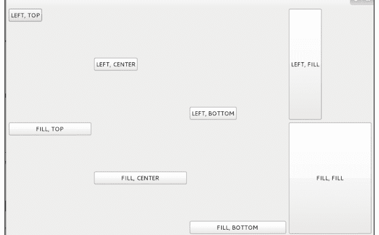

## 新功能与亮点

本节中，我们尝试指出 Eclipse Juno 版本 SWT API 的一些新特性。

第一个涉及的 `StyledText` 控件。处理需要自定义的文本时，基本的 `Text` 控件可能不够用。在此版本中进行了一些改进，例如仅在需要时显示自动滚动条。

另一个新特性是可以自定义默认浏览器渲染器。对于使用具有特定原生渲染器样式的浏览器的程序而言，这尤其重要。浏览器还增加了对 XULRunner 10 的支持。

可以提及的其他一些更新有：

- `Combo` API 中获取插入符信息的新方法
- 用于在单元格之间导航的 `TreeCursor` 类的改进
- `TrayItem` 图像可以高亮显示
- `ColorDialog` 增加了对自定义颜色的支持

## 总结

在本章中，您已[content]
```
b.setText("LEFT, FILL");
 b.setLayoutData(new GridData(SWT.LEFT, SWT.FILL, true, true, 1, 1));
 b = new Button(shell, SWT.PUSH);
 b.setText("FILL, TOP");
 b.setLayoutData(new GridData(SWT.FILL, SWT.TOP, true, true, 1, 1));
 b = new Button(shell, SWT.PUSH);
 b.setText("FILL, CENTER");
 b.setLayoutData(new GridData(SWT.FILL, SWT.CENTER, true, true, 1, 1));
 b = new Button(shell, SWT.PUSH);
 b.setText("FILL, BOTTOM");
 b.setLayoutData(new GridData(SWT.FILL, SWT.BOTTOM, true, true, 1, 1));
 b = new Button(shell, SWT.PUSH);
 b.setText("FILL, FILL");
 b.setLayoutData(new GridData(SWT.FILL, SWT.FILL, true, true, 1, 1));
 shell.open ();
 while (!shell.isDisposed ()) {
     if (!display.readAndDispatch ()) display.sleep ();
 }
 display.dispose ();
```

在此示例中可以看出 GridLayout 接收两个参数。第一个是列数，第二个是指定列不具有相同的宽度。类似地，GridData 方法接收六个参数：horizontalAlignment、verticalAlignment、grabExcessHorizontalSpace、grabExcessVerticalSpace、horizontalSpan 和 verticalSpan，这些在之前已作解释。

以下 GUI 输出由我们的示例生成：


## 新功能与亮点

本节中，我们尝试指出 Eclipse Juno 版本 SWT API 的一些新特性。

第一个涉及的 `StyledText` 控件。处理需要自定义的文本时，基本的 `Text` 控件可能不够用。在此版本中进行了一些改进，例如仅在需要时显示自动滚动条。

另一个新特性是可以自定义默认浏览器渲染器。对于使用具有特定原生渲染器样式的浏览器的程序而言，这尤其重要。浏览器还增加了对 XULRunner 10 的支持。

可以提及的其他一些更新有：

- `Combo` API 中获取插入符信息的新方法
- 用于在单元格之间导航的 `TreeCursor` 类的改进
- `TrayItem` 图像可以高亮显示
- `ColorDialog` 增加了对自定义颜色的支持

## 总结

在本章中，您已[content]
```
b.setText("LEFT, FILL");
 b.setLayoutData(new GridData(SWT.LEFT, SWT.FILL, true, true, 1, 1));
 b = new Button(shell, SWT.PUSH);
 b.setText("FILL, TOP");
 b.setLayoutData(new GridData(SWT.FILL, SWT.TOP, true, true, 1, 1));
 b = new Button(shell, SWT.PUSH);
 b.setText("FILL, CENTER");
 b.setLayoutData(new GridData(SWT.FILL, SWT.CENTER, true, true, 1, 1));
 b = new Button(shell, SWT.PUSH);
 b.setText("FILL, BOTTOM");
 b.setLayoutData(new GridData(SWT.FILL, SWT.BOTTOM, true, true, 1, 1));
 b = new Button(shell, SWT.PUSH);
 b.setText("FILL, FILL");
 b.setLayoutData(new GridData(SWT.FILL, SWT.FILL, true, true, 1, 1));
 shell.open ();
 while (!shell.isDisposed ()) {
     if (!display.readAndDispatch ()) display.sleep ();
 }
 display.dispose ();
```

在此示例中可以看出 GridLayout 接收两个参数。第一个是列数，第二个是指定列不具有相同的宽度。类似地，GridData 方法接收六个参数：horizontalAlignment、verticalAlignment、grabExcessHorizontalSpace、grabExcessVerticalSpace、horizontalSpan 和 verticalSpan，这些在之前已作解释。

以下 GUI 输出由我们的示例生成：


## 新功能与亮点

本节中，我们尝试指出 Eclipse Juno 版本 SWT API 的一些新特性。

第一个涉及的 `StyledText` 控件。处理需要自定义的文本时，基本的 `Text` 控件可能不够用。在此版本中进行了一些改进，例如仅在需要时显示自动滚动条。

另一个新特性是可以自定义默认浏览器渲染器。对于使用具有特定原生渲染器样式的浏览器的程序而言，这尤其重要。浏览器还增加了对 XULRunner 10 的支持。

可以提及的其他一些更新有：

- `Combo` API 中获取插入符信息的新方法
- 用于在单元格之间导航的 `TreeCursor` 类的改进
- `TrayItem` 图像可以高亮显示
- `ColorDialog` 增加了对自定义颜色的支持

## 总结

在本章中，您已[content]
```
b.setText("LEFT, FILL");
 b.setLayoutData(new GridData(SWT.LEFT, SWT.FILL, true, true, 1, 1));
 b = new Button(shell, SWT.PUSH);
 b.setText("FILL, TOP");
 b.setLayoutData(new GridData(SWT.FILL, SWT.TOP, true, true, 1, 1));
 b = new Button(shell, SWT.PUSH);
 b.setText("FILL, CENTER");
 b.setLayoutData(new GridData(SWT.FILL, SWT.CENTER, true, true, 1, 1));
 b = new Button(shell, SWT.PUSH);
 b.setText("FILL, BOTTOM");
 b.setLayoutData(new GridData(SWT.FILL, SWT.BOTTOM, true, true, 1, 1));
 b = new Button(shell, SWT.PUSH);
 b.setText("FILL, FILL");
 b.setLayoutData(new GridData(SWT.FILL, SWT.FILL, true, true, 1, 1));
 shell.open ();
 while (!shell.isDisposed ()) {
     if (!display.readAndDispatch ()) display.sleep ();
 }
 display.dispose ();
```

在此示例中可以看出 GridLayout 接收两个参数。第一个是列数，第二个是指定列不具有相同的宽度。类似地，GridData 方法接收六个参数：horizontalAlignment、verticalAlignment、grabExcessHorizontalSpace、grabExcessVerticalSpace、horizontalSpan 和 verticalSpan，这些在之前已作解释。

以下 GUI 输出由我们的示例生成：


## 新功能与亮点

本节中，我们尝试指出 Eclipse Juno 版本 SWT API 的一些新特性。

第一个涉及的 `StyledText` 控件。处理需要自定义的文本时，基本的 `Text` 控件可能不够用。在此版本中进行了一些改进，例如仅在需要时显示自动滚动条。

另一个新特性是可以自定义默认浏览器渲染器。对于使用具有特定原生渲染器样式的浏览器的程序而言，这尤其重要。浏览器还增加了对 XULRunner 10 的支持。

可以提及的其他一些更新有：

- `Combo` API 中获取插入符信息的新方法
- 用于在单元格之间导航的 `TreeCursor` 类的改进
- `TrayItem` 图像可以高亮显示
- `ColorDialog` 增加了对自定义颜色的支持

## 总结

在本章中，您已[content]
```
b.setText("LEFT, FILL");
 b.setLayoutData(new GridData(SWT.LEFT, SWT.FILL, true, true, 1, 1));
 b = new Button(shell, SWT.PUSH);
 b.setText("FILL, TOP");
 b.setLayoutData(new GridData(SWT.FILL, SWT.TOP, true, true, 1, 1));
 b = new Button(shell, SWT.PUSH);
 b.setText("FILL, CENTER");
 b.setLayoutData(new GridData(SWT.FILL, SWT.CENTER, true, true, 1, 1));
 b = new Button(shell, SWT.PUSH);
 b.setText("FILL, BOTTOM");
 b.setLayoutData(new GridData(SWT.FILL, SWT.BOTTOM, true, true, 1, 1));
 b = new Button(shell, SWT.PUSH);
 b.setText("FILL, FILL");
 b.setLayoutData(new GridData(SWT.FILL, SWT.FILL, true, true, 1, 1));
 shell.open ();
 while (!shell.isDisposed ()) {
     if (!display.readAndDispatch ()) display.sleep ();
 }
 display.dispose ();
```

在此示例中可以看出 GridLayout 接收两个参数。第一个是列数，第二个是指定列不具有相同的宽度。类似地，GridData 方法接收六个参数：horizontalAlignment、verticalAlignment、grabExcessHorizontalSpace、grabExcessVerticalSpace、horizontalSpan 和 verticalSpan，这些在之前已作解释。

以下 GUI 输出由我们的示例生成：


## 新功能与亮点

本节中，我们尝试指出 Eclipse Juno 版本 SWT API 的一些新特性。

第一个涉及的 `StyledText` 控件。处理需要自定义的文本时，基本的 `Text` 控件可能不够用。在此版本中进行了一些改进，例如仅在需要时显示自动滚动条。

另一个新特性是可以自定义默认浏览器渲染器。对于使用具有特定原生渲染器样式的浏览器的程序而言，这尤其重要。浏览器还增加了对 XULRunner 10 的支持。

可以提及的其他一些更新有：

- `Combo` API 中获取插入符信息的新方法
- 用于在单元格之间导航的 `TreeCursor` 类的改进
- `TrayItem` 图像可以高亮显示
- `ColorDialog` 增加了对自定义颜色的支持

## 总结

在本章中，您已[content]
```
b.setText("LEFT, FILL");
 b.setLayoutData(new GridData(SWT.LEFT, SWT.FILL, true, true, 1, 1));
 b = new Button(shell, SWT.PUSH);
 b.setText("FILL, TOP");
 b.setLayoutData(new GridData(SWT.FILL, SWT.TOP, true, true, 1, 1));
 b = new Button(shell, SWT.PUSH);
 b.setText("FILL, CENTER");
 b.setLayoutData(new GridData(SWT.FILL, SWT.CENTER, true, true, 1, 1));
 b = new Button(shell, SWT.PUSH);
 b.setText("FILL, BOTTOM");
 b.setLayoutData(new GridData(SWT.FILL, SWT.BOTTOM, true, true, 1, 1));
 b = new Button(shell, SWT.PUSH);
 b.setText("FILL, FILL");
 b.setLayoutData(new GridData(SWT.FILL, SWT.FILL, true, true, 1, 1));
 shell.open ();
 while (!shell.isDisposed ()) {
     if (!display.readAndDispatch ()) display.sleep ();
 }
 display.dispose ();
```

在此示例中可以看出 GridLayout 接收两个参数。第一个是列数，第二个是指定列不具有相同的宽度。类似地，GridData 方法接收六个参数：horizontalAlignment、verticalAlignment、grabExcessHorizontalSpace、grabExcessVerticalSpace、horizontalSpan 和 verticalSpan，这些在之前已作解释。

以下 GUI 输出由我们的示例生成：


## 新功能与亮点

本节中，我们尝试指出 Eclipse Juno 版本 SWT API 的一些新特性。

第一个涉及的 `StyledText` 控件。处理需要自定义的文本时，基本的 `Text` 控件可能不够用。在此版本中进行了一些改进，例如仅在需要时显示自动滚动条。

另一个新特性是可以自定义默认浏览器渲染器。对于使用具有特定原生渲染器样式的浏览器的程序而言，这尤其重要。浏览器还增加了对 XULRunner 10 的支持。

可以提及的其他一些更新有：

- `Combo` API 中获取插入符信息的新方法
- 用于在单元格之间导航的 `TreeCursor` 类的改进
- `TrayItem` 图像可以高亮显示
- `ColorDialog` 增加了对自定义颜色的支持

## 总结

在本章中，您已[content]
```
b.setText("LEFT, FILL");
 b.setLayoutData(new GridData(SWT.LEFT, SWT.FILL, true, true, 1, 1));
 b = new Button(shell, SWT.PUSH);
 b.setText("FILL, TOP");
 b.setLayoutData(new GridData(SWT.FILL, SWT.TOP, true, true, 1, 1));
 b = new Button(shell, SWT.PUSH);
 b.setText("FILL, CENTER");
 b.setLayoutData(new GridData(SWT.FILL, SWT.CENTER, true, true, 1, 1));
 b = new Button(shell, SWT.PUSH);
 b.setText("FILL, BOTTOM");
 b.setLayoutData(new GridData(SWT.FILL, SWT.BOTTOM, true, true, 1, 1));
 b = new Button(shell, SWT.PUSH);
 b.setText("FILL, FILL");
 b.setLayoutData(new GridData(SWT.FILL, SWT.FILL, true, true, 1, 1));
 shell.open ();
 while (!shell.isDisposed ()) {
     if (!display.readAndDispatch ()) display.sleep ();
 }
 display.dispose ();
```

在此示例中可以看出 GridLayout 接收两个参数。第一个是列数，第二个是指定列不具有相同的宽度。类似地，GridData 方法接收六个参数：horizontalAlignment、verticalAlignment、grabExcessHorizontalSpace、grabExcessVerticalSpace、horizontalSpan 和 verticalSpan，这些在之前已作解释。

以下 GUI 输出由我们的示例生成：


## 新功能与亮点

本节中，我们尝试指出 Eclipse Juno 版本 SWT API 的一些新特性。

第一个涉及的 `StyledText` 控件。处理需要自定义的文本时，基本的 `Text` 控件可能不够用。在此版本中进行了一些改进，例如仅在需要时显示自动滚动条。

另一个新特性是可以自定义默认浏览器渲染器。对于使用具有特定原生渲染器样式的浏览器的程序而言，这尤其重要。浏览器还增加了对 XULRunner 10 的支持。

可以提及的其他一些更新有：

- `Combo` API 中获取插入符信息的新方法
- 用于在单元格之间导航的 `TreeCursor` 类的改进
- `TrayItem` 图像可以高亮显示
- `ColorDialog` 增加了对自定义颜色的支持

## 总结

在本章中，您已[content]
```
b.setText("LEFT, FILL");
 b.setLayoutData(new GridData(SWT.LEFT, SWT.FILL, true, true, 1, 1));
 b = new Button(shell, SWT.PUSH);
 b.setText("FILL, TOP");
 b.setLayoutData(new GridData(SWT.FILL, SWT.TOP, true, true, 1, 1));
 b = new Button(shell, SWT.PUSH);
 b.setText("FILL, CENTER");
 b.setLayoutData(new GridData(SWT.FILL, SWT.CENTER, true, true, 1, 1));
 b = new Button(shell, SWT.PUSH);
 b.setText("FILL, BOTTOM");
 b.setLayoutData(new GridData(SWT.FILL, SWT.BOTTOM, true, true, 1, 1));
 b = new Button(shell, SWT.PUSH);
 b.setText("FILL, FILL");
 b.setLayoutData(new GridData(SWT.FILL, SWT.FILL, true, true, 1, 1));
 shell.open ();
 while (!shell.isDisposed ()) {
     if (!display.readAndDispatch ()) display.sleep ();
 }
 display.dispose ();
```

在此示例中可以看出 GridLayout 接收两个参数。第一个是列数，第二个是指定列不具有相同的宽度。类似地，GridData 方法接收六个参数：horizontalAlignment、verticalAlignment、grabExcessHorizontalSpace、grabExcessVerticalSpace、horizontalSpan 和 verticalSpan，这些在之前已作解释。

以下 GUI 输出由我们的示例生成：


## 新功能与亮点

本节中，我们尝试指出 Eclipse Juno 版本 SWT API 的一些新特性。

第一个涉及的 `StyledText` 控件。处理需要自定义的文本时，基本的 `Text` 控件可能不够用。在此版本中进行了一些改进，例如仅在需要时显示自动滚动条。

另一个新特性是可以自定义默认浏览器渲染器。对于使用具有特定原生渲染器样式的浏览器的程序而言，这尤其重要。浏览器还增加了对 XULRunner 10 的支持。

可以提及的其他一些更新有：

- `Combo` API 中获取插入符信息的新方法
- 用于在单元格之间导航的 `TreeCursor` 类的改进
- `TrayItem` 图像可以高亮显示
- `ColorDialog` 增加了对自定义颜色的支持

## 总结

在本章中，您已[content]
```
b.setText("LEFT, FILL");
 b.setLayoutData(new GridData(SWT.LEFT, SWT.FILL, true, true, 1, 1));
 b = new Button(shell, SWT.PUSH);
 b.setText("FILL, TOP");
 b.setLayoutData(new GridData(SWT.FILL, SWT.TOP, true, true, 1, 1));
 b = new Button(shell, SWT.PUSH);
 b.setText("FILL, CENTER");
 b.setLayoutData(new GridData(SWT.FILL, SWT.CENTER, true, true, 1, 1));
 b = new Button(shell, SWT.PUSH);
 b.setText("FILL, BOTTOM");
 b.setLayoutData(new GridData(SWT.FILL, SWT.BOTTOM, true, true, 1, 1));
 b = new Button(shell, SWT.PUSH);
 b.setText("FILL, FILL");
 b.setLayoutData(new GridData(SWT.FILL, SWT.FILL, true, true, 1, 1));
 shell.open ();
 while (!shell.isDisposed ()) {
     if (!display.readAndDispatch ()) display.sleep ();
 }
 display.dispose ();
```

在此示例中可以看出 GridLayout 接收两个参数。第一个是列数，第二个是指定列不具有相同的宽度。类似地，GridData 方法接收六个参数：horizontalAlignment、verticalAlignment、grabExcessHorizontalSpace、grabExcessVerticalSpace、horizontalSpan 和 verticalSpan，这些在之前已作解释。

以下 GUI 输出由我们的示例生成：


## 新功能与亮点

本节中，我们尝试指出 Eclipse Juno 版本 SWT API 的一些新特性。

第一个涉及的 `StyledText` 控件。处理需要自定义的文本时，基本的 `Text` 控件可能不够用。在此版本中进行了一些改进，例如仅在需要时显示自动滚动条。

另一个新特性是可以自定义默认浏览器渲染器。对于使用具有特定原生渲染器样式的浏览器的程序而言，这尤其重要。浏览器还增加了对 XULRunner 10 的支持。

可以提及的其他一些更新有：

- `Combo` API 中获取插入符信息的新方法
- 用于在单元格之间导航的 `TreeCursor` 类的改进
- `TrayItem` 图像可以高亮显示
- `ColorDialog` 增加了对自定义颜色的支持

## 总结

在本章中，您已[content]
```
b.setText("LEFT, FILL");
 b.setLayoutData(new GridData(SWT.LEFT, SWT.FILL, true, true, 1, 1));
 b = new Button(shell, SWT.PUSH);
 b.setText("FILL, TOP");
 b.setLayoutData(new GridData(SWT.FILL, SWT.TOP, true, true, 1, 1));
 b = new Button(shell, SWT.PUSH);
 b.setText("FILL, CENTER");
 b.setLayoutData(new GridData(SWT.FILL, SWT.CENTER, true, true, 1, 1));
 b = new Button(shell, SWT.PUSH);
 b.setText("FILL, BOTTOM");
 b.setLayoutData(new GridData(SWT.FILL, SWT.BOTTOM, true, true, 1, 1));
 b = new Button(shell, SWT.PUSH);
 b.setText("FILL, FILL");
 b.setLayoutData(new GridData(SWT.FILL, SWT.FILL, true, true, 1, 1));
 shell.open ();
 while (!shell.isDisposed ()) {
     if (!display.readAndDispatch ()) display.sleep ();
 }
 display.dispose ();
```

在此示例中可以看出 GridLayout 接收两个参数。第一个是列数，第二个是指定列不具有相同的宽度。类似地，GridData 方法接收六个参数：horizontalAlignment、verticalAlignment、grabExcessHorizontalSpace、grabExcessVerticalSpace、horizontalSpan 和 verticalSpan，这些在之前已作解释。

以下 GUI 输出由我们的示例生成：


## 新功能与亮点

本节中，我们尝试指出 Eclipse Juno 版本 SWT API 的一些新特性。

第一个涉及的 `StyledText` 控件。处理需要自定义的文本时，基本的 `Text` 控件可能不够用。在此版本中进行了一些改进，例如仅在需要时显示自动滚动条。

另一个新特性是可以自定义默认浏览器渲染器。对于使用具有特定原生渲染器样式的浏览器的程序而言，这尤其重要。浏览器还增加了对 XULRunner 10 的支持。

可以提及的其他一些更新有：

- `Combo` API 中获取插入符信息的新方法
- 用于在单元格之间导航的 `TreeCursor` 类的改进
- `TrayItem` 图像可以高亮显示
- `ColorDialog` 增加了对自定义颜色的支持

## 总结

本章介绍了名为 SWT 的工具集，它专为在 Eclipse 中开发图形界面而设计。您已[content]
```
b.setText("LEFT, FILL");
 b.setLayoutData(new GridData(SWT.LEFT, SWT.FILL, true, true, 1, 1));
 b = new Button(shell, SWT.PUSH);
 b.setText("FILL, TOP");
 b.setLayoutData(new GridData(SWT.FILL, SWT.TOP, true, true, 1, 1));
 b = new Button(shell, SWT.PUSH);
 b.setText("FILL, CENTER");
 b.setLayoutData(new GridData(SWT.FILL, SWT.CENTER, true, true, 1, 1));
 b = new Button(shell, SWT.PUSH);
 b.setText("FILL, BOTTOM");
 b.setLayoutData(new GridData(SWT.FILL, SWT.BOTTOM, true, true, 1, 1));
 b = new Button(shell, SWT.PUSH);
 b.setText("FILL, FILL");
 b.setLayoutData(new GridData(SWT.FILL, SWT.FILL, true, true, 1, 1));
 shell.open ();
 while (!shell.isDisposed ()) {
     if (!display.readAndDispatch ()) display.sleep ();
 }
 display.dispose ();
```

在此示例中可以看出 GridLayout 接收两个参数。第一个是列数，第二个是指定列不具有相同的宽度。类似地，GridData 方法接收六个参数：horizontalAlignment、verticalAlignment、grabExcessHorizontalSpace、grabExcessVerticalSpace、horizontalSpan 和 verticalSpan，这些在之前已作解释。

以下 GUI 输出由我们的示例生成：


## 新功能与亮点

本节中，我们尝试指出 Eclipse Juno 版本 SWT API 的一些新特性。

第一个涉及的 `StyledText` 控件。处理需要自定义的文本时，基本的 `Text` 控件可能不够用。在此版本中进行了一些改进，例如仅在需要时显示自动滚动条。

另一个新特性是可以自定义默认浏览器渲染器。对于使用具有特定原生渲染器样式的浏览器的程序而言，这尤其重要。浏览器还增加了对 XULRunner 10 的支持。

可以提及的其他一些更新有：

- `Combo` API 中获取插入符信息的新方法
- 用于在单元格之间导航的 `TreeCursor` 类的改进
- `TrayItem` 图像可以高亮显示
- `ColorDialog` 增加了对自定义颜色的支持

## 总结

本章介绍了名为 SWT 的工具集，它专为在 Eclipse 中开发图形界面而设计。您已[content]
```
b.setText("LEFT, FILL");
 b.setLayoutData(new GridData(SWT.LEFT, SWT.FILL, true, true, 1, 1));
 b = new Button(shell, SWT.PUSH);
 b.setText("FILL, TOP");
 b.setLayoutData(new GridData(SWT.FILL, SWT.TOP, true, true, 1, 1));
 b = new Button(shell, SWT.PUSH);
 b.setText("FILL, CENTER");
 b.setLayoutData(new GridData(SWT.FILL, SWT.CENTER, true, true, 1, 1));
 b = new Button(shell, SWT.PUSH);
 b.setText("FILL, BOTTOM");
 b.setLayoutData(new GridData(SWT.FILL, SWT.BOTTOM, true, true, 1, 1));
 b = new Button(shell, SWT.PUSH);
 b.setText("FILL, FILL");
 b.setLayoutData(new GridData(SWT.FILL, SWT.FILL, true, true, 1, 1));
 shell.open ();
 while (!shell.isDisposed ()) {
     if (!display.readAndDispatch ()) display.sleep ();
 }
 display.dispose ();
```

在此示例中可以看出 GridLayout 接收两个参数。第一个是列数，第二个是指定列不具有相同的宽度。类似地，GridData 方法接收六个参数：horizontalAlignment、verticalAlignment、grabExcessHorizontalSpace、grabExcessVerticalSpace、horizontalSpan 和 verticalSpan，这些在之前已作解释。

以下 GUI 输出由我们的示例生成：


## 新功能与亮点

本节中，我们尝试指出 Eclipse Juno 版本 SWT API 的一些新特性。

第一个涉及的 `StyledText` 控件。处理需要自定义的文本时，基本的 `Text` 控件可能不够用。在此版本中进行了一些改进，例如仅在需要时显示自动滚动条。

另一个新特性是可以自定义默认浏览器渲染器。对于使用具有特定原生渲染器样式的浏览器的程序而言，这尤其重要。浏览器还增加了对 XULRunner 10 的支持。

可以提及的其他一些更新有：

- `Combo` API 中获取插入符信息的新方法
- 用于在单元格之间导航的 `TreeCursor` 类的改进
- `TrayItem` 图像可以高亮显示
- `ColorDialog` 增加了对自定义颜色的支持

## 总结

本章介绍了名为 SWT 的工具集，它专为在 Eclipse 中开发图形界面而设计。您已[content]
```
b.setText("LEFT, FILL");
 b.setLayoutData(new GridData(SWT.LEFT, SWT.FILL, true, true, 1, 1));
 b = new Button(shell, SWT.PUSH);
 b.setText("FILL, TOP");
 b.setLayoutData(new GridData(SWT.FILL, SWT.TOP, true, true, 1, 1));
 b = new Button(shell, SWT.PUSH);
 b.setText("FILL, CENTER");
 b.setLayoutData(new GridData(SWT.FILL, SWT.CENTER, true, true, 1, 1));
 b = new Button(shell, SWT.PUSH);
 b.setText("FILL, BOTTOM");
 b.setLayoutData(new GridData(SWT.FILL, SWT.BOTTOM, true, true, 1, 1));
 b = new Button(shell, SWT.PUSH);
 b.setText("FILL, FILL");
 b.setLayoutData(new GridData(SWT.FILL, SWT.FILL, true, true, 1, 1));
 shell.open ();
 while (!shell.isDisposed ()) {
     if (!display.readAndDispatch ()) display.sleep ();
 }
 display.dispose ();
```

在此示例中可以看出 GridLayout 接收两个参数。第一个是列数，第二个是指定列不具有相同的宽度。类似地，GridData 方法接收六个参数：horizontalAlignment、verticalAlignment、grabExcessHorizontalSpace、grabExcessVerticalSpace、horizontalSpan 和 verticalSpan，这些在之前已作解释。

以下 GUI 输出由我们的示例生成：


## 新功能与亮点

本节中，我们尝试指出 Eclipse Juno 版本 SWT API 的一些新特性。

第一个涉及的 `StyledText` 控件。处理需要自定义的文本时，基本的 `Text` 控件可能不够用。在此版本中进行了一些改进，例如仅在需要时显示自动滚动条。

另一个新特性是可以自定义默认浏览器渲染器。对于使用具有特定原生渲染器样式的浏览器的程序而言，这尤其重要。浏览器还增加了对 XULRunner 10 的支持。

可以提及的其他一些更新有：

- `Combo` API 中获取插入符信息的新方法
- 用于在单元格之间导航的 `TreeCursor` 类的改进
- `TrayItem` 图像可以高亮显示
- `ColorDialog` 增加了对自定义颜色的支持

## 总结

本章介绍了 SWT 工具集及其基本概念。