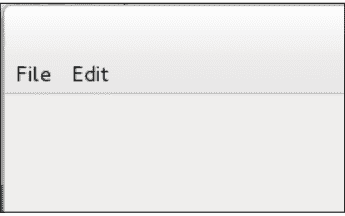
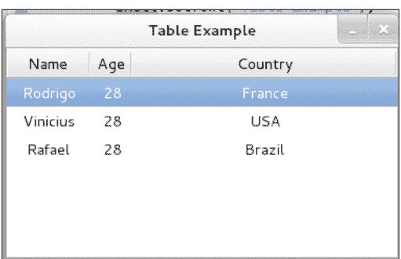
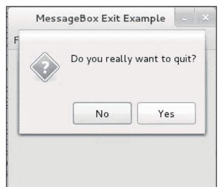
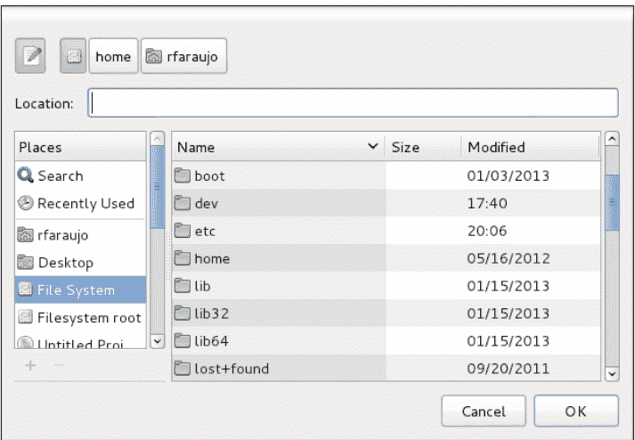
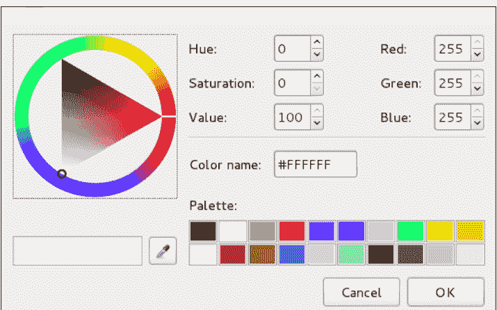
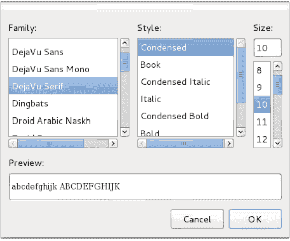

# 6 更多 SWT

如前所述，**Standard Widget Toolkit (SWT)** 是 Eclipse 项目开发的一套工具，用于帮助构建 **Graphical User Interface (GUI)** 应用程序。

在 *Chapter 5, SWT* 中，我们介绍了 SWT API 的一些基本概念。这些知识很重要，以便我们能轻松跟上本章介绍的内容。对于本章的后续部分，我们将深入 SWT 事件，并展示如何处理菜单、工具栏、对话框和表格。

### 事件

在上一章的多个示例中，尽管不是我们试图解释的重点，我们已展示如何处理一些用户事件，例如按钮点击。对于用户执行的每个操作，例如鼠标点击或按下键，操作系统都会生成一个事件。我们可以选择处理对正在开发的应用程序而言相关的部分。要捕获事件，需要向代码添加监听器，这些监听器必须附加到容器中存在的界面元素，例如 shell、composite 或 widget。

主要过程从操作系统的事件队列开始，该队列处理用户采取的操作（记录和列出）。当 SWT 应用程序运行时，`Display` 类使用 `readAndDispatch` 方法监控来自操作系统的消息。它筛选出相关的消息并将其发送到 shell 对象，后者负责将其重定向到关联的 widget。事件信息最终被 widget 监听器捕获，后者随后调用方法来处理事件。

在本章中，我们将讨论如何处理与 SWT API 相关的事件，并通过一些示例来说明我们的解释。

### 类型化与非类型化事件

处理事件需要使用监听器。在 SWT API 的早期版本中，只有非类型化监听器。这些监听器提供了一种简单的机制来处理事件。只有一个通用的接口称为 Listener 和一个事件类称为 Event。要添加监听器，需要使用 addListener 方法。

在 Eclipse 社区讨论后，决定在 SWT API 中引入更熟悉的模式。这些是类型化监听器，它们以非类型化监听器为基础定义，可以在 org.eclipse.swt.events 包中找到。我们可以在以下代码片段中看到它们之间的区别：

```
...
widget.addListener(SWT.Dispose, new Listener() {
    public void handleEvent(Event event) {
        // widget was disposed
    }
});
...
...
widget.addDisposeListener(new DisposeListener() {
    public void widgetDisposed(DisposeEvent event) {
        // widget was disposed
    }
});
...
```

在此示例中，DisposeListener 是一个接口。当监听器中定义了多个方法时，SWT API 提供了一个包含这些方法的适配器类。例如，SelectionListener 接口有两个方法 widgetSelected 和 widgetDefaultSelected，它们以 SelectionEvents 作为参数。因此，SelectionAdapter 类包含这两个方法。

下表显示了类型化事件及其对应的非类型化事件：

| Event | Listener | Method | Untyped event |
|---|---|---|---|
| ArmEvent | ArmListener | widgetArmed | SWT.Arm |
| ControlEvent | ControlListener | controlMoved | SWT.Move |
|  | ControlAdapter | controlResized | SWT.Resize |
| DisposeEvent | DisposeListener | widgetDisposed | SWT.Dispose |
| FocusEvent | FocusListener | focusGained | SWT.FocusIn |
|  | FocusAdapter | focusLost | SWT.FocusOut |
| HelpEvent | HelpListener | helpRequested | SWT.Help |
| KeyEvent | KeyListener | keyPressed | SWT.KeyPressed |
|  | KeyAdapter | keyReleased | SWT.KeyReleased |
| MenuEvent | MenuListener | menuHidden | SWT.Hide |
|  | MenuAdapter | menuShown | SWT.Show |
| ModifyEvent | ModifyListener | modifyText | SWT.Modify |
| MouseEvent | MouseListener | mouseDoubleClick | SWT.MouseDoubleClick |
|  | MouseAdapter | mouseDown | SWT.MouseDown |
|  |  | mouseUp | SWT.MouseUp |
| MouseMoveEvent | MouseMoveListener | MouseMove | SWT.MouseMove |
| MouseTrackEvent | MouseTrackListener | mouseEnter | SWT.MouseEnter |
|  | MouseTrackAdapter | mouseExit | SWT.MouseExit |
|  |  | mouseHover | SWT.MouseHover |
| PaintEvent | PaintListener | paintControl | SWT.Paint |
| SelectionEvent | SelectionListener | widgetDefaultSelected | SWT.DefaultSelection |
|  | SelectionAdapter | widgetSelected | SWT.Selection |
| ShellEvent | ShellListener | shellActivated | SWT.Activate |
|  | ShellAdapter | shellClosed | SWT.Close |
|  |  | shellDeactivated | SWT.Deactivate |
|  |  | shellDeiconified | SWT.Deiconify |
|  |  | shellIconified | SWT.Iconify |
| TraverseEvent | TraverseListener | keyTraversed | SWT.Traverse |
| TreeEvent | TreeListener | treeCollapsed | SWT.Collapse |
|  | TreeAdapter | treeExpanded | SWT.Expand |
| VerifyEvent | VerifyListener | verifyText | SWT.Verify |

前述表格中提到的适配器仅适用于监听器具有多个方法的事件。适配器对象可以使用类似的结构 addXListener 创建：

```
```
...
button.addMouseListener(new MouseAdapter()
{
    public void mouseDoubleClick(MouseEvent e)
    {
        System.out.println("Double click.");
    }
})};
.....
```
```

由于存在多个事件和监听器，很难在解释中全部关注它们。在下面的小节中，我们尝试给出一些最常用事件的使用示例。

## KeyEvent

大多数事件都易于理解和使用。然而，KeyEvent 尤其可能需要更好的解释。KeyEvent 类是在用户按下键时创建的。它有两个子类：TraverseEvent 和 VerifyEvent。当用户按下箭头键或 Tab 键以到达不同的控件时，会生成 TraverseEvent，而 VerifyEvent 子类则在用户向控件输入文本时被激活。

Three member fields of the KeyEvent class typically used are as follows:

- **character**: 它提供一个表示所按键的 char 值
- **stateMask**: 它返回一个表示键盘修改状态的整数（可以验证是否按下了某些 Alt、Ctrl、Shift 或 command 键）
- **keyCode**: 它提供与输入键相对应的 SWT 公共常量

以下代码片段展示了如何使用 KeyEvent 类的示例：

```java
public class ComboListenerEx {
    public static void main(String[] args) {
        Display display = new Display();
        Shell s = new Shell(display);

        s.setSize(500,400);
        s.setText("Combo KeyListener");
        s.setLayout(new RowLayout( ));
        final Combo c = new Combo(s, SWT.DROP_DOWN | SWT.BORDER);
        c.add("Brazil");
        c.add("Argentina");
        c.add("Spain");

        c.addKeyListener(new KeyListener() {
            String selectedItem = "";
            public void keyPressed(KeyEvent e) {
                if(c.getText().length() > 0) {
                    return;
                }
                String key = Character.toString(e.character);
                String[] items = c.getItems();
                for(int i =0;i<items.length;i++) {
                    if(items[i].toLowerCase().startsWith(key.toLowerCase())) {
                        c.select(i);
                        selectedItem = items[i];
                        return;
                    }
                }
            }
            public void keyReleased(KeyEvent e) {
                if(selectedItem.length() > 0)
                    c.setText(selectedItem);
                selectedItem = "";
            }
        });
        s.open();
        while(!s.isDisposed()) {
            if(!display.readAndDispatch())
                display.sleep();
        }
        display.dispose();
    }
}
```

此示例创建了一个简单的组合框控件。由于它采用 SWT.DROP_DOWN 样式，因此可编辑。这段代码的目标是选择与用户按下的首字母相对应的项。例如，如果按下的字母是 B 键，则会选择 "Brazil" 项。

## MouseEvent

A `MouseEvent` 发生在鼠标按钮被按下时。A `MouseListener` 可用于处理三种类型的事件：

- `MouseButtonPressed`: 该事件发生在按钮被按下但未释放时
- `MouseButtonReleased`: 该事件发生在已按下的按钮被释放时
- `MouseDoubleClick`: 该事件发生在鼠标按钮被双击时。Each of these events have a corresponding method in the listener class that is called when an event takes place.

以下代码片段展示了一个处理鼠标事件的监听器：

```java
...
public class MouseExample {
    public static void main(String[] args) {
        Display display = new Display();
        final Shell s = new Shell(display);
        s.setSize(500,400);
        s.setText("MouseEvent");
        s.open();

        s.addMouseListener(new MouseListener() {
            public void mouseDown(MouseEvent e) {
                System.out.println("Position:" + e.x + " " +
                    e.y);
            }
            public void mouseUp(MouseEvent e) {
                System.out.println("Position2:" + e.x + " " +
                    e.y);
            }
            public void mouseDoubleClick(MouseEvent e) {
                System.out.println("Double click");
            }
        });
        while(!s.isDisposed()){
            if(!display.readAndDispatch())
                display.sleep();
        }
        display.dispose();
    }
}
...
```

在此示例中，`mouseUp` 和 `mouseDown` 方法在鼠标单击发生时被触发。`mouseDoubleClick` 方法在双击发生时在控制台显示一条消息。

## Menus

大多数图形应用程序都会使用某种菜单。其标签通常被称为 File、Edit 或 Exit 等，并且通常放置在应用程序窗口顶部以显示选项列表。在 SWT 中，`Menu` 和 `MenuItem` 类负责处理与菜单相关的操作。

Basically, we can divide menus into three different kinds:

- **Main**: 这些菜单使用 `SWT.BAR` 样式在 shell 标题下方创建
- **Drop down**: 这些菜单也称为子菜单或级联菜单，并使用 `SWT.DROP_DOWN` 样式创建
- **Pop up**: 这些菜单使用 `SWT.POP_UP` 样式创建，并在用户在控件中请求菜单时显示

The relationship among these three types of menus works by having the menu bars and pop-up menus as the root of the hierarchy. Both of them are usually composed of drop-down menus.

Menu 充当 `MenuItems` 的容器，并包含可添加 `MenuItems` 的方法。`MenuItem` 是一个小部件，可以由用户选择或显示另一个菜单。它可以分为以下几类：

- `SWT.PUSH`: 在此类别中创建标准菜单项
- `SWT.CHECK`: 用于复选框按钮
- `SWT.RADIO`: 用于单选按钮
- `SWT.SEPARATOR`: 用于分隔多个菜单项
- `SWT.CASCADE`: 用于以级联样式创建子菜单

可以从 `Menu` 对象和 `MenuItem` 对象触发多个事件：

- The `Menu` events are as follows:
  - `SWT.Hide`: 菜单被隐藏
  - `SWT.Show`: 菜单被显示
  - `SWT.Help`: 菜单帮助
- The MenuItem events are as follows:
  - `SWT.Selection`: 菜单项被选中
  - `SWT.Arm`: 菜单项以武装状态绘制
  - `SWT.Help`: 菜单项帮助

以下代码片段展示了如何使用 Menu 对象和 MenuItem 对象的示例。Their implementation is quite straightforward. Notice that the MenuItem object is created using the Menu object as basis.

```
...
Display display = new Display();
Shell shell = new Shell(display);
Menu menuBar = new Menu(shell, SWT.BAR);
shell.setMenuBar(menuBar);
MenuItem fileItem = new MenuItem(menuBar, SWT.CASCADE);
fileItem.setText("File");
MenuItem editItem = new MenuItem(menuBar, SWT.CASCADE);
editItem.setText("Edit");
Menu fileMenu = new Menu(shell, SWT.DROP_DOWN);
fileItem.setMenu(fileMenu);
String [] fileStrings = {"New", "Exit"};
for (int i=0; i<fileStrings.length; i++) {
    MenuItem item = new MenuItem(fileMenu, SWT.PUSH);
    item.setText(fileStrings[i]);
}
Menu editMenu = new Menu(shell, SWT.DROP_DOWN);
String [] editStrings = {"Copy", "Paste"};
editItem.setMenu(editMenu);
for (int i=0; i<editStrings.length; i++) {
    MenuItem item = new MenuItem(editMenu, SWT.PUSH);
    item.setText(editStrings[i]);
}
shell.pack();
shell.open();
while (!shell.isDisposed()) {
    if (!display.readAndDispatch()) display.sleep();
}
display.dispose();
...
```

以下屏幕截图显示了相应的图形输出：



## Toolbars

工具栏是一排按钮，显示在菜单和工作区域之间。尽管相当常见，但并非所有应用程序都会使用它。工具栏可以有文本标签或图像。通常，当鼠标悬停在按钮上时，会使用提供按钮行为提示的图像以及工具提示帮助文本。

创建工具栏的方式与创建菜单相当相似。`ToolBar` 类被视为单个按钮的容器，这些按钮由 `ToolItem` 对象表示。以下样式可用于 `ToolBar` 和 `ToolItem` 对象：

- The `ToolBar` styles are as follows:
  - `SWT.WRAP`: 换行以适应可见区域
  - `SWT.FLAT`: 具有平面样式的工具栏
  - `SWT.HORIZONTAL`: 水平布局按钮
  - `SWT.VERTICAL`: 垂直布局按钮
  - `SWT.RIGHT`: 将文本放置在项目的右侧
  - `SWT.SHADOW_OUT`: 工具栏上方的分隔符
- The `ToolItem` styles are as follows:
  - `SWT.PUSH`: 创建一个推按钮
  - `SWT.CHECK`: 创建一个复选按钮
  - `SWT.RADIO`: 创建一个单选按钮
  - `SWT.SEPARATOR`: 创建一个分隔符
  - `SWT.DROP_DOWN`: 创建一个下拉项


-   `ToolItem` 事件如下：
  -   `SWT.Selection`：工具项已被选中

在下面的代码片段中，我们展示了一个关于创建工具栏以及工具项的非常简单的示例。也可以使用图像代替文本。

```
...
Display display = new Display();
Shell shell = new Shell(display);
ToolBar toolBar = new ToolBar(shell, SWT.HORIZONTAL);

ToolItem item = new ToolItem(toolBar, SWT.DROP_DOWN);
item.setText("Drop Down Behavior (Combo)");
toolBar.pack();
shell.pack();
shell.open();
while (!shell.isDisposed()) {
    if (!display.readAndDispatch()) display.sleep();
}
display.dispose();
...
```

我们可以看到创建了一个 `ToolBar` 项，之后一个具有下拉行为的工具项被插入到其中。在实际应用中，可能有必要为 `ToolItems` 对象添加监听器，以便处理生成的事件。

## 表格

表格可以被视为由多个单元格组成的二维网格。表格的一个可能用途是存储数据库查询的结果。为了向表格添加数据，有必要使用一个 `TableItem` 对象。每个 `TableItem` 对象的实例负责表格的一整行。值可以通过 `setText` 和 `setImage` 方法设置，这些方法接受一个整数作为参数来标识应修改的列。

与 TableItem 对象类似，TableColumn 对象接收一个表格作为参数以关联这两个对象。每次关联一个 TableColumn 对象时，对应表格中就会创建一个新列。

以下代码片段展示了如何创建 SWT 表格：

```
...
    Display display = new Display();
    Shell shell = new Shell(display);

    shell.setSize(500,400);
    shell.setText("Table Example");
    shell.setLayout(new FillLayout( ));

    Table table = new Table(shell, SWT.BORDER);
    TableColumn tc1 = new TableColumn(table, SWT.CENTER);
    TableColumn tc2 = new TableColumn(table, SWT.CENTER);
    TableColumn tc3 = new TableColumn(table, SWT.CENTER);
    tc1.setText("Name");
    tc2.setText("Age");
    tc3.setText("Country");
    tc1.setWidth(80);
    tc2.setWidth(40);
    tc3.setWidth(80);
    table.setHeaderVisible(true);
    TableItem item1 = new TableItem(table,SWT.NONE);
    item1.setText(new String[] {"Rodrigo","28","France"});
    TableItem item2 = new TableItem(table,SWT.NONE);
    item2.setText(new String[] {"Vinicius","28","USA"});
    TableItem item3 = new TableItem(table,SWT.NONE);
    item3.setText(new String[] {"Rafael","28","Brazil"});
    shell.open( );
    while(!shell.isDisposed()){
        if(!display.readAndDispatch( ))
            display.sleep( );
    }
    display.dispose();
...
```

相应代码的表格 GUI 如下所示：



尽管可以直接在列上设置属性，但最好使用 TableLayout 类。TableLayout 提供了 addColumnData 方法，这使得描述表格中每列的外观变得更容易。

JFace 是一个用于处理常见 UI 编程任务的工具包。JFace 设计为与 SWT 协同工作并且依赖于系统。其最相关的特性是 actions 和 viewers。action 机制允许用户命令独立于其在 UI 中的确切位置来定义。Viewers 是某些 SWT 组件的基于模型的适配器，简化了以列表、表格或树结构组织的应用程序数据的展示，这在我们的示例中使用。TableLayout 是 org.eclipse.jface.viewers 包的一部分。它可以像 SWT 一样导入，其解释在上一章的开头，通过访问以下网站： http://wiki.eclipse.org/JFace

以下代码片段展示了如何使用 TableLayout 对象：

```
...
TableLayout layout = new TableLayout();
layout.addColumnData(new ColumnWeightData(40, 80, true));
layout.addColumnData(new ColumnWeightData(40, 80, true));
layout.addColumnData(new ColumnWeightData(40, 80, true));
Table table = new Table(shell, SWT.SINGLE);
table.setLayout(layout);
TableColumn column1 = new TableColumn(table, SWT.CENTER);
TableColumn column2 = new TableColumn(table, SWT.CENTER);
TableColumn column3 = new TableColumn(table, SWT.CENTER);
TableItem item = new TableItem(table, SWT.NONE);
item.setText( new String[] { "column 1",
    "column 2",
    "column 3" } );
item = new TableItem(table, SWT.NONE);
item.setText( new String[] { "a", "b", "c" } );
...
```

每次创建 addColumnData 时，它都会向表格添加一列。ColumnWeightData 对象以权重、最小宽度以及是否可调整大小作为参数。重要的是要记住，有必要实例化 TableLayout 对象来处理列特征以及 TableColumns 本身。

## 对话框

对话框是与主应用程序分离的窗口。通常将其置于用户面前，以引起其对需要执行的操作的注意。dialog 抽象类为 SWT 中的对话框提供了基础。可以扩展它以创建自定义对话框或使用已有的多个模板，例如确认消息框或文件对话框。

### MessageBox

MessageBox 对话框通常用于向用户显示信息，例如可能的错误，或在需要执行的操作上获取用户的输入。对话框可以显示多个按钮，例如是或否。当用户做出选择时，对应的代码分支将被执行。

使用 MessageBox 对话框时最简单的事情是通过 setMessage 方法设置其消息。尽管如此，还可以指定多种图标样式以及多种类型的按钮。我们按如下方式展示可能的样式组合，然后是可用图标的描述：

样式组合如下：
-   `SWT.OK`
-   `SWT.OK | SWT.CANCEL`
-   `SWT.YES | SWT.NO`
-   `SWT.YES | SWT.NO | SWT.CANCEL`
-   `SWT.RETRY | SWT.CANCEL`
-   `SWT.ABORT | SWT.RETRY | SWT.IGNORE`

可用对话框图标的描述如下：
-   `SWT.ERROR_ICON`：用于告知发生错误
-   `SWT.ICON_INFORMATION`：用于提供非交互式信息
-   `SWT.ICON_QUESTION`：用于为给定问题选择答案
-   `SWT.ICON_WARNING`：用于告知用户可能有害的操作
-   `SWT.ICON_WORKING`：告知用户工作正在进行中

以下代码片段展示了 MessageBox 对话框的使用：

```
...
MessageBox messageBox = new MessageBox(shell, SWT.ICON_QUESTION | SWT.
YES | SWT.NO);
messageBox.setMessage("Do you really want to quit?");
messageBox.setText("Exiting Application");
int response = messageBox.open( );
if (response==SWT.YES) {
    shell.dispose();
    System.exit(0);
}
...
```

以下屏幕截图显示了 MessageBox 示例的结果：



### FileDialog

FileDialog 打开一个带有按钮以及列表框或树视图的对话框，可实现文件系统的导航。程序员只需实例化此类，指定几个参数，而无需进行繁重的编程。

```
FileDialog fd = new FileDialog(shell, SWT.OPEN);
fd.setText("Open");
fd.setFilterPath("/");
String[] filterExt = {"*.txt"};
fd.setFilterExtensions(filterExt);
String selected = fd.open( );
System.out.println(selected);
```

相应的 GUI 对话框在以下屏幕截图中显示：



### ColorDialog

ColorDialog 的目的是允许在组件或文本中选择颜色。可以图形化地选择所需颜色，然后将其传递给组件。也可以手动选择 RGB 值。

```
Text text = new Text(shell, SWT.CENTER | SWT.BORDER);
text.setSize(200,25);
ColorDialog cd = new ColorDialog(shell);
cd.setText("ColorDialog");
cd.setRGB(new RGB(255,255,255));
RGB newColor = cd.open( );
text.setBackground(new Color(display, newColor));
```

相应的组件如下所示。请注意，该组件依赖于操作系统，在不同系统间可能有所不同。




## 字体对话框

字体对话框可用于在图形用户界面中为文本控件选择字体。其用法与前述示例类似。

代码片段及对应的输出如下所示：

```
...
Text text = new Text(shell, SWT.CENTER | SWT.BORDER);
FontDialog fd = new FontDialog(shell, SWT.NONE);
fd.setText("Font Selection");
fd.setRGB(new RGB(0,0,255));
FontData defaultFont = new FontData("Verdana",10,SWT.BOLD);
fd.setFontData(defaultFont);
FontData newFont = fd.open();
text.setFont(new Font(display, newFont));
text.setForeground(new Color(display, fd.getRGB()));
...
```

对应的输出如下：



## 打印对话框

打印对话框允许用户选择打印机设备，应用程序可以将输出发送到该设备。要使用它，程序员必须按照前面解释的相同流程进行。我们在此展示一段关于打印对话框使用情况的代码片段：

```
...
PrintDialog printDialog = new PrintDialog(shell, SWT.NONE);
printDialog.setText("Print");
PrinterData printerData = printDialog.open();
Printer p = new Printer(printerData);
p.startJob("PrintJob");
p.startPage();
Rectangle trim = p.computeTrim(0, 0, 0, 0);
Point dpi = p.getDPI();
int leftMargin = dpi.x + trim.x;
int topMargin = dpi.y / 2 + trim.y;
GC gc = new GC(p);
Font font = gc.getFont();
String printText = "printExample";
Point extent = gc.stringExtent(printText);
gc.drawString(printText, leftMargin, topMargin + font.getFontData()[0].getHeight());
p.endPage();
p.endJob();
p.dispose();
...
```

如果执行此代码，系统配置的打印机对话框将向用户呈现，并且会打印一个简单的句子。在此示例中，设置了边距，并使用指定字体绘制了一串字符。

## 摘要

本章中，您已了解 SWT API 的更高级工具，这些工具专为在 Eclipse 中开发图形界面而设计。您已学习了其中的一些原理，例如工具栏、表格、菜单和对话框。我们还重点介绍了如何处理 SWT 事件，这些事件可分为类型化事件和非类型化事件。

在下一章中，我们将以 Eclipse 和 Apache Tomcat 为基础，讨论当前最热门的技术之一——Web 开发。
