# 7 使用 Eclipse WTP 进行 Web 开发

本章中，我们将暂时停止使用 Eclipse 开发客户端应用程序。相反，我们将探讨如何使用 Eclipse 开发基于 Web 的 Java 应用程序。为了开发此类应用程序，我们将使用 Java servlet 和 **Java 服务器页面 (JSP)**。为了运行和部署我们的示例应用程序，我们将使用 Apache Tomcat。与以独立方式运行的桌面应用程序不同，Web 应用程序在服务器上运行。因此，本章还详细介绍了如何在服务器上部署 Java servlet 和 Java 服务器页面，即 Apache Tomcat。

本章首先简要介绍基于 Java 的 Web 技术的优势。然后，我们介绍 servlet 和 Java 服务器页面的一些背景知识。我们还简要描述了 Apache Tomcat 在实现这些技术中所扮演的角色。如果您已经熟悉这些主题，只需快速浏览这些章节，然后跳到下一个主题：安装 Apache Tomcat。您还将学习如何将 Tomcat 集成到 Eclipse IDE 中，以便在部署和运行 Web 应用程序时无需离开开发环境。

本章将涵盖以下内容：

- 基于 Java 的 Web 技术优势简介
- Servlet
- Java 服务器页面
- 安装 Eclipse Web 工具
- 开发和部署您的第一个 servlet
- 开发和部署您的第一个 Java 服务器页面

## Java Web 应用程序技术优势的简要介绍

多年来，人们探索了多种编写服务器端软件的方法。在早期，通用网关接口（CGI）是开发 Web 内容最广泛使用的技术。然而，CGI 有许多缺点。由于这些缺点，人们提出了几种技术来取代 CGI。基于 Java 的技术，特别是 servlet 和 Java 服务器页面，很快成为构建基于 Web 应用程序的事实标准。Java 在服务器端的广泛采用可归因于几个因素。首先，Java 通常比脚本语言更快。对于长时间运行的应用程序尤其如此，因为如今主流的 Java 虚拟机实现可以执行自适应优化，从而带来显著的性能提升。其次，像 CGI 这样的旧技术要求服务器为每个请求生成单独的进程，而 servlet 可以以多线程方式执行。最后，Java 字节码是平台中立的，这使得应用程序可以在不同平台之间移植而无需重大更改。

人们提出了许多对 CGI 的改进，例如 FastCGI、Apache 的 mod_perl 和 Netscape 的 NSAPI。这些技术解决了阻碍 CGI 更广泛采用的性能问题。然而，所有这些 CGI 的替代方案都存在相同的问题：HTML 代码直接嵌入到编程语言代码中。因此，使用这些技术编写 Web 应用程序的开发人员需要具备混合技能：编写业务逻辑的编程语言技能以及用于展示的与 Web 相关的 HTML 技能。这在许多方面都是不可取的。虽然 servlet 也存在同样的问题，但 Java 服务器页面通过使业务逻辑和展示能够得到适当分离来克服了这个问题，正如我们在以下章节的快速概述中所描述的那样。


> 您可能想知道什么是 HTTP 以及 HTTP 代表什么。HTTP 是一种网络协议，可以看作是客户端和服务器通信的媒介。这两个元素之间的对话通常按以下顺序进行：客户端（浏览器）发送 HTTP 请求，服务器用 HTTP 响应进行回答。通常，此响应是使用 HTTP 发送的 HTML（超文本标记语言）页面。HTML 告诉客户端如何显示服务器的响应：客户端读取消息，将其渲染为网页并在用户显示器上显示。HTTP 代表超文本传输协议。

## 理解 Servlet

Servlet 是在 Web 服务器环境中运行的 Java 程序。更具体地说，servlet 是符合 servlet API 的 Java 程序。两个包构成了 servlet API 的大部分功能，即 `javax.servlet` 和 `javax.servlet.http`。前者包含最通用的 servlet API。后者包含处理 HTTP 请求的 API。`javax.servlet.http` 有许多类和接口，其主要目标是实现 HTTP 功能。`javax.servlet.http` 包中最重要的类之一是抽象类 `HttpServlet`。Servlet 从此类继承其与 HTTP 相关的 方法。自定义开发的 servlet 重写 `HttpServlet` 中定义的一个或多个方法。这些方法接收一个包含底层请求数据的对象作为参数，以及一个用于写入响应的对象。我们将在本章后面详细介绍这些方法和其参数。


> 编写与 HTTP 相关的 servlet 是常见的做法。原则上，可以实现针对其他客户端-服务器协议的 servlet。在本章中，我们只会实现基于 HTTP 的 servlet。

## 理解 Java 服务器页面

简单来说，Java 服务器页面是一种旨在促进开发包含动态内容的网页的技术。与内容基本保持不变的 HTML 页面不同，JSP 根据诸如用户先前提供的信息等多种因素更改其内容。JSP 由嵌入标签和 Java 脚本片段的 HTML 或 XML（**可扩展标记语言**）内容组成。与 servlet 相比，JSP 可以被视为将动态元素嵌入 HTML 的更便捷方法。事实上，在运行时，JSP 会被翻译成 servlet。此外，为了提高性能，servlet 容器会缓存编译后的 servlet。


## 使用 Apache Tomcat 入门

Servlet 被部署到 servlet 容器中，而 servlet 容器是运行并跟踪与 servlet 相关的多个方面的组件。Apache Tomcat（或简称为 Tomcat）就是 servlet 容器的一个例子。简而言之，Tomcat 是 Apache 软件基金会（http://tomcat.apache.org）提供的开源 Web 服务器和 Java servlet 容器。Tomcat 用 Java 编写，并实现了 Oracle 公司的 Java Servlet 和 JSP 规范。作为主要是一个 servlet 容器，Tomcat 在 servlet 的生命周期中发挥着核心作用：它加载类、实例化并初始化 servlet、将 URL 映射到 servlet、强制执行对 servlet 的正确访问权限，并创建（或分配）线程来运行 servlet。大致来说，Tomcat 对于 servlet 和 JSP 就如同 JVM 对于基于桌面的应用程序——不过请记住，Tomcat 运行在 JVM 上。

Tomcat 拥有众多的功能、配置和选项。仅了解其中一小部分就能应付（我们在本章中会尽量涵盖），但你应该知道，Tomcat 远不止下载并运行起来这么简单。然而，对这个功能齐全的 servlet 容器的深入解释超出了本书的范围。如果你正在寻找有关如何快速上手使用 Tomcat 的详细参考，请务必阅读 Tanuj Khare 所著的《Apache Tomcat 7 Essentials》。

## 安装 Tomcat

在将 Tomcat 与 Eclipse 集成之前，你需要下载并安装 Tomcat。有多种方法可以让 Tomcat 运行。在光谱的一端，你可以下载 Tomcat 的源代码并自行构建和测试。另一端，你可以简单地下载其二进制版本。在这里，我们采用了 arguably 最简单的方法来安装 Tomcat：下载、配置并运行编译好的二进制文件。在本章中，我们假设你使用的是 Tomcat 的最新发行版。截至本文撰写时，最新版本是 7.0。


> 也可通过让 Eclipse 为你下载来安装 Tomcat。只要你已安装 WTP（如何安装该插件将在后面介绍），在 Eclipse 下创建一个新服务器并将其类型设为 **Apache Tomcat** 时，你可以使用服务器定义向导上的 **Download and Install** 按钮来安装 Tomcat。你甚至可以选择要安装服务器容器的文件夹。

你可以在 `http://tomcat.apache.org/download-70.cgi` 下载最新版本的二进制版本。下载后，只需解压 Tomcat 即可安装，这会创建以下目录层次结构：

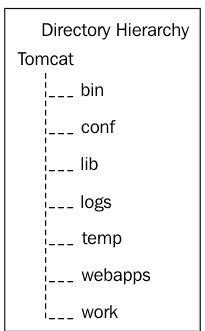

可以说，最重要的目录是 webapps 目录。这是部署目录，需要提供给客户端浏览器的文件、JAR 文件、配置文件等都放置在其中。在本章中，我们将提供有关如何在该目录下组织 Web 应用程序的详细信息。

要在 Eclipse 外部设置和运行 Tomcat，你需要配置两个环境变量，即 `JAVA_HOME` 和 `CATALINA_HOME`。`JAVA_HOME` 环境变量应设置为 JDK 的基本路径。Tomcat 7.0 需要 Java SE 6.0 或更高版本。`CATALINA_HOME` 应指向 Tomcat 目录层次结构的基本路径。有关如何在所有操作系统上设置这些环境变量的说明，可在 `http://tomcat.apache.org/tomcat-7.0-doc/setup.html` 找到。此外，Tomcat 根目录中的文件 `RUNNING.txt` 也包含安装说明。

> 值得一提的是，虽然本章中使用 Tomcat，但这里展示的示例并非 Tomcat 专属。因此，你可以在其他 servlet 容器中部署并运行本章中展示的所有示例。

起初我们将在 Eclipse 外部执行 Tomcat，本章后面会解释如何在 Eclipse 内部执行它。在设置了上述环境变量（按照之前提供的 URL 中针对你操作系统的说明）之后，你需要切换到 Tomcat 的 bin 目录。从那里，如果你是 Windows 用户，只需输入 startup；如果是基于 Unix 的操作系统用户，则输入 startup.sh。如果一切顺利，Tomcat 已启动。要验证 Tomcat 是否正在运行，请打开浏览器并输入 http://localhost:8080。你应该会看到 Tomcat 的欢迎页面，如以下屏幕截图所示。关于此 URL，有几点说明。首先，localhost 是你用来访问本地 Web 服务器的名称。此 URL 部分解析为以下 IP 地址：127.0.0.1。至于 8080 部分，这对应于端口号。通常 Web 服务器使用端口 80。Tomcat 则配置为监听端口 8080，以避免与其他 Web 服务器发生可能的冲突。

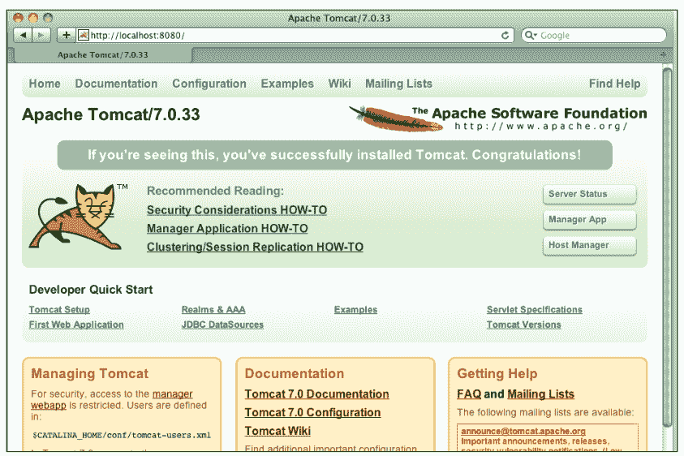

在某些操作系统中，例如 Ubuntu，Tomcat 会自动启动。因此，每当你想停止和启动 Tomcat 时，请使用 bin 目录中的 stop 和 restart 脚本。

Tomcat 附带一个基于 Web 的管理控制台。该应用程序名为 Manager Webapp，并且会随 Tomcat 一起自动启动。但是，在使用它之前你需要进行一些配置。为了允许登录并使用 Manager Webapp，你必须先配置位于 conf 目录中的文件 tomcat-users.xml。通过添加以下行来编辑此文件：

```
<tomcat-users>
    <role rolename="manager-gui"/>
    <user username="tomcat" password="tomcat" roles="manager-gui"/>
</tomcat-users>
```

请记住，修改 Tomcat 的配置文件后，更改不会立即生效。要通知 Tomcat 有所更改，你需要停止服务器然后重新启动它。重新启动 Tomcat 后，访问以下 URL 以访问该应用程序：

```
http://localhost:8080/manager/html
```

Manager Webapp 的 HTML 界面显示在以下屏幕截图中。如你所见，它列出了所有已部署的 Web 应用程序。Manager 允许你安装、重新加载、卸载和停止 Web 应用程序。如果你想了解如何使用 Manager Webapp 执行这些操作，请查阅随附的文档。

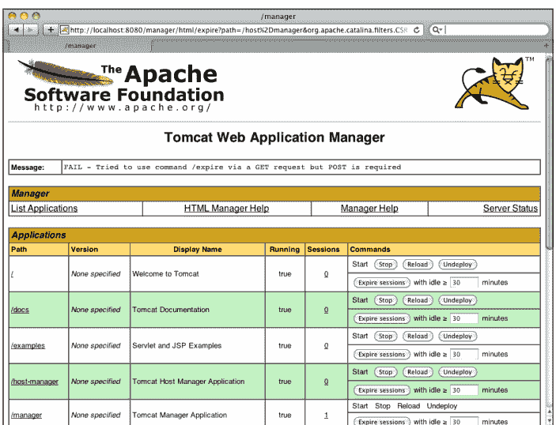

## Eclipse Web Tools 平台

我们将使用 Eclipse 平台的一个扩展来帮助我们编写、部署和运行本章的应用程序。更具体地说，我们将使用 Eclipse **Web Tools Platform (WTP)**，这是一组插件，包含用于支持 Java Web 应用程序开发和部署的工具。其中包括，你可以从 Eclipse 内部启动、停止和重启 Web 服务器。因此，在部署 Web 应用程序时，你无需在 Eclipse 和 Tomcat（或你选择的服务器）之间来回切换。要了解所有 Eclipse WTP 插件及其功能的概览，请访问项目的网站：`http://www.eclipse.org/webtools/`。

你可以从项目网站下载 Eclipse WTP 的二进制发行版：`http://download.eclipse.org/webtools/downloads/`。不过，这并不是最好的方法。让 WTP 快速运行的最直接方法是下载预先打包了 WTP 组件的 Eclipse 版本：`www.eclipse.org/downloads` 页面上的 Eclipse IDE for Java EE Developers。然而，大多数 Eclipse 版本不附带 Eclipse WTP。截至本文撰写时，只有 Eclipse 4.2 提供了附带 WTP 的版本。如果你需要使用 Eclipse 3.8 与 WTP，你将不得不使用本章中解释的方法。

另外，如果你下载的是用于 Java 开发的 Eclipse 版本，你可以通过 Eclipse Update Manager 更新 IDE 来安装 Eclipse WTP，这也是一种简单的方法。

要使用 Eclipse Update Manager 安装 Eclipse WTP，请点击 **Help**，然后点击 **Install New Software**。你需要输入软件站点的地址或使用安装窗口顶部 **Work with** 下拉菜单选择现有站点。请在 **Work with** 字段中输入以下内容：

http://download.eclipse.org/releases/juno/ （如下截图所示）：

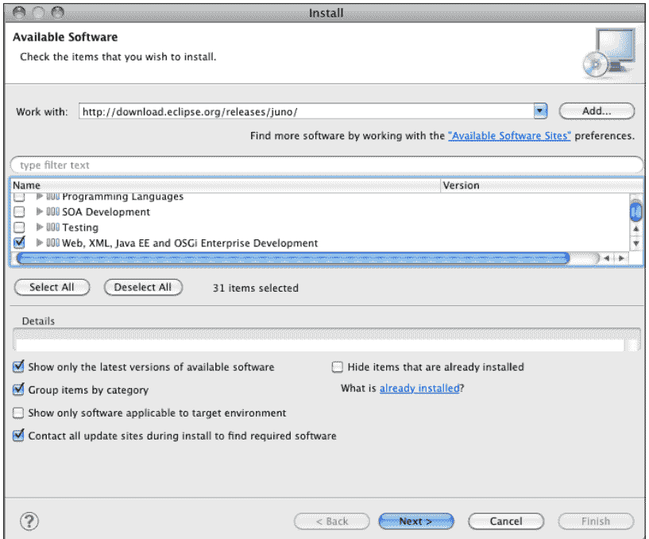

前面的截图所示为可用更新列表。在浏览可用软件选项时，选择项目 **Web、XML、Java EE 和 OSGi 企业开发**，如前一截图所示。确保选中属于 **Web、XML、Java EE 和 OSGi 企业开发** 项目下的所有条目，但 **PHP 开发工具 (PDT) SDK 功能** 除外。选择所需项目后，单击 **下一步** 进行安装。单击 **下一步** 后会发生以下情况：

- 单击 **下一步** 后，Eclipse 会将您的选择与已安装的软件进行验证。此外，Eclipse 还负责管理所选插件之间的依赖关系。因此，如果所选项目需要其他软件才能运行，则所需软件也会自动下载。这就是使用 Eclipse 更新管理器更简单的原因之一。
- 在您同意许可协议（选中 **我接受许可协议条款** 单选按钮）后，Eclipse 开始安装所选扩展。
- 下载完成后，Eclipse 会提示您重新启动；单击 **是** 重新启动 Eclipse。

如果一切顺利，您将看到以下截图（与首次打开 Eclipse 时看到的类似）：

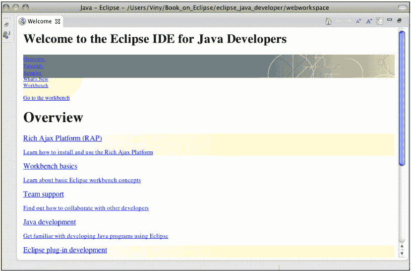

## 配置服务器

现在，您已成功安装 Eclipse WTP。然而，在使用 Eclipse 急于开发 Web 应用程序之前，还需要进行一些配置。下一步是设置 Eclipse WTP，通过指定要使用的服务器以及其安装位置（即您解压 Tomcat 的位置）。让我们先告诉 Eclipse 我们想要使用哪个服务器。为此，您需要导航到 首选项 | 服务器 | 运行时环境。您将看到如下截图所示的 首选项 窗口。在开发过程中，每当您需要添加或删除服务器时，您都会回到此窗口：

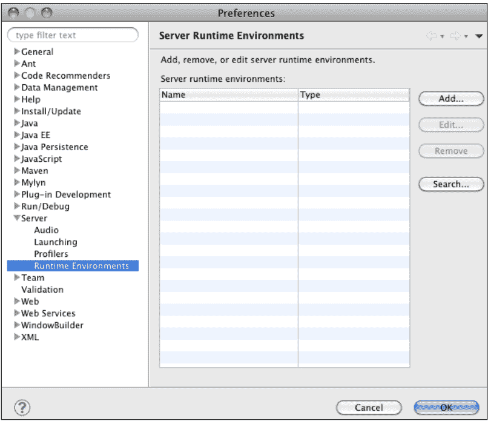

接下来，单击对话框右侧的 **添加...** 按钮。包含服务器列表的窗口将弹出。除了 Tomcat，Eclipse WTP 还支持其他多个服务器。如果在列表中找不到所需的服务器，您可以下载额外的服务器适配器（如以下图窗口右上角所示）。要选择 Tomcat，请展开 `Apache` 文件夹，然后选择您想要的 Tomcat 版本。在本章中，我们将使用 Apache Tomcat v7.0（如以下截图所示）。选择正确的 Tomcat 版本后，您应单击 **下一步**：

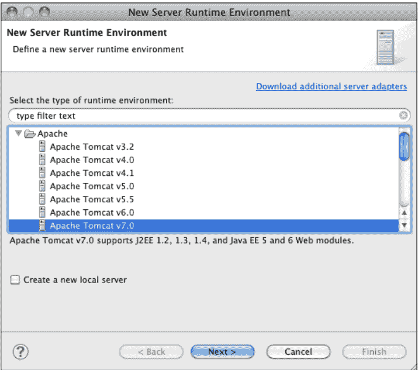

除了选择所需的服务器运行时环境外，您还需要指定其安装目录。如以下截图所示，为了告知 Eclipse Tomcat 的安装位置，您需要输入解压 Tomcat 的根目录。实际上，您可以通过单击 **浏览...** 来浏览并选择 Tomcat 根目录。例如，在以下截图中，Tomcat 根目录为 `/usr/local/apache-tomcat-7.0.33`。之后，单击 **完成**。

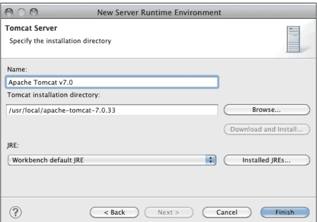

> 请确保字段 Workbench default JRE（在前一图底部）指向所需的 JDK 版本。

下一步是在 Eclipse 中创建一个新的 Tomcat 服务器。为此，导航到 窗口 | 显示视图 | 其他...。然后单击 Server 选项以展开它，如以下截图所示。选择 Servers，然后按 OK：

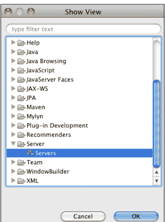

现在，如以下截图所示，服务器视图显示 Tomcat 的状态。通过此视图，您可以通过右键单击 Tomcat 的图标来启动、停止和重新启动 Tomcat：

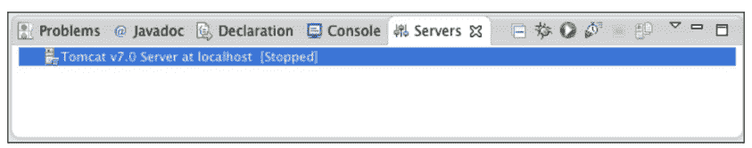

您现在已准备好使用 Eclipse 和 Tomcat 来开发 servlet 和 JSP。不过，在实现第一个 servlet 之前，让我们先看看 servlet 是如何由 servlet 容器执行的。

## Servlet 生命周期

在继续之前，有必要先介绍一下 servlet 的生命周期。实现 servlet 生命周期有三个方法：init()、service() 和 destroy()。在处理客户端请求之前，servlet 会由 servlet 容器（在本例中为 Tomcat）实例化并初始化。servlet 容器只实例化每个 servlet 的一个实例。在此初始化阶段，容器调用 init() 以给 servlet 一个运行初始化代码的机会。Servlet 以多线程方式运行，这意味着其方法可能由多个线程调用。在收到第一个客户端请求时，容器启动一个新线程或从池中分配一个线程。然后，servlet 的执行被分配给该线程，该线程通过调用 servlet 的 service() 方法继续执行。

> 值得强调的是，init() 只执行一次。此外，容器在 init() 完成之前无法调用 service()。

service() 接受两个参数：一个请求对象（它是 javax.servlet.http.HttpServletRequest 的实例）和一个响应对象（它是 javax.servlet.http.HttpServletResponse 的实例）。容器正是通过这两个实例来访问客户端请求并生成输出。在 service() 中，会检查请求对象以确定请求的类型。确定请求类型后，service() 会将请求和响应对象分派给负责实现该请求的 HTTP 相关方法。HTTP 相关方法的两个示例是 doGet() 和 doPost()。这些方法分别对应 HTTP GET 和 POST 操作。

> 除了最常用的 doGet() 和 doPost() 之外，HttpServlet 还包含 doPut() 和 doDelete() 方法。这些方法分别对应 HTTP PUT 和 DELETE 操作。但由于这两种方法很少使用，我们将不详细介绍。您只需知道它们存在即可。


最后，destroy() 的主要目的是给 servlet 一个清理的机会。总结一下，在实现自己的 servlet 时，大多数情况下您需要重写的方法是 init、doGet 和 doPost（如果需要清理某些资源，则可能还需要 destroy）。

## 使用 Eclipse WTP 实现您的第一个 Java servlet

首先，我们将解释如何使用 Eclipse WTP 实现 servlet，然后稍后我们再介绍如何实现 JSP。我们将创建一个相当简单的 servlet，它打印经典短语 "Hello, World!"。您会看到，使用 Eclipse WTP 编写和部署 servlet 非常轻松。使用 Eclipse WTP 开发 Web 应用程序的某些方面如此简单，以至于您可能几乎不需要输入任何内容。因此，如果您真的想认真学习如何使用 servlet 和 JSP 开发 Web 应用程序，我们建议您先浏览本章以了解如何使用 WTP，然后完全离开 Eclipse，开始手动安排 Web 应用程序的所有结构。这将帮助您更好地理解此类应用程序的组织方式以及 Eclipse 为您优雅自动化的步骤数量。在掌握了如何组装、开发和部署 Web 应用程序的要点后，您可以返回 Eclipse 以加快开发过程。我们将感兴趣的读者引导至 http://tomcat.apache.org/tomcat-7.0-doc/appdev/index.html 以获取有关 Web 应用程序开发的更多信息。

要使用 Eclipse WTP 开发 servlet 和 JSP，首先，我们需要创建一个新的动态 Web 项目：转到 文件 | 新建 | 其他... | Web。在新建向导中，展开 Web，然后选择 动态 Web 项目。您应到达以下截图所示的向导。

如果您花点时间观察 Web 选项下的项目，您会看到有两种类型的 Web 项目：动态和静态。动态 Web 项目包含动态资源，例如 servlet、JSP 以及大量元数据，仅举几项。静态 Web 项目仅包含静态资源，例如层叠样式表。


> Java 规范会带来很多开销；你必须遵守一个指定类路径位置、支持元数据和部署描述符的目录结构。因此，当你想要创建一个仅包含静态内容的简单 Web 应用程序时，你可能希望使用静态 Web 项目类型。

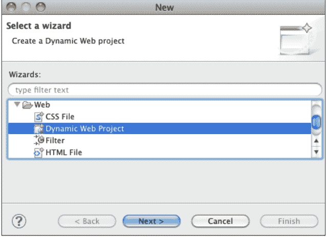

选择 **Dynamic Web Project** 后，单击 **Next**。让我们将项目命名为 `chapter7.examples`（在 **Project name** 文本字段中输入）。关于 **New Dynamic Web Project** 向导（如下图所示）需要说明一些内容。首先，如下图所示，你可以通过从 **Target runtime** 下拉列表中选择一个选项来指定要使用的服务器。鉴于我们已安装 Tomcat，它应该是默认选项。其次，关于 **Dynamic web module version** 下的数字，它与项目中将使用的 servlet API 版本有关。截至本文撰写时，3.0 是最新版本，也是本章将使用的版本。因此，在单击 **Next** 之前，将此选项设置为 **3.0**。最后，你可以让 **Configuration** 选项保持为 **<custom>** 或 **Default Configuration for Apache Tomcat v7.0**。

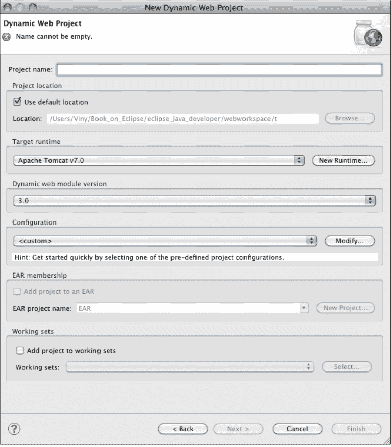

下一个窗口名为 **Configure project for building Java application**（此窗口未显示），可用于在构建路径上添加源文件夹。在此窗口中，不要更改任何内容，只需接受默认值（src），然后再次单击 **Next**。

最后，最后一个窗口询问是否应生成应用程序部署描述（web.xml）。请注意，生成此 XML 文件不是默认选项。目前我们不需要此类文件，因此请保持此选项未选中。

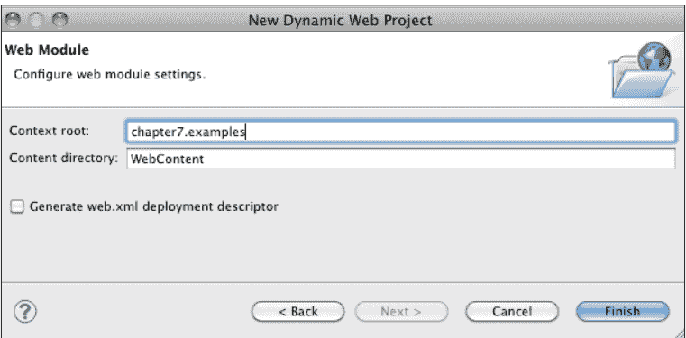

单击 Finish 后，Eclipse 会提示你更改透视图。动态 Web 项目与 Java EE 透视图相关联。要继续，请选择 Yes。你刚刚创建了一个具有 Java Web 应用程序结构的项目。请注意，你无需创建大量文件夹或 XML 文件。下一张截图显示了动态 Web 项目的组织概览。目前对我们来说重要的部分是文件夹 WebContent 和 Java Resources，你的 servlet 将放在这里。WebContent 包含两个子文件夹：META-INF 和 WEB-INF。后者在本文中尤为重要。WEB-INF 包含应用程序部署描述符（web.xml，一个包含配置信息的文件）以及其他类型资源的子文件夹，例如配置文件。需要说明的是，客户端无法访问该文件夹下的文件，这使其成为存放不打算公开的文件的安全位置。WEB-INF 内部有一个名为 lib 的子文件夹，用于放置 JAR 文件。未打包到 JAR 文件中的类文件被放置在另一个名为 classes 的文件夹中。然而，需要注意的是，你不应将任何 .class 文件放置到此目录中。相反，当 Eclipse 的 Java 编译器将 Java Resources 目录中的 Java 源文件翻译时，这些文件会自动放置在那里。编译器运行时，它会删除直接放置在此目录中的所有文件。

> `classes` 文件夹中的 Java 文件必须存储在反映其包结构的目录结构中。例如，属于名为 `foo.bar` 的包的类必须存储在 `WEB-INF/classes/foo/bar` 文件夹中。在 Eclipse 内部开发时，它会为你处理大多数部署相关问题。然而，由于这种结构在大多数 Java Web 应用程序中很常见，了解每个文件应放置的位置可以帮助你在检查他人的 Web 应用程序时更好地定位。

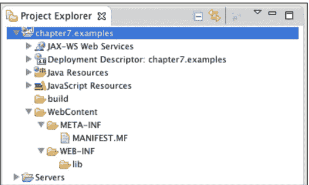

Eclipse 尚未创建任何 servlet。要让 Eclipse 创建我们的第一个 servlet，请右键单击 WebContent 文件夹，并导航到 New | Other... | Web | Servlet。按以下截图所示填写空白字段：

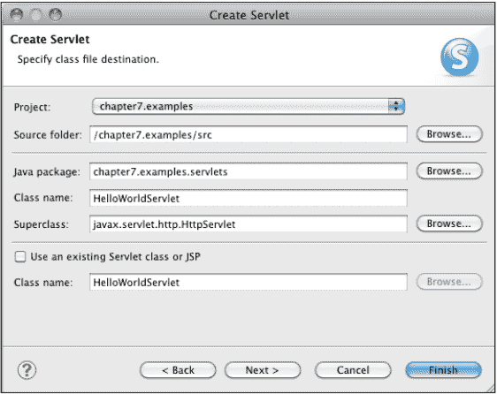

你刚刚将 servlet 命名为 `HelloWorldServlet` 并将其放置在名为 `chapter7.examples.servlets` 的包中。生成的代码如下所示。为简洁起见，大多数生成的注释已被省略：

```java
package chapter7.examples.servlets;
import java.io.IOException;
import javax.servlet.ServletException;
import javax.servlet.annotation.WebServlet;
import javax.servlet.http.HttpServlet;
import javax.servlet.http.HttpServletRequest;
import javax.servlet.http.HttpServletResponse;
@WebServlet("/HelloWorldServlet")
public class HelloWorldServlet extends HttpServlet {
    private static final long serialVersionUID = 1L;
    public HelloWorldServlet() {
        super();
    }
    protected void doGet(HttpServletRequest request,
HttpServletResponse response) throws ServletException, IOException {
        // TODO Auto-generated method stub
    }
    protected void doPost(HttpServletRequest request,
HttpServletResponse response) throws ServletException, IOException {
        // TODO Auto-generated method stub
    }
}
```

我们不希望你盲目地在计算机上输入内容，因此在修改生成的代码以满足我们的需求之前，让我们先了解一下这段代码的一些细节。Servlet 3.0 API 引入了许多新功能。其中一项新功能是注解的引入，这使得用于声明 servlet（以及其他内容）的 XML 文件（`web.xml`）成为可选。这些注解位于包 `javax.servlet.annotation` 中。使用它们，你只需用 `@WebServlet` 对其进行注解即可定义有关 servlet 的元数据。你使用 `@WebServlet` 来告知 Tomcat 相关类是一个 servlet。`@WebServlet` 可以接受多个参数，并且可以使用这些参数为 servlet 指定元数据。在此示例中，`/HelloWorldServlet` 表示 servlet 的 URL。


> servlet 的 URL 可以被视为客户端所知道的名称。换句话说，这是客户端访问的 HTML 代码中出现的名称——它是对客户端而言的虚构名称。容器负责根据客户端提供的 URL 调用正确的 servlet。

除了 @WebServlet 之外，另一个表明前一个类是 servlet 的特征是它扩展了 javax.servlet.http.HttpServlet。自动生成的代码还提供了在实现 servlet 时最常重写的两个方法的存根实现，即 doGet 和 doPost。如你所见，doGet 和 doPost 方法都接受 HttpServletRequest 和 HttpServletResponse 的实例。这些实例分别提供输入和输出流，并分别用于读取和写入客户端数据。

编写 servlet 时，你会发现自己
throws ServletException, IOException {
        response.setContentType("text/html");

```
PrintWriter pw = response.getWriter();
pw.println("<html><head><title>Warm Greeting</title></head>" +
"<body>" +
"<h1> Hello, World! </h1>" +
"</body></html>"
);
pw.close();
}
```

在运行 servlet 之前，让我们先看看你在 doGet 中刚刚输入的内容。首先，你应该记住我们正在重写 doGet 以处理客户端请求。在本示例的上下文中，对 /HelloWorldServlet 的 GET 请求将由打印消息 Hello, World! 的 HTML 文档来响应。最初，你需要告知容器返回的数据是 HTML 文档。为此，你调用 HttpServletResponse 对象名为 setContentType 的方法。在此示例中，我们将内容类型设置为 text/html。有关内容类型的信息会放在 HTTP 响应的头部。此类信息告知客户端应期望请求的结果是什么。正是通过这些信息，客户端浏览器才知道下一步该做什么：渲染 HTML、启动 PDF 查看器、将返回的数据保存为下载文件等等。


> 当你调用 setContentType 时，你正在为 servlet 返回的数据设置 MIME 类型。大多数情况下，servlet 使用的 MIME 类型是 text/html。然而，也可能使用其他 MIME 类型。例如，返回 PDF 文档的 servlet 应将 MIME 类型设置为 application/pdf。

通过 setContentType 你还可以指定字符编码。假设我们希望 servlet 容器将字符编码设置为 UTF-8，我们将按如下方式调用 setContentType：

```
response.setContentType("text/html; charset=UTF-8");
```


> 从 Java 5 开始，你还可以通过 servlet 响应对象的 setCharacterEncoding 方法设置字符编码。


下一步是获取输出流并向其写入所需的 HTML 内容。Servlet 响应对象提供了用于将数据发送回客户端的输出流。要获取输出流，需要调用 getWriter，它返回一个 PrintWriter 实例。如果你已经使用过 java.io，那么你已经熟悉 PrintWriter 了。如果你没有使用过 java.io，这里是关于 PrintWriter 的速成课程：它设计用于处理字符数据。当你需要从 servlet 返回其他内容时，将使用 OutputStream 实例。你可以通过在响应对象上调用 getOutputStream 来获取 OutputStream 实例，如以下代码片段所示：

```
ServletOutputStream out = response.getOutputStream();
```

PrintWriter 有很多方法；然而，大多数时候你只需要使用 println 或 print 将文本数据打印到字符流中。如前例所示，为了向流写入 HTML，你只需执行 I/O 操作。更具体地说，HTML 被嵌入到 Java 字符串中并发送到输出流。

此时你应该能够运行最近创建的 servlet。在 Eclipse 中运行我们的示例相当直接。选择 HelloWorldServlet，右键单击它，然后从 Run As 中选择 Run on Server，如以下屏幕截图所示：

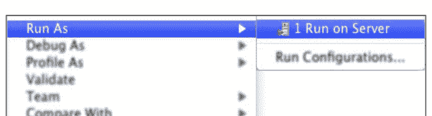

> 值得一提的是，Eclipse 也允许你调试 Web 应用程序。你甚至可以在 JSP 文件中设置断点。因此，如果你在开发过程中遇到任何问题，知道可以借助逐步执行来发现错误是很有帮助的。

将出现一个列出可用服务器的窗口。由于我们之前配置了 Tomcat，它应该包含在此列表中（如以下屏幕截图所示）。选择 **Tomcat** 后，单击 **Finish**。你可以勾选 **Always use this server when running this project** 选项，这样每次运行应用程序时此对话框就不会弹出。

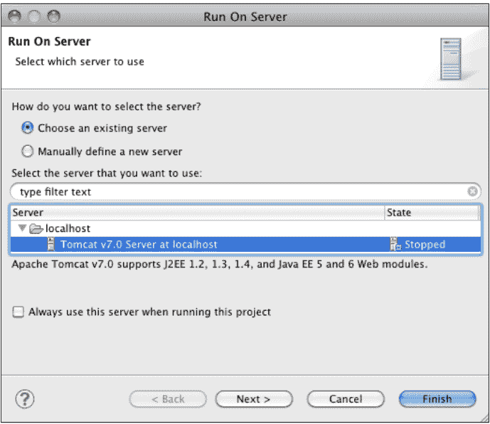

按下 **Finish** 后，Eclipse 将在 Tomcat 上配置示例 servlet。你应该会在 Eclipse 的内部浏览器中看到以下消息。如果你看到了这条消息，恭喜你，你刚刚使用 Eclipse WTP 创建了第一个 servlet：

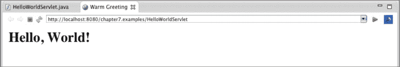

我们可以让此 servlet 显示的消息更有趣。到目前为止，它没有任何动态内容。每次运行示例时，你都会得到相同的消息。换句话说，无论你刷新 Eclipse 内部浏览器多少次，你都会看到 Hello, World! 消息。让我们在此消息中添加当前时间。为此，按以下代码所示修改 doGet 方法。请注意，每当你需要更改发送回客户端的 HTML 数据时，你都必须更改嵌入在 Java 代码中的 HTML 数据：

```
protected void doGet(HttpServletRequest request, HttpServletResponse response) throws ServletException, IOException {
    response.setContentType("text/html");

    java.util.Date currentTime = new java.util.Date();
    PrintWriter pw = response.getWriter();
    pw.println("<html><head><title>Warm Greeting</title></head>" +
        "<body>" +
        "<h1> Hello, World! </h1>" +
        "<ul> <li>current time: " + currentTime + "</li></ul>" +
        "</body></html>"
    );
    pw.close();
}
```

要查看新 servlet 的运行情况，按之前描述的方式运行它。运行上述代码后，你应该会看到类似于以下屏幕截图的内容。现在，每次点击刷新时，你都会得到一个全新的时间戳。此时间戳在运行时获取并动态添加到响应中：

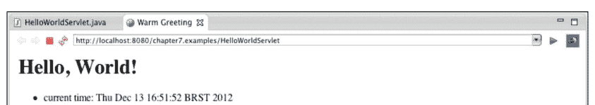

## 一个更复杂的示例 – 又一个计算器

现在你已经了解了基础知识，让我们继续一个更复杂的示例。我们将开发一个简单的计算器（到此时，你可能已经意识到作者之一是计算器迷）。为了保持简单，我们的 Web 计算器一次只能处理两个操作数。在输入每个操作数的值后，用户可以选择希望计算器执行的运算。运算结果将在新页面中显示。

我们的示例将包含三个类，其中两个是 servlet，一个是普通的 Java 类。普通类实现了计算器本身，而 servlet 负责展示以及展示与计算器类之间的交互。让我们从小处着手，先实现第一个 servlet，即用户输入两个操作数值的地方。值得一提的是，我们本可以使用纯 HTML 实现相同的功能，但我们喜欢让事情更有趣。此外，将此功能作为 servlet 实现将给你另一个机会来实践你最近获得的知识。好了，开始吧。

我们将在一个新项目中开发计算器。因此，首先，创建一个新的动态 Web 项目，并将其命名为 `webcalculator`（如果你不记得如何创建动态 Web 项目，请回到我们解释如何在 Eclipse 中创建 servlet 的章节开头）。然后，创建一个名为 `OperationSelect` 的 servlet 并将其放在包 `com.example.calculator.web` 中。下一个屏幕截图显示了你在 **Create Servlet** 窗口中应输入的内容。请记住，你无需事先创建包。创建 servlet 后，Eclipse 会确保创建其关联的包结构。由于我们的项目同时包含 servlet 和普通 Java 类，我们将使用一种广泛使用的约定来组织这些元素。Servlet 将放在包 `com.example.calculator.web` 中，而我们的计算器类将放在名为 `com.example.calculator.model` 的包中。

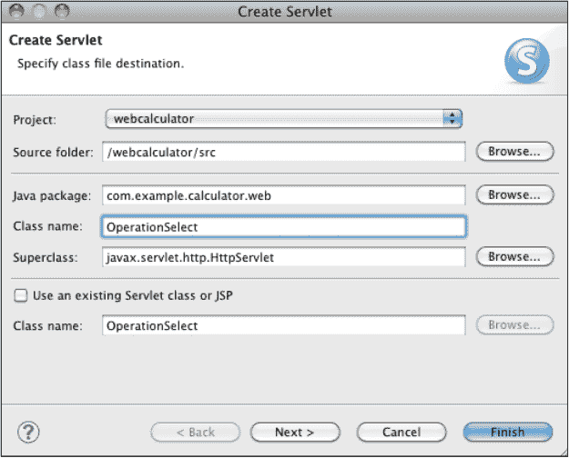

连续点击 **Next** 两次以进入以下窗口。然后取消选择 **doPost** 选项；我们不会为此 servlet 重写此方法。顺便也取消选择 **Constructors from superclass** 选项；我们也不需要构造函数。最后，点击 **Finish**：

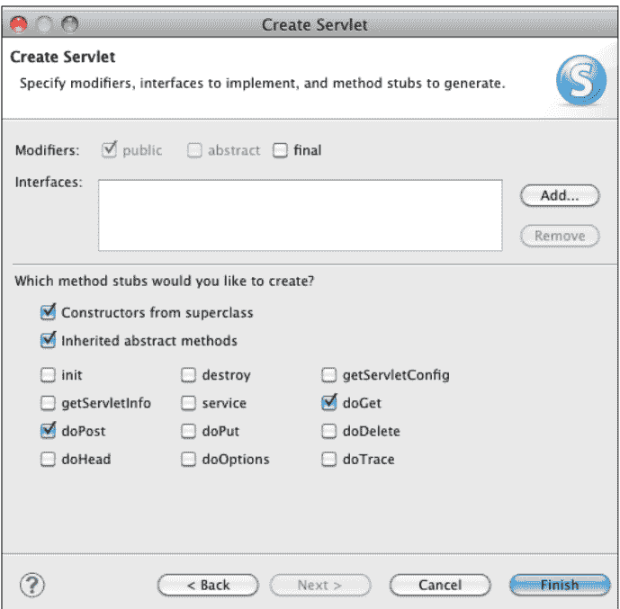

Eclipse 将生成一个包含空 `doGet` 方法的 servlet。尽管生成的代码没做什么，但我们现在无需从头开始输入所有内容。让我们开始通过修改 `doGet` 方法来更改生成的 servlet，如以下代码所示。请注意，我们执行的操作与前例所示相同。首先，我们将内容类型设置为 `text/html`。其次，我们获取了输出流以便将 HTML 内容写入输出。

正如你所见，你需要添加到输出中的 HTML 越多，你的代码就越臃肿。为了简单起见，我们在示例 servlet 中没有使用复杂的 HTML 结构。前两个元素是文本字段，最后一个是下拉列表，用户可以从中选择使用两个操作数执行的运算。我们还添加了一个提交按钮，它将操作数和运算信息转发给另一个 servlet，而该 servlet 又将触发我们计算器类的执行：

```
@Override
protected void doGet(HttpServletRequest request, HttpServletResponse response) throws ServletException, IOException {
    response.setContentType("text/html");
    PrintWriter pw = response.getWriter();
    pw.write("<html><body>");
    pw.write("<h1 align=\"center\">Web Calculator v1.0</h1>");
    pw.write("<form method=\"POST\" action=\"PerformCalculation.do\">");
    pw.write("<tt>1st operand:</tt> <input type=\"text\" " + "name=\"firstOperand\"><br>");
    pw.write("<tt>2nd operand:</tt> <input type=\"text\" " + "name=\"secondOperand\"><br>");
    pw.write("Operation to be performed: ");
    pw.write("<select name=\"operation\" size=\"1\">");
    pw.write("<option value=\"+\" > + </option>");
    pw.write("<option value=\"-\" > - </option>");
    pw.write("<option value=\"*\" > * </option>");
    pw.write("<option value=\"/\" > / </option>");
    pw.write("</select></br></br>");
    pw.write("<input type=\"submit\" value=\"Submit\">");
    pw.write("</form>");
    pw.write("</body></html>");
    pw.close();
}
```

## 部署计算器示例

在输入前面显示的方法后，我们准备好试用计算器示例的第一部分。如果你不记得如何在 Eclipse 中运行 Web 应用程序，这里有一个快速提醒：选择所需程序（本例中为 OperationSelect），右键单击它，然后在 Run As 中导航到 Run on Server。从可用服务器列表中选择 Tomcat，然后单击 Finish。下一个屏幕截图显示了执行此 servlet 后你将看到的内容：


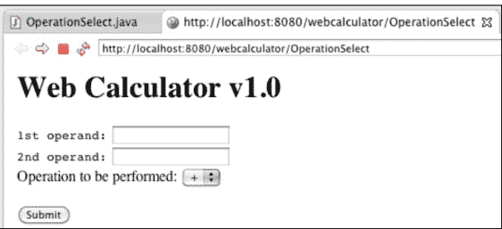

我们尚未实现负责将值和操作转发给实现计算器的类的 servlet。因此，如果你在 1st operand 和 2nd operand 字段中输入两个数字，选择一个操作，然后按下 Submit，你将看到下一张截图中显示的页面。这表明 servlet 容器未找到我们正在查找的资源。那么，让我们退一步看看为什么 servlet 容器试图将数据转发到 webcalculator/PerformCalculation.do。

这个问题的答案归结为我们的表单正在向名为 PerformCalculation.do 的内容提交信息（请查看之前的代码片段）。此外，由于没有名为此的名称的资源（例如 servlet 或 HTML 页面），容器会显示错误消息。在此示例中，PerformCalculation.do 是一个逻辑名称。也就是说，它不是一个实际的文件名。我们不希望客户端能够访问我们的 servlet 类的名称。因此，我们改用映射到实际 servlet 的虚构名称。这就解释了为什么我们得到错误页面：我们尚未告知容器哪个 servlet 通过逻辑名称 PerformCalculation.do 进行响应。

> .do 扩展名（意味着 *做某事*）只是一个约定。

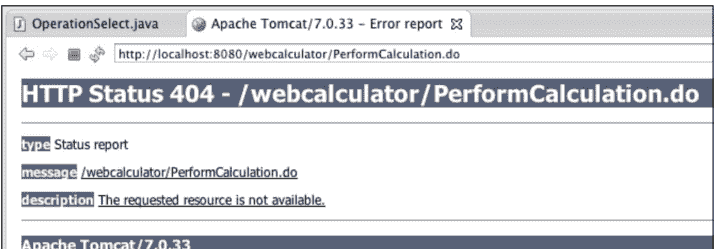

实现我们示例的第二部分意味着将 servlet 映射到上述虚构名称。再次使用 Eclipse 为你生成 servlet。将它命名为 `ArithmeticExpert`，并将其放置在前一个 servlet 的同一包中（`com.example.calculator.web`）。在创建 `ArithmeticExpert` 时，并在输入 servlet 名称和包的第一个窗口之后，点击 **下一步**，然后点击 **编辑...**，如以下截图所示。在这里你可以编辑 servlet URL 映射。鉴于我们希望告知容器新 servlet 可以映射到 `PerformCalculation.do`，请按以下代码片段所示编辑此选项（确保不要以 / 字符开头）并按下 **下一步**：

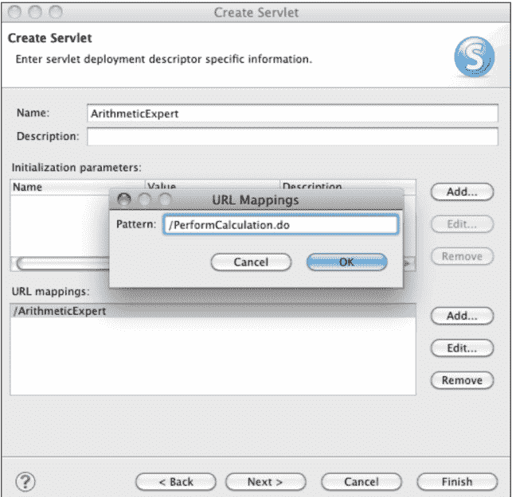

而不是重写 `doGet`，这次我们将重写 `doPost`。因为 `OperationSelect` 中的表单会生成 `POST` 操作，所以我们必须重写 `doPost`。否则，按下 **提交** 按钮将不会调用我们的方法。因此，取消选择 **doGet** 和 **从超类构造** 选项。最后，点击 **完成**。按以下片段所示更改生成的代码：

```
@WebServlet("/PerformCalculation.do")
public class ArithmeticExpert extends HttpServlet {
    private static final long serialVersionUID = 1L;
    @Override
    protected void doPost(HttpServletRequest request,
HttpServletResponse response)
    throws ServletException, IOException {
        response.setContentType("text/html");
        PrintWriter pw = response.getWriter();
        pw.write("<html><body>");
        pw.write("The result of " +
        request.getParameter("firstOperand") + " " +
        request.getParameter("operation") + " " +
        request.getParameter("secondOperand") +
        " is surprise, surprise");
        pw.write("</body></html>");
        pw.close();
    }
}
```

我们分阶段实现计算器示例。在这个第一个版本中，我们的目标是确保第一个和第二个 servlet 之间的通信链路正常工作。因此，我们的代码不会调用计算器类来执行选定的操作。相反，它只会打印出一条消息，表明两个 servlet 之间的通信正在工作，并且我们能够在它们之间共享信息。前述代码中有两个重要点需要注意。首先，看看 servlet 及其虚构名称之间的映射是如何使用 @WebServlet 注解实现的，该虚构名称出现在 OperationSelect 的输出中。请注意，括号中包含的字符串是我们创建底层 servlet 时输入的模式（请查看之前的截图）。其次，注意我们如何从请求中访问参数。我们使用 HttpServletRequest 的 getParameter 方法（实际上，此方法在 ServletRequest 接口中定义，并由包括 HttpServletRequest 在内的子类实现）。使用 getParameter，每个参数都按其名称检索。


参数名称区分大小写。

在运行之前的 servlet 并在 **第一个操作数** 文本字段中输入 2，在 **第二个操作数** 文本字段中输入 1，选择减法作为要执行的操作，然后按下 **提交** 后，你应该会看到类似下一张截图的内容。如以下截图所示，现在应用程序可以访问用户在一个 servlet 中输入的数据，以便在另一个 servlet 中执行计算：

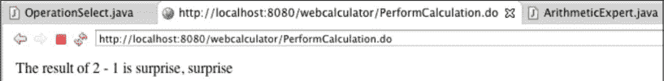

为了完成计算器示例，我们需要实现一个能够执行第一个 servlet 中显示的算术操作的计算器类。这对你来说应该很简单。在查看以下片段中显示的解决方案之前，请尝试自己编写这个类。只需确保将其命名为 `Calculator`，并将其放置在名为 `com.example.calculator.model` 的包中。以下是我们实现 Calculator 的方式：

```java
package com.example.calculator.model;
public class Calculator {
    private double op1, op2;
    private String operation;
    public Calculator(String op1, String op2, String operation) {
        try {
            this.op1 = Double.parseDouble(op1);
            this.op2 = Double.parseDouble(op2);
            this.operation = operation;
        }
        catch (NumberFormatException e) {
            //reset the value of both operands
            this.op1 = 0.0;
            this.op2 = 0.0;
        }
    }
    public double performCalculation() {
        if (operation.equals("+")) {
            return op1 + op2;
        } else if (operation.equals("-")) {
            return op1 - op2;
        } else if (operation.equals("/")) {
            return op1 / op2;
        } else if (operation.equals("*")) {
            return op1 * op2;
        }
        return 0;
    }
}
```

实现 Calculator 后，你只需将其集成到 ArithmeticExpert servlet 中，如以下片段所示。请注意，我们的实现不处理除零等边界情况。再次执行示例后，你将看到与以下截图类似的内容：

```
@Override
protected void doPost(HttpServletRequest request, HttpServletResponse response) throws
    ServletException, IOException {
    response.setContentType("text/html");
    PrintWriter pw = response.getWriter();
    pw.write("<html><body>");
    String operandOne = request.getParameter("firstOperand");
    String operandTwo = request.getParameter("secondOperand");
    String operation = request.getParameter("operation");
    pw.write("The result of " +
        operandOne + " " +
        operation + " " +
        operandTwo +
        " is " +
        new Calculator(operandOne, operandTwo,
            operation).performCalculation());
    pw.write("</body></html>");
    pw.close();
}
```

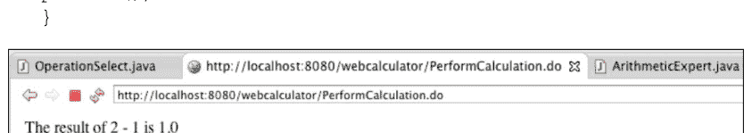

## 使用 Eclipse WTP 实现你的第一个 JSP

前面的章节让我们开始使用 Tomcat、servlet 和 Eclipse WTP。如你所见，尽管 Eclipse WTP 提供了好处（它为我们生成了整个 Web 项目的结构，并在实现之前的示例 servlet 时负责生成大量代码），但将 HTML 嵌入到 Java 代码中感觉有点别扭。正如我们提到的，JSP 被引入是为了使动态内容的创建更直接和更具吸引力。JSP 让你比 servlet 以更好的方式混合 HTML 和 Java 代码。不是将 HTML 嵌入到 Java 代码中，JSP 使嵌入动态内容到 HTML 成为可能。回顾之前的章节，JSP 是一个包含一些特殊元素的 HTML 页面。渲染为动态内容的元素类似于 HTML 元素。然而，它们是组件化的 Java 程序。除了这些类似 HTML 的元素外，JSP 页面还可以包含 Java 代码（scriptlets）。

需要提醒你的是，尽管 JSP 看起来像带有额外元素的标准 HTML 页面，但它们会被编译为 servlet。正如我们提到的，在运行时，Tomcat 将 JSP 页面编译为 servlet，将 servlet 编译为字节码，并最终执行它们。

在本节中，我们将演示如何使用 Eclipse WTP 创建 JSP。我们将实现一个 JSP，它显示与 servlet 示例相同的消息。

你不需要创建一个新的 Web 应用程序项目；我们将使用之前的那个。要让 Eclipse 为你创建一个新的 JSP 文件，请执行以下操作：选择文件夹 `WebContent`（Tomcat 将在此文件夹中查找 JSP），然后在 **新建** 中右键单击 **JSP 文件**。将其命名为 `HelloWorldJSP.jsp`（如以下截图所示），然后点击 **下一步**。实际上，你不需要输入扩展名（`.jsp`），Eclipse 会自动添加：


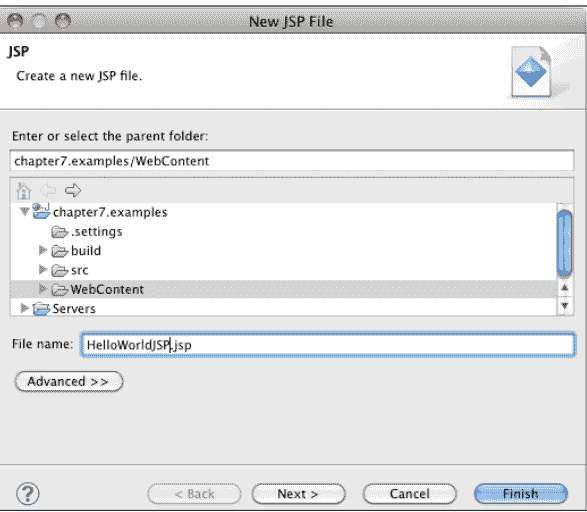

之后，选择名为 **新建 JSP 文件 (html)** 的选项，其描述为 **使用 html 标记的 JSP**（如下图所示），然后单击 **完成**：

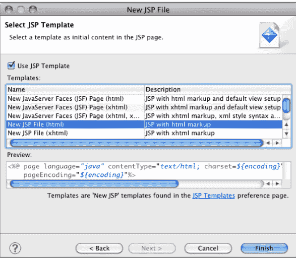

Eclipse 将生成以下代码。第一行是一个 JSP 指令元素。指令元素指定与页面本身相关的各种属性。因此，它不一定会改变发送到浏览器的响应，但会告知容器应如何处理该页面。第一行是一个页面指令，其中除了其他内容外，还指定了相关页面的内容类型：text/html。JSP 指令元素以 <%@ 开始，以 %> 结束，在这两个分隔符之间，名称/值对的列表代表所谓的指令属性。

除页面指令外，自动生成的代码主要包含 HTML 代码。在 JSP 用语中，一切不是 JSP 元素的内容都称为模板文本。模板文本是静态的，这意味着它会被发送到浏览器而不会经过任何转换。

至于自动生成的代码中的模板文本，存在一个标题占位符，而 body 部分为空。如果你熟悉 HTML 和 Java，编写 JSP 页面对你来说应该很轻松。如果你对 HTML 不太熟悉，创建 JSP 页面起初可能会有点棘手。

```
<%@ page language="java" contentType="text/html; charset=ISO-8859-1"
    pageEncoding="ISO-8859-1"%>
<!DOCTYPE html PUBLIC "-//W3C//DTD HTML 4.01 Transitional//EN"
"http://www.w3.org/TR/html4/loose.dtd">
<html>
<head>
<meta http-equiv="Content-Type" content="text/html;
charset=ISO-8859-1">
<title>Insert title here</title>
</head>
<body>
</body>
</html>
```
让我们先将标题占位符替换为我们在前一个示例中使用的标题，即 "Warm Greeting"：
<title>Warm Greeting</title>

接下来，让我们添加 Hello, World! 静态消息以及消息的动态部分：时间戳。添加前者很简单，只需复制示例 servlet 中显示的 HTML 代码的一部分即可。要包含后者，我们将在页面中嵌入 Java 表达式，将其放在 <%= 和 %> 之间，如以下代码片段所示：

```
<%@ page language="java" contentType="text/html; charset=ISO-8859-1" pageEncoding="ISO-8859-1"%>
<!DOCTYPE html PUBLIC "-//W3C//DTD HTML 4.01 Transitional//EN" "http://www.w3.org/TR/html4/loose.dtd">
<html>
<head>
<meta http-equiv="Content-Type" content="text/html; charset=ISO-8859-1">
<title>Warm Greeting</title>
</head>
<body>
<h1> Hello, World! </h1> <%-- title as template text --%>
<%-- timestamp as embedded expression --%>
<ul> <li>current time: <%= new java.util.Date() %> </li></ul>
</body>
</html>
```

如果你运行前面的示例，你将得到与执行示例 servlet 时完全相同的消息。现在，让我们回顾一下前面代码块中最重要的部分。首先，如你可能注意到的那样，放在 <%-- 和 --%> 之间的所有内容都会被容器忽略。你可以用它来描述代码中正在发生的事情或注释掉代码的一部分。鉴于 JSP 注释也是 JSP 元素，它们永远不会到达浏览器。其次，与其拼接字符串并使用纯 I/O 将其写入响应，前面的代码使用了一个脚本元素，通过它你可以在 JSP 中添加 Java 代码。当你只想添加 Java 代码而不将结果写入响应时，使用 <% 和 %>。当结果需要添加到响应中时，使用 <%= 和 %>。因此，我们使用了后者将时间戳写入响应。下一个示例展示了另一种实现相同功能的方法，但这次使用了更多 JSP 元素和 scriptlet。请注意，页面指令也用于导入 java 类（和包），如以下示例所示。此外，当导入多个类时，完全限定名称的列表必须用逗号分隔。向页面指令添加导入指令后，你就不必在 scriptlet 中使用完全限定的类名。

> 你也可以在 <% 和 %> 对内打印内容。为此，你必须使用 out 对象。该对象始终隐式存在。例如，你可以这样打印 Hello, World! 消息：<% out.println("Hello, World!") %>。不过值得一提的是，在 scriptlet 中使用 out.println() 是一种不良做法。只要可能，请改用表达式（<%= 和 %>）。

```
<%@ page language="java" contentType="text/html; charset=ISO-8859-1" pageEncoding="ISO-8859-1" import="java.util.Date" %>
<!DOCTYPE html PUBLIC "-//W3C//DTD HTML 4.01 Transitional//EN" "http://www.w3.org/TR/html4/loose.dtd">
<html>
<head>
<meta http-equiv="Content-Type" content="text/html; charset=ISO-8859-1">
<title>Warm Greeting</title>
</head>
<body>
<h1> <% out.println("Hello, World!"); %> </h1>
<% Date date = new Date(); %>
<ul> <li>current time: <%= date %> </li></ul>
</body>
</html>
```

> 切勿在表达式末尾加上分号。<%= date %> 是正确的，<%= date; %> 则不是。

## 生成 WAR 文件

Java Web 应用程序以 WAR（Web application Archive）文件形式分发。WAR 文件是一个压缩文件，它保留了 Web 应用程序的结构（除了 Web 应用程序上下文目录，即应用程序的顶级目录），并包含一个名为 META-INF 的额外文件夹。这些压缩文件具有 .war 扩展名。META-INF 文件夹包含 WAR 文件中文件相关的元数据。该文件夹中保存的一个重要文件是 MANIFEST.MF 文件。除了其他信息外，此类特殊文件还包含有关打包在 WAR 文件中的文件的信息。

当 WAR 文件被部署时，它们会被容器解包，从而创建以下图所示的结构。顶级目录的名称取决于所使用的容器。例如，Tomcat 会将顶级目录命名为 WAR 文件的名称。因此，例如，Tomcat 在解包 `deployedapp.war` 文件时将创建以下结构。如你所见，WAR 文件的内部结构与 Eclipse 动态 Web 项目的结构几乎相同：

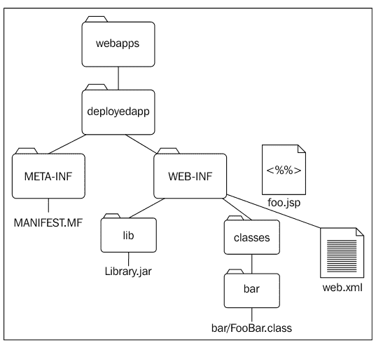

要从项目创建 WAR 文件，请右键单击项目并选择 **导出**。选择如下图所示的 WAR 文件选项，通过 **浏览...** 按钮指定目标目录，然后单击 **完成**。现在你可以通过将其放置在 `webapp` 目录下并重新启动容器，将你的 WAR 文件部署到 Tomcat。

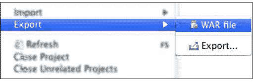

## 总结

在本章中，我们介绍了用于开发 Java Web 应用程序的主要技术概述。我们还强调了这些技术的一些优点。本章还介绍了这些技术的一个重要元素：容器。特别是，本章中使用的容器是 Tomcat。你看到了如何设置 Tomcat，以及如何执行一些基本操作，如启动和停止它；既可以通过命令行，也可以通过 Eclipse。

你了解到，要使 Eclipse 支持 Web 应用程序的开发，你需要安装一组统称为 Eclipse WTP 的插件。事实上，正如你所见，你不需要安装整套插件，本章解释了你必须安装的插件。

在了解了 servlet 的生命周期以及容器在此上下文中的作用后，使用已安装的插件集，我们回顾了基本 servlet 的创建以及一个更复杂的示例。在此过程中，我们解释了 `doGet` 和 `doPost` 之间的区别。因此，你现在知道何时重写它们。使用新 servlet API 的优点之一是使用注解。用 `@WebServlet` 注解 servlet 消除了编辑 `web.xml` 文件的需要。此外，你还了解到 servlet 可以通过 Eclipse 的内部浏览器进行测试：你只需要正确配置 servlet 容器。你还学习了如何使用 Eclipse WTP 创建 JSP。最后，本章展示了如何从 Eclipse Web 项目创建 WAR 文件。从下一章开始，我们将深入探讨更高级的主题。更具体地说，下一章将介绍使用 Eclipse 开发插件。


