# 8 Eclipse 开发

在本书的前几章中，我们已经看到了如何以各种方式使用 Eclipse，例如为 Java 开发代码、使用 Git 管理项目以及开发 Web 应用程序。在本章中，我们将转换重点，学习如何使用 Eclipse 为 Eclipse 开发代码。由于 Eclipse 是用 Java 开发的，因此对该语言有良好的了解是本章的先决条件。

Eclipse 能够成为最受欢迎的 IDE 之一的一个特性是其可插拔架构。它包含一个运行时平台，提供 IDE 运行所需的必要基础设施，例如主要的 UI 元素、已加载插件的注册表、日志基础设施等，而基本上所有其他内容都是插件。你可以通过查看机器上的 Eclipse 文件夹来检查这一点。在 plugins 文件夹内有许多 JAR 文件和文件夹，每个都与一个插件相关。插件可以打包在简单的文件夹中，也可以打包在 JAR 文件中（这只是一个重命名的 zip 文件）。这些插件中的每一个都为 Eclipse 的某个方面做出贡献。例如 org.eclipse.jdt.* 提供的就是 Java 开发工具，如 Java 调试、Java 编辑器和 Java 项目类型。

在 Eclipse 的主文件夹中，你还会找到一个名为 features 的文件夹。功能基本上是一组插件。你可以使用功能将只有在捆绑在一起时才有意义的插件分组。查看 features/org.eclipse.jdt_<version> 文件夹内的 feature.xml 文件。它包含此功能包含的所有插件的列表。

功能和插件之间可以存在依赖关系。例如，提供插件开发工具的 org.eclipse.pde 功能依赖于 org.eclipse.jdt 功能，因为所有 Eclipse 插件都是用 Java 语言编写的。

你可以通过导航到 **Help | About Eclipse SDK** 并在出现的窗口中点击 **Installation Details** 来查看已安装在你的 Eclipse 实例中的所有功能和插件的列表。**Installed Software** 选项卡列出了所有已安装的功能组，而 **Installation History** 选项卡显示每个额外插件或功能安装的时间。**Features** 和 **Plug-ins** 选项卡包含有关插件和功能提供者、版本和 ID 的信息。你还可以通过点击 **Legal Info** 按钮，或在 **Features** 选项卡中的 **License** 按钮来检查插件是在何种许可下发布的。

到本章结束时，你将能够做到以下事项：

- 创建一个新的插件项目
- 运行和调试插件项目
- 声明并实现扩展点
- 为 Eclipse 工具栏和菜单创建自定义条目
- 使用 Plugin Spy 功能
- 创建新的 Eclipse 视图
- 导出你的插件

### 创建你的第一个插件

由于 Eclipse 中包含的大多数功能都是由插件提供的，因此开始学习 Eclipse 开发的一个好方法是学习如何创建自己的插件。最好的做法是使用 Eclipse 的新建插件项目向导。选择 **File | New | Other** 以查看向导列表。选择 **Plug-in Project** 选项并点击 **Next**。向导的第一个窗口包含基本项目配置。我们默认选项就足够了。为你的项目取一个好名字，例如 "HelloWorldPlugin"，然后点击 **Next**。

下一页包含更多插件属性。同样，默认选项即可，所以直接点击 **Next**。下一页允许你从模板构建插件，而不是从头开始。让我们选择 **Hello, World** 模板，它会创建插件的基本文件结构并在工具栏中添加一个按钮，按下时显示 **Hello, Eclipse World**。点击 **Finish**。系统会询问你是否要打开插件开发透视图。此透视图与 Java 透视图非常相似，只是包含了一些特定于插件开发的视图，例如插件视图。

在尝试运行此项目之前，让我们先看看生成的文件结构。以下截图显示了 **HelloWorldPlugin** 项目的 Package Explorer 视图：

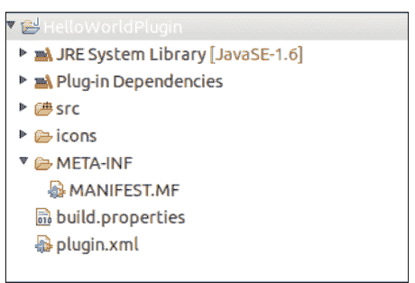

MANIFEST.MF 文件包含有关插件的基本信息。它包含插件的名称和版本，以及插件提供的内容和依赖的内容等信息。该文件的格式和提供的内容由 OSGi 规范决定。

plugin.xml 文件是插件基本文件结构中的另一个重要文件。它包含有关插件提供哪些扩展点以及实现哪些扩展点的信息。扩展点在一般意义上是插件之间“对话”的机制。我们将在本章中更详细地讨论扩展点。

build.properties 文件包含有关哪些文件夹包含源文件，以及哪些文件应包含在二进制和源构建中的信息。

通过双击这三个文件中的任何一个，Eclipse 将打开插件清单编辑器，而不是使用纯文本编辑器显示文件内容。此编辑器可用于管理插件的各个方面：依赖项、扩展点、导出的包等。编辑器在幕后会编辑 MANIFEST.MF、build.properties 和 plugin.xml 文件，以添加你通过其表单提供的信息。一些 Eclipse 开发指南更喜欢通过展示如何直接编辑这些文件来介绍插件管理。然而，本章将始终使用编辑器的表单，因为它们对新手 Eclipse 开发者更友好。

以下截图显示了插件清单编辑器的外观：

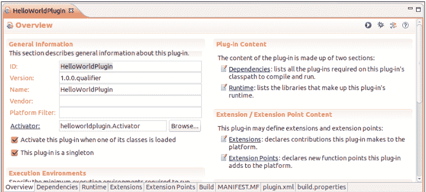

正如你所见，编辑器的下部有水平标签页。每个标签页允许你控制插件的不同方面。第一个标签页包含有关插件的基本信息，以及指向其他标签页和插件开发向导的链接。现在例如看看 Dependencies 标签页。我们可以看到我们的插件依赖于 org.eclipse.ui 和 org.eclipse.runtime，因为它们在必需插件列表中。我们将在使用它们时描述每个标签页。最后三个标签页允许你查看三个插件配置文件中的实际内容。

src 文件夹包含两个源文件：Activator.java 和 SampleAction.java，后者是按下按钮时实际显示消息的类。

激活器类管理插件在 Eclipse 平台中的生命周期。它包含在插件启动或停止时执行的代码，以及其他与生命周期相关的操作。向导生成的 Activator.java 类包含我们所需的一切。

### 运行和调试插件项目

运行或调试插件项目与我们对 Java 项目的操作没有区别。只需点击工具栏中的绿色播放按钮即可运行我们的 **Hello World** 插件。你会看到一个新的 Eclipse 实例将启动。默认情况下，此 Eclipse 实例包含开发环境中安装的所有插件，以及工作区中打开的每个插件项目。此测试实例称为 Runtime Workbench。

在你的运行时工作台的工具栏中查找 Eclipse 符号。点击它，你将被 **Hello, Eclipse World** 消息迎接。

调试的工作方式也一样。通过点击控制台中的红色方块按钮或关闭 Eclipse 窗口来停止当前运行时工作台。在 `SampleAction` 类中放置一个断点（第 59 行），然后点击工具栏中的 **Debug** 按钮（带绿色虫子的那个）。现在，在运行时工作台中点击我们的 **Hello World** 按钮。执行将在所选行处暂停。*第 3 章，单元测试与 JUnit 调试* 中关于调试所讨论的一切内容在这里也同样适用。

### 运行和调试配置

Eclipse 为运行和调试插件应用程序提供了进一步的配置。在顶部菜单中选择 **Run | Run Configurations** 以更详细地查看它们。

在 **Main** 选项卡中，你可以选择运行时工作台的工作区位置。那里将存储你在测试和调试应用程序时创建的项目。你可以通过点击工作区位置下方的 **Clear** 选项来选择在启动运行时工作台前清除工作区。**Main** 选项卡中的 **Program to Run** 部分允许你选择运行不同的产品或应用程序，而 **Java Runtime Environment** 允许你为运行时环境使用不同的 JRE。如果你在测试插件与不同 JRE 的兼容性，这会很有用。

**Arguments** 选项卡允许你在启动运行时工作台时为 Eclipse 和 JVM 选择参数。


## Eclipse 开发

插件选项卡允许您选择将在运行时工作台中加载的插件，既可以来自您的 Workspace，也可以来自您的开发环境。这对于在无需关闭它们的情况下单独测试工作区项目非常有用，或者可以从开发环境中移除无关插件以节省机器资源。以下截图显示了 **运行配置** 菜单的插件选项卡：

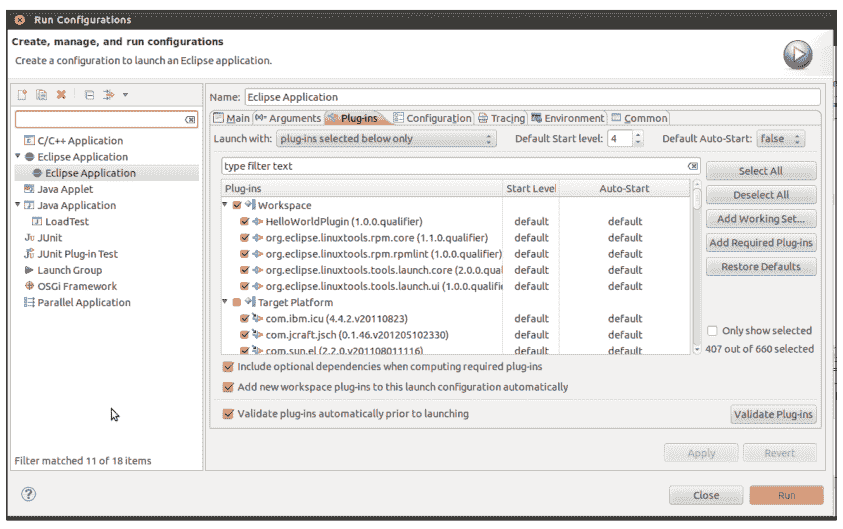

在 **配置** 选项卡中，您可以设置要用于运行时工作台实例的 `config.ini` 文件，以及修改配置区域。**跟踪** 选项卡允许您为每个插件启用跟踪。跟踪是一个有趣的功能，允许您在运行时打开或关闭调试消息。这在您为安装在客户端环境中的基于 Eclipse 的应用程序提供支持时可能特别有用。您可以简单地要求客户端为您的插件启用跟踪，而无需向其发送启用了调试消息的插件调试版本。本书不会涵盖跟踪。**环境** 和 **通用** 选项卡与常规 Java 应用程序中的完全相同。

## 扩展点

扩展点是 Eclipse 用于允许插件扩展和修改其他插件行为的机制。扩展点概念的主要目标是提供松耦合的架构，公开一些可由其他插件实现的接口。扩展点及其实现均在 plugin.xml 文件中声明。

Eclipse 平台提供了许多这些扩展点，以便插件能够为 IDE 的各个元素做出贡献。我们将在本章中查看其中一些扩展点，但它们的完整列表可以在 Eclipse 文档中找到，该文档位于 http://help.eclipse.org/indigo/topic/org.eclipse.platform.doc.isv/reference/extension-points/index.html。

我们的 Hello World 插件实现了其中一个扩展点。让我们通过在插件清单编辑器中打开扩展选项卡来看看它是什么样子的。

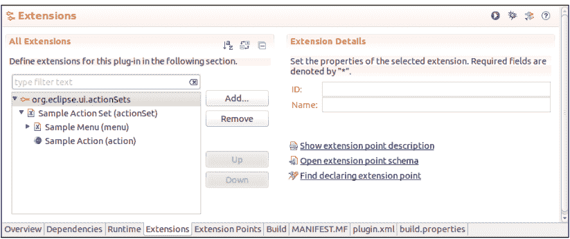

扩展选项卡显示我们，为了向工具栏添加按钮或向菜单添加新条目，我们的插件实现了一个名为 org.eclipse.ui.actionSets 的扩展点。您可以通过在扩展列表中选择它并单击“显示扩展点描述”来获取有关此扩展点的更多信息。

### 声明扩展点

目前，我们的 HelloWorldPlugin 项目仅实现了由其他插件提供的扩展点，但本身并未声明任何扩展点。让我们通过扩展我们的 Hello World 插件来声明一个扩展点，从而学习如何操作。我们将创建一个扩展点，允许其他插件提供单击工具栏按钮时显示的消息。

要创建新的扩展点，请在插件清单编辑器中选择 **扩展点** 选项卡，然后单击其中的 **添加** 按钮。系统会提示您提供三个属性：**ID**、**Name** 和 **Schema**。ID 是扩展点的内部唯一标识符。为了保证其唯一性，您可能希望使用反向域名表示法来创建 ID，其中包含扩展点所属的从不具体到具体的域。让我们使用 `com.packt.messageProvider` 作为 ID。当您填写此属性时，**Schema** 会自动填充相同的内容，后跟 `.xsd` 扩展名。**点名称** 属性是扩展点的人类可读名称。这里让我们使用 `Message provider`。完成后，单击 **完成**。将打开一个名为模式编辑器的新编辑器。以下截图显示了模式编辑器的示例：

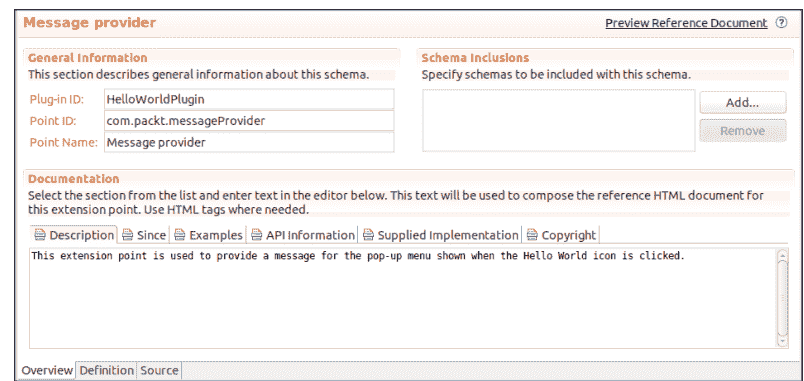

模式是描述扩展点的 XML 文件。这些文件以 `.xsd` 扩展名标识，并且与我们对 `plugin.xml`、`build.properties` 和 `MANIFEST.MF` 文件所做的操作一样，我们将使用编辑器向其添加内容，而不是直接编辑。模式编辑器包含三个水平选项卡：**概述**、**定义** 和 **源**。

第一个水平选项卡包含插件的基本描述。它还允许您为扩展点添加文档，该文档将直接显示在 Eclipse 界面中，使其他开发人员能够轻松找到有关如何实现扩展点的信息。还记得我们在 **扩展** 选项卡中看到的 `org.eclipse.ui.actionSets` 描述吗？它就来自这里。彻底描述您的扩展点并提供使用示例和 API 信息非常重要。

现在，我们必须描述扩展点包含的内容，即其他插件可以向我们的插件提供什么。为此，我们必须向扩展点添加新元素。打开模式编辑器的 **定义** 选项卡以查看扩展点的元素列表。

单击 **新建元素** 并将新元素的名称更改为 `hello_message`。您可以为该元素添加简短描述。现在选择该元素并单击 **新建属性** 为其添加一个属性。将它重命名为 `value`。属性的其他属性允许您选择必须提供的类型（字符串、布尔值、资源、Java 类或标识符）。在我们的例子中，我们希望扩展提供一个字符串。您的 **定义** 选项卡应如下所示：

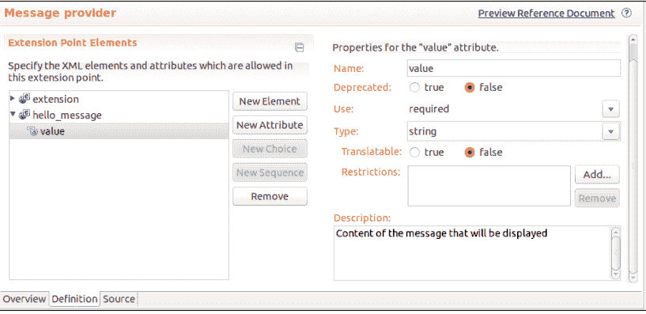

一旦元素被定义，我们必须声明它如何组成扩展点。如果我们有另一种类型的消息（例如 goodbye_message），我们可以要求扩展点实现具有一个或多个每个。元素组合是通过向“extension”元素添加选择和序列来实现的。选择是“或”组合，而序列是“与”组合。这些元素可以一起使用以创建更复杂的组合。

由于我们每个扩展点实现只需要一个 `hello_message` 元素，让我们通过选择它并单击 **新建序列** 向扩展元素添加一个新序列。将 **最小出现次数** 和 **最大出现次数** 都配置为 1。现在，右键单击 **序列** 条目，然后选择 new | `hello_message` 以声明我们需要一个 `hello_message` 元素实现。

选择的工作方式非常相似。向扩展元素添加一个选择并向该选择添加元素。如果选择中的任何元素得到满足，则扩展点已成功实现。

### 提供接口

扩展点最常用的机制之一是提供可由其他插件实现的接口。为了举例说明其工作原理，让我们稍微修改一下扩展点：不是要求其他插件提供字符串，而是要求提供实现 IMessageProvider 接口的类。

让我们首先在我们的插件中创建接口。接口必须放在将被导出的包内，以便其他插件可以实现它，因此请确保您创建一个新包来存储接口。在项目的 src 文件夹中创建一个名为 IMessageProvider.java 的新接口，其内容如下：

```
public interface IMessageProvider {

    public String getHelloMessage();

}
```

如您所见，接口仅要求实现一个返回字符串的 getHelloMessage() 方法。

现在让我们修改扩展点的模式，以要求接口实现而不是字符串。首先，“value”这个名称现在意义不大了，让我们将其更改为 message_provider。现在将 Type 属性从 string 更改为 Java。将出现两个新属性：Extends 和 Implements。由于我们提供的是接口，让我们填写 Implements 字段（请记住类是被扩展的，而接口是被实现的）。单击浏览按钮并选择我们的 IMessageProvider。请记住，您可以使用过滤器轻松找到它。单击确定。

以下截图显示了我们的扩展点最终的样子：

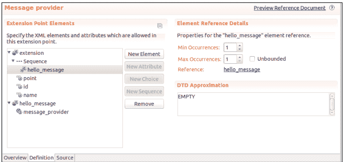


插件默认不会外部化源包。这意味着接口对其他插件不可见，从而无法被实现。要导出包含接口的包，我们将切换到插件清单编辑器的 Runtime 选项卡。在 Exported Packages 部分下点击 Add 按钮，选择包含接口的包，然后点击 OK。

## 使用扩展点实现的代码

一旦声明了扩展点，我们插件中的代码必须进行修改，以便利用其他插件通过它提供的功能。在我们的示例插件中，这意味着将硬编码的 Hello World 消息替换为由扩展点实现提供的消息。

让我们看看代码中 Hello World 消息实际显示的位置。以下代码片段位于 SampleAction 类中，该类由 Hello World 插件项目模板生成：

```
public void run(IAction action) {
    MessageDialog.openInformation(
        window.getShell(),
        "HelloWorldPlugin",
        "Hello, Eclipse world");
}
```

这里是我们的工作位置。利用来自扩展点的内容的首要步骤是验证是否存在可用的扩展，如果存在多个，则插件应使用哪一个扩展。请记住，扩展点的整个思想是解耦插件，因此如果你的扩展点没有实现，你的插件不应崩溃。

Eclipse 平台提供了可用扩展点实现的注册表。一旦获得它，你的代码必须验证特定扩展点的实现，然后查找所需的元素。

这就是 run 方法应如何重构以利用来自扩展点的消息的示例：

```
public void run(IAction action) {
    String helloMessage = null;
    IExtensionRegistry extensionRegistry = Platform.getExtensionRegistry();
    IConfigurationElement[] elements = extensionRegistry.getConfigurationElementsFor("com.packt.messageProvider");
    try{
        for (IConfigurationElement element : elements) {
            Object object = element.createExecutableExtension("message_provider");
            if (object instanceof IMessageProvider){
                IMessageProvider messageProvider = (IMessageProvider)object;
                helloMessage = messageProvider.getHelloMessage();
            }
        }
    } catch (CoreException e){
        e.printStackTrace();
    }

    if(helloMessage == null){
        helloMessage = "No providers found";
    }

    System.out.println(helloMessage);
    MessageDialog.openInformation(
        window.getShell(),
        "HelloWorldPlugin",
        helloMessage);
}
```

在前面的代码中，我们使用 Platform 类的 getExtensionRegistry 静态方法获取一个 IExtensionRegistry 对象，该对象包含平台中所有可用扩展点的信息。然后我们使用此对象获取 com.packt.messageProvider 扩展点可用的所有配置元素。请注意，如果存在多个扩展，使用哪个扩展并没有真正的问题，它将简单地遍历所有可用的配置元素并将其分配给 helloMessage 变量。如果未找到扩展，则存在回退机制，我们会打印出消息“No providers found”。因此，无论扩展点的实现数量如何，我们的插件代码都能正常执行。

## 实现扩展点

现在我们已经创建了扩展点，让我们创建一个实现它的新插件。首先创建一个名为 MessageProvider 的新插件项目。这次我们不想使用任何模板，因此在新建插件项目向导的 Templates 页面中取消选中 Create a plugin using one of the templates 复选框。

在开始使用扩展点之前，我们必须声明 MessageProvider 插件依赖于 HelloWorldPlugin，如果平台中没有 HelloWorldPlugin，就没有扩展点可以实现，MessageProvider 插件也就毫无意义。要声明依赖关系，让我们打开 MessageProvider 项目的插件清单编辑器并切换到 Dependencies 选项卡。在 Required Plug-ins 部分点击 Add 按钮并输入 HelloWorldPlugin。以下截图显示了 Dependencies 选项卡应有的外观：

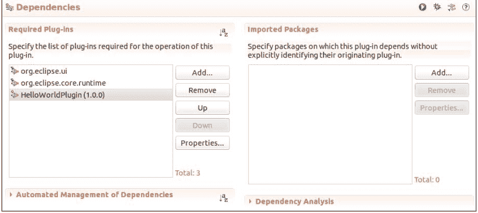

现在我们必须声明我们的插件包含 messageProvider 扩展点的实现。切换到 Extensions 选项卡，然后点击 Add 按钮。选择 com.packt.messageProvider 扩展点。

下一步是实际实现 messageProvider 扩展点。如你所见，com.packt.messageProvider 扩展已包含一个 hello_message 元素。Extension Element Details 面板向我们展示了我们已知的东西。我们需要一个实现 IMessageProvider 的类来实现此扩展点。

你可以通过在 Extension Elements Details 面板中简单点击 message_provider* 链接来创建该类。现在将以下代码复制到其中：

```
import helloworldplugin.IMessageProvider;

public class MyMessageProvider implements IMessageProvider {

    @Override
    public String getHelloMessage() {
        return "Hello world from MessageProvider";
    }

}
```

如你所见，这是一个非常基础的实现。我们现在准备测试我们的扩展点及其实现。选择我们刚刚创建的两个项目之一，然后选择 Run | Run as | Eclipse Application。当我们点击按钮时，来自扩展点的消息会显示出来，如以下截图所示：

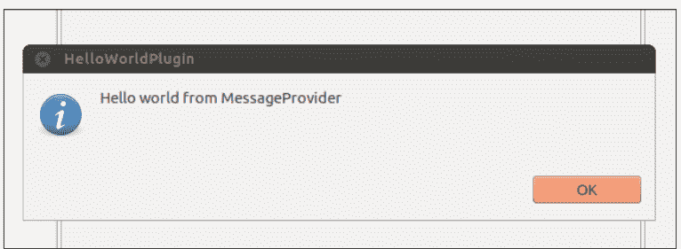

## 为平台的菜单和工具栏贡献

我们在用于说明如何声明和实现扩展点的示例中，创建了一个向 Eclipse 工具栏添加按钮的插件。现在，让我们更仔细地看看这个按钮是如何添加在那里的，以及我们如何向 Eclipse 界面的其他部分添加元素。

## 操作与命令

我们首先应该知道的是，在 Eclipse UI 中向菜单贡献有两种不同方式：操作和命令。我们在前一个示例中使用的操作方式乍一看可能更简单，但简单是有代价的；正如你所见，逻辑和界面紧密相连，如果你想添加例如执行与工具栏按钮相同操作的右键菜单项，就可能导致代码重复。如你所知，代码重复是项目的噩梦，应不惜一切代价避免。因此，相对于命令，不建议使用操作。

Command 框架通过完全解耦处理与界面来解决此问题。它需要为三个扩展点提供实现：org.eclipse.ui.menus、org.eclipse.ui.commands 和 org.eclipse.ui.handlers。menus 扩展点负责向平台添加界面元素。commands 扩展点声明命令，这些命令由处理器实现。

为了展示如何使用 commands 框架，让我们实现我们刚刚实现的同一个 hello world 工具栏按钮，但现在使用命令而不是操作。创建一个新的 HelloWorldCommand 插件项目，开始时不使用任何模板。

## org.eclipse.ui.menus

正如我们已经讨论过的，这个扩展点用于向 Eclipse 添加用户界面贡献，并取代了操作框架中的多个扩展点，例如 org.eclipse.ui.ActionSets、org.eclipse.ui.EditorActions 和 org.eclipse.ui.popupMenus。

添加此扩展点的实现以及具有以下参数的 menuContribution 元素：

- **locationURI**: toolbar:org.eclipse.ui.workbench.file?after=additions
- **allPopups**: false

LocationURI 指定贡献将在 Eclipse UI 中的何处添加。在这种情况下，它将出现在 Print 按钮的正旁边。在下一节中，我们将学习如何使用插件间谍发现 locationURIs。

如果 allPopups 布尔值设置为 false，则此菜单贡献只会添加到包含名为 "additions" 的标记的上下文菜单中。


## org.eclipse.ui.commands

命令扩展点声明将与不同菜单项绑定的命令。在命令扩展点添加一个扩展，并在其中添加一个 command 元素，具有以下属性：

- **id:** `com.packt.helloworldcommand.command`
- **name:** `helloWorldCommand`

## org.eclipse.ui.handlers

这里是命令实际实现的地方。这是通过创建一个扩展 org.eclipse.core.commands.AbstractHandler 的类来实现的。因此，在为 handlers 扩展点添加实现之前，让我们创建一个名为 DefaultHelloWorldCommandHandler 的类，代码如下：

```
package com.packt.helloworldcommand;

import org.eclipse.core.commands.AbstractHandler;
import org.eclipse.core.commands.ExecutionEvent;
import org.eclipse.core.commands.ExecutionException;
import org.eclipse.jface.dialogs.MessageDialog;
import org.eclipse.swt.widgets.Shell;
import org.eclipse.ui.PlatformUI;

public class DefaultHelloWorldCommandHandler extends AbstractHandler {

    @Override
    public Object execute(ExecutionEvent event) throws
ExecutionException {
        Shell shell = PlatformUI.getWorkbench().
getActiveWorkbenchWindow().getShell();
        MessageDialog.openInformation(shell, "Hello", "Hello World!");
        return null;
    }

}
```

在前面的代码中，你唯一需要实现的方法是 execute，显然这是在命令执行时会被调用的方法。

现在我们已经实现了处理器，让我们在 Extensions 选项卡中引用它。为 org.eclipse.ui.handlers 创建一个实现，并添加一个包含以下属性的 handler 元素：

- **commandId:** `com.packt.helloworldcommand.command`
- **class:** `com.packt.helloworldcommand.DefaultHelloWorldCommandHandler`

我们已经为三个扩展点实现了实现，但请注意，菜单项与命令或处理器之间没有任何关联。这是通过在 `org.eclipse.ui.menus` 扩展点的 `menuContribution` 元素中添加一个 "command" 元素来实现的。使用以下参数创建一个：

- **commandId:** `com.packt.helloworldcommand.command`
- **label:** `click me`

你的 **Extensions** 选项卡应如下图所示：

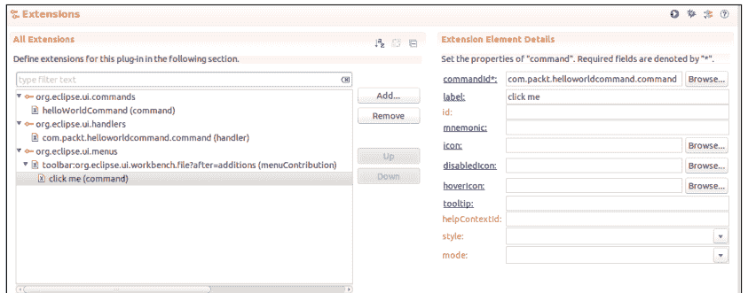

现在让我们通过运行它来看看我们的插件的行为。你应该会在 **Print** 按钮旁边看到一个写有 **click me** 的按钮。点击它，你会收到另一个 hello world 消息。如果你想在工具栏中使用图标而不是文本，请导航到 `org.eclipse.ui.menus` | `menuContribution` | `command` 元素进行编辑并更改 icon 参数。

由于命令框架的全部意义在于轻松地将同一命令添加到多个 UI 贡献中，让我们通过添加一个在右键单击时弹出的菜单项来测试这种灵活性。我们真正需要的只是在 `org.eclipse.ui.menus` 中再添加一个 `menuContribution` 元素。因此，请继续创建一个新的，包含 command 子元素，仅将 `locationURI` 属性更改为 `popup:org.eclipse.ui.popup.any?after=additions`。

再次运行插件，并在运行时工作台 UI 中右键单击 Package Explorer。你应该会看到如下条目：

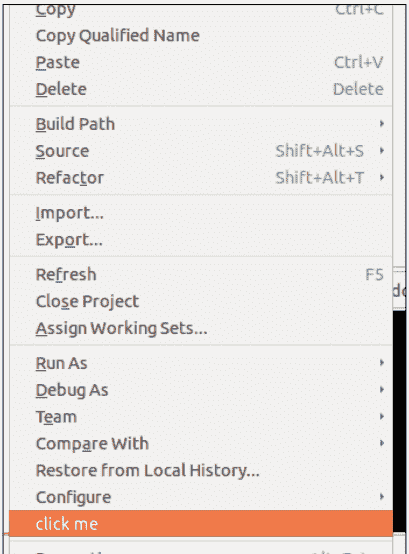

点击它与点击工具栏按钮的结果相同。

## Restricting and disabling contributions

你可能已经注意到，右键菜单中的 click me 条目并未限制在 Package Explorer 中。右键单击其他视图，例如 Java Editor 或 Outline，你会发现该条目无处不在。这可能不是期望的行为；大多数菜单贡献仅适用于某些上下文，在不适用的地方保留条目的可见或启用状态只会给 Eclipse 界面增加杂乱。

幸运的是，有一种简单的方法可以隐藏菜单贡献。`menuContribution` 下的 `command` 元素有一个可选元素称为 `visibleWhen`。顾名思义，它允许你确定在什么条件下该命令将被启用。

让我们将右键菜单项的可见性限制为仅在文本编辑器中出现。有两种方法可以做到这一点。一种是在为此命令注册的 AbstractHandler 扩展（本例中为 DefaultHelloWorldCommandHandler）中实现 isEnabled() 方法。方法执行返回的值将决定贡献是否可见。另一种方法是通过向 visibleWhen 元素添加子元素来构建一个表达式，以确定元素的可见性。在本示例中，我们将采用第二种选项。

首先添加 visibleWhen 元素。该元素中的 checkEnabled 属性决定使用哪种限制可见性的方法。如果为 true，则会评估 isEnabled() 方法，并且 visibleWhen 的任何子元素将被忽略。如果为 false，则会使用子元素。将此属性设置为 false。

visibleWhen 元素有许多类型的有效子元素。with 元素用于评估变量。这些变量由扩展点和 Eclipse 框架提供。Eclipse 提供的变量的完整列表可以在此链接的 Eclipse wiki 页面上找到：http://wiki.eclipse.org/Command_Core_Expressions#Variables_and_the_Command_Framework。此类变量的一些示例包括 activeEditor，其中包含当前活动的编辑器，activeWorkbenchWindow，其中包含当前活动的工作台窗口，以及 activePart，其中包含当前活动的部件。部件是工作台内的视觉组件，可以是视图或编辑器。由于我们希望我们的贡献仅在编辑器中可见，我们将评估 activePart 变量。因此，请继续添加一个 with 元素，并将其变量值更改为 activePart。

我们现在可以在 with 元素下添加其他元素来评估 activePart 变量。activePart 包含工作台中当前活动部件的实例，因此要验证它是否为文本编辑器，我们必须检查该对象实例化的类。这是通过 instanceof 元素完成的。让我们添加它并将 org.eclipse.ui.texteditor.AbstractTextEditor 提供给 value 参数。但是，要使其工作，我们必须能够访问属于 org.eclipse.ui.editors 插件的 org.eclipse.ui.texteditor 包。切换到 Dependencies 选项卡并将插件添加到依赖项列表中。现在切换回 Extensions 选项卡，你应该能够通过单击 Browse 按钮找到 AbstractTextEditor 类。

请注意，visibleWhen 还有许多其他子元素，例如 "and" 和 "or"，它们允许你组合不同的条件。systemTest 元素可用于测试系统属性，例如 osgi.os，其中包含 Eclipse 运行的操作系统（Win32、Linux、AIX、Solaris 等），osgi.ws，其中包含当前窗口系统（Win32、Motif、GTK 等）以及 osgi.arch，其中包含平台运行的架构（x86、x86_64、PPC、SPARC 等）。

下面的屏幕截图显示了你的 org.eclipse.ui.menus 扩展应如何显示：

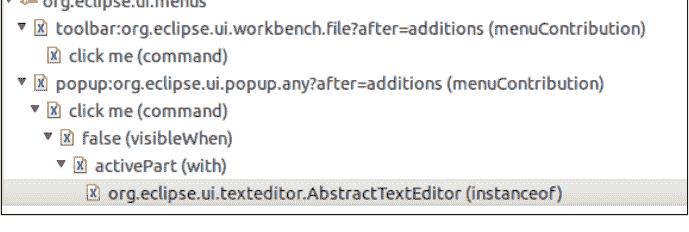

现在，运行你的项目，并尝试在运行时工作台视图上右键单击。只有文本编辑器会显示 click me 条目。

菜单项也可以被禁用而不是隐藏。以文本编辑器中的 copy 条目为例；当没有选择文本时，它为灰色且无法点击，尽管在选择文本时它表现正常。让我们将相同的行为添加到我们的菜单项中以举例说明如何操作。

当当前情况没有注册处理器时，条目将被禁用。由于我们尚未对处理器进行任何条件限制，因此它始终处于启用状态。与 menuContribution 的可见性类似，限制处理程序激活有两种方法。你可以通过向 handler 元素添加 enabledWhen 子元素并使用与 visibleWhen 中相同的子元素（with、and、or、instanceof 等）来完成，组装一个表达式以确定处理器是否处于活动状态。你也可以选择实现 isEnabled()，根据情况返回 true 或 false。由于我们已经展示了如何在 Extensions 选项卡中使用子元素来完成此操作的示例，这次让我们重写 isEnabled() 方法。

以下代码是重写 isEnabled() 以将处理器限制为在文本编辑器中选择代码时的示例：

```
@Override
public boolean isEnabled() {
    boolean enabled = true;
    IWorkbenchPart activePart = PlatformUI.getWorkbench().
getActiveWorkbenchWindow().getPartService().getActivePart();
    if(activePart instanceof IEditorPart){
        ISelection selection = PlatformUI.getWorkbench().
getActiveWorkbenchWindow().getSelectionService().getSelection();
        if(selection instanceof ITextSelection){
```


```
if (((ITextSelection) selection).getText().
    isEmpty()){
        enabled = false;
    }
}
}
    return enabled;
}
```

`PlatformUI` 类是 Eclipse 用户界面的入口。我们使用其静态方法 `getWorkbench()`，然后从 workbench 对象使用 `getActiveWorkbenchWindow()` 方法来获取对 `PartService` 的访问，从而可以获取 workbench 中当前活动的 part。如果 `activePart` 变量恰好是 `IEditorPart` 的实例，我们获取其选择服务，该服务可让我们访问编辑器中当前选中的内容。如果选择恰好是 `ITextSelection` 的实例，我们验证其内容。如果选择为空，则 enabled 值设为 false。注意 `ITextSelection` 属于 `org.eclipse.jface.text` 插件，因此如果在 **Dependencies** 选项卡的 required plugins 部分未指定此插件，此代码将无法工作。

Add this code to the `DefaultHelloWorldCommand` class and run the project. The following screenshot shows the popup menu that you should get if you right-click your Java editor with no code selected:

添加此代码到 `DefaultHelloWorldCommand` 类并运行项目。以下截图显示了当你在未选中任何代码的情况下右键点击 Java 编辑器时应得到的弹出菜单：

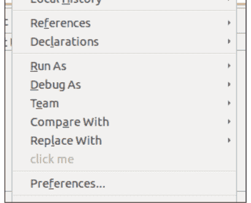

## The Plugin Spy feature

## 插件 Spy 功能

You might have wondered where did the locationURIs we used for our contributions came from. As we promised, we'll now show how to use the Plugin Spy, a very useful feature for Eclipse developers, to find locationURIs and much more.

你可能曾想过我们用于贡献的 locationURIs 是从哪里来的。如我们所承诺的，现在我们将展示如何使用 Plugin Spy，这是一个对 Eclipse 开发者非常有用的功能，用于查找 locationURIs 以及更多内容。

This feature allows you to obtain information from the UI elements of your workbench straight from the Eclipse interface, thus making it easy to find out from which plugin does that element come, its class, the current selection's type, among other useful information. The Plugin spy has two modes: the Plugin Selection Spy and the Plugin Menu Spy. As the names imply, the Selection Spy allows you to get information regarding the currently selected element and its containing part, but the Menu Spy provides information about menu contributions.

此功能允许你直接从 Eclipse 界面获取 workbench UI 元素的信息，从而轻松查明该元素来自哪个插件、其类、当前选择的类型等其他有用信息。Plugin spy 有两种模式：Plugin Selection Spy 和 Plugin Menu Spy。顾名思义，Selection Spy 允许你获取有关当前选中元素及其包含 part 的信息，而 Menu Spy 则提供有关菜单贡献的信息。

To enable the Selection Spy, press Alt + Shift + F1. You will be presented with a pop-up window containing information similar to this one:

要启用 Selection Spy，请按 Alt + Shift + F1。你将看到一个弹出窗口，其中包含类似以下的信息：

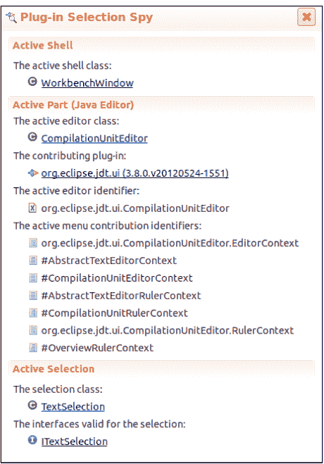

The preceding screenshot is the output of the **Plug-in Selection Spy** with **Java Editor** as the **Active Part**. As you can see, it contains the class of the active editor, the plugin that provides this part, the part's identifier, and the menu contribution identifiers. In the previous example of how to disable menu entries, we have implemented the `isEnabled()` method using information gathered from the plugin selection spy: We know that the Java editor class is `CompilationUnitEditor` and the text selection is an instance of `TextSelection`. If we didn't have the plugin selection spy, we would have to scavenge for this information in the Java Development Tool's code or documentation.

前面的截图是 **Plug-in Selection Spy** 的输出，其中 **Java Editor** 为 **Active Part**。如你所见，它包含活动编辑器的类、提供该 part 的插件、part 的标识符以及菜单贡献标识符。在之前如何禁用菜单项的示例中，我们使用从插件选择 spy 收集的信息实现了 `isEnabled()` 方法：我们知道 Java 编辑器类是 `CompilationUnitEditor`，文本选择是 `TextSelection` 的实例。如果没有插件选择 spy，我们就必须在 Java 开发工具的代码或文档中搜寻这些信息。

The other Plugin Spy mode is the Plugin Menu Spy. It allows you to get info from menu entries instead of views and selections. To enable this mode, press *Alt + Shift + F2*. You will notice that your mouse cursor will have a different look. Let's click on the **Run** toolbar button, for example, to see how the Plugin Menu Spy output looks as follows:

另一个 Plugin Spy 模式是 Plugin Menu Spy。它允许你从菜单项而不是视图和选择中获取信息。要启用此模式，请按 *Alt + Shift + F2*。你会注意到鼠标光标的外观会发生变化。例如，让我们点击 **Run** 工具栏按钮，看看 Plugin Menu Spy 的输出如下：

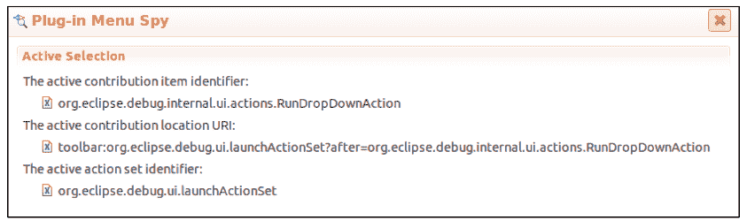

As you can see, it gives us the active contribution item identifier, the location URI of the contribution, and the action set identifier. This field can either point to an action or a command, since the action framework, as we have discussed previously in this chapter, is deprecated but there's still a lot of code that hasn't been ported to the command framework.

如你所见，它提供了活动贡献项标识符、贡献的 location URI 以及 action set 标识符。此字段可以指向 action 或 command，因为正如我们在本章前面讨论过的，action 框架已被弃用，但仍有大量代码尚未移植到 command 框架。

The Plugin Menu Spy can also be used to get info from pop-up menus, such as right-click context menus and toolbar drop-down menus.

Plugin Menu Spy 还可用于从弹出菜单获取信息，例如右键上下文菜单和工具栏下拉菜单。

So now you know from where did we get the locationURI to use in the **click me** menu entry example. Since the Plugin Menu Spy also gives us the action or the command that actually implements the menu entry, it allows us to re-use them by adding new menu contributions that use these actions or commands when required.

所以现在你知道我们在 **click me** 菜单项示例中使用的 locationURI 是从哪里得到的。由于 Plugin Menu Spy 还提供了实际实现菜单项的 action 或 command，因此它允许我们通过添加在需要时使用这些 action 或 command 的新菜单贡献来重用它们。

To exit the Plugin Menu Spy mode, press *Esc*.

要退出 Plugin Menu Spy 模式，请按 *Esc*。

## Creating new views

## 创建新视图

When creating an Eclipse plugin, you might need to create a whole new view instead of extending the current ones. Like almost everything in the Eclipse platform, this is achieved by implementing extension points.

在创建 Eclipse 插件时，你可能需要创建全新的视图而不是扩展现有视图。像 Eclipse 平台中的几乎所有内容一样，这通过实现扩展点来实现。

The org.eclipse.ui.views is the most important extension point regarding views. There are three elements in this extension point:

org.eclipse.ui.views 是关于视图的最重要的扩展点。此扩展点中有三个元素：

- **View**: Describes the view itself. It contains information regarding the view's class, category, icon, and name
- **Category**: If the view you're creating doesn't belong to any of the existing categories , you can create a new one using this element. You can see all the existing views and its categories by selecting **Window | Show View | Other**.
- **StickyView**: Use this element if you want to create a view that will be shown in all perspectives by default.

- **View**：描述视图本身。它包含有关视图的类、类别、图标和名称的信息
- **Category**：如果你要创建的视图不属于任何现有类别，你可以使用此元素创建一个新类别。你可以通过选择 **Window | Show View | Other** 查看所有现有视图及其类别。
- **StickyView**：如果要创建默认在所有透视图中显示的视图，请使用此元素。

The class required by the view element must be one that implements the org.eclipse.ui.part.IViewPart interface. It's more recommended, however, to extend the ViewPart abstract class, which is a base implementation of IViewPart that makes the task of implementing IViewPart easier. It leaves two methods to be implemented:

view 元素所需的类必须是实现 org.eclipse.ui.part.IViewPart 接口的类。然而，更推荐的是扩展 ViewPart 抽象类，它是 IViewPart 的基础实现，使实现 IViewPart 的任务更容易。它剩下两个方法需要实现：

- `createPartControl(Composite parent)`: This is the method that's called when the view is created. According to the method comments of `IViewPart`, the following actions must be taken in implementations:
  - Create one or more controls within the parent
  - Set the parent layout as needed
  - Register any global actions with the site's `IActionBars`
  - Register any context menus with the site
  - Register a selection provider with the site, to make it available to the workbench's `ISelectionService` (optional)
- `setFocus()`: This method is called when focus is set in your view. Code in this method should focus one of the elements inside the view.

- `createPartControl(Composite parent)`：这是视图创建时调用的方法。根据 `IViewPart` 的方法注释，实现中必须执行以下操作：
  - 在父容器内创建一个或多个控件
  - 根据需要设置父布局
  - 将任何全局操作与 site 的 `IActionBars` 注册
  - 将任何上下文菜单与 site 注册
  - 将选择提供者与 site 注册，使其可用于 workbench 的 `ISelectionService`（可选）
- `setFocus()`：此方法在视图中设置焦点时调用。此方法中的代码应使视图内的一个元素获得焦点。

Basically, every SWT element presented in Chapter 5, SWT, and Chapter 6, More SWT, can be used to compose a view, as well as your own custom composites.

基本上，第 5 章 SWT 和第 6 章 More SWT 中介绍的每个 SWT 元素都可用于组成视图，以及你自己的自定义复合控件。

## Saving the view's current state

## 保存视图的当前状态

It's important for most of the views to be able to save its state so that it can be retrieved when Eclipse is restarted. There is a saveState(IMemento memento) method in IViewPart that must be implemented in order to achieve that. If you take a look at ViewPart's implementation, though, you will be disappointed:

对于大多数视图来说，能够保存其状态以便在 Eclipse 重启时恢复非常重要。IViewPart 中有一个 saveState(IMemento memento) 方法必须实现才能实现这一点。不过，如果你查看 ViewPart 的实现，你会感到失望：

```
public void saveState(IMemento memento) {
    // do nothing
}
```

If you want your view to be capable of saving its own state, you have to override this method. Let's see how to do this.

如果你希望你的视图能够保存自己的状态，你必须重写此方法。让我们看看如何做到这一点。

We can see that the method receives a IMemento object as a parameter. This is the object we have to update in order to save the view's state. From the IMemento's JavaDoc, mementos are objects to which you can assign a "mapping of arbitrary string keys to primitive values, and by allowing mementos to have other mementos as children (arranged into a tree)". This mapping is created by calling the put<type>(String key, <type> value) methods, such as putFloat, putInteger, putString, and so on. Child mementos are created with the createChild method.

我们可以看到该方法接收一个 IMemento 对象作为参数。这是我们必须更新以保存视图状态的对象。根据 IMemento 的 JavaDoc，memento 是你可以为其分配“任意字符串键到原始值的映射”的对象，并且允许 memento 拥有其他 memento 作为子项（按树形排列）。此映射是通过调用 put<type>(String key, <type> value) 方法创建的，例如 putFloat、putInteger、putString 等。子 memento 是通过 createChild 方法创建的。

Once you have accordingly implemented the saveState method, Eclipse guarantees that the information stored in the memento object will be available across different Eclipse sessions, using an xml-based storage format under the hood. However, we still have to tell Eclipse how to use this information to recompose the view's state. This is done by overriding the init(IViewSite site, IMemento memento) method, since the ViewPart implementation simply ignores the memento object and delegates to init(IViewSite site). As a general rule, information from the memento is only saved in the current object, leaving the task of assigning the values back to the SWT elements to the createPartControl method. This happens because the platform calls init before createPartControl.

一旦你相应地实现了 saveState 方法，Eclipse 保证 memento 对象中存储的信息将在不同的 Eclipse 会话中可用，其底层使用基于 xml 的存储格式。然而，我们仍需告诉 Eclipse 如何使用这些信息来重新组合视图的状态。这是通过重写 init(IViewSite site, IMemento memento) 方法完成的，因为 ViewPart 实现只是忽略 memento 对象并委托给 init(IViewSite site)。作为一般规则，来自 memento 的信息仅保存在当前对象中，将值重新赋给 SWT 元素的工作留给 createPartControl 方法。这是因为平台在 createPartControl 之前调用 init。

## Adding context help to your view

## 为你的视图添加上下文帮助

The easiest way of getting help in Eclipse is through the Dynamic Help, which can be activated in Help | Dynamic Help. This opens a Help view which contains basic information and usage guidance for the currently focused view. Each view provides the help content, and the Eclipse platform takes care of assembling the help view.

在 Eclipse 中获取帮助的最简单方式是通过 Dynamic Help，可在 Help | Dynamic Help 中激活。这会打开一个 Help 视图，其中包含当前聚焦视图的基本信息和使用指南。每个视图提供帮助内容，而 Eclipse 平台负责组装帮助视图。


为了提供帮助内容，插件必须实现 `org.eclipse.help.contexts` 扩展点。实现必须提供一个 contexts 元素，该元素指向 XML 格式的上下文帮助文件。无需从头创建并手动编辑，您可以使用 **Context Help** 编辑器。为此，通过选择 **File | New | Other** 创建 XML 文件，然后浏览到 **User Assistance | Context Help**。在下一页提供文件名和位置，然后单击 **Finish**。您可以向上下文添加主题和命令。主题指向将在 **Dynamic Help** 视图中呈现的 HTML 文件。

## 新视图示例

为了说明我们迄今为止所看到的创建新视图的内容，让我们创建一个非常简单的视图，只包含一个标签和一个文本字段。让我们开始通过扩展 ViewPart：

```java
package sampleview.views;

import org.eclipse.swt.SWT;
import org.eclipse.swt.layout.GridData;
import org.eclipse.swt.layout.GridLayout;
import org.eclipse.swt.widgets.Composite;
import org.eclipse.swt.widgets.Label;
import org.eclipse.swt.widgets.Text;
import org.eclipse.ui.IMemento;
import org.eclipse.ui.IViewSite;
import org.eclipse.ui.PartInitException;
import org.eclipse.ui.part.ViewPart;

public class SampleView extends ViewPart {

    public static final String ID = "sampleview.views.SampleView";

    private Label label;
    private Text text;
    private IMemento memento;

    public SampleView() {
    }

    public void createPartControl(Composite parent) {
        parent.setLayout(new GridLayout(2, false));
        label = new Label(parent, SWT.NONE);
        label.setText("Write down something here:");

        text = new Text(parent, SWT.BORDER);
        text.setLayoutData(new GridData(SWT.FILL, SWT.NONE,
    true, false));
if(memento != null){
    if(memento.getString("content") != null){
        text.setText(memento.getString("content"));
    }
}
}

public void setFocus() {
    text.setFocus();
}

@Override
public void init(IViewSite site, IMemento memento) throws
    PartInitException {
    this.memento = memento;
    init(site);
}

@Override
public void saveState(IMemento memento) {
    memento.putString("content", text.getText());
}
}
```

现在我们有了 IViewPart 实现，让我们修改 plugin.xml 以便在 Eclipse 平台中注册该视图。下面的屏幕截图显示了在注册视图后，我们的插件清单编辑器的 Extensions 选项卡的样子：

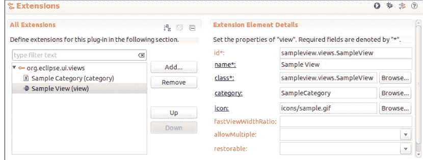

现在运行项目。通过选择 Window | Show View | Other 或使用 Ctrl + 3 快捷键并输入视图的名称来打开我们刚刚创建的视图。我们的视图应该如下所示：

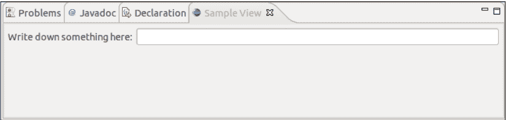

尝试在文本字段中写入一些内容并重新启动运行时工作台。请注意，您必须关闭 Eclipse 实例，而不是在开发环境中单击 Terminate 按钮（红色停止按钮）。Terminate 按钮只是终止实例，没有给平台保存视图状态的时间。

## 导出插件

到目前为止，我们只在运行时工作台中执行了我们的插件。为了将我们的插件提供给在其他机器上安装，我们必须导出它。为此，右键单击您的插件项目并选择 Export。导出向导包含四种不同的导出插件项目的方式。我们将使用 Deployable plug-ins and fragments 选项。选择它并单击 Next。

下一个向导页面允许您选择要导出的插件。您的插件有三种可能的目的地：目录、归档文件或主机。如果您选择将插件导出到目录中，每个插件将被打包到自己的 .jar 文件中并放置在 plugins 文件夹内。要安装您的插件，只需将这些 jar 文件移动到 Eclipse 安装文件夹内的 plugins 文件夹中即可。归档选项做同样的事情，但在此基础上将 plugins 文件夹归档到 .zip 文件中。Install into host 选项允许您直接将插件部署到 Eclipse 安装中。

Options 选项卡还允许您导出插件的源代码。如果您选择此选项，包含插件的 JAR 文件还将包含一个 src 文件夹，其中包含所有类的代码。JAR Signing 选项卡让您使用密钥库签署插件的 JAR 文件。

## 摘要

正如您在本章中所看到的，Eclipse 为有兴趣扩展它的开发人员提供了一套非常好的工具。插件清单编辑器通过消除了解如何编辑插件配置文件的需求，使开始创建插件变得更容易。Eclipse 提供的插件文档非常完善，并且与 Plugin Spy 等功能一起，能让您迅速上手。

现在我们对如何为 Eclipse 开发扩展有了一些基本了解，在下一章中我们将了解如何使用 Eclipse 的平台和基础设施来开发我们自己的客户端应用程序。

# 9 Eclipse 丰富客户端平台

# Eclipse 丰富客户端平台

在上一章中，我们谈到了 Eclipse 的插件开发。我们还看到 **Eclipse** 由一个基本平台和提供 **IDE** 所有功能的插件组成。我们没有告诉您的是，您可以使用此平台从头构建自己的客户端应用程序，利用 Eclipse 提供的一切。想象一下没有任何视图、透视图或工具栏的 Eclipse——这就是 **Rich Client Platform (RCP)** 提供的。它是一个空白画布，您可以在此之上使用 Eclipse 的所有构建块以及您可能想到的任何其他构建块来开发您的应用程序。

在本章中我们将：

- 了解什么是丰富客户端平台以及开发人员如何通过使用它来构建应用程序获益
- 了解 Eclipse Rich Client Platform 是什么以及它提供什么
- 使用 **Eclipse RCP** 开发一个非常简单的客户端应用程序，以展示如何使用其最重要的功能
- 了解如何捆绑和品牌化您的客户端应用程序

## 理解丰富客户端平台

在深入 Eclipse RCP 之前，让我们先定义什么是丰富客户端平台。在客户端/服务器架构的上下文中，客户端应用程序负责从用户获取请求并将其发送到将处理请求的机器，访问数据库和内部系统。互联网的普及以及速度和稳定性的改进促使许多公司将客户端应用程序从桌面转向基于互联网的应用程序。这种转变带来了许多好处，例如部署和更新的便利性，因为只需修改 Web 服务器中应用程序的代码即可将任何修改部署到所有客户端。因此，客户端的硬件和软件要求更少，等等。然而，由于网络延迟和连接问题导致的停机时间（尽管很少见，但对业务至关重要）造成的用户体验不佳，保持了对基于桌面的应用程序的兴趣。

然而，从头开发其中一个客户端应用程序是一项昂贵且耗时的任务。必须考虑许多不同的方面，例如可移植性、模块化以及更新方法。这就是丰富客户端平台发挥作用的地方。它为开发人员提供所有这些功能，以便他们构建自己的客户端应用程序，而无需担心他们处理的每种类型的客户端应用程序的不同方面。由于客户端应用程序的用户界面彼此差异不大，其中大多数基本上由包含数据输入元素的表单组成，例如文本字段和组合框。RCP 还应提供可重用的小部件，可轻松添加到应用程序中。

Eclipse 从客户端/服务器架构的角度来看并不是一个客户端应用程序。它包含所有这些理想的功能，并且这些功能通过 Eclipse RCP 提供给有兴趣为自己的客户端应用程序利用它们的开发人员。

## Eclipse 丰富客户端平台

现在我们知道了什么是丰富客户端平台，让我们更详细地了解 Eclipse RCP 提供的功能。


## OSGi 框架实现

Eclipse RCP 提供了 Equinox，即 OSGi 框架的一种实现。根据其规范文档，OSGi 框架提供了一个通用、安全、受管理的 Java 框架，支持部署称为 bundles 的可扩展且可下载的应用程序。Equinox 为您的客户端应用程序提供所有必要的[content]
## OSGi 框架实现

Eclipse RCP 提供了 Equinox，即 OSGi 框架的一种实现。根据其规范文档，OSGi 框架提供了一个通用、安全、受管理的 Java 框架，支持部署称为 bundles 的可扩展且可下载的应用程序。Equinox 为您的客户端应用程序提供所有必要的[content]
## OSGi 框架实现

Eclipse RCP 提供了 Equinox，即 OSGi 框架的一种实现。根据其规范文档，OSGi 框架提供了一个通用、安全、受管理的 Java 框架，支持部署称为 bundles 的可扩展且可下载的应用程序。Equinox 为您的客户端应用程序提供所有必要的[content]
## OSGi 框架实现

Eclipse RCP 提供了 Equinox，即 OSGi 框架的一种实现。根据其规范文档，OSGi 框架提供了一个通用、安全、受管理的 Java 框架，支持部署称为 bundles 的可扩展且可下载的应用程序。Equinox 为您的客户端应用程序提供所有必要的[content]
## OSGi 框架实现

Eclipse RCP 提供了 Equinox，即 OSGi 框架的一种实现。根据其规范文档，OSGi 框架提供了一个通用、安全、受管理的 Java 框架，支持部署称为 bundles 的可扩展且可下载的应用程序。Equinox 为您的客户端应用程序提供所有必要的[content]
## OSGi 框架实现

Eclipse RCP 提供了 Equinox，即 OSGi 框架的一种实现。根据其规范文档，OSGi 框架提供了一个通用、安全、受管理的 Java 框架，支持部署称为 bundles 的可扩展且可下载的应用程序。Equinox 为您的客户端应用程序提供所有必要的[content]
## OSGi 框架实现

Eclipse RCP 提供了 Equinox，即 OSGi 框架的一种实现。根据其规范文档，OSGi 框架提供了一个通用、安全、受管理的 Java 框架，支持部署称为 bundles 的可扩展且可下载的应用程序。Equinox 为您的客户端应用程序提供所有必要的[content]
## OSGi 框架实现

Eclipse RCP 提供了 Equinox，即 OSGi 框架的一种实现。根据其规范文档，OSGi 框架提供了一个通用、安全、受管理的 Java 框架，支持部署称为 bundles 的可扩展且可下载的应用程序。Equinox 为您的客户端应用程序提供所有必要的[content]
## OSGi 框架实现

Eclipse RCP 提供了 Equinox，即 OSGi 框架的一种实现。根据其规范文档，OSGi 框架提供了一个通用、安全、受管理的 Java 框架，支持部署称为 bundles 的可扩展且可下载的应用程序。Equinox 为您的客户端应用程序提供所有必要的[content]
## OSGi 框架实现

Eclipse RCP 提供了 Equinox，即 OSGi 框架的一种实现。根据其规范文档，OSGi 框架提供了一个通用、安全、受管理的 Java 框架，支持部署称为 bundles 的可扩展且可下载的应用程序。Equinox 为您的客户端应用程序提供所有必要的[content]
## OSGi 框架实现

Eclipse RCP 提供了 Equinox，即 OSGi 框架的一种实现。根据其规范文档，OSGi 框架提供了一个通用、安全、受管理的 Java 框架，支持部署称为 bundles 的可扩展且可下载的应用程序。Equinox 为您的客户端应用程序提供所有必要的[content]
## OSGi 框架实现

Eclipse RCP 提供了 Equinox，即 OSGi 框架的一种实现。根据其规范文档，OSGi 框架提供了一个通用、安全、受管理的 Java 框架，支持部署称为 bundles 的可扩展且可下载的应用程序。Equinox 为您的客户端应用程序提供所有必要的[content]
## OSGi 框架实现

Eclipse RCP 提供了 Equinox，即 OSGi 框架的一种实现。根据其规范文档，OSGi 框架提供了一个通用、安全、受管理的 Java 框架，支持部署称为 bundles 的可扩展且可下载的应用程序。Equinox 为您的客户端应用程序提供所有必要的[content]
## OSGi 框架实现

Eclipse RCP 提供了 Equinox，即 OSGi 框架的一种实现。
[/content]

That works? Let's test.

[content]
## OSGi 框架实现

Eclipse RCP 提供了 Equinox，即 OSGi 框架的一种实现。


如名称所示，start 方法在应用程序启动期间被调用，而 stop 方法在应用程序停止时被调用。start 方法可以返回任何类型的对象，包括整数，就像 Application 实现的情况一样。这是一个非常基础的实现，它只是创建一个新的 Display 对象并调用静态的 PlatformUI.createAndRunWorkbench 方法。该方法接收一个 WorkbenchAdvisor 对象作为参数。该对象允许您配置应用程序外观和感觉的一些基本方面。每个 RCP 应用程序都必须实现一个 WorkbenchAdvisor 对象。Display 对象管理 SWT 与操作系统之间的连接。对于大多数 RCP 应用程序而言，要使其运行起来，start 方法中通常不需要比这些更多的内容。stop 方法只是关闭在 start 方法期间创建的工作台。

现在让我们更仔细地查看 WorkbenchAdvisor 类的生成扩展，即 ApplicationWorkbenchAdvisor 扩展：

```
public class ApplicationWorkbenchAdvisor extends WorkbenchAdvisor {

    private static final String PERSPECTIVE_ID = "HelloRCP.perspective";

    public WorkbenchWindowAdvisor createWorkbenchWindowAdvisor(
        IWorkbenchWindowConfigurer configurer) {
        return new ApplicationWorkbenchWindowAdvisor(configurer);
    }

    public String getInitialWindowPerspectiveId() {
        return PERSPECTIVE_ID;
    }

}
```

getInitialWindowPerspectiveId 方法决定在打开应用程序的新窗口时将显示哪个透视图。createWorkbenchWindowAdvisor 方法负责实例化并返回一个 WorkbenchWindowAdvisor 对象，该对象配置应用程序窗口本身。我们的实现返回 ApplicationWorkbenchWindowAdvisor 扩展的一个实例，该扩展继承自 WorkbenchWindowAdvisor 对象。让我们查看其实现：

```
public class ApplicationWorkbenchWindowAdvisor extends
WorkbenchWindowAdvisor {

    public ApplicationWorkbenchWindowAdvisor(IWorkbenchWindowConfigurer
configurer) {
        super(configurer);
    }

    public ActionBarAdvisor createActionBarAdvisor(
    IActionBarConfigurer configurer) {
    return new ApplicationActionBarAdvisor(configurer);
}

    public void preWindowOpen() {
    IWorkbenchWindowConfigurer configurer = getWindowConfigurer();
    configurer.setInitialSize(new Point(400, 300));
    configurer.setShowCoolBar(false);
    configurer.setShowStatusLine(false);
    configurer.setTitle("RCP Application");
}
}
```

preWindowOpen 方法的实现调用 getWindowConfigurer 并对 IWorkbenchWindowConfigurer configurer 执行一些操作，例如为应用程序窗口设置初始大小、禁用 coolbar 和状态行，以及为应用程序设置标题。createActionBarAdvisor 方法实例化并返回 ApplicationActionBarAdvisor，后者扩展自 ActionBarAdvisor。ActionBarAdvisor 创建、添加和释放工作台窗口的 JFace 操作。JFace 操作是一条命令，可以由最终用户通过使用 UI 元素（如按钮、菜单项和工具栏中的项）触发。ApplicationActionBarAdvisor 实现不会修改 ActionBarAdvisor 的行为。

现在，让我们回到 **插件清单编辑器** 窗口，看看构建一个功能完整的 RCP 应用程序还需要哪些其他插件。正如我们在本章开头所说，RCP 应用程序就像是剥离了所有 Eclipse 图形元素的 Eclipse 实例。这意味着如果您希望应用程序正常运行，就必须创建这些元素。我们需要的第一件事是透视图，它是通过实现 org.eclipse.ui.perspectives 扩展点创建的。perspective 元素包含一个 ID，该 ID 在应用程序之间必须是唯一的，还必须是一个用户友好的名称，将在界面中显示，以及一个类。让我们看看 Perspective 类的代码：

```
public class Perspective implements IPerspectiveFactory {

    public void createInitialLayout(IPageLayout layout) {
        layout.setEditorAreaVisible(false);
        layout.setFixed(true);

    }
}
```

代码显示我们透视图类必须实现 `IPerspectiveFactory` 接口，该接口包含 `createInitialLayout` 方法。模板生成的实现只是通过调用 `setFixed` 方法从应用程序中移除编辑器区域，并禁止用户修改视图的大小和位置。编辑器区域是应用程序窗口中央为编辑器保留的空间。任何其他视图都将渲染在此区域下方、左侧或右侧。编辑器区域对于我们的应用程序被禁用，因为它没有任何编辑器。

此方法也可以通过调用 `layout.addView` 方法将视图添加到透视图中。然而，模板生成的代码采用了不同的方法。返回 **插件清单编辑器** 窗口并查看 `org.eclipse.ui.perspectiveExtensions` 实现。此扩展点允许您向现有透视图添加视图。这种方法通常用于您想要向非您开发的透视图添加视图时。在这种情况下，您将无法访问 `IPerspectiveFactory` 实现来向 `createInitialLayout` 实现添加 `layout.addView` 调用。

`perspectiveExtension` 元素是您定义将接收视图的透视图 ID 的地方。此字段允许使用 * (星号) 字符，这将导致视图被添加到与模式匹配的每个透视图中。例如，`org.eclipse.jdt.*` 将在每个 **Java 开发工具 (JDT)** 透视图中包含该视图。这是使用 `perspectiveExtensions` 扩展点而不是在 `IPerspectiveFactory` 实现中调用 `layout.addView` 的另一个好处。它简化了管理视图将被添加到的透视图的任务。在我们的示例中，`targetID` 只是 *，这意味着在 `HelloRCP.view` 中，视图将被添加到所有可用的透视图中（我们的应用程序中只有一个透视图）。

说到视图，让我们看看 `org.eclipse.ui.views` 扩展。这是一个简单的视图，就像我们在 *第 8 章，Eclipse 开发* 中创建的那样。它指向一个扩展 `ViewPart` 抽象类的 View 类。`createPartControl` 方法实例化一个 `TableViewer` 对象并为其关联一个内容提供者和一个标签提供者。我们将在后面的章节扩展此示例时探索标签和内容提供者的概念。`TableViewer` 是一个 JFace 小部件，以类似表格的列表显示内容，类似于 JDT 的 Problems 视图中使用的那种。

我们的 RCP 应用程序实现的最后一个扩展点是 `org.eclipse.ui.menus`。它只是提供一个 **文件** 菜单贡献，其中包含一个 **退出** 条目。此条目运行 `org.eclipse.ui.file.exit` 命令，导致程序退出。

## 运行和调试 RCP 应用程序

运行 RCP 应用程序最简单的方法是打开 RCP 项目的 插件清单编辑器 窗口，切换到 Overview 选项卡，然后单击右侧列上的 启动 Eclipse 应用程序 链接。这将创建一个包含 RCP 插件和必要的平台插件的默认配置。您也可以通过选择项目并在 Eclipse 菜单中导航到 Run | Run Configurations 来创建自定义运行配置，就像使用常规插件一样。双击左侧的 Eclipse Application 选项为所选项目创建一个新的运行配置。要将项目作为 RCP 应用程序而不是 Eclipse 插件运行，请确保切换到 Run an application 并在 Program to run 部分中选择您的应用程序，如以下屏幕截图所示：

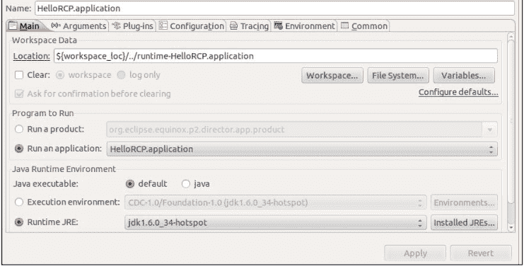

此配置还将包含开发平台中的所有插件。要仅选择所需的插件，请切换到 Plug-ins 选项卡，并从 Launch with 下拉菜单中选择仅以下选择的插件。单击 Deselect all，选择您的 RCP 插件，然后单击 Add Required Plug-ins，使应用程序中仅包含必要的平台插件。

在 第 8 章，Eclipse 开发 中介绍的其他选项卡的配置选项在这里也有效。您也可以转到 Run | Run Configuration，如果您尚未创建，Eclipse 将为您创建一个默认的运行配置。您将看到多种运行应用程序的方式：作为 Eclipse 应用程序、Java applet 或应用程序，或作为 OSGi Framework 应用程序。选择 Eclipse Application 并单击 OK。此配置将仅包含当前选择的插件和必要的平台插件。


以下截图显示了我们在上一节中构建的示例应用程序的外观。正如您所见，它符合我们所有的规范：一个 400 x 300 像素的窗口、一个视图、**RCP 应用** 标题等等。

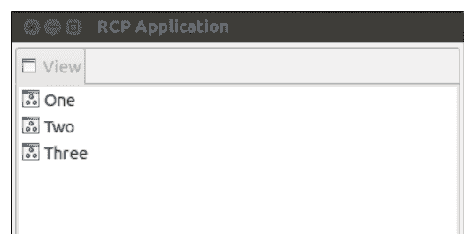

调试也是一项直接的操作——只需在您希望调试的类中设置断点，然后导航到 **运行** | **调试**。它将使用与 **运行** 命令相同的配置。

## 扩展示例 – 创建联系人列表应用程序

现在我们已经了解了 Eclipse RCP 应用程序的基础知识，让我们扩展示例并创建一个用于存储联系人信息的应用程序。为了保持简单并专注于学习如何使用 Eclipse RCP 功能，我们将开发一个独立的应用程序，而不是连接到服务器的客户端应用程序。然而，该应用程序可以很容易地修改为从服务器存储和获取联系人信息。这种设计相对于基于 Web 的客户端的优势在于，可以实现机制使您的应用程序在 Internet 连接故障或根本不存在的情况下也能工作。

这里的想法是开发一个非常简单的应用程序，但它具有功能并探索比前一个示例更多的功能。它将在应用程序窗口左侧有一个视图，其中包含联系人姓名的列表。每当在此视图中选择一个联系人姓名时，联系人编辑器将在窗口中间打开，允许用户查看联系人信息并更新它。**应用程序** 菜单将包含创建新联系人、保存当前编辑联系人的条目，以及带有 **保存** 按钮的工具栏。我们还将使用此示例来介绍内容和标签提供者的概念。

我们将在此示例中创建多个类。以下截图包含它们各自包中的所有类，以便您在需要了解应用程序的整体情况时可以参考：

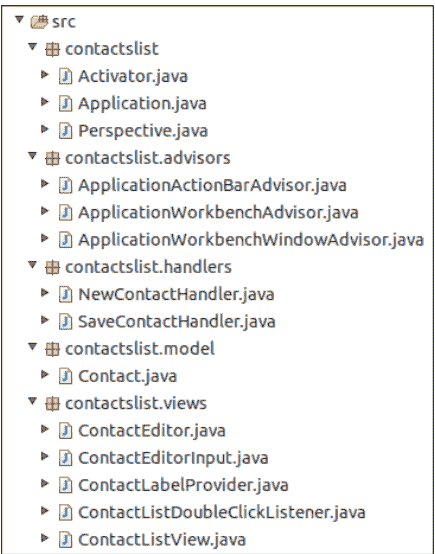

好吧，让我们动手吧。正如您在前一个示例中看到的，Eclipse 模板是入门的好方法；因此让我们也在此示例中使用它。导航到 文件 | 新建 | 插件项目 并使用 HelloRCP 模板创建一个名为 ContactsList 的新 RCP 项目。将应用程序窗口标题更改为更合适的名称，例如 Contacts List。

该项目与前一个示例的结构相似，但类更少。让我们运行应用程序以确保一切正常。打开 插件清单编辑器，切换到 概览 选项卡，然后单击右侧列中的 启动 Eclipse 应用程序 链接。您将看到一个名为 Contacts List 的空窗口，这正是我们现在所期望的。让我们关闭它并继续开发应用程序。

## 联系人列表视图

我们将首先编写包含联系人列表的视图。要创建此列表，我们将使用 SWT 的 TableViewer 元素。尽管这是一个非常基本的视图，但为了演示目的，我们将使用标签和内容提供者。标签提供者是一个特殊类，负责将模型映射到查看器中的相应条目。在我们的 TableViewer 情况下，它将提供代表联系人的标签。我们将为此使用联系人的姓名。内容提供者为查看器提供其应包含的元素。我们将使用一个名为 ArrayContentProvider 的简单 SWT 实现，它通过数组提供元素。

让我们从联系人模型开始。创建一个名为 Contact 的类，其中包含三个字符串及其 getter 和 setter：name、address 和 phoneNumber。还创建一个包含所有字符串的构造函数。

我们接下来要处理的类是标签提供者。创建一个名为 ContactLabelProvider 的类并使其实现 ILabelProvider 接口。使用第 2 章《Java 开发》中介绍的 Eclipse 代码生成功能为接口的方法创建默认实现。我们唯一要修改的方法是 getText。在这里我们将确定联系人将在联系人列表中以其姓名表示。我们需要获取 element 参数，检查它是否是 Contact 的实例，并返回联系人的姓名。以下代码实现了这一点：

```
@Override
public String getText(Object element) {
    if(element instanceof Contact){
        return ((Contact)element).getName();
    }
    return null;
}
```

现在我们拥有所需的一切，让我们开始处理 ContactList 视图本身。创建一个名为 ContactListView 的类，代码如下：

```
public class ContactListView extends ViewPart {

    private TableViewer contactsViewer;
    private List<Contact> contacts;

@Override
public void createPartControl(Composite parent) {
    contactsViewer = new TableViewer(parent);
    contactsViewer.setContentProvider(new ArrayContentProvider());
    contactsViewer.setLabelProvider(new ContactLabelProvider());
    contacts = new ArrayList<Contact>();
    contactsViewer.setInput(contacts);
}

@Override
public void setFocus() {

}

public void addEntry(Contact contact){
    contacts.add(contact);
    contactsViewer.refresh(true);
}

public void refreshEntries(){
    contactsViewer.refresh(true);
}
}
```

导入部分已省略。正如我们在上一章中看到的，创建视图的一种简单方法是扩展 `ViewPart` 类。这要求我们实现 `createPartControl` 和 `setFocus` 方法。在 `createPartControl` 方法中，我们应该实例化视图中包含的所有 SWT 元素。`setFocus` 方法在焦点分配给视图时执行。此方法通常将焦点分配给视图中的一个 SWT 元素。我们现在将忽略 `setFocus` 并使用空实现。在 `createPartControl` 方法中，我们初始化 `TableViewer` 接口并将其与我们刚刚创建的 `ContactLabelProvider` 类关联。我们还创建了一个新的 `ArrayContentProvider` 实例并为其提供一个空的 `ArrayList` 实例。随着我们创建新的联系人条目，此列表将被修改。我们还创建了两个方法（`addEntry` 和 `refreshEntries`）以简化并封装将新联系人添加到列表的任务。

现在我们有了 ContactList 类，让我们修改 plugin.xml 文件以在工作台中注册它。我们将为此使用插件清单编辑器窗口，就像我们在上一章中所做的那样。双击 plugin.xml 文件以打开它，切换到 Extensions 选项卡，并添加一个新的 org.eclipse.ui.views 条目。向扩展添加一个新的 view 元素。以下截图包含此元素的属性：

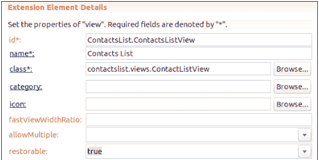

我们还必须将我们的视图添加到应用程序的默认透视图中。让我们为此使用 perspectiveExtension，就像我们在前一个示例中所做的那样。创建一个对 org.eclipse.ui.perspectiveExtensions 的扩展，添加一个 targetID 为 * 的 perspectiveExtension，并在其下添加一个 view 元素，其属性如以下截图所示：

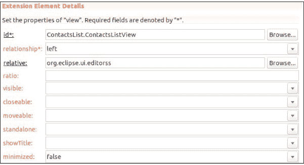

relative 字段确定将作为我们视图窗口定位的参考的部分。在这种情况下，我们使用编辑器空间（org.eclipse.ui.editors），它代表工作台中当前活动的编辑器。单击 Browse 按钮可以搜索部件 ID。relationship 字段确定它相对于 relative 字段中选定的部分的位置。

## 联系人编辑器

为了创建新的联系人条目并编辑现有的条目，我们将创建一个联系人编辑器。在处理 ContactEditor 类本身之前，让我们为其创建一个编辑器输入。编辑器输入表示正在编辑的条目。例如，文件的编辑器输入可能包含正在编辑的文件的路径。由于我们的应用程序内容仅存储在内存中，因此编辑器输入必须包含 Contact 对象本身。创建一个名为 ContactEditorInput 的类，使其实现 IEditorInput 接口，代码如下：

```
public class ContactEditorInput implements IEditorInput {

    private Contact contact;

    public ContactEditorInput(Contact contact) {
        super();
        this.contact = contact;
    }

    public Contact getContact() {
        return contact;
    }

    @Override
    public String getToolTipText() {
        return contact.getName();
    }

    @Override
    public String getName() {
        return contact.getName();
    }

    @Override
    public boolean equals(Object obj) {
        if(obj instanceof ContactEditorInput){
            if(((ContactEditorInput)obj).getContact().equals(this.contact)){
                return true;
            }
        }
        return false;
    }

    //Auto-generated method stub
}
```


我们创建了一个接收 Contact 对象的构造函数，并为其实现了 getter。我们还实现了 getToolTipText 和 getName 方法以返回联系人姓名。为了确保对同一个联系人只打开一个编辑器，还必须实现 equals 方法。我们已为其他方法使用了自动生成的代码存根。这些方法在代码中被省略了。

现在让我们来处理联系人编辑器。以下代码是 ContactEditor 类的实现：

```
public class ContactEditor extends EditorPart {

    private boolean dirty = false;
    private Text addressText;
    private Text nameText;
    private Text phoneText;

    @Override
    public void init(IEditorSite site, IEditorInput input)
        throws PartInitException {
        setSite(site);
        setInput(input);
    }

    @Override
    public void createPartControl(Composite parent) {
        parent.setLayout(new GridLayout(2, false));
        Label nameLabel = new Label(parent, SWT.NONE);
        nameLabel.setText("Name");
        nameLabel.setLayoutData(new GridData());
        nameText = new Text(parent, SWT.BORDER | SWT.FILL);
        nameText.setLayoutData(new GridData());

        Label addressLabel = new Label(parent, SWT.NONE);
        addressLabel.setText("Address");
        addressLabel.setLayoutData(new GridData());
        addressText = new Text(parent, SWT.BORDER);
        addressText.setLayoutData(new GridData());

        Label phoneLabel = new Label(parent, SWT.NONE);
        phoneLabel.setText("Phone number");
        phoneLabel.setLayoutData(new GridData());
        phoneText = new Text(parent, SWT.BORDER );
        phoneText.setLayoutData(new GridData());

        ContactEditorInput editorInput = (ContactEditorInput)
        getEditorInput();
        if(editorInput != null){
            Contact contact = editorInput.getContact();
            nameText.setText(contact.getName());
            this.setPartName(contact.getName());
            addressText.setText(contact.getAddress());
            phoneText.setText(contact.getPhoneNumber());
        }

        nameText.addModifyListener(new ContactEditorModifyListener());
        addressText.addModifyListener(new ContactEditorModifyListener());
        phoneText.addModifyListener(new ContactEditorModifyListener());
    }

    @Override
    public void doSave(IProgressMonitor monitor) {
        dirty = false;
        firePropertyChange(IWorkbenchPartConstants.PROP_DIRTY);

        ContactEditorInput editorInput = (ContactEditorInput)
        getEditorInput();
        if(editorInput != null){
            Contact contact = editorInput.getContact();
            contact.setName(nameText.getText());
            contact.setAddress(addressText.getText());
            contact.setPhoneNumber(phoneText.getText());

            this.setPartName(contact.getName());
        }
    }

    @Override
    public boolean isDirty() {
        return dirty;
    }

    @Override
    public void doSaveAs() {
    }

    @Override
    public boolean isSaveAsAllowed() {
        return false;
    }

    @Override
    public void setFocus() {
    }

    private class ContactEditorModifyListener implements ModifyListener
    {
        @Override
        public void modifyText(ModifyEvent e) {
            dirty = true;
            firePropertyChange(IWorkbenchPartConstants.PROP_DIRTY);
        }
    }
}
```

请注意 ContactEditor 扩展的是 EditorPart 而不是 ViewPart，就像 ContactListView 一样。它还包含必须实现的 createPartControl 方法。我们的实现创建了 SWT 元素，组成了联系人字段的基础表单。如果当前编辑器输入不为 null，也会填充这些字段，这将在编辑联系人而不是创建新联系人时发生。还有一个名为 ContactEditorModifyListener 的内部类，其名称暗示它会在文本元素被修改时收到通知。我们使用此类将 dirty 状态更改为 true。dirty 状态表示编辑器的输入包含未保存的更改。此状态在编辑器名称前用星号字符 (*) 表示。此状态还允许我们相应地启用或禁用保存按钮。请注意我们在 doSave 方法中如何更改 dirty 状态。

现在，让我们在 plugin.xml 文件中注册 ContactEditor 类。为 org.eclipse.ui.editors 扩展点添加一个新的扩展，并添加一个编辑器元素，其属性如以下屏幕截图所示：

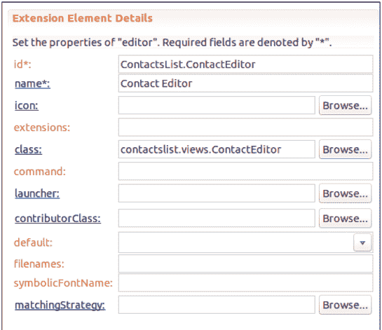

编辑器不会像普通视图那样添加到透视图中。编辑器是通过调用当前活动 WorkbenchPage 的 openEditor 方法以编程方式打开的，如本章后面将看到的那样。它们可以在任何透视图中打开，并放置在编辑器区域中，该区域位于窗口中间。

## 保存和新建命令及菜单项

下一步是实现命令、处理器和菜单项，以使用户能够创建新联系人并保存工作。让我们从处理器类开始。这是保存命令处理器的代码：

```
public class SaveContactHandler extends AbstractHandler {
    @Override
    public Object execute(ExecutionEvent event) throws ExecutionException {
        PlatformUI.getWorkbench().getActiveWorkbenchWindow().
        getActivePage().getActiveEditor().doSave(new NullProgressMonitor());
        return null;
    }
}
```

请注意有两个 AbstractHandler 类，一个在 org.eclipse.core.commands 包中，另一个在 org.eclipse.ui.commands 中。我们将使用前者，因为后者已弃用。

这是新建联系人处理器：

```
public class NewContactHandler extends AbstractHandler {

    @Override
    public Object execute(ExecutionEvent event) throws
ExecutionException {
        Contact contact = new Contact("New Contact", "", "");
        IViewPart view = PlatformUI.getWorkbench().
getActiveWorkbenchWindow().getActivePage().findView("ContactsList.ContactsListView");
        ((ContactListView) view).addEntry(contact);
        return null;
    }
}
```

新建联系人处理器 simply 创建一个新的 Contact 对象并在 ContactsListView 视图中调用 addEntry 方法。

让我们继续在 plugin.xml 文件中进行必要的修改，这与上一章演示的类似。为 org.eclipse.ui.commands 扩展点添加一个扩展，并为保存和新建命令添加命令元素。在示例中，我们使用 contactsList.save 和 contactsList.new 作为 ID，使用 Save 和 New 作为名称。现在添加 org.eclipse.ui.handlers 扩展，并为命令创建两个处理器元素，将它们链接到我们刚刚创建的处理器类。

下一步是为这些命令添加菜单项。让我们在主菜单中添加一个 File 条目，其中包含新建和保存条目，并在工具栏中添加一个保存按钮。添加以下屏幕截图中显示的元素以创建它们：

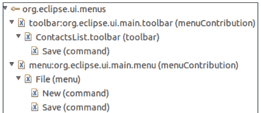

新建和保存命令分别指向 contactsList.new 和 contactsList.save 命令 ID。

如果此时运行应用程序，你会发现工具栏中的保存按钮不存在。事实上，我们的应用程序中根本没有工具栏！这是因为模板提供的 ApplicationWorkbenchWindowAdvisor 扩展的实现禁用了工具栏。打开此类，并在 preWindowOpen 方法内部注释掉 configurer.setShowCoolBar(false) 调用，或将参数更改为 true 以显示工具栏。

## 连接两个视图

现在我们有了两个视图和菜单项，下一步是通过在用户在列表中双击条目时打开编辑器来连接这两个视图。我们将通过向 ContactList 视图添加双击监听器来实现这一点。让我们开始编写监听器。创建一个名为 ContactListDoubleClickListener 的类，代码如下：

```
public class ContactListDoubleClickListener implements
    IDoubleClickListener {

    @Override
    public void doubleClick(DoubleClickEvent event) {
        TableViewer viewer = (TableViewer) event.getSource();
        StructuredSelection selection = (StructuredSelection) viewer.getSelection();
        Contact contact = (Contact) selection.getFirstElement();
        try {
            PlatformUI.getWorkbench().getActiveWorkbenchWindow().getActivePage().openEditor(new ContactEditorInput(contact), "ContactsList.ContactEditor");
        } catch (PartInitException e) {
            e.printStackTrace();
        }
    }
}
```

当 IDoubleClickListener 实现注册到 SWT 小部件时，其 doubleClick 方法会在小部件被双击时执行。我们的 doubleClick 实现获取 TableViewer 小部件并发现选择了哪个元素。这也是使用内容提供程序的另一个优点；它们允许你轻松访问 TableViewer 条目所引用的对象。


现在我们已经有了双击监听器，通过修改 ContactListView 的 createControl 方法并添加以下行，将其添加到联系人的 TableViewer 小部件中：

```
contactsViewer.addDoubleClickListener(new
ContactListDoubleClickListener());
```

为了进一步集成联系人视图窗口和编辑器，我们必须在每次编辑器保存时强制刷新联系人条目，以便反映联系人姓名可能的更改。为此，ContactsList 视图将监听编辑器在每次保存时触发的特定事件。让我们先在 ContactEditor 类中添加一个名为 contactListView 的私有 IViewPart 字段来保存联系人视图的实例。添加以下行到 ContactEditor 的 createPartControl() 方法中以获取实例：

```
contactListView = PlatformUI.getWorkbench().
getActiveWorkbenchWindow().getActivePage().findView("ContactsList.ContactsListView");
```

现在将以下代码添加到 doSave() 方法的末尾，以通知联系人列表实例编辑器已保存：

```
if(contactListView != null){
    if (contactListView instanceof IPropertyChangeListener){
        PropertyChangeEvent changeDirty = new PropertyChangeEvent(this,
"isDirty", true, false);
        ((IPropertyChangeListener)contactListView).
propertyChange(changeDirty);
    }
}
```

现在我们要做的就是更改 ContactListView 类以实现 IPropertyChangeListener 接口并添加一个 propertyChange() 方法，以便在编辑器保存时相应地执行。使用以下代码实现 propertyChange 方法：

```
@Override
public void propertyChange(PropertyChangeEvent event) {
    refreshEntries();
}
```

## 运行应用程序

我们现在已经为这个简单应用程序提出了所有内容。让我们通过运行它来看看它是什么样子的。你应该会看到一个如下所示的窗口：

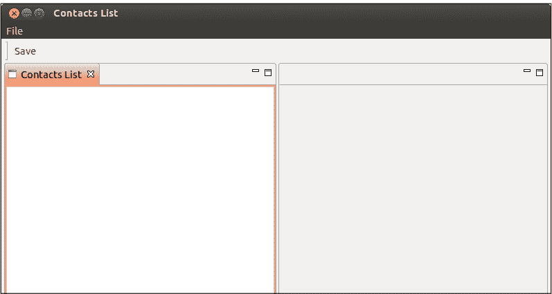

导航到应用程序主菜单中的 File | New 以创建新的联系人。编辑器将打开。以下截图显示了编辑器：

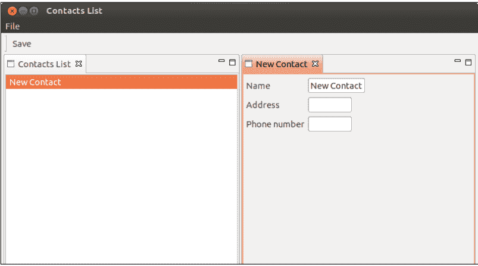

## 打包和品牌化 Eclipse RCP 应用程序

我们的联系人列表应用程序已经运行，但到目前为止我们只能从开发环境中运行它。在本节中，我们将了解如何将我们的应用程序转变为可分发给用户的自包含产品。

为了实现这一点，我们需要创建一个产品配置文件，描述我们的产品将如何打包以及包含什么内容。幸运的是，就像其他插件开发配置文件一样，Eclipse 为产品配置文件提供了一个向导和一个专用编辑器。要使用向导创建文件，请在 Package Explorer 视图中右键单击你的 RCP 应用程序项目，并导航到 New | Product Configuration。确保你正在使用 Plug-in Development 透视图，以便看到这些选项。在向导窗口中，输入 contactlist.product 作为产品配置文件名。向导允许你使用现有产品或启动配置作为产品的基配置。因为我们已经在开发环境中启动了产品，所以我们已经有一个符合基本需求的启动配置。选择 Use a launch configuration 并选择 ContactsList 配置。单击 Finish 后，产品配置编辑器将打开，如以下截图所示：

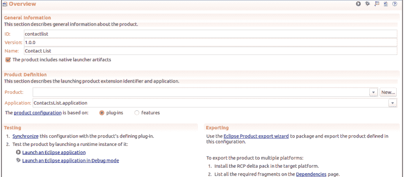

用与上一张截图中显示的相同值填充 General Information 部分。在 Product Definition 部分，让我们通过单击 New 按钮创建一个新产品。单击 Browse 选择 ContactList 作为产品的定义插件。保留 Product 作为产品 ID。在 Application 中，选择 ContactList.application。单击 Finish。我们在产品中没有使用功能，所以将产品配置保留为 plug-ins。

切换到产品配置编辑器的 **Dependencies** 选项卡。列表中应该已经包含了一些插件；其中包括 `ContactsList`。此信息来自我们指向向导的启动配置。你可以检查列表并在必要时添加/删除插件。让我们保留来自启动配置的那些。

这应该足以让我们生成一个包含联系人列表应用程序的捆绑包。保存产品配置编辑器，在 **Package Explorer** 窗口中右键单击 `ContactsList` 项目，并选择 **Export**。在 **Export** 向导的 **Plug-in Development** 类别下，选择 **Eclipse product** 并单击 **Next**。

在下一页中，将我们刚刚创建的 `contactlist.product` 配置文件指向 **Configuration** 字段。**Root directory** 字段决定了将包含我们产品的[content]
现在我们已经有了双击监听器，通过修改 ContactListView 的 createControl 方法并添加以下行，将其添加到联系人的 TableViewer 小部件中：

```
contactsViewer.addDoubleClickListener(new
ContactListDoubleClickListener());
```

为了进一步集成联系人视图窗口和编辑器，我们必须在每次编辑器保存时强制刷新联系人的条目，以便反映联系人姓名可能的更改。为此，ContactsList 视图将监听编辑器在每次保存时触发的特定事件。让我们先在 ContactEditor 类中添加一个名为 contactListView 的私有 IViewPart 字段来保存联系人视图的实例。添加以下行到 ContactEditor 的 createPartControl() 方法中以获取实例：

```
contactListView = PlatformUI.getWorkbench().
getActiveWorkbenchWindow().getActivePage().findView("ContactsList.ContactsListView");
```

现在将以下代码添加到 doSave() 方法的末尾，以通知联系人列表实例编辑器已保存：

```
if(contactListView != null){
    if (contactListView instanceof IPropertyChangeListener){
        PropertyChangeEvent changeDirty = new PropertyChangeEvent(this,
"isDirty", true, false);
        ((IPropertyChangeListener)contactListView).
propertyChange(changeDirty);
    }
}
```

现在我们要做的就是更改 ContactListView 类以实现 IPropertyChangeListener 接口并添加一个 propertyChange() 方法，以便在编辑器保存时相应地执行。使用以下代码实现 propertyChange 方法：

```
@Override
public void propertyChange(PropertyChangeEvent event) {
    refreshEntries();
}
```

## 运行应用程序

我们现在已经为这个简单应用程序提出了所有内容。让我们通过运行它来看看它是什么样子的。你应该会看到一个如下所示的窗口：


导航到应用程序主菜单中的 File | New 以创建新的联系人。编辑器将打开。以下截图显示了编辑器：


## 打包和品牌化 Eclipse RCP 应用程序

我们的联系人列表应用程序已经运行，但到目前为止我们只能从开发环境中运行它。在本节中，我们将了解如何将我们的应用程序转变为可分发给用户的自包含产品。

为了实现这一点，我们需要创建一个产品配置文件，描述我们的产品将如何打包以及包含什么内容。幸运的是，就像其他插件开发配置文件一样，Eclipse 为产品配置文件提供了一个向导和一个专用编辑器。要使用向导创建文件，请在 Package Explorer 视图中右键单击你的 RCP 应用程序项目，并导航到 New | Product Configuration。确保你正在使用 Plug-in Development 透视图，以便看到这些选项。在向导窗口中，输入 contactlist.product 作为产品配置文件名。向导允许你使用现有产品或启动配置作为产品的基配置。因为我们已经在开发环境中启动了产品，所以我们已经有一个符合基本需求的启动配置。选择 Use a launch configuration 并选择 ContactsList 配置。单击 Finish 后，产品配置编辑器将打开，如以下截图所示：


用与上一张截图中显示的相同值填充 General Information 部分。在 Product Definition 部分，让我们通过单击 New 按钮创建一个新产品。单击 Browse 选择 ContactList 作为产品的定义插件。保留 Product 作为产品 ID。在 Application 中，选择 ContactList.application。单击 Finish。我们在产品中没有使用功能，所以将产品配置保留为 plug-ins。

切换到产品配置编辑器的 **Dependencies** 选项卡。列表中应该已经包含了一些插件；其中包括 `ContactsList`。此信息来自我们指向向导的启动配置。你可以检查列表并在必要时添加/删除插件。让我们保留来自启动配置的那些。

这应该足以让我们生成一个包含联系人列表应用程序的捆绑包。保存产品配置编辑器，在 **Package Explorer** 窗口中右键单击 `ContactsList` 项目，并选择 **Export**。在 **Export** 向导的 **Plug-in Development** 类别下，选择 **Eclipse product** 并单击 **Next**。

在下一页中，将我们刚刚创建的 `contactlist.product` 配置文件指向 **Configuration** 字段。**Root directory** 字段决定了将包含我们产品的[content]
现在我们已经有了双击监听器，通过修改 ContactListView 的 createControl 方法并添加以下行，将其添加到联系人的 TableViewer 小部件中：

```
contactsViewer.addDoubleClickListener(new
ContactListDoubleClickListener());
```

为了进一步集成联系人视图窗口和编辑器，我们必须在每次编辑器保存时强制刷新联系人的条目，以便反映联系人姓名可能的更改。为此，ContactsList 视图将监听编辑器在每次保存时触发的特定事件。让我们先在 ContactEditor 类中添加一个名为 contactListView 的私有 IViewPart 字段来保存联系人视图的实例。添加以下行到 ContactEditor 的 createPartControl() 方法中以获取实例：

```
contactListView = PlatformUI.getWorkbench().
getActiveWorkbenchWindow().getActivePage().findView("ContactsList.ContactsListView");
```

现在将以下代码添加到 doSave() 方法的末尾，以通知联系人列表实例编辑器已保存：

```
if(contactListView != null){
    if (contactListView instanceof IPropertyChangeListener){
        PropertyChangeEvent changeDirty = new PropertyChangeEvent(this,
"isDirty", true, false);
        ((IPropertyChangeListener)contactListView).
propertyChange(changeDirty);
    }
}
```

现在我们要做的就是更改 ContactListView 类以实现 IPropertyChangeListener 接口并添加一个 propertyChange() 方法，以便在编辑器保存时相应地执行。使用以下代码实现 propertyChange 方法：

```
@Override
public void propertyChange(PropertyChangeEvent event) {
    refreshEntries();
}
```

## 运行应用程序

我们现在已经为这个简单应用程序提出了所有内容。让我们通过运行它来看看它是什么样子的。你应该会看到一个如下所示的窗口：


导航到应用程序主菜单中的 File | New 以创建新的联系人。编辑器将打开。以下截图显示了编辑器：


## 打包和品牌化 Eclipse RCP 应用程序

我们的联系人列表应用程序已经运行，但到目前为止我们只能从开发环境中运行它。在本节中，我们将了解如何将我们的应用程序转变为可分发给用户的自包含产品。

为了实现这一点，我们需要创建一个产品配置文件，描述我们的产品将如何打包以及包含什么内容。幸运的是，就像其他插件开发配置文件一样，Eclipse 为产品配置文件提供了一个向导和一个专用编辑器。要使用向导创建文件，请在 Package Explorer 视图中右键单击你的 RCP 应用程序项目，并导航到 New | Product Configuration。确保你正在使用 Plug-in Development 透视图，以便看到这些选项。在向导窗口中，输入 contactlist.product 作为产品配置文件名。向导允许你使用现有产品或启动配置作为产品的基配置。因为我们已经在开发环境中启动了产品，所以我们已经有一个符合基本需求的启动配置。选择 Use a launch configuration 并选择 ContactsList 配置。单击 Finish 后，产品配置编辑器将打开，如以下截图所示：


用与上一张截图中显示的相同值填充 General Information 部分。在 Product Definition 部分，让我们通过单击 New 按钮创建一个新产品。单击 Browse 选择 ContactList 作为产品的定义插件。保留 Product 作为产品 ID。在 Application 中，选择 ContactList.application。单击 Finish。我们在产品中没有使用功能，所以将产品配置保留为 plug-ins。

切换到产品配置编辑器的 **Dependencies** 选项卡。列表中应该已经包含了一些插件；其中包括 `ContactsList`。此信息来自我们指向向导的启动配置。你可以检查列表并在必要时添加/删除插件。让我们保留来自启动配置的那些。

这应该足以让我们生成一个包含联系人列表应用程序的捆绑包。保存产品配置编辑器，在 **Package Explorer** 窗口中右键单击 `ContactsList` 项目，并选择 **Export**。在 **Export** 向导的 **Plug-in Development** 类别下，选择 **Eclipse product** 并单击 **Next**。

在下一页中，将我们刚刚创建的 `contactlist.product` 配置文件指向 **Configuration** 字段。**Root directory** 字段决定了将包含我们产品的[content]
现在我们已经有了双击监听器，通过修改 ContactListView 的 createControl 方法并添加以下行，将其添加到联系人的 TableViewer 小部件中：

```
contactsViewer.addDoubleClickListener(new
ContactListDoubleClickListener());
```

为了进一步集成联系人视图窗口和编辑器，我们必须在每次编辑器保存时强制刷新联系人的条目，以便反映联系人姓名可能的更改。为此，ContactsList 视图将监听编辑器在每次保存时触发的特定事件。让我们先在 ContactEditor 类中添加一个名为 contactListView 的私有 IViewPart 字段来保存联系人视图的实例。添加以下行到 ContactEditor 的 createPartControl() 方法中以获取实例：

```
contactListView = PlatformUI.getWorkbench().
getActiveWorkbenchWindow().getActivePage().findView("ContactsList.ContactsListView");
```

现在将以下代码添加到 doSave() 方法的末尾，以通知联系人列表实例编辑器已保存：

```
if(contactListView != null){
    if (contactListView instanceof IPropertyChangeListener){
        PropertyChangeEvent changeDirty = new PropertyChangeEvent(this,
"isDirty", true, false);
        ((IPropertyChangeListener)contactListView).
propertyChange(changeDirty);
    }
}
```

现在我们要做的就是更改 ContactListView 类以实现 IPropertyChangeListener 接口并添加一个 propertyChange() 方法，以便在编辑器保存时相应地执行。使用以下代码实现 propertyChange 方法：

```
@Override
public void propertyChange(PropertyChangeEvent event) {
    refreshEntries();
}
```

## 运行应用程序

我们现在已经为这个简单应用程序提出了所有内容。让我们通过运行它来看看它是什么样子的。你应该会看到一个如下所示的窗口：


导航到应用程序主菜单中的 File | New 以创建新的联系人。编辑器将打开。以下截图显示了编辑器：


## 打包和品牌化 Eclipse RCP 应用程序

我们的联系人列表应用程序已经运行，但到目前为止我们只能从开发环境中运行它。在本节中，我们将了解如何将我们的应用程序转变为可分发给用户的自包含产品。

为了实现这一点，我们需要创建一个产品配置文件，描述我们的产品将如何打包以及包含什么内容。幸运的是，就像其他插件开发配置文件一样，Eclipse 为产品配置文件提供了一个向导和一个专用编辑器。要使用向导创建文件，请在 Package Explorer 视图中右键单击你的 RCP 应用程序项目，并导航到 New | Product Configuration。确保你正在使用 Plug-in Development 透视图，以便看到这些选项。在向导窗口中，输入 contactlist.product 作为产品配置文件名。向导允许你使用现有产品或启动配置作为产品的基配置。因为我们已经在开发环境中启动了产品，所以我们已经有一个符合基本需求的启动配置。选择 Use a launch configuration 并选择 ContactsList 配置。单击 Finish 后，产品配置编辑器将打开，如以下截图所示：


用与上一张截图中显示的相同值填充 General Information 部分。在 Product Definition 部分，让我们通过单击 New 按钮创建一个新产品。单击 Browse 选择 ContactList 作为产品的定义插件。保留 Product 作为产品 ID。在 Application 中，选择 ContactList.application。单击 Finish。我们在产品中没有使用功能，所以将产品配置保留为 plug-ins。

切换到产品配置编辑器的 **Dependencies** 选项卡。列表中应该已经包含了一些插件；其中包括 `ContactsList`。此信息来自我们指向向导的启动配置。你可以检查列表并在必要时添加/删除插件。让我们保留来自启动配置的那些。

这应该足以让我们生成一个包含联系人列表应用程序的捆绑包。保存产品配置编辑器，在 **Package Explorer** 窗口中右键单击 `ContactsList` 项目，并选择 **Export**。在 **Export** 向导的 **Plug-in Development** 类别下，选择 **Eclipse product** 并单击 **Next**。

在下一页中，将我们刚刚创建的 `contactlist.product` 配置文件指向 **Configuration** 字段。**Root directory** 字段决定了将包含我们产品的[content]
现在我们已经有了双击监听器，通过修改 ContactListView 的 createControl 方法并添加以下行，将其添加到联系人的 TableViewer 小部件中：

```
contactsViewer.addDoubleClickListener(new
ContactListDoubleClickListener());
```

为了进一步集成联系人视图窗口和编辑器，我们必须在每次编辑器保存时强制刷新联系人的条目，以便反映联系人姓名可能的更改。为此，ContactsList 视图将监听编辑器在每次保存时触发的特定事件。让我们先在 ContactEditor 类中添加一个名为 contactListView 的私有 IViewPart 字段来保存联系人视图的实例。添加以下行到 ContactEditor 的 createPartControl() 方法中以获取实例：

```
contactListView = PlatformUI.getWorkbench().
getActiveWorkbenchWindow().getActivePage().findView("ContactsList.ContactsListView");
```

现在将以下代码添加到 doSave() 方法的末尾，以通知联系人列表实例编辑器已保存：

```
if(contactListView != null){
    if (contactListView instanceof IPropertyChangeListener){
        PropertyChangeEvent changeDirty = new PropertyChangeEvent(this,
"isDirty", true, false);
        ((IPropertyChangeListener)contactListView).
propertyChange(changeDirty);
    }
}
```

现在我们要做的就是更改 ContactListView 类以实现 IPropertyChangeListener 接口并添加一个 propertyChange() 方法，以便在编辑器保存时相应地执行。使用以下代码实现 propertyChange 方法：

```
@Override
public void propertyChange(PropertyChangeEvent event) {
    refreshEntries();
}
```

## 运行应用程序

我们现在已经为这个简单应用程序提出了所有内容。让我们通过运行它来看看它是什么样子的。你应该会看到一个如下所示的窗口：


导航到应用程序主菜单中的 File | New 以创建新的联系人。编辑器将打开。以下截图显示了编辑器：


## 打包和品牌化 Eclipse RCP 应用程序

我们的联系人列表应用程序已经运行，但到目前为止我们只能从开发环境中运行它。在本节中，我们将了解如何将我们的应用程序转变为可分发给用户的自包含产品。

为了实现这一点，我们需要创建一个产品配置文件，描述我们的产品将如何打包以及包含什么内容。幸运的是，就像其他插件开发配置文件一样，Eclipse 为产品配置文件提供了一个向导和一个专用编辑器。要使用向导创建文件，请在 Package Explorer 视图中右键单击你的 RCP 应用程序项目，并导航到 New | Product Configuration。确保你正在使用 Plug-in Development 透视图，以便看到这些选项。在向导窗口中，输入 contactlist.product 作为产品配置文件名。向导允许你使用现有产品或启动配置作为产品的基配置。因为我们已经在开发环境中启动了产品，所以我们已经有一个符合基本需求的启动配置。选择 Use a launch configuration 并选择 ContactsList 配置。单击 Finish 后，产品配置编辑器将打开，如以下截图所示：


用与上一张截图中显示的相同值填充 General Information 部分。在 Product Definition 部分，让我们通过单击 New 按钮创建一个新产品。单击 Browse 选择 ContactList 作为产品的定义插件。保留 Product 作为产品 ID。在 Application 中，选择 ContactList.application。单击 Finish。我们在产品中没有使用功能，所以将产品配置保留为 plug-ins。

切换到产品配置编辑器的 **Dependencies** 选项卡。列表中应该已经包含了一些插件；其中包括 `ContactsList`。此信息来自我们指向向导的启动配置。你可以检查列表并在必要时添加/删除插件。让我们保留来自启动配置的那些。

这应该足以让我们生成一个包含联系人列表应用程序的捆绑包。保存产品配置编辑器，在 **Package Explorer** 窗口中右键单击 `ContactsList` 项目，并选择 **Export**。在 **Export** 向导的 **Plug-in Development** 类别下，选择 **Eclipse product** 并单击 **Next**。

在下一页中，将我们刚刚创建的 `contactlist.product` 配置文件指向 **Configuration** 字段。**Root directory** 字段决定了将包含我们产品的[content]
现在我们已经有了双击监听器，通过修改 ContactListView 的 createControl 方法并添加以下行，将其添加到联系人的 TableViewer 小部件中：

```
contactsViewer.addDoubleClickListener(new
ContactListDoubleClickListener());
```

为了进一步集成联系人视图窗口和编辑器，我们必须在每次编辑器保存时强制刷新联系人的条目，以便反映联系人姓名可能的更改。为此，ContactsList 视图将监听编辑器在每次保存时触发的特定事件。让我们先在 ContactEditor 类中添加一个名为 contactListView 的私有 IViewPart 字段来保存联系人视图的实例。添加以下行到 ContactEditor 的 createPartControl() 方法中以获取实例：

```
contactListView = PlatformUI.getWorkbench().
getActiveWorkbenchWindow().getActivePage().findView("ContactsList.ContactsListView");
```

现在将以下代码添加到 doSave() 方法的末尾，以通知联系人列表实例编辑器已保存：

```
if(contactListView != null){
    if (contactListView instanceof IPropertyChangeListener){
        PropertyChangeEvent changeDirty = new PropertyChangeEvent(this,
"isDirty", true, false);
        ((IPropertyChangeListener)contactListView).
propertyChange(changeDirty);
    }
}
```

现在我们要做的就是更改 ContactListView 类以实现 IPropertyChangeListener 接口并添加一个 propertyChange() 方法，以便在编辑器保存时相应地执行。使用以下代码实现 propertyChange 方法：

```
@Override
public void propertyChange(PropertyChangeEvent event) {
    refreshEntries();
}
```

## 运行应用程序

我们现在已经为这个简单应用程序提出了所有内容。让我们通过运行它来看看它是什么样子的。你应该会看到一个如下所示的窗口：


导航到应用程序主菜单中的 File | New 以创建新的联系人。编辑器将打开。以下截图显示了编辑器：


## 打包和品牌化 Eclipse RCP 应用程序

我们的联系人列表应用程序已经运行，但到目前为止我们只能从开发环境中运行它。在本节中，我们将了解如何将我们的应用程序转变为可分发给用户的自包含产品。

为了实现这一点，我们需要创建一个产品配置文件，描述我们的产品将如何打包以及包含什么内容。幸运的是，就像其他插件开发配置文件一样，Eclipse 为产品配置文件提供了一个向导和一个专用编辑器。要使用向导创建文件，请在 Package Explorer 视图中右键单击你的 RCP 应用程序项目，并导航到 New | Product Configuration。确保你正在使用 Plug-in Development 透视图，以便看到这些选项。在向导窗口中，输入 contactlist.product 作为产品配置文件名。向导允许你使用现有产品或启动配置作为产品的基配置。因为我们已经在开发环境中启动了产品，所以我们已经有一个符合基本需求的启动配置。选择 Use a launch configuration 并选择 ContactsList 配置。单击 Finish 后，产品配置编辑器将打开，如以下截图所示：


用与上一张截图中显示的相同值填充 General Information 部分。在 Product Definition 部分，让我们通过单击 New 按钮创建一个新产品。单击 Browse 选择 ContactList 作为产品的定义插件。保留 Product 作为产品 ID。在 Application 中，选择 ContactList.application。单击 Finish。我们在产品中没有使用功能，所以将产品配置保留为 plug-ins。

切换到产品配置编辑器的 **Dependencies** 选项卡。列表中应该已经包含了一些插件；其中包括 `ContactsList`。此信息来自我们指向向导的启动配置。你可以检查列表并在必要时添加/删除插件。让我们保留来自启动配置的那些。

这应该足以让我们生成一个包含联系人列表应用程序的捆绑包。保存产品配置编辑器，在 **Package Explorer** 窗口中右键单击 `ContactsList` 项目，并选择 **Export**。在 **Export** 向导的 **Plug-in Development** 类别下，选择 **Eclipse product** 并单击 **Next**。

在下一页中，将我们刚刚创建的 `contactlist.product` 配置文件指向 **Configuration** 字段。**Root directory** 字段决定了将包含我们产品的[content]
现在我们已经有了双击监听器，通过修改 ContactListView 的 createControl 方法并添加以下行，将其添加到联系人的 TableViewer 小部件中：

```
contactsViewer.addDoubleClickListener(new
ContactListDoubleClickListener());
```

为了进一步集成联系人视图窗口和编辑器，我们必须在每次编辑器保存时强制刷新联系人的条目，以便反映联系人姓名可能的更改。为此，ContactsList 视图将监听编辑器在每次保存时触发的特定事件。让我们先在 ContactEditor 类中添加一个名为 contactListView 的私有 IViewPart 字段来保存联系人视图的实例。添加以下行到 ContactEditor 的 createPartControl() 方法中以获取实例：

```
contactListView = PlatformUI.getWorkbench().
getActiveWorkbenchWindow().getActivePage().findView("ContactsList.ContactsListView");
```

现在将以下代码添加到 doSave() 方法的末尾，以通知联系人列表实例编辑器已保存：

```
if(contactListView != null){
    if (contactListView instanceof IPropertyChangeListener){
        PropertyChangeEvent changeDirty = new PropertyChangeEvent(this,
"isDirty", true, false);
        ((IPropertyChangeListener)contactListView).
propertyChange(changeDirty);
    }
}
```

现在我们要做的就是更改 ContactListView 类以实现 IPropertyChangeListener 接口并添加一个 propertyChange() 方法，以便在编辑器保存时相应地执行。使用以下代码实现 propertyChange 方法：

```
@Override
public void propertyChange(PropertyChangeEvent event) {
    refreshEntries();
}
```

## 运行应用程序

我们现在已经为这个简单应用程序提出了所有内容。让我们通过运行它来看看它是什么样子的。你应该会看到一个如下所示的窗口：


导航到应用程序主菜单中的 File | New 以创建新的联系人。编辑器将打开。以下截图显示了编辑器：


## 打包和品牌化 Eclipse RCP 应用程序

我们的联系人列表应用程序已经运行，但到目前为止我们只能从开发环境中运行它。在本节中，我们将了解如何将我们的应用程序转变为可分发给用户的自包含产品。

为了实现这一点，我们需要创建一个产品配置文件，描述我们的产品将如何打包以及包含什么内容。幸运的是，就像其他插件开发配置文件一样，Eclipse 为产品配置文件提供了一个向导和一个专用编辑器。要使用向导创建文件，请在 Package Explorer 视图中右键单击你的 RCP 应用程序项目，并导航到 New | Product Configuration。确保你正在使用 Plug-in Development 透视图，以便看到这些选项。在向导窗口中，输入 contactlist.product 作为产品配置文件名。向导允许你使用现有产品或启动配置作为产品的基配置。因为我们已经在开发环境中启动了产品，所以我们已经有一个符合基本需求的启动配置。选择 Use a launch configuration 并选择 ContactsList 配置。单击 Finish 后，产品配置编辑器将打开，如以下截图所示：


用与上一张截图中显示的相同值填充 General Information 部分。在 Product Definition 部分，让我们通过单击 New 按钮创建一个新产品。单击 Browse 选择 ContactList 作为产品的定义插件。保留 Product 作为产品 ID。在 Application 中，选择 ContactList.application。单击 Finish。我们在产品中没有使用功能，所以将产品配置保留为 plug-ins。

切换到产品配置编辑器的 **Dependencies** 选项卡。列表中应该已经包含了一些插件；其中包括 `ContactsList`。此信息来自我们指向向导的启动配置。你可以检查列表并在必要时添加/删除插件。让我们保留来自启动配置的那些。

这应该足以让我们生成一个包含联系人列表应用程序的捆绑包。保存产品配置编辑器，在 **Package Explorer** 窗口中右键单击 `ContactsList` 项目，并选择 **Export**。在 **Export** 向导的 **Plug-in Development** 类别下，选择 **Eclipse product** 并单击 **Next**。

在下一页中，将我们刚刚创建的 `contactlist.product` 配置文件指向 **Configuration** 字段。**Root directory** 字段决定了将包含我们产品的[content]
现在我们已有双击监听器，通过修改 ContactListView 的 createControl 方法并添加以下行，将其添加到联系人的 TableViewer 小部件：

```
contactsViewer.addDoubleClickListener(new
ContactListDoubleClickListener());
```

为进一步集成联系人视图窗口和编辑器，我们必须在每次编辑器保存时强制刷新联系人条目，以反映联系人姓名的可能变化。为此，ContactsList 视图将监听编辑器在每次保存时触发的特定事件。先在 ContactEditor 类中添加一个私有 IViewPart 字段 contactListView 来保存联系人视图实例。向 ContactEditor 的 createPartControl() 方法添加以下行以获取实例：

```
contactListView = PlatformUI.getWorkbench().
getActiveWorkbenchWindow().getActivePage().findView("ContactsList.ContactsListView");
```

现在将以下代码添加到 doSave() 方法末尾，以通知联系人列表实例编辑器已保存：

```
if(contactListView != null){
    if (contactListView instanceof IPropertyChangeListener){
        PropertyChangeEvent changeDirty = new PropertyChangeEvent(this,
"isDirty", true, false);
        ((IPropertyChangeListener)contactListView).
propertyChange(changeDirty);
    }
}
```

现在只需将 ContactListView 类改为实现 IPropertyChangeListener 接口并添加 propertyChange() 方法，使其在编辑器保存时相应执行。用以下代码实现 propertyChange 方法：

```
@Override
public void propertyChange(PropertyChangeEvent event) {
    refreshEntries();
}
```

## 运行应用程序

我们已为此简单应用程序准备好所有内容。运行它看看效果。你应得到如下窗口：


在应用程序主菜单中导航到 File | New 创建新联系人。编辑器将打开。以下截图显示编辑器：


## 打包和品牌化 Eclipse RCP 应用程序

联系人列表应用程序已运行，但目前只能在开发环境中运行。本节将介绍如何将其转变为可分发给用户的自包含产品。

为此，需创建产品配置文件，描述产品打包方式和内容。Eclipse 为产品配置文件提供了向导和专用编辑器。要用向导创建文件，在 Package Explorer 视图中右键单击 RCP 应用程序项目，导航到 New | Product Configuration。确保使用 Plug-in Development 透视图以看到这些选项。在向导窗口中输入 contactlist.product 作为产品配置文件名。向导允许使用现有产品或启动配置作为基配置。因我们已在开发环境中启动产品，已有符合基本需求的启动配置。选择 Use a launch configuration 并选择 ContactsList 配置。单击 Finish 后，产品配置编辑器将打开，如下图所示：


用上一截图中显示的相同值填充 General Information 部分。在 Product Definition 部分，单击 New 按钮创建新产品。单击 Browse 选择 ContactList 作为产品的定义插件。保留 Product 作为产品 ID。在 Application 中选择 ContactList.application。单击 Finish。我们未在产品中使用功能，保持 plug-ins 作为产品配置。

切换到产品配置编辑器的 **Dependencies** 选项卡。列表中已包含若干插件，其中包括 `ContactsList`。此信息来自指向向导的启动配置。可检查列表并在必要时添加/删除插件。保留来自启动配置的那些即可。

这足以生成包含联系人列表应用程序的捆绑包。保存产品配置编辑器，在 **Package Explorer** 窗口中右键单击 `ContactsList` 项目，选择 **Export**。在 **Export** 向导的 **Plug-in Development** 类别下，选择 **Eclipse product** 并单击 **Next**。

在下一页，将刚创建的 `contactlist.product` 配置文件指向 **Configuration** 字段。**Root directory** 字段决定包含产品的[content]
现在已有双击监听器，通过修改 ContactListView 的 createControl 方法并添加以下行，将其添加到联系人 TableViewer 小部件：

```
contactsViewer.addDoubleClickListener(new
ContactListDoubleClickListener());
```

为进一步集成联系人视图窗口和编辑器，需在每次编辑器保存时强制刷新联系人条目，以反映姓名可能变化。ContactsList 视图将监听编辑器保存时触发的特定事件。先在 ContactEditor 类添加私有 IViewPart 字段 contactListView 保存联系人视图实例。向 ContactEditor 的 createPartControl() 方法添加以下行获取实例：

```
contactListView = PlatformUI.getWorkbench().
getActiveWorkbenchWindow().getActivePage().findView("ContactsList.ContactsListView");
```

将以下代码添加到 doSave() 方法末尾，通知联系人列表实例编辑器已保存：

```
if(contactListView != null){
    if (contactListView instanceof IPropertyChangeListener){
        PropertyChangeEvent changeDirty = new PropertyChangeEvent(this,
"isDirty", true, false);
        ((IPropertyChangeListener)contactListView).
propertyChange(changeDirty);
    }
}
```

现在只需让 ContactListView 实现 IPropertyChangeListener 接口并添加 propertyChange() 方法，使其在编辑器保存时相应执行。用以下代码实现：

```
@Override
public void propertyChange(PropertyChangeEvent event) {
    refreshEntries();
}
```

## 运行应用程序

我们已为此简单应用准备好所有内容。运行它看看效果。你应得到如下窗口：


在主菜单中导航到 File | New 创建新联系人。编辑器将打开。以下截图显示编辑器：


## 打包和品牌化 Eclipse RCP 应用程序

联系人列表应用已运行，但目前只能在开发环境中运行。本节介绍如何将其转为可分发给用户的自包含产品。

为此需创建产品配置文件，描述产品打包方式和内容。Eclipse 为产品配置文件提供向导和专用编辑器。在 Package Explorer 视图中右键单击 RCP 应用项目，导航到 New | Product Configuration。确保使用 Plug-in Development 透视图。在向导窗口输入 contactlist.product 作为文件名。向导允许使用现有产品或启动配置作为基配置。因已在开发环境中启动产品，已有符合需求的启动配置。选择 Use a launch configuration 并选择 ContactsList 配置。单击 Finish 后产品配置编辑器打开，如下图：


用上一图相同值填充 General Information 部分。在 Product Definition 部分单击 New 创建新产品。单击 Browse 选择 ContactList 作为定义插件。保留 Product 作为产品 ID。在 Application 中选择 ContactList.application。单击 Finish。未使用功能，保持 plug-ins 作为产品配置。

切换到产品配置编辑器的 **Dependencies** 选项卡。列表已包含若干插件，其中包括 `ContactsList`。信息来自指向向导的启动配置。可检查并增删插件。保留启动配置中的即可。

这足以生成包含联系人列表应用的捆绑包。保存编辑器，在 **Package Explorer** 窗口右键单击 `ContactsList` 项目，选择 **Export**。在 **Export** 向导的 **Plug-in Development** 类别下选择 **Eclipse product** 并单击 **Next**。

在下一页将刚创建的 `contactlist.product` 指向 **Configuration** 字段。**Root directory** 字段决定包含产品的[content]
现在已有双击监听器，通过修改 ContactListView 的 createControl 方法并添加以下行，将其添加到联系人 TableViewer 小部件：

```
contactsViewer.addDoubleClickListener(new
ContactListDoubleClickListener());
```

为进一步集成联系人视图窗口和编辑器，需在每次编辑器保存时强制刷新联系人条目，以反映姓名可能变化。ContactsList 视图将监听编辑器保存时触发的特定事件。先在 ContactEditor 类添加私有 IViewPart 字段 contactListView 保存联系人视图实例。向 ContactEditor 的 createPartControl() 方法添加以下行获取实例：

```
contactListView = PlatformUI.getWorkbench().
getActiveWorkbenchWindow().getActivePage().findView("ContactsList.ContactsListView");
```

将以下代码添加到 doSave() 方法末尾，通知联系人列表实例编辑器已保存：

```
if(contactListView != null){
    if (contactListView instanceof IPropertyChangeListener){
        PropertyChangeEvent changeDirty = new PropertyChangeEvent(this,
"isDirty", true, false);
        ((IPropertyChangeListener)contactListView).
propertyChange(changeDirty);
    }
}
```

现在只需让 ContactListView 实现 IPropertyChangeListener 接口并添加 propertyChange() 方法，使其在编辑器保存时相应执行。用以下代码实现：

```
@Override
public void propertyChange(PropertyChangeEvent event) {
    refreshEntries();
}
```

## 运行应用程序

我们已为此简单应用准备好所有内容。运行它看看效果。你应得到如下窗口：


在主菜单中导航到 File | New 创建新联系人。编辑器将打开。以下截图显示编辑器：


## 打包和品牌化 Eclipse RCP 应用程序

联系人列表应用已运行，但目前只能在开发环境中运行。本节介绍如何将其转为可分发给用户的自包含产品。

为此需创建产品配置文件，描述产品打包方式和内容。Eclipse 为产品配置文件提供向导和专用编辑器。在 Package Explorer 视图中右键单击 RCP 应用项目，导航到 New | Product Configuration。确保使用 Plug-in Development 透视图。在向导窗口输入 contactlist.product 作为文件名。向导允许使用现有产品或启动配置作为基配置。因已在开发环境中启动产品，已有符合需求的启动配置。选择 Use a launch configuration 并选择 ContactsList 配置。单击 Finish 后产品配置编辑器打开，如下图：


用上一图相同值填充 General Information 部分。在 Product Definition 部分单击 New 创建新产品。单击 Browse 选择 ContactList 作为定义插件。保留 Product 作为产品 ID。在 Application 中选择 ContactList.application。单击 Finish。未使用功能，保持 plug-ins 作为产品配置。

切换到产品配置编辑器的 **Dependencies** 选项卡。列表已包含若干插件，其中包括 `ContactsList`。信息来自指向向导的启动配置。可检查并增删插件。保留启动配置中的即可。

这足以生成包含联系人列表应用的捆绑包。保存编辑器，在 **Package Explorer** 窗口右键单击 `ContactsList` 项目，选择 **Export**。在 **Export** 向导的 **Plug-in Development** 类别下选择 **Eclipse product** 并单击 **Next**。

在下一页将刚创建的 `contactlist.product` 指向 **Configuration** 字段。**Root directory** 字段决定产品文件夹名称。因要生成单文件，在 **Destination** 字段选择 **Archive file** 并指定有效文件名。路径后会自动加上 `.zip` 扩展名。不想包含源文件则取消 **Export source** 框。向导页面应如下图：

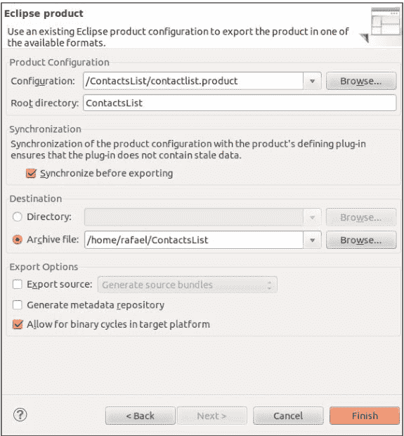

单击 Finish 开始生成产品。完成后浏览到向导指定的位置，可找到 ContactsList.zip。解压后可得 eclipse.ini 配置文件及 configuration 和 plugins 文件夹。plugins 文件夹包含产品配置编辑器中添加的所有插件，包括 ContactsList 插件。双击 eclipse 文件即可在开发环境外运行联系人列表应用。

## 品牌化 Eclipse RCP 应用程序

你可能觉得为 ContactList 应用使用名为 eclipse 的可执行文件很奇怪。缺少图标和启动画面也是问题。让我们修复这些问题。双击 contactlist.product 文件返回产品配置编辑器。在 Launching 选项卡可找到 Program Launcher 部分，用于个性化启动器。为应用选择合适名称。如需添加启动器图标，将其放入项目文件夹（RCP 模板生成 Icons 文件夹），并在 Icon 字段指向它。还可在 Launching 选项卡指定应用和 JVM 的启动参数。注意这些配置特定于平台（Linux、Mac OS X、Solaris、Win32）。

Splash 选项卡允许添加启动画面。启动画面让用户知道应用启动期间正在工作。添加启动画面需让应用的某个插件包含 splash.bmp 位图文件于插件根目录。打开 Plug-in Manifest Editor，切换到 Build 选项卡，确保 Binary Build 列表中 splash.bmp 已勾选。文件就位并包含后，在 Splash 选项卡的 Location 部分引用该插件。也可加入进度条或加载信息，类似 Eclipse。

Branding 选项卡允许选择应用窗口图像，用于操作系统工具栏和任务栏。也可在此自定义 About 对话框消息和图像。要显示 About 窗口，需在应用菜单中创建条目。因 About 窗口尚未移植到命令框架，需在 ApplicationActionBarAdvisor 类中创建条目。以下代码示例展示如何实现 Help 菜单中的 About Contact List 条目，显示 contactlist.product 文件中指示的消息和图像。导入部分省略。


public class ApplicationActionBarAdvisor extends ActionBarAdvisor {
    private IWorkbenchAction aboutAction;
    public ApplicationActionBarAdvisor(IActionBarConfigurer configurer)
    {
        super(configurer);
    }
    protected void makeActions(IWorkbenchWindow window) {
        aboutAction = ActionFactory.ABOUT.create(window);
    }
    protected void fillMenuBar(IMenuManager menuBar) {
        MenuManager helpMenu = new MenuManager("&Help", IWorkbenchActionConstants.M_HELP);
        menuBar.add(helpMenu);
        helpMenu.add(aboutAction);
    }
}

您还可以在 **Branding** 选项卡中为应用程序添加欢迎页面，类似于启动 Eclipse 时首次出现的那种。通过点击 **Intro ID** 字段前面的 **New** 按钮，您将看到欢迎页面向导窗口。将当前插件选择为 **Target**，为 **Intro** 选择一个 ID，然后点击 **Finish**。这将为 `org.eclipse.ui.intro` 和 `org.eclipse.ui.intro.config` 扩展点创建实现，以便将欢迎页面添加到您的应用程序中。欢迎页面的内容由放置在插件根目录中名为 `introContent.xml` 的 XML 文件描述。不幸的是，此文件没有专用编辑器，因此您必须手动创建和编辑它。


> `introContent.xml` 格式的内容超出了本书的范围，但您可以在 *Platform Plug-in Developer Guide* 文章中找到大量相关信息，方法是前往 help.eclipse.org 上的 **User assistance** **support** | **Welcome**。

最后但并非最不重要，**Licensing** 选项卡允许您为应用程序指定许可证文本和 URL。

## 摘要

在本章中，我们了解了如何利用 Eclipse 提供的所有基础设施创建客户端应用程序。通过使用 Eclipse RCP 构建一个简单的示例应用程序，我们看到了使用 SWT 和 JFace 图形元素编码和打包模块化客户端应用程序是多么容易。

## 键盘快捷键

Eclipse 包含大量键盘快捷键，熟练掌握后可以大大加快您的编码速度。通过使用它们，您可以避免将手从键盘上移开去使用鼠标。过于频繁地使用鼠标执行操作会损害您的生产力。

显然，想法并不是要记住整个列表以便超高生产力。此列表应作为参考，用于在您意识到必须反复执行耗时任务时，问自己“有没有更快的方法来完成此操作？”的那些时刻。

这不是一个详尽的列表。我们选择了一些最有用的快捷键并按主题组织，以便更易于浏览。

### 文件编辑器快捷键

在本节中，我们将介绍在使用文件编辑器时可能有用的一些快捷键。掌握它们可以简化代码编辑、导航和代码生成等任务。

### 代码编辑快捷键

下表包含一些最常用的与代码编辑相关的快捷键：

| 快捷键 | 用途 |
|---|---|
| Ctrl + C | 复制 |
| Ctrl + X | 剪切 |
| Ctrl + V | 粘贴 |
| Ctrl + Z | 撤销 |
| Ctrl + Y | 重做 |
| Ctrl + F | 查找/替换 |
| Ctrl + D | 删除当前行 |
| Alt + up arrow | 将当前行上移或下移 |
| Alt + down arrow |  |
| Ctrl + Shift + Delete | 删除插入点后当前行的内容 |
| Ctrl + Shift + C | 通过添加 "//" 对当前选中的行进行注释/取消注释 |
| Ctrl + Shift + / | 通过添加 /* ... */ 对当前选择进行注释 |
| Alt + Shift + J | 为当前选中的元素生成元素注释 |
| Ctrl + Shift + B | 在当前行添加/移除断点 |
| Tab | 增加/减少所选行的缩进 |
| Shift + Tab |  |
| Ctrl + I | 修正所选行的缩进 |
| Ctrl + Shift + up arrow | 将当前选择扩展到封闭元素（例如，如果选择了方法代码的一部分，则选择整个方法） |
| Ctrl + Shift + left arrow | 将当前选择扩展到下一个/上一个元素 |
| Ctrl + Shift + right arrow |  |

### 代码生成和代码重构快捷键

正如我们在第 2 章 Java 开发中所看到的，Eclipse 可以为您生成和重构代码。它可以执行诸如创建方法片段、组织类的导入等任务。下表显示了这些任务的一些快捷键：

| 快捷键 | 用途 |
|---|---|
| Alt + Shift + R | 重命名当前选中的方法 |
| Alt + Shift + M | 将当前选择提取为方法 |
| Alt + Shift + O | 组织导入 |
| Alt + Shift + F | 格式化选择 |
| Alt + Shift + S | 打开源对话框（允许生成 getter/setter、构造函数、to String 方法等） |
| Ctrl + 1 | 打开快速修复对话框 |

### 代码导航快捷键

在大型项目中，浏览源代码可能是一项痛苦的任务。庞大且众多的源文件使得难以找到所需内容。掌握以下快捷键可能会很有帮助：

| 快捷键 | 用途 |
|---|---|
| *Ctrl + Shift + up arrow* | 移动到源代码的下一个/上一个元素 |
| *Ctrl + Shift + down arrow* | （参数、方法等） |
| *Ctrl + Shift + P* | 当选择括号时，跳转到匹配的括号 |
| *Ctrl + L* | 转到行 |
| *Ctrl + Q* | 返回上次编辑位置 |
| *Ctrl + .* | 转到下一个/上一个注释（警告、错误等） |
| *Ctrl + ,* |  |
| *Ctrl + Page Up* | 转到下一个/上一个编辑器窗口 |
| *Ctrl + Page Down* |  |
| *Ctrl + left-click* | 当选择类名时，打开其源代码（如果在工作区中可用） |
| *Ctrl + Shift + T* | 打开类型 – 允许您按名称搜索工作区的类 |
| *Ctrl + Shift + R* | 打开资源 – 允许您按名称搜索工作区的资源 |

### Java 快捷键

以下 Java 特定快捷键也非常有用：

| 快捷键 | 用途 |
|---|---|
| *F2* | 在工具提示框中打开当前选中类的 JavaDoc |
| *F3* | 转到当前选中的元素定义（如果选择类则为类定义，如果选择变量则为变量声明） |
| *F4* | 为当前选中的类打开类型层次结构视图 |
| *Ctrl + O* | 打开当前正在编辑的类的outline工具提示框 |
| *Ctrl + Alt + H* | 为当前正在编辑的方法打开调用层次结构视图 |

### 文件快捷键

在下表中，您将找到一些与文件相关任务（保存、打开等）的快捷键：

| 快捷键 | 用途 |
|---|---|
| Ctrl + S | 保存当前文件 |
| Ctrl + Shift + S | 保存所有打开的文件 |
| Ctrl + W | 关闭当前编辑器窗口 |
| Ctrl + Shift + W | 关闭所有编辑器窗口 |
| Ctrl + N | 打开新建文件向导 |

### 运行和调试快捷键

以下快捷键可以使运行和调试项目更快、更轻松：

| 快捷键 | 用途 |
|---|---|
| Ctrl + F11 | 运行当前项目 |
| F11 | 调试当前项目 |
| F5 | 单步进入（调试模式） |
| F6 | 单步跳过（调试模式） |
| F7 | 单步返回（调试模式） |
| F8 | 继续（调试模式） |

### 视图快捷键

某些视图可以使用快捷键打开或显示。只需使用 *Alt + Shift + Q* 快捷键，然后按要打开的视图对应的字母。如果在 *Alt + Shift + Q* 快捷键后不按任何键，将出现一个包含视图字母的列表。下表包含最常用的视图的字母：

| 视图 | 字母 |
|---|---|
| Breakpoints | B |
| Console | C |
| Outline | O |
| Package Explorer | P |
| Problems | X |
| Type Hierarchy | T |
