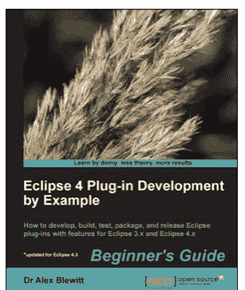
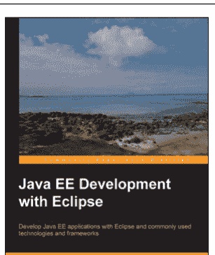
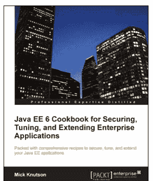
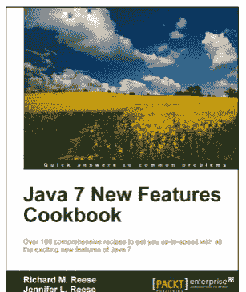

## 索引

### 符号

7-Zip
  关于 11
  下载 URL 11
@Before 注解 61
@BeforeClass 注解 61
@Ignore 注解
  创建 58
@Test 注解 55

### A

抽象窗口工具包。参见 AWT
actions
  与命令对比 181
Activator.java 类 170
Apache Hadoop 仓库 78
Apache 软件基金会 130
API（应用程序编程接口）199
ArmEvent 110
assertEquals() 方法 59
AWT 87

### B

BasicCalculator 类 51
Java Web 应用技术的好处 128
build.properties 文件 169
按钮控件 96, 97

### C

calculator example
  关于 152, 153
  部署 154-159
调用层次结构视图 32
类别 190
client application
  开发，使用 Eclipse RCP 201
client application project
  创建，使用模板 202
code
  编辑 37
  生成 34
代码导航，Java 编辑器视图 26, 27
code refactoring
  关于 38
  签名，修改方法 39
  变量，重命名 38
ColorDialog 124
组合框控件 99, 100
commands
  与操作对比 181
comment templates
  编辑 37, 38
提交选项 84
通用网关接口（CGI）128
并发版本控制系统（CVS）73
config.ini 文件 172
constructors
  生成 35
联系人编辑器 213-216

### 联系人列表应用程序
- 联系人编辑器 213-216
- 联系人列表视图 210-212
- 创建 208, 209
- 菜单条目 217, 219
- 新建命令 217, 219
- 运行 221
- 保存命令 217, 219
- 视图，绑定 219

### 联系人列表视图 210-212

### 内容辅助，Java 编辑器视图 25, 26

### 上下文帮助
- 添加到视图 191

### 贡献
- 禁用 184-187
- 限制 184-187

### 控制事件 110

### 控件
- 关于 92
- 按钮控件 96, 97
- 组合控件 99, 100
- 标签控件 92, 93
- 列表控件 97, 98, 99
- 文本控件 94, 95

### CreateWorkbenchWindowAdvisor 方法 204

### CVS
- 关于 23, 74
- 分支选项 76
- 项目，检出 76
- 同步功能 76

### CVS 仓库 74, 75

## D

### 调试器
- 使用 67-71

### 调试 43

### destroy() 方法 140

### 对话框
- 关于 121
- 颜色对话框 124
- 文件对话框 123
- 字体对话框 125
- 消息框 121, 122
- 打印对话框 126

### Display 类 92, 109

### DisposeEvent 110

### doGet 方法 153

### 下拉菜单 115

## E

### Eclipse
- 关于 10, 43, 197
- 下载 10
- 安装 11
- URL，用于下载 10

### Eclipse Juno
- 概述 11-18

### Eclipse RCP
- 关于 197, 198
- Eclipse 工作台 201
- JFace 200
- OSGi 框架实现 199
- SWT 200
- 用于开发客户端应用程序 201

### Eclipse RCP 应用程序
- 品牌化 224, 225
- 打包 222, 223

### Eclipse Web Tools Platform (WTP)
- 关于 134, 136
- 服务器，配置 137-140
- URL 134
- URL，用于下载 134
- 用于实现 Java servlet 141-151
- 用于实现 JSP 160-163

### Eclipse 工作台 201

### EGit 80, 82

### equals() 方法
- 生成 36

### Equinox 199

### 错误，Java 编辑器视图
- 编译 25

### 事件 109

### 可扩展标记语言。参见 XML

### 扩展点
- 关于 173
- 声明 173-175
- 实现，在代码中使用 177, 178
- 实现 179, 180
- 接口，提供 176, 177

## F

### fail() 方法 55

### FastCGI 128

### 文件对话框 123

### 文件编辑器快捷键
- 关于 227
- 代码编辑快捷键 227, 228
- 代码生成快捷键 228
- 代码导航快捷键 229
- 代码重构快捷键 228
- Java 特定快捷键 229

### 文件快捷键 230

### FillLayout 类
- 关于 101
- 字段 101

### FIRST 原则，单元测试 44

### FocusEvent 111

### 字体对话框 125

### Formatter 视图 34

### 全功能调试器 67

## G

### 生成的源代码 203-206

### getData 方法 91

### getInitialWindowPerspectiveId 方法 204

### getSelection 方法 97

### 获取器
- 关于 34
- 生成 34, 35

### Git
- 关于 80
- 与 Subversion (SVN) 对比 80

### Git 仓库
- 创建 82
- 使用 83

### 图形用户界面 (GUI) 87, 109

### GridLayout 类
- 关于 104
- 字段 104-106

## H

### hashCode() 方法
- 生成 36

### HelpEvent 111

### HTML 128, 129

### HTTP 128

### HttpServlet 类 129

### 超文本标记语言。参见 HTML

### 超文本传输协议。参见 HTTP

## I

### init() 方法 140

### 安装，Eclipse 11

### 安装，Tomcat 130-133

### 集成开发环境 (IDE) 9, 19, 197

## J

### Java 128

### Java 类
- 创建 21

### Java 开发工具包 (JDK) 10

### Java 开发工具 (JDT) 45, 206

### Java 编辑器视图
- 关于 24
- 代码导航 26, 27
- 内容辅助 25, 26
- 自定义 29, 30
- 错误，编译 25
- 快速修复 27-29
- 警告注释，编译 25

### Java 项目
- 创建 20
- 导入 22, 23
- 导入，从版本控制服务器 23
- Java 类，创建 21
- 工作集，创建 21, 22

### Java 运行时环境 (JRE) 10

### JavaServer Pages (JSP)
- 关于 127, 129
- 实现，Eclipse WTP 使用 160-163

### Java servlet
- 关于 127
- 实现，Eclipse WTP 使用 141-151

### Java 视图
- 关于 23
- 调用层次结构视图 32
- Formatter 视图 34
- Java 编辑器视图 24
- 组织导入视图 33
- 轮廓视图 31

### Package Explorer 视图 23

### Problems 视图 30

### Save Actions 视图 33

### Type Hierarchy 视图 32

### Java 虚拟机 (JVM) 10, 87

### Java Web 应用程序技术
- 优势 128

### javax.servlet 129

### javax.servlet.http 包 129

### JFace 120, 200

### JUnit
- 关于 44, 45
- 设置 46-48
- URL 45
- 用于测试 49-52

### JUnit 3
- 与 JUnit 4 对比 47

### JUnit 4
- 与 JUnit 3 对比 47

### junit.jar 文件 46

### JUnit Runner 视图
- 概述 57, 58

### Juno 版本 77

### JVM 130

## K

### 键盘快捷键
- 文件编辑器快捷键 227
- 文件快捷键 230
- 运行和调试快捷键 230
- 视图快捷键 231

### KeyEvent 111, 112

## L

### 标签控件 92, 93

### 启动配置
- 创建 40, 41

### 布局类
- 关于 100
- FillLayout 101, 102
- GridLayout 104-106
- RowLayout 102, 104

### 布局 100

### 生命周期层 199

### Listener 110

### 列表控件 97-99

## M

### 主菜单 115

### MANIFEST.MF 文件 169

### 菜单条目 217, 219

### MenuEvent 111

### 菜单事件 115

### MenuItem 事件 116

### 菜单
- 关于 115
- 下拉 115
- 主菜单 115
- 弹出 115

### MessageBox 对话框 121, 122

### 方法注释
- 生成 36

### ModifyEvent 111

### mod_perl 128

### 模块层 199

### MouseButtonPressed 事件 114

### MouseButtonReleased 事件 114

### MouseDoubleClick 事件 114

### MouseEvent 111, 114, 115

### MouseMoveEvent 111

### MouseTrackEvent 111

## N

### New 命令 217, 219

### NSAPI 128

## O

### Organize Imports 视图 33

### org.eclipse.swt.events 包 110

### org.eclipse.ui.commands 182

### org.eclipse.ui.handlers 182, 183

### org.eclipse.ui.menus 181

### OSGi 框架 199

### OSGi 框架实现，Eclipse RCP
- 生命周期层 199
- 模块层 199
- 安全层 200
- 服务层 200

### Outline 视图 31

## P

### Package Explorer 视图 23

### PaintEvent 111

### 插件
- 创建 168-170
- 导出 194

### Plugin Manifest Editor 170

### 插件项目
- 配置，调试 171, 172
- 配置，运行 171, 172
- 调试 171
- 运行 171

### Plugin Spy 功能 188, 189

### plugin.xml 文件 169, 173

### 弹出菜单 115

### 打印对话框 126

### Problems 视图
- 关于 30
- 自定义 30, 31

### 项目
- 构建 39
- 启动配置，创建 40, 41
- 运行 39

### 项目构建路径
- 管理 41, 42

## Q

### 快速修复，Java 编辑器视图 27-29

## R

### RCP 197, 198

### RCP 应用程序
- 调试 207
- 运行 207

### readAndDispatch 方法 92, 109

### 丰富客户端平台。参见 RCP

### RowLayout 类
- 关于 102
- 字段 102

### 运行和调试快捷键 230

## S

### Save Actions 视图 33

### Save 命令 217, 219

### schema 编辑器
- 示例 174

### 安全层 200

### SelectionEvent 111

### 服务层 200

### service() 方法 140

### servlet 生命周期 140

### servlets 129

### setAppName 方法 92

### setData 方法 91

### setLocation 方法 100

### setSelection 方法 97

### setSize 方法 100

### 设置器
- 关于 34
- 生成 34, 35

### shell 91

### ShellEvent 111

### 源代码管理 73

### 标准小部件工具包。参见 SWT

### StickyView 190

### StyledText 控件 107

### Subclipse 项目 77

### Subversion (SVN)
- 关于 73-80
- 与 Git 对比 80

### Subversive 项目 77

### SWT
- 关于 87, 88, 200
- 设置 88-90

## T

### 表格 118, 120

### teardown() 方法 61

### 模板
- 用于创建客户端应用程序项目 202, 203

### testAdd() 方法 57

### 测试用例
- 创建 58-66

### 测试驱动开发 (TDD) 44

### 测试
- 使用 JUnit 49-52

### 测试方法
- 实现 53-57

### testSubtract() 方法 60

### 文本控件 94, 95

### Tomcat
- 关于 127, 130
- 安装 130-133

### 工具栏 117, 118

### ToolBar 样式 117

### ToolItem 事件 118

### ToolItem 样式 117

### toString() 方法
- 生成 36

### 跟踪代码 67

### TraverseEvent 111

### TreeCursor 类 107

### TreeEvent 111

### 类型化事件 110

### Type Hierarchy 视图 32

## U

### 单元测试
- 关于 44
- FIRST 原则 44

### 未类型化事件 110

## V

### VerifyEvent 111

### 版本控制 73

### 版本控制服务器
- Java 项目，从...导入 23

### 版本控制系统 (VCS)
- 关于 73
- CVS 74
- Git 80-85
- SVN 77-80

### 查看器 120

### 视图
- 上下文帮助，添加 191
- 创建 190
- 当前状态，保存 191
- 示例 192-194

### 视图快捷键 231

## W

### WAR 文件
- 生成 164

### 控件 90, 91

### 工作集
- 创建 21, 22

## X

### XML 129

## 感谢您的购买

## 使用 Eclipse Juno 入门

## 关于 Packt 出版社

Packt，发音为 'packed'，于 2004 年 4 月出版了首部图书 "Mastering phpMyAdmin for Effective MySQL Management"，此后一直专注于出版针对特定技术和解决方案的高度聚焦的图书。

我们的图书和出版物分享了您同行的 IT 专业人士在适应和定制当今系统、应用程序和框架方面的经验。我们的解决方案型图书为您提供知识和能力，以便定制您正在使用的软件和技术来完成工作。与您过去看到的 IT 图书相比，Packt 的图书更具体、更少泛泛而谈。我们独特的商业模式使我们能够提供更聚焦的信息，让您了解更多所需的内容，而减少不必要的信息。

Packt 是一家现代而独特的出版公司，专注于为开发人员、管理员和新手等社区生产优质、前沿的图书。欲了解更多信息，请访问我们的网站：www.packtpub.com。

## 关于 Packt 开源

2010 年，Packt 推出了两个新品牌 Packt Open Source 和 Packt Enterprise，以继续专注于专业化。本书是 Packt Open Source 品牌的一部分，该品牌汇集了以开源许可证为基础的软件出版物，并为从高级开发人员到初级网页设计师的任何人提供信息。Open Source 品牌还运营着 Packt 的开源版税计划，Packt 会向其软件被出版图书的每个开源项目支付版税。

## 为 Packt 撰稿

我们欢迎所有有意撰稿的人士的咨询。图书提案请发送至 author@packtpub.com。如果您的图书想法仍处于早期阶段，并希望在撰写正式提案前先进行讨论，请联系我们；我们的其中一位约稿编辑会与您联系。

我们不仅寻找已出版的作者；如果您具备扎实的技术技能但缺乏写作经验，我们经验丰富的编辑可以帮助您发展写作事业，或为您提供专业知识的额外回报。

## [PACKT] PUBLISHING 开源社区经验精粹

## Eclipse 4 插件开发实战入门指南

ISBN: 978-1-782160-32-8      平装: 348 页

如何使用 Eclipse 3.x 和 Eclipse 4.x 的功能开发、构建、测试、打包和发布 Eclipse 插件

- 1. 创建插件以扩展 Eclipse 运行时，涵盖 Eclipse 3.x 以及 Eclipse 4.x 所需的更改
- 2. 从设计到分发——对整个流程进行广泛覆盖
- 3. 无需具备先前的 OSGi 或 Eclipse 插件开发经验

## 使用 Eclipse 进行 Java EE 开发

ISBN: 978-1-782160-96-0      平装: 426 页

使用 Eclipse 和常用技术与框架开发 Java EE 应用程序

- 1. 每章都包含一个端到端的示例应用程序
- 2. 使用 Eclipse 3.7 中的项目方面，使用一些常用技术开发应用程序。
- 3. 清晰的解释并辅以必要的屏幕截图

[PACKT] PUBLISHING 开源社区经验精粹

## Java EE 6 实用手册：保护、调优和扩展企业应用程序

ISBN: 978-1-849683-16-6      平装: 356 页

包含全面的配方，用于保护、调优和扩展您的 Java EE 应用程序

- 1. 使用 Java EE 内置功能以及广为人知的 Spring Security 框架保护您的 Java 应用程序
- 2. 利用相关配方测试各种 Java EE 技术，包括 JPA、EJB、JSF 和 Web 服务
- 3. 探索使用额外的动态语言以及框架扩展 Java EE 环境的各种方法

## Java 7 新特性实用手册

ISBN: 978-1-849685-62-7      平装: 384 页

超过 100 个全面的配方，帮助您快速掌握 Java 7 中所有令人兴奋的新特性

- 1. 全面涵盖 Java 7 的新特性，围绕易于遵循的配方组织
- 2. 涵盖令人兴奋的功能，如 try-with-resources 块、目录事件监控、异步 IO 和新的 GUI 增强功能等
- 3. 基于示例学习的方法，专注于关键概念，为解决现实世界问题提供基础

