## 2
安装环境组件

本章涉及我们所称的环境组件的安装。这些是先决条件组件，不属于 IBM FileNet Content Manager (CM) 本身。我们将介绍配置环境组件的示例——数据库、目录服务器和 J2EE 应用服务器——IBM FileNet 软件依赖于这些组件。

本章涵盖以下主题：

- Red Hat Linux 服务器的配置
- DB2 数据库服务器的安装和配置
- IBM WebSphere Application Server 的安装和配置
- IBM Tivoli Directory Server 的安装和配置

如果你按照安装步骤操作，你将拥有一个平台，准备在第 3 章《安装内容引擎》中进行实际的 CE 安装和配置。

## 一些重要的 IBM 文档

IBM 发布了大量关于 CM 产品和 P8 平台的文档。文档面向各种不同的受众——企业决策者、各种管理员、安全官员、开发人员和最终用户。文档数量之多可能会让人有点迷惑。本节将介绍对安装新 CM 站点的人最有趣的文档。

大多数 P8 文档可通过 IBM 网站轻松获取。进入该网站的门户是 IBM FileNet P8 版本 4.5.1 信息中心，网址为 http://publib.boulder.ibm.com/infocenter/p8docs/v4r5m1。信息中心（通常如此称呼）是所有官方 P8 产品文档的一站式购物中心，绝对应该在你的书签列表中占有一席之地。你也可以通过使用你喜欢的互联网搜索引擎搜索 p8 information center 来找到它。第 13 章、支持、修复包和故障排除 包含有关如何本地安装信息中心副本的信息。

信息中心（以及 IBM 大部分在线文档）的一个有趣方面是，你可以根据自己实际拥有的软件环境缩小所看到的内容范围。我们强烈建议你这样做，特别是对于与安装相关的信息。单击信息过滤器图标并选择适用于你的环境的特定项目。

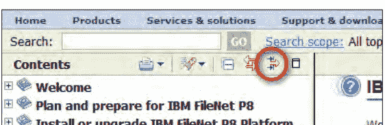

信息中心页面左侧的目录会动态调整，仅显示与所选过滤器选择相关的主题。我们的大多数示例将使用适用的 IBM 组件，但 P8 支持各种应用服务器、数据库和目录服务器的组合。

除了在线信息中心信息外，许多 P8 文档还可作为便携式文档格式 (PDF) 或其他格式的下载文件提供。查找这些可下载变体的起点是网页 FileNet P8 Platform 的产品文档。你可以从信息中心起始页访问它，但这里是直接链接：http://www-01.ibm.com/support/docview.wss?uid=swg27010422。由于它包含所有受支持版本的文件，请确保从该网页下载时选择适当的版本。可以从同一页面下载包含可搜索 P8 文档的部署 WAR 文件。在信息中心发布之前它更有用。如果你使用的是当前 P8 版本，并且你的环境可以合理地访问互联网，你可能会发现访问信息中心更方便。

除非另有说明，否则从现在开始提到的所有文档都可通过信息中心的链接获得。虽然我们可以在这里提供具体链接，但最稳定的链接是信息中心本身的链接，我们认为从那里导航到各个文档是最可靠的策略。

## 计划并准备你的环境

*Plan and Prepare Your Environment for IBM FileNet P8* 应该是你为自己的安装做准备时的首站。它既作为信息中心的一部分提供，也作为可下载的 PDF 文档提供。它是对众多受支持部署方案、安装期间执行的角色、账户类型和其他所需信息等的全面背景介绍。为简洁起见，我们将把该文档称为规划和准备指南 (PPG)。

人们经常问为什么不能有一个简单的安装程序，问几个问题然后像典型的 Microsoft Windows、Linux 或 Apple Mac 消费应用程序一样安装产品。对于演示环境，可以创建这种简单的安装程序，但对于几乎任何人的真实环境来说都是不正确的。企业环境中有太多选择，无法轻易猜测或假设。相反，P8 安装过程包括一个规划步骤，在该步骤中收集有关环境和计划部署的信息，以及一个安装步骤，在该步骤中使用这些信息实际安装软件。确实可以说，跳过规划步骤部分的人往往会在安装步骤中付出努力和困惑的代价。在规划步骤中给予适当的关注，实际安装相当简短，尽管你可以自己判断。

规划指南中介绍的一个重要概念是 *Installation and Upgrade Worksheet*。这是一个实际的电子表格，可帮助你以有条理的方式收集自己的安装所需信息。它具有宏，可让你生成特定于你将安装的软件的自定义电子表格。我们将在实际安装过程中使用工作表中的形象化名称。

PPG 和工作表均可直接从上面提供的文档链接下载。


## Fix Pack 兼容性矩阵

如果这是你的第一次 P8 安装，你无疑会选择组件的最新版本和修复包。之后，当你单独应用修复包或升级组件时，重要的是要检查 FileNet P8 4.5.x Fix Pack Compatibility Matrix，以确保你没有创建不受支持的组合。几乎总是如此，如果你将所有内容升级到最新版本和修复包，则组合是受支持的。务必检查矩阵以确认。

### 环境组件

CE 运行在 J2EE 应用服务器下，但它也使用其他企业环境组件。我们称这些为环境组件，因为大多数企业在安装 CM 之前已经为其他应用程序选择并使用它们。以下是 CE 如何使用数据库和目录组件：

- 所有 CE 元数据都存储在关系数据库中，尽管向应用程序呈现的概念模型是面向对象的。这就是为什么我们在第 3 章中讨论的架构显示了单独的数据层和对象层。CE 负责将关系数据映射到对象和从对象映射回来的簿记细节，因此通常只有组织中的数据库管理员对低级数据库细节感兴趣。
- CE 预期使用企业目录进行身份验证（证明你的身份）和授权（确定你拥有的权限）。虽然在技术上不完全正确，但通常将目录称为 LDAP 目录，因为这是用于目录交互的协议。当然，严格来说，它不必是企业目录。你可以为 CE 使用设置一个专用目录（事实上，大多数应用服务器都有内置目录）。除少数特殊情况外，在生产环境中使用其他目录（而不是企业的目录）通常不是很有用，并且会带来一定的维护麻烦。CE 仅从目录读取信息；它永远不会更新目录。

CM 包含 IBM WebSphere Application Server 和 IBM DB2 Universal Database 的有限使用许可。CM 中的许可仅包括在 CM 中使用这些组件，而不用于一般用途。此外，许可适用于 WebSphere 和 DB2 的特定版本。这些版本非常适合开发环境、原型制作、概念验证等。它们也适用于在一定可扩展性限制内的生产应用程序。如果你计划依赖这些版本用于生产使用而不是单独许可它们，请务必检查其功能以确保它们满足你的生产需求。特别是，WebSphere 许可不包括 Network Deployment（ND）版，而你几乎肯定需要它来进行高可用性和扩展的集群。

### 硬件和软件要求

P8 支持的环境列表很长，但不是无限的。文档 IBM FileNet P8 Version 4.5 Hardware and Software Requirements 是关于受支持硬件、操作系统、数据库、目录服务器、应用服务器和其他非 P8 组件的官方指导。鉴于 P8 背后大部分是 Java 技术，毫不奇怪，本硬件/软件指南的大部分内容都致力于软件环境。

> 指向官方 P8 文档和其他资源的指针在第 13 章中全面涵盖。

在该文档中最重要的检查内容是你要使用的特定事物是否受支持，但你也需要关注 P8 组件共置的部分。**共置**意味着软件能够一起安装而不引起问题。P8 组件的共置规则相当宽松且易于满足，但在文档中偶尔会指出一些重要例外。在生产环境中，你通常希望出于性能和可扩展性原因将事物分离到不同的服务器上。在开发或演示系统中，你可能会选择为简单起见共置许多组件；务必检查硬件/软件指南以避免功能问题。

如果你正在设置新环境并且可以自由选择任何组件，我们能给你的最好建议是选择每个组件的相对较新的版本。IBM 支持矩阵通常涵盖组件的当前版本和一个或多个较旧版本。时间不可避免地向前推进，后续版本的 CM 可能会使其他组件的旧版本过时，因为添加了新版本。

让我们简要看看受支持的组件。我们将避免具体的发布号，因为硬件/软件指南是检查如此具体内容的最佳位置。我们的列出只是为了让你感受到覆盖范围的广度。此外，并非每个单独的组件在每个平台组合上都受支持。

- 操作系统：IBM AIX、Microsoft Windows（服务器版）、Sun Solaris、HP-UX、Red Hat Enterprise Linux、Novell SUSE Linux Enterprise Server
- 应用服务器：IBM WebSphere、Oracle WebLogic、JBoss by Red Hat
- 数据库：IBM DB2、Oracle、Microsoft SQL Server
- 目录服务器：IBM Tivoli Directory Server、Novell eDirectory、Sun Java System Directory Server、Microsoft Active Directory、Microsoft ADAM、Oracle Internet Directory
- 存储设备：操作系统原生文件系统、IBM System Storage DR550、IBM Tivoli Storage Manager、EMC Centera、Network Appliance、和 IBM N-series SnapLock

并非所有组件组合都受支持。硬件/软件指南提供了受支持组合的详细图表和说明。

### 定制规划和安装指南

前面，我们描述了如何为特定软件环境过滤 infocenter。规划指南和安装指南都有单文档版本，涵盖所有受支持的软件组件和组合。它们本身的性质决定了这些文档具有大量冗余且令人印象深刻的长。

P8 团队还为最常见的配置制作了定制规划和安装指南。如果你的环境匹配其中一种配置，你会发现使用定制指南容易得多。截至本文撰写时，在 http://www-01.ibm.com/support/docview.wss?rs=3278&uid=swg27016206 上有十多个不同的指南可用，并且会不时制作更多组合。

如果你查看我们上面列出的受支持软件组件列表，你会看到操作系统、应用服务器、数据库和目录的组合超过 300 种。这还不考虑这些组件的发布号变化。如果你的特定组合不在定制指南中，我们的建议是同时使用最接近你环境的定制指南和单文档指南。使用定制指南通读一遍，并使用单文档指南作为参考，当定制指南讨论与你的软件环境不匹配的组件时。一旦你进入定制指南的节奏，你会发现从单文档指南中挑选孤立的信息部分变得容易得多。

### 我们的目标环境

鉴于成百上千种可能的配置组合，我们不可能全部描述。相反，我们的计划是选择一种配置并展示如何在我们称之为一体式配置中安装它。一体式配置意味着我们将把所有内容安装在单台服务器上。这是在开发者和测试人员或演示目的的隔离系统上设置的好方法。事实证明，使用虚拟服务器映像而不是物理服务器是很常见的，因此这也是给某人一份环境副本的便捷方式（假设你对所有内容的许可允许这样做）。

> 我们称之为一体式配置，但最终会变成两台服务器。并非每个组件都在每个操作系统上运行。我们选择对大多数事物使用 Linux，但有几件事我们将在 Windows 服务器上运行。称之为一体式两配置就没有同样的吸引力了。

即使你对环境中的软件组件有完全不同的要求，你也应该会发现本章很有用，因为大多数组合的安装过程非常相似。如果你是 P8 新手，你可能想尝试安装我们使用的完全相同的组合，以确保你能快速进入一个可工作的环境。从那里，你可以扩展到你计划实际使用的目标环境。

在本章中我们展示的示例中，我们将使用以下软件组件：

- Red Hat Enterprise Linux（RHEL）5.5
- Microsoft Windows Server 2003（W2K3）
- IBM WebSphere Application Server（WAS）7.0 for FileNet Content Manager 4.5.1


+   - IBM DB2 Workgroup Server Edition (DB2) 9.5 for FileNet Content Manager 4.5.1
+   - IBM Tivoli Directory Server (TDS) 6.2

当然，我们知道你在想什么：我们使用的大部分都是 IBM 软件，因为我们是 IBM 的托儿。好吧，我们是不是 IBM 的托儿，可能是也可能不是，但我们选择这些组件的原因有点不同。正如我们提到的，CM 许可证包含了 WebSphere 和 DB2 的有限使用许可证。你也可以从厂商网站下载 RHEL 和 TDS 的评估版（http://www.redhat.com/rhel/server 和 http://www.ibm.com/tivoli）。如果你是那种拥有 CM 副本但尚未选择其他软件组件的特殊用户，请在购买额外的 IBM 产品时尽管提我们的名字。这不会给你任何折扣，但我们从不反对 IBM 销售团队因为把客户介绍给他们而请我们吃午餐。

> 我们想明确指出，我们并非因为 P8 平台与这些组件配合更好或以某种方式偏爱它们而选择了所有 IBM 组件。P8 尽力平等地支持所有应用服务器、数据库、目录和操作系统。每个类别中的竞争产品并不相等，但每个产品都有其独立于 P8 与之集成的优缺点。作为 IBM 员工和股东，我们希望你能购买和使用尽可能多的 IBM 硬件和软件。作为 P8 软件架构师和本书的作者，我们希望你根据自己的需求和选择标准来选择平台的各个要素。

全包配置有一个小例外——管理工具 FileNet Enterprise Manager (FEM) 只能在 Microsoft Windows 上运行。我们将在第 3 章安装它，并在第 5 章《安装其他组件》中在 W2K3 服务器上安装额外的组件。如果你想推迟配置该机器，你可以先在已有的 Windows 桌面环境上安装 FEM，因为 FEM 并不会侵入系统。

## 安装环境组件

自然地，在做任何其他事情之前，你需要先拥有操作系统。其他组件基本上可以按任意顺序安装。我们选择先安装 DB2，其次是 WAS，最后是 TDS。TDS 需要一个用于目录数据的数据库，而 TDS 6.2 很乐意使用已安装的 DB2 9.5。如果它找不到它喜欢的 DB2 版本，TDS 将安装并使用 DB2 的嵌入式副本。TDS 还需要一个应用服务器，但 TDS 6.2 希望使用 WAS 6.1。由于我们将使用 WAS 7.0，TDS 将改用其自己的 WAS 嵌入式副本。

### 用户和组账户

PPG 列出了执行安装任务和操作已安装系统所需的多个用户和组账户。这些账户可以是操作系统账户、数据库账户或企业目录账户（PPG 有时称之为“目录账户”，有时称之为“LDAP 账户”；在此上下文中它们含义相同）。快速了解所有这些各种类型的账户的一种方法是查看安装工作表并扫描标记为 **User or Group Account** 的列。如果你查看工作表上的通用标签，你会看到许多无关的账户，但在自定义工作表上（你可以通过从 **Instructions** 标签运行自定义宏来创建），列表应该是你实际会使用的内容。

值得注意的是，在大多数地方，指南都说你必须创建这样的账户或选择现有账户。这很重要，因为个人账户的列表相当长。列表很长是因为，当指南谈论各种账户时，它实际上是在谈论这些账户所使用的角色。例如，你会同时看到 **CE application server installation account** 和 **CE installation account**。虽然听起来几乎一样，但它们是在安装期间用于不同任务的两个不同角色。指南定义了每个账户并描述了它（以及它需要的权限），以便你了解差异。很多时候，你会决定使用单个账户来履行多个角色。

在你的生产环境中，你当然会使用与你的企业管理与安全策略一致的账户。例如，你可能有一项政策规定，必须由某些目录或操作系统组的成员来执行某些功能。也许你有一个数据库管理员组，数据库维护必须由该组成员执行。我们当然敦促你遵循既定的策略。

### Red Hat Enterprise Linux

我们使用的是相当标准的 RHEL 5.5 安装，并且接受安装过程中几乎所有的默认值。数据库安装程序通常会建议你修改共享内存配置或其他内核参数。在我们的 DB2 9.5 安装中并未发生这种情况，因此我们将所有这些都保持为默认值。

除了超级用户 root 之外，你还将在安装过程中创建至少一个非特权账户。你可以为该账户的用户 ID 使用任何你喜欢的名称，但我们通常使用既通用又有提示性的名称（以防我们把镜像副本给别人，而他们可能不喜欢 slimy-mud-puppy 或类似的用户 ID）。对于我们在此使用的镜像，我们选择了用户 ID ecmuser。在安装期间或之后，创建一个操作系统组 ecmgroup 并使 ecmuser 成为该组的成员。

我们还需要一个操作系统账户，它将获得一些 DB2 权限，并且 CE 将通过 WAS 数据源使用它与数据库通信。root 的 RHEL 控制面板有一个方便的用于在操作系统级别添加此用户的程序。你可以在将用户添加到数据库之前或之后执行此操作，但我们建议你现在就做，以免忘记。创建一个名为 cedbuser 的新用户（该用户在 PPG 和安装工作表中以形象名称 ce_db_user 引用，但 DB2 不喜欢带下划线的用户名，所以我们去掉了它们）。我们建议选择一个禁止实际操作系统登录的登录 shell，因为该用户 ID 仅用于软件控制的数据库操作。我们将在下面的 DB2 部分介绍数据库权限。

> 我们为 RHEL 系统选择的完全限定名称是 wjc-rhel.example.net。我们的 W2K3 系统是 wjc-w2k3.example.net。域名 example.net 根据 RFC 2606《保留的顶级 DNS 名称》保留用于示例。你在跟随操作时可能会为系统选择不同的名称，并且你肯定会为生产环境使用不同的名称。为了避免不断指出这一点，我们将在各种示例和屏幕截图中使用我们的系统名称，并假设你能将其在脑中转换为你的系统名称。

### 网络地址

如果你打算从安装 CM 的机器之外访问任何 CM 服务器，你可能希望为该机器获取一个静态 IP 地址并在本地域名服务（DNS）中注册它。这两者对于我们在此使用的软件组件来说都不是严格必要的，只是为了方便。我们将在不同的机器上安装至少一个组件，但对你来说，使用动态分配的 IP 地址在需要连接时可能就足够了。

> 我们经常为虚拟服务器使用动态 IP 地址。我们的网络基础设施倾向于在很长一段时间内为我们的服务器分配相同的 IP 地址。我们不将服务器名称注册到 DNS，而是每当我们注意到有趣的变化时手动修改本地主机文件。在 Linux 上，该文件是 /etc/hosts。在 Windows 上，该文件是 C:\Windows\system32\drivers\etc\hosts。两个文件格式相同，由包含 IP 地址后跟一个或多个主机名的行组成。在正常配置中，系统会在查询 DNS 之前先查询 hosts 文件。另一方面，如果你的组织很容易获得静态 IP 地址并将服务器名称放入 DNS，你最好省去麻烦并这样做。这可能会在以后的某个时间帮你避免一两个故障排除的谜团。

### 系统时钟

所有 P8 服务器必须具有同步的系统时钟。这在只有一个物理服务器的环境中无关紧要，但养成这个好习惯是好的。严格来说，只要求各个时钟彼此一致。实际上并不要求它们正确。不过，为了避免自己发疯，最简单的方法是让你的操作系统时钟通过使用网络时间协议（NTP）或类似技术与现实世界时间同步。


当多台服务器的时钟不同步时，产生的问题可能非常神秘且难以定位。这就是为什么当你遇到一个真正奇怪的问题时，它很可能是支持人员首先会问的问题之一。此外，当查看日志文件并试图关联来自不同服务器的条目时，如果系统时钟相差哪怕几秒钟，也可能会让人非常困惑。对于非常详细的日志记录，在一个时钟秒内看到成千上万行日志并不罕见。

## 文件存储区域

*存储区域*是 CE 的行话，指存储文档实际内容数据的地方（与属性相对；属性始终存储在数据库中）。为了让我们的 CM 安装更接近实际，我们将使用一个文件存储区域。文件存储区域位于操作系统文件系统上。在正常的生产环境中，您可能会有一个专用文件服务器，磁盘实际位于该服务器上，多个 CE 服务器会看到通过受支持的文件共享协议（例如 NFS）共享的文件夹。一个域中的所有 CE 服务器必须能够访问所有存储区域。对于一体化镜像，我们并不真正需要那种复杂性。磁盘也将在本地。但是，如果您希望环境更接近生产环境，您仍然可以这样配置。

我们在本地文件系统中创建一个文件存储区域，并将其安排好，以便只有 ecmuser 可以访问（因为，如后面所述，我们将以 ecmuser 身份运行保存我们的 CE 的 WAS 配置文件）。以下命令以 root 用户身份运行，可用于创建和配置所需的顶级目录：

```bash
# mkdir /p8filestores
# mkdir /p8filestores/fs1
# chown -R ecmuser /p8filestores
# chmod -R 770 /p8filestores
```

这些名称是任意的，但我们稍后需要记住它们。如果您使用文件共享，那么您将需要为文件存储目录的父目录（在本例中为 /p8filestores）创建一个挂载点。

## 防火墙

如果您的服务器有软件或硬件防火墙，并且您希望从服务器外部与 CM 安装进行交互，则必须对其进行配置，以允许通过各个端口进行连接。以下是我们将使用的所有端口号的列表，以及每个端口的简要说明。您可能会决定在您的环境中不需要打开所有这些端口。

| 端口 | 备注 |
|------|------|
| 9080 | AE WAS 实例，http，非安全 |
| 9443 | AE WAS 实例，https，安全 |
| 9081 | CE WAS 实例，http，非安全 |
| 9444 | CE WAS 实例，https，安全 |
| 2809 | AE WAS 实例，EJB |
| 9100 | AE WAS 实例，EJB |
| 2810 | CE WAS 实例，EJB 传输 |
| 9101 | CE WAS 实例，EJB 传输 |
| 9060 | AE WAS 控制台，非安全 |
| 9043 | AE WAS 控制台，安全 |
| 9061 | CE WAS 控制台，非安全 |
| 9044 | CE WAS 控制台，安全 |
| 9990 | CSE K2 仪表板 |
| 12100 | TDS Web 控制台，非安全 |
| 12101 | TDS Web 控制台，安全 |
| 55000 | DB2 实例 db2inst1 连接 |
| 3801 | DB2 实例 db2inst1 连接 |

如果您使用的是具有快照功能的虚拟服务器镜像，现在是拍摄快照的好时机。事实上，我们建议在本章后面描述的每个主要安装步骤之后都拍摄快照。如果后续步骤出现问题，您可以恢复到快照点，省去重新开始的麻烦。

## 安装 DB2

DB2 数据库的安装很简单，您应该以 root 身份执行。DB2 安装程序提供服务器和客户端选项；请选择服务器选项。如果您进行“典型”安装，可以接受提供的默认值，除非您有自己的理由做出不同的选择。我们使用 DB2 9.5，因为这是 CM 许可证中包含的版本。最新版本是 DB2 9.7，安装时只有几个小的差异。我们已在后续步骤中注明这些差异。

> CM 5.0 包括针对 DB2 9.7 的类似有限使用许可。

DB2 安装过程中需要注意的一些具体要点：

- 默认情况下应启用 Java 支持，并且这是必需的；请不要禁用它。
- 安装程序将为您提供在安装过程中创建实例或稍后创建实例的选项。我们建议您在安装过程中创建实例。
- 您还可以选择安装 IBM Tivoli System Automation for Multiplatforms Base Component（SA MP Base Component）。除非您计划使用 SA MP Base Component，并且知道您的 Linux 服务器满足先决条件和许可授权，否则我们建议您选择不安装它。
- 安装结束时，安装程序会通知您默认实例正在监听端口 55000。我们稍后会用到该信息（因此请记下它，尤其是如果由于某种原因安装程序告诉您不同的端口号）。您还应该在 `/etc/services` 文件的末尾附近找到它的条目。

作为安装的一部分，DB2 将使用或创建一些操作系统帐户。如果您采用了安装程序的默认值，您将拥有以下操作系统用户和组：

- 用户 dasusr1，组 dasadm1：DB2 管理服务器用户。
- 用户 db2inst1，组 db2iadm1：默认实例 db2inst1 的 DB2 实例所有者。
- 用户 db2fenc1，组 df2fadm1：DB2 fenced 用户。

您可以查阅 DB2 文档（http://publib.boulder.ibm.com/infocenter/db2luw/v9/）以了解有关这些用户和组各自用途的更多详细信息。请注意，每个名称中的最后一个字符是数字 1，这在某些字体中可能不太明显。

安装后，需要立即为此实例设置一些 DB2 配置参数。在以用户 db2inst1 身份登录时，使用 db2set 命令行工具并设置以下附加参数（其中第一个仅适用于使用 DB2 9.7 的情况，不适用于 DB2 9.5）：

```bash
$ db2set DB2_WORKLOAD=FILENET_CM
$ db2set DB2_OPTPROFILE=Yes
```

我们的下一步是在默认实例 db2inst1 中创建一个供 CM 使用的数据库。

> 数据库厂商在这一步骤的术语有些不同，日常用语也可能有些随意，所有这些都可能导致对到底需要什么产生一些困惑。在使用 DB2 时，是在同一个数据库中创建所有 CE 对象存储，还是为每个对象存储创建一个单独的数据库，是一个有些主观的问题。使用单独的数据库可以在安全性、备份和其他数据库管理方面提供独立的选项。一旦创建了数据库，当之前提到的灵活性不是必需时，单个数据库中的表空间对于某些数据库管理任务会更方便。对于我们的示例，我们将使用多个数据库，因为这在概念上更容易理解。

通过 DB2 控制中心执行以下步骤。使用用户 ID db2inst1 登录。运行命令 db2cc 以启动 DB2 控制中心。启动数据库管理器。在 DB2 控制中心中，导航到实例 db2inst1 的节点，右键单击并选择“启动”。

## 创建新数据库

在实例 db2inst1 下选择**数据库**节点，右键单击，然后选择**创建数据库**。我们建议您使用**自动维护**创建数据库。对于大型生产站点，您（或企业数据库管理员）可能会做出不同的选择，但对于这个一体化系统，自动维护是最简单的。该数据库将用作 CE 的全局配置数据库（GCD）。您可以为它起任何您想要的名字，但 GCD 既合乎逻辑又容易记住。在向导中处理任何问题时，您都可以接受默认值。一个新的条目 GCD 将出现在**数据库**节点下。

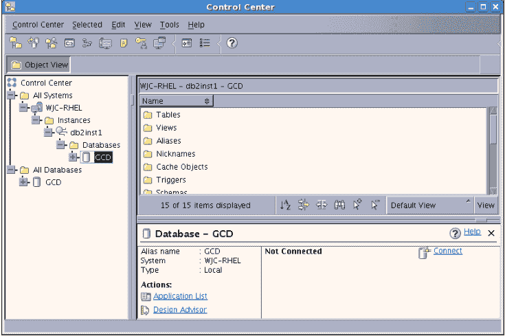

## 删除默认用户表空间

如果存在默认用户表空间，您可以将其删除，因为它的配置不适合我们在这里使用。展开 GCD 节点并选择**表空间**文件夹。在主面板中，选择**USERSPACE1**，右键单击，然后选择**删除**。

## 创建缓冲池定义

所有表空间必须使用 32 KB 的页大小（这是 CE 的要求）。DB2 9.5 和 9.7 中的默认值是 4 KB。这意味着您必须创建一个新的缓冲池定义。选择 GCD 下的**缓冲池**节点，右键单击，然后选择**创建**。确保新的缓冲池的**页大小**为 32，并给它一个有意义的名称。我们将其命名为**WJC32K**。


## 创建表空间

我们建议为所有表空间选择自动存储。表空间向导可通过选择“表空间”文件夹，右键单击并选择“创建”来启动。然后按如下方式创建表空间：

- 1. 创建一个类型为用户临时表空间。我们将其命名为 CEUSRTEMP，但名称并不重要。系统询问类型时，选择用户临时。
- 2. 在配置缓冲池的面板中，不要接受默认的 4 KB 页面大小的缓冲池；相反，选择上面创建的具有 32 KB 页面大小的缓冲池（如果您使用了我们使用的名称，则为 WJC32K）。为此表空间选择缓冲池定义后，您可以点击通过其余面板，对所有问题均采用默认值。
- 3. 创建一个类型为系统临时表空间。我们将其命名为 CESYSTEMP。同样，使用您创建的缓冲池定义，以便表空间具有 32 KB 页面大小。
- 4. 像往常一样，使用提供 32 KB 页面大小的缓冲池定义。我们将其命名为 CEDATA。创建一个类型为 Large 的表空间，用于存放 GCD 的实际表。

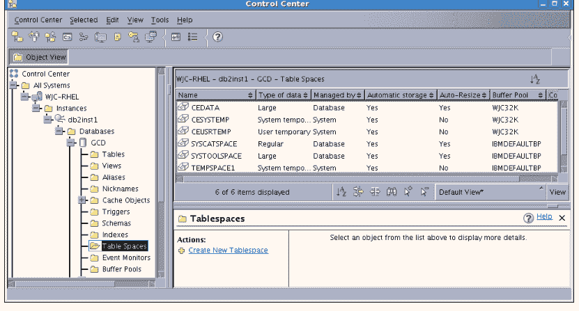

## 向数据库添加用户

此数据库用户将在 J2EE 应用服务器中配置数据源时使用。选择数据库 GCD，然后导航到“用户和组对象 | DB 用户”。通过从下拉菜单中选择来添加用户 cedbuser。这与我们之前在操作系统级别添加的同一用户；我们只是现在为其授予数据库权限。此用户必须被授予以下权限：

- 连接到数据库、创建表以及隐式创建模式（均在“数据库”选项卡上设置）
- 使用上面创建的用户临时（CEUSRTEMP）和 Large（CEDATA）表空间（通过“表空间”选项卡设置）
- 对表 SYSIBM.SYSTABLES 和 SYSIBM.SYSCOLUMNS 执行 SELECT（通过“表”选项卡设置），并查看 SYSCAT.DATATYPES（通过“视图”选项卡设置）

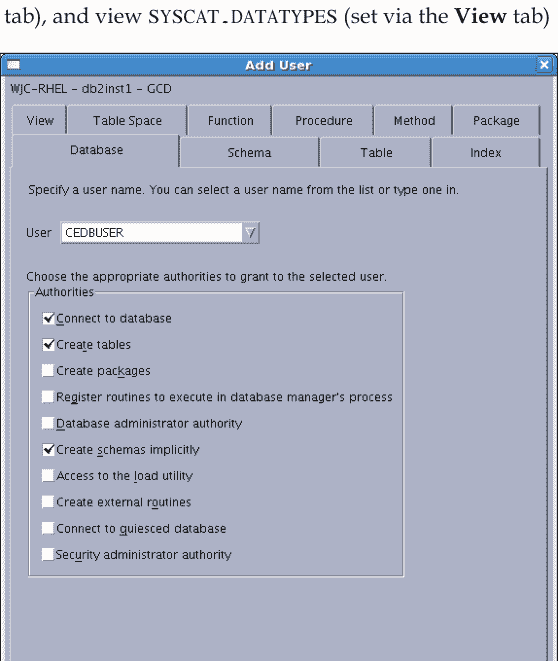

> 我们刚刚描述的权限与 CM 用户的权限无关。请记住，对数据库的所有访问都由 CE 服务器中介。此数据库用户和这些权限是 CE 执行其底层数据库工作所需要的。

## 设置 DB2 参数

在使用数据库用于 CM 时，建议或要求设置一些 DB2 配置参数设置。您可以通过选择数据库 GCD，右键单击并从上下文菜单中选择“配置参数”来设置这些参数。将 APPLHEAPSZ 设置为至少 2560；如果您使用的是 DB2 9.7，则将 CUR_COMMIT 设置为 0n。

## 对 OSTORE1 重复操作

重复上述所有步骤，为我们的第一个对象存储创建一个名为 OSTORE1 的数据库。如果您感觉冒险，可以在步骤记忆犹新时为其他对象存储创建其他数据库（OSTORE2、OSTORE3 或您想命名的任何名称）。即使对于这种开发系统，我们也喜欢至少有两个对象存储。我们将一个用于各种临时活动，另一个用于更结构化的探索。

> 如果您熟悉 DB2，您可以通过克隆数据库 GCD 来创建数据库 OSTORE1，从而节省一些配置麻烦。我们在此超出范围无法描述其细节，但其本质是创建数据库 GCD 的备份，然后将其恢复到新的数据库 OSTORE1。您可以使用 DB2 控制中心完成所有这些操作。如果您使用此技术，您希望现在就这样做，而 GCD 数据库尚未用于 CE 使用而填充。

由于最后几个步骤是权限和配置参数设置的稍显棘手的列表，您应该仔细检查 P8 产品文档以获取更新。检查 PPG 和 FileNet P8 性能调优指南。

## WebSphere Application Server

WAS 的实际安装过程虽然冗长，但很直接且大部分是自动进行的，因此我们不会逐步介绍。您可以接受所有面板的默认值。系统会要求您提供 WAS 管理员用户名和密码。这只是临时的，后续在本章稍后 TDS 中配置的 was_admin 账户会替换它。现在，我们建议您指定用户名 admin 和您喜欢的任何密码。

## 配置文件和端口

WAS 安装过程会创建一个默认配置文件 AppSrv01，并预先配置了许多 TCP/IP 端口分配。这些分配包括管理控制台应用程序、Web 容器、JNDI 提供程序、各种安全服务等的端口号。存在一个 CM 要求，即 **Application Engine (AE)** 和 Content Engine 不能在同一个 WAS 配置文件（对于其他应用服务器，存在类似规则，但配置文件是 WAS 特有的概念）中运行。同一服务器上的不同配置文件必须对类似功能具有不同的端口分配，以便您可以通过单个主机地址连接到它们。这通常甚至不是一个因素，因为您会将 AE 和 CE 安装在不同的服务器上，但我们必须为我们的全包配置做好规划。

AE 是一个更面向用户的组件，因此我们将严格出于偏好选择，让 AE 使用标准的 WAS 端口编号。这意味着它被安装到默认的 WAS 配置文件中。在安装 CE 之前，我们将创建一个新的 WAS 配置文件来容纳它，接受默认名称 AppSrv02。CE 最终位于第二个 WAS 配置文件中，即使我们先安装 CE。当组件相互通信时，WAS 配置文件的名称无关紧要。只有管理员需要跟踪它们。

如果您安装的是 WAS 7 的 32 位版本，图形化 Profile Management Tool 通常会作为 WAS 安装过程的一部分运行。您也可以单独运行它来创建第二个配置文件，使用以下命令（假设 Linux 的默认安装路径）：

```
# /opt/ibm/WebSphere/AppServer/bin/ProfileManagement/pmt.sh
```

此图形工具不适用于 Linux 的 WAS 7 64 位版本。相反，运行以下命令以创建名为 AppSrv02 的新配置文件：

```
# cd /opt/ibm/WebSphere/AppServer/bin
# ./manageprofiles.sh -create -templatePath profileTemplates/default
```

以下是 AppSrv01 配置文件（在配置文件创建时自动创建）的 logs/AboutThisProfile.txt 的内容：

```
Application server environment to create: Application server
Location: /opt/IBM/WebSphere/AppServer/profiles/AppSrv01
Disk space required: 200 MB
Profile name: AppSrv01
Make this profile the default: True
Node name: localhostNode01
```

```
Host name: localhost
Enable administrative security (recommended): True
Administrative console port: 9060
Administrative console secure port: 9043
HTTP transport port: 9080
HTTPS transport port: 9443
Bootstrap port: 2809
SOAP connector port: 8880
Run application server as a service: False
Create a Web server definition: False
```

以下是配置文件 AppSrv02 的同一文件的内容：

```
Application server environment to create: Application server
Location: /opt/IBM/WebSphere/AppServer/profiles/AppSrv02
Disk space required: 200 MB
Profile name: AppSrv02
Make this profile the default: False
Node name: localhostNode02
Host name: localhost
Enable administrative security (recommended): False
Administrative console port: 9061
Administrative console secure port: 9044
HTTP transport port: 9081
HTTPS transport port: 9444
Bootstrap port: 2810
SOAP connector port: 8881
Run application server as a service: False
Create a Web server definition: False
```

配置文件还将有一个 properties/portdef.props 文件，更具体地处理端口号。

正如您所见，配置文件 AppSrv02 的默认端口号比默认配置文件 AppSrv01 高一。此时，了解每个端口的用途并不太重要，但您最终必须在其他地方输入其中一些端口号值。


对于给定的 WAS 配置文件，您也可以通过该配置文件的 WAS 管理控制台找到这些端口号。如果您使用了 WAS 管理控制台的默认端口号，则可以使用 URL http://wjc-rhel.example.net:9060/ibm/console 或 http://wjc-rhel.example.net:9061/ibm/console 分别连接到 AppSrv01 或 AppSrv02。从那里，导航到 Servers | Server Types | WebSphere application servers | server1 | Configuration | Ports。以下屏幕截图适用于 AppSrv02：

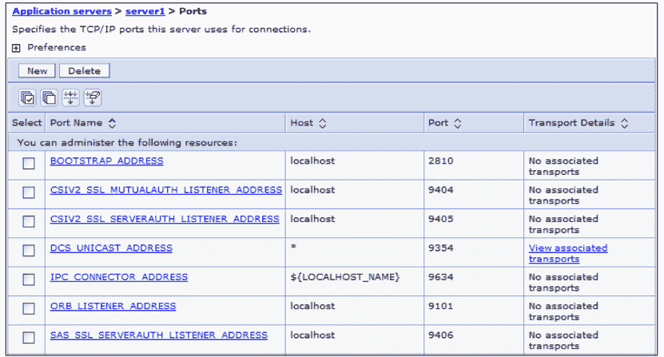

## WAS 进程属性

准备指南中指出了 CE Java 进程的 UMASK 设置。在类 Unix 操作系统中，UMASK 控制由进程创建的文件的默认权限。

> UMASK 有时被认为是一个用户创建的文件的默认权限，但从技术上讲它是一个正在运行进程的设置。它在用户的登录 shell 进程上设置，并被其他进程继承。

## 安装环境组件

- 将该 WAS 配置文件的所有文件更改为我们在表单上设置的用户和/或组
- 启动该 WAS 配置文件（从 root 账户或我们为该配置文件配置的用户账户启动）

在本例中，我们以用户/组 ecmuser/ecmgroup 运行 AE 和 CE 两个配置文件。我们还在 AE 配置文件上将 UMASK 值设置为 007 仅为保持一致。我们可以只将这些字段留空并始终从 ecmuser 账户启动 WAS，但进行这部分配置可以防止我们犯错。我们可以从 root 账户启动 WAS，它仍然会以 ecmuser 运行。

运行以下命令以修复 AE 和 CE WAS 配置文件下文件的拥有者：

```shell
# cd /opt/ibm/WebSphere/AppServer/profiles
# chown -R ecmuser:ecmgroup AppSrv01 AppSrv02
```

## WAS 性能调整

需要对 CE 配置文件的 WAS 管理控制台进行少量性能调优配置。导航到 **Servers | Server Types | WebSphere application servers | server1 | Java and Process Management | Process definition | Java Virtual Machine**。指定至少 512 MB 的初始堆大小和至少 1024 MB 的最大堆大小。根据您可用的 RAM，您可能会发现指定更大的值对性能有益。

规划和准备指南中有一条关于可选增加 WAS 事务超时的说明。只有少数更新操作存在触发事务超时的风险，例如创建 ObjectStore 以及随后向 ObjectStore 安装 AddOns。WAS 默认值为 300 秒，除非您在这些操作中遇到问题，否则可以保留该值。

最后，有一个经常困扰人们的 WAS 配置重要细节。它是少数在测试或演示环境中比生产环境更可能成为问题的事项之一。前面我们展示了 WAS 管理控制台中 bootstrap 地址的屏幕截图。当时我们关注的是端口号，但现在让我们来看地址的主机部分。WAS 安装尽力确定我们主机的名称，但它只能得出 localhost。这对于从同一服务器连接来说完全可以，但要从任何其他机器连接到该 WAS 实例，bootstrap 主机名必须在客户端机器上可通过 DNS 解析。对于我们的系统，我们将至少为 bootstrap 地址输入 wjc-rhel.example.net。这对于 CM 目的通常已足够，但如果您愿意，也可以更改所有其他 localhost 条目。

根据您的 DNS 环境，您可能只需要想象输入服务器名称。域名可能无法在您的 DNS 中解析。在这种情况下，请改用该服务器的 IP 地址。

## WAS 和 DB2

现在是时候将我们的 WAS 和 DB2 组件结合起来了。这包括两项独立的工作。我们必须确保 WAS 使用与 CE 兼容的 JDBC 驱动程序与 DB2 通信，并且我们必须配置 WAS 数据源以供 CE 用于与 GCD 和 ObjectStores 通信。所有 CE 与数据库的通信都由 J2EE 应用服务器中介。

P8 硬件/软件指南给出了每个受支持数据库和平台的可用 JDBC 驱动程序。这通常以最低发布级别的形式说明，但偶尔会列出需要避免的特定驱动程序版本。由于我们在安装 DB2 时确保指定了 Java 支持，JDBC 驱动程序已作为默认实例的一部分安装在默认位置 /home/db2inst1/sqllib/java/。文件 db2jcc.jar 包含我们感兴趣的实际 JDBC 提供程序。要找到该文件中提供程序的确切版本号，我们使用 Java 来查询驱动程序本身。以下命令执行 JAR 文件中的 DB2Jcc 类并向其传递一个参数以请求版本信息。紧随其后的行是典型的输出。

```
$ cd /home/db2inst1/sqllib/java
$ java -cp db2jcc.jar com.ibm.db2.jcc.DB2Jcc -version
IBM DB2 JDBC Universal Driver Architecture 3.53.95
```

截至本文撰写时，P8 硬件/软件指南指定 DB2 9.5 的最低版本为 3.53.95（DB2 9.7 为 3.57.82），因此我们可以直接使用此已安装的驱动程序。如果不是这种情况，驱动程序软件可从 DB2 支持站点下载。这对于所有受支持的数据库都是典型情况。

要使 WAS 意识到此特定 DB2 驱动程序，请登录 CE 配置文件的 WAS 控制台，并导航到 Environment | WebSphere variables。将变量 DB2UNIVERSAL_JDBC_DRIVER_PATH 的值设置为 /home/db2inst1/sqllib/java。务必保存您的更改。

我们可以手动配置用于连接 GCD 和 ObjectStore 数据库所需的 JDBC 数据源，但我们将让 P8 Configuration Manager 应用在第 3 章安装实际 CE 软件时处理这些细节。如果您有兴趣了解如何手动设置数据源，可以在 WAS 文档中找到详细说明。如果您手动操作，请务必查阅 P8 文档以获取性能和功能方面的必要设置。

## 安装 Tivoli Directory Server

TDS 使用数据库（用于存储目录和配置数据）和应用服务器（用于托管其基于 Web 的管理工具）。安装程序将尝试检测已安装且可用的版本。如果未找到任何版本，它将使用安装程序提供的嵌入式 DB2 和 WAS 版本。

到目前为止，故事应该听起来很熟悉——使用“典型”路径安装 TDS，并接受各种事物的默认建议。这几乎就是情况。我们接下来展示的步骤使用 DB2 9.5 和“典型”安装路径。对于我们的安装，TDS 6.2 能够使用 DB2 9.5。对于 TDS 6.2 的某些早期版本，存在一个可能阻止正常启动的错误。我们接下来将向您展示如何规避该错误。但是，使用 DB2 9.7 时，“典型”路径运行顺畅，就像使用 DB2 9.5 和 TDS 6.2 的后续修复包时一样。

TDS 6.2 不会使用 WAS 7.0，因此它会安装自己的 WAS 6.1 嵌入式副本。如果您接受默认值，您将在 /opt/ibm/ldap/appsrv/ 下找到 WAS 的嵌入式副本。

> TDS 6.2 是 CM 4.5.1 支持的最新版本。CM 5.0 最终可能支持 TDS 6.3。TDS 6.3 反过来可以使用 WAS 7.0 作为其嵌入式应用服务器。在这种情况下，WAS 7.0 将被 TDS 安装程序自动检测并使用。

在“典型”安装路径中，TDS 创建一个单独的 DB2 实例 dsrdbm01，以及同名的操作系统用户账户。它还创建了一个目录管理操作系统用户 idsldap。

在启动 TDS 安装程序之前：

- 确保 DB2 管理服务器正在运行。这对于 TDS 创建自己的 DB2 实例和数据库是必需的。
- 设置一个环境变量来告诉 TDS 使用哪个 DB2 实例。我们现在就这样做，即使实例尚不存在，也只是为了让安装顺利进行。


从命令行窗口，并在包含 TDS 安装文件的目录中，运行如下所示的命令。尽管我们从命令行运行这些命令，TDS 安装程序会启动一个 GUI。

```
# su – dasusr1 -c "db2admin start"
# DB2INSTANCE=dsrdbm01
# export DB2INSTANCE
# ./install_tds.bin
```

第一行启动 DB2 管理服务器。第二行和第三行设置并导出 DB2INSTANCE 环境变量。由于我们之前提到的缺陷，TDS 可能会对要使用哪个 DB2 实例感到困惑，而设置该环境变量可以消除这种困惑。稍后您会看到，我们在用于启动 TDS 运行的脚本中也包含了同样的内容。上面的最后一行启动 TDS 安装程序。所有操作都应以 root 用户身份完成。

当您选择“典型”安装路径时，最终会看到一个带有**完成**按钮的屏幕。随后，**IBM Tivoli Directory Server 实例管理工具**将自动启动。主面板将显示一个已创建的目录服务实例 dsrdbm01。该实例将处于**已停止**状态。单击该摘要面板上的**启动/停止**按钮以启动该目录实例。

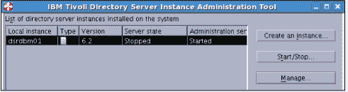

关闭所有嵌套的向导面板、对话框以及与 TDS 相关的其他屏幕杂物。您的目录已安装、运行，并等待填充数据。默认情况下，目录管理员账户已创建为 cn=root，我们将在下面使用该账户。

如果您对我们刚才提到的 dsrdbm01 感到有些困惑，这里简要列出了发生的事情：

- 我们创建了一个新的 TDS 实例来保存我们的企业目录。它实际上并没有名称，但它归 dsrdbm01 所有，并存储在该用户的主目录中，因此它隐式地采用了该名称。

## 安装环境组件

- 我们创建了一个名为 **dsrdbm01** 的新 DB2 实例。出于 DB2 管理目的，它与我们在安装 DB2 时创建的实例 **db2inst1** 分开，后者将用于保存 ObjectStore 数据库。
- 我们在 DB2 实例 **dsrdbm01** 中创建了一个 DB2 数据库。该数据库也称为 **dsrdbm01**，并存储在该用户的主目录中。TDS 在访问该数据库时将使用操作系统用户账户 **dsrdbm01**。

## 使用目录

目录信息可用于多得令人难以置信的不同目的，其中许多考虑因素会增加数据本身的复杂性。然而，对于 CM 而言，其用途是直接且标准的。

- **基本用户信息：** 主要用于以各种目的唯一标识个人。
- **用户身份验证：** CM 将此项委托给 J2EE 应用服务器，理论上它完全可以不查阅目录。实际上，基于目录的密码身份验证仍然是最常用的技术。即使不使用密码身份验证，目录也几乎总是其中的一部分。
- **组成员身份：** 某个特定组的成员身份可用于控制授权（即访问各种事物的权限）。

人们对身份验证和授权的概念常常感到混淆，也许是因为这两个词非常相似。身份验证是向系统证明您是谁。授权是系统决定您有权做什么。身份验证是授权的自然前提（我们将在*第 8 章“安全特性与规划”*中讨论安全特性时再次重点阐述这一点）。CM 不使用目录或 J2EE 进行授权。它有一个内部访问控制系统，但它确实依赖目录来实现用户身份和组成员身份的目的。

## 填充目录

如果您刚刚安装了 TDS，那么您将拥有一个基本上是空的目录，也就是说其中没有任何真实的用户或组。TDS 确实附带了一个示例数据文件，您可以将其导入目录中。如果您想查看一些真实数据或学习某些 TDS 教程材料，当然可以这样做。它不会干扰我们下面为 CM 使用的目录数据。

> 如果您已经熟悉企业中使用的目录模式约定，您可以在我们刚刚创建的隔离目录中执行类似操作。在本章后面配置 WAS 和 CE 进行目录交互时，您需要进行一些相应的调整。

让我们逐步完成手动添加一些用户和组的过程。CM 环境需要一些特定的目录用户和组角色。大多数从事企业软件工作的人至少对用户和组的概念有直观的感受，但深入了解企业目录结构的来龙去脉则是一种更为专业的知识。我们将引导您完成我们所使用的步骤。

我们将使用一种可能与您企业的约定密切匹配、也可能不完全匹配的方案，但该方案对于运行一体化环境来说没有问题，而且是一种让一切快速启动并运行起来的简便方法。

- 我们目录命名的前几个顶层遵循域组件（Domain Components）的常见模式，即组织 DNS 域名中的元素被映射到目录层次结构的顶层。我们的企业是一个虚构的组织，非常神秘，甚至没有名称。不过，它的 DNS 域名是 example.net（取自 RFC-2606 为示例保留的域名列表）。
- 在目录命名层次结构的一个独立分支中，我们将创建一个扁平的用户列表。
- 每个用户都有一个唯一标记，作为目录条目的一个常用名称属性。这不仅会在扁平列表中唯一（且永久）地标识每个用户，而且还将作为登录用户 ID（用目录术语来说就是短名称）。
- 在目录命名层次结构的另一个独立分支中，我们将放置组。组可以嵌套在组中，但我们不会利用这一功能。

> 我们可以使用 TDS Realms 界面来构建我们的用户和组。如果您在企业中使用 TDS，那是一个不错的方法。它为目录管理提供了若干用户界面上的便利，并为条目提供了部分引用完整性。我们使用这里描述的更简单且稍显繁琐的方法，因为您可以将其用于任何 LDAP 目录。

## TDS Web 控制台设置

配置 TDS Web 控制台需要执行一些一次性操作。我们将在此一一介绍。

首先，以 root 身份运行以下命令，启动随 TDS 嵌入的 WAS 实例。任何时候您想使用 Web 控制台时都需要执行此操作，因为 Web 控制台作为该 WAS 配置文件下的一个 servlet 运行。

```
/opt/ibm/ldap/V6.2/appsrv/profiles/TDSWebAdminProfile/bin/startServer.sh
server1
```

> 上述命令为单行命令，唯一的空格就在 `server1` 这个词之前。

使用 Web 浏览器连接到基于 Web 的管理工具，地址为 `http://wjc-rel.example.net:12100/IDSWebApp/`。在登录提示符处，您可能会想输入之前配置的目录服务管理员账户和密码。但这不是它要求的。它要求的是控制台登录。默认情况下，用户为 `superadmin`，密码为 `secret`。该密码实际上就是单词“secret”。

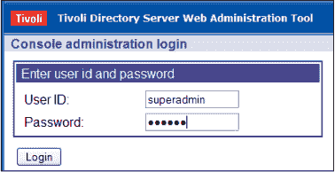

> 除非您经常使用这个 TDS 工具，否则我们保证，您迟早会忘记用于控制台登录的用户 ID 和密码。我们已经忘记并重新学习了多次。

您可以选择忍受这一点（每次忘记时也只是一笑置之），也可以使用提供的选项：控制台管理 | 更改控制台管理员登录名和更改控制台管理员密码，改成一个您能记住且可能更安全一些的凭据。虽然默认凭据不会让您获得太多权限，但它们的权限足以让某个恶作剧者修改凭据并将您拒之门外。

> 由于我们将仅通过此控制台管理单个目录，因此我们将凭据更改为与目录服务器管理员 cn=root 相同。

此时，我们已有一个可正常运行的 TDS 控制台服务器，但它不知道要管理任何实际的目录。下一步是告知它同一服务器上有一个目录正在运行。导航到控制台管理 | 管理控制台服务器。单击“添加”按钮。

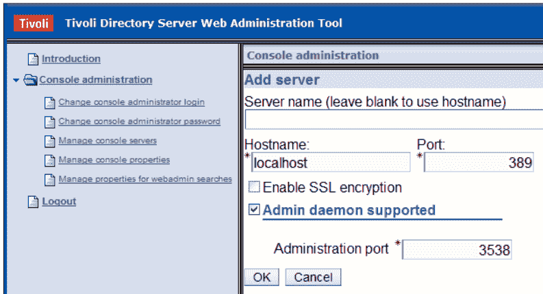

我们使用了主机名 localhost，因为目录服务器与控制台服务器运行在同一台服务器上。出于同样的原因，我们将“启用 SSL 加密”选项保持为未选中状态。这是针对控制台与目录服务器之间的通信。如果您要远程管理目录服务器，则可能需要启用 TLS/SSL。


点击 OK 应用更改。退出控制台管理工具，然后返回到登录页面。你会发现它变成了更符合预期的样子。

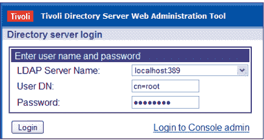

你现在可以使用我们之前配置的凭据 cn=root 登录到目录管理工具（不是控制台配置工具）。如果你需要返回控制台配置工具，只需点击 Login to Console admin 链接即可。

如果点击 Login 按钮，你将被带到 Tivoli Directory Server Web Administration Tool，我们将通过该工具完成所有的目录配置和数据录入。

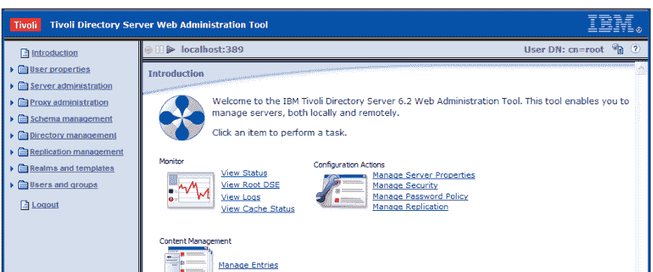

## Server-side sorting

作为 CE 的要求，需要配置 TDS 以允许搜索结果的服务器端排序。这通常默认启用，但你可以通过 TDS Web 管理应用程序进行检查。导航到 **Server administration | Manage server properties | Search settings** 并确保 **Allow only administrators to perform sort searches** 复选框未被选中。你不想将其限制为管理员；你希望允许任何人进行排序搜索。

## The suffix

TDS 可以保存任意数量的数据逻辑分区，每个分区都位于唯一的 **suffix** 下。后缀只是在其下所有其他条目都落入的属性值集合。我们的组织将企业目录称为 "WhoZit?"，因此我们将后缀设为 dc=whozit,dc=example,dc=net。

> 目录概念和记法看起来可能很奇怪。大多数人不会每天遇到它们。网上有大量材料可以解释概念和记法。这里有一个例子写得清晰，面向目录新手：http://www.skills-1st.co.uk/papers/ldap-schema-design-feb-2005/index.html。

你可以通过基于 Web 的管理工具向 TDS 添加后缀。导航到 **Server administration | Manage server properties | Suffixes**。在 **Suffix DN** 框中输入完整的后缀，然后点击 **Add** 按钮。务必同时点击 **OK** 或 **Apply** 按钮以提交更改（很容易遗漏）。

> 你可能还需要在新后缀在目录中显示之前重启目录服务器。导航到 **Server administration | Stop/start/restart server。**

## Users

目录管理中的一个良好做法是为个人添加所有条目采用扁平结构，然后从随时间可能发生变化的组、组织实体和其他结构中引用这些条目。其思想是无论目录中需要什么其他更改，用户 Distinguished Name 都保持不变。我们将定义一个名为 cn=people 的节点来保存所有人员条目，无论其组织或其他隶属关系如何。导航到 Directory management | Add an entry。从结构对象类列表中选择 groupOfNames 并点击 Next。我们使用 groupOfNames 类是因为它在 TDS 管理工具用户界面中为我们触发了一些便利；请注意不要意外选择 groupOfUniqueNames。对于这个简单的容器节点，我们不需要任何额外属性，因此点击 Next 跳过辅助对象类面板。这将带你进入 Required attributes 面板。

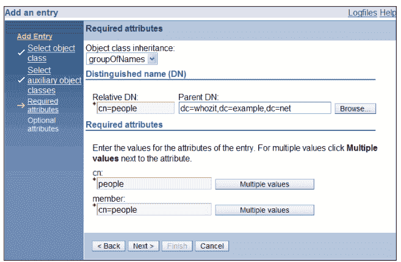

输入我们新容器的名称 cn=people 作为 Relative DN，并将 people 也作为 cn 属性值输入。因为 groupOfNames 必须至少有一个成员，请在该字段中添加节点本身。你可以浏览以选择 Parent DN 的 LDAP 后缀。

> TDS 管理工具某些版本的怪癖是，新创建的 LDAP 后缀在某些地方要到其下至少有一个条目后才会显示。如果这种情况发生在你身上，只需将值 dc=whozit,dc=example,dc=net 输入到该字段即可；它将通过 Browse 按钮在所有未来操作中可用。

你可以将下一屏幕上出现的可选属性字段留空。点击 Finish 提交更改后，TDS 会询问你是否要添加类似的条目。你可以通过点击 Yes 为自己节省一点工作。创建一个用于保存组定义的容器，并将其 Relative DN 设为 cn=groups。我们现在有了两个特殊用途的目录节点 – cn=people,dc=whozit,dc=example,dc=net 用于用户，以及 cn=groups,dc=whozit,dc=example,dc=net 用于组。

要添加单个用户，请返回 Directory management | Add an entry。这次，选择结构对象类 person。另一个流行选择是 inetOrgPerson，因为它有许多额外的可选属性，但就我们的目的而言，person 类更简单且足够。重要的是用户条目具有 userPassword 属性，因为它将是 CM 的登录密码以及其他各种用途的密码。

对于 Relative DN，提供对给定用户唯一的值。这通常是员工 ID 号或电子邮件地址。它也将是登录用户 ID，因此应是用户有意义且不保密的值。在下一屏幕中，我们使用了姓名首字母（这对示例来说是可以的，但如果你的企业有超过几个人则可能很糟糕）。重要的是该值永久唯一，因为 Relative DN 和 Parent DN 的组合构成了用户的完整 Distinguished name。目录不允许你创建具有重复值的条目，这是使用用户扁平列表的优点之一。

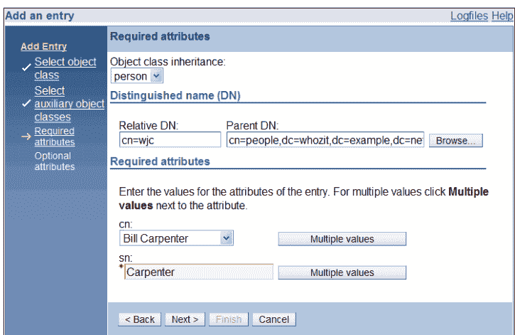

尽管定义为可选，但请务必为每个条目提供 userPassword 属性的值。在真正的企业目录中，你可能会自定义使其 userPassword 属性成为必需。

继续创建一两个个人用户条目。随意尝试该工具；你以后随时可以删除条目。我们将在本节稍后返回填充 CM 特定信息。

## Groups

让我们至少创建一个目录组来看看如何操作。我们之前添加了节点 cn=groups,dc=whozit,dc=example,dc=net。导航到该节点，选中 cn=groups 旁边的复选框，并从下拉菜单中选择 Add 以在该节点下直接放置新条目。使新条目成为 groupOfNames 并将其 Relative DN 设为 cn=vampires。（有人告诉我们，如果我们提到吸血鬼就会卖出更多书，但我们认为只有在他们年轻、漂亮且情绪化时才有效。我们拭目以待。）同样，将新条目添加为其自身的成员。当你完成并提交更改后，你应该能够导航到新节点 cn=vampires,cn=groups,dc=whozit,dc=example,dc=net。从组列表中选择该节点，如下一张屏幕截图所示。从 Select Action 下拉菜单中选择 Manage Members 并点击 Go。

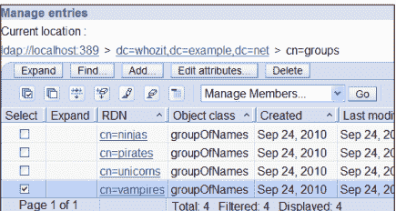

你将被带到一个屏幕，可以通过输入其 Distinguished names 或在目录中浏览来添加组成员。正如你所料，你也可以导航到个人条目并选择 Manage Memberships 来从该角度管理事物。在进入下一小节之前随意尝试。

## CE-specific entries

对于 CE 的安装和初始配置，需要少量用户和组。通常会指定现有的目录条目用于这些用途，但对于我们的全包环境，我们将创建新的专用条目。这将帮助你了解哪些账户用于哪些目的。

下表总结了你现在应使用刚刚描述的流程创建的用户和组。所示的具体用户或组 ID 只是建议，并与 PPG 和安装工作表中使用的比喻名称相匹配。如果你愿意，可以使用不同的名称。务必记录你为这些账户分配的密码。虽然对 CE 目的不是必需的，但你可能喜欢将这些特殊账户分配给一个描述性命名的组以便于简单记账。例如，我们有时在设置中使用名为 pseudousers 的组。

| User | Group | Comment |
|---|---|---|
| `ce_bootstrap_admin` |  | 使其成为不用于其他任何用途的专用账户，并且密码永不过期。CE 用于初始访问 GCD。 |
| `gcd_admin` |  | 域管理员。 |
| `object_store_admin` | `object_store_admin_group` | ObjectStore 管理员。 |
| `ce_service_user` |  | CE 用于执行 LDAP 目录查找。 |
| `was_admin` |  | 在我们将其更改为使用 TDS 进行身份验证后，使用此用户 ID 登录 WAS 管理控制台。 |

如果你遵循本节中描述的模式，你将拥有像 cn=ce_bootstrap_admin,cn=people,dc=whozit,dc=example,dc=net 这样的用户 Distinguished name。不要忘记将用户 object_store_admin 放入组 object_store_admin_group 中。


这些是 CE 安装所需的唯一目录条目，但我们在安装额外的 CM 组件时仍会返回到该目录。由于这是一个开发系统，你可能会添加一些额外的用户来代表环境中的非管理员用户。例如，我们经常创建名为 poweruser 和 unpriv 的用户，用于安全配置实验中的不同角色。

### 手动 TDS 查询

出于故障排除目的，或出于任何其他原因，你可以使用 /opt/ibm/ldap/V6.2/bin/ldapsearch 命令从命令行手动查询 TDS。我们不会尝试对 LDAP 查询语法进行教程说明，但以下两个命令分别查询我们在上面定义目录数据中的所有人员和组：

```
$ cd /opt/ibm/ldap/V6.2/bin
./ldapsearch -b "cn=people,dc=whozit,dc=example,dc=net" "cn=*"
./ldapsearch -b "cn=groups,dc=whozit,dc=example,dc=net" "cn=*"
```

### 脚本和桌面快捷方式

全集成服务器中有很多活动部件，即使是有经验的人也可能难以记住所有可能的命令和位置。在开发或演示系统上，你可能会定期启动和停止各种事物。

在我们的架构角色中，我们处理着大量具有不同配置的虚拟服务器镜像库。执行即使是常规任务的流程也因供应商而异，有时甚至同一供应商产品的不同版本之间也不同。我们发现为启动和停止我们的 DB2 实例、启动和停止 TDS 实例，以及启动和停止两个 WAS 配置文件创建一系列桌面快捷方式非常方便。我们将 WAS 配置文件分开处理，因为我们经常需要调整 CE 而不需要 AE 运行。

为方便我们自己，我们还将其中许多相同的命令收集到脚本中，可以从 root 账户运行，以确保一切都在运行或确保一切都已关闭。

> 这些脚本也可以在 Packt Publishing 网站上的其他可下载材料中找到：http://www.packtpub.com/support。

这是我们第一个脚本，我们称之为 up.sh。它以满足依赖关系的逻辑顺序启动所有服务器（其中一些依赖关系只有在我们在 *第 3 章* 和 *第 5 章* 安装并配置了更多内容后才会出现）。我们首先启动数据库，然后是目录，然后是应用服务器配置文件。其中一些单独的命令使用 Linux su 命令在身份很重要时切换为其他用户。命令行中的连字符对于获取该其他用户的环境非常重要。

```sh
#!/bin/sh

# up.sh: Script to bring up all the components.
# Handy after reboot. Run as root.

set -v

### applications/default DB2 instance
su - db2inst1 -c "db2 db2start"
#echo "Press enter..."; read x

### TDS admin service.
## Normally started via inittab. We have it here
## just in case we shut it down via the down.sh
## script and need to bring it back up.
/opt/ibm/ldap/V6.2/sbin/ibmdiradm -I dsrdbm01
#echo "Press enter..."; read x

### TDS DB2 instance
## Normally started automatically by TDS, but
## we start it manually just to make sure.
su - dsrdbm01 -c "db2 db2start"
#echo "Press enter..."; read x

### TDS directory instance
## We set DB2INSTANCE so TDS knows which instance to use
DB2INSTANCE=dsrdbm01; export DB2INSTANCE
/opt/ibm/ldap/V6.2/sbin/idsslapd -I dsrdbm01
#echo "Press enter..."; read x

### TDS directory admin console server
/opt/ibm/ldap/V6.2/appsrv/profiles/TDSWebAdminProfile/bin/startServer.sh server1
#echo "Press enter..."; read x

### WAS CE instance

/opt/ibm/WebSphere/AppServer/bin/startServer.sh server1 -profileName AppSrv02
#echo "Press enter..."; read x

### WAS AE instance
/opt/ibm/WebSphere/AppServer/bin/startServer.sh server1 -profileName AppSrv01
#echo "Press enter..."; read x

### CSE
rm -f /tmp/k2start.log
su - k2_os_user -c /opt/IBM/FileNet/ContentEngine/verity/k2/_ilnx21/bin/k2adminstart > /tmp/k2start.log
#echo "Press enter..."; read x

## This is done so the window doesn't disappear
echo "Press enter..."; read x
```

第二个脚本，我们称之为 down.sh，基本上就是 up.sh 的逆向操作（它与 up.sh 一起在 Packt Publishing 网站的可下载材料中提供）。它以与启动相反的顺序关闭事物。对于两个脚本来说，都可能出现某个服务器已经启动或已停止的情况。在这种情况下，会打印无害的错误。运行这些脚本几次后，很容易看出什么重要，什么只是常规且预期的错误。

如果你的环境与我们相似，你可以通过从 up.sh 和 down.sh 中复制行来为单个项目创建自己的快捷方式。有些“值得做成快捷方式”的内容并未出现在这些脚本中。以下是这些内容的简要目录，再次假设你是从 root 账户运行，并且使用了用户账户和文件系统位置的默认值：

- 要启动 DB2 管理服务器（在 DB2 控制中心执行大多数操作时需要）：/opt/ibm/db2/V9.5/das/bin/db2admin start。
- 要为 DB2 实例 db2inst1 运行 DB2 控制中心 GUI：/bin/su - db2inst1 -c db2cc。该命令首先切换到用户 db2inst1，然后运行 DB2 控制中心。如果出现 X Window System 连接错误，你可能需要调整允许某人连接到你的 X 显示器的权限。最简单（但也是最不安全的）方法是先运行命令 xauth +local host（仅允许来自同一主机的连接）或 xauth +（完全关闭访问检查）。
- 要为 TDS 使用的实例 dsrdbm01 运行 DB2 控制中心 GUI：`/bin/su - dsrdbm01 -c db2cc`（请参阅上一条要点中关于 X 显示错误的说明）。
- 要连接到 WAS 配置文件 AppSrv01 的管理控制台（它将成为我们的 AE）：`http://wjc-rhel.example.net:9060/ibm/console`。
- 要连接到 WAS 配置文件 AppSrv02 的管理控制台（它将成为我们的 CE）：`http://wjc-rhel.example.net:9061/ibm/console`。
- 要连接到 TDS 基于 Web 的管理工具：`http://wjc-rhel.example.net:12100/IDSWebApp`。要使用 TLS/SSL，则为 `https://wjc-rhel.example.net:12101/IDSWebApp`。

在上面的 URL 中，如果你是从服务器本身连接，可以选择使用服务器名称 `localhost`。

### 摘要

在本章中，我们成功安装了全集成环境中 CE 的先决条件环境组件。这包括设置操作系统，以及安装和配置数据库系统、目录服务器和 J2EE 应用服务器。

现在所有这些都已就位，并且我们在安装工作表中做出并记录了许多决策，我们已准备好在 *第 3 章* 安装 CE 本身。
