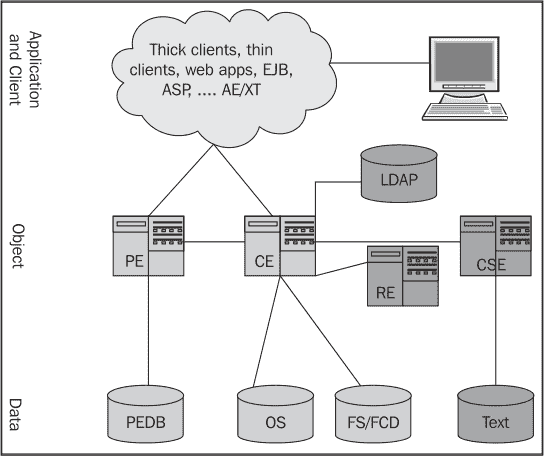
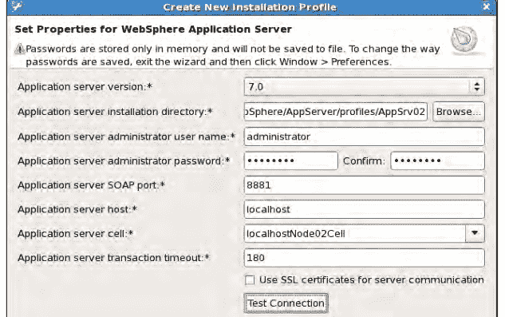
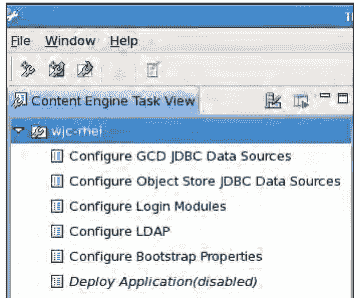
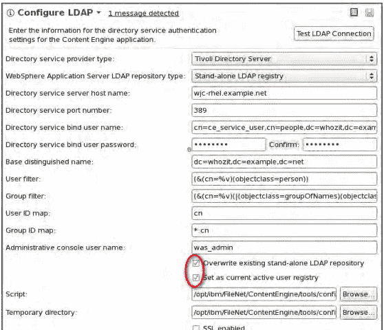
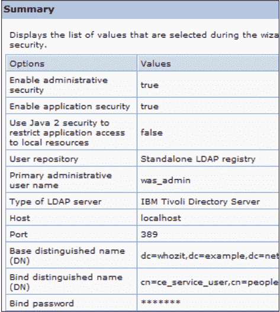
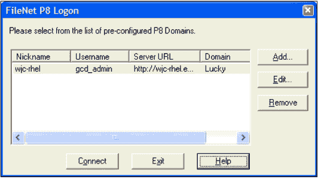
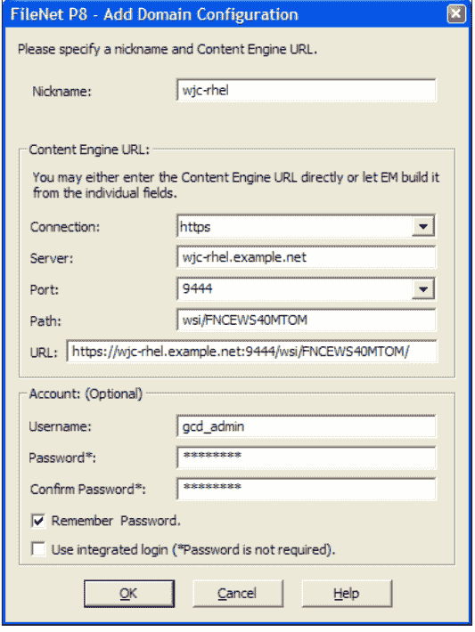
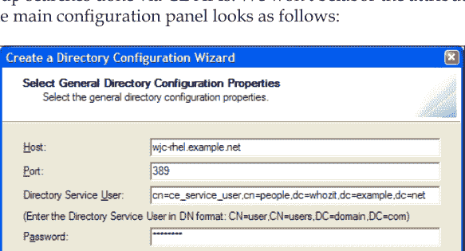
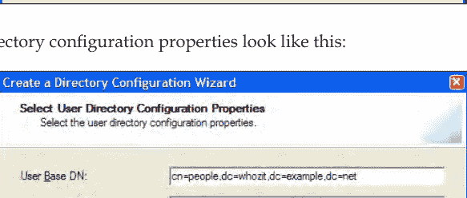
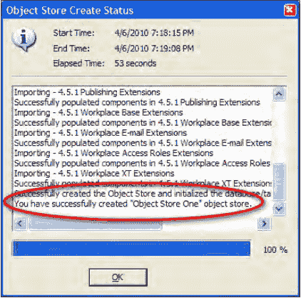

## 3 安装 Content Engine

在本章中，我们开始实际安装 Content Engine（CE）软件。本章中的某些内容假设你拥有与第 2 章中描述相似的环境。如果你的环境与此不同，在执行配置步骤时可能需要进行一些调整。

本章包含以下主题：

- CM 产品、P8 平台以及各种组件的概述
- CE 本身的安装
- 安装后立即执行的任务，直至创建你的第一个对象存储

如果你按照安装步骤操作，到本章结束时你将拥有一个可工作的 CE 服务器。

### 关于一些名称的旁注

Content Manager 和 Content Engine 有什么区别？P8 在其中扮演什么角色？如果你主要使用面向消费者的商业软件或开源软件，听到对听起来相同的东西有这么多不同的名称可能会觉得奇怪。让我们现在就理清这些，以便你在本章和整本书中理解术语时不会遇到困难。我们将在整本书中正确使用这些术语，以便你始终准确地知道我们的意思。


IBM FileNet Content Manager (CM) 是一个产品名称。它是你能从 IBM 许可的一组特定组合。由于它是一个相当复杂的产品，构成 CM 的有许多独立的软件组件。P8（如果你在想，它不代表任何特别的东西；它只是一个名字，尽管关于其起源有一点小小的神话）指的是一个软件组件家族。虽然 IBM FileNet 开发团队每天都在努力构建和增强 P8 组件，但你并不会购买或许可一个叫做 P8 的东西。你许可的是 CM，而这包括了使用若干 P8 组件的权利，以及其他内容。

> 还有另一个产品叫做 IBM Content Manager，或 IBM CM（通常被称为 CM8）。当与 IBM FileNet Content Manager 相比时，这种命名可能会有点令人困惑。虽然这两个产品都是 ECM 产品，因此都有相同的总体产品目标，但它们有着不同的开发历史和技术架构。两者都在积极开发中（事实上，在 IBM 内部同一个更大的开发组织中），并且两者都可能存在很长时间。除此之外，我们在这本书中完全不会谈论 IBM Content Manager。每当我们说 Content Manager 或只是 CM 时，我们指的是 IBM FileNet Content Manager。

我们将在本章以及后面的章节中对 CE 有很多话要说。现在，我们只是想明确区分，它是 CM 产品中一个具体的、可触及的软件组件。

## P8 平台架构

在本节中，我们将查看一个 CM 安装的典型部署架构。下面的图示显示了这样的部署图。目前，我们不会对应用程序云说太多（我们将在第 5 章和第 6 章中回来讨论它）。它包括 P8 Application Engine (AE) 以及 CE 团队创建和发布的绝大多数 CE 管理工具。图中对象层和数据层中的所有组件都将在本节中描述。



### Content Engine (CE)

CM 产品的核心是 P8 **Content Engine**。它调解应用程序与实际内容之间的所有活动。CE 提供安全性、引用完整性、复杂的面向对象数据模型，以及管理内容所需的许多其他功能。我们将在 *第 7 章* 中深入探讨其中大部分功能；安全性将在 *第 8 章* 中单独处理。现在，你可以认为 CE 以一种类似于数据库服务器管理数据库表、行和列以及其上构建的功能的方式来管理内容和相关对象。

> 你有时会看到 Content Engine 被称为“P8CE”，有时只是称为“CE”。你有时会看到它被称为“CE server”，有时会省略“server”一词。有时同一作者会混合使用这些术语。所有这些通常意味着同一件事。我们大多数时候会使用更简单的术语“CE”，但我们偶尔需要区分服务器部分和属于 CE 的其他东西（例如，CE API）。这应该总是从上下文中清楚。

CE 关注三类广泛的持久数据：

- **Content：** 这就是大多数人传统上认为的实际文档或其他受管内容。它是办公生产力或其他应用程序所工作的原始位集合的实际内容。除少数特殊情况外，CE 不会查看内容本身。在 CE 控制下，内容可以存储在文件系统中、在 Object Store 数据库中，或在来自多个厂商的各种专用存储设备中。前一图中标记为“FS/FCD”的组件代表文件存储（文件系统中的存储）或固定内容设备（几种专用存储设备之一）。

- **Metadata：** 这代表关于内容或其他对象的数据。例如，文档最后修改的日期就是元数据。CE 数据模型有一套丰富的系统元数据来支持 CE 功能，并且还允许在自定义元数据中进行非常灵活的扩展。无论内容存储在哪里，元数据始终存储在一个称为 **Object Store** 的存储库中，该存储库建立在关系数据库之上。图中标记为“OS”的组件是一个 Object Store 数据库。对于文档而言，其元数据加上其内容构成了文档对象。Object Store 中还驻留着许多其他类型的对象。例如，Object Store 文件夹层次结构中的每个文件夹实际上都是一个对象。

- **Global Configuration Database (GCD)：** 这是一个特殊的数据库，用于保存驻留在任何 Object Store 之外的对象的定义和配置。GCD 对应于一个 P8 **Domain**，并且是所有 Object Stores、CE 服务器实例、文件存储和其他顶级对象的关键。一个 Domain 可以有大量的 Object Stores，但特定的 P8 安装始终恰好有一个 Domain。

那么，Domain 究竟是什么？除了是安装中所有顶级对象的集合之外，它还要求 Domain 中的大多数组件与其他所有 Domain 对象具有网络连接。因此，例如，每个 CE 服务器必须能够直接访问每个 Object Store。Domain 的所有组件共享一个通用的用户和组目录基础设施。许多，也许大多数应用程序只能与单个 Domain 工作，并且不知道存在多个 Domain 的可能性。这在一定程度上是由于用于配置 CE API 的连接 URL 也隐式选择了 Domain 的安排，但我们稍后会回到这一点。

## Installing the Content Engine

### Content Search Engine (CSE)

P8 **Content Search Engine (CSE)** 是一个全文搜索引擎，可用于索引 CE 字符串属性和大多数常见业务文档类型的内容。图中标记为“Text”的组件是 CSE 管理的文本索引数据。它目前基于文件系统。

> 请注意，应用程序与 CSE 之间没有直接交互。所有交互（索引和搜索）都在 CSE 与 CE 之间进行。

对于 CM 4.5.1 及更早版本，CSE 基于 Autonomy K2 搜索引擎的嵌入式副本（你可能认识它为 Verity K2 搜索引擎；Verity 几年前被 Autonomy 收购）。虽然 K2 作为 CSE 组件包含在 CM 的许可中，但许可不包括将 K2 用于其他目的。CM 5.0 包含一个 IBM 开发的文本搜索引擎，但对基于 K2 的 CSE 的支持将继续一段时间。截至本文撰写时，细节尚未公布。

### Process Engine (PE)

P8 **Process Engine (PE)** 是一个企业级、功能齐全的 **Business Process Management (BPM)** 系统。PE 与 CE 集成，用于将文档和其他对象作为工作流附件进行处理。工作流本身的记账维护在 PE 管理的独立数据库中（图中标记为“PEDB”）。有趣的是，在正常配置中，PE 服务器充当 CE 客户端，而 CE 服务器充当 PE 客户端。CM 许可包括有限许可，可将 PE 用于 AE 随附的几个预定义工作流。

### Rendition Engine (RE)

P8 **Rendition Engine (RE)** 是一个用于将常用业务文档类型转换为 HTML 或 PDF 格式的服务器。在这种意义上，“rendition”意味着目标文档只是源文档的转换副本。它不包括任何实质性内容或格式更改。你有时会听到 RE 被称为发布引擎。RE 单独许可，并基于 Liquent Vista 软件的嵌入式副本。虽然 Liquent Vista 包含在 RE 的许可中，但许可不包括将 Liquent Vista 用于其他目的。


## 安装 CE

好吧，自从第 2 章开始以来，我们确实经历了很多，而我们现在才真正进入 CE 安装阶段。为什么仅仅走到这里就这么麻烦？

有一个重要的事实需要记住——我们从零开始搭建了所有支持的基础设施，并且描述了你可能做出的各种配置决策以及执行配置步骤的各种流程。在许多大型企业中，组织内部已经有人是数据库专家、应用服务器专家或目录专家。事实上，组织越大，你需要协商和决定的就越少。更可能的情况是，负责的人员会告诉你配置将如何进行，或者甚至代你完成，而不是让你自己动手。

我们涵盖了很多内容来帮助你搭建一体化的环境，但我们不认为你在搭建生产环境（或旨在镜像生产环境的预生产环境）时会以同样的方式进行。你更可能只是花费时间收集必要的信息，而花费更少的时间安装支持的软件组件。你在 PPG 和安装工作表中花费的时间将在后续实际安装和配置 CE 软件的步骤中得到回报，让过程更加顺利。

### 获取软件

截至本文撰写时，IBM FileNet Content Manager 并没有可自由下载的版本。前面各节中描述的大多数支持组件至少可以从各自的厂商处获得试用版。对于 CM，则在达成许可协议后安排向你交付软件。这可以是实物介质的形式，也可以是通过电子下载获得。

如果你不是在组织内收到软件的人，你需要内部查明。可能有助于你寻找的一个线索是询问谁拥有 IBM Passport Advantage 或 Passport Advantage Express 账户的登录名。这些是获取许可的 IBM 软件下载的常见途径。

在本节的其余部分，我们假设你已经拿到 CM 软件，无论是一套物理光盘还是已下载（并解压）的文件。

### 运行 CE 服务器安装程序

无论是物理介质还是解压后的下载，Linux 上 CE 的 CM 4.5.1 安装程序的名称为 P8CE-4.5.1-LINUX.BIN。首先以 root 用户身份运行该程序。经过典型的安装程序启动、启动画面、欢迎和许可接受面板后，你将被要求接受或提供安装位置。我们建议接受默认的 /opt/IBM/FileNet/ContentEngine。如果你在 Microsoft Windows 上安装，还有一些额外的选择，但对于 Linux 安装则不适用。

基本安装完成后，你将被提供立即启动配置管理器的机会。取消选中该框并单击完成以结束安装程序。我们将手动运行配置管理器。

CE 安装程序还建议你在运行配置管理器之前先安装内容搜索引擎（CSE）和流程引擎（PE）客户端软件。只有在为这两个组件发布修复包时这才重要。我们现在将只安装所有 CM 组件的基础 4.5.1 版本，并在第 13 章中介绍修复包和升级。

### 配置管理器

CE 安装程序仅将 CE 及相关软件复制到本地磁盘位置。设置配置选项并将 CE 实际部署到应用服务器的大部分工作都在配置管理器中完成。你完全可以通过手工方式在每个软件组件中配置所有必要项目，但配置管理器了解组件之间的关系，并在过程中执行一些有效性检查，同时愉快地处理大量文书工作。CE WAS 配置文件、DB2 实例和 TDS 在你在配置管理器中工作时必须处于运行状态。

假设你在 CE 安装期间使用了默认位置，通过运行以下命令启动配置管理器：

```
# /opt/ibm/FileNet/ContentEngine/tools/configure/configmgr
```

> 对于 CM 4.5.1 和 WAS 7.0 的特定组合，在应用服务器配置面板的某个阶段会存在一个已知的小问题。该问题描述在 http://www-01.ibm.com/support/docview.wss?uid=swg21415627。你必须修改配置管理器的配置文件，使其使用 WAS JRE。在启动配置管理器之前执行此操作。如果你反而启动了配置管理器并遇到问题，你只需退出工具，做出修正，然后重新启动工具即可。
> 
> （该问题出现在 CE 4.5.1 配置管理器的基础版本中，到你尝试此操作时可能已通过修复包解决。）

配置管理器是一个具有图形用户界面的厚客户端应用程序。首次启动时，你会看到一个欢迎屏幕，可以在其中阅读有关配置管理器的角色和功能的简要介绍。准备就绪后，关闭欢迎屏幕，你会发现自己处于一个看起来相当空的工作台屏幕中。

由于这是一个全新的安装，你的第一步将是导航到 **File | New Installation Profile**。这会启动配置文件创建向导。配置管理器配置文件（不应与 WAS 配置文件混淆）是你所做出的所有配置选择的集合。配置管理器可以跟踪许多正在进行和已完成的独立配置文件，因此向导中的第一个必填字段是新配置文件的名称。我们将其命名为 *wjc-rhel*，与 CE 服务器机器的简单主机名相同，但名称是任意的，供你自己使用，以防你创建多个。

你将做出的第一个选择是针对应用服务器。选择 **WAS 7.0** 并记得将配置文件从默认的 AppSrv01 改为 AppSrv02。同样，使用端口 8881 作为 SOAP 字段，而不是 WAS 默认的 8880。**Application server cell** 字段是一个下拉菜单，如果你为之前的字段提供了正确的信息，它应该会自动填充。管理员用户名和密码是你用于登录 WAS 管理控制台的凭据。使用你在安装 WAS 时创建的凭据（我们建议使用 *admin*），而不是稍后我们将使用的 was_admin 用户 ID。

此面板也是你可能遇到上述 Java 问题的地方。填写所有必填字段后，在离开面板之前最好使用 **Test Connection** 按钮。

如果你想确保配置 AppSrv02 而不是意外配置 AppSrv01，你可以在此期间关闭配置文件 AppSrv01。如果连接测试成功，你就能确信自己连接到了正确的位置。

如以下屏幕截图所示，配置管理器默认不会将任何密码保存到文件中。这是最高安全的做法。你可以通过 Windows | Preferences 中的工具首选项更改此设置。



接下来的面板列出了要包含在配置中的一系列复选框。你需要全部选中并单击完成按钮。向导关闭，你的工作台将在内容引擎任务视图中显示你的配置文件及其下的任务列表。



虽然不要求按列出的顺序执行这些任务，但这是一个合理的顺序，我们建议遵循它。列表中的大多数任务都需要你的一些信息。右键单击每个任务并从上下文菜单中选择 **Edit Selected Task**。你可以在为其提供信息后执行每个任务（右键单击并从上下文菜单中选择 **Run Task**），或在为所有任务提供信息后一次性运行它们（通过工具栏上的绿色三角形按钮）。我们个人更喜欢逐个编辑并运行每个任务，但你也可以任选其一。随着每个任务成功完成，其图标会获得一个小的绿色勾号装饰（绿色圆圈内的白色勾号）。

除非被要求提供必填信息以及我们在 LDAP 配置下方所指出的情况，否则你可以接受每个任务提供的默认值。你可能出于风格或易记性的原因想更改一些内容。例如，第一个对象存储的默认数据源名称为 FNOSDS，但将其更改为 FNOSTORE1DS 更易于记忆，以提醒你相关的数据库名称。如果你已使用安装工作表在过程中收集信息，在这些面板中提供必要信息将轻而易举。

如果你像我们一样创建了额外的对象存储数据库，你可以复制 **Configure Object Store JDBC Data Sources** 任务，为副本命名（顺便说一下，你也可以为原任务起一个提示性的名称，比如 Configure OStore1 JDBC Data Sources），编辑相关信息以指向另一个数据库，然后执行该任务。




> 在操作身份验证管道时，请务必仔细核对所有条目是否有打字错误。很容易输入错误的组合，导致你被锁定在 WAS 控制台之外。如果发生了这种情况，你可能会感到有点沮丧，但一切都还没完。如何修复这个问题超出了本文的范围，但你可以通过在互联网上搜索 websphere admin console lockout 很容易找到建议。你会发现你不是第一个遇到这个问题的人。你很可能会最终手动编辑位于 CE WAS 配置文件目录树中的名为 security.xml 的配置文件。

在你提供信息并运行所有其他任务后，配置管理器中的最后任务将是部署应用程序。你可能会发现该任务被标记为禁用，因此在提供必要信息后，点击右上角的按钮以启用该任务。对于我们的环境，将部署类型更改为标准（而不是集群或网络部署）。

假设一切顺利，你可以退出配置管理器。对新域的剩余配置步骤将在在 CE WAS 配置文件的 WAS 控制台中稍作停留后通过 FEM 完成。

## WAS 控制台调整

尽管配置管理器将 CE 应用程序部署到应用程序服务器，但它不会自动启动（升级情况除外）。登录 WAS 控制台。

- 导航到 Security | Global Security。确保已选择 Administrative security 和 Application security，并确保未选择 Java 2 security。点击 Apply 并保存更改。
- 我们有时发现配置管理器中完成的 LDAP 配置更改并未在 WAS 中生效。我们不确定为什么有时会发生这种情况，但解决方法是直接在 WAS 中重复类似步骤。如果你可以重新启动 CE WAS 配置文件，然后使用 was_admin 而不是 admin 登录，那么配置管理器的更改可能已正确完成。相反，如果情况相反，你可能需要执行以下手动步骤：
  - 我们首先点击 Global Security 页面上的 Security Configuration Report 按钮。我们查看 User Registry 部分中的条目，以确保它们与我们之前提供的值相匹配。

## 安装内容引擎

- 然后我们点击同一页面上的 **Security Configuration Wizard** 按钮。如果所有值都符合预期，则只需取消 **Summary** 屏幕。



- 再次从 **Global Security** 页面，进入 **User account repository** 部分。你应该会看到 **Current realm definition** 的值为 **Standalone LDAP registry**。如果不是，请使用附近的下拉菜单选择该值，点击 **Set as current** 按钮，然后点击 **Apply**。

- 点击 **User account repository** 部分中的 **Configure** 按钮，并再次检查其中显示的信息是否符合预期（是的，我们知道，这大约是我们第 73 次仔细检查，但你永远不会太小心）。在 **Additional Properties** 下，选择 **Advanced Lightweight Directory Access Protocol (LDAP) user registry settings**。如果你对 LDAP 过滤器和查询还不熟悉，此页面的信息可能看起来有点晦涩。

- 如有必要，将 **User filter** 值更改为 `(&(cn=%v)(objectclass=person))`。请记住，我们在 TDS 中的用户具有 person 的结构对象类，并且我们使用 cn 属性来唯一标识它们。

- 如有必要，将 **Group Filter** 值更改为 (&(cn=%v)(|(objectclass=groupOfNames)(objectclass=groupOfUniqueNames)(objectclass=groupOfURLs)))。请记住，我们在 TDS 中的组具有 groupOfNames 的结构对象类，并且我们使用 cn 属性来唯一标识它们。此处的组过滤器字符串将识别该类以及另外几个常用类的组。

- 如有必要，将 **User ID Map** 值更改为 `*:cn`，因为我们未使用 uid 属性。

- 导航到 **Applications | Application Types | WebSphere enterprise applications**。你将看到名为 **FileNetEngine** 的 CE 应用程序，但其状态将显示红色“x”。选择 **FileNetEngine** 并点击 **Start** 按钮。应用程序将启动，其状态图标将更改为绿色箭头。

停止并重新启动 CE WAS 配置文件，并验证你是否可以使用 was_admin 用户 ID 登录 WAS 管理控制台。

## 安装 FEM

**FileNet Enterprise Manager (FEM)** 是 CM 的主要管理工具。它面向关心安装、维护、故障排除和升级 CM 的人员。它不是日常用户的工具，并且假设使用者对 CM 概念和架构有一定的熟悉程度，超出了对 CM 应用程序的单纯熟悉。事实上，如果你没有通常被认为是管理员特有的权限，FEM 通常会拒绝执行任何有用的操作。作为这个一站式安装的所有者，你可能会经常使用 FEM 来查看系统某些细节或调整某些设置。

> 在我们开始安装之前，我们想澄清一个经常出现的问题。FEM 是否使用某种秘密的内部“管理员 API”？不，它没有。FEM 与 CE 的通信最终使用的是对每个应用程序编写者都可用的相同 API。我们不会深入介绍构成 FEM 技术堆栈的各个层，但它肯定在底层使用 CE .NET API。当然，作为一个应用程序，FEM 包含大量用于向导、一致性检查和用户帮助的逻辑，这些都不属于任何 CE API 的一部分，但它并没有通往服务器的秘密后门。原则上，任何足够有动力和技能的人或团队都可以编写一个与 FEM 完全相同的应用程序。

## 安装内容引擎

你必须安装 FEM 才能完成域的设置。与 CM 大部分不同，FEM 是一个只能在受支持的 Microsoft Windows 版本上运行的厚客户端。它被实现为一个框架 **Microsoft Management Console (MMC)** 的插件。由于它仅限 Windows，我们无法直接在 Linux 服务器上安装它。如果你使用的是非 Windows 服务器作为物理机，如果你手头没有其他合适的 Windows 机器，你可以运行一个 Windows 虚拟机。FEM 与其他 CE 软件相对解耦，因此在典型的桌面机器上安装 FEM 不会带来大量其他组件。

> CM 5.0 引入了一个名为 Content Engine 的行政控制台的新工具 CE（ACCE，发音类似于“ace”）。它是一个基于 Web 的客户端，作为基本 CE 服务器安装的一部分安装。ACCE 具有有限的初始功能，将在多个版本中扩展。在 ACCE 达到合适的功能丰富程度之前，FEM 将继续是 CE 的主要管理工具。

FEM 安装程序是组合 CE 服务器安装磁盘（或下载）的一部分。在 CM 4.5.1 中，CE Windows 服务器安装程序称为 P8CE-4.5.1-WIN.EXE。像任何典型的 Windows 程序一样运行它。安装程序启动和启动画面活动后，你将看到分步安装向导的欢迎屏幕。有一些 Windows 与 Linux 的细节差异，但此安装程序与我们之前运行以安装 CE 服务器的安装程序非常相似。一个很大的区别是它具有功能性的 **Choose Components** 面板，如以下屏幕截图所示。选择 **FileNet Enterprise Manager** 作为 **.NET Clients** 的子组件。

> 对于我们的安装，我们不会在 Windows 上安装 **Content Engine Server** 或 **Tools**。这些东西已经在 Linux 上安装了。很容易被冲昏头脑而在不注意太多细节的情况下安装所有内容。所以请注意。


## 安装内容引擎

安装程序完成后，您会在 Windows **开始** 菜单中看到一个 FEM 条目，以及桌面上的一个快捷方式。请确保如上所述，在启动 FEM 之前已经安装了 WebSphere 3.0。如果没有它，FEM 虽然可以运行，但无法连接到 CE。

FEM 可以连接到任意数量、任意多个域（Domains）中的 CE 服务器。你必须告诉它 CE 在哪里（服务器 URL），当然还要提供登录凭证。在你第一次运行 FEM 时，它还不知道这些信息，因此如果不添加至少一组连接信息，你就无法通过登录屏幕。



当你点击 **添加** 按钮时，你会看到一个如下所示的配置面板，可以在其中输入连接详情。几个字段已经预填了默认值。你可能只需要提供 **昵称**，并根据本地环境修改 **服务器** 和 **端口** 值即可。回顾一下，我们的 CE 运行在 WAS 服务器的第二个配置文件中，且所有端口号都比默认值大 1。因此，对于 HTTP 或 HTTPS，不要使用 WAS 默认的 9080 或 9443，而是分别改为 9081 或 9444。注意，你可以在 **端口** 字段或 **URL** 字段中修改，另一个字段会自动调整。

**连接** 字段提供 **http** 和 **https** 选项。即使你的本地安全策略不要求这样做，养成使用 **https**（即受 TLS/SSL 保护的连接）的习惯也是个好主意。你的 CM 数据可能并不特别敏感，但你的管理员凭证是通过该连接发送的（集成登录的情况除外）。



### 建立 P8 域

在你第一次通过 FEM 连接到新的 CE 安装环境时，你会被引导通过一系列我们非正式地称为域建立的步骤。这是配置的最终阶段，旨在创建一个功能完备的域。该过程的第一步是选择域的名称。由于给定的 CE 连接 URL 隐含了特定的域，因此域名称在多处不会显示。因此，你可以将其命名为几乎任何你想要的名字。在我们的示例中，我们将我们的域命名为 Lucky。

下一步是创建目录配置的向导。根据我们在配置管理器（Configuration Manager）和 WAS 管理控制台中花费在目录数据上的时间，你甚至可能在睡梦中也能输入这些信息。之前的步骤是为了让 WAS 能够进行身份验证。CE 步骤是为了让 CE 能够解析授权所需的组成员身份，同时也为了能够通过 CE API 处理用户和组的搜索。我们不再重复说明属性值，但主要配置面板如下所示：



用户目录配置属性如下所示：



要启动向导，你可以点击上文图片中显示的 **创建对象库** 链接，或者选择 **对象库** 节点，右键点击，然后从上下文菜单中选择 **新建对象库**。对象库既有显示名称，也有符号名称，其中符号名称具有受限的字符集。它们不需要相同，也不需要与数据库名称或 WAS 数据源名称有任何关系，尽管为了记账方便，通常习惯使这些名称保持一致。我们将使用显示名称 Object Store One 和符号名称 OStore1。

你会回想起，我们通过配置管理器创建了两个数据源——FNOSTORE1DS 和 FNOSTORE1DSXA。当被要求时，请提供这些值。该向导面板上的 **高级** 按钮会导致一些此处不感兴趣的专用数据库设置。

对于默认的内容库，你可以选择 **数据库存储区**。对于我们要创建的小型演示系统来说，这没问题，但对于大多数生产站点来说不现实。大多数（但并非所有）现实世界的内容都存储在 **文件存储区** 或 **固定存储区**（指专用硬件设备）中。选择 **文件存储区**。在随后的面板中，输入或浏览到 `/p8filestores/fs1`。回想一下，我们在 *第 2 章* 中创建了该目录。（实际上，由于我们没有为该目录创建实际的共享文件夹，你无法浏览到它。你必须直接输入名称。这是 CE 服务器机器上的一个目录，而不是运行 FEM 的客户端机器。）对于给出文件存储区参数的下一个面板，你可以使用默认值。

接下来的几个面板涉及为对象库建立初始安全设置。对象库管理员的列表应该已经预填了 gcd_admin 用户。使用 **添加** 按钮和搜索框添加 object_store_admin_group 组。回想一下，该组包含 object_store_admin 用户，因此没有必要单独添加该用户。

对于允许连接到此对象库的初始用户和组，对于我们的演示系统，我们希望设置得相当宽松。使用 **添加** 按钮和搜索框添加 #AUTHENTICATED-USERS 组。这不是来自目录的真实组。它代表任何经过身份验证的用户的伪组。换句话说，任何能够成功通过 TDS 目录登录的人都可以连接到这个对象库。可以使用更细粒度的安全设置来限制对业务对象的访问。我们将在 *第 8 章* 中详细讨论安全时对此进行介绍。

最后一步是选择要安装到对象库中的 AddOns。AddOn 是类和属性的集合，通常支持某些特定应用程序。我们通常建议你选择 **最小配置**，因为稍后很容易安装额外的 AddOns。对于我们的集成系统，拥有很多可看的东西是很好的，因此点击 **Workplace/Workplace XT**，它将选择几乎所有可用的 AddOns。



当你看到上图中的乐观消息时，你的对象库即可使用，并且你已完成了安装 CE 的旅程。我们建议再休息五分钟来庆祝，但让我们不要太过分。

### 总结

在本章中，我们成功地将 CE 安装到了集成环境中。这建立在我们 *第 2 章* 中所做步骤之上：配置操作系统，以及安装和配置数据库系统、目录服务器和 J2EE 应用程序服务器。一旦 CE 安装并运行后，我们安装了管理工具 FEM，并使用它来初始化我们的域并创建我们的第一个对象库。

现在你已经使用大多数预先选定的选项完成了一次这些操作，你可以放心地使用 PPG 和安装工作表来尝试不同的软件组件或不同的选项。

在下一章中，我们将使用 FEM 来探索这个目前仍为框架结构的 CE 系统的一些基本方面。
