## 4 管理工具与任务

在 *第 2 章和第 3 章* 中，我们花了大量精力来设置环境并安装 **内容引擎（CE）**。在 *第 5 章* 中，我们将花费时间安装额外的组件和工具，以完善 **内容管理器（CM）** 环境。让我们在本章稍作休息，看看 CM 的一些功能在实际中的应用。

虽然我们将使用 **FileNet 企业管理器（FEM）** 来说明这些功能中的大多数，但请记住，这些实际上都是 CE 本身的功能。因此，它们有时可以在其他工具中获得，并且始终可以通过 CE API 获得。重点不是展示如何操作 FEM 本身，而是说明 CM 的功能。由于 FEM 是管理员的工具，我们将主要关注管理概念和任务。

回想一下，FEM 必须在 Microsoft Windows 机器上运行。即使你使用虚拟机映像或其他隔离服务器作为你的 CM 环境，你可能也希望在一台普通的 Windows 桌面机器上安装 FEM 以方便自己。

在本章中，我们将涵盖：

-   P8 域及其内容的讨论
-   如何使用拓扑级别配置你的环境
-   驻留在域内的对象的讨论
-   对象库及其内容的讨论
-   创建自定义类并为其添加自定义属性的示例


## Domain 和 GCD

这里有一个简单的问题：什么是 P8 Domain？很容易给出一个简单的答案——它是给定安装中所有 P8 事物的顶级容器。不过这需要一点澄清，因为看起来有点循环；事物之所以在 Domain 中，是因为 Domain 知道它们。

从直接的技术意义上说，如果事物共享同一个全局配置数据库（GCD），它们就在同一个 Domain 中。GCD 从字面上讲就是一个数据库。我们在第 2 章和第 3 章的安装步骤中创建并配置了 GCD。那时，我们只关心单个 CE 服务器。如果我们安装额外的 CE 服务器，只要我们希望它们属于同一个 Domain，它们就会共享该 GCD。

当你第一次打开 FEM 并查看左侧面板中的树视图时，你看到的大多数事物都是 Domain 级别的事物。我们经常会提到 FEM 树视图，我们说的是用户界面的左侧部分，如以下屏幕截图所示：

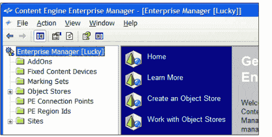

> FEM 会记住树视图的会话状态。当你下次启动 FEM 时，它会尝试打开你在退出时打开的节点。这通常意味着会有一些延迟，因为它会为每个打开的 Object Store 节点读取大量数据。你可能会发现，在退出 FEM 之前关闭所有节点是一个有用的习惯。

Domain 内的大多数事物彼此了解并且可以直接连接，而给定 Domain 中的任何事物都不知道其他 Domain。

GCD，以及因此 Domain，包含：

- Domain 对象本身的简单属性
- Domain 级别对象
- Domain 环境更复杂方面的配置对象
- 指向其他组件的指针，既包括 CE 环境的一部分，也包括外部组件

哪些事物是对象，哪些是指向其他组件的指针，这有点主观。什么是某物的配置对象，什么是该某物的属性集合，这也有点主观。让我们不要纠结于这些哲学上的细微差别。让我们来看一个更具体的列表：

- **属性**：这些简单属性控制 Domain 本身的行为或描述其特征。
  - **名称和 ID**：像大多数 P8 对象一样，Domain 既有名称也有 ID。违反直觉的是，你很少需要知道这些，有时甚至可能忘记自己 Domain 的名称。原因在于你始终会连接到某个特定的 CE 服务器，而该 CE 服务器恰好属于一个 Domain。因此，与 Domain 对象相关的所有 API 都能够使用一种默认机制，即“当前 Domain”。
  - **数据库模式**：存在包含每种 P8 支持的数据库类型的 Object Store 的数据库模式的属性。CM 在首次填充新的 Object Store 以创建表和列时默认使用此模式，这是一个实际的 SQL 语句脚本。有趣的是，你可以在执行 Object Store 创建任务时（通过 FEM 或通过 API）自定义模式，但不应随意这样做。
  - **权限**：Domain 对象本身受访问控制约束，因此它具有权限属性。实际可用的访问权限集特定于 Domain 操作，但概念上与对其他对象的访问控制相似。
- **Domain 级别对象**：少数类型的对象直接包含在 Domain 本身中。我们一会儿会谈到配置对象，但在 Domain 中有几个非配置对象。
  - **AddOns**：AddOn 是一个元数据包，表示 CE 服务器中未内置的离散功能块的需求。其中一些随产品提供，其他的由第三方提供。必须先创建 AddOn，然后它才会在 GCD 中可用，可供安装到一个或多个 Object Store 中。

除了上面树视图中直接可用的项目之外，Domain 中直接包含的大多数剩余项目都可以通过在 FEM 中右键单击 Domain 节点并选择 **属性** 时弹出的面板以一种方式或另一种方式获得。

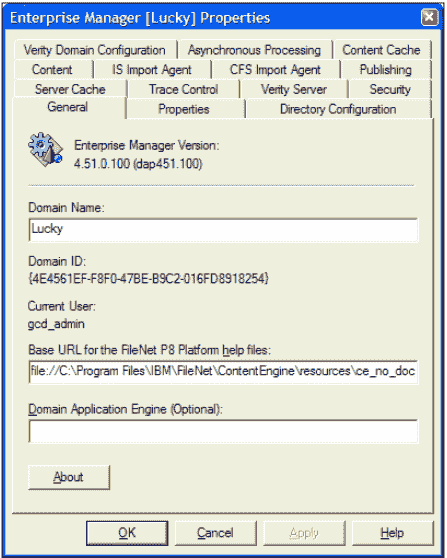

弹出面板的 **常规** 选项卡包含 FEM 版本信息。格式看起来可能有点奇怪，因为 CM 发布号，包括任何修复包，以及构建号映射到 Microsoft 将版本信息放入 DLL 属性的方案。在之前的图中，**4.51.0.100** 代表 CM 4.5.1.0，构建 100。这一点通过括号中的内部构建号指定 **dap451.100** 得到加强。幸运的是，你不必真正理解这个方案。你偶尔会被要求向 IBM 支持报告这些数字，但忠实地复制即可。

## 拓扑级别

Domain 存在一个明确的层次拓扑结构。它在配置子系统时最常出现。例如，CE 服务器跟踪日志记录可以在任何拓扑级别配置，使用最具体的配置设置。我们所说的含义在我们解释拓扑级别的使用方式后应该会更清楚。你可以在以下屏幕截图中 FEM 左侧的展开树视图中看到这些拓扑级别：

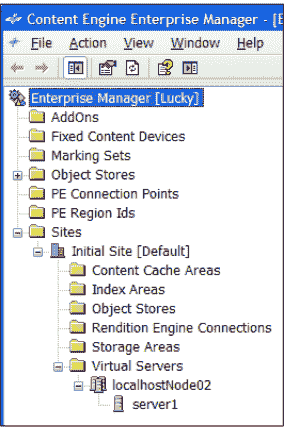

在层次结构最高级别的是 Domain，在上一节中讨论过。它对应于 CM 安装中 CE 部分的所有组件。

在 domain 内有一个或多个站点。最好将站点视为位于特定地理区域的 Domain 的一部分。这很重要，因为网络通信在地理上分离的区域之间与区域内部的通信相比，其特征不同。特征差异主要由两个因素造成——延迟和带宽。延迟是对数据包从连接一端到另一端所需时间的表征。网络数据包在长距离传输需要更长时间，既因为物理定律，也因为路径中通常会有更多的网络交换和路由组件。带宽是对在固定时间内可通过连接传输的信息量的表征。带宽在长距离上几乎总是更受限制，这是由于预算或容量限制。管理在地理区域之间传输的网络流量是分布式部署的重要规划因素。

一个站点包含一个或多个 **虚拟服务器**。虚拟服务器是一组 CE 服务器，从应用程序的角度来看，它们在功能上表现得像单个服务器（从应用程序的角度来看）。最常见的情况是通过使用集群或农场来实现高可用性或负载平衡的原因。一个站点可能出于任何对企业有意义的原因包含多个虚拟服务器。例如，虚拟服务器可能用于分割不同的应用程序组合或用户群体。

一个虚拟服务器包含一个或多个 **服务器**。服务器是在 J2EE 应用服务器中运行的单个、可寻址的 CE 服务器实例。这些有时被称为物理服务器，但在 21 世纪这通常并不完全正确。我们在 *第 3 章，安装内容引擎* 中安装到 WAS 配置文件中的 CE 对应于此意义上的服务器。就运行的软件而言，真正存在的东西只有单个 CE 服务器。没有独立运行的软件代表 Domain 或 GCD。没有单独的软件代表 Object Store（除了它是 RDBMS 软件调解的数据库的意义上）。所有 CE 活动都在 CE 服务器中发生。

CM 中可能还有其他运行软件的服务器——流程引擎、内容搜索引擎、渲染引擎和应用引擎。前一段只是想澄清，除了服务器之外，没有代表拓扑级别的正在运行的软件部分。你不必担心运行时请求被传递到拓扑层次结构的上层或下层。

并非每个安装都需要区分所有这些拓扑级别。在我们的全包安装中，Domain 包含单个站点。该站点在安装期间自动创建，惯例上称为 **Initial Site**，尽管如果我们想的话可以更改它。该站点包含单个虚拟服务器，而该虚拟服务器包含单个服务器。

这对于开发或演示安装来说很典型，但你应该能够看到它如何利用定义的拓扑级别扩展到任何规模的部署，甚至是全球范围的部署。你可以为这些不同的拓扑级别使用除刚才描述之外的其他方案；唯一的缺点是其他人将无法理解你的部署术语。


## 使用拓扑级别

我们之前提到过，许多子系统可以在任一级别进行配置。虽然最常见的做法是进行域级配置，但例如你可能出于故障排查目的，想要在单个 CE 服务器上启用跟踪日志。在解读子系统配置数据时，CE 服务器首先查找本地 CE 服务器（也就是它自己）的配置数据。如果找到任何配置数据，则使用该数据。否则，CE 服务器会查找包含它的虚拟服务器的配置数据，然后是包含它的站点，最后是域。只要存在，就会使用最具体的配置数据。

> 一组配置数据，如果被使用，则作为完整配置使用。也就是说，不同拓扑级别上的配置对象不会混合在一起来形成“有效配置”。

CE 有一个名为请求转发的功能。由于 CE 服务器与保存对象存储的数据库之间的对话比 CE 客户端与 CE 服务器之间的对话更为频繁，因此在网络层面上更靠近该数据库的 CE 服务器处理请求可能会带来性能上的好处。当 CE 服务器将请求内部转发给另一台 CE 服务器时，它会使用配置在虚拟服务器上的 URL。站点对象保存着控制 CE 服务器是否可以转发请求以及是否可接受转发请求的配置选项。

站点是内容缓存区域、文本索引区域、Rendition Engine 连接、存储区域和对象存储的容器。也就是说，这些项目中的每一个都与特定站点关联。

## 探索域级项目

让我们花点时间更详细地查看一些域对象。在 API 和一些文档中，它们有时被称为非存储库对象，以区别于驻留在存储库（即对象存储）中的对象。这些对象主要对管理员有意义，很少会被最终用户应用程序操作。在*第 3 章*的初始域启动期间，我们看到了几个这样的对象。这里我们将查看其他一些对象。

在 FEM 中，有两种常见方式可访问这些对象和对话框。有些可以直接从左侧的树视图中访问，有时可通过右键单击并从上下文菜单中选择来访问。其他对象则在你从树视图中域节点的上下文菜单中选择**属性**时，通过多标签弹出对话框来访问。

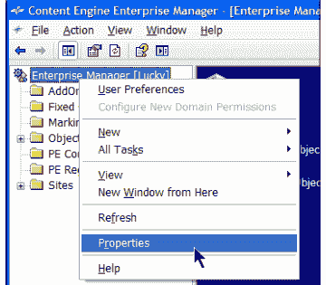

正如 FEM 中通常的模式一样，域中的所有内容都是可用的，尽管如果你在那个弹出面板上选择“属性”选项卡，更多是一种自我引导的形式。这个属性表可用于大多数对象，让你查看或编辑对象的各个属性。CE 服务器始终是允许的属性值、安全访问和引用完整性等规则的强制执行者。FEM 很复杂，但它仍然只是一个客户端应用程序。FEM 不能允许你违反 CE 规则，尽管它并不总能阻止你做出不明智的事情。下面的截图是在你选择属性后打开的对话框，如前一张截图所示：

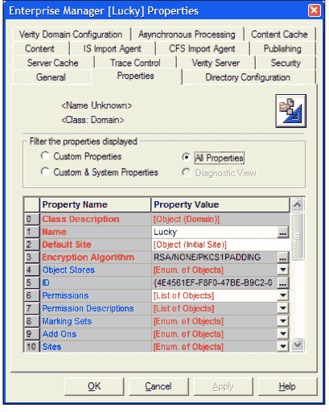

## AddOns

AddOn 是一种 CE 打包机制，包含对象存储的元数据（可能还有实例数据）。AddOn 预期用于表示某个独立应用程序或功能所需的内容，但这并非强制要求。AddOn 在 GCD 中*创建*，但*安装*到各个对象存储中。

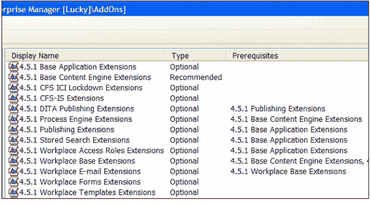

如果你单击树中的 **AddOns** 节点，你将看到 GCD 中可用的 AddOn 列表。你在屏幕截图中看到的所有 AddOn 均由 CM 提供，但任何安装中可能还存在其他 AddOn，因为可以通过 CE API 创建 AddOn。

除了**推荐**或**可选**外，AddOn 还可能具有**前提条件**。除非其前提条件已预先或同时安装，否则 CE 服务器不会允许你将 AddOn 安装到对象存储中。

存在一种用更新版本取代 AddOn 的机制，但 AddOn 一旦安装，就无法从对象存储中卸载。因此，在将 AddOn 安装到对象存储中之前，你需要仔细考虑。在创建对象存储的向导接近末尾处，有一个步骤可为你安装 AddOn，但你也可以在之后的任何时间安装它们（通过右键单击单个对象存储节点，然后导航到 **所有任务 | 安装 AddOn**）。Base Content Engine Extensions AddOn 应始终安装到新的对象存储中，因为大多数应用程序都依赖它提供的少量功能（例如，自定义属性 `DocumentTitle`）。对于任何其他 AddOn，我们建议你避免在创建对象存储时安装，除非你确定确实需要它。

## 固定内容设备

文档内容可以存储在对象存储数据库中、传统文件系统中，或存储在 CM 所称的固定内容设备 (FCD) 中。术语 FCD 包括供应商提供的、一旦内容被写入便不允许更改的设备，但这个名称可以说有点用词不当，因为它还包括联合内容源。从 CE 服务器的角度来看，这些设备都不允许更新内容文件。

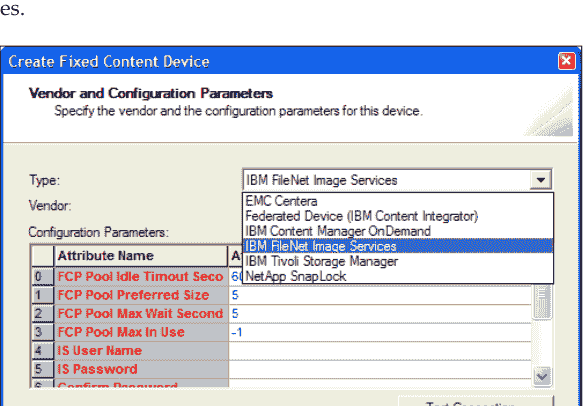

在从对象存储使用任何 FCD 之前，你必须先在 GCD 中注册它，以便 CE 服务器知道如何与之通信。如果你在 FEM 树视图中右键单击 Fixed Content Devices 节点，然后选择 New Fixed Content Device，向导将引导你完成配置 FCD 连接的步骤。所需的配置参数因设备类型而异。

## 服务器缓存配置

“服务器缓存”选项卡让你能够控制 CE 服务器内部维护的多个缓存的特征。正如你或许能从这些项目的名称和缓存的一般主题中判断的那样，这里设置的值会对性能产生巨大影响。这些项目中的每一个的用途都在 P8 产品文档中进行了描述。

你不应该鲁莽地更改这些值。默认值是为大多数使用场景选择的合理值，尽管实际情况确实会有所不同。本章描述的其他性能调优设置也适用同样的建议。

IBM 支持有时会针对特定情况推荐具体的更改。在 FileNet P8 Performance Tuning Guide 中也有一些关于适当值的指导。

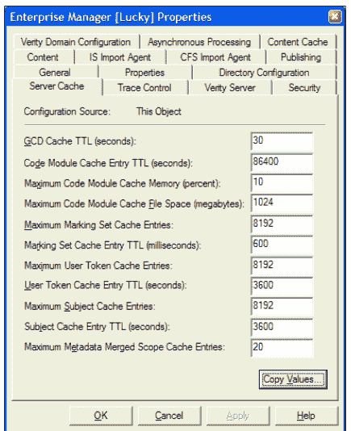

在右下角附近有一个标记为 Copy Values 的按钮。这是一种通用机制，你会在几个配置面板中看到它。我们之前提到，许多子系统配置可以在域、站点、虚拟服务器或服务器级别设置，并使用更具体的条目。Copy Values 按钮提供了一种便捷的方式，将一组配置值从那些其他拓扑节点之一复制到此节点。如果单击该按钮，你将看到一个弹出面板，允许你导航到任何你希望从中复制值的节点。

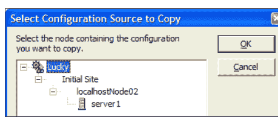

### 内容配置

**内容**选项卡包含用于调整内容上传、下载和相关移动等后台操作行为的设置。与其他类型的更新相比，内容上传（从客户端到 CE 服务器）可能需要很长时间才能完成。CE 服务器和 API 通过安排在实际将内容提交到存储库的事务之外上传内容，从而避免事务超时问题。在某些情况下，内容分块上传，这些分块必须为最终存储重新组装。

这两件事都会导致一定量的幕后簿记、后台处理和清理工作。此选项卡上的设置会调整该后台活动的性能和行为。

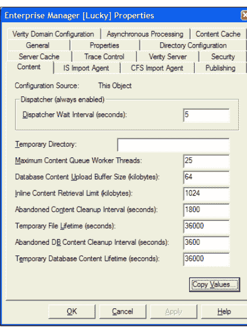


此面板包含我们前面提到的**复制值**按钮。另一个需要注意的地方，是在选项卡正下方的**配置来源：此对象。** 如果你在站点、虚拟服务器或服务器拓扑节点上查看同一选项卡，会看到类似的文本，指明配置来自域级别，并且所有输入框都会被禁用。这是一种方便的方式，可以查看配置实际位于何处，以及你是否在特定拓扑节点上覆盖了更高级别的配置。相比之下，下图显示了服务器 server1 的内容选项卡。

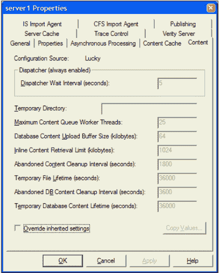

## 跟踪日志

CE 服务器会写入两种日志文件。错误日志文件用于记录重要异常，并且始终处于启用状态。跟踪日志文件用于故障排查，必须专门启用。**跟踪控制**选项卡用于在 CE 服务器内部配置跟踪。

> 虽然客户端 API 中使用了类似的技术来提供跟踪日志，但配置机制是完全独立的。FEM 中的面板仅控制 CE 服务器内部的跟踪，不适用于任何客户端跟踪。

跟踪日志文件本身是供 IBM 支持人员使用的。因此，跟踪日志文件的格式和含义没有精确的文档记录，并且经常随版本而变化。此外，跟踪日志文件的内容不像其他 IBM 组件那样进行本地化。你通常会在 IBM 支持的指导下启用跟踪日志，在这种情况下，他们会告诉你需要启用哪些具体项目。

你可能会在日常工作中逐渐熟悉跟踪日志文件的一些内容，也可能决定出于自己的目的收集跟踪日志文件。这没有错，但有几件重要的事情需要记住：

- 跟踪日志产生的输出可能非常冗长。通常一个好的策略是从最少的跟踪日志开始，然后逐步增加以扩大诊断搜索范围。即使最明显的诊断线索，如果被埋藏在大量无关材料中，也可能被忽略。
- 跟踪日志可能会对 CE 服务器的性能产生显著影响。这不仅仅是因为需要写入的日志输出量很大。当启用跟踪日志时，CE 服务器中的条件代码有时会执行额外的查找、计算和其他昂贵的操作来创建日志条目。

让我们看一下用于配置跟踪日志的**跟踪控制**选项卡：

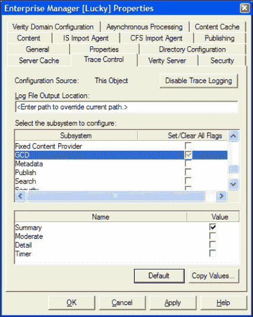

跟踪日志以两种方式组织：

- 有些功能子系统可以单独启用或禁用。这些子系统的名称具有提示性（并在 P8 产品文档中记录）。在排查特定问题时，很少需要选择超过几个子系统。IBM 支持通常会要求只为一两个子系统记录日志。
- 有不同的详细程度：**摘要**、**适中**、**详细**和**计时器**。虽然用户界面使这些详细程度看起来是严格分层的（如果你选择**详细**，用户界面会自动选择**适中**和**摘要**），但它们实际上是独立的。不过，你总是希望选择一个详细程度以及所有比它更不详细的级别。

上图显示了一个示例，其中已为 **GCD** 子系统在**摘要**级别启用了跟踪日志。在诊断难以捉摸的问题时，通常需要在多个会话中进行跟踪日志记录。对于更复杂的跟踪日志配置，每次重新创建配置可能会很麻烦。跟踪日志子系统有一个功能，允许你配置跟踪日志但完全禁用它。这就是**禁用跟踪日志**按钮的作用。

> 如果你发现在域配置中禁用跟踪日志后，性能仍然下降，或者跟踪日志文件继续增长，那可能是因为仍在更具体的级别配置了跟踪日志。这很容易被忽略，尤其是在更复杂的部署或 CM 管理职责共担的情况下。

默认情况下，CE 服务器跟踪日志文件写入应用程序服务器特定的目录。不幸的是，FEM 配置面板不会告诉你默认位置是什么，因此你必须查阅产品文档。例如，在我们的 WAS 设置中，跟踪日志文件写入 **/opt/ibm/WebSphere/AppServer/profiles/AppSrv02/FileNet/server1/p8_server_trace.log**。你可以通过为该字段提供值来指定跟踪日志文件的不同位置。请记住，该位置是从 CE 服务器的角度出发的，而不是运行 FEM 的机器的本地文件系统。

## 管理工具和任务

与域一样，FEM 中有两种访问对象存储中内容的基本路径。左侧面板中的树视图可以展开以显示对象存储及其中的许多存储库对象，如上图所示。每个对象存储都有一个右键单击上下文菜单。从该菜单中选择**属性**将弹出一个多选项卡弹出面板。我们首先查看该面板的**常规**选项卡。

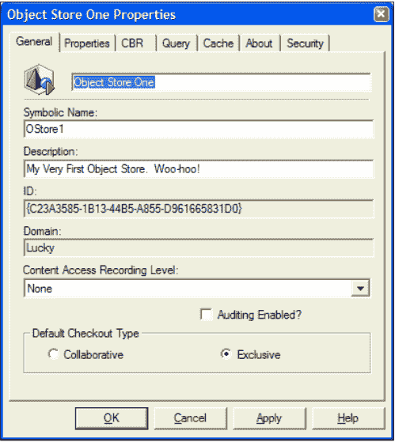

### 内容访问记录级别

通常，CE 服务器不会跟踪特定文档的内容上次被检索的时间，因为这需要昂贵的数据库更新，而且通常没什么意义。对象存储上的 ContentAccessRecordingLevel 属性可用于在文档或批注的 DateContentLastAccessed 属性中启用记录此可选信息。该属性默认处于关闭状态。

有时知道某些信息是很有用的，例如文档内容是在最近一周内被访问的，而不是三年前。一旦某个文档的内容被读取过，很可能在同一时间段内还会有几次访问（并非出于技术原因；而只是统计上的可能性）。安装可以通过该属性的值选择仅按小时或按天粒度记录访问时间，而不是为每次访问都记录上次访问时间。这样可以大大减少数据库更新的次数，同时仍能提供对上次访问时间的适当近似。还有一个选项是每次访问时都更新 DateContentLastAccessed 属性。

### 审计

CE 服务器可以记录客户端何时检索或更新所选对象。启用该功能需要设置对对象实例或类的订阅。这与我们将在第 7 章*主要 CM 功能*中描述的 CE 服务器中的事件子系统非常相似。由于设置必要的审计配置可能相当复杂，因此也可以在对象存储级别完全启用或禁用审计。

### 检出类型

CE 服务器提供两种文档检出类型：**协作式**和**独占式**。区别在于允许谁执行后续的检入操作。独占式检出仅允许同一用户执行检入。通过 API，应用程序可以明确选择其中一种类型，也可以使用对象存储的默认值。使用默认值通常很方便，因为给定的应用程序可能没有任何上下文来决定选择哪一种。

> 即使使用协作式检出，后续的检入操作仍然要接受访问检查，因此你仍然可以对此进行细粒度控制。事实上，因为你可以使用细粒度安全性来限制谁可以执行检入，所以除非你有某些具体要求必须使用独占式，否则最好将对象存储的默认值设为协作式。


## 文本索引日期分区

如图所示，**CBR** 选项卡上的大部分值都是只读的，因为它们是在 **Content Search Engine (CSE)** 首次设置时确定的。

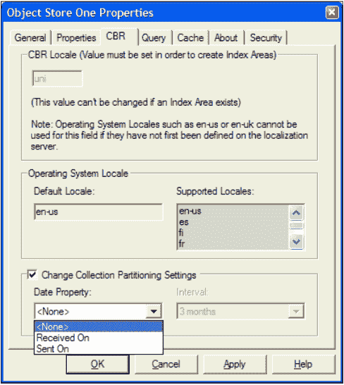

按对象存储可更改的一项是文本索引集合的基于日期的分区。 对文本索引集合进行分区可以更高效地搜索大型集合，因为 CE 可以将搜索范围缩小到特定的分区或分区，而不必搜索整个文本索引。

默认情况下，没有分区。 如果您选中复选框以更改分区设置，**Date Property** 下拉列表会显示一组日期值自定义属性。 在上面的屏幕截图中，您可以看到来自电子邮件相关文档的自定义属性 **Received On** 和 **Sent On**。 选择其中一个属性后，您可以选择分区粒度，从一个月到一年不等。

如果在 FEM 树视图中选择 **Index Areas** 节点，然后右键单击索引区域条目并选择 **Properties**，则可获得其他文本索引配置属性。 虽然我们在此显示屏幕截图供参考，但如果您按照我们的安装程序进行操作，您的环境中尚未有 CSE 或任何索引区域。 我们将在 *第 5 章，安装其他组件* 中介绍 CSE。

## 缓存配置

正如我们在域级别所看到的那样，Cache 选项卡允许为每个对象存储配置各种缓存调优参数。 正如我们之前所说，您不希望在没有充分理由的情况下更改这些值。 默认值适用于大多数情况。

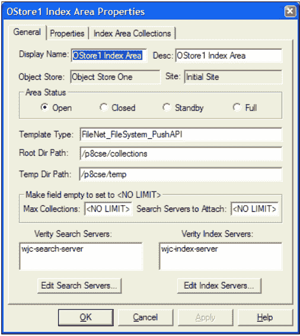

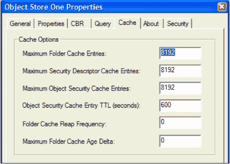

## 元数据

CM 的关键功能之一是它具有可扩展的元数据结构。 您不必在预定义文档属性的固定框架内工作。 您可以向 Document 类添加其他属性，甚至可以为特定目的创建 Document 的子类。 例如，您可能有一个名为 CustomerProfile 的子类，另一个名为 DesignDocument 的子类，还有一个名为 ProductDescription 的子类，等等。 创建子类可以让您定义专门用于您特定业务目的所需的属性。 没有必要有关于属性应被忽略的非正式规则，因为它们不适用。 通常也没有必要有一个属性来标记文档是 CustomerProfile 还是其他内容。 类提供了这种区别。

CM 附带一组预定义的系统类，每个类都有许多预定义的系统属性（其中许多在大多数系统类之间共享）。 Document、Folder、Annotation、CustomObject 等都有预定义的系统类。 上述类通常被称为业务对象类，因为它们用于直接实现常见的业务应用程序概念。 我们将在后面的章节中更详细地讨论它们，尤其是在第 7 章中。

系统属性是 CE 服务器具有特定编码行为的属性。 一些系统属性用于控制服务器行为，其他属性提供某种系统状态的报告。 我们已经在域和对象存储对象中看到了几个示例。

应用程序在安装过程中创建自己的子类和自定义属性是很常见的，但通过 FEM 手动执行类似操作也很常见。 FEM 包含多个向导，可以使管理员的过程更简单，但在幕后，始终有各种组件在运行。

## 属性模板

任何自定义属性的基础都是属性模板。 如果您在树视图中选择 Property Templates 节点，您将看到现有属性模板的长列表。 双击列表中的任何项目将显示该属性模板的属性。 属性模板是一个独立可持久化的对象，因此它有自己的身份和安全性。

> 大多数系统属性没有显式的属性模板。 它们的特征来自 CE 服务器内部的另一种机制。

| Display Name | Description | Data Type | Created By | Create Date |
|---|---|---|---|---|
| Animation Enabled | Animation Enabled | Boolean | gcd_admin | 4/6/2010 7:18:52 PM |
| Application Name | Application Name | String | gcd_admin | 4/6/2010 7:18:43 PM |
| AssociatedPropertyID | AssociatedPropertyID | ID | gcd_admin | 4/6/2010 7:18:38 PM |
| Cc | Cc | String | gcd_admin | 4/6/2010 7:19:07 PM |
| Component Binding Label | Component Binding Label | String | gcd_admin | 4/6/2010 7:18:38 PM |
| Container Type | Container Type | String | gcd_admin | 4/6/2010 7:19:01 PM |
| Custom Object Type | Custom Object Type | String | gcd_admin | 4/6/2010 7:19:01 PM |
| Dependent Documents |  | Object | gcd_admin | 4/6/2010 7:18:55 PM |
| Description |  | String | gcd_admin | 4/6/2010 7:18:43 PM |
| Description | Entry Template Description | String | gcd_admin | 4/6/2010 7:18:44 PM |
| Document Title | Document Title | String | gcd_admin | 4/6/2010 7:18:37 PM |
| Email Dependent Reference | Email Dependent Reference | Object | gcd_admin | 4/6/2010 7:19:07 PM |

属性模板之所以得名，是因为它们定义的特征作为添加到类的属性的模式，其中属性以特定类的属性定义的体现存在。 属性模板的一些属性可以在属性定义中被覆盖，但有些不能。 例如，基本数据类型和基数一旦创建属性模板就无法更改。 另一方面，像可设置性和值是否必需之类的内容可以在属性定义中进行修改。

在创建没有现有属性模板的新属性时，您可以独立提前创建属性模板，也可以按照 FEM 向导步骤将属性添加到类。 如果需要为正在添加的属性创建属性模板，FEM 会提示您提供额外的面板。

## 选择列表

大多数属性类型允许 CE 服务器强制执行一些简单的有效性检查。 例如，整数值属性具有可选的最小值和最大值，这取决于其预期用途（除了整数数据类型施加的预期绝对约束之外）。 对于某些用例，希望将允许的值限制为特定项目列表。 CE 服务器中实现此目的的机制是选择列表，它适用于字符串值和整数值属性。

如果您在 FEM 树视图中选择 Choice Lists 节点，您将看到现有顶级选择列表的列表。 下面屏幕截图中的示例选择列表都来自对象存储中安装的 AddOns。 双击列表中的任何项目将显示该选择列表的属性。 选择列表是一个独立可持久化的对象，因此它有自己的身份和安全性。

我们已经多次提到独立对象，还有更多提及。 我们将在第 7 章中更全面地描述它们。 目前，认为它们是可以独立存储或检索的对象就足够了。 大多数独立对象都有自己的访问安全。 将独立对象与仅存在于某些独立对象上下文中的依赖对象进行对比。 如果这仍然听起来像胡言乱语，请在第 7 章中获得完整解释之前忽略“独立”和“可持久化”等词语。

| Display Name | Description | Data Type | Created By | Create Date |
|---|---|---|---|---|
| Entry Choices | Entry Choices | String | gcd_admin | 4/6/2010 7:18:44 PM |
| Form Types | Form Types | String | gcd_admin | 4/6/2010 7:18:48 PM |
| Preference Type | Preference Type | String | gcd_admin | 4/6/2010 7:19:01 PM |

选择列表是选择对象的集合，尽管选择列表可以分层嵌套。 也就是说，在选择列表的任何位置都可以有另一个选择列表而不是简单的选择。 选择对象由本地化显示名称和选择值组成（字符串或整数，具体取决于选择列表的类型）。 嵌套选择列表只能在某些顶级选择列表中引用。

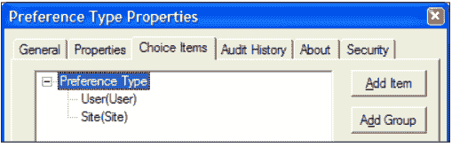

## 类

在 FEM 树视图中，有两个描述类的节点：Document Classes 和 Other Classes。 文档类仅为用户方便而单独列出（因为 Document 子类最常见）。 您可以将这两个节点视为一个大列表。 无论如何，展开树中的节点会显示分层嵌套的子类。 从树中选择一个类会显示任何子类和任何自定义属性。 屏幕截图显示了来自 Workplace AddOn 的自定义类 EntryTemplate。 您可以看到它有两个子类 RecordsTemplate 和 WebContentTemplate，以及四个自定义属性。


右键单击 FEM 树视图中的 **Document Class** 节点并选择 **New Class**。**Create a Class Wizard** 将启动。

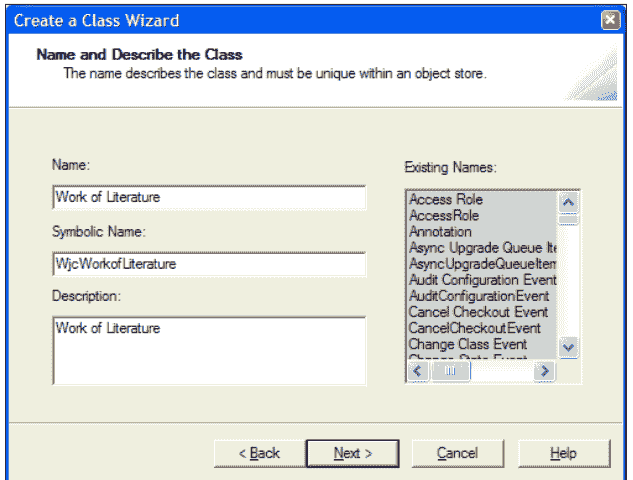

第一个面板要求输入 **Name**（实际上是指显示名称）和 **Symbolic Name**。当您输入显示名称时，FEM 会自动构建一个默认的符号名称，通过删除空格和其他不可接受的字符。您可以将符号名称修改为其他名称；我们添加了前缀 **Wjc**，因为符号名称必须唯一，使用简短的前缀可以减少与其它名称冲突的可能性。描述是可选的，但您可以提供您想要的任何描述性文本。

下一个面板显示类上的继承属性，并邀请您添加更多属性。由于我们之前尚未创建属性模板，请单击 **New** 按钮以启动 **Create a Property Template** 向导。

## Administrative Tools and Tasks

选择列表没有符号名称，但显示名称要求唯一。我们将选择列表称为 **Literature Formats**。这里对引用完整性真正重要的其实是选择列表的 Id，但 FEM 会自动创建必要的链接，并且不会让我们操心。单击 **Next** 按钮并选择 **String** 作为选择列表数据类型。再次单击 Next 以进入 **Add Choice List Elements** 面板。

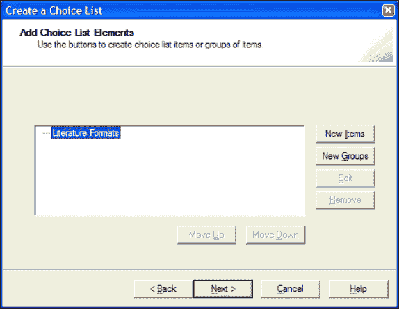

如果我们要制作一个分层选择列表，我们会使用 **New Groups** 按钮。我们只制作一个简单的列表，因此请单击 **New Items** 按钮。

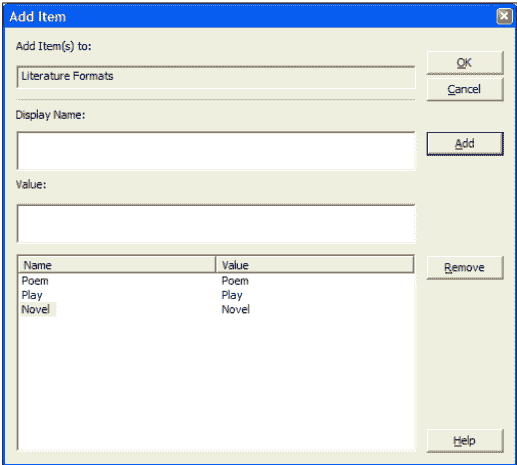

使用 **Add Item** 面板添加所示的三个值。使用选择列表的应用程序通常会向用户显示 **Name**，但 **Value** 实际上将被用作属性值。当您完成 **Create a Choice List** 向导后，您将被返回到已在进行的 **Create a Property** 向导。

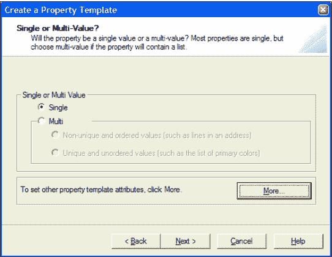

选择 **Single**（这是属性基数）并单击 **More** 按钮以定义 WjcFormat 属性的额外特征。

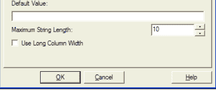

在此面板中最重要的事项是，我们已选中 **Value Required** 复选框，我们已将属性设为 **Read/Write**，并且我们指定了 **Maximum String Length** 为 10 个字符。

当您完成 **Create a Property** 向导后，您将被返回到已在进行的 **Create a Class Wizard**，位于 **Select Properties** 面板。在继续之前，让我们再创建三个新属性，这些属性将在 *Chapter 6* 的一些示例中出现。

- **Genre**（WjcGenre），一个多值字符串属性（唯一且无序）。它应具有 **Value Required**，为 **Read/Write**，并且 **Maximum String Length** 为 25。使用名为 Literature Genre 的选择列表，其值为 Drama、Comedy、Farce、Science Fiction、Western、Romance、Sonnet、Epic、Unknown 和 History。
- **AuthorLastName**（WjcAuthorLastName），一个简单的字符串属性。它应具有 **Value Required**，为 **Read/Write**，并且 **Maximum String Length** 为 64。它没有选择列表。
- **AuthorFullName**（WjcAuthorFullName），一个简单的字符串属性。它不应具有 **Value Required**，为 **Read/Write**，并且 **Maximum String Length** 为 64。它没有选择列表。

您的 **Create a Class Wizard** 应如下所示：

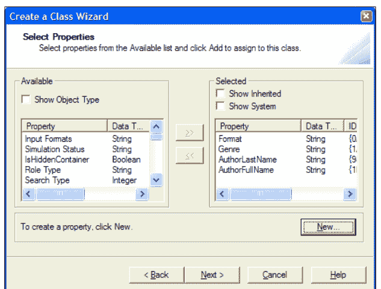

最后，**Create a Class Wizard** 的最后一个面板将显示您在过程中定义的事物的摘要。单击 **Finish** 按钮以创建类。

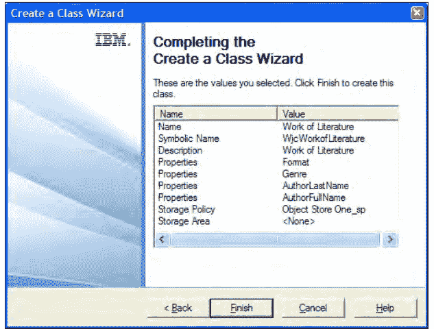

我们不会详细介绍此对话框，因为它更多地涉及 FEM 用户界面而不是 CM。值得注意的是，您可以使用类似 SQL 的查询语言对 CE 服务器进行查询。事实上，我们称之为 CE SQL；它是一个 SQL-92 变体。使用这些查询在应用程序中非常常见，您可以手动从 FEM 中的此对话框执行此操作。在幕后，FEM 正在组合一个 CE SQL 查询。

该对话框的另一种模式允许您简单地粘贴自己构建的查询。从 Content Engine Query Builder 中选择 View > SQL View。

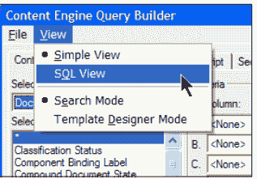

 resulting view 预填充了一个相当复杂的 CE SQL 查询字符串。您可以删除它并输入或粘贴您自己的查询字符串。

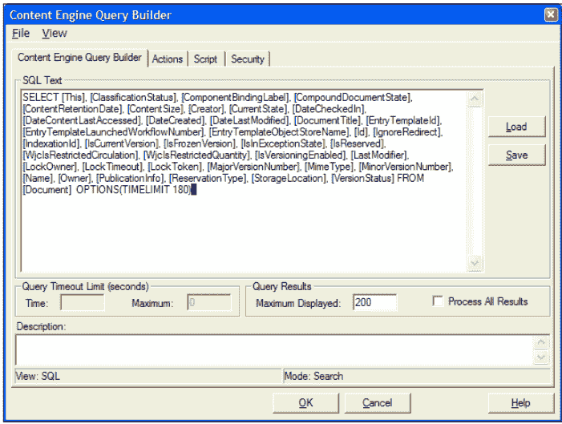

当您单击 OK 时，查询将被执行，FEM 将显示结果。还有一个选项可以保存查询的本地副本，以便以后加载和重新执行。（此功能与 Workplace 和 XT 功能称为 Stored Search 无关。）

> FEM 查询界面的一个历史怪癖是 SELECT 列表必须以 This 属性开头。这不是 CE SQL 的一般要求。

## Summary

在本章中，我们简要浏览了 CM 的一些常见管理功能。大多数人通过 FEM 工具体验这些功能。然而，FEM 所做的一切都是通过 CE API 完成的，因此也可以编写自定义应用程序来执行这些事情中的一些或全部。

CM 的内容远不止这些，但在我们查看它们之前，我们必须先安装几个更多组件。我们将在第 5 章《Installing Other Components》中继续我们的 CM 安装冒险。

| Component | Linux | Other Unix | Windows |
|---|---|---|---|
| CE server | **Yes** | Yes | Yes |
| CE client | **Yes** | Yes | **Yes** |
| FEM | No | No | **Yes** |
| CSE | **Yes** | Yes | Yes |
| SD | **Yes** | Yes | Yes |
| PE server | No | Yes | **Yes** |
| PE client | **Yes** | Yes | Yes |
| AE | **Yes** | Yes | Yes |
| XT | **Yes** | Yes | Yes |
| RE | No | No | **Yes** |

目前，不要太担心表格第一列中的缩写，尽管它们与我们在 *Chapter 3* 的概述图中使用的相同。我们将在各自的部分中逐一解释它们。

> 我们现在将把我们的全包安装分散到两台不同的机器上。（我们希望你在思考这句话时背对着我们。）为这些机器设置智能的方式是使用静态 IP 地址，如果你能轻松做到，那是正确的方法。如果你做的是我们经常做的事情——使用动态分配的 IP 地址为虚拟机镜像——那么你可能希望在本地 hosts 文件中添加条目。
> 
> 在 Linux 上，它是 `/etc/hosts`，在 Windows 上它是 `C:\WINDOWS\system32\drivers\etc\hosts`。（我们很难记住 Windows 路径，所以我们在 Windows 桌面上放了一个快捷方式。）在任何一种情况下，格式都相同，条目看起来像这样：
> 
> ```text
> 10.0.129.12 wjc-w2k3 wjc-w2k3.example.net
> 10.0.129.29 wjc-rhel wjc-rhel.example.net
> ```
> 
> 如果你的 DHCP 服务器突然为任一主机分配了新地址，你只需更新这两个文件，你就可以通过名称相互引用它们而恢复正常。


## Content Search Engine (CSE)

CSE 是一个全文搜索引擎。您可以有选择地为文档正文内容以及选定的字符串属性启用全文索引。在 CM 术语中，您有时会看到文本索引的概念被称为 **content-based retrieval (CBR)**。这只是同一事物的另一个名称。CSE 的内部是 Verity 的 K2 引擎，但 Verity 几年前被 Autonomy 收购，所以您会在文档中看到它以三种方式提及——Verity、K2 和 Autonomy。

CSE 不是一个 J2EE 应用程序，并且与 CE 分开运行。在生产环境中，它在与 CE 不同的服务器上运行，以便更好地管理负载。在我们轻负载的全包环境中，我们将在安装 CE 的同一台 Linux 服务器上安装它。当您查看 PPG 中的 CSE 主题时，您会发现构成 CSE 环境的各种不同逻辑服务器类型。对于生产环境，您肯定希望仔细考虑这些信息，但我们的单台 Linux 系统将在我们的安装中容纳所有这些服务器角色。

> 有一个通用要求：如果 CE 在 Windows 上，则 CSE 也必须在 Windows 上。如果 CE 在 Linux 或 Unix 上，则 CSE 必须在 Linux 或 Unix 上。重要的区别是 Windows 与非 Windows；例如，您可以在 Linux 上运行 CE，并在 Unix 上运行 CSE。


实现一个可工作的 CSE 涉及以下步骤：

- 1. 运行 CSE 安装程序
- 2. 从命令行手动配置一些内容
- 3. 通过 K2 Dashboard 配置 CSE
- 4. 配置 CE（通过 FEM）以了解 CSE 配置

第一次操作时，这些步骤可能看起来有点繁琐甚至神秘，但您可以 mostly 盲目地遵循记录的步骤，事情就会按预期工作。对我们来说，毫无疑问，CSE 安装是正常 CM 设置中最复杂的部分，但我们敦促您不要跳过它。基于文本的搜索在近年来已变得越来越受欢迎。


## CSE 用户

创建一个操作系统用户，CSE 软件将在此用户下运行。我们使用用户 ID k2_os_user，与 PPG 和安装工作表中的象征性账户名相同。还要创建一个操作系统组 k2_sec_group，并将其设为 k2_os_user 的主组。将 k2_os_user 添加到 ecmgroup 作为辅助组。稍后我们将在“命令行配置步骤”一节中详细讨论这些组成员资格。

以 k2_os_user 身份登录 Linux 系统。我们将以该用户身份执行所有 CSE 安装任务。

CSE 需要 Java，并且对可使用的 Java 版本有特定要求。它可以使用 Java 1.4.2 或 Java 5，但不能使用 Java 6。在 Windows 上，它不能使用 64 位 Java。

在您的机器上找到 Java，并设置 JAVA_HOME 环境变量（全局设置或仅为 k2_os_user 设置）。由于我们刚刚在这台系统上安装了多个基于 IBM Java 的程序，所以可供选择的 Java 版本并不缺乏。JAVA_HOME 必须指向完整的 Java 开发工具包（JDK），而不仅仅是 Java 运行时环境（JRE）。我们在自己的服务器上找到了一个 Java 5 JDK，不过您的路径肯定不同。我们在 ~k2_os_user/.bashrc 中添加了以下行（根据 k2_os_user 使用的 shell，您可能需要将其放在其他 shell 初始化文件中，例如 .profile）：
export JAVA_HOME=/usr/lib/jvm/java-1.5.0-ibm-1.5.0.11.2.x86_64

在下一节运行 CSE 安装程序之前，需要确保该环境变量生效。如果不知道如何操作，只需注销并以 k2_os_user 身份重新登录即可。

## 运行 CSE 安装程序

CSE 安装程序会提供一个默认的 CSE 软件安装路径（在 Linux 上为 /opt/ibm/FileNet/ContentEngine/verity）。由于您是作为 k2_os_user 运行安装程序，而其他安装程序是以其他用户身份运行的，因此您可能需要（在安装程序之外）确保用户 k2_os_user 拥有足够的访问权限来创建或更新该文件夹。


找到并运行 CSE 安装程序 P8CSE-4.5.1.0-LINUX.BIN。在常规的欢迎和许可证面板之后，系统会询问您选择安装为主管理服务器（Master Administration Server）还是简单管理服务器（Administration Server）。我们只在一台服务器上安装 CSE，因此请选择主管理服务器。管理服务器是除必需的主管理服务器之外的额外服务器。

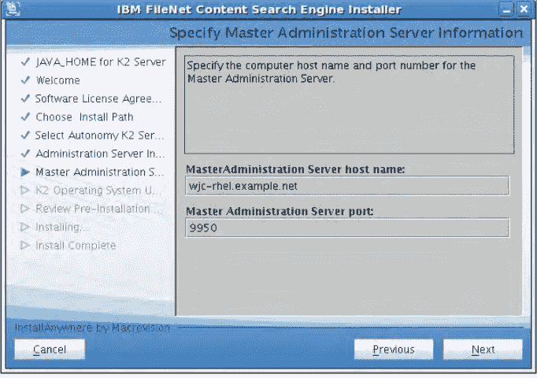

在后面的面板中提示输入主管理服务器的主机和端口号时，请指定服务器名称 wjc-rhel.example.net 以及任意方便的端口号。什么算是方便的端口号？在这种情况下，可以是服务器上不会用到的任何端口号。如果您没有偏好，我们建议您使用端口 9950，这样您的选择将与 P8 平台文档中的默认端口列表一致。安装程序可能会默认填入该端口号。

由于您是在与 CE 相同的机器上运行 CSE 安装程序，并最终运行 CSE 本身，您可能会倾向于使用 localhost 作为 CSE 服务器主机。从 CE 的角度来看，这在技术上是正确的。然而，利用这样的小技巧不是一个好习惯。在将 CSE 与 CE 分开安装或安装了多个 CSE 服务器的任何环境中，这肯定行不通。我们建议您使用正确的主机名。例如，在我们的例子中，我们使用了 wjc-rhel.example.net。请务必确保服务器名称正确，因为安装程序和 Verity 软件会将其大量写入多个配置文件中。如果默认值不正确（这是使用动态 IP 地址的隐患之一），请立即纠正。

## 安装其他组件

当要求提供 K2 用户账户时，请给出 k2_os_user 的用户 ID 和密码。您可以为 Verity 域任意命名。我们使用了 VerityLucky，以便与相关的 P8 域名称产生联想。

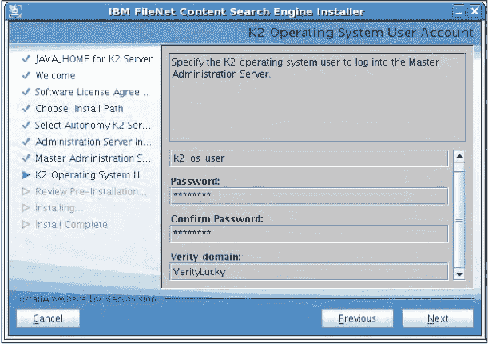

运行完 CSE 安装程序后，CSE 将开始运行。您可以通过使用 **telnet** 连接到端口 9950（或您选择的任何端口）来确认这一点。您会看到 K2 服务器返回的一串奇怪的乱码。一旦看到该输出（而不是 **连接被拒绝**），您就知道 CSE 正在运行，可以退出 telnet。在 Microsoft Windows 上，CSE 作为几个 Windows 服务运行（查找名称中带有 **Verity K2** 的服务），但在 Linux 上，它作为几个独立的守护进程运行。

默认情况下，这些守护进程不会在 Linux 和 Unix 系统启动时自动启动。您可以通过运行 k2adminstart 和 k2adminstop 命令来启动和停止它们，这些命令位于安装目标目录下（例如，**/opt/ibm/FileNet/ContentEngine/verity/k2/_ilnx21/bin/k2adminstart**）。当然，您需要以 k2_os_user 用户身份运行它们。

对于生产系统，我们建议在 **/etc/init.d/** 或类似机制中添加适当的条目。对于我们的演示系统，手动运行它们就足够了，我们将 K2 命令添加到了 *第 2 章* 中展示的 up.sh 和 down.sh 脚本中。有些文档建议在后台运行启动脚本，并通过 nohup 重定向输出，但我们发现 k2adminstart 命令会与启动它的终端断开连接；因此不需要 nohup。

## 命令行配置步骤

运行 CSE 安装程序后，在继续进行下一节的配置任务之前，您必须更改 K2 可执行文件 vspget 的安全性，使其成为“setuid root”。这意味着无论实际用户是谁，它都将以 root 用户身份运行。在 Linux 命令提示符下，以 root 身份登录后，执行以下命令：

```bash
# cd /opt/ibm/FileNet/ContentEngine/verity/k2/_ilnx21/bin
# chown root vspget
# chmod u+s vspget
```

您需要创建几个目录供 CE 和 CSE 共同使用。通常，在生产分布式环境中，这些将是文件共享。这些目录需要为 k2_os_user 提供完全访问权限。同样，在 Linux 命令行中，以 root 身份登录后，执行以下命令：

```bash
# cd /
# mkdir p8cse
# mkdir p8cse/collections
# mkdir p8cse/temp
# chown -R k2_os_user p8cse
# chgrp -R ecmgroup p8cse
# chmod -R 770 p8cse
```

CE 文件存储目录也需要进行一些相应的调整：

```bash
# cd /
# chgrp -R ecmgroup p8filestores
# chmod -R 770 p8filestores
```

最后，使用操作系统工具为用户 k2_os_user 添加一个辅助组 ecmgroup（当然，我们在本章前面已经执行了后一步）。

通过像我们这样设置组成员资格，并通过以这些所有者和组创建目录并使用 770 权限，我们实现了 CE 和 CSE 可以通过文件系统共享文件。K2 服务器以 k2_os_user 用户身份运行，CE 以 ecmuser 用户身份运行。两个服务器必须能够相互在对方的目录中创建和读取文件才能进行通信。还有其他方法可以实现这种共享，在使用文件共享时，您应该找到一种符合本地安全策略的机制。

## 安装其他组件

必须手动编辑 K2 配置文件，使其了解您刚刚创建的 `/p8cse/collections/` 目录的位置。使用文本编辑器打开文件 `/opt/ibm/FileNet/ContentEngine/verity/k2/common/verity.cfg`，并将“6”系列标记设置为以下值：

```
alias6=path1
mapping6=/p8cse/collections
dirmode6=rw
```

## 通过 K2 Dashboard 配置 CSE

下一步使用原生的 Autonomy K2 Dashboard Web 应用程序来配置 K2 本身的各个子组件。如何部署 K2 子组件有很大的灵活性，在规划生产环境时，您需要考虑各种可能性。我们首先要承认，本节中描述的步骤看起来有些随意，因为我们还没有解释各种 K2 组件分别是什么。除了 CM 文档资源外，CSE 安装中还附带了完整的“原生”Verity 文档。请查看目录 `/opt/ibm/FileNet/ContentEngine/verity/data/docs/pdf/`。

现在，我们只需完成在一体化环境中使用 CSE 所需的基础设施设置步骤。如果您按照这些步骤操作（我们从 CSE 安装指南中提炼而来），它一定会奏效。在这些说明中，我们将使用简单的命名和默认端口号。如果您做出了不同的选择，将它们记录下来将简化下面 *通过 FEM 为 CSE 配置 CE* 一节中的步骤。

使用 Web 浏览器连接到端口 9990 上的 K2 Dashboard，例如：`http://wjc-rhel.example.net:9990`，然后选择 **Dashboard**。此时不会提示您输入凭据；它们将在本节中的后续步骤中添加。屏幕左侧的 **System View** 中将列出各种 K2 子组件。

多年来，CM 已经整合了多个 CSE 版本和更新。K2 Dashboard 的屏幕仍然带有 2005 年的版权日期。K2 Dashboard 支持的浏览器列表相当有限，您很可能会被重定向到关于此问题的警告屏幕。我们发现，使用不受支持的浏览器时，只会出现轻微的格式和布局问题。如果您注意到 K2 Dashboard 存在较大的功能缺口，更可能的原因是您之前设置的 JAVA_HOME 值不正确。请检查它是否指向 Java 1.4.2 或 Java 5 JDK。


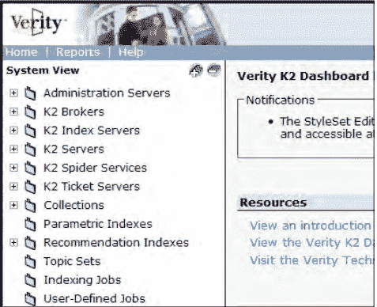

1.  从 **系统视图** 中，选择 **K2 索引服务器 | 添加 K2 索引服务器**。将服务别名输入为 **wjc-index-server**，并使用 **端口 9960**。点击 **下一步**，然后将访问类型更改为 **授权的管理员**。点击 **完成**。

2.  从 **系统视图** 中，选择 **K2 代理 | 添加 K2 代理**。将服务别名输入为 **wjc-broker**，并使用 **端口 9990**。点击 **完成**。

3.  从 **系统视图** 中，选择 **K2 服务器 | 添加 K2 服务器**。将服务别名输入为 **wjc-search-server**，并使用 **端口 9920**。点击 **下一步** 两次，这将带你进入 K2 代理的屏幕。从下拉菜单中选择我们在上面刚刚创建的 **wjc-broker**。接受各种类型工作线程的默认设置，然后点击 **完成**。

4.  从 **系统视图** 中，选择 **集合 | 管理样式集**。如果你看到关于样式表编辑器的通知，可以忽略它（我们不使用该功能）。点击 **导入**。将样式集别名输入为 **FileNet_FileSystem_PushAPI**，并将源路径输入为 **/opt/ibm/FileNet/ContentEngine/verity/data/stylesets/FileNet_FileSystem_PushAPI**。样式表子目录将位于相对于 CSE 软件安装位置的该目录中。点击 **导入**。

5.  从 **系统视图** 中，选择 **K2 票据服务器 | 添加 K2 票据服务器**。将服务别名输入为 **wjc-ticket-server**，并使用 **端口 9910**。点击 **下一步**，确保选中 **UNIX** 作为 **登录模块** 类型。点击 **下一步**，确保选中 **文件** 和 **内存** 作为 **持久存储模块** 类型。点击 **完成**。

6.  现在是时候为管理 K2 子组件设置身份验证了。从上一步开始，wjc-ticket-server 配置屏幕应该可见。如果不可见，请从系统视图中选择 wjc-ticket-server。点击管理管理安全，然后从下拉菜单中选择 wjc-ticket-server。在凭据字段中，输入 k2_os_user 以及你为该操作系统用户创建的密码。点击修改按钮。成功意味着 K2 仪表盘将关闭并要求你重新以 k2_os_user 身份登录。

   > 如果你发现无法使用 k2_os_user 凭据登录，可能遗漏了本章前面描述的修改 vspget 安全设置的步骤。

7.  登录后，你会看到一些关于需要重启服务的通知。这是因为我们刚刚做出的更改。你可以记下提到的服务，或者也可以浏览系统视图中你创建的所有服务器并重启那些标记为需要重启的服务器。虽然快速重启可能足够，但完整重启可能会更可靠。如果你不确定是否已成功重启所有需要重启的服务，请点击主页以回到主 K2 仪表盘屏幕。仍需要重启的服务将在其中提及。

8.  从系统视图中，选择 K2 票据服务器并选择 wjc-ticket-server。选择管理 K2 代理/K2 服务器安全。对于 K2 服务器和 K2 代理（这些是作为单独步骤修改的），分别突出显示我们在上述步骤中创建的服务器 wjc-search-server 和 wjc-broker，并点击修改。

9.  正如上面所述，wjc-broker 和 wjc-search-server 服务需要完整重启。

如果上述任何步骤未按预期进行，你可以在 K2 仪表盘中找到适用 K2 日志文件的链接。日志文件很可能提供关于发生什么错误的线索。

## 通过 FEM 为 CSE 配置 CE

在上一节中，我们从 CSE 的角度配置了 CSE。现在我们必须告知 CE 我们所做的一些选择。CE 与 CSE 进行通信有两个原因：它告知 CSE 需要索引的新内容，并且在基于内容的检索（CBR）过程中查询 CSE。因此，CE 必须了解一些关于 CSE 配置的信息，以便通信能够按预期进行。我们还必须告诉 CE 我们（站点管理员）希望哪些内容和属性被索引。

相应地，CE 针对 CSE 的配置分为两部分：针对整个域的配置（主要是通信参数）和针对每个对象存储的配置（要索引的文档类和属性）。

### 配置 P8 域

让我们从域配置开始：

1.  在你的 Microsoft Windows 机器上启动 FileNet Enterprise Manager (FEM) 应用程序，并以 gcd_admin 用户身份登录。在树形结构中选中顶级（域）节点，右键单击，然后选择属性。

2.  从弹出面板中，选择 **Verity 域配置** 选项卡。输入我们在上一节中创建的 Verity 主管理服务器的主机名和端口号。我们使用了主机 wjc-rhel.example.net 和端口 9950。凭据是与我们之前登录 K2 仪表盘时使用的相同的 k2_os_user 凭据。点击创建配置。出现的其他 K2 服务器名称在上一节中看起来很熟悉。

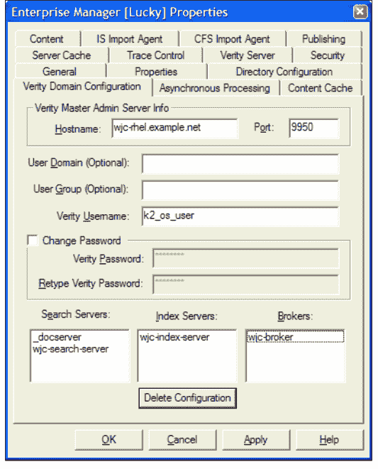

3.  从同一个弹出面板中，选择 **Verity 服务器** 选项卡。将 `wjc-broker` 从 **可用代理** 移动到 **已选代理**。点击 **确定** 以应用设置并关闭弹出面板。

这就完成了针对 CSE 的域配置，接下来我们将进入配置我们的单个对象存储，即对象存储一，`OStore1` 的步骤。

### 配置对象存储

在树形结构中选择 **对象存储一** 节点，右键单击并选择 **属性**。从弹出面板中，选择 **CBR** 选项卡。此面板上只有一个可编辑的字段。将 **CBR 区域设置** 字段设置为 **uni**。点击 **确定** 以应用设置并关闭弹出面板。


> **uni** 代表 Unicode，通常是支持多语言的最佳选择。如果你认为不需要多语言支持，即使所有用户的环境具有相同的区域设置，你也极有可能误解了。无论如何，如果你倾向于使用不同的 CBR 区域设置，你应该首先阅读 K2 区域设置自定义指南，因为这是一个相对复杂的话题。

**索引区域** 是 CE 指代 CSE 位置的方式。通过右键单击对象存储一并选择 **新建 | 索引区域** 来为此对象存储创建一个 Verity 索引区域。创建索引区域的向导将出现。

1.  点击 **下一步** 跳过前面的几个面板，当被提示时，将索引区域的名称输入为 `OStore1 Index Area`。

2.  在 **输入 Verity 目录** 面板中，输入之前在通过 K2 仪表盘配置 CSE 时选择的值。见下图。请注意，看起来我们为 **模板类型** 输入了简单目录名 `FileNet_FileSystem_PushAPI` 而不是完整路径。实际上，我们输入的是之前分配的别名，它恰好与简单目录名相同。

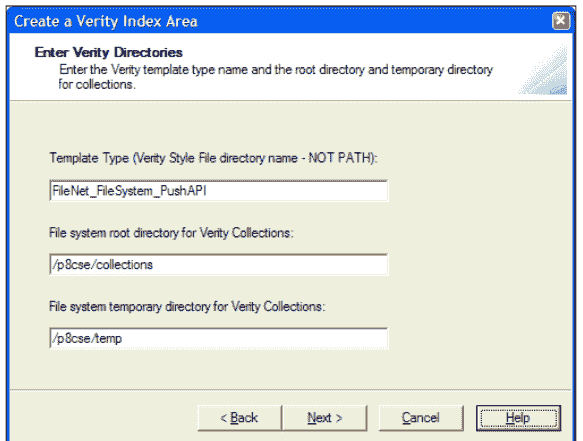

3.  在接下来的两个面板中，选择之前定义的 K2 搜索服务器 (wjc-search-server) 和索引服务器 (wjc-index-server)。

4.  除了这些明确的选择外，在所有面板上接受默认值，点击继续直到最后以创建索引区域配置并关闭向导。

向导的最终面板总结了我们所做的配置选择：

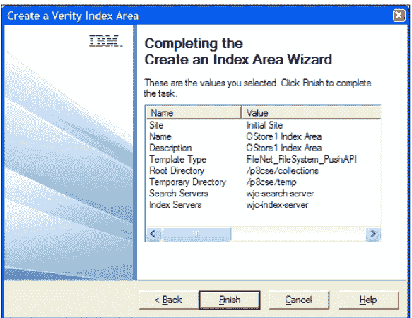

为了以后审查此配置，你可以通过 FEM 中对象存储的 **索引区域** 节点导航至该配置。

配置 CBR 的最后一步是指定你希望在 CSE 中索引的文档和/或注释子类。为了描述的简洁性，我们将仅索引所有文档类，包括文档基类。如果你拥有大量内容，并且可以从功能上排除其中很大一部分文档类的文本索引，这可能是一个很好的性能提升。除了索引文档内容外，你可以选择性地索引一个或多个字符串值属性。（字符串值属性的索引也可以针对文件夹和自定义对象类进行，但当然，它们没有内容。）作为一个例子，我们将启用 DocumentTitle 属性的文本索引。

1.  在 FEM 左侧的树形结构中，选择 **对象存储一** 内的 **文档类**。右键单击并选择 **属性**。在 **常规** 选项卡中，你会看到一个用于 **CBR 启用** 的复选框。选中它以启用 CBR 索引并点击 **应用**。你会被提示是否要将该选择应用于所有子类。需要应用，因此点击 **是**。（在你点击 **是** 之后，FEM 完成此步骤可能需要一些时间。）

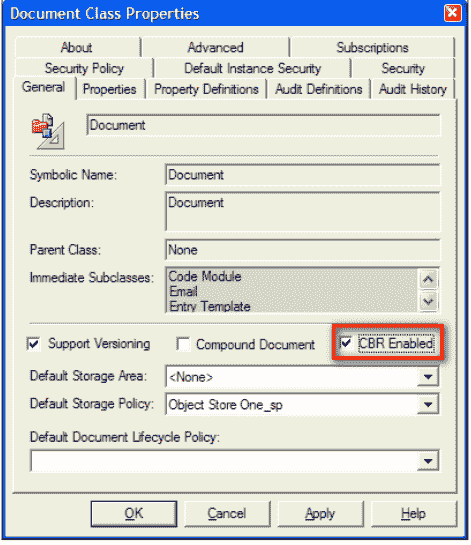


- 2. 再次，在同一个**文档类属性**对话框中，选择**属性定义**选项卡。突出显示**文档标题**所在行，并点击**编辑**。在**常规**选项卡上，您会看到一个类似的**启用 CBR**复选框，这次仅适用于这个特定属性。选中该复选框以启用 CBR 索引，然后点击**确定**应用设置并关闭面板。（同样，点击**确定**后，此步骤可能需要一些时间。）

这完成了 CSE 的安装和配置。CE 和 CSE 是松耦合的，出于性能原因，某些索引是批量完成的，因此新内容出现在文本索引中可能需要几分钟。默认情况下，CE 调度程序后台线程每三分钟运行一次。如果 CSE 必须首先从文字处理文档或类似文件中提取文本，则可能需要额外的时间进行索引。

您可以通过向 Object Store One 添加一些文档（为了测试，纯文本文档最简单），等待至少三分钟，然后从 K2 Dashboard 对这些文档执行简单的关键字搜索，来测试您的 CE 和 CSE 服务器是否配置正确。为此，请使用 Web 浏览器打开 K2 Dashboard，并导航到**系统视图 | K2 服务器 | wjc-search-server**。在打开的页面上，点击**测试搜索**链接。在**搜索**字段中输入您知道在文档中存在的搜索词，然后点击**搜索**按钮。您的测试文档应该会被找到。

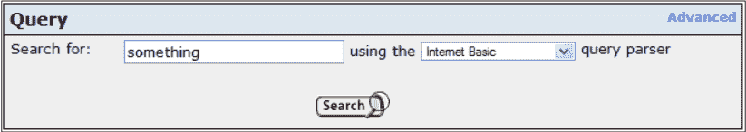

现在让我们转向另一个主要组件：流程引擎。

## 流程引擎服务器（PE 服务器）

### 安装其他组件

PE 目前不支持在 Linux 上运行（尽管它在各种其他 Unix 版本上受支持，并且将在 P8 5.0.0 版本中支持 Linux），因此我们将把它安装在 Microsoft Windows 服务器上。但是，我们仍然可以使用已经在 wjc-rhel.example.net 上安装的基于 Linux 的 DB2 实例。在生产环境中，数据库可能安装在自己的服务器组上，并且我们希望 PE 数据库在地理和网络拓扑上靠近 PE 服务器。对于我们的一体化环境，为了我们的方便，我们只是重用已经安装的 DB2 实例。

从高层来看，安装 PE 服务器的步骤如下：

- 1. 在 Linux 和 Microsoft Windows 上配置操作系统账户。还有一个 LDAP 目录用户和组。
- 2. 配置数据库以供 PE 使用。
- 3. 在 Microsoft Windows 上安装数据库客户端软件。
- 4. 在 Microsoft Windows 上安装和配置 PE 服务器软件。
- 5. 在 CE 中配置 PE 项。

#### 用户和组

正如我们在其他示例中所做的那样，我们在这里使用的用户和组账户与 PPG 和安装工作表中使用的象征性名称相同。如果您愿意，可以选择不同的名称。如果您使用不同的名称，那么在 PE 安装程序中请注意有关别名的说明。

在 Microsoft Windows 服务器（将安装 PE 的地方）上，创建以下内容。我们的环境不属于 Windows 域，因此我们所有的用户和组都是本地的。

- 组 fnop：该组的成员是 PE 操作员。
- 组 fnusr：该组的成员是 PE 用户，但不是操作员。
- 组 fnadmin：该组的成员是 PE 管理员。
- 用户 fnsw：将此用户添加到组 fnop、fnadmin 和 fnusr。如果存在 Microsoft Windows 组 Administrators，也请将此用户添加到该组。此用户账户用于启动和停止 PE 软件。我们还将使用它来安装 PE 服务器软件。

在 Linux 服务器（安装了 DB2 的位置）上，创建以下本地操作系统账户：

- 用户 f_sw：这是 PE 用于数据库活动的主要运行时用户 ID
- 用户 f_maint：PE 用于数据库维护

在 Tivoli (TDS) 目录中，创建以下内容。如果您在创建 TDS 用户和组时需要帮助，请参阅第 2 章中添加 CE 用户和组的部分。

- 组 pe_admin_group：该组的成员会自动获得 PE 中的某些管理员权限。
- 用户 pe_service_user：PE 在联系 CE 时使用此账户。此用户必须是 LDAP 组 pe_admin_group 的成员。

#### 数据库配置

数据库步骤包括创建表空间（Linux）、配置用户账户权限（Linux）和安装 DB2 客户端软件（Windows）。

##### DB2 数据库和表空间

虽然我们可以在一个 CE 数据库中创建 PE 相关的表空间，但如果我们将所有内容完全分开，就更容易看清情况。我们将使用相同的 DB2 实例，但会为 PE 使用创建一个数据库。我们将使用常规名称（VWDB），但您可以使用不同的名称。

使用实例 db2inst1 的 DB2 命令中心（如果需要复习如何启动它，请参阅第 2 章），执行以下操作：

- 1. 使用自动维护功能创建新数据库 VWDB。
- 2. 所有与 PE 相关的表空间都需要最小 8 KB 的页面大小。默认缓冲池可能具有 4 KB 的页面大小。在数据库 VWDB 中，创建一个页面大小为 8 KB 的新缓冲池。作为助记符，我们将其称为 VWDB8K。我们将把该缓冲池用于我们在此数据库中创建的所有表空间。
- 3. 创建新的系统临时表空间。
- 4. 创建新的用户临时表空间。
- 5. 创建三个具有自动存储且最小大小为 200 MB 的大型表空间。使用以下名称：VWDATA_TS、VWINDEX_TS 和 VWBLOB_TS。
- 6. 您可以删除随数据库创建的默认表空间。

##### DB2 用户权限

在上一步中，我们创建了几个 Linux 操作系统用户账户 f_sw 和 f_maint，PE 将使用它们与 DB2 进行数据库交互。现在是为这些账户授予数据库权限的时候了。因为我们使用 Linux 用户账户来运行位于其他地方的 PE 服务器，所以我们将使用 DB2 服务器身份验证。这里我们只总结必要的权限。如果您需要复习如何在 DB2 中执行此操作，请参阅第 2 章中 CE 的 DB2 配置步骤。

对于用户 f_sw：

- 1. 连接到数据库。
- 2. 创建表。
- 3. 对我们刚刚创建的每个“VW”表空间使用特权。

对于用户 f_maint：

- 1. 确定具有 SYSADM 权限的 Linux 操作系统组。您可以通过运行命令 db2 get dbm cfg 并检查输出来完成此操作。在我们的配置中，它是 DB2 安装期间自动创建的组 db2iadm1。
- 2. 确定 DB2 实例所有者 db2inst1 的主组。它很可能就是刚才提到的同一个组 db2iadm1。
- 3. 使 f_maint 用户成为前两个要点中组的成员。

##### DB2 客户端软件

在 Windows 服务器上运行的 PE 需要 DB2 客户端软件才能与在 Linux 服务器上运行的 DB2 服务器通信。DB2 客户端软件的安装很简单，我们在这里不详细说明。我们只提几点：

- 从 DB2 安装程序中，您只需安装 IBM Data Server Client 包。除非您的磁盘空间确实紧张，否则我们建议您选择“典型”安装选项。
- 为简单起见，我们取消选中标记为“启用操作系统安全性”的复选框。
- 默认安装位置是 C:\Program Files\IBM\SQLLIB\。

从 Windows 开始菜单启动*DB2 配置助手*，方法是导航到**开始 | 所有程序 | IBM DB2 | DB2COPY1（默认）| 设置工具 | 配置助手**。（您的 DB2 实例名称可能不同于**DB2COPY1**。）*DB2 配置助手*提供了方便的图形界面，用于配置 DB2 客户端软件到远程数据库的连接。找到并配置主机 **wjc-rhel.example.net** 上 DB2 实例 db2inst1 中数据库 VWDB 的连接。该工具提供了许多帮助程序来浏览或发现这些组件。给数据库一个与数据库名称（VWDB）相同的别名。

如果您发现自己手动配置 DB2 连接，可以通过在 DB2 服务器（我们的 Linux 服务器）上为实例 db2inst1 运行*DB2 控制中心*来查找或确认端口号。右键单击实例**db2inst1**的节点，然后选择**设置通信**。在出现的面板中，单击**TCP/IP**的**属性**按钮。将显示连接参数，包括端口号。在我们的例子中，它是端口 3801。还要确保该端口未被防火墙阻止，以便 **wjc-w2k3.example.net** 可以连接到它。

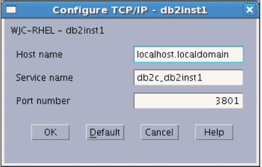

配置好到远程数据库的本地连接后，**DB2 配置助手**会为您提供测试连接的机会。您应该这样做，同时使用 **f_sw** 和 **f_maint** 用户 ID 进行测试。假设一切按预期进行，您可以关闭**DB2 配置助手**。

#### PE 服务器安装和配置

既然已经处理了 DB2 客户端软件及其到 DB2 服务器的连接，现在是时候在 Windows 服务器上安装和配置 FileNet 软件了。


## PE 服务器安装

现在是运行 PE 服务器安装程序的时候了。它的名称可能类似于 P8PE-4.5.1-WIN.EXE，具体版本取决于你的安装。 我们不会详细介绍安装的每一步，但这里有几个关键点：

- 你希望以操作系统用户 fnsw 的身份运行安装程序，因此要么以该用户登录，要么使用 Microsoft Windows 的“以其他用户身份运行”功能（在 Windows 资源管理器中右键单击安装程序名称并选择 **Run As**；从下拉菜单中选择用户 fnsw 并输入 fnsw 的密码）。
- 告诉安装程序你的数据库是 DB2 并且它不在 z/OS 上（除非你的 DB2 在 z/OS 上，在这种情况下，你知道该怎么做）。
- 如果你按照我们上面使用的名称设置了 DB2 数据库，那么安装程序的 **Specify DB2 Configuration Parameters** 面板中的默认值对你来说已经是正确的了。如果不是，请进行必要的调整。
- 如果你使用了默认的用户和组账户名称，如我们上面所做的，那么在 **Determine Administrator User and Group Aliasing Method** 面板上你可以回答“否”。否则，你必须回答“是”并在下一个面板中输入你使用的名称。

安装完成后，**Process Engine Services Manager** Windows 服务应会自动启动。

## CE 客户端安装

在 PE 服务器上安装 CE 客户端软件。该软件使 PE 能够为了各种目的发起与 CE 服务器的连接。安装程序的名称可能类似于 P8CE-CLIENT-4.5.1-WIN.EXE。

- 同上，以用户 fnsw 的身份运行此安装程序，要么以该用户登录，要么使用 Windows 的“以其他用户身份运行”功能。
- 在 **Select FileNet P8 Applications** 面板中，**Process Engine** 的条目可能已经被选中。如果没有，请选中它。
- CE 服务器 URL 将提供一个默认值，但它不正确。将其更改为此值：`cemp:http://wjc-rhel.example.net:9081/wsi/FNCEWS40MTOM/`。 （除了 `cemp:` 前缀外，这与你在 *Chapter 3* 中为 FEM 连接到 CE 服务器配置的 URL 相同。）
  - `cemp:` 前缀是为了历史原因而存在，在你运行的安装程序版本中可能已被移除。
  - 像往常一样，CE 服务器主机名是 **wjc-rhel.example.net**。
- 我们为 CE 服务器使用了第二个 WAS 配置文件，因此 HTTP 端口是 9081 而不是默认值 9080。
- 方案 http: 和路径元素 wsi/ 表示我们将使用 CE API 的 CEWS 传输（以前称为 WSI 传输）。
- 路径元素 FNCEWS40MTOM 表示我们将使用 MTOM 格式（一种 Web 服务标准）用于 SOAP 请求中的附件。你有时可能会看到的替代方案是 FNCEWS40DIME。选择 MTOM 而不是 DIME（一种较旧、已过时的 Web 服务标准）对你来说几乎没有区别，但 DIME 格式已被弃用，并且在 CE 5.0.0 起将不再受支持。
- 完成 CE 客户端安装程序的其余部分。

## PE 服务器配置

大部分 PE 服务器配置将通过使用 Process Task Manager 来完成。

1. 通过 Windows 开始菜单导航运行它：Start | All Programs | IBM FileNet P8 Platform | Process Engine | Process Task Manager。你可能会看到一个与 Windows 主机名同名的 PE 服务器，并且它未在运行。右键单击它并选择 Start 以启动 Process Service。一旦启动，图标上的红色“x”将消失。

   > 如果 Process Service 未能启动，请检查名为 Process Engine Services Manager 的 Windows 服务是否已启动。如果没有，请手动启动它并确保将其标记为自动启动。

   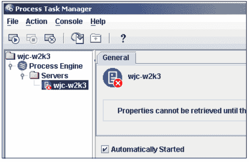

2. 当 Process Server 运行时，你将被带到 **Process Engine** 多标签属性面板。如果没有自动发生，请从树中选择 **Process Engine** 并从显示的面板中选择 **Security** 选项卡。

3. **Security** 选项卡上已经显示了你在 CE 客户端软件安装期间提供的 CE 连接 URL。输入 **pe_service_user** 用户 ID（和密码）以及 **pe_admin_group** 组。 将 **Configuration Group** 字段留空（我们没有创建）。

4. 单击 **Apply** 并在提示重启 Process Service 时单击 **Yes**。

   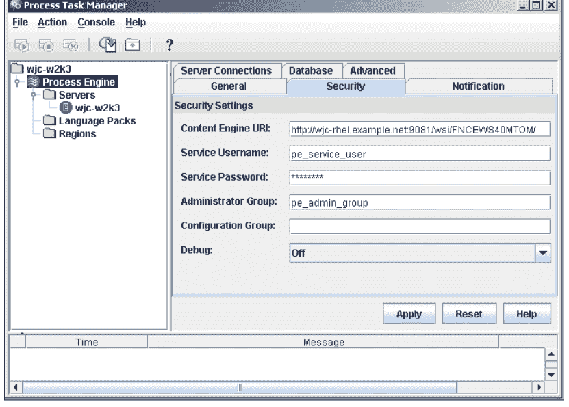

5. 在树中选择 **Regions** 节点。右键单击并选择 **New** 以创建一个新的 PE 隔离区域。

6. 在 **General** 选项卡上，我们将为隔离区域选择一个编号。PE 使用隔离区域来标识物理 PE 服务器内本质上不同的 PE 操作和数据分区。隔离区域编号是一个任意值，只要你不选择在此 Domain 中已被其他用途使用的编号即可。你可能不会感到惊讶的是，最受欢迎的选择是 1；最高允许值是 999。为了多样性，让我们使用 **398**。无论你选择什么，请记住该值以备后用。使用默认表空间。

7. 在 **Security Settings** 选项卡上，为隔离区域输入一个密码。显然，你也必须记下该值以备后用。

8. 单击 **OK** 并在提示重启 Process Service 时单击 **Yes**。退出 Process Task Manager 应用程序。

## 共享内存

PE 服务器在其内部架构中大量使用共享内存，因此给它尽可能多的连续共享内存访问权限非常重要。PE 提供了一个实用程序来计算该信息并创建 Windows 注册表更新文件以配置该大共享内存段的基地址。

在 Windows 服务器上以用户 fnsw 打开的命令行中，运行以下命令：

```
C:\> c:\fnsw\bin\set_shm_address.exe -r shm.reg
C:\> type shm.reg
C:\> shm.reg
C:\> del shm.reg
```

第一行运行一个 PE 实用程序，该实用程序计算共享内存段信息并创建注册表更新文件 shm.reg。第三行应用这些注册表设置。你可能会被提示确认。

完成此步骤后，你应该重启 PE 软件。实际上，为了稳妥起见，此时完全重新启动 Windows 服务器可能是一个好主意。必要的 PE 服务应会自动重启。

## 测试连接

在跨两台服务器和多个组件的众多配置步骤之后，现在是小小的真相时刻了。我们将使用配置的信息测试 PE 服务器到数据库的连接性。在 Windows 服务器上以用户 fnsw 打开的命令行中，运行命令 `c:\fnsw\bin\vccemp -1`。如果成功，vccemp 将报告有关连接和配置的一些晦涩事实。重要的是它不会报告错误。如果有错误，你必须重新检查上面各节中的配置步骤。

如果从 PE 到 CE 的连接出现问题，IBM 的 PE 团队发布了这份 *Troubleshooting the PE to CE Security Configuration* 技术说明： `http://www-01.ibm.com/support/docview.wss?uid=swg21328045`。

## CE 配置 PE

PE 服务器已安装并已配置为从 PE 服务器发起到 CE 服务器的连接性。我们现在必须配置相反方向，以启用从 CE 到 PE 发起的通信。这发生在例如 CE 事件处理程序启动 PE 工作流时。CE 使用 PE 连接点的概念来标识 PE 隔离区域的 PE 连接性和安全性信息。你将通过 FEM 创建和配置这些类型的对象。

1. 运行 FEM 并以用户 `gcd_admin` 连接到 `wjc-rhel.example.net`。
2. 在左侧树中，选择 **PE Region Ids**，右键单击并选择 **New PE Region Id**。
3. 按照向导步骤，并提供本章前面各节中的 PE 隔离区域信息（PE 服务器 `wjc-w2k3.example.net`，区域编号 **398**）。
4. 区域密码与我们之前在 PE 服务器上创建隔离区域 398 时输入的密码相同。
5. 在左侧树中，选择 **PE Connection Points**，右键单击并选择 **New PE Connection Point**。
6. 你可以为连接点指定任何你想要的名称，只要它在 Domain 内的连接点中是唯一的。我们使用了 `wjc-w2k3-398`。
7. 选择刚刚创建的隔离区域。

> 在你可以使用 XT 的工作流相关功能之前，你必须在 XT 站点首选项的 **General** 选项卡上配置一个 **Process Engine Connection Point**。你将在下拉菜单中获得一个列表，应选择我们刚刚创建的连接点。


## PE 客户端软件

稍后，我们将在 XT 环境中安装 PE 客户端软件。由于 CE 服务器与 XT 在同一台物理机器上，PE 客户端安装程序会同时检测到两者并一次性完成更新。如果由于某种原因，你既不安装 AE 也不安装 XT，那么你必须为 CE 服务器的使用安装 PE 客户端软件。请按照下面描述的步骤为 XT 安装 PE 客户端软件。

## 应用引擎 (AE)

AE 的术语可能有点令人困惑。一方面，你安装 AE 是为了部署 Workplace 应用程序。Workplace 是主要开箱即用的面向终端用户的应用程序。另一方面，AE 也是可以构建自定义应用程序的平台。Workplace 的许多功能可以通过自定义 Model-View-Controller (MVC) 框架中的集成点直接利用。AE 包含用于构建此类应用程序的工具包：Web Application Toolkit (WAT)。

如果你计划在环境中使用全部自定义应用程序，你需要安装和部署 AE（或 XT）吗？不需要；也就是说，除非你的应用程序是基于 WAT 构建的。如果你的应用程序是直接基于 CE 和 PE API 构建的，那么你可以跳过 AE 的安装。然而，即使是这种情况，我们也建议你在开发环境中至少安装 AE 或 XT。拥有一个开箱即用的工具来验证这样或那样的细节，或与你自己的自定义编码工作进行比较，是非常方便的。

由于 AE 和 XT 在 CM 生态系统中的位置相似，我们将跳过 AE 的安装，直接进入下一节安装 XT。如果你想在环境中安装 AE，你会发现安装过程与 XT 安装非常相似。特别是，LDAP 目录准备步骤完全相同，如果你将 AE 和 XT 安装到同一个 WAS 配置文件中，则只需执行一次。其他章节中的功能讨论将侧重于 XT 而不是 AE，尽管在许多情况下功能是等效的。

## Workplace XT (XT)

Workplace XT 是一个开箱即用的 Web 应用程序，用于访问许多 CM 功能。你可以浏览、搜索并直接操作 CE 中的许多类型对象，并且还可以参与 PE 中运行的工作流。XT 在 J2EE Web 容器中运行。由于它通过 EJB 传输与 CE 通信，XT 必须在与 CE 服务器相同品牌和版本的应用程序服务器上运行。

AE 中的 Workplace 应用程序（现在非正式地称为“Workplace classic”）最初有在 HTML 3.2 环境中工作的限制。XT 另一方面，使用更现代的 UI 范式，具有所谓的 Web 2.0 的外观和感觉。XT 开发人员以 Workplace classic 代码库为起点，按子系统逐步现代化 UI。尽管 XT 中仍保留了 Workplace classic 代码的几个部分，但大部分已被重写。XT 不包含用于自定义应用程序集成的完整 WAT，但仍有几个钩子可以添加自定义菜单项和操作。XT 使用行业标准的 MVC 框架，因此对其进行增强比对 Workplace 执行相同操作更少专业化。

我们将在与 CE 相同的物理服务器上，在其自己的 WAS 配置文件中安装 XT。不支持将它们安装到同一配置文件中（由于性能和功能原因）。在生产环境中，除轻负载环境外，你可能不会在同一台物理服务器上安装 XT 和 CE。拆分它们可以让你更好地控制负载均衡及其各自的扩展行为。

XT 的安装过程包括：

- 准备步骤（LDAP 目录和信任关系）
- 安装软件
- 配置和部署软件

## 配置 LDAP

请回忆在第 3 章中我们将 CE 服务器安装到配置文件 AppSrv02。现在我们将 XT 安装到配置文件 AppSrv01。XT 必须使用与 CE 服务器相同的 LDAP 目录设置，因此我们的第一步将确保 AppSrv01 与我们在 AppSrv02 中已完成的 LDAP 设置相匹配。有几种方法可以做到这一点。如果你是 WAS 专家，你可以只将 WAS 配置文件 AppSrv02 的相关部分复制到 AppSrv01。你也可以使用配置管理器（如我们在第 3 章 CE 安装中所做的那样），将其重新定位到 AppSrv01，并应用 LDAP 配置。我们将改为通过 WAS 管理控制台手动配置。

> 由于这是两个单独的配置文件，我们理论上可以在单独的浏览器窗口中同时打开控制台，这将便于并排比较。实际上，这可能会混淆保存会话信息的浏览器 cookie，让你有点抓狂。如果你安装了两个不同的浏览器，例如 Firefox 和 Internet Explorer，你可以在每个浏览器中打开一个控制台。

1. 登录 AppSrv01 的 WAS 控制台。导航到 Security | Global Security。
2. 在 User account repository 部分，从下拉列表中选择 Standalone LDAP registry，然后单击 Configure。
3. 单击 Advanced Lightweight Directory Access Protocol (LDAP) user registry settings。
4. 在配置面板中输入以下值：
   - User filter: `&&(cn=\*)(objectclass=person))`
   - Group filter: `&&(cn=\*)(|(objectclass=groupOfNames) (objectclass=groupOfUniqueNames) (objectclass=groupOfURLS)))`
   - User ID map: `*:uid`
   - Group ID map: `*:cn`
5. 单击 OK 返回到上一个面板。
6. 在配置面板中输入以下值：
   - Primary administrative user name: `was_admin`
   - Type of LDAP server: IBM Tivoli Directory Server
   - Host: `wjc-rhe1.example.net`
   - Port: `389`
   - Base distinguished name: `dc=whozi t,dc=example,dc=net`
   - Bind distinguished name: `cn=ce_service_user, cn=people, dc=whozi t,dc=example,dc=net`
7. 单击 Test connection 按钮。如果由于任何原因目录连接不成功，你必须在此点纠正它。如果你不纠正任何问题就继续，你可能会将自己锁定在该配置文件的 WAS 控制台之外。（不要问我们是怎么知道的。）
8. 单击 OK 返回到 Global security。
9. 单击 Set as current 以使此配置成为当前领域定义。
10. 选择 Enable administrative security 和 Enable application security 的复选框。取消 Java 2 security 部分中的所有复选框。
11. 单击 Apply。
12. 在屏幕顶部，你将看到保存或查看更改的链接。单击 Save。

如果你退出 WAS 控制台然后重新登录，你会注意到你仍在使用旧凭据。你必须重启 WAS 配置文件 AppSrv01 才能使 LDAP 更改生效；请执行此操作。从这一点开始，你必须使用 userid `was_admin` 登录 AppSrv01 的 WAS 控制台，就像你一直为 AppSrv02 所做的那样。

## 信任关系和 LTPA

在用户身份验证期间，将在 XT 应用程序服务器上创建一个名为 JAAS Subject 的对象。该 Subject 必须被 CE 应用程序服务器信任。不同的供应商使用不同的技术来实现这种所谓的信任关系。

WebSphere 使用的技术涉及一种称为 Lightweight Third Party Authentication (LTPA) 的机制。通常的做法是从 CE 服务器导出 WAS LTPA 密钥并将其导入 XT 服务器。

要导出 LTPA 密钥，请使用 AppSrv02 的 WAS 控制台。导航到 Security | Global Security。在 Authentication 框中，确保选择了 LTPA，然后单击 LTPA 链接。

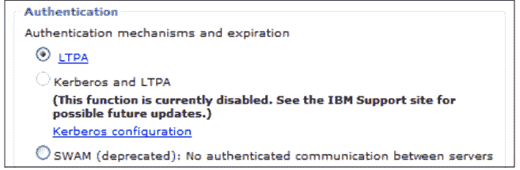

在 Cross-cell single sign-on 框中提供请求的密码和文件名，然后单击 Export keys。

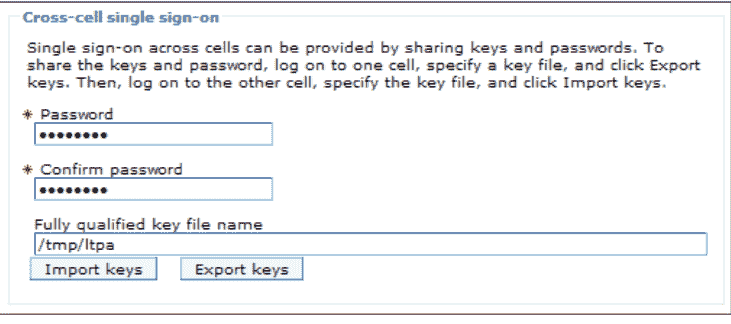


从 WAS AppSrv02 控制台注销，登录到 WAS AppSrv01 控制台，导航到同一区域，然后单击 Import keys。导入 LTPA 密钥后，我们建议您重启 AppSrv01。

## Run the installer

找到并运行适用于服务器操作系统的 XT 安装程序映像，在我们的例子中为 WorkplaceXT-1.1.4.0-LINUX.bin。对于安装程序会提出的大多数问题，答案都是显而易见的，或者你可以直接使用提供的默认值。

> XT 使用的磁盘空间可能超出你的预期。我们建议在进行 XT 安装时至少有 2 GB 的磁盘空间可用。XT 部署到应用服务器后，其中大部分空间可以收回。

当提示输入 CE API 配置时，在全部三个字段中使用值 cemp:iiop://wjc-rhel.example.net:2810/FileNet/Engine，如以下屏幕截图所示。特别注意，端口号是 2810，而不是通常的 WAS 默认值 2809。

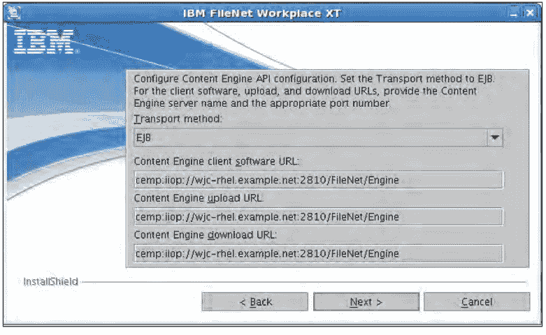

在配置用户令牌安全设置的面板上，取消选中 Create maximum strength keys 复选框。对于本演示系统来说这样就足够了。对于生产环境，最大强度密钥是个好主意，但你可能需要使用策略文件下载来配置 WAS Java 环境。我们现在避免这种复杂性，但你可以在 XT 文档中阅读有关用户令牌和相关加密设置的介绍。

选择 EAR 文件部署（而不是 WAR 文件部署）。完成剩余的安装程序面板并完成 XT 软件的安装。完成后，XT 软件将被安装，但 XT EAR 文件尚未部署到 J2EE 应用服务器。

XT 将日志文件写入安装树中的一个目录。为了使运行中的 WAS 进程能够在该目录中创建文件，请执行以下命令，将 XT 日志目录的所有权更改为 ecmuser，组更改为 ecmgroup：

```
# chown ecmuser:ecmgroup /opt/ibm/FileNet/WebClient/LogFiles
```

## CE and PE client software

XT 同时与 CE 服务器和 PE 服务器通信。像任何其他应用程序一样，XT 需要访问这些服务器提供的客户端软件。

如果你同时安装 AE 和 XT，可以在运行完 AE 和 XT 的安装程序后执行这些步骤，这样客户端更新将同时完成。对 AE 和 XT 分别执行与单独执行没有区别；只是能省去一点麻烦。

### CE client

CE 客户端软件和配置文件必须安装到 XT 环境中。这与我们之前为 PE 服务器所做的步骤类似。在这种情况下，CE 客户端安装程序名称为 P8CE-CLIENT-4.5.1-LINUX.BIN。如果你在 XT 安装程序中使用了默认路径，XT 安装的存在应该会被自动检测到。其余的安装过程应该不会有问题。

由于你将在此之后立即安装 PE 客户端软件，可以跳过现在创建 EAR 文件。在 Create Deployment File 面板上，选择 Create the file later。

### PE client

PE 客户端软件和配置文件也必须安装到 XT 环境中。在这种情况下，PE 客户端安装程序名称为 P8PE-CLIENT-4.5.1-LINUX.BIN。如果你在 XT 安装程序中使用了默认路径，XT 安装的存在应该会被自动检测到。它还会检测到 CE 服务器的存在，因此请保持两个复选框都选中。

PE 客户端需要连接到 CE 服务器，并且希望使用 CE Java API 的 CEWS 传输。对于 CE 连接 URL，请使用值 http://wjc-rhe1.example.net:9081/ws/FNCEWS40MTOM/。正如我们在其他地方所指出的，这与配置 FEM 时使用的 URL 相同。可以将 PE 客户端配置为使用 EJB 传输，但这需要一些复杂的手动配置步骤，而且没有很好的动机去这样做。

当被询问时，请选择安装 PE REST 服务。它是 ECM Widgets 所必需的。如果你没有在这里安装它，可以通过重新运行 PE 客户端安装程序稍后添加它。

我们已经完成了对 XT 环境的更新，因此现在选择 Create the WAR or EAR deployment file。它可能已经被默认选中了。

## XT pre-deployment configuration

在 XT 部署到应用服务器之前，可以执行一些可选的配置步骤：

- **SSO:** 你可以配置 XT 参与各种标准化的单点登录（SSO）方案
- **User Tokens:** 你可以配置 XT 的用户令牌交叉认证机制，以允许第三方与 XT 集成

我们这里不会描述 SSO 设置，但几个 CM 组件确实利用了用户令牌（例如 XT Image Viewer applet），因此让我们启用它们：

1. 将以下 JAR 文件复制到 /opt/ibm/WebSphere/AppServer/lib/ext/。当然，我们展示了 JAR 文件和目标目录的默认路径：
   - /opt/ibm/FileNet/WebClient/WorkplaceXT/authenticationFiles/authentication-websphere.jar
   - /opt/ibm/FileNet/WebClient/WorkplaceXT/WEB-INF/lib/log4j.jar

2. 为 WAS 配置文件 AppSrv01 指定一个 JAAS 配置文件。在 WAS 控制台中，导航到 Servers | Server Types | WebSphere application servers | server1。在 Configuration 选项卡上，选择 Java and Process Management | Process definition，然后选择 Java Virtual Machine。在 Generic JVM arguments 字段中，添加此 Java 命令行参数（保留可能已有的其他参数）：-Djava.security.auth.login.config=/opt/ibm/FileNet/WebClient/CE_API/config/jaas.conf.WebSphere。

3. 启用信任关联：
   - 仍在 AppSrv01 配置文件的 WAS 控制台中，导航到 Security | Global security | Web and SIP security | Trust association。选中启用信任关联的复选框，然后单击 Apply 然后 Save。
   - 返回 Trust association 页面，单击 Interceptors，并添加一个新拦截器，类名为 com.filenet.ae.authentication.tai.UserTokenInterceptor。单击 OK 返回拦截器列表。单击 Save 以更新 WAS 配置。

4. 从 WAS 控制台注销，并重启 WAS 配置文件 AppSrv01。

## Deploying XT


> 我们刚刚所做的所有更改都是针对 WAS 本身，而不是 XT 安装目录下的文件。如果你对 XT 文件做了任何此类更改，或者你要求 CE 或 PE 客户端安装程序不要自动重建部署文件，那么你必须手动重建部署文件（EAR 或 WAR）。你可以在目录 /opt/ibm/FileNet/WebClient/deploy/ 中找到用于此目的的脚本。

XT 的实际部署主要是通过 WAS 控制台进行的标准 WAS EAR 部署：

- 登录 AppSrv01 配置文件的 WAS 控制台并导航到 **Applications | Application Types | WebSphere enterprise applications.** 单击 **Install** 以添加新应用程序。
- 在打开的面板上，会提示你输入 XT EAR 文件的位置，可以在本地或远程文件系统上。“本地”指的是你运行浏览器的机器，“远程”指的是 WAS 运行的机器。在适合你的情况下，输入文件名 **/opt/ibm/FileNet/WebClient/deploy/web_client.ear**，然后单击 **Next**。
- 完成安装新 EAR 的剩余 WAS 面板。我们建议你采用 WAS **Fast Path** 并接受提供的默认值。其中一些步骤可能需要一些时间，因为被操作的文件相当大。请务必在最后面板上 **Save** 你的更改。

你将被带回到 **Enterprise Applications** 列表。你会在该列表中看到 WorkplaceXT，但它尚未启动。在启动它之前，我们必须进行一些重要的配置更改，描述如下。

### Classloader configuration

单击 **WorkplaceXT**，然后单击 **Class loading and update detection**。选择单选按钮以选择 **Classes loaded with local class loader first (parent last)**。单击 **OK**。（在较早版本的 WAS 中，此类加载策略称为“application first”。）

这应该会带你返回 WorkplaceXT 配置页面。单击 **Manage Modules**，并选择 **WorkplaceXT**。（这种看似冗余是因为这是 EAR 文件内的 WAR 文件。）从下拉列表中，选择 **Classes loaded with local class loader first (parent last)**。单击 **OK**。

**Save** 更改。


## 映射特殊主体

映射特殊主体可启用 XT 的容器管理认证（CMA）功能。

再次导航到 **企业应用程序 | Workplace XT**。单击 **安全角色到用户/组映射** 链接。选择 **所有已认证** 行，然后从 **映射特殊主体** 下拉菜单中，选择 **应用程序领域中的所有已认证**。

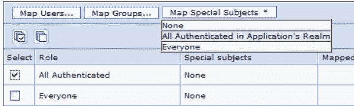

选择 **所有人** 行，并将其映射到下拉菜单中的 **所有人** 条目。

**保存** 这些更改。

## ORB 唯一性

此项是必需的，因为 XT（或任何使用 EJB 传输的 CE 应用程序）与 CE 服务器安装在同一服务器主机上时存在特殊情况。如果没有此配置，JNDI 查找可能会混淆。您必须在 AppSrv01 和 AppSrv02 中都进行此更改。

导航到 **服务器 | 服务器类型 | WebSphere 应用程序服务器 | server1**。然后选择 **Java 和进程管理 | 进程定义**。单击 **Java 虚拟机** 的链接，然后选择 **自定义属性**。创建一个新属性 **com.ibm.websphere.orb.uniqueServerName**，并赋予其值 **true**。

**保存** 这些更改。不要忘记为另一个 WAS 概要文件执行相同的配置。

## 首次运行 XT

在前述所有配置项完成后，最好重新启动两个 WAS 概要文件。如果 AppSrv01 之前未启动，重启 AppSrv01 会顺带启动 XT。

通过在 Web 浏览器中输入以下地址连接到 XT：http://wjc-rhe1.example.net:9080/WorkplaceXT。

XT 的首次登录应使用管理员用户 ID 完成。该用户 ID 将自动添加到应用程序引擎管理员列表中。该列表是允许对 XT 站点首选项进行更改的用户列表。首次登录时看到的第一个 XT 屏幕将是 Bootstrap 首选项页面。您可以通过“说明”链接阅读可用信息，或查阅 XT 文档获取指导，但对于我们的演示系统，采用默认值也是合理的。

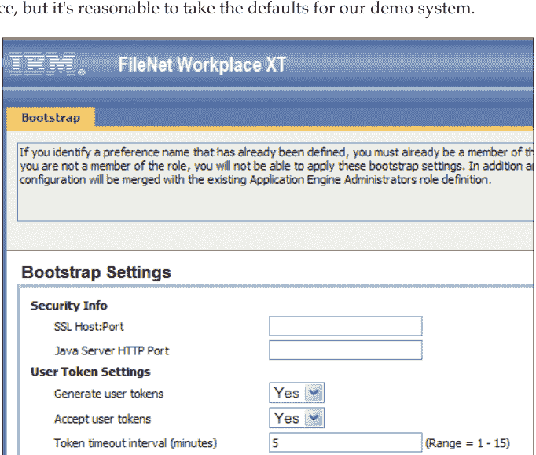

> 在您可以使用 XT 的工作流相关功能之前，必须在 XT 站点首选项中配置连接点。导航到“工具 | 管理 | 站点首选项”。在“常规”选项卡中，找到“常规设置 | 任务 | 流程引擎连接点”条目。您会看到一个下拉菜单，应选择我们本章前面创建的那个连接点 wjc-w2k3-398。

## IBM System Dashboard for ECM (SD)

一旦您的 CM 系统启动并运行，其持续运行的健康状况将变得值得关注，尤其是在生产环境中。几乎所有 P8 技术组件都会不断收集有关当前活动的许多方面的统计信息，包括吞吐率、平均事务时间等。当某个组件似乎运行异常时，查看各个组件的内部计数器趋势可能非常有价值。“正常值”的含义会因站点而异，但特定站点的管理员通常一眼就能看出哪个组件出现异常。

> System Dashboard 随 CM 一起提供。不应将其与名为 IBM FileNet System Monitor 的附加产品混淆。尽管它们构建在基本相同的基础设施、计数器和统计信息之上，但 System Monitor 是一种更主动的工具，能够持续监控目标系统，并提供警报、自动化例行响应、重启等功能。

SD 是一个随附组件，可以查看由各种组件维护的计数器和其他统计信息。您可以使用 SD 深入查看特定领域以进行问题解决和故障排除。此外，定期使用 SD 可以帮助管理员在潜在问题影响最终用户之前发现它们。

单个 SD 安装文件包含所有受支持平台的安装程序以及 PDF 格式的完整产品文档。使用 Linux 服务器上的 root 帐户，运行命令 Linux_ECMDashboard.bin 以启动图形化安装过程。

> 可能需要使安装程序可执行（chmod +x Linux_ECMDashboard.bin）。如果您是从物理磁盘或映像安装，可能需要将文件复制到可以执行此更改的临时位置。

接受默认值即可在 /opt/ibm/FileNet/Dashboard/ 目录下进行“典型”安装。通过执行该目录中的 Dashboard 可执行文件来运行 Dashboard。

对于我们的两台机器设置，System Dashboard 的配置很简单。

- 1. 导航到目录 /opt/ibm/FileNet/Dashboard/，然后运行 Dashboard 命令。在打开界面中，选择“集群”选项卡。
- 2. 单击“新建”以添加新集群，并为其命名为您想要的任何名称。我们建议您使用与您的域相同的名称，Lucky。
- 3. 突出显示刚刚添加到列表中的集群名称，然后点击 **编辑**。
- 4. 使用 **添加** 按钮添加我们的两个服务器主机：**wjc-rhel.example.net** 和 **wjc-w2k3.example.net**。
- 5. 点击 **确定** 关闭编辑面板。
- 6. 使用菜单 **文件 | 将集群另存为** 将集群定义保存到方便的位置的文件中。在以后运行 Dashboard 时，您可以加载集群文件定义，而不是每次重新创建它们。

> 如果集群中的任何主机恰好没有运行任何 P8 软件组件，出现错误是正常的。如果 P8 组件在给定主机上运行，即使 Dashboard 远程运行，它们通常也会被自动发现。

## 渲染引擎（RE）

RE，也称为发布引擎或发布服务，可以将常用的业务文档格式转换为 HTML 或 PDF。文档的内容不会改变，格式会尽可能忠实地呈现原始版本。CE 维护原始版本（称为**源**文档）与渲染版本（称为**目标**文档）之间的链接。

> RE 需要单独授权，不包含在基础 CM 许可证中。

RE 有两个典型用例：

- 站点可能希望以供应商中立或尽可能广泛的受众可以使用的格式（或两者兼有）在网站上提供内容。HTML 和 PDF 都适合此场景。
- 站点可能希望出于合规或其他原因，永久捕获文档在某个瞬间的确切状态。尽管 CM 可靠地跟踪所有内容更改，并防止在文档版本检入后发生任何内容更改，但有时出于外部原因需要内容的官方快照。在许多场景中，PDF 是此类快照的首选格式。

## 总结

RE 的安装很简单，但为了简洁起见，我们这里不展示。在生产环境中，RE 会安装在独立于 CE 的服务器上，以便更好地管理两种不同类型的负载。在一体化环境中，RE 和 CE 可以安装在一起，但 RE 仅限于在 Microsoft Windows 下运行。

尽管我们说 CM 的核心是 CE，但您可以从本章看到，构成整个 CM 图景的组件还有很多。我们安装了其中几个组件，并描述了另外几个。这暂时结束了我们的安装和配置，在*第 6 章*中，我们将使用这些工具来查看更多 CM 功能。
