## 最终用户工具和任务

在*第 4 章，管理工具和任务*中，我们看到了如何执行许多管理活动，主要是在 **FileNet Enterprise Manager（FEM）** 中。我们将在后面的章节中看到更多这类主题，但在本章中，我们将主要转向其他内容——最终用户可能要做的事情。我们对此的主要工具将是 Workplace XT（XT），尽管许多相同功能在 Workplace“经典版”中也可用。与第 4 章一样，我们的主要动机是展示概念，而不是为特定应用程序提供教程。

本章涵盖以下主题：

- XT 应用程序概述
- 浏览及相关操作
- XT 条目模板
- 工作流交互
- 文档版本控制
- 属性和安全操作
- XT 搜索界面

这些主题中的部分内容将涵盖 XT 应用程序的功能，而不是 CM 和 P8 平台的通用功能。我们会指出这些，以免混淆。

# 什么是 Workplace XT？

IBM 为编写与 CM 产品和 P8 平台协同工作的应用程序提供了完整、综合的 API。它们还提供了多个预建的、即用型环境用于与 CM 协作。这些范围从连接器和其他集成，到 IBM 和第三方应用程序，到随 CM 提供的独立应用程序不等。业务需求将决定使用其中哪些。企业通常会使用自定义编码、产品集成和独立 CM 应用程序的混合方式。即使在独立 CM 应用程序并未在整个企业中广泛部署的情况下，管理员或高级用户仍可将其用于临时探索或故障排除。

XT 是随 CM 包含的一个完整、独立的应用程序。它非常适合以人为中心的文档管理，在这种管理中，不同角色的用户积极参与单个项目的创建和管理。XT 暴露了大多数 CM 功能，包括内容管理与流程管理（工作流）的结合。

> XT 是一个使用现代用户界面技术构建的轻量级 Web 应用程序，因此具有某种 Web 2.0 的外观和感觉。要运行 XT，只需使用 Web 浏览器打开其起始页。URL 为 XT 安装的服务器名称、适当的端口号以及 WorkplaceXT 的默认上下文。在我们的安装中，那就是 http://wj c-rhel.example.net:9080/WorkplaceXT。我们在此未展示，但在 XT 的使用范围超出我们的一体化开发系统时，通常会将其配置为显示在 80 端口，即默认 HTTP 端口。这可以通过重新配置应用程序服务器直接使用这些端口，或通过在浏览器客户端与应用程序服务器之间插入 Web 服务器（例如 IBM HTTP Server, IHS）作为中继来实现。还很常见的是将配置为至少登录页面受 TLS/SSL 保护。这两项配置的详细说明在产品文档中有深入介绍（因应用程序服务器类型而异）。

在本章的一些示例中，我们将以高权限用户 poweruser 登录，对于其他示例，我们将以低权限用户 unpriv 登录。我们在第 2 章《安装环境组件》中提到了这两个目录用户。如果您未创建它们，现在可以创建它们，或使用您自己的目录中的任何一对非管理员账户替代。

## 浏览文件夹和文档

让我们看一下 XT 的开屏界面。以用户 poweruser 登录到 XT。将顶左四个图标组中的文件夹图标选中，如下图所示，XT 会显示一个树视图，允许浏览文件夹中的内容。

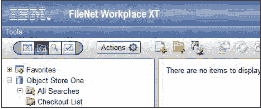

当然，我们目前在对象存储中还没有任何内容，因此当我们展开 Object Store One 节点时，看到的只是伪文件夹（即 XT 放入树中但在对象存储中并非真正文件夹的东西）。

现在就添加一些内容吧。我们将在第 7 章《主要 CM 功能》中对文件夹和包含的技术特性进行大量讨论。现在，我们将集中关注用户视角。

## 添加文件夹

在图标栏中有两个带有小绿色“+”号的图标（您可以在上面的屏幕截图中看到它们）。左侧的图标看起来像一张纸，用于向当前展开的文件夹添加文档。右侧的图标看起来像一个办公用品文件夹，用于向当前展开的文件夹添加子文件夹。

在树视图中选择 Object Store One，然后单击添加文件夹的图标。

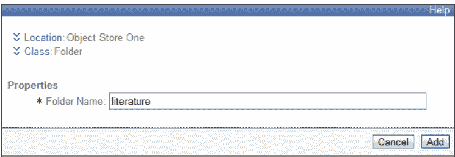

弹出向导的第一面板出现，如上图所示，提示您输入文件夹名称。我们选择了名称 ***Literature*** 以继续在 *第 4 章，管理工具和任务* 中开始的示例。单击 **Add** 按钮，文件夹将被创建并出现在树视图中。按照相同步骤为其添加名为 shakespeare 的子文件夹。也就是说，创建一个路径为 /**Literature**/shakespeare 的文件夹。

您可以通过右键单击并选择 **More Information | Security** 来修改大多数对象的权限。弹出面板显示对象的 **Access Control List (ACL)**。我们将在 *第 8 章，安全功能和规划* 中更详细地讨论 ACL。现在，我们只是想允许其他用户向 shakespeare 文件夹添加项目（当我们稍后进入该部分说明条目模板的示例时，我们需要它）。打开该文件夹的安全面板。单击 #***AUTHENTICATED-USERS*** 的链接，并在 *Allow* 列中选中 **File In Folder** 复选框，如以下屏幕截图中突出显示的那样：

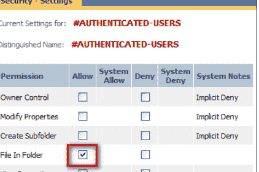

### 添加文档

现在让我们向存储库添加一些实际文档。我们将添加几部莎士比亚的著名作品作为示例文档。

> Internet 上可以轻松获取莎士比亚作品的电子版。我们最喜欢用于此类练习的来源之一是麻省理工学院：http://shakespeare.mit.edu。它很方便，因为它基本上只是文本，没有太多注释、批评等。您首先看到的是按作品类型分类的所有作品列表，只需一两步点击即可获得作品的完整 HTML 文本。它们明确声明已将 HTML 版本置于公共领域，这也不无帮助。

我们将使用单页的完整版本作为示例文档。在您桌面机器上的某个方便位置，下载几个完整文本文件。我们选择了 *As You Like It* (`asyoulikeit_full.html`)、*Henry V* (`henryv_full.html`)、*Othello* (`othello_full.html`) 和 *Venus and Adonis* (`VenusAndAdonis.html`)。

在树视图中选择 `/literature/shakespeare` 文件夹，然后单击添加文档的图标。文档添加向导弹出，如下所示：

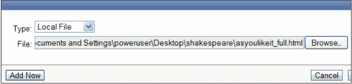

浏览到第一个文档文件 `asyoulikeit_full.html` 的位置，然后单击 **Next** 按钮。不要单击 **Add Now**，否则您将不会获得我们示例所需的正确文档类。

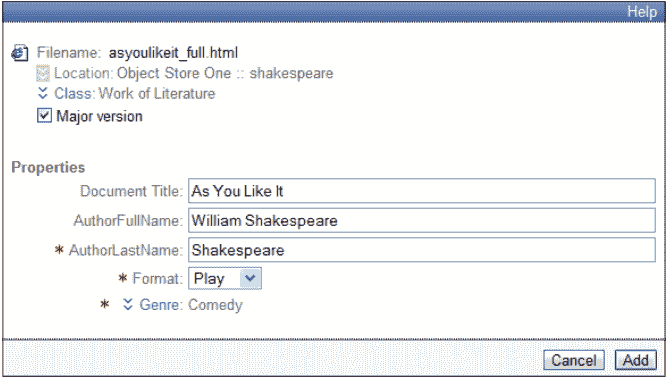

最初，类 **Document** 被指示。单击 **Class** 并选择 **Work of Literature**。属性列表会自动调整以反映为我们的自定义类定义的自定义属性。提供指示的值（请特别注意，您必须调整 **Document Title** 属性，因为它默认为文件名）。XT 使用通常的约定，用星号标记必填属性。单击 **Add**。

对其他三个文档重复上述步骤。您现在将在 shakespeare 文件夹中看到一个简短列表。

| Name ▲ | Size | Modified By | Modified On | Major Version |
|---|---|---|---|---|
| As You Like It | 226 KB | poweruser | 10/16/10 1:10 PM | 1 |
| Henry V | 263 KB | poweruser | 10/16/10 1:13 PM | 1 |
| Othello | 298 KB | poweruser | 10/16/10 1:21 PM | 1 |
| Venus and Adonis | 63 KB | poweruser | 10/16/10 1:22 PM | 1 |

XT 还提供了一个用于拖放文档的“着陆区”。它位于浏览器窗口右上角，如下所示。这可以为您节省在文件系统中浏览文档的麻烦。即使它可以接受单次拖放中的多个文档，它也只会提示输入一组属性值，并将该值应用于所有文档。

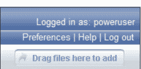

## 查看文档

在 XT 中单击文档链接将导致内容下载并启动合适的应用程序。对于大多数文档，Web 浏览器用于根据文档内容类型查找并启动应用程序，尽管 XT 在站点首选项中对其行为有一定可配置性。您通常可以期望的行为与单击任何典型网站上的文档链接时的行为相同。

对于图形图像内容（JPEG、PNG 和类似格式），XT 启动 Image Viewer 小程序。Image Viewer 小程序对于处理标记图像格式文件（TIFF）图形尤其方便，因为大多数浏览器不原生处理 TIFF。传真和扫描应用程序通常会生成页面的 TIFF 图像。然而，即使对于浏览器可以渲染的常见图形格式，Image Viewer 小程序也具有更多功能。最有趣的额外功能是为图像添加文本或图形注释。与直接操作原始图像不同，注释是在覆盖层中创建并作为注释对象保存在存储库中。例如，在下面显示在 Image Viewer 小程序中的图像中，已使用印章工具将其标记为 DRAFT。该注释可以轻松重新定位甚至删除，而不会影响原始图像。

> > 附带的图像查看器小程序仅被许可用于已集成该程序的 FileNet 组件中。它是 Daeja Image Systems 公司 ViewONE 的 OEM 版本。功能更丰富的 ViewONE Pro 应用程序可直接从 Daeja 获得许可，并可作为受支持的配置集成到 FileNet 应用程序中。但在这种情况下，查看器本身的支持直接由 Daeja 提供。

# 条目模板

尽管创建文档和文件夹的每一步单独来看都很简单，但综合起来，它们可能会让非技术用户感到困惑，尤其是再加上命名、安全及其他约定时。即使完全理解了流程，仍有一些纯属事务性的细节可能会因输入错误等问题而出错。

基于这些动机，XT 提供了一个名为“条目模板”的功能。通常由管理员等人员创建条目模板，以帮助其他创建文件夹或文档的用户。许多细节可以预先指定，但用户仍然可以在适当的位置进行选择。

要创建条目模板，请导航到 **工具 | 高级工具 | 条目模板 | 添加**。系统会启动一个向导，你可以通过它定义**文档条目模板**或**文件夹条目模板**。我们不会在这里逐一介绍所有步骤，因为用户界面很容易理解。两种类型的条目模板都是 Document 的子类，XT 将创建的条目模板归档到文件夹中。当你双击某个条目模板时，XT 会呈现一个符合该条目模板设计的用户界面。例如，在下图中使用的条目模板名为 **Shakespearean Document**，文档类别和目标文件夹已被预先选定，用户无法更改。同样，作者姓氏和全名也已预先填充。其他确实需要用户输入的属性，则可以像往常一样进行编辑。

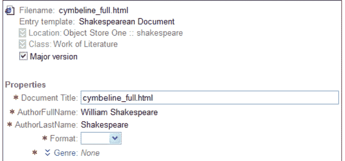

# 工作流交互

XT 不仅与 CE 通信以进行内容管理，还可以与**流程引擎（PE）**通信来管理工作流。在创建条目模板时提供的选项之一就是启动关联的工作流。与本章讨论的许多其他功能一样，从 XT 启动工作流有多种方式，而在条目模板中使用它们是常见的方式之一。

## 一次性隔离区域设置

你应当记得，我们在**第 3 章“安装 Content Engine”**中配置了一个 PE 隔离区域，并在**第 5 章“安装其他组件”**中在 Xl 站点首选项中选择了该隔离区域。在使用该隔离区域之前，必须先对其进行初始化。

以用户 `gcd_admin` 或你已指定为应用程序引擎管理员的任何其他用户身份，导航到 **工具 | 管理 | 流程配置控制台**。“流程配置控制台”是以 Java 小程序的形式实现的。在树状视图中，找到 **wjc-w2k3-398** 隔离区域。右键单击并**连接**到该区域。再次右键单击并选择**初始化隔离区域**。该隔离区域的 PE 数据库将填充各种结构，如下所示：

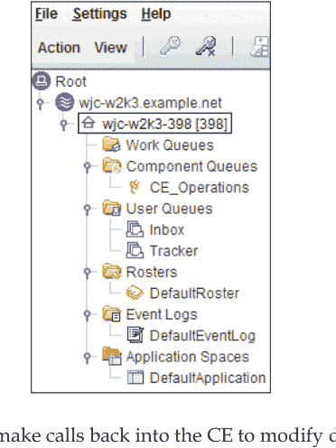

运行中的工作流可以回调 CE 来修改文档和其他对象。例如，你可能有一个审批工作流，它更新文档的生命周期状态以反映批准或拒绝。PE 允许运行中的工作流调用其他系统的机制称为**组件集成器（Component Integrator）**，而对 CE 调用的具体实现称为**内容扩展操作（Content Extended Operations）**。这体现在上图中看到的 `CE_Operations` 组件队列中。

> 组件集成器是 PE 的一个极其强大的功能，你并不局限于 `CE_Operations` 中实现的特定功能。你可以实现自己的组件，包括进行其他类型的 CE 调用。

有许多用于调优内容扩展操作的配置参数，但我们当前关注的是它回调 CE 时将使用的凭据。右键单击 **CE_Operations** 节点并选择**属性**。在**适配器（Adaptor）**选项卡上，如下所示，有要使用的**用户名**和**密码**字段。该用户必须拥有足够的 CE 访问权限，才能执行通过内容扩展操作进行的操作。一般来说，这意味着能够对 CE 中许多或大多数对象进行非常灵活的一系列更改。显然，这是一个功能非常强大的账户。我们的建议是为此专门创建一个专用目录账户（如此处所示），并采取预防措施保护它免遭破坏。

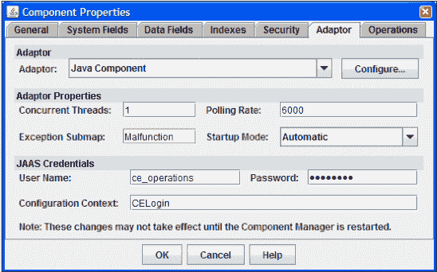

# 审批工作流

如果你拥有完整的 BPM 许可证，你将拥有各种用于创建和管理工作流的工具。使用 CM 许可证时，你会获得一台 PE 服务器以及 XT 附带的两个工作流定义。在创建条目模板的**选择工作流**步骤中，这两个定义都会提供。

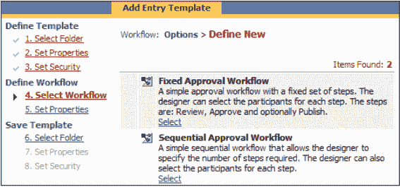

从上一张截图的说明文字可以看出，“固定审批工作流”由预定义的两步或三步工作流组成。这满足了许多简单文档审批的常见用例。对于更复杂的情况，“顺序审批工作流”允许你创建额外的步骤。具体步骤的名称只是建议，可以根据需要重命名为任何名称。每个工作流步骤的参与者可以在工作流与条目模板关联时指定，也可以留给用户在运行时自行分配。

# XT 中的任务

工作流的参与者可以在 XT 收件箱中查看待处理项。在此截图中，你可以看到用户 poweruser 正在查看 XT 的任务区域。由于 poweruser 被列为“固定审批工作流”中“审阅者”步骤的参与者（该工作流是在有人添加 Cymbeline 文档时启动的），因此该审批步骤会出现在收件箱中，可供批准或拒绝。

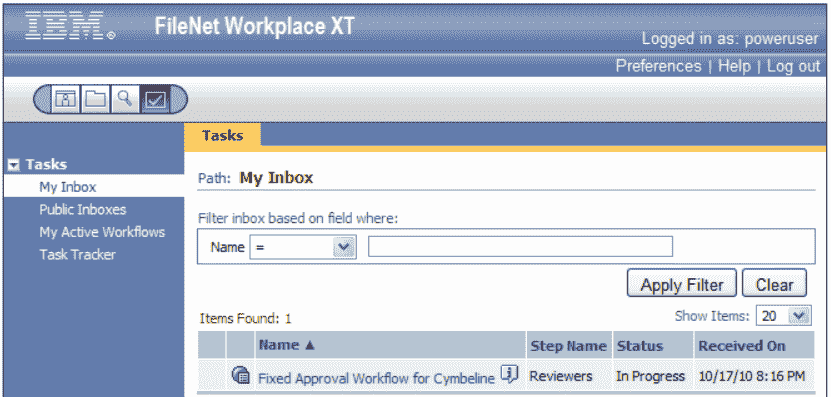

如果用户单击该链接，XT 的 HTML 步骤处理器将打开。审阅用户将看到指向该文档的链接，作为主要的工作流附件，并可以看到该工作流是由用户 unpriv 启动的。在此场景中，这意味着 unpriv 添加了该文档。如果 poweruser 批准了该工作流步骤，该工作项将从其收件箱移到“审批者”步骤中列出的参与者的收件箱中。另一方面，在工作流进行期间，unpriv 可以通过查看“我的活动工作流”菜单项来检查其进度。

# 版本控制

添加和浏览文档是一回事，但文档通常还需要以各种方式进行处理。最基本的处理方式是**版本控制**。在 ECM 语境中，版本控制意味着以受控方式修改文档内容的能力。在 CM 中，你无法真正直接修改文档的内容，但你可以创建文档的新版本，并在该过程中修改新版本的内容。我们将在*第 7 章“CM 主要功能”*中以更技术性的细节介绍版本控制。现在，让我们先看看它是如何工作的。

以 **poweruser** 身份登录 XT 后，在树状视图中选择 **/literature/shakespeare** 文件夹。假设我们注意到其中一个文本中有个拼写错误。我们将通过一个无关紧要的更改来模拟修正该错误。选择 **Venus and Adonis**，然后执行签出操作。在 XT 中，你可以通过多种方式执行此操作。就我们的目的而言，请右键单击并从上下文菜单中选择**签出并下载**。系统会提示你选择保存从存储库下载的文件内容的位置。选择任何方便的位置，但不要覆盖你的原始文件。你会看到 XT 中该文档旁边出现一个小的红色对勾标记，表示它已被签出。在我们签入或取消签出之前，其他任何人都无法签出同一文档。

> 在我们签出文档期间，你可能会想单击树状视图中的**签出列表**伪文件夹，看看我们的文档确实在列表中。

用编辑器（而不是网页浏览器）打开下载的文件 VenusAndAdonis.html。如果你碰巧有 HTML 编辑器或支持 HTML 的文字处理器，那当然很好。否则，直接用任何文本编辑器即可。我们从 MIT 获取的文件使用 Unix 风格的行尾符，因此 Windows 记事本等编辑器可能会将它们显示为难以阅读的乱码，但暂时不必在意。对该文件做一些小改动。例如，你可以更改莎士比亚名字的拼写。任何你以后能识别出来的改动都可以。保存更改后的文件并退出编辑器。

返回 XT，再次选择该文档，这次从上下文菜单中选择**签入**。系统会提示你在本地计算机上浏览找到修改后的文件。完成后，单击**选项**按钮（先不要单击**签入**按钮）。你会看到一个如下所示的属性表，它与我们最初用来将文档录入存储库的属性表非常相似：

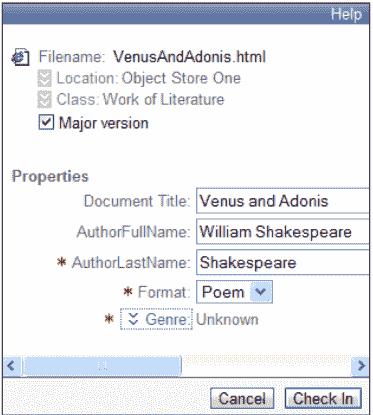

请注意，大多数或全部属性值已经填充了来自先前版本的值。如果我们愿意，可以在此处更改其中一些属性值。

单击“检入”按钮完成操作。注意，XT中的“主版本”列从1增至2，以表示这是文档的第二个版本。修改日期也更新为当前日期和时间。

文档的先前版本发生了什么？它仍然在存储库中并且可用。从上下文菜单中，导航到“更多信息 | 版本”。

你会看到一个弹出窗口，显示文档所有可用版本的完整列表。通常用十进制表示法表达主版本和次版本信息，在本例中即2.0和1.0。你可能猜到了，你可以创建文档的次版本，并且除了截图中看到的“已发布”和“已取代”值之外，还有其他“版本状态”标签。这些细节是第7章中关于版本控制的更广泛讨论的一部分。

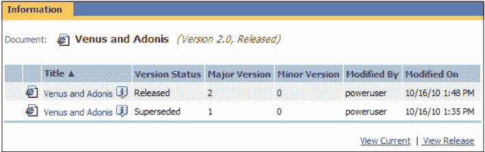

在同一个弹出屏幕中，你可以直接检查存储库中仍然可用的任何版本的内容或属性表。如果单击“标题”列中的超链接值，该版本应在Web浏览器中打开。对于“已发布”版本，你应该能够发现你所做的更改。关闭弹出窗口以返回主XT屏幕。

假设你后悔修改文档的决定。（你以为你是谁？莎士比亚吗？）一种选择是再次执行检出/检入循环，并尝试恢复文件的原始内容。当然，你仍然会留下你鲁莽编辑的记录，而且对于复杂文档，你可能能够或可能无法恢复原始内容（除非你意识到可以从存储库中早期版本下载内容）。在这种情况下，我们真正想要的是对已经完成的检出/检入循环进行某种“撤销”。

在CE中，每个文档版本都是可单独操作的对象。XT（以及大多数其他工具）中的删除操作在后台删除文档的所有版本，因为这是最常见的用例。XT还提供删除单个版本的选项。再次右键单击文档，从上下文菜单导航到“更多操作 | 删除版本”。你会看到一个弹出窗口，列出所有可用的文档版本，类似于之前的弹出窗口。这次，各个版本旁边有复选框，你可以决定要删除哪些版本。请注意，一旦删除，它们将真正从存储库中消失。

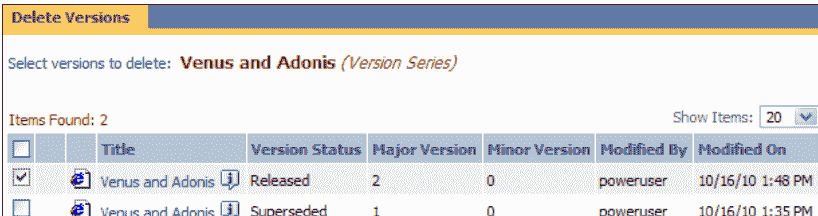

有趣的是，并非只有旧版本可以删除。请注意，你可以删除任何版本，包括当前版本。继续这样做：勾选“已发布”版本的复选框，然后单击“接受”（不要勾选旧版本的复选框）。当返回主XT窗口时，你会看到主版本再次变为1。如果你查看该文档的内容，会看到原始的、未修改的文本，正如所料。

瞧！这就是内容管理。

> 已删除的对象是真正永久删除的。除非有应用程序实现了撤销或回收站或类似机制，否则没有撤销或回收站。

## 属性和安全性

既然我们正处于XT用户界面的浏览部分，让我们简要看一下文档中可以查看和更新的几个项目。虽然我们检查的是文档，但它所展示的模式也适用于存储库中的文件夹和其他对象，包括对象存储本身。

单击一个文档，例如《维纳斯与阿多尼斯》，然后从上下文菜单中选择“属性”。一个非常熟悉的属性表会弹出，如下所示。与我们之前看到的属性表的一个区别是，这个属性表底部有一个“系统属性”部分。存储库中的每个对象都有系统属性，但实际属性因对象类型而异。XT没有显示一些自定义和系统属性，但所有属性对FEM中的管理员都是可见的。许多或所有自定义属性都可以从此属性表更新，具体取决于安全性和属性的定义方式。XT不会让你更改它无法保存到存储库的任何值。

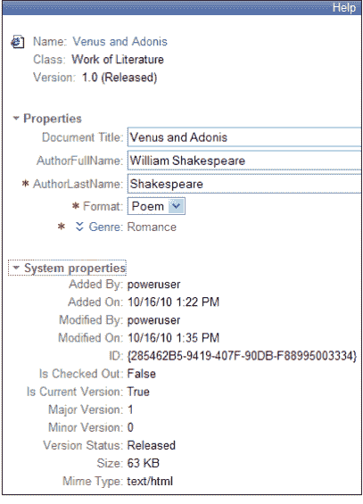

## 最终用户工具和任务

如果你单击一个文档并从上下文菜单导航到“**更多信息 | 安全性**”，你会看到一个弹出窗口，显示文档的访问控制列表（ACL）详细信息。我们在下面看到的是典型安排。所有者、poweruser和管理员对该文档拥有许多操作权限。其他所有人，即伪组#AUTHENTICATED-USERS的成员，只有有限的权利。CM中的细粒度安全性是其最强大的功能之一，我们将在*第8章“安全功能和规划”*中详细讨论。

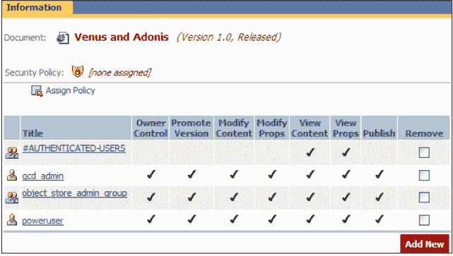

## 搜索

在文件夹中浏览文档在许多方面都很不错。对大多数计算机用户来说感觉很自然。一旦文档数量庞大，使用这种技术查找所需内容可能变得繁琐甚至不可能。如果你曾经在计算机的文件夹间徒劳地点击，寻找别人给你的食谱或五年前的简历，你大概知道有时你需要更好的方法。

CM提供两大类搜索，甚至可以将这两种类型合并为一次搜索。

- 第一种搜索类型在ECM和数据库领域有着悠久的历史。它是基于属性值的结构化搜索。有时也称为元数据搜索。
- 第二种搜索类型是较新的，但今天在大多数ECM平台上都可用。它是基于文档和注释内容的全文搜索。CM还为文档、文件夹、自定义对象和注释上的字符串值属性提供全文搜索。

如今，大多数非技术用户更熟悉全文搜索，因为它与互联网搜索引擎提供的搜索类型非常相似。非技术用户对元数据搜索不太熟悉。

XT试图以合理且易用的方式向用户呈现这两种搜索类型。如果单击放大镜图标，你将看到XT的三种搜索类型：简单、关键字和高级。我们逐一来看。

> XT暴露了CM搜索功能的很大一部分，但有些功能不可用。完整的搜索功能集可通过特定于CE的结构化查询语言（SQL）方言获得。CE SQL可以直接通过API、FEM和其他一些工具使用。我们将在第7章中进一步讨论。

### 简单搜索

简单搜索旨在提供满足最常见搜索需求的直接界面。选项不言自明。用户不必太担心属性名称和其他技术因素。他或她只需单击适用的复选框，输入一两个词，剩下的由XT完成。此图像显示了对名称以“Venus”开头的文档的搜索结果。

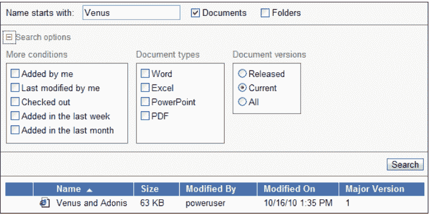

然而，要套用现代陈词滥调：责任有限，能力也有限。简单搜索无法提供太多自定义选项或更复杂的搜索功能。

### 关键字搜索

关键字搜索是XT对全文搜索的术语。你会记得我们在第5章中配置了所有文档类以进行基于内容的检索（CBR）。CBR只是全文搜索的另一种说法。XT关键字搜索只能找到已通过CE管理工具选择索引的内容。

在此截图中，我们展示了对单词“dispatch”的简单关键字搜索，该词恰好出现在我们添加的四个文档中的三个中。关键字搜索结果包含“得分”列，这是文本搜索引擎对文档匹配搜索关键字程度的判断。如果你去浏览文本，你会发现《奥赛罗》包含“dispatch”四次，《亨利五世》三次，《皆大欢喜》只有两次。相对得分反映出关键字出现次数越多，匹配度越高，至少对于简单的关键字列表是这样。

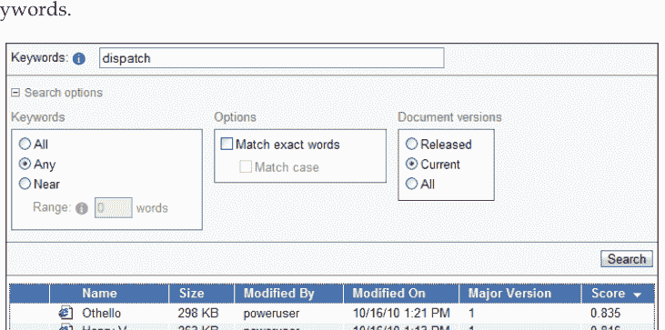

### 高级搜索

高级搜索不仅结合了简单搜索的元数据搜索和关键字搜索的全文搜索，还提供了强大的功能，可将复杂的自定义属性条件添加到搜索中。在截图中，我们仅展示了一些属性和操作，但可以构造相当复杂的条件表达式。

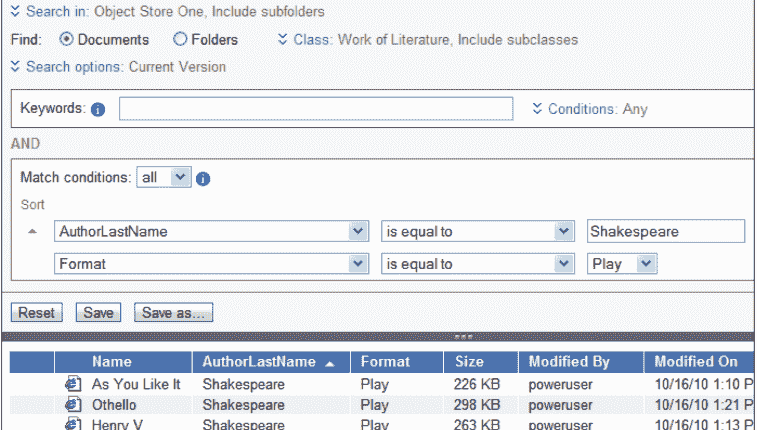

一旦你调整好搜索条件，找到所需内容，就可以点击“另存为”按钮来命名并保存搜索。当你返回 XT 的搜索界面时，已保存的搜索会以“我的搜索”形式列在左侧。

## 已保存的搜索和搜索模板

XT 具有预定义搜索的功能。通常的使用场景是，管理员或技术熟练的人创建搜索定义，然后更广泛的用户群体可以在对 CE 和应用数据模型了解较少的情况下运行这些搜索。

已保存的搜索 (SS) 和搜索模板 (ST) 之间的区别在于，模板允许用户在运行时提供一些输入。设计 SS 或 ST 的用户在预定义限制条件方面有很大的灵活性，运行者无法绕过这些条件；而在收集用户输入方面也具有同样的灵活性。SS 或 ST 是使用名为搜索设计器（SD）的 Java 小程序创建的。你可以通过导航到“工具 | 高级工具 | 搜索设计器”从 XT 启动 SD。SD 的界面相对简单，因此我们转而展示搜索模板在 XT 中执行时用户界面的样子。（我们将在第 7 章讨论搜索时展示 SD 的截图。）

已保存的搜索和搜索模板是文档的子类，SD 会将它们归档到设计者选择的文件夹中。在 XT 中浏览时，搜索与其他文档一样是文件夹内容的一部分，尽管它们在用户界面中带有独特的图标。如果你双击已保存的搜索，XT 会立即执行搜索并显示结果。如果你双击搜索模板，XT 会显示一个界面，用于根据 ST 定义提供值。当用户点击“搜索”按钮时，搜索才会真正执行。

下图展示了 ST 的搜索参数和搜索结果，该 ST 搜索“文学作品”（Work of Literature）类的文档，这些文档的文档标题以“Venus”开头，或者其内容中包含“dispatch”一词。如果你一直跟着前面的示例走，看到它返回了全部四个示例文档，你不会感到惊讶。

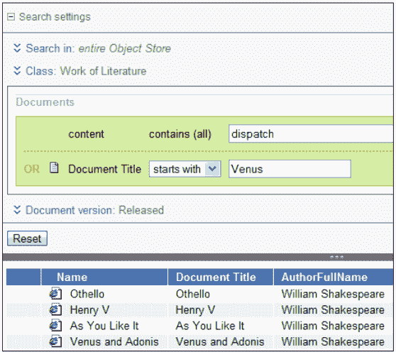

> 此示例包含一个针对字符串值属性进行简单模式匹配的情况。在 XT 搜索中，还有几种其他方式也能实现同样的功能，所有这些方式都使用 CE 的 SQL LIKE 函数。你应该知道，匹配属性开头（“starts with”）通常效率尚可，但匹配中间（“contains”）或结尾（“ends with”）在数据库层面是一种低效的操作。除非在搜索中使用其他条件来缩小潜在结果集，否则“contains”或“ends with”可能会导致数据库表扫描，从而严重影响性能。

## 总结

XT 的功能远不止我们在这里展示的这些。本章的目的是介绍一些典型的最终用户功能和操作。你可以在 CM 产品文档中阅读更多关于 XT 的内容，包括定制以及站点和用户首选项。

既然我们已经从最终用户的角度了解了相关内容，你可能渴望更深入地讨论 CM 功能实际实现的方式。这正是我们将在 *第 7 章* 中介绍的内容，安全主题将在 *第 8 章* 中单独讨论。
