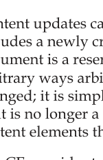
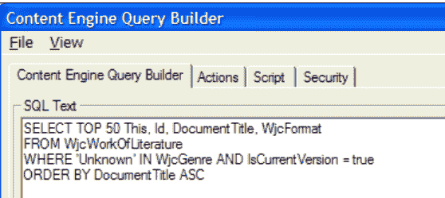
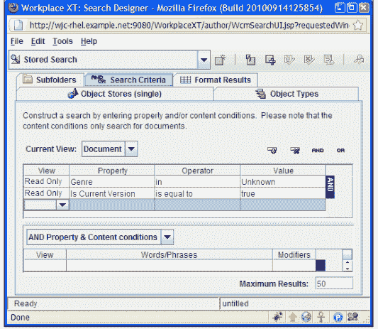

## 7
## CM 的主要功能

本章将探讨 Content Manager (CM) 的大部分功能，并讨论主要的组件架构。虽然这些功能大多以某种方式出现在 CM 随附的开箱即用工具中，但所有 CE 功能都可以通过公开的 API 在自定义代码中使用。可以利用这些功能创建完全不同的概念模型（不同于开箱即用工具所使用的模型）来呈现给最终用户。因此，这些功能应被视为构建整体系统的积木和原材料。

这些功能大多是 Content Engine (CE) 的功能，但也有少数是其他组件的功能。如果某个功能属于 CE 之外的组件，我们会特别指出。提醒一下，CM 是一套产品套件，而 CE 是若干服务器平台组件之一。

在第 1 章“什么是 ECM？”中，我们大致描述了对任何 ECM 系统来说必须具备的几个功能。毫无疑问，其中大多数都是 CM 的核心优势，这并非巧合。在本节中，我们将介绍许多各种规模和重要性的 CM 功能。这是一个相当长的列表，但即便如此，它也并未涵盖所有功能。就像任何一套积木一样，那些预构建的部件中确实有一些魔力，但更大的魔力在于你可以用它们构建出的东西。

本章将涵盖以下主题：
- 文档及文档管理相关功能
- 搜索相关功能
- 与文件夹和包含关系相关的功能
- 元数据功能与概念
- 自定义对象、注释和链接对象
- 事件子系统
- 功能附加组件

由于安全是一个内容丰富的主题，我们将在第 8 章“安全功能与规划”中讨论，该章完全致力于安全概念。

## 文档

毫无疑问，任何内容管理系统最基本的功能就是能够管理内容。与许多现代软件实践领域一样，我们用首字母缩写词 CRUD——创建、检索、更新、删除——来描述与文档的交互。事实证明，我们为文档描述的许多功能也是 CE 中其他对象类型的特性，但我们将在本章稍后介绍。

CE 中的文档是一个可独立寻址的对象，具有属性和可选内容。虽然创建没有内容的文档通常没有什么意义，但这是可以做到的，有时也用于一些场景，例如内容之后才会到达的情况。

你可能已经熟悉带有相关内部属性的文档的概念。大多数办公效率应用程序都会为它们创建的文档应用内部属性。这些属性可包括作者身份、编辑文档所花费的时间、版权声明或许多其他内容。CE 的属性与这些内部属性没有直接关联，但应用程序在将文档添加到 CM 存储库时，会从文档中提取这些内部属性并用它们来填充类似的 CE 属性，这种情况并不少见。虽然这些属性的作用类似，但你会看到 CE 的属性模型要丰富得多。

## 内容

文档可以包含任意数量的内容元素。很容易将内容元素理解为文档的“实际比特”。如果你有一个文本文件、一个 PDF、一个字处理器文档或磁盘上的一个 HTML 页面，我们所说的就是整个文件。CE 会逐字存储该文件，不会对文件内容进行任何转换或解释。当有人之后检索该文档时，内容将与该文档上传时的内容 100% 逐位相同。

CE 的一个关键特性是，文档内容一旦上传到存储库便不可更改。当文档处于签出状态时（参见后面的“版本控制”一节），你可以随意替换内容，但仍然不存在修改特定内容元素这种事情。一旦文档签入，内容元素列表就会被冻结，任何元素都不能添加、删除或替换。

## 多个内容元素

等一下。什么是多个内容元素？为什么有人需要它？如果有多个内容块，为什么不直接创建多个文档呢？

通常会有这样的情况：一个文档在逻辑上可以分成多个块，而这些块实际上是一个更大的文档的一部分。最常见的例子是由传真图像组成的文档。这些系统通常将传真图像存储为每个内容元素一个页面图像。这些并不是真正独立的逻辑文档，它们只是恰好被分成适合页面大小的块。为此，在（单个文档对象中的）使用多个内容元素是非常合理的，内容元素在列表中的位置代表传真页码。

还有其他一些由多个逻辑块组成的内容类型，在单个文档中使用多个内容元素可能合适，也可能不合适。我们将在本节后面介绍复合文档和再现形式，以展示一些具有特定支持功能的用例。还有一些特定于应用程序的用例，其中由应用程序决定在多个内容元素中放入什么内容。例如，相册应用程序可以将图像存储在一个内容元素中，并将相应的缩略图存储在另一个内容元素中。缺点在于其他应用程序不太可能理解这种特定的约定或许多类似的约定。

在同一个文档中使用多个内容元素的关键概念在于，文档整体是可寻址的对象，并且所有文档属性（包括安全性）都适用于整个内容元素集合。如果某些内容元素需要不同的安全性或其他属性，那么使用单独的文档可能是合适的。

CE 中有大量基础设施可以处理多个内容元素，但大多数用例每个文档只使用一个内容元素。

## 内容传输和内容引用

到目前为止，我们只讨论了将以某种方式显式存储在 CM 存储库中的内容。在 CE 数据模型中，这些内容被称为内容传输元素（因为内容被直接传输到存储库或从存储库传出）。还有另一种内容元素，即内容引用。顾名思义，这类内容存储在其他地方，而指向它的引用存储在 CM 存储库中。该引用只是一个表示 URL 的字符串，CE 不会对该 URL 进行转换或解释。应用程序通常能够理解内容引用并解析引用的内容，可以直接解析，也可以将其交给操作系统工具处理。


给定文档的内容元素列表可能由任意组合的 Content Transfer 和 Content Reference 元素组成。

Content Transfer 元素除了实际的内容位之外还有一些有趣的属性。RetrievalName 属性不被 CE 使用，而是作为下载应用程序使用的简单文件名的提示（例如，VenusAndAdonis.html）。它通常由上传应用程序设置为原始文件名（如果已知）。ContentType 属性是两种内容元素共有的属性，并且同样通常由上传应用程序设置，标识内容的类型，可用作操作系统在下载后查找打开内容的合适应用程序的提示。如果上传应用程序未为 ContentType 提供值，CE 会根据 RetrievalName 文件扩展名使用一个相当简单的猜测算法。最好由上传应用程序显式设置这两个属性，但并非所有应用程序都这样做。

将内容元素属性 ContentType 与文档属性 MimeType 对比。这些属性性质相似但并不完全相同。如果在 checkin 之前应用程序未提供值，MimeType 是基于内容元素的内容类型值计算得出的。对于只有一个内容元素的文档，这两个属性的值将相同，但对于具有多个内容元素的文档，MimeType 属性将指示复合类型。为方便起见，所有 ContentType 值的列表可在多值属性 Document.ContentElementsPresent 中获得。

## 内容元素编号

由于内容元素列表实际上是一个列表，每个元素在列表中都有一个隐式位置编号。编号从 0 开始还是从 1 开始取决于所使用的编程语言，但对用户而言它只是一系列项目，因此实际位置编号很少对用户界面目的很重要。每个内容元素在其名为 ElementSequenceNumber 的属性中都有一个与其关联的显式编号。该编号与特定的物理内容元素相关联；它不是位置编号。它永远不会更改，也永远不会被重用（在该文档内），无论在文档 checkin 之前内容元素列表被更改多少次。

| Position | ESN |
|---|---|
| 0 | 114 |
| 1 | 376 |
| 2 | 248 |

例如，参考上表。如果您从三个内容元素的列表开始，它们将在内容元素列表中隐式位于位置 0、1 和 2（或 1、2 和 3）。假设为了举例，它们分别具有 ElementSequenceNumber 值 114、376 和 248。如果您删除中间的内容元素，您仍然会在位置 0 和 1（或 1 和 2）有元素，但 ElementSequenceNumber 值将为 114 和 248。如果您在这两个元素之间插入一个新元素，您将恢复到原始的位置编号列表，但该内容元素的 ElementSequenceNumber 值将不是 376。它将是一个从未在该文档中用过的新编号。

## 版本控制

在将内容放入和取出存储库之后，内容管理最重要的下一个功能可能是版本控制。版本控制在其最基本的定义中是指能够在跟踪先前版本的同时更新内容。CE 的版本控制值得探索的细节很多。

> 什么是修订？虽然 version 在 CM 中是一个具有明确且不同的技术含义的术语，但 revision 这个术语使用得不那么正式，并且语义经常重叠。它有时用于指内容任何更新，包括作者在一次 checkout/checkin 周期中对文档所做的多次更新。它有时也用于指对文档的一组经过编辑批准的更改，该文档在修订过程中可能经历了几次 checkout/checkin 周期。我们的建议是始终寻找上下文以澄清所使用的 revision 的特定含义。在任何情况下，都不要假设 revision 和 version 是同义词。

在 CE 中，随着文档被反复版本化，每个新版本都是其自身的一个 Document 对象。它具有独立的身份、安全性、属性值和内容。换句话说，如果有人拥有特定文档的 ID，该 ID 将始终引用完全相同的文档版本。（通常通过路径引用文档时并非如此，但我们稍后会谈到。）

如果每个文档的每次编辑都是存储库中漂浮的单独对象，那就不是特别方便，而在 CE 中并非如此。该逻辑文档的所有单独版本都统一在一个名为 Version Series 的集合对象中。Version Series 有自己的 ID。属性 VersionSeries.Versions 是通过版本控制相关联的文档的有序集合。事实上，Version Series 对象本身似乎没有任何属性。它的所有属性都直接来自或从其包含的文档的属性中合成。Version Series 对象的访问控制取自当前文档。

作为说明，这里是 XT 对一个经历了几次 checkout/checkin 周期版本的文档的描绘。在阅读本节其余部分中的版本控制概念时，您可能希望参考此图。

| Document: | Once Upon a Chapter (Version 1.0, Released) |
|  | Title ▲ | Version Status | Major Version | Minor Version | Modified By | Modified On |
|  | Once Upon a Chapter | Reservation | 1 | 4 | madi | 10/10/10 9:41 PM |
|  | Once Upon a Chapter | In Process | 1 | 3 | madi | 10/10/10 9:41 PM |
|  | Once Upon a Chapter | Superseded | 1 | 2 | wyatt | 10/10/10 9:40 PM |
|  | Once Upon a Chapter | Superseded | 1 | 1 | meg | 10/10/10 9:39 PM |
|  | Once Upon a Chapter | Released | 1 | 0 | meg | 10/10/10 9:37 PM |
|  | Once Upon a Chapter | Superseded | 0 | 2 | madi | 10/10/10 9:36 PM |
|  | Once Upon a Chapter | Superseded | 0 | 1 | wyatt | 10/10/10 9:34 PM |

让我们回顾一下：所有 Document 对象也是 Version Series 对象的一部分。随着文档的版本化，新版本会自动成为同一个 Version Series 对象的一部分。每个文档版本和 Version Series 本身都有单独的身份。从任何 Document 对象，您都可以导航到 Version Series 对象，从 Version Series 对象您可以导航到该 Version Series 中的任何 Document 对象。（有快捷方式可让您直接从一个 Document 对象导航到同一 Version Series 中的另一个 Document 对象。）

## Checkout 和 checkin

CE 中的版本控制过程使用 checkout/checkin 模型。也就是说，希望制作文档新版本的人首先 checkout 该文档。该操作创建一个新的文档版本（请记住，它是一个完全不同的对象），标记为 reservation。正是 reservation 版本实际被更新，然后最终被 checkin。相比之下，被 checkout 的文档版本被称为 reserved。

对于一个 Version Series 来说，同时只能有一个 checkout 操作，并且 checkout 总是在最近创建的文档版本上进行。如您所见，checkout 充当对 Version Series 的一种锁定，以防止另一个调用者也执行 checkout。第一次 checkout 必须得到解决，要么通过 reservation 的后续 checkin，要么通过取消 checkout。（取消 checkout 是一个 API 人工产物，也被带入了许多应用程序。事实上，CE 服务器中并没有这样的操作。您可以通过对 reservation 文档版本执行普通的删除来取消 checkout。CE 会在您删除 reservation 时自动更新 checkout 记账。）




不要将通过签出获得的名义锁定与无关的协作锁定功能混淆。协作锁定是应用程序显式标记 Document、Folder 或 Custom Object 为已锁定的机制。顾名思义，这仅对检查并尊重协作锁定的应用程序才有意义。CE 不会因为对象上存在协作锁而阻止任何更新操作——锁定操作本身除外。

只有在文档处于保留状态时才能对其进行内容更新（这包括在首次签入之前新创建的文档）。在文档处于保留状态期间，调用方可以以任意方式任意多次自由更新内容元素的列表。之前上传的实际内容不会被更改；它只是被替换，正如我们之前描述的那样。一旦保留被签入，它就不再是保留，内容元素的列表（以及各个内容元素本身）就不能再被更新。

CE 提供了两种签出方式，共同满足多种用例。签出可以是协作式的，在这种情况下，任何具有适当权限的人都可以进行相应的签入。签出也可以是独占式的，在这种情况下，只有保留的所有者才能进行签入。

## Freeze

我们之前说过，一旦文档版本被签入，其内容就不能再更改。那文档版本的其它属性呢？某些属性被标记为仅在创建时可设置或仅在签入前可设置，但对于自定义属性的一般情况而言，它们可以在任何时候更新，即使是对旧的文档版本。有时也希望阻止属性更新，CE 提供了该功能。你可以冻结一个文档版本。一旦文档版本被冻结，尝试更新属性的操作将会失败。 （这不适用于系统属性，系统属性会在后台更新。）

没有“解冻”操作。一旦被冻结，文档版本将保持冻结状态直到被删除。

## Major and minor versions

CE 中的文档版本具有由系统自动维护的系统属性 MajorVersionNumber 和 MinorVersionNumber 反映的两部分版本号。这两者都是整数，但通常使用十进制表示法来指代组合（例如，3.2 或 3.2，这取决于本地惯例）。尽管一个版本系列可以包含各种主要和次要版本号的模式，但组合在一起时始终按自然递增顺序排列。例如，版本 3.2 总是在版本 3.1 之后，而版本 4.0 总是在所有主要版本为 3 的版本之后。非正式地，我们将次要版本为 0 的文档版本称为主要版本（例如，4.0），其余的称为次要版本。是否将版本设为主要版本或次要版本的决定是在签入时做出的（保留文档始终创建为次要版本）。由于通常赋予主要和次要版本号的语义，针对每种类型的签入提供了单独的权限。

版本号分为主要和次要两部分，旨在满足一个非常常见的用例。在文档修订周期中，通常会在确定最终的已批准、官方的下一个内容修订版之前经历任意数量的草案修订。通常的模型是使用主要版本（次要版本为 0 的文档版本）作为官方修订版，而次要版本作为草案修订版。CE 本身并未强制执行该模型，因此你可以根据自己的用例随意操作。事实上，一些应用程序完全不使用次要版本，而完全只使用主要版本的情况并不少见。

文档版本具有与主要/次要用例相关的系统维护的整数属性 VersionStatus。它反映了该模型中文档版本的四种可能状态。你可以在前面说明版本系列的图中看到这些版本状态值。

- **Reservation**（值 3）表示仍处于保留状态的新文档版本。作者可以更新内容。
- **In Process**（值 2）表示已签入的次要文档版本，且在版本系列中没有更高的主要版本号。此状态仅适用于该主要版本下的最高次要版本。
- **Released**（值 1）表示具有最高主要版本且次要版本为 0 的文档版本。
- **Superseded**（值 4）表示不再处于上述任一状态的文档版本。它可以是主要版本也可以是次要版本。

顺便说一下，*superseded* 是 CM 术语中最常被拼错的词。

当你执行签出/签入循环时，CE 会自动跟踪并更新版本系列中每个文档版本的版本状态。有时你可能希望更改一个或多个文档版本的版本状态。例如，你可能在对某个保留进行签入时选择了错误的类型，或者你可能希望说明最后的草案修订版就是被批准的那个，而不想麻烦地创建新版本。CE 在有限的方式下允许这样做：

- 你可以将次要版本提升为主要版本。这会使任何先前的主要版本且为已发布版本的状态变为已取代。
- 你可以将主要版本降级为次要版本。

提升和降级在何时可以执行存在限制。最重要的是，不能存在保留，并且受影响的文档必须是当前版本。调用用户必须具有适当的访问权限（提升时创建主要版本，降级时创建次要版本）。这些限制是合理的，因为主要动机是为了纠正将签入指定为错误类型的主要/次要版本。

## Document lifecycles

如果你对文档从创建到删除的进展有相当直接的用例，签出/签入模型和两级版本控制可能已完全满足你的需求。如果你对正在修订（或进行任何其它复杂更改）的文档有更复杂的记账需求，你可能会创建一个自定义属性来跟踪文档处于各种状态中的哪一种。然后你必须安排在适当的时间更新状态属性，确保状态值有效且一致应用，等等。

CE 有一个内置功能可以简化此操作。该功能称为 **document lifecycle**。要使用它，你需要创建一个 Document Lifecycle Policy 对象并将其分配给同名的 Document 属性。

策略对象定义了一个有序的生命周期状态列表。你可以将其视为简单的字符串值，尽管它们稍微复杂一些。你可以向前或向后移动文档通过这些状态。这称为文档生命周期提升和降级（但它与文档版本状态的提升和降级无关）。你可以将生命周期设置为异常状态（意味着需要某种应用程序定义的关注）或清除该异常状态。你不能在处于异常状态时提升或降级文档，而且显然不能降级到列表中的第一个状态之前或提升到最后一个状态之后。此外，每个状态都有一个属性，说明是否允许从该状态降级。

到目前为止，文档生命周期策略似乎只是对系统属性 **CurrentState** 的一种方便记账，该属性跟踪你在列表中定义的位置。你仍然必须自己更改状态并自行管理异常状态。有趣的部分来自与 Document Lifecycle Policy 关联的 Document Lifecycle Action。生命周期操作关联有一段自定义代码（即你提供的代码），该代码在生命周期状态更改时在服务器上运行。此处理程序代码知道所涉及的文档以及生命周期状态的之前和之后，因此可以采取适当的行动。Document Lifecycle Policy 有时被称为“穷人的工作流”，但事实证明，在处理程序中执行的最流行操作之一是通过 P8 Process Engine 启动工作流。

Document Lifecycle Policy 的最后一部分是文档安全性的自动修改，通过与每个状态关联的模板权限实现。我们将在 *Chapter 8, Security Features and Planning* 中连同其它安全主题一起更详细地描述这一点。

## Autoclassification

将文档添加到 Object Store 的一种场景是使用通用批量加载应用程序，该应用程序从某处收集内容并将其添加到 CM。典型的批量加载应用程序针对性能进行了优化，并且可能有意避免用例业务逻辑的纠缠。因此，一些对文档摄取有趣的事实可能会推迟到处理中的后期。


CE 提供了一个名为 **自动分类** 的功能来帮助处理这种情况。摄取应用程序指示它希望触发自动分类功能，然后将文档创建为 Document 基类的实例或某些其他通用占位符类。CE 内部的自动分类机制会查看添加文档的内容类型，并异步调用为该内容类型注册的分类器（你提供的自定义代码）。分类器可以对文档进行相当灵活的范围的更改。最受欢迎的选择是将文档的类更改为更具体的类，为文档填充有趣的属性，或根据分类器已知的方案将文档归档到文件夹中。

CE 包含一个名为 XML 分类器的分类器示例。它使用站点提供的 XML 属性映射脚本，利用自动分类功能检查和/或转换传入的 XML 文档。

## 复合文档

有一些文档自然地分解为逻辑上独立的部分。也许它们是更大作品的章节。也许它们是相互引用的文档部分网格，如一组 HTML 页面。或者它们可能只是许多文档使用的样板图形和文本一样简单。

在 CE 中，这些链接的部分统称为 **复合文档**。这些部分作为 CE 数据模型中的独立文档进行管理，但它们彼此显式链接。一旦文档的 CompoundDocumentState 属性设置为复合文档（而不是标准文档），该文档就可以链接到任意数量的父文档和子文档。CE 提供了创建链接的结构，但链接的含义取决于用例。

我们以一种使特定文档看起来像是自然起点的方式描述了它，但情况并非总是如此。父或子链接的链可能形成一个圆圈或任何其他图形拓扑。最频繁的用例是定义一些可独立重用的片段，然后将它们链接起来创建各种聚合文档。

## DITA 发布

CE 对特定复合文档用例有专门支持。**达尔文信息类型架构 (DITA)** 是组织技术文档的行业标准。内容的基本片段被创建为 DITA **主题**，通常只包含不超过一个段落的内容——足以描述一个自包含的项目。其他 DITA 构造用于将主题编织成更大的文档。经常会出现一个给定的 DITA 主题可以在许多不同的复合文档中重用的情况。当然，像徽标和样板文本之类的东西是单独编写的，并且在单个复合文档内部以及跨多个文档中也被多次重用。

除了复合文档链接之外，CE 还支持异步将 DITA 主题组合成各种格式的复合文档。此过程称为 **DITA 发布**。

一些流行的技术文档编写工具理解 DITA 构造和机制，有些工具理解将 DITA 数据模型叠加到 CE 复合文档功能上。那些理解 CE 复合文档的工具很可能也知道如何使用 DITA 发布功能创建成品文档。

## 呈现引擎

CM 包含另一个有时被称为发布的功能，但它与 DITA 发布没有直接关系。正式地说，该功能称为 **呈现** 支持。CM 产品提供了一个单独许可和单独安装的 **呈现引擎 (RE)**。RE 的目的是异步将单个文档转换为其他格式。例如，办公生产力文档可能被呈现为 PDF 或 HTML。

它被称为呈现，因为文档的概念内容没有改变。只是格式被改变了。你可能熟悉 PDF，并且知道创建文档的 PDF 通常具有非常高的保真度。HTML 的结果各不相同。在 RE 术语中，原文档称为 **源** 文档，呈现的文档称为 **目标**。CM 对呈现的支持包括在源文档和目标文档之间自动创建链接。

## 搜索

> 当搜索话题出现时，通常会随后产生直接绕过 CE 服务器查询底层数据库表的兴趣。CM 团队不鼓励这种想法，因为 CE 层中有许多有用的抽象和额外功能。其中最不重要的抽象是安全访问检查；如果绕过 CE，这些检查将被完全绕过。尽管如此，感觉是你的数据所以你应该能够读取它。你不应该这样做，除非你有充分的理由。另一方面，CM 团队不支持直接对底层数据库的行和列进行的任何更新。仅支持由 CE 执行的更新。

CE 提供了一个灵活的 API 用于搜索文档和其他对象。这在各种应用程序中以部分或完整的形式公开。无论是根据从用户收集的信息组合还是根据应用程序逻辑硬编码，查询都可以提交给 CE。

该功能的中心是用于搜索表达式的结构化查询语言 (SQL) 方言。为了清晰起见，我们将该方言称为 CE SQL，以将其与 CE 用于与数据库通信的原生 DB SQL 区分开来。CE 呈现的数据模型以各种方式映射到底层 Object Store 数据库中的表和列。应用程序使用 CE SQL 向 CE 发出查询。CE 解释 CE SQL 并发出适当的原生 DB SQL 语句。从概念上讲，文档和其他对象类在 CE SQL 中充当表的角色，它们的属性充当列。

下面是一个 CE SQL 查询类型的示例：

```
SELECT TOP 50 Id, DocumentTitle, WjcFormat
FROM WjcWorkOfLiterature
WHERE 'Unknown' IN WjcGenre AND IsCurrentVersion = true
ORDER BY DocumentTitle ASC
```

你可以想象在管理或清理应用程序中使用这种查询。它查找我们作品文学子类中具有未知流派值的项目。搜索结果将限制为 50 个项目，并按文档标题值排序。在 CE SQL 中，引用类和属性时始终使用符号名称（因此使用 "WjcFormat" 而不是 "Format"）。类和属性名称中大小写不敏感。

在尝试完善查询以给出你正在寻找的确切结果时，手动运行查询通常很有帮助。最简单的方法之一是通过 FEM。从左侧树中选择 **搜索结果**，右键单击并选择 **新建搜索**。弹出面板可以指导你选择属性、构建条件等。一旦你对 CE SQL 有了一些经验，你可能会发现手动编写 CE SQL 更有效。从弹出面板中，导航到 **查看 | SQL 查看**，如下所示。



## 合并模式

到目前为止的讨论仅涉及单个 Object Store 内的搜索。你可能在想，你可以通过单独运行查询并在应用程序内合并结果来组合多个 Object Store 的搜索结果。你当然可以这样做，对于简单场景来说很直接。对于更复杂的场景，记账工作可能会变得相当令人生畏。例如，你可能拥有具有功能等价但其类或属性定义对象的 ID 值不同的类和属性的 Object Store。

CE 查询 API 允许你搜索一个或多个 Object Store。每个 Object Store 称为一个 **作用域**，搜索多个 Object Store 称为 **合并作用域查询**。合并作用域查询可以在两种模式之一中完成：

- **交集** 模式意味着查询中引用的所有类和属性必须存在于合并作用域中的所有 Object Store 中。
- **并集** 模式意味着查询中引用的所有类和属性必须存在于合并作用域中的至少一个 Object Store 中。

如果你碰巧在多个 Object Store 中定义了功能等价（或几乎等价）的类或属性，并且希望在合并作用域查询中使用它们，CE 提供了一种通过类定义和属性定义对象将它们定义为彼此别名的机制。


## 可选择和可搜索的属性

在 CE SQL 查询字符串中，属性具有两个与其出现方式特别相关的特性。

WHERE 子句只能引用可搜索的属性。大多数属性是可搜索的，但少数属性由于将对象模型映射到一系列关系数据库表和列的复杂性而不可搜索。因此，遗憾的是，少数属性不能直接用作查询匹配条件的一部分。若要确定某个属性是否是可选择的，请检查属性描述中的 IsSelectable 属性，或者像我们一样——直接试一下，看是否有效。

SELECT 子句只能引用可选择的属性。这在如今有点不合时宜了。从 CM release 4.0.0 开始，所有属性都是可选择的。

## 属性搜索与全文搜索

CE SQL 查询的 WHERE 子句可以包含两种不同类型的条件，并且可以通过简单的 JOIN 构造将两者组合。

在传统 SQL 表达式构造中使用属性名称时，这被称为属性搜索或元数据搜索。实际上并没有标准术语，这两个术语是最常用于同一事物的说法。CE SQL 条件会被转换为原生数据库 SQL，并针对 Object Store 数据库中的数据进行求值。如果你对关系数据库查询有一定了解，这应该听起来非常熟悉。你所了解的关于索引、查询优化、查询计划及相关概念的大部分内容，都很适用于这类 CE 查询。

字符串值属性以及文档和注释的内容可以被指定为启用 CBR。CBR 代表基于内容的检索，只是全文搜索的另一个名称。当内容或属性值启用了 CBR 时，它会由文本搜索引擎建立索引，该搜索引擎独立于保存大多数 Object Store 数据的数据库。这也就是我们在第 5 章“安装其他组件”中安装的 Content Search Engine (CSE) 组件。

毫无疑问，你对全文搜索有一种直观的感受，因为它与通过互联网搜索引擎进行的搜索类型非常相似。你可能不熟悉的是现代文本搜索引擎通常可用的强大操作符范围。要在 CE SQL WHERE 子句中使用文本搜索，可以使用 CONTAINS() 函数。作为字符串参数提供给 CONTAINS() 的全文搜索条件会直接传递给文本搜索引擎进行求值。文本搜索引擎返回的结果会与元数据搜索的结果合并，这样只有满足所有条件的对象才会返回给调用者。对于 CM 4.5.1 版本，CSE 基于 Autonomy K2。其表达式语言称为 Verity Query Language (VQL)。CSE 安装包含 VQL 文档；我们在第 5 章中描述了在哪里可以找到该文档。

CE SQL 允许将元数据搜索条件和基于文本的搜索条件组合到单个查询中，但你必须使用 JOIN 操作符才能做到这一点。虽然我们可以推理出这个特定 JOIN 的机制，但我们大脑中的一些脆弱神经元使我们无法在需要时记住它，所以我们每次都只能查一下（或者从其他查询中复制）。与其让你去查阅 CE SQL 参考资料，我们不如在这里为你重复一遍，这至少给了你另一个可以查找的地方。

```
SELECT ...
FROM Document DOC INNER JOIN ContentSearch CBR on DOC.This = CBR.QueriedObject
WHERE CONTAINS(...) AND ...
```

提醒一下，你可以对 Folder、Annotation 和 Custom Object 类以及 Document 类执行全文搜索。

## JDBC 提供程序

如果你是从事 CE 搜索的软件开发者，你一定会想使用 CE API 功能来执行查询。它们非常强大且灵活，返回的数据与从 CE 获取的其他对象和属性项形式相同。

有时你可能需要使用现成的报表包或其他要求行业标准搜索接口的软件框架来执行查询。Java 世界中最流行的标准化接口是 Java Database Connectivity (JDBC)。CE Java API 提供了一个只读 JDBC 驱动程序，可用于使用 CE SQL 执行查询。

该 JDBC 接口的驱动程序位于 Java 类 com.filenet.api.jdbc.Driver 中。它接受任何合法的 CE SQL 语句，但典型的基于 JDBC 的应用程序软件只会使用基于属性数据类型的简单表达式。返回的属性值会转换为标准 JDBC 数据类型。例如，CE 64 位浮点属性值将转换为 JDBC 类型 java.sql.Types.FLOAT。

> 不要将 CE Java API JDBC 提供程序与应用服务器中配置的 JDBC 提供程序混淆。它们是两种完全不同的东西，尽管它们都使用 JDBC 接口和范例。

## 搜索模板和存储搜索

Workplace 和 Workplace XT 提供了两个相关功能，称为搜索模板 (ST) 和存储搜索 (SS)。两者都允许某人预先创建 CE 搜索，之后可以由同一个人或完全不同的一组人运行。一个名为 Search Designer (SD) 的小程序用于创建 SS 或 ST。两者之间的主要区别在于，ST 为执行搜索的人提供了更多机会，使其可以在搜索运行时提供值或搜索条件的其他部分。SS 或 ST 的作者决定搜索的哪些方面是预先确定的，哪些可以由用户修改。

以下是 SD 正在定义存储搜索时的截图，该搜索与我们在本节前面展示的查询大致相同：



## 文件夹与包含

在 Object Store 中，许多事物都呈现出与传统文件系统类似的结构。有一个文件夹树，最顶层的文件夹有特殊的名称：根文件夹。一个文件夹可以包含子文件夹，子文件夹又可以包含更深层的子文件夹，深度任意。任何层级的任何文件夹都可以包含文档和自定义对象。每个文件夹都有一个名称，你可以从根文件夹开始，按顺序列出每个文件夹的名称，直到找到你要找的那个文件夹，从而给出文件夹的完整路径。在 CE 表示法中，你以正斜杠字符开头，并在每对文件夹名称之间使用另一个正斜杠。这听起来很复杂，但实际上只是意味着一个熟悉的东西：形如 /once/upon/a/time/machine 的文件夹路径。（关于根文件夹是称为 /，还是正斜杠只是空名称与第一个子文件夹名称之间的分隔符，这是一个激烈的计算机科学讨论话题。也许最好避免这类讨论。）

CE 中的文件夹始终是根化的。也就是说，它们总是位于从根文件夹开始的链中。换句话说，每个文件夹（除了根文件夹）都必须有一个父文件夹，由文件夹的 Parent 属性指向。

## 引用包含

所有这些即使对非技术用户来说也会显得相当直观。CE 文件夹的某些方面作为强大的功能非常有用，但对非技术用户来说可能不太熟悉。具体来说，CE 使用了一种称为引用包含的机制。文件夹包含的是对文档的引用，而不是文档本身。这听起来有点技术性和复杂，因为我们习惯于思考钥匙放在外套口袋里，或者书放在书架上的这种包含关系。现代计算机用户界面的桌面范式强化了这种观念，但对于计算机中的对象来说，这完全是人为的。

从字面上讲，文件夹除了包含一个列表之外不包含任何其他内容（即使这样说也有点善意的谎言，只是为了保持解释简单）。假设我们住得很近，共同拥有一个 DVD 收藏。我们每个人都可以列出已经看过的 DVD、想看的 DVD 等等。我们的列表可能会有一些重叠，但在每个重叠的情况下，我们仍然只是在谈论同一个实际 DVD。这与存储库中的文档是一样的。每个文档都存储在某个地方，文件夹可以指向它。我们不需要一个文档的多个副本来做到这一点。


引用包含（Referential containment）通过使用第三个对象将文件夹和所包含的对象链接在一起来实现。CE 有两种不同类型的对象用于此目的，由于它们的名称相当冗长，因此几乎只用缩写来指代：**引用包含关系（RCR）** 和 **动态引用包含关系（DRCR）**。两者都有指向文件夹（Tail 属性）和所包含对象（Head 属性）的属性。

> Head 和 Tail 属性名称的灵感来源于你可以想象从文件夹到所包含对象绘制一个箭头。箭头的尾部位于文件夹，箭头的头部位于所包含对象。根据我们自己的非科学数据，对于大约一半接触到 Head 和 Tail 的人来说，这个类比完全直观且易于记忆；对于另一半人来说，它则完全违反直觉且难以记忆。如果你属于后者，那很抱歉！

归档文档时，你几乎总是希望使用 DRCR，大多数应用程序也会如此假设。RCR 的 Head 属性可以指向文件夹、自定义对象或特定的文档版本。即使文档有版本，RCR 仍然会指向同一个特定的文档版本。DRCR 的动态之处在于，其 Head 属性会自动调整，始终指向版本系列中的当前文档版本。

RCR 和 DRCR 都是可子类化的，因此你可以添加与应用程序定义的关系行为相关的附加属性。

## 归档

关于文件夹归档的一些具体事实：

- 当文档被归档到文件夹中时，它会获得一个**包含名称**。虽然包含名称通常对人们了解文档有一定意义，但从技术上讲，它只是一个任意的字符串标签。你可以通过路径引用文档：获取文件夹的路径，然后附加一个正斜杠和文档的包含名称。这通常感觉很自然，即使对非技术用户也是如此。
- 同一文件夹中的两个文档不能具有相同的包含名称。我们说文件夹内的包含名称存在**唯一性约束**。考虑到通过路径引用文档，这一点很容易理解。如果它们的包含名称相同，你如何区分它们呢？

某些应用程序在显示文件夹中包含的对象列表时，会显示除包含名称以外的其他内容。例如，它们可能会显示所包含文档的 DocumentTitle 或某个其他属性。这可能会看起来像是违反了唯一性约束，但这只是因为它们没有显示包含名称本身。

- 一个文档可以被归档到多个文件夹中。每个这样的文件夹都将其视为自己的包含对象。该文档在不同文件夹中可以有不同的包含名称。请记住，文件夹只是一个包含项目的列表。
- 一个文档可能完全不被归档到任何文件夹中。对于非技术用户来说，第一次遇到这种情况可能会有些不安，因为桌面计算范式告诉他们，文档不能没有存放位置。当然，在存储库中，文档肯定存在于某个位置，并且可以通过其唯一标识符来引用，而不是通过其路径，或者除了路径之外还可以通过唯一标识符引用。

你可能在 FEM 中注意到一个看起来像文件夹的东西，名为“未归档文档”。那是什么？当你点击它时，FEM 通过运行一个查询并列出结果来模拟文件夹。它运行的查询是“查找未归档到任何文件夹中的文档列表”。

- 一个文档可以多次归档到同一个文件夹中。由于文件夹只是包含文档列表，我们可以多次列出同一文档（只要我们为每次归档指定不同的包含名称）。为什么要做这种看似无用的事情？通常是因为你想通过路径来标识文件夹中的某个文档，因为该文档用于特定目的。如果有多个这样的场景，就可能出现一个文档满足多种目的的情况。

我们刚才关于文档和在文件夹中归档所说的内容，同样适用于自定义对象。我们将在本章后面的部分重新讨论自定义对象。现在，只需将它们视为没有内容的对象。它们确实具有属性。


好的，我们要告诉你一些事情，但你必须承诺忘记它。准备好了吗？承诺？文件夹还可以引用包含其他文件夹。这有点像 Unix/Linux 中指向目录的符号链接，或者 Microsoft Windows 中指向文件夹的快捷方式。在你兴奋起来并开始为这个功能设想有趣用途之前，你应该知道几件事：第一，你找不到任何工具允许你创建引用包含的文件夹。第二，你找不到任何工具能够理解引用包含的文件夹。第三，INFOLDER 和 INSUBFOLDER 这两个 CE SQL 运算符不会将引用包含的文件夹纳入其处理范围。你是否得到了“你不应该使用引用包含的文件夹”的暗示？很好！现在，按照你的承诺，忘记它们吧。

## 包含名称

当你将文档或自定义对象归档到文件夹中时，它必须有一个包含名称，并且该包含名称对于归档到该文件夹中的所有对象必须是唯一的。归档应用程序可以指定一个显式的包含名称，这通常是做事情的最佳方式。

如果你尝试使用一个已被占用的包含名称来归档对象，你会从 CE 得到一个异常。但是，如果你正在编写应用程序，你可以选择使用 CE 的自动唯一性功能。如果你使用的名称已被占用，并且你请求自动唯一性，CE 服务器会自动向包含名称追加一个数字后缀。它会以这种方式找到一个唯一的包含名称，然后使用该名称。

包含名称不能包含以下任何字符：

- 正斜杠或反斜杠（/ \）
- 冒号（:）
- 星号（*）
- 问号（?）
- 双引号（"）
- 左尖括号或右尖括号（< >）
- 竖线（|）

## 主要 CM 特性

如果你不指定任何包含名称，CE 服务器将提供一个默认的包含名称。默认名称的获取方式是查看正在归档的对象，并使用其 Name 属性的值。如果没有 Name 属性，则使用对象 Id 属性的字符串形式。无论哪种情况，任何非法字符都会被静默丢弃，对于文档会添加一个文件扩展名（基于 MimeType 属性），并且整个名称会在必要时被静默缩短，以便能够容纳在 255 个字符以内。

## 归档文档的决策

在创建或配置应用程序时，我们希望你想一想这个问题：为什么要归档文档？答案在这里：如果你有理由归档，就应该归档。我们不是在绕圈子。有时人们认为他们应该归档所有内容，但在一个几乎做任何事都会消耗性能或其他资源的世界里，你应该权衡是否需要归档所有对象。

如果你的用例主要是人们以*临时*的方式手动向存储库添加文档，并同样以这种方式检索它们（换句话说，如果他们使用存储库的方式就像在工作站上使用文件系统一样），那么你就有充分的理由归档它们。人们归档东西是为了以后能再次找到它们，而记住文档的路径比记住笨拙的文档 ID 值更容易。

另一方面，如果你的用例是一个或多个应用程序向存储库添加大量文档，那么是否归档它们取决于其他一些因素。文档将如何被检索？是否会运行某个查询，根据明确定义的选择标准来选取它们？是否存在一种自然的层次化文件夹结构，人们可以用它来导航到文档的子集？判断是否存在某种自然理由来归档东西的一个好的初步测试是，考虑是否会出现良好的包含名称分布。如果你最终得到数千个包含名称，且它们都基于 Name 属性值 "Invoice"，那么该包含名称对导航不会有太大帮助。

使用不良归档策略时，你可能会遇到两个常见的性能热点：

- 将内容归档到文件夹中的操作耗时超出预期，因为如果碰撞更多，生成唯一包含名称的算法就必须更加费力。


- 跟踪包含名称的数据库索引会产生数据库管理员所说的索引倾斜。这意味着数据库软件判定被索引的值几乎没有变化，因此索引毫无用处。最终结果就是令人 dreaded 的数据库表扫描。IBM 在 *FileNet P8 Performance Tuning Guide* 中讨论了这种情况，但通常的解决办法是发现归档本身就不合逻辑。

我们并不是想吓唬你不要把东西归档到文件夹里。恰恰相反。这是一个非常有用的功能，在很多情况下对用户很有帮助。我们只是建议，如果没有特别的理由，就避免归档。

## 自定义属性和类

CE 中的元数据类结构是分层的，与面向对象编程领域使用的类有许多共同之处。它与编程概念并非完全一致，而且绝不意味着你需要是程序员才能理解和使用自定义类和属性。

自定义子类代表了 CE 基类或另一个自定义子类的特化。例如，我们曾使用自定义 Document 子类 Work of Literature 来说明前几章中的某些内容（我们在 *Chapter 4, Administrative Tools and Tasks* 末尾创建了它）。虽然仅作为自定义子类本身就足以标识一种更具体的对象类型，但通常情况下，该类型对象还会有一些额外的相关属性。例如，我们为 Work of Literature 自定义类添加了一些自定义属性。也可以在现有类上定义额外的自定义属性，包括对应用业务逻辑感兴趣的大多数系统类。

本章后面描述的机制可以添加一些自定义业务逻辑片段，但大多数对象行为都是通过自定义类定义和自定义属性定义的属性来定制和确定的。我们在创建 Work of Literature 自定义类及其自定义属性的过程中已经见过其中的一些。我们将简要列出类定义和属性定义中更有趣的一些属性。我们这里主要集中在直接影响功能行为的属性上。CE 数据模型中的所有元数据都是可发现的，这意味着应用程序可以查明任何类或属性（包括自定义类和属性）的细节，而不必依赖外部获取的信息。

## 类定义的属性

我们已经多次提到 CE 类是按层次排列的。我们在这里不会再多说，除了会指出类定义包含有关其在层次结构中如何拟合的信息。SuperclassDefinition 和 ImmediateSubclassDefinitions 属性允许在层次结构中向上向下导航。综合起来，这些属性允许重建整个层次结构。

还有一些属性控制是否可以创建类的实例（AllowsInstances）、是否可以向类添加自定义属性（AllowsPropertyAdditions），以及是否可以对类进行子类化（AllowsSubclasses）。你可能对业务逻辑感兴趣的大多数类都允许以上所有操作。

当创建类的对象时，调用应用程序可以指定所有者和创建对象的一组权限。如果应用程序没有明确指定这些内容，类定义会提供默认值（分别为 DefaultInstanceOwner 和 DefaultInstancePermissions）。默认所有者通常是特殊值 #CREATOR-OWNER。在对象创建时，它会动态更改为调用用户的身份。

对于当前讨论而言，类定义最重要的属性可能是 PropertyDefinitions。它是 Property Definition 对象的列表，每个对象描述实例将拥有的一个属性。我们接下来会考虑这些属性。

## 属性定义的属性

虽然存在 PropertyDefinition 基类，但你会看到的属性定义都是针对特定数据类型调整的子类的实例。以下是 CE 数据模型中可用的数据类型：Binary、Boolean、DateTime、Float64、Id、Integer32、String 和 Object。子类主要用于为特定属性提供允许值和默认值方面的特化。

属性的数据类型是根本性的。同样根本性的还有属性的 Cardinality，它描述属性是单值还是多值。虽然这只是一个相对较小的语义区别，但对 CE 存储和操作属性值有重大的实现考虑。

当文档被版本化时，通常希望将前一版本的大多数属性向前携带。作为一种便利，调用应用程序不必自行处理，这一方面的属性默认行为由 CopyToReservation 属性控制。如果为 true，则属性会自动复制到保留。

系统属性的 IsSystemOwned 属性值为 true，而自定义属性的值为 false。

Settability 属性控制任何调用者何时以及是否可以更改属性值（这不是安全功能，因为它不依赖于调用者的身份）。READ_ONLY 和 READ_WRITE 值很容易理解。还有两个更专门的值：SETTABLE_ONLY_ON_CREATE 表示属性只能在对象创建时设置。SETTABLE_ONLY_BEFORE_CHECKIN 类似，但仅适用于保留文档，并且允许在文档签入前更新属性。

属性可能有一个默认值，如果调用应用程序未明确提供，则使用该值。保存默认值的属性因 Property Definition 子类而异，名称类似于 PropertyDefaultString、PropertyDefaultBoolean 等。

PersistenceType 属性有三个可能的值，主要用于控制原始数据类型的多值属性是否拥有自己的数据库表（有时是重要的性能权衡）。然而，最有趣的值是 NOT_PERSISTENT，意味着属性值不会存储在任何地方。这些也称为瞬态属性。你可能想知道为什么有人会创建不存储的属性。它有两个实际用途：

- 虽然对瞬态属性值的任何更新最终都会被丢弃，但它足以存活到被事件处理器看到。它因此可以被应用程序用作向事件处理器发出信号的设备，用于事件处理器和应用程序之间私下安排的任何内容。通常，它用于以某种方式标识调用应用程序。你不应将其视为某种安全机制或表明某种受信任的应用程序正在调用的方式，因为攻击者可以轻易利用它。

- 如果属性是瞬态的但具有默认值，它就充当类常量。对该属性的任何获取都会看到默认值。这可以是区分子类或高效地向应用程序提供有关整个类的信息的另一种方式。

有一些有趣的属性仅适用于 PropertyDefinitionObject，我们接下来会考虑这些属性。

RequiredClassId 对此属性可以指向的对象的类施加限制。正如你所期望的，如果此属性指示 Work of Literature 类，则对象属性只能指向 Work of Literature 对象（或 Work of Literature 的子类对象）。

ReflectivePropertyId 指示由 RequiredClassId 指示的类的特定属性。它用于创建反射属性安排。当你请求此对象的属性值时，CE 服务器会执行查询，找到所有反射属性指向此对象的所需类（和子类）的对象。这就是为什么你永远不会设置反射属性安排的多值端。CE 在你请求值时动态解析它，而这两个属性就是控制该解析的细节。

DeletionAction，正如你所期望的，控制当调用者尝试删除对象时 CE 的某些行为。如果删除操作值为 NONE，则没有特别的特殊行为。对象只是被删除，须遵守通常的安全访问检查等。如果删除操作值为 PREVENT，则只要此属性具有非空值，对象就不能被删除。如果删除操作为 CASCADE（通常称为 *cascade delete* 的简写），则删除此对象还会导致删除任何被指向的对象或对象（这可能又受其自身 DeletionAction 属性控制）。所有累积的删除必须成功，否则整个事务会回滚且没有任何对象被删除。

## 自定义对象

自定义对象是可以用于任何不需要内容的应用程序特定目的的对象。如果不需要内容，自定义对象比文档轻量得多，主要是因为没有版本记账或内容记账。

Custom Object 基类只有很少的属性。它只有大多数对象类型共有的那种属性：所有者、权限、创建和修改记账属性等。自定义对象的意义在于允许你添加自己的属性来跟踪应用程序特定数据。用数据库术语来说，这就像添加自己的表和列，但——像所有 CE 对象一样——其上有一个对象模型。例如，你可以在文档上创建一个属性引用某种自定义对象（当然 *vice versa* 也是如此）。

自定义对象实例可以恰当地被视为“属性包”。对自定义对象的使用几乎没有限制。它们像其他业务对象一样具有访问控制。它们可以归档到文件夹中。它们的字符串属性可以被索引以进行全文搜索。它们可以有批注。它们可以作为工作流的附件。它们可以订阅并且可以触发事件触发（本章后面会稍作描述）。


这是一个使用自定义对象的简小示例。假设你在仓库中记录你的 DVD 收藏。你可能会创建一个自定义对象子类来表示单张 DVD。自定义属性可能包括诸如 DVD 标题、内容分级、制作年份、你获得它的日期等等。如果你有 DVD 光盘或封面艺术的图形文件，你可能会创建以这些图形文件作为内容的文件，然后创建从 DVD 自定义对象指向艺术品文档的**对象值属性 (OVPs)**。正如我们之前提到的，你可能会使用文件夹通过将 DVD 自定义对象归档到这些文件夹中来创建各种原因的 DVD 列表。

## 注释

CE 注释的实现是那些以或多或少单一用例为目标创建的功能之一，但它本身也是一个有趣且灵活的功能。

注释的典型用例是内容为某种图形图像的文档。在 ECM 世界中，这通常意味着通过传真或扫描仪输入获得的**标记图像格式文件 (TIFF)** 图像。在文档的生命周期中，特别是在摄取期间及摄取后不久的早期阶段，许多业务流程需要对图像进行标记，可能是为了突出某些区域，可能是为了澄清不清晰的文本，或仅仅是为了添加不同的图形或文本样板项。经常有业务或监管原因要求保持原始图像未被修改，因此注释作为单独的对象完成，由渲染程序在屏幕上图形组合。

现代办公生产力应用程序通常有自己的内置机制来向文档内容添加类似注释的项目，但有时仍然存在注释不绑定到特定应用程序的用例。

Annotation 基类非常简单，并且不假设注释的任何特定格式。相反，为特定注释目的创建 Annotation 子类。就像任何其他自定义类一样，可以添加应用程序定义的属性。Annotation 对象已经有一个 Content Elements 集合，就像文档一样，但注释不可版本化。虽然 CE 没有预定义任何特定的注释子类，但许多开箱即用的应用程序理解从 IBM FileNet Image Services 联合的特定注释格式，并由随 XT 提供的 Image Viewer 小程序渲染。

注释可以应用于 Documents、Folders 和 Custom Objects，所有这些都有一个 Annotations 属性，提供其注释的枚举。虽然 Annotation 是一个具有自己的身份和安全性的独立对象，但它不能单独存在。Annotation 属性 AnnotatedObject 必须具有值。该属性还与 Document、Folder 或 Custom Object 类的 Annotations 属性形成反射属性安排。Annotations 属性的删除操作是级联，这意味着当被注释对象被删除时，注释会自动删除。

对文档的注释是对特定文档版本的注释。注释不会在 checkout/checkin 周期中自动传递到新版本。这通常是期望的行为，但如果用例要求复制注释，则是应用程序的责任。

由于注释通常适用于特定内容元素，因此还有一个额外的可选整数属性，AnnotatedContentElement。通常，在注释文档时的做法是将其填充为适用内容元素的 ElementSequenceNumber。如果注释的是 Folder 或 Custom Object，该属性没有标准含义，因此可用于应用程序特定目的或保持未设置。

没有规则规定 Annotation 子类必须以刚刚描述的方式使用。另一个流行的用途是存储有关其他对象的可选额外信息，以利用级联删除。例如，如果文档包含某种图形，则注释可用于为其存储缩略图图像。使用注释的应用程序应选择并仅使用其理解的注释子类。其他注释应保留，除非有明显的使用案例可做其他处理。

注释具有访问安全，并且通过 AnnotatedObject 属性继承安全。我们将在第 8 章讨论安全继承。

## 链接

当我们描述 containment 时，我们描述了用于在 Folder 与 Document 或 Custom Object 之间建立 containment 关系的 RCR 和 DRCR 类。使用第三个对象创建关系允许你创建多对多关系。文件夹 containment 是多对多关系的良好示例。文件夹可能包含许多文档，而文档可能包含在许多文件夹中。

有时为应用程序定义目的创建多对多关系是有用的。使用 containment 可能不合适，要么是因为它不符合 containment 的技术要求，要么是因为你不想具有 containment 的含义。Link 存在以满足这一需求。它是一个通用的关系对象，具有 Head 和 Tail 属性，用于创建任意多对多关系。

要使用它，请创建 Link 基类的子类并将 Head 和 Tail 属性的必需类型缩小到你将在关系中使用的特定对象类。虽然 Head 和 Tail 属性是预定义的并且必须具有值，但如果你认为它们不适合你的用例，你不必按原样使用它们。定义具有对某种特定类型关系有意义的名称的完全新属性是很常见的。

Link 不像其他一些对象类型那样为人所知，并且不 unusual 看到另一个 CE 类被用作多对多关系中的第三个对象。例如，使用 Custom Object 很容易做到这一点。这是个好主意还是坏主意？我们不能真的称之为坏主意，但你可能想出于以下原因改用 Link 对象：

- 仅仅通过成为一种 Link，就暗示了你的 Link 子类正在做什么。
- Links 存储在与 Custom Objects 不同的数据库表中，如果你有大量关系或用于其他目的的 Custom Objects，这可能会带来性能差异。（不用担心与 RCR 和 DRCR 竞争。它们也有自己的表。）

## 订阅、事件和审计

业务逻辑的通常位置在应用程序中。以 CM 术语来说，应用程序是 CM 服务器组件的客户端。这种安排当然是最容易理解和协调的。然而，在某些场景下（不仅仅是 CM），这种做法有众所周知的缺点：

- 如果你有多个应用程序——这是相当常见的场景——你必须在所有这些应用程序之间协调业务逻辑。例如，如果某个属性只能具有一定范围的值，所有应用程序都必须强制执行该约束。即使你想为用户体验目的放置客户端验证逻辑，显然也有意义利用服务器端功能。

## 主要 CM 功能

- 即使你的业务需求仅限于单个应用程序，恶意攻击者也可能能够获得访问权限甚至创建替代应用程序来绕过你的业务逻辑。应用程序位于信任边界之外。我们的意思是 CM 服务器组件不信任任何客户端已正确完成任何操作。客户端逻辑始终被假定为可能有故障，无论是意外还是有意。例如，如果 CE 元数据中为属性指定了特定值范围，CE 服务器将始终检查传入的属性更新是否符合该约束，并且永远不会假设客户端已经这样做。
- 如果有服务器逻辑来实现特定的业务目标，那么在应用程序中冗余实现类似逻辑通常在开发、测试和支持时间上更昂贵。

我们显然在为尽可能利用服务器端机制而发声。CM 服务器组件已经拥有丰富的服务器端机制调色板可供使用。例如，查看本章前面关于定义自定义属性的部分。

有你希望扩展服务器端功能的情况，以便你可以使用自己的自定义业务逻辑，同时仍然获得服务器端实现的优势。CE 事件子系统满足这一角色，它也是 CM 产品文档所称的*活动内容*中的核心功能之一。在本节中，我们描述通过订阅进行事件处理。由于审计日志记录的机制在概念上和机械上都密切相关，我们也在本节中描述它。

## 什么是事件？

事件只是在 CE 仓库中发生在对象的某件事。示例包括创建对象、Document 的 checkout，以及将对象归档到 Folder。大多数事件是更新事件，而唯一的非更新事件是检索对象或检索 Document 或 Annotation 内容。事件有一个触发对象（导致事件触发的对象），并且在事件触发时可能触发各种类型操作。

- 对于更新事件，事件处理程序可能会执行以执行站点定义的活动
- 对于更新事件和对象及内容检索，审计日志记录可能会写入
- 对于文档生命周期提升或降级，生命周期事件处理程序可能会执行


除了系统定义的事件之外，还可以定义自定义事件。自定义事件是通过创建 Custom Event 基类的子类来创建的。与通常一样，子类上可以定义自定义属性。应用程序通过调用 Subscribable.raiseEvent(CustomEvent) 方法来触发自定义事件。一旦触发，事件处理程序的调用方式与系统事件相同。乍一看，应用程序触发自定义事件只是为了调用具有自定义逻辑的事件处理程序，这似乎毫无意义。其优点与本节开头提到的相同：将业务逻辑从应用程序中移出，放入服务器层。我们将在第 12 章“DUCK 示例应用程序”的示例应用程序中展示以这种方式使用自定义事件的示例。

## 订阅

将事件与处理程序绑定是通过订阅机制完成的。一方面，订阅指向一个类或实例，事件可以从该类或实例触发。另一方面，订阅指向一个 Event Action，它标识要执行的事件处理程序以及其他详细信息。最后，订阅包含一个感兴趣的事件类型列表。

订阅可以应用于特定对象，这种情况称为实例订阅。订阅也可以应用于整个对象类，这种情况称为类订阅。每当该类的任何实例（包括子类实例）发生事件时，都会使用类订阅。出于性能考虑，可以提供过滤器表达式——类似于 CE SQL 的 WHERE 子句。仅当过滤器表达式对触发对象求值为真时，才使用订阅。

对于特定对象，可以有任意数量的独立类订阅或实例订阅。在同步和异步类型中，事件处理程序的调用没有定义顺序。实际上，顺序可能会在一次事件触发到另一次事件触发之间发生变化。

订阅根据相关联的事件处理程序的执行时间分为同步订阅或异步订阅。然而，这两者之间的区别不仅仅在于时间，而且这种区别常常被误解。

> 为方便术语表述，事件或事件处理程序有时被称为同步或异步。这在技术上并不正确，因为这一指定总是针对订阅对象进行的。一个事件可以拥有任何一种订阅，一个事件处理程序也可以以两种方式被调用。

同步订阅在任何对象更新真正提交之前执行事件处理程序。其目的是允许或否决该更新。事件处理程序不能修改触发对象。它在与触发更新相同的应用服务器事务中执行。这有两个后果：

- 事件处理程序内的逻辑包含在整体更新的事务超时范围内。因此，事件处理程序逻辑应高效执行，并且不应包含诸如等待远程服务器响应之类的操作，这一点相当重要。
- 如果事件处理程序代码抛出异常，会导致整个更新事务回滚，并且调用应用程序将收到该异常（尽管它会被包裹在一个或多个其他异常中）。这是预期的行为，也正是否决更新的机制。如果事件处理程序批准更新，它只是正常退出而不抛出异常。

> 如果同步订阅的事件处理程序更新了触发对象，CE 不会抛出异常。这使得许多开发人员忽略此规则，认为这仅仅是一种最佳实践。尽管如此，同步订阅事件处理程序不允许这样做始终是一条规则。即使在某个特定实例中有效，也可能在测试中无法检测到的随机时间失败。不要落入这个陷阱！

异步订阅在任何对象更新提交之后执行事件处理程序。时间延迟通常很小，但没有任何时间保证。对于同一触发对象的多次更新有顺序保证（但对于同一触发对象上的多个订阅没有）。显然，异步订阅事件处理程序不能否决已经提交的更改。其目的是对更改做出反应。它可能实现其他 CM 更改，甚至对外部系统进行更新。如果异步订阅的事件处理程序抛出异常，调用应用程序不会收到通知，因为处理是在 CE 的后台线程中完成的。实际上，唯一的通知是通过 CE 服务器日志。事件处理程序在自己的事务中被调用，因此异常不会影响任何其他事件处理程序或应用程序线程。

由于事件处理程序是服务器端代码，不受执行触发事件操作的用户访问权限的控制，因此事件处理程序代码的安全访问检查被禁用（尽管事件处理程序总是可以查明触发用户是谁）。不用说，应该只使用来自可信来源的事件处理程序。

## 审计日志记录

出于合规、治理或其他业务原因，有时需要记录谁执行了各种操作。CE 用于此功能的特性称为**审计日志记录**。审计日志记录不仅可以记录谁执行了操作，还可以记录谁尝试执行操作但由于安全访问原因而失败。除了更新事件之外，审计日志条目还可以为对象检索和文档内容检索进行配置（这些活动不适用于正常的订阅和事件处理程序）。

由于需要审计日志记录的活动类型与可能使用事件处理程序的事件类型非常相似，因此这两个子系统之间有很多协同作用。事件订阅对象的对应物是审计定义对象。审计定义直接作为列表配置在类定义上，不能应用于对象实例。

审计日志记录被写入对象存储中的数据库表，这些记录作为 CE 类 `Event` 的对象公开。它们可以像任何其他 CE 对象一样通过 `CE SQL` 直接查询。审计定义控制着更新事件记录在 Event 表中的一些信息。您可以选择记录修改后（变更后）对象的副本、修改后和原始（变更前）对象的副本，或者两者都不记录。

> 当通过 `Event` 对象检索原始或修改后的对象时，这些对象来自 Event 表中的副本。它们通常与对象存储存储库主要部分中存在的对象几乎没有相似之处，因为自审计记录写入以来，该对象可能已经经历了多次更改，甚至可能已被删除。

### 内容访问记录级别

文档有一个名为 `DateContentLastAccessed` 的属性。顾名思义，它记录该文档上次内容检索的时间戳。大多数站点并不真正需要此信息，并且 CE 维护它会产生不可忽略的性能成本。

因此，该属性的更新频率可以通过对象存储属性 `ContentAccessRecordingLevel` 来控制。可选值包括完全不记录（默认值）、每日、每小时或每次访问时记录。例如，如果配置的值为每日，那么给定文档的 `DateContentLastAccessed` 属性在前一个值距离检索操作不到 24 小时时将不会更新。


## 事件处理程序

事件处理程序是站点提供的代码片段，由 CE 响应触发的事件而执行。

事件处理程序使用 Java 编写，并实现 CE API 的 EventActionHandler 接口。CE 调用该接口上的一个方法，以告知处理程序触发事件的情况。事件处理程序会收到事件触发所涉及的订阅对象的 Id，以及一个提供具体细节的事件对象。事件对象的类别及其中的可用信息将特定于触发的事件类型，但它总是包含触发对象的副本。处理程序总是有足够的信息来推断触发事件的更改的具体细节。

事件处理程序的代码存储在一个称为代码模块的 CE 对象中，事件处理程序间接链接到该对象。代码模块是 Document 的子类，其内容是 Java 类或 Java 归档（JAR）文件。我们倾向于使用 JAR 文件，因为它可以轻松地将实现划分为多个类，将资源与事件处理程序关联起来，并且通常可以将内容整洁地打包。

> 无论是打包为 Java 类还是 JAR 文件，代码模块都由 Action.CodeModule 属性指向。如果您创建代码模块的新版本，该属性仍将指向先前的特定文档版本。在生产环境中这通常不是问题，但在开发过程中可能会让人挠头。

也可以将事件处理程序的代码放在应用程序服务器的类路径上。这可以在迭代开发期间节省一些时间，但不建议用于生产部署。除了将事件处理程序代码部署到多个应用程序服务器实例所带来的额外后勤不便之外，事件处理程序代码存在于最通用的类路径上可能会对其他应用程序或应用程序服务器本身产生意想不到的行为副作用。

## 工作流启动

CM 产品提供了一个特定的事件处理程序。它用于在配置的流程引擎（PE）服务器中启动工作流流程。此事件处理程序了解与联系 PE 服务器并实际启动工作流相关的所有逻辑。有一对订阅子类，分别称为 Instance Workflow Subscription 和 Class Workflow Subscription。每个子类都有特定于工作流启动的属性。例如，每个子类都有一个 IsolatedRegionNumber 属性，该属性间接提供 PE 服务器的连接信息。


工作流订阅对象上的一个属性是对 Workflow Definition 对象的引用。WorkflowDefinition 是 Document 的一个子类，其内容是编码的工作流定义。工作流定义通常是通过一个名为 Process Designer (PD) 的应用程序创建的。PD 不包含在基础 CM 许可证中，但包含两个预定义的工作流对象，可以从 XT 中轻松访问。

固定审批工作流由三个预定义的工作流步骤组成，用于评审、审批以及可选地发布文档。它被称为“固定审批”，因为步骤是预定义的。顺序审批工作流让你可以为审批流程定义灵活数量的步骤。在这两种情况下，XT 都提供了一个界面，用于为每次使用工作流定义每个步骤的参与者和其他详细信息。

## AddOns

我们之前描述了如何创建自定义类和属性。这是在遵循面向对象原则的情况下建立应用程序特定数据模型的强大功能。使用 FEM 手动创建这些类和属性是相当直接的，但这会让你面临如何在部署环境中重新创建这些类和属性的问题。

由于 FEM 能做的一切都可以通过 CE API 实现，一种解决方案是编写一个自定义应用程序，以编程方式在目标 Object Store 中创建自定义元数据。这个想法很有吸引力，因为它让你完全控制流程。也有一些缺点，包括：

- 这是另一个需要编写和维护的自定义应用程序。根据你的企业或其他业务需求，这可能意味着安装程序、应用程序文档以及其他可消费性细节。
- 随着需求的变化，应用程序必须更新。这很麻烦，特别是如果应用程序必须跟踪自定义元数据的多个版本。
- 尽管有合理的文档记录，创建或更新元数据的编程过程在 CE API 中属于较少走的路，在该领域看到应用程序编程错误的情况很常见。

## AddOn 组件

CE 有一个专门用于处理此需求的功能。AddOn 是一组可以从 CE 的角度定义自定义功能的东西。AddOn 包可以包含以下任何或全部项目（全部为可选）：

- **自定义类和属性的元数据定义**：如果类或属性已存在于目标 Object Store 中，则 AddOn 包中的数据会与其合并而不是替换它。这对于向现有类添加自定义属性的情况尤其有用。
- **实例数据**：你可以包含 Documents、Folders、Custom Object 的实例，或者事实上几乎任何 CE 类，包括诸如订阅和事件处理程序之类的东西。实例数据中的类和属性必须已经定义，但这些定义可以位于同一 AddOn 的元数据部分中。如果实例已存在于目标 Object Store 中，则会抛出异常。虽然对实例数据没有技术限制，但显而易见的是，大型文档内容会使 AddOn 包变得臃肿且难以管理。
- **预安装和后安装脚本**：自定义功能的某些细节可能很难仅用元数据和 CE 对象的实例来表达。如果你的 AddOn 属于这种相当罕见的情况，你可以包含两个可选脚本之一来进行少量 CE API 编程。如果提供了其中一个脚本，它将在任何元数据和实例数据导入目标 Object Store 之前运行。另一个脚本（如果提供）将在之后运行。脚本必须用 JavaScript 编写。

## 创建和安装 AddOns

AddOns 的管理在初次接触时可能有点令人困惑。AddOn 是在 Domain 对象下*创建*的（以创建任何其他 CE 对象的方式创建）。创建后，它可用于*安装*到 Object Store 中。

当你首次创建 Domain 时，你会看到大约十几个 AddOn 已在 Domain 中创建，如下图所示。其中一个 Base Content Engine Extensions 包含一些不是系统属性和类的项目，但被应用程序普遍认为是必不可少的。例如，属性 DocumentTitle 不是系统属性，而是由此 AddOn 创建。其他 AddOn 提供由一个或多个 IBM 提供的应用程序使用的数据。

| Display Name | Type | Prerequisites |
|---|---|---|
| 4.5.1 Base Application Extensions | Optional | |
| 4.5.1 Base Content Engine Extensions | Recommended | |
| 4.5.1 CFS ICI Lockdown Extensions | Optional | |
| 4.5.1 CFS-IS Extensions | Optional | |
| 4.5.1 DITA Publishing Extensions | Optional | 4.5.1 Publishing Extensions |
| 4.5.1 Process Engine Extensions | Optional | 4.5.1 Base Content Engine Extensions |
| 4.5.1 Publishing Extensions | Optional | 4.5.1 Base Application Extensions |
| 4.5.1 Stored Search Extensions | Optional | 4.5.1 Base Application Extensions |
| 4.5.1 Workplace Access Roles Extensions | Optional | 4.5.1 Base Application Extensions |
| 4.5.1 Workplace Base Extensions | Optional | 4.5.1 Base Content Engine Extensions, 4.5.1 Ba |
| 4.5.1 Workplace E-mail Extensions | Optional | 4.5.1 Workplace Base Extensions |
| 4.5.1 Workplace Forms Extensions | Optional | |
| 4.5.1 Workplace Templates Extensions | Optional | |
| 4.5.1 Workplace XT Extensions | Optional | 4.5.1 Workplace Base Extensions |

AddOns 可以在任何时候安装到 Object Store。FEM Object Store 创建向导在最后一步会提示 AddOns。由于你可以在任何后续时间安装 AddOns，并且 AddOn 没有卸载功能，你应该在 Object Store 创建时安装最小集合。否则，你很可能会发现该 Object Store 中存在你可能永远不会使用的某些元数据杂乱。

## 编写 AddOn

AddOns 从哪里来？你如何创建新的 AddOn？

第一步是定义你计划捆绑在 AddOn 中的自定义类、属性和实例数据。你会发现如果在开发环境中进行此操作会更方便，这无论如何都是典型的，即在仅用于此目的的 Object Store 中。换句话说，创建一个新的 Object Store，避免安装除 P8 Essentials AddOn 之外的任何更多内容（除非你的 AddOn 有先决条件 AddOn），然后在该 Object Store 中手动创建自己的对象。

FEM 包含一个名为 **export** 的功能，可用于从 Object Store 创建大多数类型对象的 XML 表示。使用 FEM 导出你的对象以创建此类 XML 表示。你可能会发现导出的 XML 包含一些系统数据。你可以手动编辑 XML 以删除该系统数据。这将减少 AddOn 的大小，并降低因冲突导致安装失败的可能性。

如果需要，编写 AddOn 预安装和后安装脚本。

使用 FEM 在你的开发 Domain 中创建你的 AddOn。

最后，使用另一个新的空 Object Store，测试你的 AddOn 的安装过程。


> 如果你碰巧不是一个完美的人，你可能需要迭代几次，直到你得到想要的结果。为了机械效率，我们通常使用包含快照功能的虚拟机映像进行此类工作。我们在 P8 Domain 中创建 AddOn 之前制作一个快照。然后进行测试。如果需要迭代，回滚到快照点非常快。

## Summary

在本章中，我们查看了 CM 中可用的大多数主要功能。虽然我们没有深入探讨所有功能，但我们希望至少勾勒出全貌，并为你提供对可用功能及其作用的良好基础理解。

一个主要的功能集几乎没有提到：安全。我们已为安全单独设立一章，接下来就是它。


