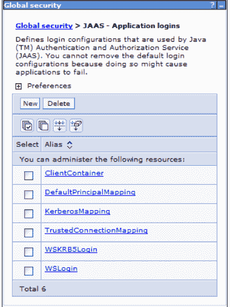
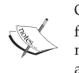
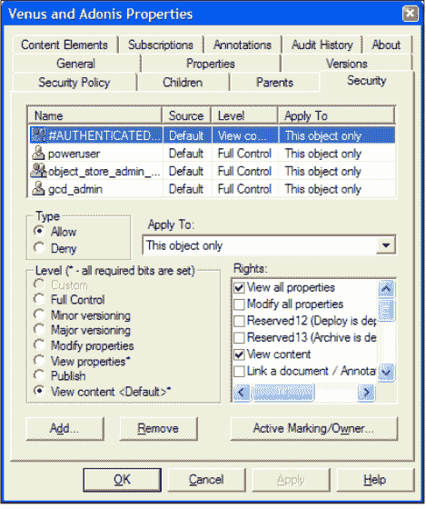
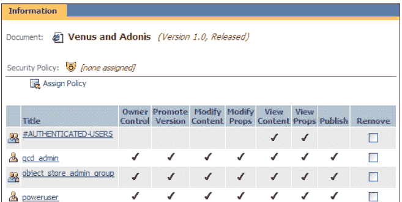
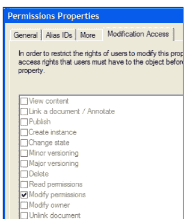
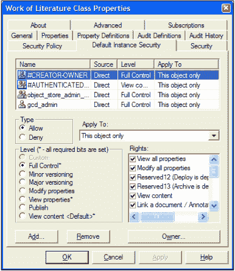
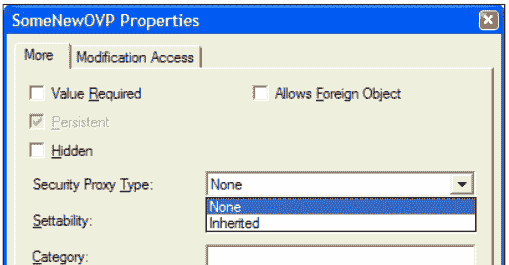
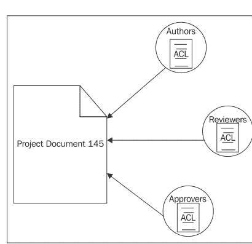
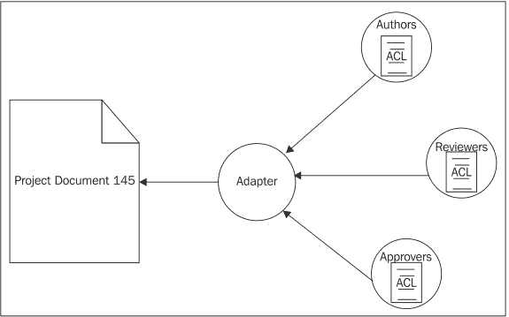

## 8 安全功能与规划

本章讨论 CM 安全的诸多方面。我们在其他章节中已零散地看到过安全相关内容。现在是时候对这些内容进行更全面的审视了。

在任何关于安全的讨论中，总有人会说安全是一个复杂的话题。确实如此！我们将向你描述各个安全功能，并提供一些指导，说明你如何使用这些功能来满足特定需求。每个功能单独来看都很容易理解。由这些微小部分可以构建出精密的机制。

更具体地说，我们将涵盖以下主题：

- CM 身份验证机制
- 企业目录交互
- 众多 CM 授权机制，包括自主访问控制和强制访问控制
- 一个较为复杂的授权场景的逐步讲解

### 身份验证还是授权？

我们将讨论身份验证和授权这两个主要主题。让我们大胆猜测一下，你可能不知道这两者之间的区别。如果你不知道也没关系，但你很快就会知道。我们进一步猜测，在阅读这段文字的 100 名读者中，有 85 人会立刻承认我们说得对。10 名读者会以为自己知道，但实际上是错的（很可能把术语弄反了）。另外 5 名读者确实知道区别。让我们把大家的认识统一起来。

这两个主题存在很多混淆，这无疑是因为术语听起来对普通听众来说几乎是同一个词。只有在积累了大量经验，甚至进行一些深夜吟唱之后，我们才能在不思考的情况下正确使用它们。把安全分为身份验证和授权，是组织计算机安全以及许多其他安全领域最常见的方式。

**身份验证**是证明身份的过程。它显然源自 *authentic* 这个词根。当你看到一幅据称是梵高的画作时，你可能会怀疑它是否 authentic，但你不会怀疑它是否 authoritative。取决于你的个人情况，你可能会携带员工徽章、学生身份证或其他证明你身份的凭证。对于其中一些凭证，很容易混淆概念，认为“这张卡证明我被允许进入那栋建筑”。实际上，这张卡的用途是证明你是谁。

**授权**是查看你被允许执行哪些操作的过程，其中可能包括检查你被允许查看哪些项目。当你想到一个典型的写着“仅限授权人员”并由保安看守的入口标志时，你可能会想到保安会把你列入名单核对，看你是否被允许进入。授权检查只有在你证明了自己的身份后才会启动。有趣的是，授权过程根本不关心你是如何证明身份的。授权过程信任身份验证过程已完成其工作，并且只关注具有该身份的人（或事物）的权限。

### CM 中的身份验证

你已经知道，身份验证是让用户证明其身份的过程。

在计算机安全领域，**安全主体**声称一个身份，并通过出示一个或多个**凭证**来证明它。这听起来更技术化，但实际上只是意味着除了用户之外，其他事物也可以被验证身份。例如，在某些情况下，特定的计算机或应用程序可以被验证身份，使用安全主体这一术语只是让计算机安全专业人员在谈论时无需不断加以限定。

你可能会把凭证想成密码，在大多数情况下今天确实如此。当你输入 userid 和正确的密码时，身份验证系统相信你是该 userid 的所有者。还有许多其他类型的凭证，有些环境会要求你出示不止一种凭证来证明身份（这称为**多因素身份验证**）。如果你是科技惊悚小说的粉丝，你会知道每个政府大楼都使用眼球扫描仪通过虹膜的独特图案来识别人员。更现实的非密码凭证，至少在当今，工作站上的指纹扫描仪，以及用于远程系统访问的手持安全令牌。还有许多其他可能性。

> 我们最喜欢的想象中的非密码身份验证方案称为狗嗅测试。它设想一只狗站岗并嗅闻每个过路人。它仅凭气味就能分辨好人坏人。最著名的例子是 Argos 的做法，这只狗在二十年未见后立即认出了他的主人奥德修斯。

### Java 身份验证和授权服务（JAAS）

不久前，任何复杂系统往往都有自己的身份验证机制。出于诸多原因，这在企业环境中过于不灵活而无法生存。最常见的现代设置，也是 CM 原生支持的唯一设置，是将身份验证机制委托给 CE 运行的应用服务器。J2EE 应用服务器使用的机制是 Java 身份验证和授权服务，缩写为 JAAS，发音与 “jazz” 相同。

尽管 JAAS 可用于身份验证和授权，但 CM 仅将其用于身份验证。

这到底意味着什么，即 CM 支持 JAAS 进行身份验证？通过 JAAS，CE 总是从应用服务器接收一个名为 **Subject** 的对象，以表示身份验证成功以及已验证用户的身份。如果身份验证失败，则会抛出异常，应用服务器不会向 CE 提供 Subject。传递 Subject 进入 CE 的机制是可靠且安全的，因此 CE 知道它不会被其他软件组件伪造的 Subject 所欺骗。作为术语上的简写，我们说 CE 通过 JAAS 将身份验证委托给应用服务器。

说 CE 将身份验证委托给应用服务器固然很好，但应用服务器如何执行身份验证呢？所有 J2EE 应用服务器都使用 JAAS 进行身份验证，但在低层实现细节上存在相当大的差异。JAAS 的完整描述超出了我们此处的范围（通过网络搜索很容易找到许多详细论述），但以下是其概要：

- 站点决定信任哪些机制用于身份验证目的。例如，它可能只信任传统的 userid/密码机制，或坚持使用手持硬件令牌方案。
- 每个机制都需要一个名为 JAAS 登录模块的软件实现。应用服务器附带了一套用于流行目的的登录模块，而第三方身份验证相关软件通常为与应用服务器集成提供一个或多个登录模块。具备足够技能和动力的企业甚至可以编写自己的登录模块（尽管应用服务器特定的要求使这超出了初学者的任务范围）。
- 此外，站点决定哪些机制单独足以进行身份验证，哪些需要与其他机制结合才足够。
- 站点配置应用服务器 JAAS 组件以反映上述策略决策。这通常通过一个可能还带有 GUI 编辑程序的配置文件来完成。配置包括列出 JAAS 登录模块，并附带 required 或 sufficient 等指定，组成名为 stanzas 的命名组。站点通过配置表明，如果你选择其中任何一个 stanza，按照 JAAS 身份验证规则执行，并提供登录模块要求的信息，那么它将信任 JAAS（以及登录模块）正确地验证用户。例如，这里是 WAS 控制台中显示的 WAS 安装的默认 JAAS 模块集的一个面板。每行代表一个命名 stanza。

- 一个应用程序会进行标准的 JAAS 调用以执行身份验证。它可以显式选择一个命名的 JAAS 配置段，也可以让 JAAS 选择默认配置段。登录模块可以通过编程方式向调用应用程序请求信息，应用程序如果愿意，可以将其转换为用户交互以获取信息。
- 如果应用程序提供的信息被登录模块认可，则会向应用程序授予一个 Subject。如果不认可，则会抛出异常。
- 在获得经过身份验证的 Subject 后，应用程序有一种方式可以将该 Subject 与其所做的任何调用关联起来。我们称之为环境 JAAS Subject，因为一旦建立，它通常会自动适用于需要查找它的情况。应用程序程序员通常不会将 Subject 作为参数传递给许多不同的方法调用。CE Java API 确实提供了一些显式操作 Subject 的便捷方法，但其使用是完全可选的。

如果你之前没有接触过，这听起来可能很麻烦，而你通常只是想检查一个 userid/password 对。事实上，应用程序服务器提供的默认 JAAS 配置以及 CM 提供的示例正是这样安排的，并且 CE API 提供了处理 userid/password 身份验证的便捷机制。更灵活、可配置的身份验证方案的意义在于满足其他需求。由于 JAAS 是标准化的，并且你可以提供自己的登录模块，因此你可以实现完全独特的凭证材料。应用程序和应用程序服务器完全与你的方案隔离，并且在使用它时根本不需要更改。（我们仍在研究一种可以 somehow 与那只狗通信的登录模块。）

## 身份验证实际发生的位置

如果应用程序在与 CE 相同应用程序服务器的 web 容器或 EJB 容器中运行，那么身份验证发生的位置可能很直观。这并不典型，甚至不推荐（出于性能和扩展原因），因此身份验证可能发生在其他地方。让我们来看一下这些地方。

## Application Server trust relationships

一种常见的 J2EE 架构是拥有至少两到三层按顺序通信的应用程序服务器。最常见的是，一个 web 应用程序可能会使用 EJB 调用，从前端应用程序服务器的 web 容器向后端应用程序服务器的 EJB 容器发出请求。当你使用一个通过 EJB 传输进行 CE API 调用的应用程序（例如 Workplace XT）时，应用程序正是这样做的。它只是进行普通的 Java 调用，但 API 内部使用 EJB 作为远程机制。

在此配置中，JAAS 身份验证仍在应用程序服务器上发生，但它是一个与 CE 运行的实例不同的应用程序服务器实例。J2EE 应用程序服务器具有建立 **trust relationships** 的机制。就我们的目的而言，这仅仅意味着后端应用程序服务器将信任在前端应用程序服务器上创建的 Subject。配置信任关系的机制是厂商特定的，允许信任可信赖的底层机制也是如此。它通常涉及对 Subject 内部信息进行数字签名。

当通过 EJB 进行远程调用时，如在使用 EJB 传输时 CE Java API 内部发生的情况，环境 JAAS Subject 会自动传播到接收应用程序服务器并成为该服务器的环境 JAAS Subject。这完全通过应用程序服务器的 EJB 远程实现完成，不涉及应用程序或 CE Java API 中的任何显式代码。

> 当应用程序服务器看到一个它不信任的 Subject（因为与发送应用程序服务器之间没有信任关系）时，它通常会简单地丢弃该 Subject 或剥离其中的关键信息。这就是为什么来自 CE 的“你正在尝试进行匿名访问”的投诉通常意味着你的信任关系设置存在问题。

EJB 自动传递 Subject 的机制在 J2EE 中相当标准化。然而，通常不可能在不同厂商的应用程序服务器之间使信任关系或 Subject 内部的精确细节正常工作。有少数孤立的情况，前端应用程序服务器可以以一种后端应用程序服务器会信任的方式进行身份验证，但这些配置往往很脆弱，很容易被一个看似无害的厂商点发布破坏。这也是 CE Java API 不支持在异构应用程序服务器之间使用 EJB 传输的原因之一。

## Thick EJB clients

我们所说的厚 Java 客户端，是指不在 J2EE 应用程序服务器内运行的客户端。这可以是 Java 控制台应用程序或 GUI 应用程序。即使不运行在应用程序服务器中，使用 EJB 传输进行此类应用程序的身份验证支持仍然是可能的。身份验证发生在厂商特定的安排中，涉及厂商提供的客户端支持库与应用程序服务器之间的协作。

这些机制的工作细节对本讨论来说并不特别重要。最终结果是客户端中的一个 Subject，当它通过 EJB 调用到达时会被应用程序服务器信任。在某些情况下，凭证在应用程序认为的身份验证时传递给应用程序服务器。在其他情况下，凭证在 EJB 调用时以其原始形式或多或少地发送。你甚至可能被赋予配置选择，使用哪种方式。对应用程序来说，这是透明的。作为厚客户端的配置者，这值得你关注。无论哪种方式，很可能原始凭证会通过网络传输。你需要确保该路径受到 TLS/SSL 的保护，假设根据你的站点策略或最佳实践，需要这样保护凭证。

## CEWS clients

CE API 还有另一种传输方式可用。它称为 CE Web Services（CEWS）传输，它完全不使用 EJB。身份验证细节有所不同。CEWS 传输是 SOAP XML 通过 HTTP 或 HTTPS（TLS/ SSL）连接传输。

> 你肯定在许多不同情况下熟悉 XML 文件。它们在今天的软件中无处不在。如果你不熟悉 SOAP，你只需要知道它是一种在 XML 文件中表达信息的特定方式的标准。它通常用于请求/响应场景，例如 CE API 对 CE 服务器的调用。

## Java clients with CEWS

使用 CEWS 传输时，我们没有信任关系和自动传播的二进制兼容 Subject 的好处。因此，应用程序服务器永远不会自动信任客户端，身份验证始终发生在 CE 运行的应用程序服务器实例上。客户端看到的是身份验证的幻象，或者确实是一种被除 J2EE 应用程序服务器之外的组件所信任的身份验证。

为了保持一致的应用程序编程模型，CE Java API 在使用 CEWS 传输时仍使用 JAAS 进行模拟身份验证。该模拟身份验证通过 CE 提供的登录模块完成，仅收集 userid 和 password 以供以后使用。对于 CE API 对 CE 服务器的每次调用，原始凭证都会显式地在 SOAP XML 中传递。

> 由于原始凭证的传输，使用 CEWS 传输时你需要配置 TLS/SSL 连接。

CEWS 请求由一个名为 CEWS 侦听器的 web 组件接收。虽然它是作为 CE 服务器安装的一部分提供的组件（你无需做任何额外安装；事实上，你无法避免它），但它并未被 CE 的主要部分自动信任。我们说它位于服务器的信任边界之外。它被视为任何其他 web 组件，但碰巧在与 CE 其余部分相同的应用程序服务器实例内运行。CEWS 侦听器从传入的 SOAP XML 中提取原始凭证，并以任何其他 web 应用程序会做的方式执行 JAAS 身份验证。然后 CEWS 侦听器进行 CE Java API EJB 调用。从那时起，CE 不在乎也不关心请求最初是通过 CEWS 传输进来的。CE 服务器的主要部分将所有请求视为通过 EJB 传输传入，并且由应用程序服务器信任的 Subject。这消除了 CE 服务器中大量特殊处理代码。

## .NET 客户端和直接使用 CEWS 的用户

还有另外两类向 CEWS 监听器发送请求的客户端：CE .NET API 客户端以及直接将 CEWS 作为协议使用的客户端。CE .NET API 由于技术栈的差异无法使用 JAAS。直接使用 CEWS 协议的用户可能可以使用 JAAS 进行凭据收集，但无论如何，其内部实现对 CEWS 监听器来说都是未知的。

.NET API 仅使用 CEWS 传输，并且没有需要维护的 JAAS 假象。因此，.NET API 为应用程序提供了显式机制来提供受支持的凭据类型。凭据最终会出现在与使用 CEWS 传输的 CE Java API 所述相同的或相关的 SOAP XML 位置中，直接使用 CEWS 协议的用户也可以使用这些位置。

我们在这里不会重复 CEWS 监听器的讨论，因为它与上面针对使用 CEWS 传输的 CE Java API 的描述完全相同。CEWS 监听器不知道传入请求的来源（至少在原则上是这样）。

CE .NET API 对基于 Kerberos 的集成 Windows 身份验证（IWA）有直接支持。当然，这仅在 Windows 环境中可用。由于 SOAP XML 中有 Kerberos 凭据的位置，因此也可以被直接使用 CEWS 协议的用户使用。使用 Kerberos 需要将对其的支持配置到 CEWS 监听器使用的 JAAS 配置中。CM 仅在特定上下文中支持 Kerberos。

> 集成 Windows 身份验证（IWA）是客户端为其他目的进行的身份验证的一个很好的例子，直到它被 J2EE 应用服务器自己“嗅探”过之前，该服务器是不会信任它的。IWA 多年来正式或非正式地以其他几个名字为人所知。当你看到关于 Windows 身份验证和 Kerberos、SPNEGO，甚至可能是 NTLM 的讨论时，这几乎肯定是在讨论 IWA。

## 自定义身份验证和隧道

如果上面描述的标准机制不能满足你的需求，有两种定制技术有点像万能牌。它们需要复杂的定制开发，但它们的能力几乎没有限制。

CEWS 监听器对 **Web Services 可扩展身份验证框架（WS-EAF）** 有显式支持。这是一个仅支持直接使用 CEWS 协议的用户使用的功能——它在 SOAP XML 中提供了一个位置，应用程序可以在其中放置任意格式良好的自定义 XML 片段。CEWS 监听器提取该自定义 XML 片段并在 JAAS 身份验证期间将其提供给登录模块。要使用它，你需要编写一个理解你的 XML 信息的自定义 JAAS 登录模块，并将该登录模块部署到 CEWS 监听器使用的 JAAS 配置中。

另一种机制，可用于所有客户端，称为隧道。其思想很简单。你使用现有的 userid/password 槽来携带一些自定义信息。例如，你可能会为 userid 使用一些不寻常且独特的固定值来指示密码包含某种编码的令牌。然后你编写一个理解你的约定的自定义登录模块并能够验证令牌。然后将你的自定义登录模块部署到 CEWS 监听器使用的 JAAS 配置中。

## 委托身份验证

本节并不是真正关于 CM 身份验证的不同位置，而是描述应用程序为其自身目的进行身份验证的方式。

典型的 CM 应用程序会调用 CE，可能还会调用 PE 服务器，以及可能的其他第三方服务器或服务。应用程序通常只关心身份验证的程度，即应用程序使用的服务器和服务所强制执行的程度。应用程序通常不包含敏感数据或计算；这些都留给了受严格保护的后端系统。

- 调用 CE 的应用程序将使用 JAAS 身份验证或上面讨论的其他机制之一，因为它知道 CE 需要它。
- 调用 PE 的应用程序要么执行 JAAS 身份验证，要么使用 PE API 提供的登录方法。在幕后，PE API 会调用 CE 来证明身份验证是可以接受的。这种机制对于我们这里的讨论来说有点太复杂了，但可以肯定的是，PE 将身份验证责任委托给了 CE（而 CE 又委托给了应用服务器）。
- 调用其他服务器或服务的应用程序必须执行它们可接受的身份验证。通常，这将是用于 CE 和 PE 身份验证的相同 JAAS 身份验证或 IWA。如果不是，则由应用程序自行解决。
- 最后，作为一种特殊情况，应用程序可以为其自身目的利用 CE 进行身份验证，通过发出一些简单的 CE 调用并查看它是否因身份验证原因而失败。在 J2EE 环境中，你可以尝试访问任何受保护的资源并查看结果，但 CE 恰好是一个方便且定义明确的示例。

由于身份验证需求和设施不断朝着标准化的方向发展，将其从应用程序手中完全移走是可取的。IWA 通过让用户向操作系统进行身份验证来实现这一点，并且操作系统可靠地将每个应用程序标记为由该用户运行。J2EE 有一个类似的机制，称为 **容器托管身份验证（CMA）**。用户可以向 Web 或 EJB 容器进行身份验证，并且由此产生的 Subject 成为代表该用户运行的所有应用程序线程的环境 Subject。在可以使用的地方，这些更高级别的身份验证机制可以大大减少应用程序对特定身份验证技术的依赖，并且还从应用程序中移除了大多数与身份验证相关的安全漏洞的可能性。

## 单点登录

**单点登录（SSO）** 的概念是让用户只需登录一次，通常是在工作站上，然后他们的身份验证会自动传播并被他们在一天中使用的所有业务应用程序所信任。用户出于明显的原因喜欢这个想法（尽管更恰当的说法可能是大多数用户从未听说过这个想法，并且在遇到它时强烈讨厌缺乏它）。鉴于大多数企业环境中存在多种不兼容的技术栈，SSO 的完全实现非常具有挑战性。

我们之前看到过一个 SSO 技术的例子。通过 Kerberos 的 IWA 被广泛使用，这主要是由于大多数企业中 Windows 工作站的普遍存在。在服务器基础设施支持的情况下，它可以在工作站桌面、桌面应用程序和 Web 应用程序之间提供良好的 SSO 集成。

一种常见的 SSO 折中方案是企业选择在 Web 应用程序之间实现 SSO。这通常在工作站基于 Windows 但服务器基础设施不是时提供相当大的简化。我们已经看到，尽管可能没有完整的细节，但 JAAS Subject 以及信任关系构成了 J2EE 应用服务器层内 SSO 的合理基础。

J2EE 环境中有许多第三方 SSO 提供商。几乎所有这些都通过 JAAS 集成，尽管有时需要做一些自己的定制工作才能为用户提供完全流畅的 SSO 环境。对于自定义应用程序，CM 支持 SSO 供应商和应用服务器供应商支持的任何 SSO 解决方案。对于 CM 提供的客户端，合格的 SSO 解决方案的具体列表在 *IBM FileNet P8 硬件和软件要求* 文档中给出。

## 匿名和访客访问

我们大肆宣扬在 CM 仓库中确切知道谁在做什么。那是最常见的用例，但也有用例，出于方便或其他原因，你不希望让用户通过身份验证来访问内容的一部分。

例如，你可能有一个不敏感的仓库，用于支持面向公众的网站。你不希望在公众获取你提供的资讯的道路上设置任何人为的障碍。这种情况的一种变体是，你确实希望让公众成员识别自己，通常使用低等级的凭据，如他们控制的电子邮件地址，但你希望在企业目录之外跟踪他们。由于不在企业目录中，他们的身份验证在大多数环境中会因 J2EE 目的而失败。

CE 按设计不允许匿名访问。CE 请求始终伴随着经过身份验证的 Subject，否则请求将被 CE 拒绝。这与其它软件组件其实并没有什么不同。除了像 DOS 和 CP/M 这样古老系统外，计算机操作系统上的每个进程都以某个人身份运行。在每种情况下，某个人是谁可能并不明显，因为软件组件协同工作使模拟匿名访问变得容易。尽管如此，即使是最简化的 Web 服务器也以某个操作系统用户身份运行。（在许多 Unix/Linux 系统上，有一个专用的低权限操作系统用户称为 nobody 用于此类目的。即使是 nobody 也是某个人。）

对于 CM 应用程序以及上面提到的其他类型的系统，通常的做法是通过使用称为 **访客访问** 的东西来模拟匿名访问。访客访问意味着一组凭据被专门为这些用户（访客）使用而预留。访客本身通常并不知情，也不知道访客凭据是什么。访客凭据被硬编码到应用程序中或为应用程序配置。同一想法的其他名称包括 **系统账户** 和 **配置身份**。

Guest access is a trade-off between strict security and convenience. It may be a trade-off worth making for some use cases, but you should be aware of the risks:

- You may be controlling guest access with some application-level logic, but an attacker who discovers the actual guest credentials may be able to bypass your application logic and access back-end systems directly.
- Auditing and other logging systems will be unlikely to record anything other than the guest identity. You may be tracking more specific information at the application level, but matching up logging across multiple tiers can add considerable complexity and effort to any troubleshooting or forensics efforts. In other words, it may be pretty difficult to unravel the trail if someone does something malicious via a guest account.
- The CE, in particular, records several facts about access to and modification of objects in audit logs and system properties. That information can be no more accurate than the identity presented in the authenticated Subject.

## Impersonation and run-as

There is a special mechanism for guest access available in J2EE and a similar mechanism for IWA. In both cases, an application can be configured so that all or some part of it runs with an identity different from the actual user running the application. Windows calls this **impersonation**, and J2EE calls it **run-as**. The mechanisms differ in implementation, but both are administratively configured, and the net result is that the authenticated user identity seen by the CE is the impersonated or run-as identity.

> One of the first software patents — perhaps the very first — was granted to Bell Laboratories for the Unix *setuid* mechanism. That mechanism enabled impersonation on Unix and is still in use today in all Unix derivatives.

These mechanisms can obviously be used for guest access. You would simply arrange your software components so that the parts needing guest access were configured to run using either of these mechanisms with the guest account. Perhaps less obviously, the same mechanisms can be used to provide intentional access with elevated privileges.

## Security Features and Planning

Suppose you wanted to allow some set of users to perform an action for which they are not normally authorized. (We are jumping ahead to the authorization topic a bit, but please bear with us.) They are authorized to do it under some special circumstances, like only being allowed to do it on Wednesdays, when the moon is full, during leap years. In other words, it's under some conditions where no general purpose middleware system is going to provide the business logic needed for that special condition. You're going to have to write the business logic yourself.

You won't be able to just give those users that right in the middleware system without also empowering them do it outside of your special conditions. After all, they might write their own application or use some general purpose application to perform the operation without the benefit of your application logic. CM does not have a notion of privileges assigned to applications. It only has privileges assigned to users or groups of users.

To use the impersonation or run-as features for this use case, you would put the complex business decision logic into a separate software component and configure it to run as a user identity that did have the extra privilege. (The administrative configuration could not be done by unprivileged users to give their own software components the extra rights.) The business logic in that component would not exercise the extra privilege unless the special conditions were met; that's what the business logic is all about.

A couple of important points about this technique:

- You are explicitly trusting the configured component to do the right thing. So, you should obviously exercise due security diligence in inspecting the component before performing the configuration for impersonation or run-as.
- Remember that your configured component might be called in ways you are not expecting. Make sure that you are satisfied with the statement, "No matter how this component is called, I am willing to let it perform this operation as long as the business logic conditions are met."
- Complexity and good security are generally inversely correlated. You want only the barest minimum amount of logic that you can get away with inside the configured software component. The more you have in there, the more chance there is that an attacker can fool your component into doing something that it shouldn't.
- Finally, this is just a reminder that most systems will only log actions as having been taken by the configured identity and may not even be aware of the actual calling user identity. Be sure to analyze this and make sure it is acceptable.

## Enterprise directories

CM assumes the use of a directory containing user and group information.
Technically, the CE does not care if the application server consults a directory for authentication, but there must at least be the illusion that the directory is used. The application server provides an authenticated Subject, and within that Subject is the identity of the authenticated user. The CE trusts the identity because it received it by trustworthy means from the application server.

The CE uses the directory explicitly for the following things:

- There are CE API calls for searching for directory users and groups in various ways. These are translated into directory service calls, and a handful of directory attributes are available to CE API callers.
- Access permissions can be assigned to directory groups. To see if a particular group access permission applies to the calling user, the CE uses directory service calls to discover group memberships. Depending on the directory in use, there may be groups nested within groups.
- The CE stores some user and group information using unique identifiers from the directory. This is different from the user and group names returned to callers. When necessary, the CE uses directory service calls to do the translation.

All CE directory calls are made using the **Lightweight Directory Access Protocol (LDAP)**. This is a standard, vendor-neutral protocol available for all modern enterprise directory servers. It would be nice if things were standard enough that you could provide a few configuration parameters and then use any LDAP-based directory access. Unfortunately, that amount of standardization is not currently available, and the CE has some amount of vendor-specific code for every supported enterprise directory. Each supported directory configuration undergoes a specific testing effort to ensure that it works properly with the CE. Details of specific directory brands and version numbers are given in the *IBM FileNet Hardware and Software Requirements* document.

Directory searches, especially for the resolution of group memberships, can cause a considerable amount of performance drag within the CE. The CE caches directory information to ease this burden. The sizes, refresh intervals, and other details of these caches can be tuned if a site has special requirements. The application server vendors also cache directory look-ups involved in authentication.

## Authorization in CM

We described JAAS in the section about authentication. Although the middle two letters of JAAS stand for authentication and authorization, CM does not use JAAS for authorization purposes.

Instead, CM provides its own fine-grained and richly-featured access control mechanisms. It is fine-grained because it can be applied with individual granularity to most objects within an Object Store. It includes both discretionary access control mechanisms and a mandatory access control mechanism. There are built-in features for setting and modifying the access control on objects to make it easy to implement a wide variety of popular use cases with minimal development or administrative effort.

The terms authorization, access control, and access check are similar enough that they can be used interchangeably for our discussion.

## Discretionary and Mandatory Access Control

Discretionary and Mandatory Access Control are industry standard terms for describing ways of establishing access control for objects in a computer system.

You are probably already familiar with the mechanics of **Discretionary Access Control**, even if you don't know that term, because it occurs in everyday computer systems. It refers to users being able to give someone else access to an object without system interference. It's discretionary in the sense that a user can just decide, based on his or her own discretion, to give (or deny) someone else access. The system does not evaluate the appropriateness of that action. **Mandatory Access Control**, on the other hand, is about using system enforcement to make sure that certain access can never be granted by one user to another, accidentally or intentionally.

If you're not used to these security concepts, they may seem like a lot of fuss over a minor difference. They are actually dramatically different, and that will probably be clearer once we've described the CM implementations individually. The first several mechanisms are discretionary, and we'll finish up with marking sets, the CE mandatory access control mechanism.

## 访问控制列表

**访问控制列表（ACL**，有时读作“ACK-el”）是特定对象的一系列访问控制规范。列表中的单个条目称为**访问控制项（ACE）**。单个 ACE 始终包含完全相同类型的概念信息：

- 其适用的用户或组的身份。只能是其中之一，绝不会同时是用户和组。
- 指示 ACE 是允许某些权限还是拒绝某些权限。同样，只能是其中之一。
- 此 ACE 允许或拒绝的权限集。虽然可以每个 ACE 指定单个权限，但指定一个集合既是一种高效的快捷方式，也有助于思考权限如何授予访问权。无论如何，CE 会在可以合并的地方合并 ACE。

ACE 还具有可继承深度和权限来源，但我们将在后文描述这些内容。

要在 FEM 中查看对象的 ACL，请选择该对象，右键单击，然后选择**属性**。大多数对象在弹出面板中都有**安全**选项卡。

解读 ACE 的方式是：“对于这个（用户或组），此 ACE（授予或拒绝）这个（权限集）”。当 CE 中的授权检查在检查 ACE 时，它首先判断调用用户是否匹配 ACE 中提到的用户，或者是 ACE 中提到的组的成员。如果不是，则该 ACE 在访问控制目的上被完全忽略。在考虑整个 ACL 时，在丢弃不适用的 ACE 后，对于调用用户的任何特定访问权限，有几种可能性：

- 存在一个或多个适用于该用户的“允许” ACE，并且没有适用于该用户的“拒绝” ACE。在这种情况下，给定的访问权限被授予。
- 存在一个或多个适用于该用户的“拒绝” ACE。在这种情况下，该用户被拒绝给定的访问权限。由于对于给定的权限，“拒绝”优先于“允许”，即使存在针对相同权限的“允许” ACE，访问也会被拒绝。一个常见错误是拒绝某个组的访问，然后试图允许该组的一个或多个成员访问。这不起作用，因为“允许”用户 ACE 无法覆盖“拒绝”组 ACE。
- 没有任何适用于该用户的 ACE。在这种情况下，给定的访问权限对该用户被**隐式拒绝**。隐式拒绝仅意味着如果 ACL 中根本没有提到某个用户或组，那么最终的默认情况就是拒绝他们的访问。通常的做法是避免使用“拒绝” ACE，而是依靠隐式拒绝来限制访问。

这种评估方案实际上稍微复杂一些，因为 ACL 中的 ACE 根据 ACE 的权限来源按层级组织。有四种权限来源可能性，组织成三个层级：

- **直接/默认**：包括直接应用于单个对象的 ACE，无论是显式还是通过“默认实例权限”类
- **模板**：包括通过安全模板应用的 ACE
- **继承**：包括通过安全继承应用的 ACE

这些层级背后的机制将在本章其他部分描述。目前，你只需要知道直接/默认 ACE 优先于模板 ACE，模板 ACE 优先于继承的 ACE。也就是说，直接层级中的“允许” ACE 可以覆盖模板或继承层级中的“拒绝” ACE。在同一层级内，计算如前所述，“拒绝”优先于“允许”。

在所有计算结束时（以及接下来要描述的其他一些事情），CE 将获得授予调用用户的访问权限列表。这被称为**有效访问掩码**。计算结束时，访问权限是如何授予的并不重要。重要的是它是否以某种方式被授予（或未被授予）。

## 用户和组访问

ACE 可以指定特定用户，也可以指定目录组。在后一种情况下，ACE 适用于直接或间接属于该组的所有用户。（间接成员关系之所以存在，是因为某些目录允许组嵌套在其他组中。）

理论上，你可以只使用用户 ACE 而从不使用组 ACE，但这通常不是一个好主意。首先，当一个组就能完成任务时，列出单个用户会非常繁琐且劳动密集。其次，组 ACE 是动态使用的，即在检查 ACE 时评估组成员资格（受 CE 中短期缓存的轻微影响）。因此，如果新用户添加到组中，ACE 自动适用于该用户。如果用户从组中移除，该组 ACE 授予的权限将自动撤回。

尽可能使用组 ACE 是最佳实践。ACL 是单个对象的属性，随着个别用户的加入和离开，更新数千甚至数百万对象的安全性通常是不切实际的。

> 还有另一种 ACE 仅对应用程序开发人员感兴趣。它是未知 ACE。这种 ACE 的产生是因为 ACE 有时会成为孤儿。ACE 中提到的用户或组从目录中删除，但 ACE 仍存在于存储库中。这些 ACE 永远不会匹配任何调用用户，因此永远不会参与任何访问控制计算。
> 
> 应用程序开发人员在以编程方式显示或修改 ACL 时必须意识到这种 ACE。未知 ACE 应被静默过滤掉，不显示给最终用户。（FEM 会显示未知 ACE，但它是管理员工具。）如果对 ACL 进行更新，则必须过滤掉未知 ACE。否则，CE 将抛出异常，因为它无法解析目录中的用户或组。

## 权限

在 CE 中，用户可执行的每个受访问检查控制的操作都有一个单独命名的访问权限。在 ACL 评估结束时，给定的访问权限要么被允许，要么被拒绝（可能通过隐式拒绝）给调用用户。绝无任何含糊或疑问：用户对给定权限要么允许，要么拒绝。同样，在 ACE 中提及权限始终是该 ACE 范围内的绝对“允许”或“拒绝”。权限是单独考虑的，授予或拒绝一个权限不会自动授予或拒绝用户的任何其他权限。

> 访问权限的两态特性使得可以轻松地将它们紧凑地表示为称为位掩码的整数字段中的位集合。实际上，CE 正是为了效率而这样做。然而，这只有对应用程序开发人员和钻研神秘技术的学生才有意义。大多数工具将权限显示为单独的复选框或类似的 UI 项。

可能的权限集因对象类型而异，因为不同对象类型的可能操作集不同。少数访问权限适用于所有对象类型（例如，读取对象属性值的权限），而其他权限则更为专门（例如，创建主版本或次版本的权限，仅存在于 Document 对象中）。举例来说，对象存储定义了八种单独权限，而 Document 对象定义了十五种单独权限（另外还有两种曾经使用过但现已过时的权限）。

## 级别

虽然各个访问权限之间没有技术联系，但确实有些权限倾向于一起使用。在某些用例中，你可能需要将一组特定权限作为一个整体授予或拒绝给某个对象，以实现某种功能目的。CE API 为许多有用的权限集合提供了常量，许多应用程序利用这一点以各种分组显示权限。这些分组称为访问级别。然而，重要的是要理解，级别不是额外的权限种类，也不是不同的机制。它们只是现有访问权限在功能上有意义的集合。

在本章前面，我们展示了 FEM 中“属性”面板“安全”选项卡的截图。FEM 中使用访问级别创建一系列单选按钮以便快速选择。下面是 XT 中看到的同类权限的图片：

FEM 和 XT 对于权限组合使用了一些不同的术语。这主要是由于这两个工具的受众不同。

如果你正在开发一个显示或操作安全细节的应用程序，你可能对级别（在 API 类 AccessLevel 中定义）是否对你的用例有兴趣。你可以也可以不感兴趣。如果它们没有帮助，就不要使用它们。

## 未使用的位

现在你知道了访问权限是以一组位的集合形式存储的，并且以编程方式作为位进行操作，你可能会更深入地查看定义的访问权限位。位以 32 位整数的形式存储，但并非所有位位置在此时都有定义的含义。如果你想将其中一些未分配的位用于自己的目的，那不会干扰 CE 的访问检查计算。当然，大多数工具甚至不会给你设置这些位的方法，但你可以通过编程方式做到。那是个坏主意，原因如下：

- 其他应用程序不应该关心你使用的位，但它们也不能保证会尊重它们。它们可能会以“它们知道这些位未定义任何用途”为由直接清除它们。
- 一些应用程序对安全有简化和详细两种视图。简化视图基于应用程序认为有意义的众所周知的访问权限组合。设置未分配的位几乎肯定会导致这些应用程序放弃简单视图并始终显示详细视图。
- 访问权限位并不经常更改，但完全有可能 CM 的下一个版本会对你正在使用的位定义含义。所有未分配的位都应被视为系统未来使用的保留位。

如果这是一个如此糟糕的主意，为什么你一开始还想这么做呢？你可能认为这是一个方便的地方，可以为你自己的私有访问权限做簿记。你的同步事件处理程序可能会在决定是否允许操作的决策逻辑中检查这些位。这不是一个坏主意；只是使用未分配的访问权限位是个坏主意。你必须找到更传统的地方来跟踪此类事情。

## 隐式权限

除了通过 ACL 机制授予的权限外，还有两种特殊情况，权限会隐式授予调用用户。

### 对象所有者

对象有一个 Owner 属性。通常情况下，创建对象的人也是所有者，但也有其他可能性。有一种特定的访问权限称为 WRITE_OWNER（但通常非正式地称为“接管所有权”），这意味着某人（或某个组）有权接管对象的所有权。

对象的拥有者始终被允许更新对象的 ACL（即使未明确授予 WRITE_ACL 权限）。因此，对象的拥有者间接获得了该对象所有其他可用权限。我们说它是间接的，因为必须实际修改 ACL 才能授予这些其他权限。

假设你想消除这个例外并将操作限制为明确授予的权限。（记录管理就有此要求，例如。）很明显如何确保没有人拥有 WRITE_OWNER 访问权限。对象的所有者怎么办？可以把 Owner 属性的值设为 null，在这种情况下没有所有者，也没有人拥有隐式授予的所有者权限。拥有 WRITE_OWNER 访问权限的普通用户只能将 Owner 属性设置为他或她自己的身份。将它设为 null 需要下一节中讨论的额外特权。

### 对象存储管理员

在 CE 眼中，实际上并不存在对象存储管理员。只有经过身份验证的用户，有或没有各种访问权限。像 FEM 这样的工具对对象存储管理员有一个工作定义，即对对象存储对象拥有完全访问权限的用户。这主要是因为在像 FEM 这样的管理员工具中，如果用户没有执行各种操作的权限，常规事务会变得非常棘手。

然而，有一种特定的访问权限，比其他任何权限都更像是“管理员位”。该访问权限称为 WRITE_ANY_OWNER，仅对对象存储对象可用。拥有此访问权限的用户被允许使用任何合法值，包括 null，更新对象存储中任何对象的 Owner 属性。

你大概能猜到下一部分：拥有对象存储 WRITE_ANY_OWNER 权限的用户被视为也拥有每个对象的 WRITE_OWNER 权限，这意味着他们有权修改每个对象的 ACL；这意味着他们可以对这些对象做几乎任何事情。现在应该很清楚为什么拥有 WRITE_ANY_OWNER 权限通常被认为等同于成为管理员。

有趣的是，对象存储本身并没有 WRITE_OWNER 访问权限。那是因为它没有 Owner 属性。它确实有一个 Creator 属性，但这不会授予任何特殊特权。

### 特殊查询权限

要查看对象，实际上是指查看对象的属性，用户需要对该对象拥有 READ 权限。否则，对象的存在对他们来说是隐藏的。拥有 WRITE_OWNER 或 WRITE_ANY_OWNER 的用户可以更新对象的 ACL 并授予自己 READ 访问权限。在他们更改 ACL 之前，他们必须获得对对象的引用。如果他们没有 READ 访问权限，获取对象引用可能很困难。对象不会在普通浏览中显示。

拥有对象但没有 READ 访问权限的情况称为“丢失对象问题”。它通常是意外发生的，通常每个人都丢失了对该对象的 READ 访问权限。对象实际上不可见，但它仍然存在。这可能不仅仅是令人烦恼。例如，丢失的对象仍可能由于 CE 中的引用完整性检查而阻止删除其他对象。

为了解决丢失对象问题，有一个仅在返回查询结果时发生的特殊情况。调用者没有 READ 访问权限的对象通常会静默地从查询结果中排除。然而，如果调用用户拥有 WRITE_OWNER 或 WRITE_ANY_OWNER 访问权限，则不会排除它们。想法是可以通过此类查询定位丢失的对象，从而提供所需的引用，以便可以更新 ACL（因为这些相同的调用用户也会拥有隐式的 WRITE_ACL 权限）。

## 额外访问要求

除了 ACE 以及手动和自动操作它们的各种机制之外，还有一些常见情况，你可能想要一些额外的控制。CM 对这些情况有特定的机制。这些机制都是对在对象上设置特定属性的额外限制的实现，因此它们在相关属性的属性定义中进行配置。

### 修改访问必需

有时你可能希望对特定属性提供额外保护，以便即使用户通常有权更新对象上的属性，他们仍需要更多访问权限才能修改该特定属性。CE 对对象有 ACL，而不是对对象的属性有 ACL。名为 **Modification Access Required (MAR)** 的功能让你可以使用对象 ACL 来保护特定属性。

属性 PropertyDefinition.ModificationAccessRequired 是一个整数值，以通常的位掩码表示，定义用户必须拥有的对象访问权限，以便被允许修改该属性。在通常情况下，该值为零（在这种情况下，更新由对象 ACL 决定），但你可以为自定义属性定义额外的必需访问权限。例如，你可能要求调用用户拥有删除对象的权限，才能允许其更新特定属性。这并不意味着他们必须实际删除对象；它仅仅意味着他们必须拥有删除它的权限。你可以在 FEM 中通过编辑属性的属性定义来查看或修改 MAR 值。例如，这里是继承属性 WjcWorkOfLiterature.Permissions 的 MAR。因为它是系统属性，你不能修改 MAR。发现需要修改权限的权限（WRITE_ACL）并不令人惊讶。

当尝试更新对象上的属性值时，CE 首先计算调用用户对该对象的有效访问权限。假设所有对象级访问检查都通过，CE 会查看正在更新的每个属性的修改访问必需。调用用户还必须拥有所有这些权限，否则更新将失败。

### 目标访问必需

在 CM 中形成对象之间关系的方式有很多。大多数在第 7 章《主要 CM 功能》中进行了描述。我们通常认为关系是将一个对象的属性更新为指向另一个对象，并且我们通常考虑调用者更新指向对象的权限。有时让被指向的对象对另一个对象是否可以指向它发表意见是有用的。名为 Target Access Required (TAR) 的功能实现了这一点。

属性 PropertyDefinitionObject.TargetAccessRequired 是一个整数值属性，以通常的位掩码表示形式定义，当在指向对象上设置 OVP 的值时，用户必须对指向的对象拥有的访问权限。在通常情况下，不需要额外的访问权限。作为使用 TAR 的示例，您可能希望在设置指针之前要求调用用户拥有删除指向对象的权限。您将该权限添加到指向对象的目标访问所需中针对该属性。换句话说，您将在指向 OVP 的属性定义上设置它。

## 默认实例安全

当对象被创建时，创建应用程序可以显式设置其访问权限。Permissions 属性保存 ACL，并且可以在创建时像许多其他属性一样进行设置。在这种情况下，ACL 按原样应用，每个 ACE 都会成为我们上面描述的直接 ACE。必须为每个新对象正确显式设置 ACL 既繁琐又容易出错，因此存在一个默认机制。

类描述有一个名为 DefaultInstancePermissions 的属性。这只是一个预定义的 ACL。它不适用于类描述本身。相反，如果调用者在创建时未显式设置 ACL，则它适用于该类的新对象实例。在这种情况下，ACE 是默认 ACE。出于访问检查目的，直接 ACE 和默认 ACE 具有相同的效果。你会记得在我们本章前面描述访问控制计算时它们处于同一层级。这里例如是 FEM 对文学作品类的默认实例权限的视图：

许多人误将此默认机制理解为一种安全继承。它绝对不是。如果您修改类的默认实例权限，它仅影响此后创建的对象实例。它不会更新现有实例的权限。如果它真的是继承，它会以某种方式自动反映在这些现有实例中。

### #CREATOR-OWNER

如果您为类设置默认实例权限，您可能希望明确允许或拒绝创建实例的用户拥有的某些访问权限。显然，在用户实际创建实例之前，您不知道该用户是谁。

有一个特殊的象征性用户可以解决这个问题。当您创建一个 ACE 且用户身份为字面字符串 #CREATOR-OWNER（注意它使用连字符，而不是下划线）时，该 ACE 会自动转换为对象的实际所有者。目录中没有名为 #CREATOR-OWNER 的用户。

稍加思考，您会发现当您直接更新 ACL 时进行此替换意义不大（您知道所有者是谁，可以直接在 ACE 中使用该身份）。事实证明，CE 只会在 ACL 更新将自动执行的情况下接受此值。换句话说，ACL 正在被创建或修改，但该 ACL 只会在稍后时间应用。类默认实例权限就是这些位置之一，安全策略和文档生命周期策略也是如此，两者都在下一节中描述。

## 安全策略和文档生命周期策略

对象在创建时为其建立初始 ACL。对于许多对象，对象的整个生命周期中 ACL 从未更改。其他用例中 ACL 会在计划的时间以可预测的方式更新。例如，随着文档经历版本化周期，您可能希望对废弃版本、在处理中的版本等系统地使用不同的 ACL。

CM 提供了一个功能来促进这一点，它称为安全策略。文档生命周期策略功能（在第 7 章中描述）中提供了一个相关机制。历史上，生命周期相关功能最先存在。安全策略功能更通用一些。如果您已经出于其他原因使用文档生命周期，您可能会发现同时使用其安全功能很方便。

## 安全策略和安全模板

文档、文件夹和自定义对象具有 **SecurityPolicy** 属性，可以设置为指向 **Security Policy** 对象。安全策略对象有一个 **Security Template** 对象的列表。安全模板只不过是 ACE 的集合多一点，而 ACE 正是从模板层起源的。

> SecurityPolicy 是一个普通的对象值属性，可以随时更新。由于最常见的使用方式是在对象创建时从类定义中获取默认值，因此安全策略通常被认为适用于一个类。

每个安全模板都有一个 GUID 值 **ApplyStateId** 属性，用作其行为的一部分。您可以将 **ApplyStateId** 属性设置为代表文档版本状态的四个特殊值之一（并在 CE API 中的类 **VersionStatusId** 中定义），或由您的应用程序确定的值，具体取决于您的安全模板是创建为 **VersioningSecurityTemplate** 还是 **ApplicationSecurityTemplate**。两种类型的模板可以共存于安全策略对象中的模板列表中。

如果这是您第一次接触 CE 安全策略和安全模板，您可能对我们刚刚描述的信息感到困惑。让我们描述一下行为：

- 当安全模板应用于目标对象时，ACE 列表会从安全模板复制到该目标对象。来自任何模板的现有 ACE 首先被删除。安全策略对象上的一个布尔属性决定是否同时删除任何直接/默认 ACE。
- CE API 中的文档、文件夹和自定义对象有一个名为 **applySecurityTemplate** 的方法。它将该对象的某个安全策略中的安全模板应用于该对象。特定的应用安全模板通过其 **ApplyStateId** 值标识。这代表应用程序以象征性的方式对对象的权限进行特定更改的一种方式。应用程序无需将特定的 ACE 编码到其中。
- 当文档发生版本状态更改时（例如，当保留被签入时），CE 会自动查找并应用具有与文档目标状态对应的 **ApplyStateId** 的版本安全模板。这代表一种配置方式，使文档版本在经历版本周期转换时自动进行特定的安全更改。调用应用程序无需采取任何操作，因为 CE 会根据安全策略对象及其版本安全模板集合自动执行此操作。

上面描述的两种机制中，更受欢迎的是与版本相关的功能。您可以通过使用其他 CM 功能的组合来实现任一类型安全模板的效果，但如果适合您的用例，使用安全策略功能通常更具性能效率且应用程序逻辑更简单。

## 文档生命周期策略

文档生命周期策略具有与安全策略非常相似的功能，但机制和术语略有不同。生命周期功能总体上在第 7 章中描述。这里，我们只关注自动安全更改的功能。

文档具有 DocumentLifecyclePolicy 属性，其值为文档生命周期策略对象。文档生命周期策略对象有一个文档状态对象的列表。除了提供生命周期状态详细信息外，文档状态对象还具有可选的模板权限列表。模板权限集合只是一个 ACE 列表。

以下是其使用方式：当文档转换到特定生命周期状态时，该状态的模板权限列表会被复制到文档。来自模板的现有 ACE 首先被删除。文档生命周期策略对象上的一个布尔属性决定是否同时删除任何直接/默认 ACE。

您可以看到这在概念上与上面描述的安全模板机制非常相似。在生命周期情况下，应用程序触发文档生命周期状态转换，但 CE 会根据文档生命周期策略和文档状态对象自动更新安全。

## 动态安全继承

安全继承是一个强大的功能，可以大大简化您 CM 环境中访问控制的管理。我们之前曾顺带提到过安全继承，现在我们将更详细地介绍它。

> 在 CE 中，该功能称为动态安全继承，以强调它被动态（且即时）评估的事实。CE 的早期版本使用从父级到子级的 ACE 后台复制来模拟继承。虽然就您实际在子对象上看到的安全而言功能效果相同，但该机制偶尔会有一些不理想的副作用。今天的 CE 只使用真正的继承——并且在将某物描述为安全继承的地方不使用 ACE 的后台复制。

## 可继承深度

在我们迄今为止对 ACEs 的讨论中，我们谈到了它们如何影响它们所应用的对象。它们可用于有选择地允许或拒绝目标对象上的访问权限。ACE 还有一个额外的整数值属性，称为 InheritableDepth，它专门与安全继承相关。可继承深度表示有多少代子对象将继承该特定 ACE。

- 如果可继承深度为 0，则没有任何一代子对象会继承 ACE。换句话说，ACE 仅适用于最初定义它的对象。
- 如果可继承深度为 1，则一代子对象将继承 ACE。
- 如果可继承深度为特殊值 -1，则无限数量的子对象代将继承 ACE。从实际角度来看，这与使用一百万的可继承深度值并没有太大区别，但拥有一个特殊值可能会让开发人员在选择一个足够大的数字以确保覆盖所有情况时免去一时的犹豫。
- 如果可继承深度为任何其他正值，则恰好有这么多代子对象将继承 ACE。拥有这种灵活性很好，但在实践中，前三点才是可能有趣的唯一情况。

通过继承获得的对象有时也称为贡献 ACE。ACE 只能在最初定义它的对象上进行修改（作为直接或默认 ACE）。对于通过继承接收它的对象，它是只读的。

## 父对象和子安全对象

就安全继承而言，子对象到底是什么？虽然系统元数据中有几个预定义的情况，但你可以通过自定义元数据定义自己的安全继承关系。预定义的情况以完全相同的方式进行评估。

CE 具有一种属性类型，其值是对另一个 CE 对象的引用。它们被称为对象值属性（OVPs）。在第 4 章和第 7 章中，我们描述了如何定义自己的自定义属性，包括 OVPs。例如，发票行项目对象可能具有指向包含发票对象的 OVP。OVP 的属性模板具有一个名为 SecurityProxyType 的属性，正是通过该属性你建立安全继承关系。被指向的对象将成为安全继承的父对象，而在该对象上定义指向属性的对象将成为安全继承的子对象。如果 OVP 的值为 null，则不会通过它进行安全继承，因为没有父对象。

此屏幕截图显示了在属性模板对象上设置安全代理类型的面板：

SecurityProxyType 属性的可能值如下。这些值不会出现在 FEM 中用于多值（反射）OVP 的属性模板，因为安全继承仅适用于单值 OVP。

- NONE (0)：这是典型情况。OVP 不创建任何安全继承关系。
- INHERITED (2)：此属性创建新的安全继承关系。
- FULL (1)：你不应该使用此值（因此 FEM 不将其作为选项提供）。它会导致父对象的<|message|> 安全完全替换子对象的 security（这就是该属性被称为 SecurityProxyType 的原因）。它被记录管理软件用于锁定受管对象的 security。虽然对于单个完整代理，机制是明确定义的，但在存在多个完整代理的情况下，其行为未记录，并且可能在未来版本中发生变化。

如果特定子对象有多个父对象会怎样？换句话说，如果对象具有多个 SecurityProxyType 为 INHERITED 的 OVP 怎么办？所有父对象都以同等力度贡献 ACE（假设贡献的 ACE 具有足够深的可继承深度以到达子对象）。所有贡献的 ACE 在评估 ACE 以进行安全访问计算时都被归入一个单一的“继承”层。可继承深度仅用于决定在继承链中走多少代，而不是贡献 ACE 之间相对强度指标。

你可能已经猜到，继承 ACE 的子对象也可能对另一个对象成为安全继承的父对象。除了可能向子对象贡献自己的直接/默认 ACE 外，一个对象还会（保持不变地）传递任何继承的 ACE，前提是这些继承的 ACE 具有足够的可继承深度。

> 为 SecurityProxyType 为 INHERITED 的属性提供值会修改接收对象的 security。你可能希望控制谁可以设置这些属性的值。一种方便的方法是使用本章前面描述的 Modification Access Required (MAR) 功能。分配一个包含至少 WRITE_ACL 权限的 MAR 值。

## 系统定义继承

CE 系统元数据中有几个预定义的安全继承关系。其中一些在 CE 中有特殊用途的实现代码，但大多数使用与自定义属性完全相同的机制：

- 文件夹从其父文件夹继承。因为（根文件夹之外的）文件夹在其 Parent 属性中始终有值，所以有另一种防止意外安全继承的机制：布尔属性 Folder.InheritParentPermissions。
- ReferentialContainmentRelationship 对象没有自己的 security。它始终采用 Tail 对象的 security，换句话说，就是包含某物的文件夹。
- 文档和自定义对象具有一个名为 SecurityFolder 的属性，可以选择指向文件夹并由此继承该文件夹的 security。对象不需要存放在该指向的文件夹中，尽管这是通常的用例。这取代了通过名为 SecurityParent 的属性的旧机制，该属性指向 ReferentialContainmentRelationship 对象。SecurityParent 属性仍然存在，但 CE 通过 SecurityFolder 属性模拟旧行为。
- 文档、文件夹和自定义对象可以有注释。注释对象从被注释对象继承 security。注释在其 AnnotatedObject 属性中始终有值。
- Class Definition 对象可以从其超类继承 security。创建继承关系的属性是 SuperclassDefinition。这是 Class Definition 对象本身的 security，并不影响默认实例 security。

## 角色和适配器

安全继承的常见情况是“我想让此文件夹的 security 应用于我存入此文件夹的任何内容”或“我希望此文档的注释具有与文档相同的 security”。换句话说，使用安全继承的第一直觉是用于一组相当静态的情况，继承沿功能线进行。动态方面也是可用的，即使在这些用例中也是如此。如果你更新文件夹或文档的 security，在第一和第二示例中，继承对象会自动且立即获得可继承的部分更改。

更复杂的安排也是可能的，我们将通过以下示例进行说明。

## 项目团队示例

如果有一组在业务逻辑上有关联但没有明显低级技术关系的对象会怎样？它可能是没有共同父文件夹的一些文件夹，也可能是存放在不同文件夹或根本没有文件夹的一些文档或自定义对象。

OVP 的限制很少，包括那些导致安全继承的 OVP。你可以创建指向对象的对象，其全部目的是定义可继承的 ACE。许多不相关的对象可以指向该对象的单个实例。由于它们的使用方式，我们即将描述，它们通常被称为角色对象。

例如，假设你有一个属于各种项目团队的文档和文件夹的存储库，并且你的 security 要求是项目团队成员只能访问他们自己的工件。你可以为每个项目团队创建一个系列的角色对象，每个项目团队一个角色对象。每个角色对象上的 ACE 将授予项目团队成员的权限，并且可继承到无限深度。通过简单地将角色对象分配给每个文档上的继承定义属性，所有项目团队成员都将由于继承的 security 而获得访问权限。如果文档本身没有任何 ACE，则隐式拒绝将阻止非项目团队成员的访问。

这个示例当然也可以通过其他方式实现。例如，如果你的项目团队恰好都在合适的目录组中，你就可以直接在文档上使用基于组的 ACE。那确实需要目录中某些幸运的 circumstances 恰好对齐。如果没有完全对齐，那么你就得回到在文档上使用用户和组 ACE 的某种组合，并设置允许或拒绝访问来实现你想要的效果。这与使用角色对象有什么不同？不同之处在于项目团队成员发生变化时。如果访问权限是在单个文档上定义的，那么你就必须以某种方式更新所有这些文档。相反，你只需更新单个角色对象，所有继承的对象都会立即更新。使用角色对象的形式的安全继承显然具有操作上的便利性。

## 项目团队适配器

项目团队示例很容易理解，但事情往往会更复杂一些。并非每个团队的每个成员都是平等的。可能不同的团队成员获得不同的访问权限。例如，可能所有团队成员都可以为新文档的草案做出贡献，但只有某些指定的子集才能通过将其提升为发布版本来批准它们。甚至批准者可能不在可以进行更改的人员集合中。尽管如此，角色对象仍然有能力定义这种类型的访问。如果人们倾向于参与多个项目团队，各种组合的数量可能会失控并成为维护负担。

现在，在许多组织中，通过给每个人更多他们不需要的权限，然后以某种离线方式处理策略违规，可能足以近似这种设置。对于各种其他用例，通常在高度受监管的行业中，这种非正式性是不够的。安全架构师很快就会想到为不同的功能角色使用多个 OVP。可能有一个 OVP 指向一组普通项目团队成员，另一个 OVP 用于文档批准者，也许还有一个用于“高级管理”，等等。这仍然相当易于管理，因为你有相对较少的角色对象，可以以不同的组合用于文档。然而，这种方案也有一些缺点：

- 你仍然在文档实例上定义组合。如果一个项目有一千份文档，那就是一千个对象需要获得适当的多重 OVP 设置。
- 一年后，你可能会需要一种额外的 OVP 和角色对象类型。在你的文档类上定义新的 OVP 很容易，但你将有成千上万个现有文档在该属性中没有值。你必须以某种方式填充它们。

处理这种复杂性的流行方式是使用一种称为 **adapter object** 的约定。你创建一个新的角色对象类型，表示整个项目团队和其他需要访问项目文档的人员组。你在适配器对象类上定义你的三到四个 OVP（或你需要的任意数量）。正如你对单个文档所设想的那样，这些 OVP 指向定义普通成员、批准者等的角色对象。现在，最后，你将文档类上的 OVP 缩减为只有一个。你让该 OVP 指向一个适配器对象。

实际上，适配器对象现在代表了你希望应用于所有项目文档的统一访问。你仍然可以将访问分解为每个功能角色的单个角色对象，但当你需要重新安排项目的<|message|>安全访问要求时，就不会有更新的头痛。最后，如果需要新的角色，你只需要更新有限数量的适配器对象（也许每个项目一个）。适配器的布局很好地映射到“谁为该项目执行此角色？”这个问题。

## 作为适配器的文件夹

任何文件夹、文档或自定义对象类都可以用作安全继承源。在这些类中，出于其他原因最轻量的是自定义对象。这使得自定义对象成为角色对象和适配器对象的自然选择。只需定义适当的 OVP，也许再加上少量其他属性（用于描述等），你就完成了。

如果你恰好将大部分或全部文档归档到与你的安全要求一致的文件夹中（例如，所有项目文档都放在顶级项目文件夹下），那么你就可以使用这些相同的文件夹作为你的安全继承适配器对象。文件夹是可以子类化的，因此你可以添加 OVP 来指向角色对象，文件夹安全可以轻松地被子文件夹继承，并且文档和自定义对象已经具有 SecurityFolder 属性，这是一个指向充当适配器的文件夹的相当自然的 OVP。

如果你使用文件夹作为角色对象或适配器对象，你可以避免数据模型中的一些混乱。然而，在走这条路之前，你需要仔细考虑你的需求是否可能会随着文件夹层次结构的方式或 SecurityFolder 属性的使用方式而发生变化。如果有疑问，我们的建议是通过自定义 OVP 定义所有内容，这样你以后就不会发现自己陷入困境。

## 标记集

标记集是 CM 用于强制访问控制的机制。标记集背后的想法相当直观。你在对象上放置一个特定的标记（通过将其值分配给一个专门配置的字符串属性，有时称为标记控制属性），只有有权查看带有该标记的事物的用户才能访问该对象。未被授权查看带有该标记的事物的用户将被拒之门外。将标记本身视为具有魔力的字符串值。使标记集强大（并启发了“强制”这一形容词）的因素是，没有任何东西可以克服标记集施加的限制。它是 CM 中最强大的访问控制功能，只能用于移除其他机制可能授予的权限。

## 安全功能和规划

标记集在 P8 域级别定义，但用于保护位于对象存储中的对象。标记集定义由标记值列表和整体指示标记集是分层还是平坦组成：

- 平坦标记集是可以相互独立应用的标记值集合。标记之间没有预定义的关联。你使用平坦标记集的方式决定了标记值是互斥的还是可以组合的。
  - 如果接收标记值的属性是单值的，那么它只能保存一个标记。在这种情况下，标记通常是互斥的。
  - 如果接收标记值的属性是多值的，那么它可以保存多个标记。在这种情况下，标记可以组合在单个对象上。用户必须对所有应用的标记拥有权限才能访问它们保护的对象。
- 分层标记集是具有隐含优先级关系的标记值集合。被授权访问带有特定标记的对象的用户会自动被授权访问带有分层较低标记的对象的访问。用分层标记集与多值属性一起使用是没有意义的。

让我们讨论是什么赋予了标记值其魔力。

属性 Marking.MarkingValue 包含标记的实际字符串值。习惯上使这些值有意义，但它们也可以像你的安全要求所要求的那么神秘。

标记对象还包含一个 ACL，但如果您习惯于文件夹、文档等的自由裁量访问权限，则可能的权限是不寻常的。对于特定的标记对象，有三种可能的访问权限。其中两种很容易理解：**add** 和 **remove** 权限意味着用户有权将此特定标记值添加到对象或从对象中移除。（它并不意味着用户可以向标记集添加或移除标记。）

最后一个标记权限是 **use**。它意味着用户有权使用受此特定标记值保护的对象。在这种意义上，“使用”意味着用户可以执行由标记对象的普通自由裁量访问控制权限指定的操作。换句话说，如果用户对标记具有“使用”权限，那么该标记将不会干扰该用户与具有该标记的对象进行正常交互的能力。

好的，那么如果使用标记集来移除权限，具体是如何实现的？如果用户对某个标记没有“使用”（use）权限，则有效访问权限中会扣除针对被标记对象的一组权限。你通过设置 Marking.ConstraintMask 属性来定义确切想要移除的权限。这是一组采用常规位掩码表示法的访问权限，但在这种情况下，被指示的权限将从被标记对象的有效访问权限中扣除。如果一个对象拥有多个由标记集控制的属性，调用用户必须通过每个标记集的权限检查，才能访问该对象。

## 标记集示例

你可能会觉得上述事实有点令人困惑，因此让我们来看一个具体的例子。我们假设你将其作为一个思想实验，而不是实际执行这些步骤，因此我们不会详细描述具体操作：

- 定义一个扁平标记集，包含三个标记对象。这些标记对象具有 Siss、Boom 和 Bah 的值，或者你自己选择的某些值。
- 使用每个标记对象的 ACL（访问控制列表）来定义谁拥有该特定标记的“使用”权限。至少授予一个用户（“使用”权限）对某个特定标记值的访问权，但不授予对其他标记值的访问权。
- 对于每个标记对象的约束掩码（constraint mask），选择所有可用的权限。（在技术上，并不要求为每个标记对象使用相同的约束掩码值。）如果调用用户没有该标记的“使用”权限，这些权限将被拒绝。
- 在一个文档类上，添加一个新的字符串值属性，其最大长度至少足够容纳最长的标记值。在 FEM 属性模板创建向导中，选择上述标记集以用于该属性。
- 创建该文档类的若干实例，并在每个实例中将该字符串属性填充为其中一个标记值。你也可以创建一些将该值留空的文档实例。

当用户尝试访问文档（无论是检索还是更新）时，CE（内容引擎）将执行以下步骤：

+ 1. 它使用文档的 ACL 计算该用户对该文档的有效访问权限。
+ 2. 然后，它依次检查每个由标记集控制的字符串属性。如果该属性有值，则查询适用的标记对象。
+ 3. 如果用户没有该标记值的“使用”权限，则该标记值约束掩码中提到的权限将从该用户对该文档的有效访问权限中移除。在我们的示例中，约束掩码包含所有权限，因此所有权限都将从有效访问权限中移除。
+ 4. 在考虑完所有由标记集控制的属性后，有效访问权限将得到更新，以反映在自主访问控制之上的强制访问控制。
+ 5. CE 随后决定是否允许该操作尝试进行。

当然，这是一简化的描述，因为 CE 还必须考虑其他所有访问控制机制。

你也许在自问，标记集和强制访问控制有什么特别之处。如果没有标记集，你不能通过在文档本身使用复杂的 ACL（可能结合其他访问控制机制）来实现相同的结果吗？通常情况下你可以这样做，但存在质的区别。

利用自主访问控制机制，用户通常可以根据具体情况，为其他人添加对某个文档的访问权。这就是“自主”的含义所在。如果他们决定这样做，他们就可以做，并且不需要考虑任何技术因素，例如其他用户访问某些类型文档的权限。

在一般情况下，尤其是针对标记集，拥有修改域级对象权限的人可以在管理上配置标记集。正是这个权限更高的用户，通过标记对象 ACL，实际上将某些用户标记为有权访问某些内容而无权访问其他内容。无论其他人试图向这些用户授予什么访问权，标记集在允许访问进行方面拥有最终决定权。这在设计上极其强大，尽管它只能用于移除访问权限。

## 最终否决权

确实，如果你无法使用本节前面描述的一些或所有访问控制技巧来实现你的访问需求，那将是非常罕见的。如果你确实处于这种罕见情况，即你的访问控制业务逻辑很复杂，而预定义的机制不够用，那么还有另一种武器可以基于自定义业务逻辑拒绝访问。

在第 7 章中，我们描述了 CE 的事件子系统。当时我们提到，同步订阅的主要目的是为相关事件处理器提供批准或否决触发对象变更的机会。事件处理器是你提供的自定义代码。它可以实现你认为合适的任何业务逻辑，包括查看 CM（内容管理）中的其他对象。最终，它只需决定是否允许该操作继续进行。如果不允许，它会抛出异常，CE 将回滚该操作的事务。

同步事件处理器不能用于授予额外权限，但可以用于拒绝所有其他 CM 授权检查所授予的权限。使用自定义业务逻辑的能力非常强大，但有两点重要事项需要考虑：

- 与使用 CE 内置的访问控制机制相比，通过同步订阅执行此类操作的性能成本更高。
- 检索操作没有可用事件，因此你无法通过此机制阻止某人读取属性值或内容。

## 一个假设场景

为了说明上述描述的大多数访问控制机制，让我们考虑一套略为复杂的业务需求。这个例子是假设性的，但并非荒谬。实际上，它是几年前引起我们关注的一个 CM 安全实施问题的简化版。我们更改了术语以及各种事物的动机，以去除真实场景的具体细节并使解释更清晰。

## 相关方

一家企业有三个主要独立运营的部门：忍者（Ninjas）、海盗（Pirates）和独角兽（Unicorns）。还有一个公司总部层级，HQ，提供人力资源、财务等共同服务。

## 业务需求

各部门之间的竞争非常激烈，以至于需要建立技术访问控制机制，以防止各部门干涉其他部门的事务。对于常规事项，HQ 被视为诚实的中介，不会将一个部门的信息泄露给另一个部门。对 HQ 的这一层信任并不一定适用于更敏感的事项。（嘿，我们说过这是假设性的。这种情况肯定不会在任何实际的大型企业中发生。它绝对没有在你的企业中出现过。我们在想完全不同的事情。）

每个部门都有各种不同敏感级别的项目。以下是我们将通过访问控制机制来满足的业务规则。为了简化描述，我们只考虑对文档的读取访问；其他访问权限和其他对象类型可以通过直接的推论来适应。

- 文档作者拥有其本人文档的访问权，除非列表中另一项适用。例如，只要作者留在同一部门，作者就拥有访问权，但如果作者更换部门或调至 HQ，则不要求作者继续拥有访问权。为了方便，我们称之为*作者访问*。
- 普通文档的典型访问方式是，部门内人员拥有同一部门内文档的访问权。其他部门的人员无权访问这些文档。我们将此要求称为*部门限制*。
- 有一些文档涉及敏感领域。例如包括人力资源、财务和医疗信息（关于 HQ 或部门人员）。只有这些领域的专家才有权访问这些文档。我们将此要求称为*职能限制*。
- 每个部门有一些特别敏感的项目。各部门之间的特殊项目没有重叠。只有被明确授权访问每个敏感项目的人员才能访问相关文档。这些人员可能在部门内，也可能在 HQ。我们将此限制称为*特殊处理*。
- 所有 HQ 人员通常可以访问所有部门文档，但职能限制和特殊处理文档除外。
- 职能领域人员，无论在 HQ 还是在同一部门，通常可以访问兼容类型的职能限制文档。例如，HQ 的财务人员可以访问所有财务文档。独角兽部门的财务人员无权访问 HQ、忍者部门或海盗部门的财务文档。
- 同样，有一些 HQ 人员可能有权访问部门特殊处理项目。HQ 人员名单因项目而异，在某些情况下甚至没有 HQ 人员参与。

读完上述需求后，你的第一反应可能是尖叫着逃离房间，或者只是翻到这本书的下一章。坚持住，我们会一步步解析它。

above: direct application, class-based defaulting, or dynamic security inheritance through a folder or by using roles and adapters. The important part is that the divisional group-based ACE gets applied via some foolproof (and probably automated) mechanism.

- 功能限制可以通过标记集来处理，其中每个标记值都是 HR 仅限使用、财务仅限使用，或类似的内容。因为功能受限的文档可能出于不止一个原因而受限，我们将使用多值属性来表示功能限制标记。可以为所有部门和总部的相应功能区域人员授予每个适用标记值的权限。这不会授予忍者医疗人员查看独角兽医疗文档的权利，因为标记集只能移除权限。其他机制保持忍者和独角兽的分离。
- 特殊处理限制可以通过第二个标记集来实现。每个标记值是一种代码词或短语，用于标识敏感项目。我们假设项目在各部门之间没有重叠，并且在此做出简化假设，即给定文档最多与一个部门内的一个敏感项目相关联。因此，我们可以使用单值字符串属性来保存此标记。具有对敏感值授权访问权限的部门成员会被授予对标记集中相应标记对象的“添加”、“移除”和“使用”权限。同样，可以为每个敏感项目的特定识别的总部人员授予关联标记的“使用”权限。
- 假设可以通过一个或少数几个目录组轻松识别总部人员，可以向所有文档添加一个通用 ACE，授予这些总部人员访问权限。这可以通过与部门组基于 ACE 的添加方式相同的方式实现。
- 临时情况下，用户可以拒绝特定用户和组访问特定文档。由于在关键强制访问控制区域使用了标记集，普通用户无法授予超出此处考虑范围的访问权限。

嗯，也许这比我们想象的更简单。开玩笑，当然。那仍然是一个相当复杂的访问控制图景。对它有两个主要批评：

- 正如我们所说，它很复杂。它基于相对复杂的业务需求，可能没有简单的方法来满足这些需求。尽管如此，安全性正确性和复杂性往往呈反相关。复杂性越大，未被发现的问题潜入的可能性就越大。
- 在某些情况下，它不是纵深防御。它在某些方面有点像拼凑紧密匹配的拼图碎片。最好也设置应用程序或网络级别的保护作为冗余措施。

## 测试

我们想重申一下之前提到过的内容。一旦你有了这样的策略和计划，就要集思广益，列出你能想到的所有特殊情况。列出对系统可能进行的攻击清单。这两个清单很可能有共同之处。确保你的计划以某种方式涵盖了你关心的一切。

当你的策略和计划看起来对你来说很可靠时，你必须对其进行原型设计并测试。虽然我们已经尝试清楚地解释每个访问控制功能（CM 产品文档也做了同样的事情，在许多情况下提供了更明确的细节），但我们不能保证你完全理解了这些内容。原型将阐明你对各个功能及其协同工作的理解。

保留你所有的清单和原型测试用例，以备最终实施时使用。测试它们所有内容，外加你认为新的任何内容。在将实施部署到生产系统后，再次测试以确保没有配置步骤出错。定期审计生产系统的配置，以便更有可能发现配置问题，无论是意外还是蓄意的。执行渗透测试，看看是否可以不当访问某些内容。

> 在生产系统上运行测试是一件冒险的事。你需要设计测试，使其对生产操作没有显著的性能影响。
> 你还希望确保你已获得任何渗透测试的适当组织批准。对于高级管理层来说，很难区分有用但未经授权的测试和一个不值得信任的人的恶意行为。

## 摘要

在本章中，我们涵盖了 CM 特定的安全机制的全部内容，既包括身份验证，也包括授权。在后者方面，我们以一个复杂的访问控制用例的简要分析作为结束。你现在应该对 CM 中可用的各个安全机制有所了解，并对如何将它们组合成套件以实现你的安全业务目标有一些想法。

我们现在基本上已经结束了对基本 CM 功能的描述。在下一章中，我们将讨论如何超越我们在前几章中建立的全包系统，并规划企业范围的生产部署的实用问题。
