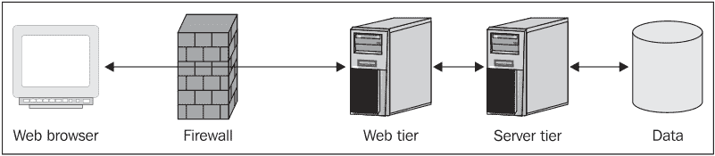
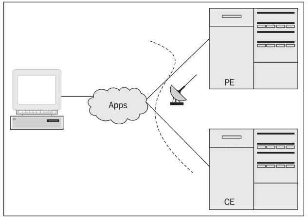
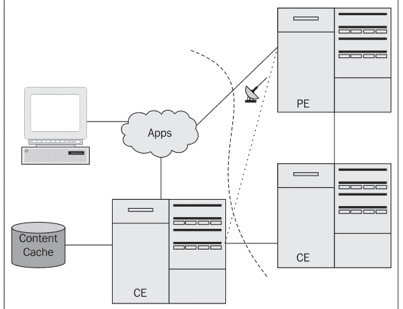

## 9

## 规划你的部署

在之前的章节中，我们花费了大部分时间描述 IBM FileNet Content Manager (CM) 组成的各个组件的各种功能和用途。在本章中，我们将稍微改变方向，考虑你在思考如何在企业范围内部署 ECM 时会考虑的一些因素。

我们在第 2、3 和 5 章中的安装示例使用了所谓的“一体化系统”，其中大多数组件都安装在单个服务器上。我们仅在无法安装到主服务器的组件上使用第二台服务器。在这些情况下，这并非由于资源不足或东西放不下。而是这样做是因为我们的主服务器是 Linux，而少数组件在 Linux 上不受支持。一体化系统，尤其是虚拟机镜像，因各种原因非常方便，从随意探索和实验到全面开发。对于多种原因（本章大部分内容都会探讨），你不太可能在企业部署中使用这种配置。

本章涵盖以下主要主题：

- 典型部署的功能层
- 自定义应用程序的考虑因素
- 不同用途的并行环境
- 决定应使用多少个域和对象存储的因素
- 内容存储
- 集群、高可用性和灾难恢复

## 规划你的部署

### 分布式部署的功能层

让我们先看看事物在功能层上可能如何逻辑排列。因为基于 Web 的应用程序往往占据主导地位，我们将以它们为例。这可能是 Workplace XT，也可能是某些自定义应用程序。下图显示了功能分解的概述：

> > 对于描述多层架构所使用的术语，人们可能会有强烈感受。我们将尝试通过描述在各个地方完成的事情来避免大多数这种情况。某事物是否符合某个人对表示层或数据层等的严格定义，比决定你将把哪些事物放在数据中心以及如何连接它们要不那么重要。

无论你的应用程序组合如何，你都必须制定处理设备和网络连接的计划。通常通过将事物分组为层来进行此规划。这并不意味着你需要为每个层准备一定数量的物理设备。这意味着你有一个处理如何发生的逻辑模型。这可能意味着从单个物理设备上的多个功能到一组物理设备按集群或农场排列以执行单一功能。

### Web 浏览器

根据定义，Web 应用程序的表示技术是 Web 浏览器。我们可能不需要对 Web 浏览器做太多说明（我们确信你曾在某处遇到过），但用于应用程序的技术清单正在增长。

传统的 Web 应用程序非常字面地使用 Web 浏览器进行表示。它被视为几十年来用于字母数字终端的更色彩丰富、图形更丰富的版本。Web 浏览器，如所说，对眼睛友好。

过去几年里，运行在浏览器中的应用逻辑出现了高速增长。其主要构成是用于实际应用逻辑的 JavaScript，以及用于更令人满意和更有用的呈现体验的异步服务器调用和部分页面渲染的组合。这些东西合在一起有时被称为 AJAX 或 Web 2.0。

> 从技术上讲，使用 ECMAScript（源自 ECMA-262 及相关标准）这个术语比 JavaScript 更准确。我们只是无法抗拒称之为 JavaScript，原因有两个。首先，其他人都是这么叫的，而且称之为 ECMAScript 仍然显得过于 pedantic。其次，处理浏览器在脚本实现上的特有差异仍然是一项大生意。即使在撰写本文时，似乎也不公平地暗示一切都已尘埃落定。

还有其他用于在浏览器中进行应用逻辑的技术。由于这不是一本关于开发 Web 应用的书，我们只会指出它们共同之处：迟早，它们需要与某个服务器层通信以完成有成效的工作。这可能是通过传统的 HTTP 页面刷新，也可能是通过更细粒度的调用。

## Web 服务器

Web 浏览器与 Web 服务器通信。这就足够简单了。在 Web 服务器上会发生什么？

传统上，Web 层是维护会话状态的地方。会话状态是指回答诸如以下问题的信息：你是否已通过身份验证，你是否在五步向导的第二步，自上次调用 Web 层以来过去了多久，等等。（随着浏览器内应用逻辑的出现，在某些应用中，这一 Web 层的角色往往会减弱或完全缺失。）

Web 层能够维护会话状态，是因为它扮演着更一般的角色。它代表了浏览器和客户端桌面这种不受控制的世界与高度受控的数据中心服务器环境之间的边界。当然，有些企业会以不同程度锁定桌面配置，但完全信任客户端桌面甚至像维护正确系统时间这样简单的事情是很少见的。企业通常在 Web 层首次强制执行强身份验证。

Web 层也是 **services** 可见的地方。我们将故意对服务的定义保持模糊，因为它对不同受众可能意味着很多不同的东西。在这里，我们只是指“作为来自其他应用程序调用的结果可以完成的事情”。你可能会将浏览器交互结构化为对业务操作的请求，粒度各不相同（例如，预订这辆车、查找符合这些条件的文档、更改这个系外行星描述的这些属性，等等）。你的 Web 层将这些业务操作翻译成对 CM 服务器的适当调用。

CM 和相关产品提供可直接从 Web 浏览器调用的 API。这些不是 Java 和 .NET API 的 JavaScript 绑定。它们是 Web 服务定义或 **Representational State Transfer (REST)** API。然而，在每种情况下，这些 API 的目标都是运行在 Web 层中的 servlet。那些 servlet 将传入的调用翻译成原生 API 调用。你可以选择为自定义应用程序开发类似的 servlet，或重用 IBM 提供的组件。

## CE、PE 和朋友们

我们终于来到了 CM 服务器层：**Content Engine (CE)**、**Process Engine (PE)**，以及与它们相关联的少数其他组件。在 ECM 术语中，这是系统中受信任程度最高的部分。CE 和 PE 将决定你执行各种操作的权限。一旦你通过了授权检查，这些操作将被翻译成适当的底层数据库操作。

由于 CE 运行在应用服务器中，它对数据库的访问不是直接配置的。相反，它使用应用服务器数据源。正是这些数据源包含数据库连接和凭据信息。CE 的配置仅限于数据源与 Object Store 的关联。

## 数据库和文件系统

CM 服务器本身没有太多固有信息。它们关于你特定信息的知识存储在后端数据库、文件系统或其他存储设备中。你已经知道，文档和其他对象的元数据（属性）存储在关系数据库中。对于大多数配置数据也是如此。在 CE 的情况下，其中很大一部分存储在恰如其名的 **Global Configuration Database (GCD)** 中。

文档的内容可以存储在同一个 Object Store 数据库或文件系统中。我们将在本章后面讨论内容存储。

## 自定义应用程序

你无疑会根据许多因素决定是否使用自定义应用程序，而其中一些因素会导致对竞争需求的妥协或优化。通常，创建和支持自己的自定义应用程序成本更高，但回报是它们更有可能完全按照你的意愿执行。

CM 提供了一些开箱即用的应用程序，例如 Workplace 和 Workplace XT，但它们本质上是通用的。确实，许多客户将它们用作主要终端用户应用程序。也有一些客户根本不为终端用户安装这两个应用程序（或仅在开发环境中安装以供比较）。

在开发自己的完全自定义应用程序和使用 CM 提供的应用程序之间存在中间地带。有一批丰富的顾问（IBM 内部和外部）以及 IBM 业务合作伙伴专门从事基于 CM 的自定义或定制应用程序的构建。他们提供的服务范围从简单的时间和材料实施任务一直到完整的系统设计。由于他们帮助过许多具有多样化需求的客户的经验，他们可以带来丰富的实践经验。即使你自己进行开发工作，考虑聘请这些顾问进行设计评审也是值得的。

自定义应用程序的可能存在如何影响你的部署决策？这只意味着在规划环境时，你需要考虑它们资源需求和特殊要求。例如，如果你将使用基于 Java 或 Microsoft 技术构建的厚客户端应用程序，这很可能会影响你如何进行身份验证。

## 并行环境

一旦你弄清楚如何部署你的 ECM 基础设施，你就会对需要多少服务器设备、提供所需可用性的冗余等有很好的了解。许多企业发现构建一些额外的并行环境也很有用。

开发环境通常被认为“不干净”，因为开发人员倾向于对临时变通方案进行各种非标准的环境更改。开发人员有责任跟踪这些事情，并在适当的时候撤销它们。

另一方面，测试环境应严格控制，并使用与生产环境相同或非常相似的配置设置和程序。原因很明显：测试环境的目的在于证明事情能够按照官方记录的程序和受变更控制的软件和数据正常工作。任何使用 *ad hoc* 配置或其他变通方案的情况都应让测试人员感到不安，直到一切恢复正常。

在任何情况下，虚拟机镜像都非常方便。它们可以在重新配置物理服务器所需时间的很小一部分内进行克隆、快照和回滚。

> 我们多次提到虚拟机镜像。我们不提倡任何特定的虚拟机技术或产品（我们自己使用不止一种）。如果你找到一种满足你需求的，使用它就像使用任何其他生产性软件组件一样。它可以在你需要重新配置或克隆环境时为你节省巨大的时间和精力。
>
> 几年前，CM 产品文档说虚拟机技术是受支持的，但如果你需要支持，可能必须在物理硬件上重现任何问题。那已不再是这种情况，虚拟化现在作为一等公民得到支持。
>
> 为了你自己的目的，你可能希望评估所选虚拟化技术是否存在显著的性能成本。评估最安全的方法是在与预期生产环境相似的配置和负载下进行。

## 需要多少个域？

这可能是一个让你惊讶的问题，但在你的生产环境中需要多少个 P8 Domains？对于大多数组织来说，答案恰好是一个，但也有例外。在多个 Domains 之间协调事情比在单个 Domain 内做要困难得多，通常涉及自定义开发工作或复杂配置。你不应在没有充分理由的情况下使用多个 Domains。单个 Domain 在成为一个有趣的问题之前可以容纳很多东西，即你处于单个域内。

## 规划您的部署

> 当然，我们说的是生产环境中域的数量。在之前讨论过的并行环境中，您不应使用与生产环境相同的域，尽管如果网络彼此隔离，您可以使用相同的域名。即使没有网络隔离，您也可以重用域名，但您可能会冒着存在未知依赖的风险。

以下是考虑使用多个域的一些常见原因：

- 除了少数例外，域中的 CE 服务器可以与该域中的其他所有内容通信。这意味着每个 CE 服务器都可以直接访问其他每个 CE 服务器、GCD、对象存储数据库以及文件存储和其他文件系统共享。如果由于策略或纯技术因素而无法实现这种连通性，那么您可能需要考虑将环境划分为不同的域。

- 域内的所有身份验证和授权都预期使用相同的一组目录。如果您有需要使用不同用户群体或组配置的应用程序，那么拥有多个域可能有所帮助。（这里，我们说的是真正不同的用户和组集合。我们不是说只是不同子集的用户需要访问不同数据集的情况。此外，如果只是组成员资格有问题，那么您可能可以通过使用访问角色对象而不是组来保持在单个域中，如 *第 8 章，安全功能和规划* 中所述。不同的目录需求通常出现在组织甚至整个公司合并时，每个组织都已有各自的目录和域。正如您可能会制定计划来合并此类情况下的目录一样，您可能也需要制定计划来合并域。

- 无论您最终使用 ECM 平台的应用程序有多少，您可能只需要少数几个不同的对象存储。如果您发现自己需要几十个单独的对象存储（再次强调，不太可能，但并非不可能），如果您将事物划分为多个域，您的 CE 服务器的资源需求可能会降低。对象存储，像大多数其他实体一样，只能属于一个域。

除非您确实落入上述特殊情况之一，否则您可能不需要多于一个域。作为规划因素，您应计划使用单个域，除非出现明确需要多个域的理由。

## 需要多少个对象存储？

很容易开始将对象存储视为某种花哨的数据库，从那里很容易开始认为每个应用程序都需要自己的对象存储，就像过去它可能需要自己的数据库一样。对象存储具有一些特性，大大减少了通常对数据额外分区的需求的动机：

- 对象存储使用细粒度的授权。“细粒度”授权在几个不同的维度上运行：用户和对象。它可用于允许或拒绝单个用户对单个对象执行单个类型操作的权利。

- 用户群体通常从企业目录中选择。没有独立于配置的目录服务器的内部用户数据库。

- CM 数据模型允许分层、面向对象的设计。不相关的对象类可以在对象存储内独立定义，同时仍共享 CM 提供的通用功能。

在决定是否将环境划分为多个对象存储时，存在明确的操作权衡：

- 对象存储由不同的数据库实例支持（或取决于数据库厂商，表空间实例）。您可能出于策略或技术原因限制不同数据库的数量。

- 使用第 8 章中描述的技术，通常可以轻松地将用户限制在对象存储内的数据子集，尽管这在管理上会产生成本。对象存储本身的 CONNECT 访问权限控制给定用户是否可以访问该对象存储内的任何内容。虽然这在理论上并不比在单个对象存储内对对象的限制更安全，但您可能希望将此对象存储级安全控制用作操作简化或作为纵深防御安全策略的一部分。

- 一些企业有监管或法律限制，通常涉及国家边界，规定数据物理存储的位置。您可以使用多个对象存储将不同子集的数据放在不同位置。此策略要求通常会与性能和网络考虑相冲突，因此您必须决定如何权衡。并且它只直接解决了“静态数据”问题。如果设计不当，数据仍可能在传输过程中跨越边界。

- 如果您有多个地理上分离的数据中心，您可能会通过高效的网络利用获得性能优势，将对象存储放置在不同的地理区域。请参阅本章后面描述的 *分布式部署* 部分。

- 将 GCD 和所有对象存储一起备份是 CM 的最佳实践，但在某些情况下，您可能会发现可以单独备份数据的逻辑子集。将这些逻辑子集划分为多个对象存储可促进这一点。

- 将数据划分为多个对象存储的一个流行原因是数据面向日期。也就是说，某些类型的文档自然与某个时间点或时期相关联。随着时间的推移，那些数据可能只对偶尔的研究目的感兴趣。数据可以设为只读（实际上即使不是）。按日期将数据划分为多个对象存储可能会导致您出现一个活动对象存储——即进行更新——以及任意数量的归档对象存储——即只读。真正只读的对象存储不需要定期备份。

正如我们对域所做的那样，我们倾向于使用您能用的最少数量的对象存储。然而，需要考虑的因素数量明显更多，在特定域中看到五到十个对象存储的情况并不少见，原因各不相同。

## 网络安全

我们假设您根据某些企业策略或至少根据安全架构师的最佳判断来配置网络安全。这可能意味着，例如，单个数据中心内服务器之间的网络连接在诸如窃听易感性之类的方面是可信的。用户机器与数据中心之间的连接可能不太可信，而您的数据中心之间的连接可能在没有额外保护的情况下完全不可信。无论您的企业策略如何，您在决定如何部署 ECM 环境时很可能必须考虑它们。

## TLS/SSL

当敏感数据通过不可信的网络连接传输时，应通过加密手段加以保护。有特定于协议的加密保护方案，但在实践中，网络连接通常使用 **传输层安全 (TLS)** 或其前身 **安全套接字层 (SSL)** 进行保护。

对许多人来说，TLS 和 SSL 之间的区别有点模糊。事实上，即使您想要的是 TLS，您可能从未听说过它。

SSL 由 Netscape Communications Corporation 在 1990 年代开发，并迅速成为保护 HTTP 和其他类型网络连接的 *事实* 标准。它经历了三个版本的演变，有时仍可看到 SSLv3.0 的使用。

TLS 最初由 **互联网工程任务组 (IETF)** 通过 RFC-2246 标准化。虽然它在结构上与 SSLv3.0 非常相似，但它纠正了一些缺陷并进行了其他协议改进。由于某些内部协议编号约定，TLSv1.0 有时被错误地称为 SSLv3.1。

我们使用 TLS/SSL 这一术语来面对 TLS 是正确术语但 SSL 是更广为人知的术语的现实。

据我们所知，可以使用 TLS/SSL 保护 CM 使用的以及 CM 内部的每个连接。例如，所有受支持的目录都有配置条款，可在进行身份验证或授权的目录查找时使用 TLS/SSL 连接。使用 TLS/SSL 会产生计算开销（我们通常使用约 10% 开销的经验法则，但会因硬件而异），但值得知道 TLS/SSL 在您需要时可用。

TLS/SSL 也带来了一定的证书管理开销。如果您使用主流证书颁发机构的证书，一切可能“正常工作”。另一方面，如果您使用自签名证书、私有证书颁发机构的证书，甚至来自鲜为人知的证书颁发机构的证书，您可能需要花费一些时间导出和导入证书，以便连接的两端相互信任。这与访问网站时浏览器提示接受不 recognized 证书的动作完全类似。您可能已经做过数百次。软件组件自动使用导入证书的机制有点更复杂，并且因软件组件而异。

## 防火墙

您可能拥有专用的防火墙设备，您可能在服务器机器上使用软件防火墙，或者您可能在网络路由器中配置流量规则。在任何情况下，您可能都会根据诸如源 IP 地址或目标 TCP 端口号之类的标准来限制进入服务器的流量。

- 支持多种目录服务器，包括 IBM Tivoli Directory Server、Novell eDirectory、Sun Java Directory Server、Oracle Internet Directory，当然还有 Microsoft Active Directory（完整版和 AD 轻型目录服务）。该列表会随着时间不断变化，你还应核对具体的发行版本号。
- CM 支持多种用于内容存储的存储技术和供应商，包括 EMC Centera、NetApp SnapLock 和 IBM System Storage N Series。该列表同样会随着时间演变。

## 将内容与工作流集成

将工作流用作 ECM 的一部分非常普遍。无论你使用随 CM 捆绑的 PE 服务器，还是获得更通用许可的 BPM 安装，在部署环境时都需要考虑这两个引擎的相对位置。我们在第 6 章“最终用户工具和任务”中以 XT 为例描述了工作流集成。

- PE 服务器不必能够访问所有 CE 服务器，但它必须能连接到至少一台 CE 服务器，以检索和更新作为工作流附件携带的对象。例如，步骤处理器中工作流属性的更新可能会触发 CE 中一个或多个文档属性的相应更新。
- CE 必须能够连接到 PE，以便响应文档和其他对象的更新事件而启动工作流。例如，检入新主版本的文档可能会触发审批或发布工作流。
- 应用程序，尤其是涉及工作流步骤处理的应用程序，通常需要连接到 CE 服务器和 PE 服务器。

## 内容存储

在决定将文档内容存储在 CM 中的何处时，你有多种选择。文档和其他对象的属性始终存储在对象存储数据库中，但文档或批注的实际内容数据会根据配置的存储区域和存储策略进行存储，如第 7 章“CM 主要功能”所述。无论你选择将内容放在何处，都无法从应用程序直接访问它。你的应用程序将始终通过 CE 服务器以字节流形式获取内容。这使实际存储细节对应用程序透明，并确保不会绕过 CM 的安全性。

内容实际存储的位置取决于两个文档和批注属性：StoragePolicy 和 StorageArea，它们分别指向存储策略和存储区域对象。存储区域对象表示特定的物理存储位置。另一方面，存储策略对象表示一个或多个在功能和管理上视为等效的存储区域。如果设置了 StorageArea 属性，则将使用该存储区域。否则，将根据 StoragePolicy 属性的值选择存储区域。由于其管理灵活性，使用存储策略是更好的实践。某个特定文档或批注可以设置任一属性，但通常的做法是在类定义上将这些值设置为类默认值。

让我们看看不同类型的存储区域。

### 数据库存储区域

从概念上讲，最简单的存储选择是将内容放入对象存储数据库。每个对象存储都会自动配置数据库存储区域和策略。（在创建对象存储时选择的默认内容存储区域仅是一个默认值。数据库存储区域始终存在。）文档内容作为 blob 存储在单独的表中，CE 会自动维护指向它的引用完整性链接。使用数据库存储的优势在于，进行数据库备份时会自动进行内容备份。对于其他存储类型，备份必须同步进行。数据库存储的缺点是，在处理生产 ECM 存储库中 blob 的大小和数量时，数据库有时会遇到困难。数据库可能需要大量调优关注才能提供合理的性能。此外，出于成本原因，你可能希望为内容使用不同类别的物理存储。

### 文件存储区域

下一个最简单的存储选择是使用文件系统作为存储设备。对于文件存储区域，内容存储在实际文件中（每个内容元素对应一个文件），CE 自动维护对象与内容之间的链接。

一个常见问题是，如果你可以访问对象存储中文档的属性，如何在文件系统上找到该文件。答案是：你既无法找到它，也无法直接访问内容。你必须使用 API 通过 CE 服务器访问。指向实际文件的指针保存在非公开数据中。

> 文件存储区域内用于内容的文件夹与对象存储中用于归档对象的文件夹没有任何关系。仔细想想，这应该是显而易见的，因为你可以为未归档的文档存储内容。对象存储中的文件夹是一种对象组织技术，而文件存储区域中的文件夹则用于避免单个目录中的文件过多而压垮原生文件系统（这可能会影响性能）。

所有 CE 服务器都必须能够从每个存储区域读取文件。这通常意味着文件存储区域应定义为网络共享，尽管对于只有单个 CE 服务器的一体化系统，你可以使用本地目录。一种常见策略是使用 NAS 或 SAN 作为存储设备，并让文件系统目录在所有物理 CE 服务器上出现在相同位置。

### 固定内容设备

CE 支持多种特定的存储设备，统称为**固定内容设备（FCDs）**。前面我们提到了 EMC Centera、NetApp SnapLock 和 IBM System Storage N Series 等示例。FCD 一词源于一种供应商设备，该设备本身会进行一些存储管理。放入此类设备的内容通常无法更改，而且通常只能按照配置的保留策略删除。这些设备特性补充了 CM 中可用的类似特性。

### 内容联合服务（CFS）

最后一类存储位置完全是另一回事。内容被添加并存储在外部系统中。这些外部存储文档的部分选定属性也通过称为**联合**的过程出现在对象存储中。协作的后台进程确保，当外部系统中这些选定属性中的任何一个发生更改时，该值会异步复制到对象存储中的相应属性。

对象存储不保存联合文档的内容。当 CM 应用程序检索联合文档的内容时，CE 会透明地从外部系统检索并将其传递给调用者。

CFS 连接器可用于大多数 IBM 内容存储库（无论是否源自 FileNet），也可用于 EMC Documentum Content Server 和 Open Text Livelink。

## 集群、高可用性和灾难恢复

这三个主题相互关联，但各自代表系统风险管理的不同方面。每个主题本身都很复杂，因此我们这里只能给出概述。

### 集群

**集群**是一种通过负载均衡降低停机风险并优化资源利用率的技术。集群有几种形式，但共同原则是提供多个等效服务器来处理给定的负载。就 CM 而言，我们通常讨论的是应用层和 CE 服务器层中 J2EE 应用服务器的多个实例。

> 随 CM 许可证捆绑的 IBM WebSphere 版本不包含*网络部署*功能。换句话说，它不包含集群及随之而来的管理功能。它非常适合大多数开发、功能测试，甚至某些类型的生产部署，但不包含那个特定功能。

关于 CM 中的集群，最重要的是要了解：对 CE 服务器使用的最佳集群类型取决于所使用的 API 传输方式：

- 对于 EJB 传输，应使用应用服务器内置的软件负载均衡。原因是 EJB 地址解析往往很少执行，并且会将连接绑定到集群中的某个特定主机。这通常会使硬件负载均衡器预期的负载均衡失效。
- 对于 CEWS 传输，硬件负载均衡器效果很好。你通常需要为负载均衡器配置虚拟主机名，并让它将连接传递给物理服务器。所有硬件负载均衡器都了解如何正确均衡 HTTP 和 HTTPS 流量。

> 与 CE 的所有 API 交互都是无状态的。换句话说，除了负载均衡外，对于任何特定 API 请求，使用哪个 CE 服务器并不重要。请求被独立处理，CE 不会代表应用程序维护任何会话状态。另一方面，某些 CM 应用程序确实需要配置**粘性会话**。粘性会话意味着后续传入的请求（通常来自 Web 浏览器）必须返回到同一个应用程序实例。

使用简单的集群方案，集群中单个节点失效意味着其他节点将承担相应比例的工作负载，尽管有时性能会下降。

## 高可用性

**高可用性 (HA)** 在集群的基础上更进一步，通常涉及确保整个环境中没有单点故障。沿着同样的思路，设备是按冗余方式配置的，这样一个或多个冗余节点可以失效，而其他节点仍能处理工作负载且性能不会下降。粗略地说，HA 就是对资源进行超额配置，并制定节点可靠地相互覆盖的策略。

HA 规划通常是对预算可用性与风险承受能力的复杂协调。

## 灾难恢复

**灾难恢复 (DR)** 是在主设施发生灾难性故障后迅速恢复运营的能力。对不熟悉的人来说，这听起来很像 HA，但本质上是不同的。为了有效，DR 站点必须位于主站点之外。

“之外”的定义取决于你为哪种类型的灾难做规划。是附近河流的突发洪水？在这种情况下，几英里外的 DR 站点可能就足够了。是地震、火山爆发、恐怖袭击或小行星撞击？在这种情况下，你可能希望 DR 站点远得多。是太阳超新星爆发摧毁所有行星（包括冥王星，即使它不是行星）？在这种情况下，嗯，我们就留给你去想这个问题了。

DR 规划应涉及以下因素：

- 一个 DR 站点，其位置根据所规划的灾难来选择。该站点将拥有足够的设备、网络容量和其他资源来承担你想要的运营负载的任意百分比。
- 将数据从主站点复制到 DR 站点的某种手段。这可以像定期备份并物理运送到 DR 站点一样简单，也可以像通过光纤链路进行接近实时的网络复制一样复杂。
- 如何实际从灾难中恢复的计划。你将如何实际加载最新的复制数据？你将如何处理复制数据与灾难发生前主站点事务性提交数据之间无论多小的差距？你将如何为 DR 站点配备人员，如果主站点的工作人员无法行动或无法前往 DR 站点？不言而喻，最好的计划是那些在 DR 演练等中得到实践的计划。

> 我们提到了 DR 的接近实时复制。很容易想当然地认为你的 DR 站点就是你的数据备份，或者至少消除了对传统备份的需求。看起来太好了难以置信，因为你的所有更新几乎会瞬间复制到另一个数据中心。陷阱在于复制无法区分期望的更新和错误。如果由于操作失误需要恢复部分数据（例如，如果你在对象存储数据库中删除了表），DR 副本也会反映同样的错误。即使你拥有复制的 DR 站点，你仍应进行传统备份。

## 分布式部署

许多企业使用单一的集中式数据中心运行。即使用户群体在地理上分布，这也经常是事实。CM 不假设单一物理位置，许多其他企业也在全球多个数据中心跨区域使用 CM。在本节中，我们将描述与分布式部署相关的一些具体规划因素和 CM 功能。

成本和性能是思考分布式部署的两个驱动因素。长距离网络比本地网络更昂贵，预算现实通常限制了你愿意支付的网络容量。长距离网络具有两种互补的特性，可以部分用金钱解决：带宽和延迟。

- **带宽** 指的是网络在给定时间内可以承载的信息量。本地网络和长距离网络在带宽方面没有真正的技术区别，只是长距离带宽通常昂贵得多。
- **延迟** 指的是单个信息在网络连接一端到另一端传输所需的时间。网络信号在距离上传输信息并被中间网络设备处理需要一定的时间。延迟通常只能通过在链路间配置更快的交换设备或完全消除某些交换点来在一定程度上影响。

鉴于网络费用和物理现实的限制，分布式部署计划将考虑不同组件之间通信的特征，并尝试最大限度地降低系统整体成本和性能影响。

## CE 拓扑

在一个 CM 系统中，假设单一域：

- 每个 CE 服务器必须能够访问 GCD、每个对象存储数据库、每个文件系统存储区、每个固定内容设备以及每个内容搜索引擎。
- 每个 PE 服务器必须能够访问至少一个 CE 服务器，*反之亦然*。PE 服务器必须能够与 PE 数据库通信。
- 所有 CE 服务器都与同一个目录服务器通信。这实际上意味着在 CE 中配置了单个目录服务器地址，因此任何目录集群都可以隐藏在虚拟地址之后。目录流量相对轻量且高度缓存，因此目录位置通常不是性能关键的。可靠地连接到目录则非常重要。

从拓扑上看，CE 服务器组件可以用以下操作层级来描述，这是对 *第 4 章，管理工具和任务* 中更详细解释的回顾：

- **域：** 共享给定 GCD 和一组对象存储的所有 CE 服务器。
- **站点：** 地理位置接近的系统。站点内的服务器通常通过局域网连接。
- **虚拟服务器：** 表现为单个系统的系统集合。这通常意味着一个集群。
- **服务器：** 可单独管理的物理服务器。

大多数 CE 服务器的配置设置都可以根据上面描述的操作层级进行分层配置。你可以配置设置应用于整个域、单个 CE 服务器，或两者之间。例如，我们在 *第 4 章* 的 *跟踪日志* 部分中说明了这一点。

就分布式部署而言，我们通常对站点感兴趣。分布式部署通常用中央站点和一个或多个远程站点来描述。然而，CE 本身并没有中央站点的概念。对于 CE 行为的实际机制，更有意义的是谈论本地站点和远程站点。哪个是哪个实际上取决于对象存储或其他资源位于何处。

## PE 考虑因素

对于 PE，涉及的对象非常动态。由于变化率高，PE 对象的缓存非常有限。PE 活动倾向于数据库密集，因此将 PE 服务器定位在 PE 数据库附近是有意义的。这应在同一物理数据中心内。

PE 和 CE 仅就有限的事项进行通信：PE 的委托认证（通常在网络流量方面轻量）、工作流附件的检索和更新（如果涉及内容获取则可能重量级），以及 CE 调用 PE 启动工作流。PE 和 CE 不要求具有相同的物理位置，但如果它们在同一位置，性能会更好。

## CSE 考虑因素

内容搜索引擎 (CSE) 执行全文索引并响应全文查询。调用应用程序不直接连接到 CSE。CSE 只能通过发出 CSE API 调用的 CE 服务器访问。CSE 必须将其存储视为对 CSE 服务器本地，即使该存储位于某种网络共享上。

最容易将 CSE 视为另一种类型的数据库服务器。由于所有 CE 服务器都必须能够与所有 CSE 服务器通信，除非你的内容自然为特定站点分区，否则将 CSE 服务器集中化是有意义的。

## CE 分布式部署特性

CE 有两个特定的特性旨在促进分布式部署。如果你没有使用分布式部署，使用这两个特性都没有优势。

### 内容缓存

内容缓存之所以有趣有两个原因：数据库事务和其他通信量相对较小，与文档内容相比微不足道。还有一个合理的可能性是，一旦某段内容因某种原因变得有趣，它会保持有趣一段时间并被额外检索多次（也许原因是该文档刚刚添加）。

CE 包含一个 **内容缓存** 特性，它基本上就是根据名称所期望的功能。它缓存文档内容，但不缓存文档属性。内容缓存不是在单独的服务器上实现的。它是每个 CE 服务器的一部分，但默认情况下未启用。启用后，它通常在站点级别进行配置，以便该站点上的所有 CE 服务器（以及其他站点上的 CE 服务器不使用）可以使用该内容缓存。

> 尽管只有本地 CE 服务器从内容缓存中检索内容，但所有 CE 服务器都必须能够访问它以进行管理维护。因此，它必须在网络上可见，就像文件系统存储区域一样。

当本地 CE 服务器需要访问位于另一个站点的内容时，它可以改为从本地配置的内容缓存中读取内容。在缓存未命中时（即请求缓存中不存在的内容），内容将被获取并放入缓存中。使用的协议与 CE 在没有内容缓存的情况下读取内容时所使用的协议相同（通常是 NFS 或 SMB）。

在获取任何内容之前，CE，无论是本地还是远离内容，都会先检查 Object Store 中的文档属性。这确保了文档内容在 Object Store 中在逻辑上仍然存在，并且调用用户有权检索它。因此，从调用应用程序的角度来看，内容缓存中的数据永远不会过时。时效性和安全性始终已检查，就像没有内容缓存一样。过时的内容仍可能暂时以字面意义存在于内容缓存中，但它永远不会被提供给调用者；它在 CE 服务器本身之外将是不可见的。

内容缓存对可以占用的空间和可以保存的内容数量有配置限制。当它填满时，它使用 **最近最少使用 (LRU)** 策略丢弃缓存中的内容。CE 后台线程会清除过时内容。

### 请求转发

CE 客户端向 CE 服务器发出的请求通常在抽象层级更高，并且比 CE 与 Object Store 数据库之间的 resulting 通信更少聊天。对于一个 CE 服务器要求另一个 CE 服务器执行特定更新或检索，通常在网络效率上更有利。此功能称为请求转发（RF）。

RF 背后的想法是到达更接近 Object Store 数据库的 CE。每个 Object Store 都与某个 CE 站点相关联。每个 CE 服务器都与某个 CE 站点相关联。当 Object Store 和 CE 服务器位于不同的 CE 站点时，使用 RF 可能有意义。RF 默认禁用。要使用它，你必须在发送方和接收方站点都进行配置。RF 始终使用 EJB 传输，并且在电线上与使用 EJB 传输的客户端请求几乎无法区分。

当请求被启用了 RF 的 CE 服务器接收时，它会计算最佳目标 CE 站点，确定是否应使用 RF，将请求转发到配置的地址，从远程 CE 服务器接收结果，并将结果中继给原始调用者。有少数条件会使传入请求不合格而无法转发：

- 如果请求引用同一本地站点的 Object Store，则没有其他站点更适合处理它。
- 如果请求包含内容上传或检索，则不会转发，因为直接访问内容存储比 RF 更有效。
- 如果请求包含对 GCD 对象的引用，则不会转发。
- 如果请求要求元数据（类或属性描述，而不是对象本身的属性），则不会转发。每个 CE 服务器都有所有 Object Store 的元数据的内存缓存副本。再次说明，我们说的是类和属性描述，即每个 Object Store 相对较少的对象。
- 传入调用可能由一批请求组成。当接收到一批请求时，它们将全部转发到同一个远程 CE 站点或都不转发。批次中的所有请求都将由同一个 CE 服务器提供服务。
- 已经转发到 CE 服务器的请求将不会再次转发。

这些规则听起来有点复杂，但它们归结为试图确保使用 RF 不会导致响应时间净损失。你可能会想知道哪些类型的请求有资格进行 RF。大多数由 CE 服务器看到的请求涉及单个 Object Store 中的对象。即使一批请求中有多个项目也是如此。可以说，如果 Object Store 位于另一个站点，大多数请求都是 RF 的候选者。

### 典型的分布式部署

以下是分布式部署两种最常见配置的简要描述。显然，还有许多其他可能性。这些只是最常用的。第一个可能很常见，因为它在概念上非常简单，并且倾向于将 CM 服务器层和数据隔离在中央站点。第二种是更复杂的配置，但更有可能从上面描述的分布式部署特性中受益。

#### 远程应用层

在此配置中，客户端在本地，也许通过 LAN，与应用程序通信。应用程序通过长距离网络与 CE 和 PE 服务器通信。没有内容缓存或请求转发，因为只有一个 CE 站点。应用程序有责任在网络上做出最佳利用。

#### 远程应用和 CE 层

在此配置中，客户端再次在本地与应用程序通信。应用程序和 CE 通过长距离网络与 PE 服务器通信。应用程序在本地与具有内容缓存的 CE 服务器通信，并且该服务器使用请求转发将请求发送到远程 CE 服务器。

### 总结

在本章中，我们从讨论单个特性转向了如何为 ECM 平台的组件规划和部署到真实环境的大局。在许多情况下，我们只是提出了规划因素，因为你必须自行决定这些事情是否适用或你将如何对权衡做出决策。

你的下一步将是为你自己的部署制定计划。如果你对 ECM 总体或 FileNet 特别来说是新手，在投入大量资源进行推广之前安排专家审查你的计划可能是有意义的。因为部署完成后重新安排事情需要付出努力，所以获得额外的意见可能是个好主意。

在下一章中，我们将超越 CM 本身的边界，并查看一些与 CM  commonly 一起使用的其他软件产品和组件。
