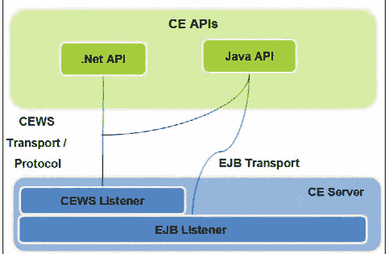
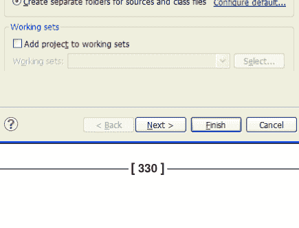
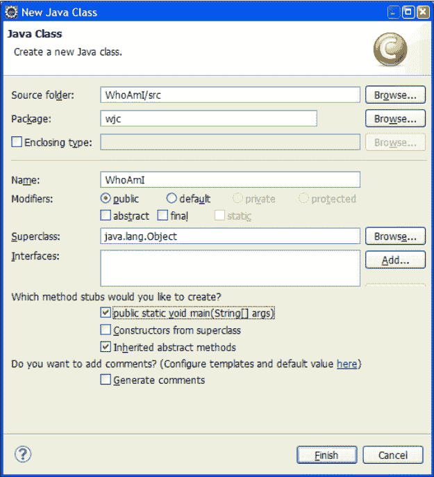
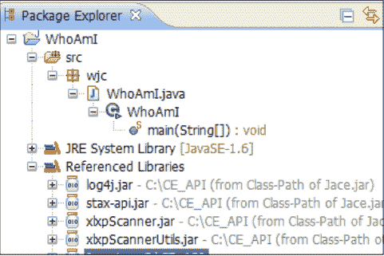
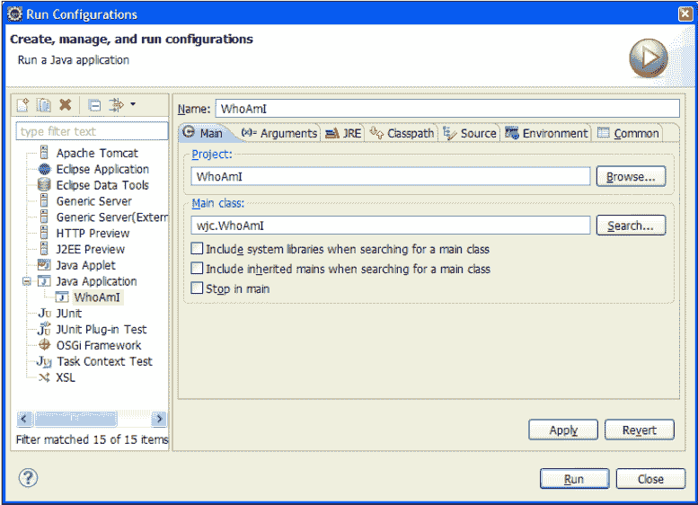
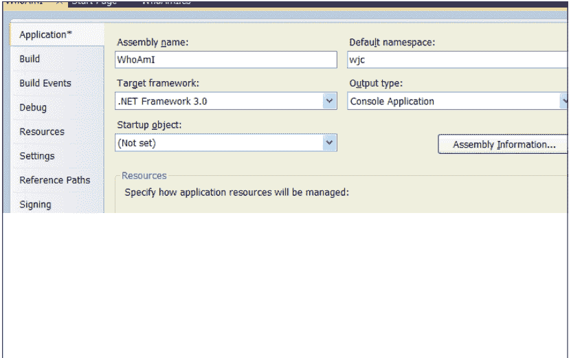
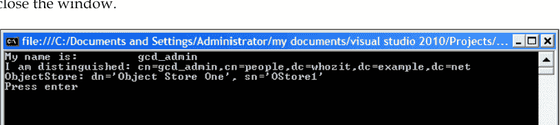

## 11
### A Taste of Application Development

This chapter provides a short overview of application development for IBM FileNet Content Manager (CM). We can only give a glimpse here since this is the kind of topic that could easily merit its own book of this size or larger. We're not trying to make you into CM developers just by reading this chapter.

Since this isn't a book about application development and is just an introductory book on the overall topic of CM, why include this chapter at all? It's useful for a few reasons. First, a fairly large percentage of CM customers do develop custom applications, and we think it's important that you know generally what's available. Second, it can help you to understand custom or off-the-shelf components provided by IBM Lab Services or IBM business partners. Frankly, we think it will help you better understand the nuts and bolts of the standard CM-provided applications. It should also help in understanding the sample application described in *Chapter 12, The Duck Sample Application.*

In this chapter, we'll cover:
- The CE Java and .NET APIs
- The CE Web Services protocol
- Other APIs that are often used in CM solutions
- A very small sample program using the CE Java API in Eclipse
- The same small sample program using the CE .NET API in VS C# Express.

## The Content Engine APIs

We start our development story with the most fundamental piece of the picture, the CE APIs. The other components described in this chapter add significant functionality, but all interactions with the CE ultimately go through one of these CE APIs. The CE philosophy is to expose all features as part of documented APIs. There are no hidden, insider-only APIs (though there are lots of non-exposed API implementation details beneath those APIs). To be sure, there is plenty of complex logic locked up inside applications and toolkits, but everything they do goes through a documented CE API. You could, in theory, build for yourself anything you see a CE application doing.

## Don't bypass the APIs

Everything can be done through CE APIs. The corresponding restriction, however, is that the CE insists that everything go through its APIs. If it's not available via a CE API, it's basically not available.

The most important question related to this is whether you can do things directly to the underlying relational databases and filesystems—the Object Stores, the Global Configuration Database, and the file storage areas—that hold CE's persisted data. We'll consider the reading and updating cases separately.

> The following subsections discuss technical and supportability constraints. If you are using DB2 software bundled with CM with a limited use license, there are licensing constraints on the operations you are allowed to do in database applications. That kind of constraint is out of the scope of this chapter.

## Reading

That actual data in the CE is your data. They're your documents, your properties, and so on. Are you entitled to read that data back out without the mediation of the CE server? Yes, you are entitled, but it's still a generally bad idea.

- The CE is enforcing security access checks for objects and properties. The mere existence of an object (say, a folder called Plans for Selling the Company) can be hidden from unauthorized eyes.

## API transports

Whenever there is a client API accessing a server, there has to be a communications path and some protocol between them. In the CE case, this is explicit and is called the transport. There are two transports available for the CE APIs: CEWS and EJB. Though very different in nature, they are, with only two exceptions, functionally equivalent.

As you can see from the following architectural drawing, the Java API has a choice of either transport, but the .NET API always uses CEWS transport.



## CEWS transport

Because of its name, you will not be surprised to learn that Content Engine Web Services (CEWS) transport uses web services technologies to connect clients with the server. It is XML (in the form of SOAP requests and responses) over HTTP (or HTTPS). It therefore shares with web services in general these operational characteristics:

- Because it uses only one or two well-known TCP ports, it's relatively easy to configure firewalls and other filters to allow web services traffic to pass through.
- Because it's textual, it is easy to examine in a network trace during troubleshooting. Even someone who knows nothing about CE in particular can deduce quite a bit from the XML contents.
- Because it's textual and follows XML conventions, it tends to be somewhat more verbose on the wire and takes a little more effort to decode on the receiving end. In most environments, this doesn't add up to anything you probably care about, but it's a possible performance difference you can easily measure for yourself in most cases.

The CEWS transport is exactly the same thing as the CEWS protocol that will be described later in the *CEWS Protocol* section. It conforms to the published Web **Services Description Language (WSDL)** schema for CEWS. It's not some secret version of it or some abominable use of web services technologies.

> For historical reasons, CEWS transport is sometimes called **Web Services Interface (WSI)** transport. The most obvious place where that naming lives on is in the CE connection URLs that you have seen occasionally throughout this book. The URLs for CEWS transport always contain the string `/wsi/`.

## EJB transport

**Enterprise JavaBean (EJB)** transport uses the inherent remoting technology of EJB calls to connect client to server. That means that an inner layer of the API makes EJB calls to the CE. The specific EJB calls that are used are not exposed for you to call from your applications, and it's not safe for you to reverse engineer them and use them anyhow. Like most undocumented details, they are subject to change from release to release.

EJB transport is a little strange in that it's different in its underlying implementation for every supported application server type. The J2EE specifications leave it up to the vendors to implement whatever wire protocols they want as long as the higher-level EJB constructs meet the specified programming models. The vendors generally use compact, binary wire protocols for EJB remoting. There is a prescribed wire protocol that all vendors must implement for interoperability with other vendor products (the Internet Inter-ORB Protocol, IIOP), but, in practice, authenticated mixed-vendor EJB calls are difficult for other reasons.

In theory, the CE APIs depend only upon the J2EE-specified vendor-independent behaviors for EJB calls. In practice, each vendor has quirks and edge cases that need specific workarounds. None of this matters to you, the caller of the CE API, because the CE API smooths over those differences. You will just make ordinary method calls on objects representing things like documents and folders, and the CE API takes care of the rest.

EJB transport can only be used with Java technologies, and so it is only available for the CE Java API. On the other hand, the use of EJB transport automatically enables two features that are not available with CEWS transport, described in the next two sections.


## 用户事务

所有 CE 服务器更新均以事务方式完成。每个提交的更新要么原子提交，要么回滚。CE 负责启动事务、执行操作以及结束事务。

CE API 没有任何功能允许应用程序启动事务。如果您有多个希望原子执行的操作（且这些操作不适合通过单个 CE API 批量更新），您可能需要这样做。如果您希望在同一事务中包含对其他内容（CE 对象之外的内容）的更新，您也可能需要这样做。

J2EE API 包含在应用程序中创建和管理事务的功能。主要接口是 UserTransaction。正因为有这些 J2EE API，CE Java API 中才没有事务类或方法——它们不是必需的，因为可以从 J2EE 容器中获得。当您启动 UserTransaction 并使用 EJB 传输时，该事务的上下文可以自动携带到 CE 服务器。在这种情况下，任何 CE 更新都将成为您的 UserTransaction 的一部分，并根据应用程序进行的 J2EE 事务调用被提交或回滚。

无需告知 CE Java API 有关单独事务的信息，因为传播由 EJB 编程模型自动处理。然而，为了与 CEWS 传输提供对称行为，CE 服务器将忽略任何传入的客户端 UserTransaction 上下文，除非客户端连接被标记为参与该事务。这很容易在应用程序代码中使用 `ConfigurationParameter.CONNECTION_PARTICIPATES_IN_TRANSACTION` 实现。

> 使用 UserTransaction 是一项强大的功能，但不应随意使用。它往往会导致数据库级别的锁持有时间变长，进而引发各种众所周知的负面数据库后果。其中大多数并非 CE 所特有。
>
> 对于多个 CE 更新，很少无法通过 CE API 中的单个 UpdatingBatch 完成。对于登记其他资源，除了使用 UserTransaction 之外几乎没有其他选择。在这种情况下，请设计您的应用程序，使事务处于打开状态的时间尽可能短。

## JAAS 上下文

J2EE 中用于跟踪用户身份验证上下文（简单来说就是“已登录”）的机制是 JAAS Subject。在第 8 章“安全特性与规划”中，我们描述了 CE 如何使用 JAAS。当您使用 EJB 传输调用 CE 时，EJB 基础设施会自动、可靠地将用户身份验证上下文传播到服务器端。然后，CE 使用 JAAS Subject 中的用户身份来做出授权决策。

关于这一点的重要部分是：EJB 基础设施负责传播，CE Java API 基础设施除了实际进行 EJB 调用外并不参与。此外，JAAS 已经将应用程序（以及 CE Java API）与身份验证过程解耦。结合这两点，结果是：CE Java API 和 CE 服务器都不关心使用什么技术创建 JAAS Subject，也（在很大程度上）不关心 JAAS Subject 中包含什么内容。任何应用程序服务器可以接受的内容，CE Java API 和 CE 服务器也都会接受。其所有工作原理都是其他人的问题。

> 由于 JAAS Subject 的存在，跨多个应用程序服务器供应商的 EJB 调用很困难。虽然如果使用 IIOP 或其他互相支持的线路协议，Subject 确实会由 EJB 基础设施传输，但不同供应商的应用程序服务器不理解也不信任彼此的 JAAS Subject。这不仅仅是供应商的狭隘；这是一个真实且困难的技术问题。

与此形成对比的是 CEWS 传输，其中用户身份验证上下文必须适合 XML 架构结构。为了适应这种结构，并从其中解包后在 CE 端实际使用，上下文中的信息必须被通信双方理解。因此，CEWS 在支持的身份验证方案类型上更为有限。

## 特定传输的编码

您可能会因为所有关于传输差异的讨论而感到担忧。您是否必须在应用程序中考虑所有这些？如果您希望运行自己的 CM 应用程序，并在以后更改传输选择，最终是否会得到大量条件代码？

好消息是，在编写代码时，您几乎不需要关心部署的应用程序将使用哪种传输。您的应用程序中可能有一些与身份验证相关的特殊情况代码，也可能没有，但所使用的传输可以纯粹是配置问题。

## *应用程序开发初体验*

CE API 会从应用程序获得一个连接 URI（例如 `http://wjc-rhel.example.net:9081/wsj/FNCEWS40TOM/` 或 `iiop://wjc-rhel.example.net:2810/FileNet/Engine`）。对于 CE Java API 而言，由于支持多种传输，API 严格根据给定的 URI 决定使用哪种传输。任何以 **http:** 或 **https:** 开头的内容都是 CEWS 传输。任何其他内容都是 EJB 传输。就这么简单。

您可能希望使用 TLS/SSL 来保护应用程序与 CE 之间的连接。对于 CEWS 传输，只需使用 **https:** 而不是 **http:** 即可。对于 EJB 传输，您应查阅应用程序服务器文档，了解如何保护 EJB 连接。每种供应商的技术各不相同。

## CE .NET 和 Java API

CE .NET API 面向使用 Microsoft 相关技术的应用程序。该 API 的实现语言是 C#，但您可以使用任何与 Microsoft 公共语言运行时（CLR）兼容的语言编写 .NET 应用程序。除了 C# 之外，另一个常见选择是 Visual Basic .NET。使用 CE .NET API 编写的应用程序必须在包含 Microsoft Web Services Extensions 或 Windows Communications Framework 的环境中运行。还需要 .NET Framework。请查阅 *IBM FileNet P8 硬件和软件要求*，以获取所需支持软件的最新精确版本。

CE Java API 面向使用 Java 相关技术的应用程序，对于应用程序而言，显然的选择是 Java。自 CM 4.5.1 起，CE Java API 支持 Java Runtime Environment（JRE）1.4.2、1.5（又称 Java 5）和 1.6（又称 Java 6）版本。由于 Java 1.4 已视为过时，未来的 CM 版本将不再支持它。仅支持官方、经 Java 标识认证的实现，但不必是 Sun 的实现。CE Java API 非常充分地利用了 Java 运行时，因此不仅不支持 Java 克隆版本，它们也不太可能正常工作。当使用 EJB 传输时，根据 CE 应用程序服务器供应商的说明，存在一项支持软件要求。这通常以一个或多个 JAR 文件的形式存在，但也可能有其他要求。例如，对于 WAS，需要使用厚 Java 客户端才能使用 WAS JRE。

CE .NET 和 Java API 的主要区别在于各自环境特有的风格约定。例如，CE .NET API 中的接口以字母“I”为前缀，而 Java API 中的接口则没有。CE .NET API 中的方法名使用 CamelCase（大写驼峰），而 CE Java API 中的方法名使用 camelCase（小写驼峰）。此类细微的风格差异有很多，目的是让某个 API 的用户在使用 CE API 时感到舒适。

这听起来像我们在试图劝阻您直接使用 CEWS 协议吗？很好，因为我们确实是这样。支持 CEWS 协议的原因是少数情况下它是不可或缺的。您可能在集成某些其他组件，这些组件要求使用 Web 服务作为其集成技术。在这种情况下，您可能没有机会为集成包含自定义代码。CEWS 协议可能是您唯一的选择。

除了使用 CEWS 协议，还有其他选择吗？当然就是 CE .NET 和 Java API。如果您使用 Web 服务工具包进行任何复杂的交互，您很可能会在侧面开发一小堆实用程序、抽象层、帮助程序、缓存等，以改善您开发的自定义组件的整体性能和品质。CE 开发者已经在 CE API 中完成了所有这些工作。结果是 CE API 完全类型安全，并具有现代、面向对象的外观和感觉。它们拥有开发者会视为理所当然的大量便利。假设您没有陷入必须使用 CEWS 协议进行集成的境地，那么使用 CE API 将为自己节省大量工作（可能还有相当多的挫败感）。

## 附件格式

当使用 CEWS 作为 API 传输或直接使用 CEWS 协议时，您至少需要稍稍考虑一下文档内容将如何上传到 CE 或从 CE 下载。用 Web 服务的行话来说，内容作为 SOAP 请求或响应的**附件**承载。

有三种可能，在将内容从连接的一端传输到另一端方面，它们在功能上是等效的。如果您使用带 CEWS 传输的 CE API，附件格式完全由连接 URI 中一个相当明显的细节决定；前面给出的示例是用于 MTOM。如果您直接使用 CEWS 协议，请查阅工具包文档，了解支持哪些附件格式以及如何使用它们。

- **MTOM：** MTOM 是**消息传输优化机制**，在所有情况下都是首选的附件格式。它与互联网电子邮件附件标准**多用途互联网邮件扩展（MIME）**在机制上有些相似，但不同于某些旧版 CM 版本支持的“MIME”附件格式。如果您使用 CEWS 协议并自行添加附件，按照附件在 SOAP 请求中被引用的相同顺序添加附件会带来一定的解码性能优势（CE API 和 CE 服务器会自动以该顺序执行）。


- **DIME:** DIME 是 **Direct Internet Message Encapsulation**，由 Microsoft 创建的一种附件格式。它已弃用，取而代之的是 MTOM，并且不再被 Microsoft 基础设施支持。事实上，如今找到其实际规范都有些困难。因为 Microsoft 不支持 DIME，在使用 CE .NET API 时不可用。它仅在 CE Java API 和 CE 服务器中得到支持，原因是在 CM 4.5.1 中为了向后兼容。它已被弃用，并且将在下一个 CM 版本中不再支持。你不应在任何情况下使用 CE API 的此格式。如果你有使用它的 CEWS 协议应用程序，应立即将其转换为 MTOM。

- **SOAP:** SOAP 并不是真正的一种附件格式的昵称。当 SOAP 最初被定义时，它是纯 XML。在 XML 中携带任意二进制数据存在困难。SOAP 具有一种数据类型 `base64binary`，用于在先进行 base64 编码后将二进制数据作为文本携带。所有 SOAP 软件都理解此数据类型并自动将值解码回二进制。这种方案效果良好，但对于大内容存在性能劣势。文档内容必须在传输时编码，在接收时解码。这当然会花费处理时间，但许多处理 SOAP `base64binary` 数据的组件期望其很小并完全在内存中操作。这可能导致内存使用异常剧增或在内容较大时 outright 失败。

- 你通常应避免使用 SOAP 附件格式，但它偶尔用于故障排除是有用的。如果你在 MTOM 附件格式中遇到神秘错误或问题，你可以暂时切换到 SOAP，以获取更多线索。对于 CE API 应用程序，切换应像在连接 URI 中更改几个字符一样简单。故障排除完成后，你应切换回 MTOM，以避免 SOAP 的性能成本。

## Compatibility layers

我们将通过简要讨论 API 兼容层来结束本节关于 CE API 的内容。

CM 4.0.0 版本标志着 CE 的全新架构。它从基于 DCOM 和其他 Microsoft 技术转变为基于 J2EE。伴随 CE 服务器的重构，出现了创建强大的新 CE API 集合的机会。之前讨论过 CE Java API、CE .NET API 和 CEWS 协议。

CM 团队的成员坚信向后兼容，不允许让使用早期 CE API 编写的应用程序被抛弃。两个 API 兼容层和一个 CEWS 协议兼容仿真被开发出来，并在 CM 4.0.0 以来得到支持。它们在正式上都被指定为已弃用，但 IBM 并未公开说明它们何时会真正不再受支持。

## Java Compatibility Layer

即使 CE 服务器基于 Microsoft 技术，大多数自定义应用程序也是用 Java 编写的，并使用 CE 3.x Java API。Java 兼容层在 CE 4.x 环境中提供相同的编程接口。内部实现已从调用 CE 3.x COM API 改为调用新的 CE Java API。

> CE 3.x Java API 的内部开发代号为 Buzz，当然当时并未称之为“3.x”API。“Buzz”从未成为任何官方产品或组件名称的一部分，但你可能会在 IBM 支持人员的无意时刻听到它被提及（“收集 Buzz 日志”），或在论坛帖子等中看到它。如今，它也常指 CE 4.x 环境中的 Java 兼容层。
> Shhh！不要告诉任何人我们向你透露了这些高层内部信息。随意在你参加的任何 CE Java API 鸡尾酒会上在闲聊中使用它。

Java 兼容层的向后兼容保真度非常好。自然地，由于新架构，管理和配置细节有所变化，但大多数应用程序无需代码更改甚至重新编译即可运行。少数差异，已在官方产品开发人员文档的开发人员指南部分 *Upgrade Custom Applications* 中列出。

你不应为新工作使用 Java 兼容层。原生的 CE Java API 更加强大和灵活。此外，由于 CE Java API 中可组合某些操作，你可以编写比使用 Java 兼容层更高效的应用程序。

## COM Compatibility Layer

在 CM 4.0.0 之前，最基本的 CE API 是 CE COM API。COM 兼容层（CCL）提供相同编程接口的一个子集。内部，它现在调用 CE .NET API（使用 Microsoft 称为 COM Interop 的技术）。由于其位置发生了翻转，从软件堆的最底层变为顶部的仿真层，CE COM API 在 CCL 中的性能远不如其作为原生 CE API 时。

许多主流 COM API 应用程序只需进行管理和配置更改即可与 CCL 配合工作；本质上是替换一些 DLL。然而，CCL 中存在一些重大的功能限制，如果你计划使用 CCL，应在产品开发人员文档中查阅。

你不应为新工作使用 CCL。原生的 CE .NET API 更加强大和灵活，与原始 CE COM API 不相上下。CE .NET API 也更符合 Microsoft 开发环境中的当前技术趋势。

## CEWS 3.5 protocol

CM 4.5.1 版本中使用的 CEWS 协议是早期版本协议的演进。它在一些细微但重要的细节上有所不同。与大多数 Web 服务一样，你通过为连接选择的端点来标识想要使用的变体。当前的 CEWS 端点在端点名称（和连接 URI）中包含 FNCEWS40，而 CEWS 3.5 端点在名称中包含 FNCEWS35。你有时会听到“four-oh 端点”或“three-five 端点”的简写术语。

在使用 CEWS 传输的 CE API 时，仅支持当前一代的端点。这不是向后兼容问题，因为 CE API 会处理请求和响应的 XML 格式化的所有细节。为了为使用早期 CEWS 协议直接调用编写的应用程序提供向后兼容，CE 服务器将接受该格式的请求并以相同格式响应。

你不应为新工作使用 CEWS 3.5 端点。如果你有使用 CEWS 3.5 WSDL 编写的应用程序，应计划尽快迁移到当前一代的 WSDL。

## Other APIs

有一件事完全确定——CM 中 API 绝不缺少。在上一节中，我们详细描述了在 CE 层直接可用的 API。其他 CM 组件和层以及附加产品提供了许多其他 API。我们将其中一些称为精品 API，因为它们具有高度专业化的特性。其他则是相对功能齐全且通用。我们无法在此空间中描述所有 API，但我们将简要描述一些通用、广泛使用或兼具的 API。

## PE APIs

流程引擎包含其自己的 API 集合，如果你在 CM 安装中四处查找，你会找到 PE Java API 的 JAR 文件。从理论上讲，你可以使用 PE API 编写自定义 BPM 应用程序，但正常的 CM 许可证仅允许你运行基于预定义 CM 工作流定义的流程。它不值得为自定义 PE 开发付出努力，除非你还拥有 CM 兄弟产品 IBM FileNet Business Process Manager（BPM）。

## CMIS

我们在第 1 章《什么是 ECM？》中提到了内容管理互操作服务（CMIS）标准。它定义了一组 REST-ful API 和 Web 服务，可用于大多数常见的文档管理操作。它由 OASIS 批准并于 2010 年 5 月发布为标准。

 several ECM 厂商已宣布支持其存储库的 CMIS 接口。IBM 预计将在 2010 年第四季度发布其对 CE 的 CMIS 接口。在此期间，CM 的 CMIS 技术预览版自 2008 年 10 月起已在 IBM 网站上公开提供。最新迭代基于已批准的 CMIS 规范。如果你使用“IBM”和“CMIS”进行互联网搜索，你会在前几条结果中找到它。

> 一旦 CMIS 连接器作为产品发布，技术预览代码几乎肯定会被从网站上移除并且将不可用。

像大多数行业标准一样，CMIS 的关键在于互操作性。对于常见的文档管理需求，你应该能够轻松混合搭配来自不同厂商的 CMIS 存储库。从实际意义上讲，CMIS 很可能为常规应用程序提供你所需的所有功能。对于这一标准来说还为时过早，但迄今为止厂商的支持看起来很有希望。


# AE/XT 定制与集成

IBM FileNet 应用引擎（AE）和 Workplace XT 组件包括一组互补组件，既可用于定制用户体验，也可用于集成自定义或第三方应用程序。这里我们仅提及其中一部分。

Workplace 应用引擎 UI 服务（AE UIS）是一小组 servlet，外部应用程序可以利用它们来使用预构建的 Workplace UI 的某些部分。其技术是通过易于构造的 URL 进行调用，将参数传递给 servlet。例如，其他 Web 应用程序通常会在内容下载和呈现时调用 AE UIS。AE 层包含针对不同内容类型定制处理程序的功能，外部应用程序会自动从中受益。

Web 应用程序工具包（WAT）是仅适用于 AE 的工具包，用于构建模型-视图-控制器（MVC）Web 应用程序。Workplace（但不包括 XT）构建在 WAT 之上，也可以使用它构建自定义应用程序。除了 MVC 分发和定制之外，WAT 还提供各种其他应用程序服务。例如，有一个 API 可用于操作站点和用户偏好。

> WAT 和 AE UIS 不受 XT 支持。要使用它们，您必须安装 AE 和 Workplace“经典版”。XT 确实支持 GetContent servlet，其用法和语义与 AE UIS 中的相同。

AE 提供了一种单点登录（SSO）形式，由 AE 来协调身份验证过程。该功能称为用户令牌（User Tokens），指的是在应用程序组件之间来回传递的、作为凭据的不透明文本令牌。用户令牌功能的一种常见用法是在使用 AE UIS 时绕过正常的 Workplace 登录屏幕。在请求中包含有效的用户令牌即可抑制登录屏幕。XT 不支持用户令牌（除非在内部使用），因为它更全面地面向容器管理的 SSO 身份验证。

## 开发环境

我们并不是试图将您变成开发人员（如果您还不是的话），但我们将通过向您展示如何设置几个开发环境并使用 CE API 运行一个极其简单的应用程序，来结束本章关于应用程序开发的讨论。

在初次接触 CE API 时，总有一种反复出现的讽刺现象：尽管如今绝大多数应用程序都是基于 Web 的，但每个人都想在稍微简单的控制台应用程序世界中做初步实验。我们在这里为您提供便利，我们将向您展示如何在 CE Java API 和 CE .NET API 中创建简单的控制台应用程序。在这两种情况下，重点不是展示一个真正令人兴奋的应用程序，而是展示如何为 CE API 工作专门配置开发环境。

该应用程序在 Java 和 C# 中逻辑相同，因此对它们的解释彼此非常相似并非巧合。

## Eclipse 中的 CE Java API

对于使用 CE Java API，开发环境没有太多限制。除了使用受支持的 Java 开发工具包（JDK）之外，您甚至可以使用命令行工具和简单的文本编辑器完成所有工作。然而，为了让生活更轻松、更高效，大多数开发都是在集成开发环境（IDE）中完成的。有许多可用的 Java IDE，如果您已经在使用其中一个，那么您可能应该继续使用它。

对于那些刚起步的人，我们将使用流行的 Eclipse IDE，它可以从 http://www.eclipse.org 免费下载。Eclipse 有几种不同的捆绑包可供选择，以满足各种预期需求。这主要是为了方便您。由于 Eclipse 具有插件架构，大多数功能可以在以后添加到 Eclipse 安装中。


> IBM 用于 J2EE 应用程序开发的旗舰工具是 Rational Application Developer（RAD）。如果您的企业已经在使用 WebSphere，那么您很可能也在使用 RAD，它以前被称为 WebSphere Application Developer（WSAD）。RAD 远非仅限 WAS 的工具，它是一个功能强大的 IDE，可用于为任何 J2EE 应用程序环境创建 J2EE（和 J2SE）应用程序。RAD 与 Eclipse 有很多共同之处，因为它们同出一源。IBM 捐赠给 Eclipse 基金会的技术也属于 Rational 工具家族。Eclipse 及其插件模型可以被视为一个框架，其他工具可以构建在该框架之上，而 RAD 正是利用了这一模型。如果您使用 RAD，那么在理解使用原版 Eclipse 完成的步骤描述时应该不会有困难。
> 
> 除了 RAD 之外，IBM 在 Rational 和 InfoSphere 品牌下还有许多配套工具，可帮助架构师、开发人员、测试人员和项目经理完成产品开发周期的各个阶段：数据建模、组件设计、项目跟踪等。

在撰写本文时，当前的 Eclipse 版本是 3.6，代号为 Helios。我们将使用名为 Eclipse IDE for Java EE Developers 的捆绑包的非定制下载来展示示例（预计您中有些人会从简单的控制台应用程序转向 J2EE 应用程序，放弃悠闲舒适的生活，投入企业级 Java 的快节奏世界）。我们不会带领您完成下载和安装 Eclipse 的步骤，因为 Eclipse 网站已经解释得很清楚了，而且这是一个相当简单的过程。

当您第一次运行 Eclipse 并关闭欢迎屏幕时，您将看到一个基本空白的工具，该工具配置在所谓的 **Java EE 透视图**中。由于我们将要做的是简单的 Java 控制台应用程序，让我们切换到 **Java 透视图**。从工具栏导航到 **Window | Open Perspective | Java**。

## 项目

让我们从创建一个项目并向其中添加一个类开始。

通过导航到 **File | New | Java Project** 创建一个新的空项目。将出现一个 Java 项目创建向导，如下所示：



您可以随意命名项目。在本示例中，我们使用项目名称 WhoAmI。您可以对其他所有字段使用默认值，然后点击 **Finish** 按钮。您的新项目将出现在左侧的 **Package Explorer** 面板中，并带有一个小型的骨架结构。

在树中选择项目名称，右键单击并导航到 **New | Class**。将出现一个类创建向导，如下所示。Java 使用称为包（package）的构造来防止类之间的命名冲突。对于这个简单的示例，我们实际上不需要它，但这是一个好习惯。使用包名 `wjc` 和类名 `WhoAmI`。（实际上并不要求使用与项目名称相关的名称。）勾选生成 main 方法的复选框，其他所有选项保持默认，然后点击 **Finish** 按钮。



您可以展开 **Package Explorer** 中的节点，以确认您的类确实已创建。它也会在应用程序中央的编辑器选项卡中可见。它具有最小的结构和桩内容。我们将稍后返回到这个类。

## CE API 依赖

显然，Eclipse 不会自动知道 CE API，因此您必须告诉它一些事情。您需要的第一件事是一小组 CE JAR 文件。如果您在已经安装了 CE 服务器或基于 Java 的客户端的机器上运行 Eclipse，您可以在该安装树中找到所需的 JAR 文件。然而，对于 Java 开发，直接复制另一台机器上的 JAR 文件也是可以的。您需要确保客户端应用程序使用的 JAR 版本与 CE 服务器相同。CE JAR 文件不特定于操作系统。

所需的 JAR 集合因 CEWS 传输和 EJB 传输而异。对于胖 Java 客户端（即控制台应用程序），为 CEWS 传输配置环境更简单，因此本节剩余部分我们将这样做。

我们安装了 XT 客户端，因此从该位置复制 JAR 文件是个不错的主意。您可以在 Linux 服务器的目录 `/opt/ibm/FileNet/WebClient/CE_API/lib/` 中找到它们。

您需要以下 JAR 文件的本地副本：

- **Jace.jar**：实际的 CE Java API 组件。这是您编译应用程序所需的唯一 CE JAR 文件，但运行时还需要其他 JAR。
- **log4j.jar**：用于跟踪日志记录的实用程序（JAR 文件名也可能包含版本号）。除了 Jace.jar 之外，运行 CE Java API 客户端应用程序还需要 log4j.jar。即使您未启用跟踪日志记录，也是如此。
- **stax-api.jar、x1pScanner.jar 和 x1pScannerUtils.jar**：这三个 JAR 文件用于某些专门的 XML 解析，仅当您的应用程序使用 CEWS 传输时才需要。如果使用 EJB 传输则不需要（因为它有自己的一组依赖项）。

> 在 CM 4.5.1 之前，为使用 CEWS 传输的 CE Java API 客户端满足运行时依赖要复杂得多。如果您遇到针对那些早期版本的任何配置说明，请不要感到困惑。


我们将所有这些 JAR 文件的副本放入名为 `C:/CE_API/` 的本地目录中。现在，我们将告诉 Eclipse 关于它们。右键单击项目名称并导航到 **Build Path | Add External Archives**。从文件选择对话框中，浏览到 `C:/CE_API/` 并选择 `Jace.jar`。它将出现在项目的 **Referenced Libraries** 列表中。其他 JAR 文件可能自动添加，也可能不会。如果它们没有自动添加，则无需手动添加它们。它们是运行时依赖项，但只有 `Jace.jar` 是编译时依赖项。

下图显示了在将 CE JAR 添加到构建路径后 **Package Explorer** 窗口的外观：



## The application code

WhoAmI.java 的骨架源代码应该仍可见于 Eclipse 窗口中间的编辑器面板中。用以下内容完全替换它：

```java
package wjc;

import java.util.Iterator;

import javax.security.auth.Subject;

import com.filenet.api.collection.ObjectStoreSet;
import com.filenet.api.constants.PropertyNames;
import com.filenet.api.core.Connection;
import com.filenet.api.core.Domain;
import com.filenet.api.core.Factory;
import com.filenet.api.core.ObjectStore;
import com.filenet.api.security.User;
import com.filenet.api.util.UserContext;

public class WhoAmI
{
    private static final String URI =
        "http://wjc-rhel.example.net:9081/wsi/FNCEWS4OMTOM/";
    private static final String USERID = "gcd_admin";
    private static final String PASSWORD = "password";
    public static void main(String[] args)
    {
        Connection conn = Factory.Connection.getConnection(URI);
        Subject subj = UserContext.createSubject(conn, USERID, PASSWORD, null);

        UserContext uc = UserContext.get();
        uc.pushSubject(subj);
        try
        {
            doSomething(conn);
        }
        finally
        {
            uc.popSubject();
        }
    }

    private static void doSomething(Connection conn)
    {
        User u = Factory.User.fetchCurrent(conn, null);
        String uDisplayName = u.get_DisplayName();
        String uDistinguishedName = u.get_DistinguishedName();
        System.out.println("My name is:          " + uDisplayName);
        System.out.println("I am distinguished: " + uDistinguishedName);

        Domain dom = Factory.Domain.getInstance(conn, null);
        dom.fetchProperty(PropertyNames.OBJECT_STORES, null);
        ObjectStoreSet oss = dom.get_ObjectStores();
        for (Iterator it = oss.iterator(); it.hasNext();)
        {
            ObjectStore os = (ObjectStore)it.next();
            String oDisplayName = os.get_DisplayName();
            String oSymbolicName = os.get_SymbolicName();
            System.out.println("ObjectStore: dn=\"" + oDisplayName
                + "\", sn=\"" + oSymbolicName + "\"");
        }
    }
}
```


Eclipse 可能会报告一些警告，但不应该有明显的错误。你需要将文件顶部 USERID、PASSWORD 和 URI 字段的字符串值替换为适合你环境的值。

## Running the application

Eclipse 会在你添加源代码文本或进行更改时自动将 Java 源文件编译为可执行类文件。你可以取出该编译后的类文件并从命令行运行它。相反，我们将通过创建 **Run Configuration** 在 Eclipse 内运行它。从主工具栏导航到 **Run | Run Configurations**。在弹出的向导中，选择 Java Application 并单击 **New** 图标（看起来像一张带小“+”号的纸）。出现的运行配置，其名称以你的项目命名，应该已经自动找到具有 *main* 方法的 Java 类。



在 **Classpath** 选项卡上，检查它是否包含上面提到的所有 CE Java API JAR 文件。你可能需要展开类路径树中的某些节点才能看到它们。如果缺少任何一个，请通过选择 User Entries 节点，单击 **Add External JARs** 按钮并导航到 `C:/CE_API/` 来手动添加它们。单击配置面板中的 **Apply** 和 **Close**。如果不需要手动添加更多 JAR 文件，**Apply** 按钮将被禁用，只需单击 **Close** 即可。

在项目中选择其中一个节点后，转到主工具栏并导航到 **Run | Run**。如果一切顺利，你应该会在 **Console** 选项卡中看到如下输出：

```
log4j:WARN The log4j system is not properly configured!
log4j:WARN All ERROR messages will be sent to the system console until proper configuration has been detected.
My name is:            gcd_admin
I am distinguished: cn=gcd_admin,cn=people,dc=whozit,dc=example,dc=net
ObjectStore: dn='Object Store One', sn='OStore1'
```

你可以忽略关于日志配置的前几行抱怨。它们只是为了烦你（但如果你查阅开发人员文档，你可以摆脱它们）。

这个简单的示例连接到 CE，请求有关调用用户的信息，然后获取并列出所有 Object Store 的名称（在我们的例子中只有一个）。

## Some things we didn't show

我们没有展示如何配置此应用程序以使用 EJB 传输运行。除了在源代码中更改 URI 值外，你还必须向运行时类路径添加更多 JAR，并且可能还需要进行其他配置。

我们没有展示如何配置 JAAS 身份验证。CE Java API 内有一个默认机制，试图猜测你想要什么。对于这种简单的情況，它通常是正确的。对于更复杂的情况，你可能必须明确告诉它你的 JAAS 配置文件在哪里。

我们没有向你展示如何大量注释你的源代码，但我们相信你会自己弄明白。

## CE .NET API in VS C# Express

对于使用 CE .NET API，开发环境的選擇很少，因为存在许多对 Microsoft 组件的明确和隐式依赖。也许你已经安装了一些最近版本的 Microsoft Visual Studio .NET，在这种情况下，你可能可以直接使用它。无论如何，出于方便，你将希望使用集成开发环境（IDE）。

对于那些从头开始的人，我们将使用 Microsoft Visual C# 2010 Express，简称为 VC#，在本节其余部分中称之为 VC#。它可以作为免费试用版从 http://msdn.microsoft.com 下载。我们不会带你完成下载和安装 VC# 的步骤，因为 Microsoft 网站已经解释得足够清楚，而且过程相当简单。经过一段时间后，你将不得不升级到付费版本或注册免费的产品激活密钥以继续使用此 VC#。

当你第一次运行 VC# 时，你会遇到一些惯常的问候和欢迎屏幕。将其关闭后，你可能会看到一个大部分空的工具，等待你的命令。

## The project

通过导航到 File | New Project 创建一个新的空项目。会出现一个 New Project 创建向导。提供项目名称并选择 Console Application。你可以随意命名项目。我们在此示例中使用项目名称 WhoAmI。单击 OK 按钮。你的新项目将出现一个小而骨架的结构。已经创建了一个带有 Main 方法的类。

我们现在将执行几个步骤，只是为了让事情与上面的 Java 示例保持平行。你技术上不必做所有这些事情，但对于示例的其余部分，我们假设你已经做了。

- 在 **Solution Explorer** 中，在树中突出显示你的项目名称，右键单击并选择 **Properties**。在出现的配置面板中，将 **Default namespace** 更改为 wjc。从 **Target framework** 下拉菜单中，选择 **.NET Framework 3.0**。（你可能会被提示保存并重新打开项目。）我们使用 .NET Framework 3.0，因为我们的开发机器上已经有它。



- 在 **Solution Explorer** 中，在树中选择 **Program.cs**，右键单击并选择 **Delete**。
- 在 **Solution Explorer** 中，右键单击项目名称 **WhoAmI**，并导航到 **Add | Class**。

为其提供文件名 **WhoAmI.cs** 并单击 **Add** 按钮。新文件将以存根内容显示在编辑器面板中。我们稍后会回到此文件。


## CE API 依赖项

显然，VC# 并不会自动识别 CE API，因此你需要告诉它一些信息。首先需要的是 CE .NET API DLL 文件，名为 **FileNet.Api.dll**。如果你运行 VC# 的机器上已经安装了 FEM 或其他基于 .NET 的客户端，就可以在该安装目录树中找到所需的 DLL 文件。不过，对于 .NET 开发，你也可以从另一台机器上复制该 DLL 文件。你需要确保客户端应用程序使用的 DLL 与 CE 服务器版本一致（尽管 CE 服务器并不使用此 DLL）。

我们安装了 FEM 客户端，因此从该位置复制 DLL 不失为一个好主意。你可以在 Windows 服务器计算机的 **C:/Program Files/IBM/FileNet/ContentEngine/** 目录中找到它。

> 除了 CE DLL 文件之外，你还需要 Microsoft .NET Framework（2.0 或更高版本）和 Web Services Extensions（WSE，3.0 或更高版本）。WSE 正被 Microsoft 逐步淘汰。如果你的机器支持 WCF，则可以使用其替代品 Windows Communication Foundation（WCF），从 CE 4.5.1 fix pack 2 开始，但有一些配置步骤需要注意，请参阅开发人员文档。我们的示例将使用 WSE。

- 在 **WhoAmI** 项目的**解决方案资源管理器**中，展开 **引用** 节点。选中该节点下的所有项并删除。
- 我们在本地目录 **C:/Program Files/IBM/FileNet/ContentEngine/** 中有一份该 DLL 文件的副本（并非巧合，FEM 也使用同一目录）。现在，我们将告诉 VC# 这个位置。在 **WhoAmI** 项目的**解决方案资源管理器**中，右键单击 **引用** 节点并选择 **添加引用**。在 **浏览** 选项卡中，浏览到 **C:/Program Files/IBM/FileNet/ContentEngine/** 并选择 **FileNet.Api.dll**。
- 按照类似的过程，添加对 WSE DLL 的引用。其默认位置（对于 WSE 3.0）是 **C:/Program Files/Microsoft WSE/v3.0/Microsoft.Web.Services3.dll**。

## 应用程序代码

将 WhoAmI.cs 中的骨架源代码替换为以下内容：

```csharp
using System;
using System.Collections.Generic;
using System.Text;

using FileNet.Api.Core;
using FileNet.Api.Util;
using FileNet.Api.Constants;
using FileNet.Api.Security;
using FileNet.Api.Collection;

using Microsoft.Web.Services3;
using Microsoft.Web.Services3.Design;
using Microsoft.Web.Services3.Security;
using Microsoft.Web.Services3.Security.Tokens;

namespace wjc
{
    class WhoAmI
    {
        static void Main(string[] args)
        {
            string uri = "http://wjc-rhel.example.net:9081/wsi/FNCEWS40MTOM/";
            string username = "gcd_admin";
            string password = "password";
            IConnection conn = Factory.Connection.GetConnection(uri);

            UsernameToken token = new UsernameToken(username, password, PasswordOption.SendPlainText);
            UserContext.SetThreadSecurityToken(token);

            try
            {
                DoSomething(conn);
            }
            finally
            {
                UserContext.SetThreadSecurityToken(null);
            }
            Console.WriteLine("Press enter");
            Console.ReadLine();
        }
    }
}
```

```csharp
private static void DoSomething(IConnection conn)
{
    IUser u = Factory.User.FetchCurrent(conn, null);
    string uDisplayName = u.DisplayName;
    string uDistinguishedName = u.DistinguishedName;
    Console.WriteLine("My name is:	" + uDisplayName);
    Console.WriteLine("I am distinguished: " + uDistinguishedName);

    IDomain dom = Factory.Domain.GetInstance(conn, null);
    dom.FetchProperty(PropertyNames.OBJECT_STORES, null);
    IObjectStoreSet oss = dom.ObjectStores;
    foreach (IObjectStore os in oss)
    {
        string oDisplayName = os.DisplayName;
        string oSymbolicName = os.SymbolicName;
        Console.WriteLine("ObjectStore: dn=" + oDisplayName + ", sn=" + oSymbolicName + "");
    }
}
```

> 你可以从本书的网站下载这个 C# 源文件。操作说明请参见前言。

VC# 可能会报告一些警告，但不应出现明显的错误。你需要将文件顶部附近的用户 ID、密码和 uri 字段的字符串值替换为适合你环境的值。

> 如果你使用 WCF 而非 WSE 的环境，一个区别是 WCF 坚持使用安全连接。在这种情况下，请确保你使用的是 HTTPS 连接 URI。

## 运行应用程序

在 VC# 中运行应用程序非常简单。在解决方案资源管理器中右键单击 WhoAmI 项目节点，然后选择“生成”，以确保所有最新更改都已编译。右键单击项目节点，然后导航到“调试 | 启动新实例”来运行应用程序。此时将打开一个控制台窗口，你会看到程序的输出。按 Enter 键结束程序并关闭窗口。



这个简单的示例连接到 CE，向 CE 请求调用用户的信息，然后获取并列出所有对象存储的名称（在我们的示例中只有一个）。

## 我们没有展示的一些内容

我们没有展示如何将此应用程序配置为独立可执行文件来运行。我们将留待你在探索 VC# 时自行解决。

我们没有展示如何运行配置了集成 Windows 身份验证（IWA）的应用程序。你可以参阅产品开发人员文档了解这些详细信息。

我们没有向你展示如何为源代码添加大量注释，但我们相信你能自己解决。

## 小结

在本章中，我们概要介绍了 CM 可用的各种 API，并讨论了一些开发方法与理念。我们主要关注 CE Java 和 .NET API，并在本章最后详细展示了如何为每种 API 配置流行的 IDE，以分别运行一个非常简单的应用程序。
