## 12 DUCK 示例应用程序

本章包含一个完整、自包含的示例应用程序，演示了 CM 的一些功能。这个应用程序名为 **DUCk**，它代表 **Documents Under Control（受控文档）**（“k”之所以存在，只是因为我们希望最终得到“duck”这个词，延续了 IT 界的伟大传统——在选定喜爱的缩写词之后，再为其创造展开形式）。这并不是一本真正面向开发的书，示例的目的其实只是为了展示一些可能实现的功能。因此，为了简洁起见，许多底层实现细节被省略了，但在源代码中仍然可以找到。

> 此示例应用程序的完整源代码和其他相关文件可从出版社网站下载。下载详情和通常的免责声明请参见本书前言。

我们将经历一个完整的应用程序设计周期，从概念到第一轮原型。当我们说原型时，意思是 DUCK 应用程序基本可用，但不一定在可用性等方面经过精心打磨。还有几个次要功能未实现。我们会沿途提及这些未实现的内容。将这个应用程序视为技术验证可能是合适的，因为它展示了在不深入每一个细节的情况下也能实现各种功能。DUCK 应用程序主要聚焦于下一节描述的独特业务需求，并不试图成为一个通用的文档管理应用程序。我们假设管理和其他任务使用 IBM 提供的应用程序或其他自定义应用程序来完成。

本章将具体讨论以下内容：

- 业务场景与需求
- 从用户角度进行的应用程序界面模型
- 业务场景的数据与安全模型设计
- 原型应用程序的实现细节

本章最后将提供有关如何在你的 CM 环境中实际部署此应用程序的信息。如果你不是开发人员，可以按原样下载并部署该应用程序，以更好地了解其运作方式。如果你是开发人员，则可以获取源代码，以便对其进行修改。

### 业务需求

我们的企业拥有大量数字资产：文档、视频文件、图像和音频文件。为简单起见，我们将所有这些都称为文档。

其中许多文档完全不受限制。也许它们是在内部开发的，也许来自未施加再分发限制的来源。企业将这些文档统称为**不受限制的文档**：

- 对于不受限制的文档，不需要特别的额外处理
- 我们需要常规的访问检查：只有适当的用户才能执行删除和修改等操作

### 受限数量文档

然而，有些文档在可存在于企业的不同副本数量方面受到许可限制。企业将这些文档统称为**受限数量（RQ）**文档，并希望遵守这些限制。企业有与知识产权相关的政策，但在可行的情况下，将使用基于 CM 的 ECM 环境中的功能来实施技术性执行：

- 企业希望采用类似于借阅图书馆的模式来控制流通中的副本数量。虽然他们只想在 CM 存储库中保留一份主副本，但用户必须完成等同于*借出*项目以供使用，并在不再需要时*归还*项目的操作。（我们特意避免使用*签出*和*签入*这些术语，以免与文档版本控制中的同名术语产生混淆。）

- 系统不得允许流通中的副本数量超过数量限制所允许的范围。存储库中的单一副本不计入流通。
- 必须能够查找到某个受限数量文档当前所有借阅副本持有者的身份。

## 受限流通文档

独立于知识产权限制之外，还有一些敏感的业务文档，企业希望对它们进行额外控制：谁有权访问该文档，以及在其生命周期内谁查看过其内容。企业通常将这些文档称为**受限流通（RC）**文档。同样，这部分将通过策略（例如，观看视频片段时不允许他人从背后偷看）来实现，部分将通过平台的技术特性来实现：

- 对于每份 RC 文档，都有一个经授权的用户列表，允许其查看文档内容。不同文档可以有不同列表。系统必须阻止任何未授权用户获取文档内容的副本。对于文档属性则没有此类限制。
- 必须有一套流程，供文档所有者修改授权查看者列表。
- 即使曾经拥有访问权限，被从列表中移除的用户也不能再获取该文档的新副本。
- 系统必须维护一份权威列表，记录谁访问过每份 RC 文档的内容，以及日期和时间等细节。不要求跟踪仅查看过属性的用户。如果文档被删除，该列表必须继续保留。（我们将在数据模型设计时重新审视这一需求。）

受限流通和受限数量这两个概念是相互正交的。对于给定文档，可以两者都不适用，可以两者同时适用，也可以仅适用其中一种。

## 终端用户视图设计

本节描述整体终端用户体验。它不仅反映了上述业务需求，还体现了我们企业内部 IT 部门的约定和实践。

大多数功能将作为 DUCK 基于 Web 的应用程序的一部分来实现。由于我们有写作过程的魔力相助，可以使用实际完成的 Web 应用程序的截图来进行说明。如果没有这一点，我们就得制作屏幕原型来展示我们的需求。关于某些屏幕的细节，我们有一些说明。我们将这些说明放在本节中截图附近，而不是在之后描述实现细节时重复类似的截图。

### 通用登录屏幕

DUCK 应用的所有部分都将使用同一个通用登录屏幕。任何未认证的访问尝试都将被重定向到登录页面。所有 DUCK 页面都会有一个注销链接，点击后将丢弃安全上下文并将用户带到如下所示的登录页面：

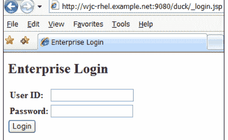

尽管由于制作独立示例的后勤原因，我们仅为 DUCK 应用构建登录页面，但它也可以与企业中部署的其他 Web 应用程序共享。我们真正想表达的是，我们的 DUCK 应用将采用常见的企业级统一认证，而应用本身并不关心实际认证是如何完成的。我们将使用传统的基于表单的用户 ID 和密码认证来演示，但它可以扩展到企业使用的任何通用登录方案。DUCK 应用的外观和感觉相当简洁。通用登录及相关屏幕并不试图模仿这种外观和感觉。

按 J2EE 术语来说，我们将使用**容器管理的认证**，并使用符合 J2EE 规范的基于表单的登录（见前一张截图）。遗憾的是，J2EE 规范并没有提供标准的注销方式，尽管大多数应用服务器提供了专有机制来实现注销。我们希望示例应用尽可能保持平台中立，因此没有使用任何这些专有机制。虽然 DUCK 应用的每个屏幕上都有**注销**按钮，能将用户带回登录页面，但此时用户实际上并未注销。例如，用户可以使用浏览器的**后退**按钮返回之前的屏幕，并从中继续导航，因为会话仍然有效。

### 查找文档

基本模型是通过浏览单个已配置对象存储中的文件夹层次结构（从根文件夹开始）来查找文档。浏览过程将遵循 `Folder.IsHiddenContainer` 属性，不显示隐藏文件夹。在每个级别，将按预定义布局显示子文件夹和所包含对象的列表。单击子文件夹名称将进入该子文件夹。

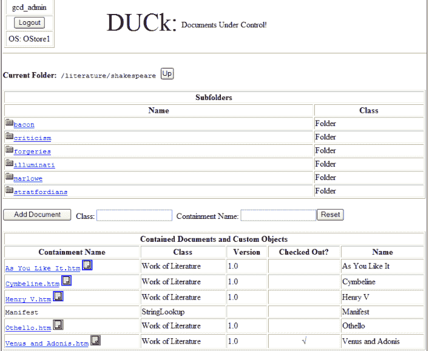

还会提供一种查询文档的方式，查询结果将以与浏览相同（或类似）的预定义格式显示。

在查询结果视图中，将显示文档名称。在浏览视图中，将显示名为 ContainmentName 的关系。浏览视图还会显示所包含的任何自定义对象（例如，前面截图中的**清单**行）。

在两种列表形式中，每个文档行的名称上都会有一个链接（自定义对象不适用此规则）。该链接将指向上述的详细属性。受限数量或受限流通状态的详细信息将显示在详细信息屏幕上，但不需要在列表中显示这些细节。

> 如果用户无法查看任何文档的属性，那么 CE 将自动从结果中排除该文档。这是正常行为，无需进行 UI 处理。该文档对该用户来说就是不可见的。

### 内容下载

文档在视觉上也区别于自定义对象，因为在包含名称旁边有一个小文档图标。该图标始终出现在文档行中。如果用户有权查看文档内容，该图标就是用于显示内容的链接；否则，图标显示时不作为链接。对于禁用链接的情况，不需要区分受限数量文档、受限流通文档，以及用户因其他原因无权查看内容的文档。

一个文档可能包含任意数量的内容元素。必须能够单独下载任意一个内容元素。由于访问控制检查在文档级别进行，因此要么所有内容元素都可用，要么全部不可用。

客户端的內容处理由用户的 Web 浏览器完成，通常会是浏览器提供的打开/另存为对话框。对于 `ContentReference` 元素，`ContentLocation` URL 会直接提供给用户，CE 不做任何解释。

对于原型，我们使用重定向到 XT 来显示内容。XT 提供了一个名为 GetContent 的 servlet，专门用于通过 XT 机制渲染内容。通过构造带有文档化查询参数的 URL 即可访问该 servlet。这使得内容下载非常容易实现。它还有一个不错的附带效果：默认情况下，图形内容会由 XT 附带的 Image Viewer 小程序渲染。我们本也可以使用 Workplace "classic"，因为它有相同的 GetContent servlet。浏览/查询屏幕上的文档图标用于通过 XT 打开内容。会打开一个新窗口，以免 DUCK 应用中的导航路径发生混淆。

> GetContent servlet 没有用于请求特定内容元素的参数。它总是假定调用方想要第一个内容元素。（作为特例，Image Viewer 小程序知道如何导航到其他内容元素，因为以这种方式存储多页图像很常见。）若要超越 DUCK 原型，我们将必须找到处理多元素文档的方法，或者寻求放宽业务要求。

### 添加文档

作者/所有者必须能够将文档添加到存储库中。这包括通常的属性填充、内容上传、归档到文件夹等。

> 原型没有实现内容上传。使用标准 JSF 1.2 组件进行文件上传存在众所周知的问题。（我们将在后面讨论实现细节时再谈 JSF。）实际上，许多 JSF 实现都提供了让文件上传变得简单的组件，但我们希望这个示例坚持使用标准组件，因为这不是一本关于 JSF 的书。直接在 DUCK 中创建文档可被视为一种便利，因为 DUCK 的主要作用是方便访问 RQ 和 RC 文档。也可以在 FEM、XT 和其他工具中通过常规操作来添加 RQ 和 RC 文档。

此外，它还将包含以下功能：

- 文档可被指定为限量副本文档，此时必须提供授权副本的数量
- 文档可被指定为限制流通文档，此时可提供授权用户列表（可选）

如果你查看上一节的截图，可以看到页面中间部分有添加文档的控件：

用户可以选择性地提供特定的文档子类名称和包含名称。用户将被引导至一个详情页面，在那里可以填写属性值。创建的文档将自动归档到浏览/查询屏幕中当前显示的文件夹中。

> 应向用户呈现可用文档子类的列表以供选择，而不是要求用户手动输入。这一点在 DUCK 原型中尚未实现。

## 查看文档详情

将有一个详细的属性页面，授权查看者可以在该页面查看文档的所有属性。隐藏属性的值（由 `PropertyDescription.IsHiddenProperty` 指示）不会显示（此行为可配置）。该页面也是执行与文档相关的各种活动的页面。

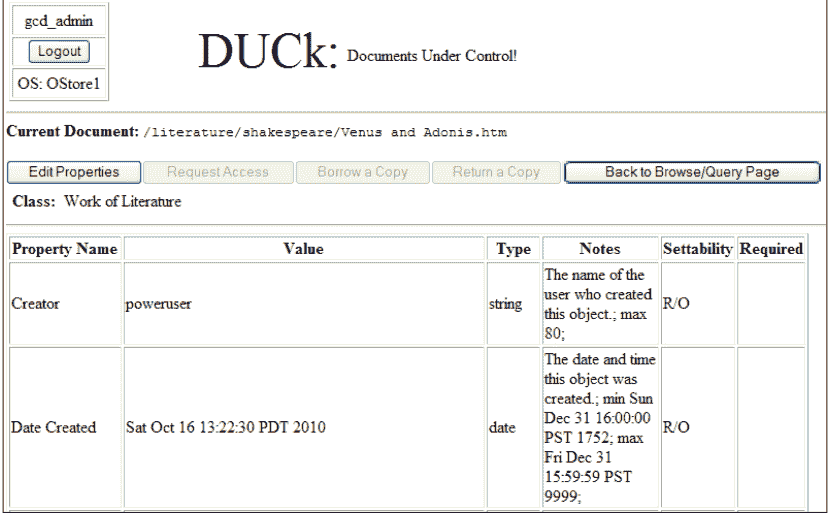

你可以看到，在此示例中，“请求访问”、“借阅副本”和“归还副本”按钮均处于禁用状态，因为此文档恰好不是限量副本类型或限制流通类型。（如果我们查看的是《哈姆雷特》而不是《维纳斯与阿多尼斯》，我们或许会忍不住引用“既不要向人借钱，也不要借钱给人”之类的说法，但我们还是让这个机会过去吧。）

同样，如果用户没有权限更新该特定文档的属性，“编辑属性”按钮将被禁用。该权限的评估不包括隐式的所有者/管理员权限（见第8章“安全特性与规划”）。从截图可以推断，该文档由 poweruser 创建，当前登录用户为 gcd_admin。因此，gcd_admin 必须已被显式授予对该文档的 `AccessRight.WRITE` 权限（在 FEM 中称为“修改所有属性”）。

## 限量副本文档

回顾一下，限量副本（RQ）文档是指在任何给定时间内流通副本数量受限的文档。以下要求仅适用于 RQ 文档：

- 页面上将有一个可见标识，表明这是限量副本文档，并提供一种显示当前借阅者列表的方式。
- 如果用户是当前借阅者，将有一个归还所借副本的链接。归还副本时没有上传步骤，但会要求用户确认已删除其本地副本。归还步骤完成后，页面会重新显示，此时用户不再是该文档的当前借阅者。
- 如果用户不是该文档的当前借阅者，但至少有一份副本可供借阅，则将有一个链接使用户成为借阅者。
- 除非用户是当前借阅者，否则下载链接将被禁用。

> DUCK 原型未实现当前借阅者列表的显示。该列表作为文档上的多值字符串属性存在，因此可以在任何能够显示多值字符串属性值的应用程序中查看。

## 限制流通文档

回顾一下，限制流通（RC）文档是指内容查看访问受到严格控制的那类文档。以下要求仅适用于 RC 文档：

- 页面上将有一个可见标识，表明这是限制流通文档，并显示用户是否被授权查看内容。
- 如果用户未被授权查看内容，将有一个向所有者请求访问的链接。访问权限将由所有者异步授予（如果授予的话）。
- 除非用户被授权查看内容，否则下载链接将被禁用。
- 对于多元素文档，计划在详情页面上为每个内容元素提供一个链接。由于之前描述的从浏览/查询页面使用指向 GetContent 小服务程序的链接技术，这一点在 DUCK 原型中尚未实现。

## 修改文档

对于有权更新文档属性的用户，文档详情页面上将有一个编辑链接（见前面的截图）。当用户单击编辑链接时，页面将重新显示，可更新的属性会以适当的 UI 控件呈现，并为整个页面提供一个提交链接，如下图所示：

DUCK：受控文档！

当前文档：/literature/shakespeare/Venus and Adonis.htm

类别：文学作品

| 属性名称 | 值 | 类型 | 说明 | 可设置性 | 必填 |
|---|---|---|---|---|---|
| 所有者 | cn=poweruser,cn=people,dc=whozit,dc | 字符串 | 对象的安全所有者。；最长 4000； | 读/写 |  |
| 复合文档状态 | 0 | 整数 | 文档状态，是标准文档还是复合文档。； | 读/写 |  |
| 文档标题 | Venus and Adonis | 字符串 | 文档标题；最长 255； | 读/写 |  |

该页面将仅显示实际可以更新的属性，当前值将作为默认值提供。与之前的查看详情页面一样，“说明”列是 `PropertyDescription.DescriptiveText` 属性与属性验证标准的简单渲染（例如，整数属性的最小值和最大值）的组合。

完整的属性编辑有许多方面未在 DUCK 原型中实现。这些包括：使用选择列表来引导值选择、对象值属性、多值属性和二进制（blob）属性。从 UI 处理更新后的值是通过相当简单的解析器完成的，这些解析器不具备生产应用程序所需的用户友好性（例如，我们使用 `Integer.parseInt()` 和 `Date.parse()` 方法）。除了编辑链接之外，还将有一个更新内容的链接。内容更新将导致文档检出，而编辑页面将用于保留文档的属性。将有一个内容上传链接，并且有机会提交更改（通过文档检入）或取消。

> 由于我们之前描述的原因（在添加新文档的描述中），DUCK 原型未实现内容上传。

## 企业强制要求

DUCK 应用程序将遵守与我们所有企业应用程序相同的本地化、可访问性和其他标准方面的强制要求。DUCK 原型未实现其中的大部分内容。

然而，仅就 CM 这一点而言，如果你在 Web 浏览器中更改首选区域设置，很容易看到部分本地化的效果。CE 属性和类显示名称是可本地化的，IBM 为系统属性和类的显示名称提供了多种区域设置的本地化版本。例如，以下是同一文档的编辑屏幕截图，但 Web 浏览器区域设置已设置为中文（区域设置 zh-CN）。应用程序无需任何软件更改即可获得这些本地化名称，因为 DUCK 将浏览器区域设置传递给 CE API，CE 会自动返回适合该区域设置的本地化显示名称。

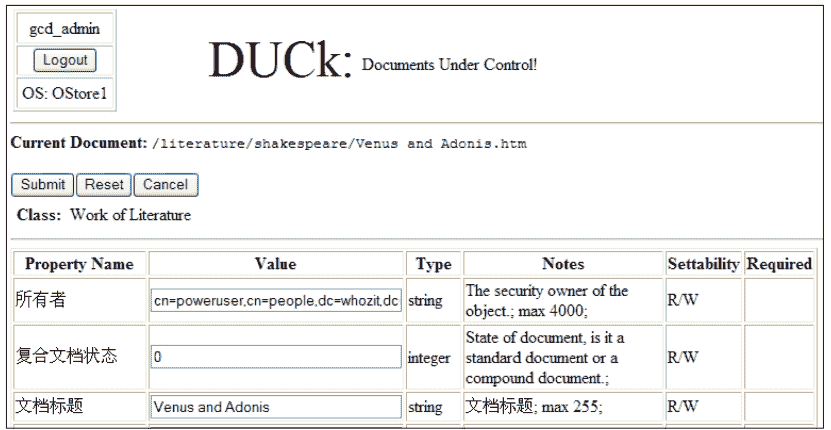

## 导航概述

下图展示了 DUCK 应用程序中各页面之间的基本导航转换。如果你熟悉编辑 JSF 导航规则，可能会觉得这很眼熟。四个矩形（BrowseQuery、AddDoc、ViewDoc 和 EditDoc）代表 DUCK 应用程序的主要屏幕。带标签的箭头对应于触发转换到另一个屏幕或返回同一屏幕的用户操作。

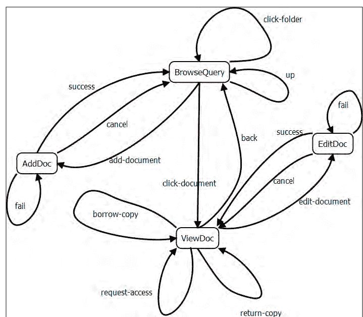

此图不包括插页式确认对话框的流程。我们在原型中使用 JSP 页面里的浏览器原生 JavaScript 弹窗实现了这些对话框，如下面的“借阅副本”按钮示例所示（这是 Firefox 版本）：

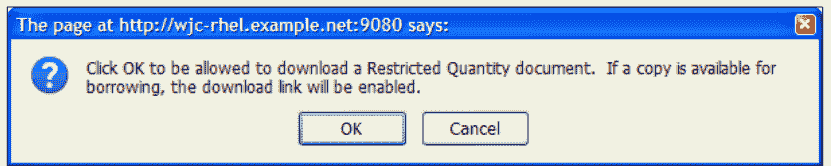

## 数据模型与安全模型

在本节中，我们将深入探讨如何构建 CM 功能和应用逻辑，以实现上述业务需求和最终用户应用程序视图。这可以分解为数据建模（使用 CE 类和属性）和安全建模（使用 CE 安全特性）。这两者在一定程度上相互交织，因此我们将一起描述。

我们在安全性和引用完整性方面做了设计，即使用户通过 FEM、XT 或其他应用程序尝试直接修改对象，也不会让事情陷入混乱。这证明你可以使用 CM 平台本身来控制这些事情，而不必依赖应用程序逻辑来实现这些关键功能。

在考虑如何绕过你的控制措施时，你必须始终假设有人可以直接使用 CE API 编写应用程序，从而绕过你的应用程序。当然，对于数据库访问也可以说类似的话：有人可以绕过 CE 直接访问数据库。这确实没错，但大多数组织通过防火墙规则或其他机制，对谁可以直接访问数据库实施了相当严格的控制。

### 文档属性

我们很快就意识到，当文档受到 RC 或 RQ 这两种限制之一（或两者）时，需要有一个或多个记录属性。我们可以为每种限制类型创建一个文档子类，但由于存在三种组合（外加不受限制的组合），这种做法充其量只会很别扭。任何其他出于文档类型划分而进行的自然子类化，都必须在每个分支中重复实现。在这种情况下，更简单的做法是将这些属性添加到 Document 基类中，以便它们适用于存储库中的所有文档。

> 在接下来的实现细节中，我们使用带有 Wjc 前缀的符号名称。这符合 IBM 关于使用前缀来避免与无关项目中的属性名发生冲突的建议。显示名称则不需要这样的约定，因为显示名称没有相同的唯一性要求。与大多数应用程序一样，DUCK 在内部使用符号名称进行操作，但在用户界面中使用显示名称。命名事物有一个不幸的事实：简短、通用、流行的名称很可能被其他方使用。

### 限制指示符

在我们的场景中只有两种限制类型，这意味着有很多可能的方式来表示某个特定文档具有其中一种或两种限制。最明显的两个选择是：

-   一个多值属性（可能是带有选项列表的字符串），用于存放适用限制的列表
-   一组单独属性，用于指示特定限制是否适用

当然还有其他可能的方法。

多值字符串属性方法能让我们在未来灵活添加更多类型的特殊处理考量，而不会对数据模型造成太大扰动。另一方面，添加新的特殊处理类型本身很可能就是应用程序和数据模型的一项重大变更，因此我们将采用概念上更简单的方法，为每种限制定义单独的属性。

我们将向 Document 基类添加以下属性：

-   符号名称为 WjcIsRestrictedCirculation，显示名称为“受限流通”。布尔类型，默认值为 false。如果为 true，则该文档是受限流通文档。只有具有 AccessRight.WRITE_OWNER 的用户才能更新此值，以便即使在其他人拥有修改属性的常规权限时，所有者也能控制此状态。
-   符号名称为 WjcRestrictedQuantityCount，显示名称为“受限数量计数”。整数类型，默认值为 0。如果该值大于零，则表示该文档是受限数量文档，且可用副本总数即为此值所示的数量。只有具有 AccessRight.WRITE_OWNER 的用户才能更新此值。
-   符号名称为 WjcRestrictedQuantityBorrowers，显示名称为“受限数量借阅者”。多值字符串（唯一且无序），无默认值。包含当前借阅者身份（目录可分辨名称）的列表。只有具有 AccessRight.WRITE_OWNER 的用户才能更新此值。

### 受限流通

对于 RC 文档，有两个基本要求：控制实际的内容查看，以及跟踪在文档整个生命周期内有哪些人看过其内容。

### 访问日志

要创建谁查看过受限流通文档的历史记录，使用标准 CE 审计日志会很好。通过对内容检索进行审计日志记录，我们就能得到对受限流通文档访问的完整记录。不幸的是，有一个现实层面的考量使得这个方案在我们的场景中并不可取。

审计日志只能对整个类启用，而我们已经决定任何类的文档都可以被指定为受限流通。因此，我们必须对所有文档的所有内容检索操作启用审计日志。内容检索是存储库活动的一大组成部分，这会产生海量审计日志记录，很可能影响性能以及我们管理审计日志本身的能力。我们可以重新考虑是否允许任何类的文档都被指定为 RC，但我们希望保留这种灵活性。

除了审计日志，我们也可以转而使用事件订阅。事件订阅有两个很好的特性，可以解决我们看到的审计日志问题：

-   事件订阅可以关联到某个文档实例，而不是整个类。如果 RC 文档的数量相对较少，实例订阅可能很有吸引力。
-   事件订阅具有筛选表达式。该筛选表达式类似于 CE SQL WHERE 子句（有一些限制）。如果筛选表达式计算结果为 false，则会跳过事件订阅处理。我们可以将订阅应用于所有文档类，但使用仅在 WjcIsRestrictedCirculation 为 true 时才为 true 的筛选表达式。

那么，为什么不使用事件订阅呢？简单原因是：没有可订阅的内容检索事件。内容检索事件仅作为审计日志的触发器可用。

我们的用例只要求跟踪那些已查看受限流通文档内容的用户。我们不需要保留一份已获授权查看文档的用户名单。重要的是他们是否真的利用该授权实际下载了内容。正如我们刚才所见，我们确实可以实现业务要求，但代价非常高。因此，我们已向业务相关方说明了情况，他们同意，只要我们同时记录用户获得访问权限或被撤销访问权限的日期和时间，那么记录每个文档被授予访问权限的用户就是可以接受的。

我们可以通过跟踪受限文档的创建、删除和安全更新来满足这一修订后的业务要求。与内容检索相比，这些操作很少发生，但它们是否少到我们不必担心审计日志的容量问题？可能如此，但这必须针对每个环境做出判断。在我们的场景中，我们将假设它是足够的。

> 审计日志的一种替代方案是，为这些事件使用事件订阅，并附带一个筛选表达式，将其限制为仅针对受限流通文档。事件处理程序可以将安全信息记录到存储库之外的私有位置。

### 访问控制

文档的所有者控制对其的访问，我们将使用标准的 `AccessRight.VIEW_CONTENT` 权限来控制谁可以查看受限流通文档的内容。我们将使用直接针对用户应用的 ACE 来授予或移除该权限。

### 访问请求

当用户请求访问受限流通文档时，将触发一个面向文档所有者的审批工作流。实际的审批本身不会产生任何实质性影响，但所有者只有在手动更新文档的访问权限后，才会处理该审批。（也可以将 PE Component Manager 配置为回调 CE 存储库，并在工作流审批过程中直接更新文档权限。）

> 虽然我们为 RC 文档实现了访问请求机制，但它与 RC 文档审计日志的要求和实现是解耦的。没有任何理由表明访问请求机制不能用于调用者希望查看内容的任何文档。事实上，DUCK 在决定是否启用访问请求时，只检查查看内容的权限，而不关心用户为什么没有该权限。

DUCK 应用程序不包含工作流收件箱功能。可以使用标准 XT 工作流监控功能或其他应用程序的工作流监控功能。

访问请求策略的实施由两部分组成——审批工作流及其触发器：

-   对于触发器，我们的应用程序将使用一个自定义事件。自定义事件只是 CE CustomEvent 类的子类，通过 FEM 像创建其他任何子类一样创建。该自定义事件具有符号名称 WjctRequestContentAccessEvent（显示名称为 Request Content Access Event）。在适当的时候，DUCK 应用程序将通过调用文档上的 raiseEvent() 方法来触发该自定义事件，并将自定义事件的一个实例作为参数传递。从语义上讲，触发自定义事件意味着“发起调用的用户请求访问此文档”。在 Document 基类上针对该自定义事件创建的 CE 类工作流订阅将启动审批工作流。

> 使用事件来启动工作流是组件解耦的另一个有趣实例。DUCK 应用程序完全没有任何工作流逻辑，也不包含对 PE API 的调用。事实上，DUCK 应用程序甚至不知道服务器在响应 WjctRequestContentAccessEvent 自定义事件时会做什么。它只知道这个自定义事件是用户请求访问文档内容的方式。这也使得在其他应用程序中实现相同的逻辑变得非常容易。它们只需触发该自定义事件即可。

-   如果站点是 BPM 许可证持有者，则可以使用 Process Designer 创建具有任何所需路由的工作流。如果没有 BPM 许可证，则可以使用 CM 附带的预定义审批工作流之一。必要的是，审批工作流必须路由到文档所有者进行审批。发起调用的（请求）用户将被指定为工作对象的发起人。

> DUCK 原型会触发 WjctRequestContentAccessEvent 自定义事件，但不会实现工作流订阅。UI 中的“请求访问”按钮不会执行任何有意义的操作。

这不是 DUCK 需求的一部分，但我们也可以使用相同的自定义事件和工作流思路，请求文档所有者移除某个用户对该文档的访问权限。

## 受限数量

RQ 文档的需求是管理借阅/归还流程，并将内容检索限制为给定文档的当前借阅者。这意味着我们必须跟踪可借阅的总副本数和当前借阅者列表。可借阅的副本数可以轻松地从这两项中推算出来。

我们不希望用户能够直接操作跟踪借阅信息的属性。由于疏忽或恶意，用户可能会扰乱记账记录，并妨碍我们强制执行最大副本数的能力。

我们的第一反应是让记账在服务器内部通过绑定到 RQ 文档的异步订阅事件处理器完成。我们会使用异步订阅，因为同步订阅事件处理器不允许更新触发对象（指触发事件的文档）的属性。这种方法有几个问题：

-   它是异步的，因此用户点击借阅副本的链接与该用户实际可检索内容之间会存在短暂但不可预测的延迟。在实践中这可能不会太糟，因为延迟通常远小于一秒。应用程序可以实现一个带有短延迟的循环来改善用户体验。
-   存在竞争条件。假设只剩一个副本可借，但两个用户同时点击借阅链接。两个用户都会认为自己已获得一个副本，但后触发的事件处理器不会将该用户添加到列表中，因为副本数已经达到上限。这给应用程序带来了一些棘手的 UI 问题。异步事件处理器除了 CE 日志文件之外，没有内置的失败通知机制。

如果我们能让 CE 以某种同步的方式确认借阅操作已成功或必将成功，那么构建应用程序会更容易，用户体验也会更好。在这种情况下的常见做法是，将更新业务逻辑放入应用程序中，并依靠同步订阅事件处理器来检查更新，如果更新不合适则予以否决。

我们将采用的解决方案是，如上所述，将总数和借阅者列表放在 RQ 文档上。然后使用一个附属对象来同步处理事件并更新 RQ 文档的属性。这个附属对象有许多实现选择（“附属”仅意味着它是次要于“真正”对象即 RQ 文档的），但我们尽可能喜欢使用方便的内置 Annotation 类。它的实例具有一些有利特征：

-   注释与称为被注释对象的特定对象相关联。注释不能移动到另一个对象（因为 AnnotatedObject 属性只能在创建注释时设置）。
-   Annotation 基类只有少数几个属性，其中大部分我们并不关心。如果有必要，我们可以开放对所有注释属性的访问，而不必担心奇怪的副作用。
-   当被注释对象被删除时，注释会自动删除。这让我们很容易避免引用完整性问题。

自然，如果我们没有现成的 Annotation 类，我们也可以从头开始构建所有这些特性，例如使用 CustomObject 子类和标准 CE 功能。

我们将定义一个 Annotation 的自定义子类，名为 WjcRestrictedQuantitySatellite，显示名称为 Restricted Quantity Satellite。对于这个注释子类，我们不需要任何自定义属性，因为我们只是以附属对象的能力来使用它。事实上，使用自定义子类只是为了将我们将要使用的特定注释与可能碰巧也关联到该文档的其他注释区分开来。

借阅或归还副本的操作被实现为更新 WjcRestrictedQuantityBorrowers 列表，分别添加或移除调用用户的身份。此操作的业务逻辑在针对该注释触发的 WjcRestrictedQuantityBorrowReturnEvent 的事件处理器中实现。该事件处理器（DuckRQB，下文将更详细描述）执行以下操作：

-   如果被注释的文档不是 RQ 文档，则不采取任何操作。
-   如果调用用户的身份已在借阅者列表中，则该操作为归还。用户的身份将从借阅者列表中移除。
-   否则，该操作为借阅。如果至少有一份副本可借，则将用户的身份添加到借阅者列表中。如果没有可用副本，处理器将抛出异常。

-   **WjcRestrictedQuantityBorrowReturnEvent**。使用显示名称 **Restricted Quantity Borrow/Return Event**。此事件将与下面的 DuckRQB 相关联。

这两个自定义事件子类都没有任何自定义属性。

## 审计日志配置

我们将通过审计记录文档创建、删除和安全更新来跟踪访问变更。

通过右键单击 **Object Store One** 并选择 **属性** 来启用对象存储的审计日志记录。在 **常规** 选项卡上，选中 **启用审计** 复选框。

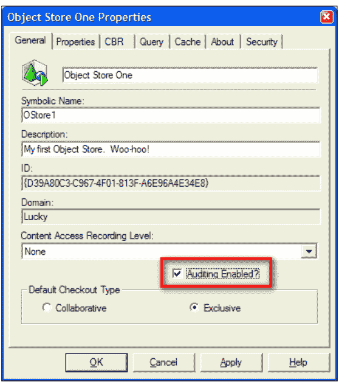

在 FEM 的树状视图中，导航到 Object Stores | Object Store One | Document Class。右键单击并选择“属性”。在弹出的面板中，选择“审计定义”选项卡。为“创建”、“删除”和“更新安全”事件创建审计定义。所有审计都应对“成功”进行审计，并且所有审计都应“应用于子类”。

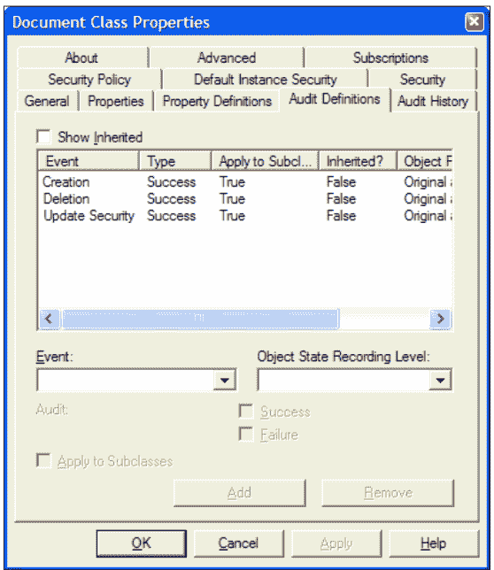

## 部署事件处理器代码模块

我们提供了事件处理器代码，既可作为 Eclipse 项目，也可作为 JAR 文件，您可以不使用任何开发工具直接部署。

> CE 事件处理器（实际上，通常任何代码模块）都可以打包为独立的 Java 类文件或 JAR 文件。对于这个简单示例，两者都可行，但我们建议养成使用 JAR 文件的习惯。这实际上并不会多出太多麻烦，而且能为您提供更大的灵活性，以便将更复杂的事件处理器拆分为多个类。如果您决定本地化异常消息和其他文本，它也为您提供了放置资源文件的位置。

为了方便讨论，我们假定你选择了 `duckrqb.jar`，这个名称与我们为你提供的预制 JAR 文件同名。你导出的 JAR 文件内容也应与我们的一样。

## 新代码模块

你可以选择将 JAR 作为代码模块安装到 CE 存储库中，也可以将其放到应用服务器类路径上。许多开发人员更喜欢类路径方式，因为它看起来不那么复杂。但这样做确实意味着任何更改都需要重启应用服务器，这在迭代开发过程中可能会让人很烦。我们采用代码模块方式，也建议你采用这种方式，因为生产环境中你使用的正是这种方式。

由于 FEM 有一个向导会引导你完成这些步骤，因此为新订阅部署代码模块是相当轻松的。就我们的场景而言，在 FEM 中右键单击 Document 类节点，然后选择 Add Subscription（添加订阅）以启动向导，为 Creation Event（创建事件）和 Update Event（更新事件）添加同步处理器。单击 New（新建）按钮创建一个 Event Action（事件操作），系统会提示你输入类或 JAR 文件的位置，以及 Java 类的完全限定名称：net.example.wjc.duck.DuckRQB。FEM 将创建所有必需的链接关系，并将代码模块对象归档到 Object Store 的 /CodeModules/ 文件夹中。归档只是为了方便你，并不是使用代码模块的必要条件。

> 你也可以像放置任何其他文档一样，将代码模块放入 Object Store，是否归档随你意愿。如果你确实手动创建代码模块，请确保它是作为 CodeModule 类的实例创建的，否则它将无法使用。有关代码模块的其他注意事项，请参阅产品文档。

在 FEM 中右键单击 Restricted Quantity Satellite 类节点，然后选择 Add Subscription（添加订阅）。这一次的事件是 Restricted Quantity Borrow/Return Event（受限数量借用/归还事件），你应该使用我们刚刚创建的 DuckRQB 代码模块。该代码模块具有条件逻辑，因此可用于多种目的。它会知道触发的是哪种事件类型，以及触发对象是什么。

## 修改代码模块

修改代码模块的过程（你在开发过程中肯定会经历）稍微复杂一些，因为内部链接关系会将某个特定的文档版本作为代码模块来引用。因此，无论你是为每次迭代创建一个全新的代码模块，还是对单个代码模块的版本系列执行签出/签入循环，都必须更新订阅链接以指向它。我们下面将描述这一过程。

使用 FEM 定位你的代码模块（可能位于 /CodeModules/ 文件夹中）。执行常规的签出/签入循环以更新代码模块的内容。为简单起见，我们建议你不要使用次版本。此时 FEM 将显示代码模块的最新版本，但该版本还没有被任何内容引用。（如果 FEM 没有显示正确的主/次版本号，你可能需要刷新 /CodeModules/ 文件夹的视图。）右键单击代码模块，然后选择 Copy Object Reference（复制对象引用）。这会将一个指向该特定对象的指针放入 FEM 中的某种剪贴板。

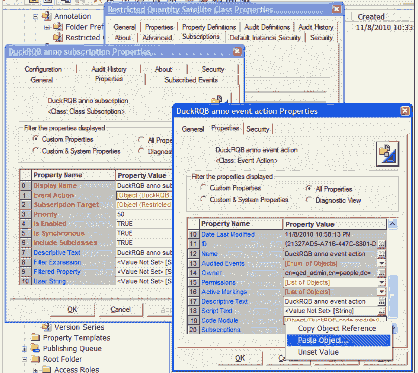

请参考上图，执行以下步骤：

1. 右键单击 Restricted Quantity Satellite 类节点，选择**属性**，然后点击**订阅**选项卡。
2. 你会看到你创建的订阅。选中它，然后点击**属性**按钮。此时会出现订阅属性弹出窗口。点击**属性**选项卡以打开通用属性表。
3. 其中一个属性将是 Event Action（事件操作）。点击它在**属性值**列中的那一行。此时会出现事件操作属性弹出窗口。点击**属性**选项卡以打开通用属性表。
4. 选择**所有属性**筛选选项。列表中的其中一个属性将是 Code Module（代码模块）。如果你点击它的**属性值**列，将出现针对该代码模块先前版本的代码模块属性弹出窗口。这不是我们想要的。相反，应右键单击该行的**属性值**列，然后选择**粘贴对象**。在确认对话框之后，先前复制的对象引用（即我们之前复制的那个）将被用于填充该 Code Module（代码模块）属性值。

针对 **Document** 类重复上述步骤。我们首先承认，这个过程看起来有点晦涩难懂，而且有些随意。之所以会有这种感觉，是因为 FEM 没有针对此操作的特定辅助面板，所以我们使用了通用属性表。当然，在生产环境中修订代码模块是相当罕见的事情。在你操作过几次之后，如果你为订阅、事件操作和代码模块使用了有逻辑性的名称，我们认为你会忘记它的随意性，并能快速点击完成。

更新代码模块后，你可以随时删除代码模块的旧版本。CE 不会允许你删除被任何订阅引用的代码模块，因此你无需担心这一点。

## 调试日志

我们的 DuckRQB 代码模块类内置了一些基本的调试日志功能。启用后，调试日志会直接写入标准输出。对于我们的 WAS CE，日志最终会写入文件 /opt/ibm/WebSphere/AppServer/profiles/AppSrv02/logs/server1/SystemOut.log。

默认情况下，日志记录是禁用的。你可以将 Java 系统属性 DuckRQB.debugLog 设置为 **true** 来启用它。在 WAS 中，你可以通过 WAS 控制台执行此操作：导航到**服务器 | 服务器类型 | WebSphere 应用服务器 | server1 | Java 和进程管理 | 进程定义 | Java 虚拟机**。在**通用 JVM 参数**文本框中，添加 **-DDuckRQB.debugLog=true**。要禁用日志，请删除该项，或将值改为 **false**。无论如何，你可能都需要重启应用服务器，新值才能生效。

请记住，你是在控制 CE 内运行的事件处理程序的调试日志，因此你需要在应用服务器的 CE 实例上执行这些操作。

## Duck 项目

我们使用 **JavaServer Faces (JSF)** 实现了 DUCK Web 应用。这项技术已不是几年前人们所认为的尖端技术，但它仍然是快速创建应用的一种方式。它拥有不错的组件库，尤其是对于我们想要完成的那些简单直接的事情，而且它适用于 CM 支持的所有应用服务器。如果你愿意，我们将把重新实现该应用的工作留给你，可以做成浏览器内 AJAX 应用，或其他任何在你企业眼中看起来更炫酷、更现代的形式。

我们将使用流行的开源集成开发环境 Eclipse 来创建该应用。我们使用的是 Eclipse 3.6.0（**http://www.eclipse.org**；具体来说，我们使用的是名为 Eclipse IDE for Java EE Developers 的套件），并将使用 JSF 的 Apache MyFaces 实现（**http://myfaces.apache.org**）。虽然有与 JSF 2.0 对应的 Apache MyFaces 版本，但我们仍将使用与 JSF 1.2 对应的版本，因为我们的需求很简单，而且这个版本在你的环境中获得支持的保证更高。例如，WAS 7 可以安装并使用 JSF 2.0，但它开箱即用提供的是 JSF 1.2。

本章的可下载资料中包含了以 ZIP 文件形式提供的完整 Eclipse 项目。你可以将 ZIP 文件放在任何方便的位置（无需解压），然后通过导航到**文件 | 导入 | 常规 | 将现有项目导入工作区**，将其导入你的 Eclipse 工作区。选择**选择归档文件**，然后浏览到该 ZIP 文件。该项目将作为新项目导入到你的 Eclipse 工作区中。项目名称将是我们创建这些项目时使用的名称。

DUCK Web 应用 Eclipse 项目的文件名为 duck.project.ZIP。按前面所述将其导入 Eclipse。很快，Duck 项目将出现在 Eclipse Project Explorer 面板中，如下所示：

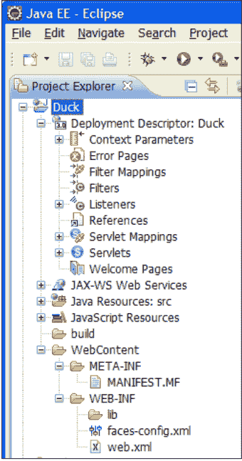

> 你还需要 CE 客户端安装程序提供的 Jace.jar 和 log4j.jar 的引用。如果你的这些 JAR 文件恰好与我们放在同一位置，那么你的项目可能无需更改即可使用。如果它们位于不同位置，Eclipse 会提示一些构建路径错误，你需要更正这些 JAR 文件的位置。

如果之前尚未安装 JSF 实现包，可以在 Eclipse 中轻松下载一个。选中 **Project Explorer** 中的项目名称 **Duck**，右键单击并选择 **Properties**。在弹出的对话框中，导航到 **Project Facets | Java Server Faces**。如果看不到 JSF 1.2 的条目（如以下屏幕截图所示），请单击下载图标（带向下箭头的软盘）。

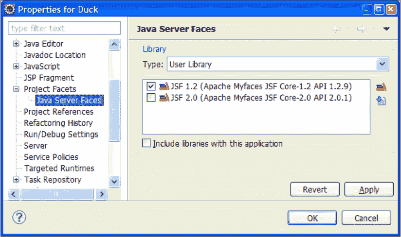

选择并下载 Apache MyFaces 实现的 JSF 1.2。理论上，任何 JSF 1.2 实现都应表现相同。我们在示例 DUCK 实现中使用了 Apache MyFaces，建议你也这样做，以防实践与理论不符。下载完成后，请确保已选中 JSF 1.2 用户库，并且未选中任何其他 JSF 实现。**Include libraries with this application** 的复选框不应被选中。这控制 JSF JAR 是否包含在将要创建的 WAR 文件中。我们不需要它们，因为 WAS 7 会自动提供 Apache MyFaces 1.2。

## Exporting and deploying Duck.war

如果你已将 Duck 项目导入 Eclipse 并进行了必要的配置修复以使项目正确构建，可以通过从 Eclipse 导出 Duck.war 来重新创建它。选中 Eclipse Project Explorer 中的 Duck 项目，右键单击并导航到 Export | WAR file。在开发期间，我们喜欢在导出的 WAR 文件中包含源文件，但你可能不会在生产部署中这样做。

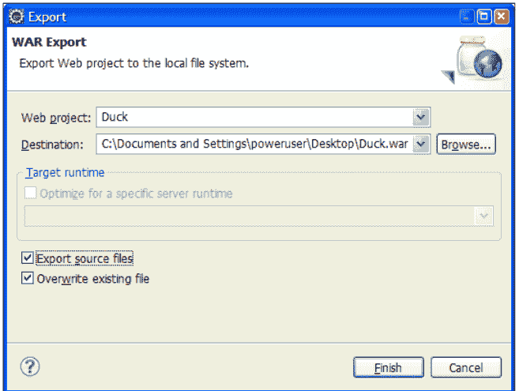

导出的 Duck.war 与本章下载材料中包含的版本相同，只有一个例外。我们的副本不包含 Jace.jar 和 log4j.jar。如果你决定使用我们的副本，必须将这两个 JAR 文件添加到 WAR 文件内的 WEB-INF/lib/ 目录中：

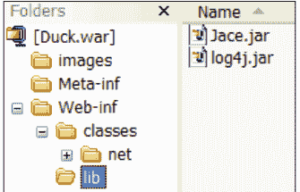

## Deployment descriptor

Duck.war 在 WEB-INF/web.xml 中包含一个 XML 部署描述符。如果你使用的是我们在全书示例中使用的相同服务器配置，那么可能无需更改即可使用该部署描述符。其中大部分是标准的 JSF 样板代码，但有几个 context-param 元素专门用于 DUCK Web 应用的配置。如果你想更改这些值中的任何一个，有几种选择：

- 应用服务器有时允许你直接修改已部署 Web 应用的这些参数。这通常不是一个很好的选择，除非是临时更改。
- 你可以从 Duck.war 中提取 WEB-INF/web.xml，编辑它，然后将其替换回 Duck.war 中。
- 如果你在 Eclipse 中有 Duck 项目，可以在导出 WAR 文件之前使用 Eclipse 编辑器编辑 web.xml。这可能是最好的选择，因为更改最不可能丢失。

所有应用特定参数的名称都以前缀 duck 开头。如果你修改 web.xml，请务必不要更改除这些参数值之外的任何内容。以下是参数的完整列表以及我们提供的默认值：

- `duck.ce.uri=iiop://wjc-rhel.example.net:2810/FileNet/Engine`：它给出目标 CE 服务器的位置。你应使用此连接 URI 的 EJB 传输形式。
- `duck.ce.objectstore=OStore1`：它给出将用于所有操作的 Object Store 的名称或 Id。
- `duck.ce.showhiddenfolders=true`：它控制 DUCK UI 是否会抑制 Folder.IsHiddenContainer 属性值为 true 的文件夹。
- `duck.ce.showhiddenproperties=true`：它控制 DUCK UI 是否会抑制 PropertyDescription.IsHidden 属性值为 true 的属性。
- `duck.xt.baseurl=http://wjc-rhel.example.net:9080/WorkplaceXT`：它是用于连接到 XT 应用的 URL。DUCK 在构造重定向到 GetContent servlet 的 URL 时会使用它。

## Deploying to WAS

为了保持我们的架构分层，我们将 DUCK 部署到我们用于 XT 的同一 WAS 配置文件，因为它们都是 Web 应用。这不是 DUCK 应用的要求，它只需要能够连接到配置的 CE 服务器和配置的 XT 服务器。

> 如果你决定将 DUCK 应用部署到 XT WAS 实例之外，你将必须使用我们在第 5 章 Installing Other Components 中为 XT 部署描述的程序来配置 WAS 目录配置和 LTPA 信任关系。

给定按上述准备好的 Duck.war，首次部署到 WAS 是常规的新 Web 应用添加操作：

1. 在 WAS 控制台（用于 XT 的 WAS 实例）中，导航到 Applications | Application Types | WebSphere enterprise applications。单击 Install 按钮启动安装新应用的向导。
2. 提示时，浏览到你的 Duck.war 副本。
3. 直到提示上下文根时都可以采用默认值。将默认值 / 改为 /duck。
4. 完成向导并保存配置。Duck_war 将列在 Enterprise Applications 中，但尚未启动。WAS 在从 WAR 文件名创建应用名称时会将句点更改为下划线。

你可以使用相同的程序就地更新 DUCK 应用。所有设置，包括上下文根，都将被记住并传递到替换的 WAR。然而，首次安装 DUCK 时必须执行一些额外的配置步骤。这些在以下两个小节中描述。

## Selecting the JSF Runtime

我们希望确保使用 WAS 提供的 Apache MyFaces 版本，以最大化与开发环境的兼容性（即使我们没有有意使用任何非标准的 JSF 功能）。

从 Enterprise Applications 屏幕中，单击 Duck_war，然后单击 JSP and JSF options 的链接。对于 JSF implementation，选择 MyFaces 1.2。

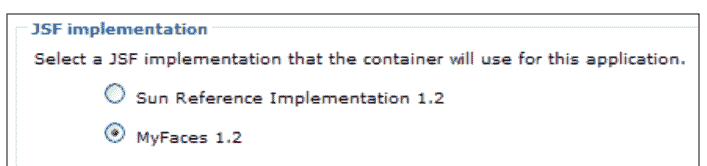

## Configure role mapping

DUCK 应用使用基于表单登录的容器管理身份验证。Duck.war 部署描述符将所有应用屏幕的访问限制为 authenticated-duck-user 角色的成员。未在该角色中的用户将被 Web 容器自动重定向到企业登录屏幕。我们现在将映射 authenticated-duck-user 角色，使所有已认证用户都属于该角色。

从 Enterprise Applications 屏幕中，单击 Duck_war，然后单击 Security role to user/group mapping 的链接。选中 authenticated-duck-user 旁边的复选框，并从 Map Special Subjects 下拉菜单中选择 All Authenticated in Application's Realm。

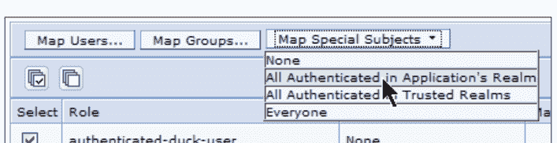

## Starting the application

执行上述配置步骤并保存所有设置后，返回 Enterprise Applications 屏幕，选中 Duck_war 应用的复选框，然后单击 Start 按钮。DUCK 应用应成功启动。

退出 WAS 控制台，使用 Web 浏览器连接到 http://wjc-rhel.example.net:9080/duck/。你应被引导至企业登录屏幕。使用有效凭据登录（你在第 2 章 Installing Environmental Components 或之后创建的任何 LDAP 目录用户和密码），你应看到 OStore1 根目录的浏览/查询屏幕。

> 由于 WAS 控制台和 DUCK 应用程序都使用容器管理的身份验证，如果你想看到 DUCK 企业登录屏幕，必须先退出 WAS 控制台。否则，你将被立即带到第一个浏览/查询屏幕，以 `was_admin` 身份登录。

恭喜！你的 DUCK 应用程序现在正在运行，你可以探索本章前面描述的功能。

## Summary

我们介绍了自包含的 DUCK 自定义应用程序。在此过程中，我们逐步介绍了业务需求、计划的用户体验，以及利用 CM 功能的各种实现细节的规划步骤。由于我们还提供了 DUCK 解决方案的工件作为配套下载，你可以运行它并亲眼看到它按所述执行。你也可以使用 FEM 或其他应用程序直接检查存储库文档及其注释，以查看类和属性在低级视图中的外观。你也可以尝试使用这些工具来击败设计中内置的安全措施。我们希望你找不到任何漏洞。

在下一章中，我们将为你的 CM 环境提供一些故障排除信息，包括对许多其他信息资源的回顾。

## 13 Support, Fix Packs, and Troubleshooting