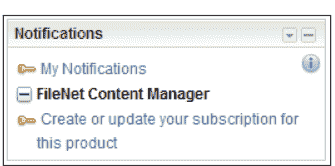
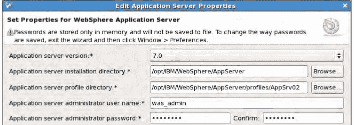
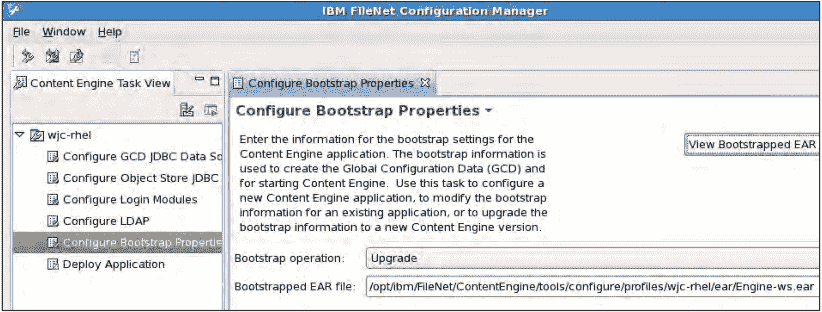
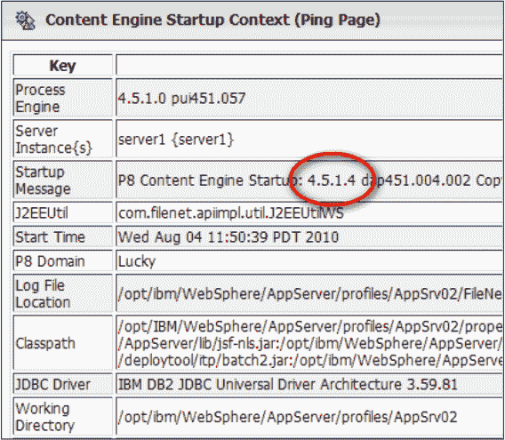
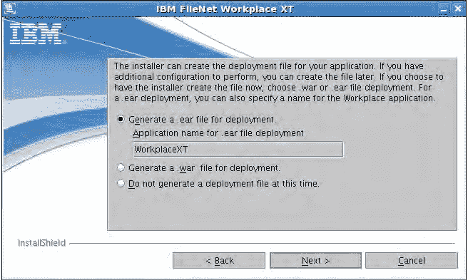

本书前面的章节帮助你创建了一个可工作的 IBM FileNet Content Manager (CM) 系统，甚至在其中放置了一些示例项目。如果你跟着操作，你应该有一个完整的系统可以自行摆弄和探索。这反过来应该让你对构建生产部署充满信心。

现在是时候进行不太光鲜的部分了：你需要让系统长期保持运行。有例行和偶尔需要做的事情。我们不会在这里为你提供详细的计划。那将过于依赖于你企业特定的情况。相反，我们将概述一些你在制定详细计划时需要考虑的事情。

在本章中，我们将涵盖以下领域：

- 我们将描述在线和其他资源，帮助你了解产品功能、修复和更新。
- 我们将向你展示如何实际应用 CM 修复包。
- 我们将讨论一些常见的故障排除情况和技术。

### Resources

无论你只是刚开始使用 CM（这会成为一本书的绝佳标题）还是拥有相当丰富的经验，你都希望利用从 IBM 和其他来源提供的各种文档和其他资源，使你的 ECM 项目持续成功。在本节中，我们将列出一些你可以视为自助的资源。

我们确实想提到的是，有一个丰富的人才生态系统可以帮助你完成从制定策略、规划项目、执行实施到提供持续支持等所有工作。这些人包括 IBM Lab Services、IBM 业务合作伙伴和其他顾问。你可以在此网页找到有关 ECM 领域的 IBM 业务合作伙伴的信息：**http://www-01.ibm.com/software/data/content-management/partners/**。有关 IBM ECM Lab Services 提供的服务的信息可在以下位置找到：**http://www-01.ibm.com/software/data/content-management/services/lab.html**。

当谈到可以帮助你的人时，我们要提到 IBM 有一个名为 **FileNet Certified Professionals (FCP)** 的认证和评估计划。当你查看任何顾问的资格时，你可能希望将其考虑在内。事实上，你的一些员工可能有兴趣遵循教育和测试路径成为 FCP。你可以访问 IBM ECM 的主网页找到有关认证计划的信息：**http://www.ibm.com/software/ecm**。导航到 **Services | Training and Certification**。

在同一个网页上，你还可以找到有关 IBM 针对 FileNet 产品（包括 CM）的广泛培训课程的信息。课程以多种格式和地点提供。一些课程可在网上获得，其他课程则在 IBM 设施或你的地点面对面进行。

### Documentation

上面提到的 IBM ECM 链接是查找产品描述、公告和营销材料的良好起点。在本节中，我们将描述在哪里找到 CM 的深入技术文档。

#### Information center

CM 技术文档的起点是信息中心，一个在线的完整产品文档集合。CM 4.5.1 的信息中心是 *IBM FileNet P8 Version 4.5.1 Information Center*，网址为 **http://publib.boulder.ibm.com/infocenter/p8docs/v4r5m1**。那里的信息按层次组织并且可完全搜索。此在线资源的存在意味着许多客户选择跳过本地安装产品文档。

CM 应用程序中存在一种将帮助链接转换为空信息中心相对链接的趋势。此时，并非所有应用程序都已转换，但每个产品发布都会转换更多。在安装或配置时，你可以设置信息中心的基础 URL。如果你选择这样做，你可以下载并本地安装信息中心的副本。在这种情况下，你可以选择将帮助链接指向你自己的副本作为基础。你可以在此处找到有关 *FileNet P8 Version 4.5.1 Installable Information Center* 的信息：http://www-01.ibm.com/support/docview.wss?uid=swg24025610。

#### Standalone documents

有一些文档是单独下载的，通常为 PDF，即使它们链接到信息中心或包含在信息中心内。例如，我们在本书中多次提到的 *IBM FileNet P8 Version 4.5 Hardware and Software Requirements* 文档。查找所有这些文档的起点是位于此处的 *Product Documentation for FileNet P8 Platform* http://www-01.ibm.com/support/docview.wss?uid=swg27010422。

> CM 4.5.1 是第一个使用 IBM 信息中心框架进行在线文档的版本。位于上述链接页面上的可下载的 *FileNet P8 Platform Documentation* 采用的是信息中心之前的格式。它仍然有用，并且是 CM 4.5.1 之前版本的最佳文档来源。

你可以自行查看该网页的内容，但我们只想提醒你注意其中一些更值得注意的项目。我们在本书其他地方也提到过其中的一些：

- *FileNet P8 Release Notes*：这些是 CM 及相关组件完整版本的发行说明。发行说明包括所有重要新功能和修复的列表。这很方便，因为在进行完整版本升级之前可能涉及大量规划。你可以详细研究发行说明，看看是否有任何特别影响你的领域。
- *FileNet P8 Hardware and Software Requirements*：这是关于哪些环境组件受支持的官方指导。我们认为，只要你计划进行环境更改，就应查阅此文档。由于此文档不时修订，你应始终检查你是否拥有最新版本。
- *Fix Packs and Compatibility Matrices*：这些文档是可下载的电子表格，告诉你 CM 及相关组件的哪些版本和修复包组合是受支持的。在计划应用修复包时，检查此文档是很好的。你通常不应该期望在将所有内容提升到最新水平时出现问题，但偶尔会出现混合较新和较旧修复包的问题。
- *Installation and Upgrade Worksheet*：我们在第 2 章至第 5 章中大量使用了此电子表格。它是收集和组织配置环境所需的大量细小信息非常方便的方式。
- *FileNet P8 Platform Installation and Upgrade Guide*：还请查找指向特定组件组合的定制版本文档的链接。如果你恰好使用其中一种流行的组合，它将为你节省跳过不适用于你的环境内容的麻烦。
- *FileNet P8 Security Help Extract*：当你规划环境时，你会产生许多关于 CM 组件如何处理各种安全方面的疑问。此文档试图将所有这些信息集中到一个地方。如果你是负责“做安全”的人，我们建议你通读此文档，以获得对可用安全功能的良好基础。
- *FileNet P8 Platform Developer Samples*：产品文档和各种 IBM developerWorks 文章和 IBM Redbooks 中散布着大量代码示例。此处提供的示例大多是小型、独立的应用程序，如果你在 CM API 的非核心领域做事会特别有帮助。
- *FileNet P8 Performance Tuning Guide*：你在规划部署时至少应浏览此文档。它经常修订，包含基于直接经验和测试的 CM 组件和环境组件的最佳调优建议。如果你正在排查性能问题，你肯定需要查阅此文档。

### Other links

本节是本书本章之外提到的其他文档的链接集合。我们在这里收集它们以方便你，因此以下项目可能彼此无关。


-   对于 CM 4.5.1 和 WAS 7.0 的特定组合，在 Configuration Manager 工具的应用服务器配置面板的某个位置会出现一个已知的小问题。该问题描述在此：http://www-01.ibm.com/support/docview.wss?uid=swg21415627。
-   如果您在从 PE 连接到 CE 时遇到问题，IBM 的 PE 团队发布了一份名为 *PE 到 CE 安全配置故障排除* 的技术说明：http://www-01.ibm.com/support/docview.wss?uid=swg21328045。
-   全文搜索引擎的配置和持续运行中可能出现许多微妙的问题。CM 支持组织将调查和解决其中许多问题的技巧汇总成了一份非常详细的技术通知，标题为 *FileNet Content Engine 4.x 基于内容的检索（CBR）故障排除*：http://www-01.ibm.com/support/docview.wss?uid=swg27012912。
-   在之前的章节中，我们多次提到了 CM 和其他产品的许可。贵企业中应该有人持有实际许可协议的副本。不过，大多数 IBM 软件许可文件（包括 CM 及相关产品的许可文件）也可以在线获取。请访问此网页并搜索“filenet content manager”：http://www-03.ibm.com/software/s1a/s1adb.nsf。搜索结果将包含当前许可文件以及之前的几个版本。
-   在几个示例中，我们使用或引用了威廉·莎士比亚的作品。莎士比亚的作品在互联网上的许多网站都可以轻松找到。我们最喜欢的网站之一是麻省理工学院的网站：http://shakespeare.mit.edu。它很方便，因为上面只有文本，没有大量注释、评论等内容。

## IBM 红皮书

IBM 有着悠久的传统，即发布额外的文档作为官方产品文档的补充。这些出版物被称为 IBM 红皮书，它们确实是书。它们力求与产品文档重叠不多。例如，它们通常只包含有限的参考材料，因为假设您可以查阅产品文档以获取最新的特殊值列表等。相反，它们非常务实，并且往往专注于特定场景。

完整的 IBM 红皮书可以 PDF 格式免费下载。如果您比较传统，想要实体书，大部分也有纸质版可供购买。要查找与 CM 及其他 FileNet 产品相关的 IBM 红皮书，请访问 http://www.redbooks.ibm.com 并搜索“filenet”。新书会不断添加。

每本 IBM 红皮书都由一个专门组建的写作团队编写。作者可以包括参与创建相关产品的 IBM 工程师、与该产品打交道的 IBM 现场人员，实际上，任何有兴趣参与编写此类书籍的人都可以。虽然大多数作者是 IBM 员工，但这并不是必须的。您可能会发现自己有兴趣加入 IBM 红皮书写作团队。请访问 IBM 红皮书页面，查找关于驻留项目的信息。

## IBM developerWorks

IBM *developerWorks*（dW）是一个包含文章、代码示例和其他资源的集合，涵盖各种技术主题。我们向您介绍 dW，是为了让您知道那里有几篇与 CM 相关的文章，而 dW 覆盖的广度和深度都相当惊人。您会找到基本上涵盖现代 IT 各个兴趣领域的文章，其中许多文章由 IBM 以外的人撰写。

要查找与 CM 及其他 FileNet 产品相关的 dW 文章，请访问此网页：`http://www.ibm.com/developerworks`。您可以搜索“**filenet**”及相关术语，也可以导航到 dW ECM 专区：`http://www.ibm.com/developerworks/data/products/ecm`。

请务必不要忽视 dW 论坛。这些论坛由 IBM 托管，但并非官方支持渠道。相反，它们是客户和业务合作伙伴互相帮助的地方。如果您有问题或想讨论某事，也许想听听别人的看法，论坛是个好地方。虽然不保证一定有答案，但代价为零。

您可以在此处找到与 IBM 信息管理产品相关的论坛列表：`http://www.ibm.com/developerworks/forums/im_forums.jspa`。IBM FileNet Content Manager 特定论坛的直接链接是 `http://www.ibm.com/developerworks/forums/forum.jspa?forumID=1165`。

## 全球 IBM ECM 社区

全球 IBM ECM 社区是一个协作中心，用于交流信息并讨论 IBM ECM 的各个方面。除了社区内托管的论坛和维基之外，您还可以找到内部和外部博客的链接、本地和区域 IBM ECM 用户组的链接，以及 IBM ECM 在 LinkedIn、Twitter 和 Facebook 等热门社交网站上的存在指引。您可以通过此链接找到该社区：`http://www.ibm.com/community/ecm`。

您可以从支持页面按产品区域的关键字搜索技术说明。仅举一个例子来了解它们的样子，这是我们在 CM 区域搜索 **authentication** 时找到的一份技术说明。它名为 *如何配置 Process Engine 以配合由 SSL 保护的 Content Engine 身份验证*，可在此处找到：http://www-01.ibm.com/support/docview.wss?uid=swg21392767。

## 个性化通知

在 CM 特定支持概述页面上，您会找到一个链接，用于在发布各种信息时获取个性化通知。它被称为 **My Notifications**，涵盖从产品发布通知到日常技术说明的所有内容。要使用 My Notifications，您必须在 IBM.com 上注册，但这是免费的，并且与您可能拥有的任何软件或支持合同无关。任何人都可以注册。如果您点击该链接，通常会看到登录提示和注册机会。您可以根据类型和产品自定义接收的通知，还可以将其他 IBM 产品和信息更新添加到订阅列表中。



链接旁边的小钥匙图标表示您必须先登录 IBM.com 才能访问它。

## Fix Central

您一定要记住的一个支持区域是 Fix Central，网址为 http://www.ibm.com/support/fixcentral。这是一个易于导航的网站，可用于查找大多数 IBM 软件集团产品（包括 ECM 产品）的可用修复程序。顾名思义，它是获取修复信息和实际修复包下载的中心位置。您无法从 Fix Central 获取产品基础镜像，只能获取修复包和其他类型的更新。在本章后面，我们将为多个组件安装修复包。我们所有的这些修复包都是从 Fix Central 获取的。

## 信息随需应变会议

面向 CM 用户和 IBM 业务合作伙伴的首要会议系列是 IBM 信息随需应变（IOD）。这些会议重点展示 IBM 信息管理部以及 IBM 软件集团内其他紧密相关组织的产品线。这是一个在高带宽环境中获取信息的好机会。您可以查阅 http://www.ibm.com/software/data 上的活动日历，找到有关 IOD 会议的详细信息。当然，您也可以在网上搜索 IBM Information On Demand conference 来获取会议信息。

IOD 会议有三种类型：

-   IOD 全球会议是规模最大的聚会。它每年十月举行，过去几年一直在拉斯维加斯举行。来自客户组织、IBM 业务合作伙伴和 IBM 自身的数千名与会者齐聚一堂，进行了数百场技术和业务会议。大型展区为会议提供了补充。关于 2010 年会议的信息可在此处获取：http://www.ibm.com/software/data/2010-conference/。
-   区域 IOD 会议于春季在欧洲和亚洲举行，还有一些针对特定国家的 IOD 会议。这些会议的计划通常会更加针对举办地点所在地区或国家的具体兴趣进行调整。
-   在美国、加拿大以及其他一些地区，以“信息随需应变来到您身边”为总称举办本地活动。这些活动通常为期一两天，在当地举办，并根据特定地区客户和合作伙伴的兴趣进行定制。

如果可能的话，我们强烈建议您尽可能参加任何 IOD 活动。除了正式的计划之外，这也是结识其他使用 CM 和 IBM 相关产品的人并分享经验的好方式。您甚至可能会在那里见到我们。

## 版本和修复

对于 CM 产品，您可能会从 IBM 获得三类更新。这与其他大多数 IBM 软件集团产品更新的模式相同。

## 产品版本

CM 的新正式版本会不时发布。每个版本的时间和内容都是单独决定的，因此在 IBM 宣布之前，不太可能对未来的版本进行任何精确的预测。


出于务实的考虑，历来每年发布的版本不超过一两个。新版本发布相对不频繁对你来说其实是好消息。你可能想要升级到大多数新版本（以避免落后感），但升级时可能需要你做大量的测试和认证工作。

CM 的发行版按 VRMF 模式编号：版本（version）、发行版（release）、次要发行版（minor release）、修复包（fix pack）。例如，在本章前面提到的 CM InfoCenter URL 的 v4r5m1 组件中，你可以看到这一点。你不必太纠结什么是版本、什么是次要发行版等等，因为坦白说，关于这些事物的决策对我们来说也有点神秘。（此外，不要因为“发行版编号”中居然包含一个称为“发行版”的部分而感到困惑。那只是递归的魅力所在。）相反，主要关注相应的数字即可。本书描述的发行版是 CM 4.5.1。

CM 是否也存在软件行业传统的“dot zero”问题？换句话说，你是否应该避开第二个或第三个数字为零的发行版，等待包含所有修复的“dot one”发行版？当然，我们有偏见，但我们认为不必。的确，CM 4.5.0 和 4.5.1 都存在，但“dot one”版本并不是作为其“dot zero”兄弟版本的修复版而构建的。无论出于何种原因，IBM 决定使用“dot one”编号，但每个发行版都有完整的开发、测试和文档周期，并包含大量新功能。针对“dot zero”问题，你可能担心的实际问题已由下一节描述的修复包机制很好地处理了。所以，如果我们是你的话，不会特别回避“dot zero”发行版。我们会像对待任何其他可用的新发行版一样对待它们。如果你遵循我们在第9章“规划部署”中概述的计划，并且将测试环境与生产环境分开，那么安装升级并安全测试应该没有问题，不会导致生产环境过度停机或功能问题。

我们不会在此详细讨论如何升级到新发行版。每个 CM 发行版都附带了如何实际执行升级的全面说明，而且大部分过程都很简单。任何特殊情况都会在安装和升级说明中明确指出。发行版升级与修复包安装确实有一些共同特征，我们将在下面更详细地介绍。

你应始终特别关注的一件事是客户端兼容性。当需要升级客户端和服务器组件时，你应该先升级服务器组件（除非 IBM 有具体的不同指示，但这种情况相当少见）。新的服务器发行版通常会带来新的客户端组件（JAR、DLL、配置文件或其他构件）。PE 和 CE 客户端安装程序通常会查找并自动升级 CM 提供的应用程序，但通常无法对自定义应用程序自动执行相同操作。

根据经验法则，服务器将支持比自身旧一个发行版的客户端组件。例如，CE 4.5.1 服务器将支持 CE 4.5.0 客户端。相反的组合不受支持：服务器通常不支持更新的客户端版本。这里，我们指的是 IBM 官方支持策略意义上的支持。其他组合在技术意义上可能有效，但如果出了问题（确实可能出问题，也许是以微妙的方式），你将处于不受支持的配置中。无论如何，为了将风险降到最低，你应该尽快将客户端移动到与服务器完全匹配的版本。“N 减 1”支持实际上只是升级过程中的一种临时状态。

> 这里有一个提示，供那些从事自定义开发并可能面临多个发行版环境的人参考。你应该在将支持的最旧发行版环境中进行开发和测试。这有助于你避免使用较新功能的诱惑，也避免无意中使用到它们的可能性。

## 临时修复

如果你遇到具体的 CM 问题，可能的原因有很多。当然，你会通过查阅 CM 产品文档和检查自己的自定义应用程序来进行应有的排查，但你看到的问题也许就出在 CM 产品本身。在某些情况下，你认为的产品问题其实是 CM 在按设计运行，只是它的行为不符合你的预期。在其他情况下，问题可能是缺陷：CM 没有执行它设计上应执行的操作。

无论如何，在确认问题后，IBM 支持人员通常会首先尝试寻找一种变通方法，以便让你获得你想要的行为。这可能是一个配置设置，或者在自定义开发的情况下，建议采用不同的方法解决问题。（对自定义开发的支持由不同的支持领域处理，其条款与对开箱即用组件的支持不同。）寻找变通方法并不是 IBM 试图逃避责任或避免修复问题。这实际上符合你的最佳利益，因为如果找到变通方法，通常可以立即解决你的问题。


> 有些变通方法会建议将未记录的配置选项设置为某个值。为什么有些配置选项没有文档化，只有在你致电 IBM 支持时才会透露？通常，它们可能具有潜在的性能或功能副作用，必须逐案考虑。另一些则是开发人员为他们认为在实践中不会发生的情况或仅对 IBM 内部开发过程感兴趣的情况而加入产品的配置选项。或许可以恰当地将这些未文档化的项目视为处方药。使用不当，它们弊大于利。

在存在实际产品缺陷的情况下，可能会发生以下一种情况：

- 如果问题不太严重，或者有某种合理的变通方法，或者其他情况决定（例如，产品即将结束支持生命周期），则缺陷可能不会修复。根据我们的经验，这种情况相对少见，但并非闻所未闻。
- 无论有无变通方法，你可能都认为该缺陷对你来说不那么紧迫。该缺陷的修复将被添加到未来的产品修复包或发行版中。（添加到修复包中的项目通常会添加到下一个产品发行版中。）
- IBM 支持可能会认为必须提供修复，而且你的情况已经等不及下一个修复包了。在这种情况下，IBM 将为你提供**临时修复**。（临时修复通常会添加到下一个修复包中。）

“临时修复”这个名字在两方面具有重要意义。首先，它只打算供你使用到获得包含永久修复的产品修复包为止。偶尔，永久修复的性质会与临时修复不同。这通常是由于可用的实现时间不同。其次，临时修复不是为特定客户维护的一次性功能的载体。当然，有时缺陷报告和临时修复会带来新功能或对现有功能的更改，但临时修复仍然只延续到下一个修复包或产品发行版为止。

是否应该制作临时修复通常是主观的，并且需要你和 IBM 支持之间进行一些协商。你是否应该始终坚持自己的立场并要求临时修复？我们无法为你判断关键问题、不便和琐事之间的区别，但我们确实想指出，应用临时修复对你来说有一些缺点：

- 你可能是世界上唯一运行包含该临时修复的确切配置的人。仅这一事实就足以让许多组织望而却步。


- 一个临时修复会被测试，而该测试基于 IBM 支持和产品开发的最佳判断，即更改仅限于某些区域。尽管如此，测试的严格程度不如修复包或产品发布那样严格。出现某些副作用的风险极小——但并非为零。
- 如果今后你还需要额外的临时修复，IBM 创建并交付给你的时间可能会更长，即使对于同一问题，针对不同客户已存在临时修复。原因在于，已安装的临时修复不会孤立运行。它通常会与许多其他内容一起成为同一个 JAR、DLL 或其他组件的一部分。在组件中安装新的临时修复通常会清除该组件中先前的所有临时修复。因此，IBM 必须为交付给客户的每一种临时修复组合创建产品构建。不仅必须遵循 IBM 严格的源代码控制和其他构建实践，而且有时还涉及产品开发人员进行的专门分析，以确保临时修复的组合能够和平共存。

尽管如此，如果你需要临时修复，你就需要临时修复。上述因素只是你在自己权衡时需要考虑的事情。

## 修复包

我们已经多次提到修复包，现在是时候更详细地描述它们了。

如果现代、复杂的软件是完美的，就不需要修复了。但对于企业软件这种拥有众多 moving parts 的东西来说，完美是罕见的（有人说根本不存在）。鉴于这一现实，所有主要软件厂商都计划在产品发布后提供软件更新。不同厂商使用不同的名称和编号方案。

IBM 的术语是修复包。（非正式地，修复包和临时修复也被称为补丁，但这种术语暗示了一种过时的流程，而这种流程在今天已不适用。）对于 CM 和大多数其他 IBM Software Group 产品，修复包使用 VRMF 模式的第四位数字按顺序编号。例如，截至本文撰写时，最新 CE 修复包编号为 4，因此 CE 组件的完整发布号为 CE 4.5.1.4。实际的修复包名称则有所不同：你需要应用名为 P8CE-4.5.1-004 的修复包才能将你的安装升级到发布号 CE 4.5.1.4。

修复包包含新功能的情況很少见。当这种情况发生时，通常是因为新功能是对修复包中包含的某个修复的泛化，并且包含新功能比单独处理修复更省事（或更不容易混淆）。修复包引入新的受支持平台组件的情况并不少见。这些通常是已受支持组件的更新版本，如目录服务器、数据库和应用服务器。修复包绝不会有意移除功能或引入向后兼容性问题。原因很简单：IBM 和客户都希望在修复包发布后迅速迁移到新修复包。

出于同样的原因，IBM 支持和产品开发非常严格地控制哪些修复会被纳入修复包。除偶尔例外外，修复均来自客户报告的问题，并被评估为具有足够的严重性或适用性，以至于所有客户都应获得该修复。修复包的发行说明文档包含所有所含更改的简明列表。

在修复包中添加的功能的一个重要特例是称为 **post-qualification** 的工作。有时，对某个功能或受支持平台进行完整测试会不合理地延迟产品发布，因此会做出在正式产品发布后进行资格认证的决定。该决定是在期望测试仅证明开发工作如预期进行的假设下做出的。在这种情况下，IBM 仅宣布对该功能或平台的支持。如果测试结果需要产品更改，则会将其纳入修复包。

修复包是累积的。这意味着，如果你安装了某个特定修复包，你将自动获得同一产品发布的所有先前修复包的更改。无需按顺序安装所有修复包。基于同样的理由，一旦发布了更新的修复包，先前的修复包对于大多数用途而言就已过时。先前的修复包通常仍可下载，用于测试和其他特殊用途。除非你有特殊原因（例如，你可能想匹配现有环境），否则在考虑安装任何修复包时，你肯定希望获取最新可用的修复包。

CM 产品中的不同组件往往遵循不同的修复包时间表。原因在于这些组件可能属于 IBM 的多个产品捆绑包，而同步的修复包时间表几乎不可能实现。这可能会有点令人困惑，因此 IBM 支持发布了 *FileNet P8 Fix Pack Compatibility Matrices*（参见之前的链接）。这些是电子表格，详细说明了所有组件的哪些修复包组合可以一起安装，包括特定组合的特殊情况。（矩阵不包含有关临时修复的信息。）

## 安装修复包

为了进一步说明修复包流程，我们将借此机会为我们已安装的所有 CM 组件安装最新的修复包。

## 支持组件

我们不会演示更新其他组件（如应用服务器）的流程，但我们会指出在将所有内容升级到最新修复包时获得的这些组件的版本：

- **DB2**：我们安装了最新的 DB2 修复包，从 9.5.0.0 升级到 9.5.0.6。在应用修复或升级数据库时，不要忘记你可能有安装了数据库客户端软件组件的机器。在我们的例子中，那就是 Windows 服务器 wjc-w2k3.example.net，我们在该服务器上安装了 PE 服务器。除非数据库文档另有说明，否则最好保持所有数据库软件组件同步。

- **TDS**：我们安装了最新的 TDS 修复包，从 6.2.0.0 升级到 6.2.0.13。由于我们的 TDS 安装使用的是主 DB2 安装，因此我们为 DB2 所做的更新会自动应用于 TDS。我们的 TDS 使用 WAS 的嵌入式副本，并未使用我们主 WAS 安装。我们根据 TDS 支持站点推荐安装了最新的嵌入式 WAS 修复包，从 WAS 6.1.0.13 升级到 6.1.0.31。

- **WAS**：我们安装了最新的 WAS 修复包，从 7.0.0.0 升级到 7.0.0.13。如果你安装了 WebSphere Application Client（例如，如果你将我们的简单开发示例进一步配置为使用 EJB 传输），你也希望将其更新到最新的修复包。WAS 服务器和客户端修复包通常会同时发布。

> 如果你按照第 2 章《安装环境组件》中的示例操作，并且以非 root 用户运行 WAS 配置文件（例如用户 ecmuser 和组 ecmgroup），那么你可能需要重复我们在第 2 章《WebSphere Application Server》部分中描述的目录和文件所有权调整。如果不这样做，你可能会收到有关不兼容事务类型的神秘投诉。我们将在安装 CE 修复包后在下面重复确切的说明。

- **RHEL**：我们没有升级 Red Hat Enterprise Linux 的版本。相反，我们使用 RHEL 包管理软件在软件包可用时对其进行修复和升级。

## 支持、修复包和故障排除

我们安装这些支持软件更新的方法是按上述顺序进行，但在安装每项内容后重启 RHEL 服务器并运行一些测试，以确保我们没有犯错。每当我们升级环境组件时，我们首先停止所有 CM 组件，以便尽可能处于空闲状态。重启和测试从理论上讲不是必需的，但我们希望在出现问题时更容易找到原因。

## CM 组件

CM 中由 FileNet 提供的不同组件都有自己的修复包周期和修复包安装程序。我们将使用最新修复包升级我们已安装的所有组件的安装。（PE 4.5.1 恰好没有修复包，但它确实有一些临时修复可用。我们在这里不会安装 PE 临时修复，但你可以自行决定下载并安装。）各个组件的 resulting 版本号总结如下表所示：

| Component | Fix Pack Level |
|---|---|
| CE | 4.5.1.4 |
| CSE | 4.5.1.1 |
| XT | 1.1.4.8 |

对于 CM 服务器组件，通常会同时发布服务器修复包安装程序和客户端修复包安装程序。我们将在适当位置同时使用两者来更新相关组件。单独安装程序的想法是，客户端 API 组件可以与更新的服务器组件保持同步。

> CE 5.0.0 版本包含一项名为 Downloadable Client Components 的功能。使用小型且稳定的 API，客户端应用程序可以直接从正在运行的 CE 服务器获取 CE JAR 文件和其他工件。这是一种让应用程序始终拥有与 CE 服务器匹配的客户端组件的好方法。然而，由于这是一个新功能，在大多数应用程序采用它之前还需要一段时间。

规划 CM 修复包安装的第一步是确保所有拟安装的修复包都是兼容的，这意味着需要检查前面提到的 *FileNet P8 Fix Pack Compatibility Matrices*。请确保获取电子表格的最新副本，因为它经常更新。如果你要安装最近发布的修复包，它可能尚未在矩阵中提及。大多数“最新内容”的组合都是兼容的，但如果你在查看电子表格后仍有疑问，始终可以咨询 IBM 支持。


修复包将包含一组安装说明。我们不会详细讨论这些说明，但在安装特定修复包时，你应通读一遍。我们接下来演示的过程相当通用，而且修复包说明有时会包含重要的特殊情况或限制。修复包通常无法卸载，因此务必做好备份或准备其他恢复计划，以防遇到问题或决定放弃安装某个修复包。

## CE 4.5.1.4 服务器

我们的第一步是升级 CE 服务器和客户端组件。CE 服务器运行在我们 Linux 服务器上的一个 WAS profile 中。CE 客户端更新必须针对以下环境执行：位于独立 WAS profile 中的 CE 安装、我们 Windows 服务器上运行的 PE 服务器，以及任何安装了 FEM 的 Windows 机器。如果你搭建了 Java 或 .NET 开发环境，那些机器也需要进行客户端更新。我们将先更新 CE 服务器，然后应用客户端更新。这是 CE 更新支持的操作顺序。

> 在对 CE 服务器进行任何更改之前，请确保你已安全保存了引导后的 CE EAR 文件的副本。如果你在第 3 章“安装 Content Engine”中还没有这样做，那么现在请完成。CE EAR 文件将命名为 Engine-ws.ear、Engine-wl.ear、Engine-jb.ear 或 Engine-jbc.ear，具体名称取决于你的应用服务器品牌（分别是 WebSphere、WebLogic 或 JBoss）。如果你正从部署位置复制副本，你的应用服务器可能已将 CE EAR 重命名为其他名称。不要跳过此步骤。如果你丢失了原始的 bootstrap 设置，许多本可恢复的错误将变得无法恢复。

下载并解压 CE 服务器修复包更新。在解压后的目录中，你会找到的文件之一是 version.txt。这个简短的文件精确描述了所包含组件的确切构建版本。以下是我们 CE 修复包中 version.txt 的内容：

```
P8 Content Engine 4.5.1.4 build dap451.004.002
Using pui451.057
Using pch455.004
Using cm451.002.008
Using dep451.074
This build includes cambridge14.mdb revision
```

了解这些内容各自的含义并不是很重要。它们只是子组件的内部构建编号标识，并非所有这些标识都会在已安装的产品中实际可见。稍后我们将利用这些信息来复核修复包安装是否符合预期。

在 CE 服务器关闭的状态下，运行 CE 服务器修复包安装程序。在我们的案例中，可执行文件名为 4.5.1.4-P8CE-FP004.BIN。虽然这是一个图形化安装程序，但我们建议你从 shell 窗口启动它，以防有任何重要的控制台消息被打印出来。有几个安装程序面板仅适用于 Windows 环境，而且你可能希望为 CE 安装使用默认位置。这意味着你可以直接点击浏览大部分面板。

在最后一个面板上，安装程序建议：如果你正在使用 PE 和 CSE 这些组件并且有可用更新，请运行它们的客户端更新程序。换句话说，如果 CE 服务器使用了这些组件，安装程序会要求你更新它们。我们两者都在使用，但只有 CSE 有更新，因此我们接下来将处理这个问题。确保取消选中“启动 Configuration Manager”复选框，然后点击“完成”按钮。

你应该查看安装日志文件（位于目录 /opt/ibm/FileNet/ContentEngine/ 中），以确认是否发生了任何问题。

## CSE 4.5.1.1 客户端

解压 CSE 修复包 4.5.1.1 的 Linux 客户端包。此情况下的安装程序可执行文件名为 4.5.1.1-P8CSE-CLIENT-LINUX-FP001.BIN。同样，我们建议你从 shell 窗口运行该程序以启动图形化安装程序。此安装程序将更新 CE 服务器 EAR 文件中的 CSE 客户端文件。假设你使用默认路径，你可以直接点击浏览安装程序面板，它就会顺利完成。

> 在 CSE 修复包的发行说明中，你应该留意的一点是它是否需要对你的内容重新建立索引。通常不需要，但也有可能需要。对于我们这个极小的多合一站点来说，这不算什么问题。但对于一个拥有数百万甚至更多文档的生产站点，重新建立索引所需的时间将相当可观。

CSE 客户端文件更新将放置到 /opt/ibm/FileNet/ContentEngine/CSEClient/ 中。你应该快速浏览一下该目录中的安装日志文件，以确认没有出现问题。

## CSE 4.5.1.1 服务器

由于我们刚刚安装了 CSE 客户端更新，为了保持同步，我们将安装 CSE 服务器更新。解压 CSE 修复包 4.5.1.1 的 Linux 服务器包。此情况下的安装程序可执行文件名为 4.5.1.1-P8CSE-LINUX-FP001.BIN。同样，我们建议你从 shell 窗口运行该程序以启动图形化安装程序。如果你此前没有为此设置环境变量，则需要在运行安装程序之前为 JAVA_HOME 设置一个值。以下是我们在第 5 章“安装其他组件”中使用的设置：

```
# export JAVA_HOME=/usr/lib/jvm/java-1.5.0-ibm-1.5.0_11.2.x86_64
```

> 在更新到 CSE 服务器软件期间，你必须关闭所有 CE 和 CSE 服务器。否则，CSE 可能会在更新期间尝试处理 CE 请求，从而导致文本索引损坏。

安装程序将更新 CSE 服务器本身中的软件，因此我们将首先停止 CSE 服务器。如果你正在使用类似于我们在第 2 章中使用的 up 和 down 脚本，则只需运行 down 脚本即可停止所有内容。否则，请转到 CSE 软件位置（默认是 /opt/ibm/FileNet/ContentEngine/verity/k2/_ilnx21/bin/），并运行 k2adminstop 命令。

> 快速检查 Unix 或 Linux 服务器上是否有任何 CSE 软件正在运行的方法是执行命令 ps -ef | grep k2。如果没有显示任何内容（可能除了 grep 命令本身外），则说明没有 CSE 软件正在运行。

修复包文件中包含用于备份和恢复 CSE 配置文件的脚本。你需要一个目标目录来存储这些文件（它们总计将达到 30-50 MB）。只有当你的系统在重启时不会自动清理 /tmp/ 目录时，你才可以安全地将它们放在 /tmp/ 下的某个目录中。更安全的做法是将它们存储在你解压修复包文件所在位置的一个新建子目录中。你应该以我们在第 5 章中指定的用户 k2_os_user 身份运行备份（以及之后的恢复）。

```
# su - k2_os_user -c "/some/path/backup_k2.sh /opt/ibm/FileNet/ContentEngine/verity /some/path/k2save"
```

在生产环境中，你可能会将各种 CSE 功能分散到多台服务器上。如果是这种情况，你应该在每台独立的服务器上运行备份过程和 CSE 安装程序。

重新启动 CE 的 WAS profile。（如果你通过关闭所有内容而停止了 WAS profile，那么还必须重新启动目录服务器。）在 WAS 控制台中，导航到 Applications | Application Types | WebSphere enterprise applications。选择 CE 服务器（通常名为 FileNetEngine），然后点击 Uninstall 按钮。按照提示操作，并将更改保存到主配置。

如果你的 CE 服务器应用程序名为 FileNetEngine，那么它的 WAS 缓存文件将位于 /opt/ibm/WebSphere/AppServer/profiles/AppSrv02/temp/localhostNode02/server1/FileNetEngine/。最可能的情况是，你会发现在该位置只有空目录。停止 WAS profile，然后删除该 FileNetEngine 目录及其以下的所有内容。

重新启动 WAS profile。至此，CE 服务器应用程序的所有残留痕迹都已清除。

在第 3 章中，我们最初是以 root 用户身份安装 CE 服务器的。我们也将以 root 用户身份运行 P8 Configuration Manager。稍后，我们将像在第 3 章中那样修正文件和目录的所有权。使用以下命令运行 P8 Configuration Manager：

```
# /opt/ibm/FileNet/ContentEngine/tools/configure/configmgr
```

导航到并打开初始安装时保存的配置配置文件（wjc-rhel）。你可能还记得，在第 3 章中，我们将 WAS 控制台管理员登录名从 administrator 更改为了 was_admin。该配置配置文件可能仍然反映的是较早期的 administrator 用户。点击那个看起来像电脑的图标，打开应用服务器配置设置面板。提供 was_admin 用户名和密码。使用 Test Connection 按钮以确保你的设置正确。




由于我们没有更改 CE 服务器安装的任何基本配置项，因此应用修复包只需要执行几个实质性的步骤。如果您没有保留原始配置配置文件，则需要查阅修复包说明中提到的产品文档，并执行更详细的步骤。假设您要么足够聪明，要么足够幸运，我们将仅描述简化的步骤：

- **引导**。双击配置配置文件树视图中的 **Configure Bootstrap Properties**（配置引导属性）任务。将 **Bootstrap Operation**（引导操作）更改为 **Upgrade**（升级）。右键单击 **Configure Bootstrap Properties**（配置引导属性）任务并选择 **Run Task**（运行任务）。这将修改修复包 CE EAR 文件以包含初始安装中的引导信息。



- **部署**：右键单击 **Deploy Application**（部署应用程序）任务并选择 **Run Task**（运行任务）。这将把经过引导的 CE EAR 文件部署到应用程序服务器中。如果一切顺利，工作即已完成。

> 我们经常在部署步骤中运气不佳，并因各种不同原因经历过失败。如果您也遇到这种情况，可以轻松地使用应用程序服务器的工具来部署 CE EAR。从 WAS 控制台，导航到 **Applications | Application Types | WebSphere enterprise applications**（应用程序 | 应用程序类型 | WebSphere 企业应用程序）。单击 **Install**（安装）按钮，导航到经过引导的 CE EAR 文件（除非您的浏览器运行在 CE 服务器机器上，否则请使用 **Remote file system**（远程文件系统）选项），并按照额外步骤部署 CE EAR。

- 从 WAS 控制台检查 FileNetEngine 应用程序是否正在运行。如果没有，请启动它。

您可能还记得在最初的 CE 安装中，我们不得不手动调整 WAS 配置文件的目录树的权限。我们刚才执行的安装操作会撤销其中的一部分，因此我们必须再次执行此操作。以下是该步骤的重复。在 Linux 命令提示符下，以 root 身份登录，执行以下命令：

```
# cd /opt/ibm/WebSphere/AppServer/profiles
# chown -R ecmuser:ecmgroup AppSrv02 AppSrv01
```

为了验证您正在运行的是您认为的版本，请使用浏览器连接到 CE “ping page”：http://wjc-rhel-example.net:9081/FileNet/Engine。您应该在启动消息中看到正确的 VRMF，如下面的图像所示：



## CE 4.5.1.4 客户端

我们不会详细介绍运行 CE 客户端修复包安装程序的过程。这些过程相当直接，并且它们询问的所有问题都可能具有正确的默认值。让我们回顾一下在哪些地方运行哪些安装程序：

- 您必须运行与客户端应用程序的操作系统平台相对应的特定 CE 客户端安装程序。在给定机器上运行一次 CE 客户端安装程序就足够了。
- 对于基于 CE .NET API 的 FEM 和其他 CE 客户端，您运行 CE 服务器修复包安装程序来更新这些客户端组件。这可能有点令人困惑（因为您可能预计会使用客户端修复包安装程序），但由于历史原因，它是这样做的。
- 对于基于 CE Java API 的所有 CE 客户端，包括随 CM 提供的大多数应用程序，您运行 CE 客户端修复包安装程序。
- 上述要点也适用于任何自定义应用程序开发环境。在这种情况下，您可能需要从公共位置复制 CE 客户端组件或引用它们。CE 安装程序会告诉您更新组件的安装位置。

## XT 1.1.4.8

我们将升级的最后一个 CM 组件是 Workplace XT。XT 修复包比较特殊，因为它们包含完整的 XT 安装，因此可用于从头开始安装，或作为现有安装的更新。实际上，您可以采取的一个选项是完全删除现有的 XT 安装并从头开始安装新版本。我们将描述进行就地更新的过程。

> 与初始安装一样，考虑到 XT WAR 和 EAR 的大小，我们建议您为任何类型的 XT 更新至少预留 3-5 GB 的磁盘空间。其中大部分空间仅临时使用，可以在 XT 更新结束时回收。

与 CE 服务器修复包安装类似，第一步是对 XT 部署进行安全备份，以便在出现任何问题时可以恢复。XT EAR 文件相当大，您可能愿意接受在不做备份的情况下应用修复包的风险。大多数 XT（和 AE）配置信息都存储在某个对象存储中，但需要少量的配置才能使 XT 应用程序达到能够读取该对象存储中内容的阶段。

在进行 XT 升级之前，您应该备份三个小文件。这些文件及其默认位置如下：

```
/opt/ibm/FileNet/Config/WebClient/bootstrap.properties, /opt/ibm/FileNet/WebClient/WorkplaceXT/WEB-INF/web.xml, and /opt/ibm/FileNet/WebClient/WorkplaceXT/WEB-INF/WcmApiConfig.properties.
```

用户通常会对已部署的 XT 应用程序中的后两个文件进行调整。您可能需要将这些文件与已部署的版本进行比较，后者默认位于 `/opt/ibm/WebSphere/AppServer/profiles/AppSrv01/installedApps/localhostNode01Cell/WorkplaceXT.ear/web_client.war/WEB-INF/`。（我们发现该路径的长度足以让我们不敢更改这些已部署的文件，但这有时是可能的。）如果在已部署的副本中存在您希望保留的更改，则必须将它们复制到 `/opt/ibm/FileNet/WebClient/WorkplaceXT/WEB-INF/` 目录。XT 修复包安装过程将操作该位置中的文件。

启动包含 XT 应用程序的 WAS 配置文件，并使用 WAS 控制台卸载 WorkplaceXT 应用程序。停止该 WAS 配置文件，并删除 WorkplaceXT 应用程序的应用程序服务器缓存文件。您可以参考前面描述删除 FileNetEngine 应用程序的章节，以了解如何执行此操作。

解包 XT 修复包并运行安装程序。在这种情况下，它是 `WorkplaceXT-1.1.4.8-LINUX.bin`。我们建议从 shell 窗口运行图形安装程序，以防任何消息记录到标准输出。



安装程序将提议为更新后的应用程序生成 EAR 文件。由于我们已经安装了 CE 客户端文件更新，请继续生成该 EAR。

现在，您已准备好将 XT 应用程序部署到应用程序服务器中。重启 XT 的 WAS 实例，并回到 *Chapter 5*（第 5 章）查找初始安装中的 XT 预部署和部署步骤。这些步骤稍微有点长，我们在此处不会重复它们。某些设置将从初始安装中自动保留，但其他设置需要再次设置。请检查每个步骤以确保无误。

部署新的 XT 版本后，执行与我们在本章前面部署 CE 服务器后执行相同的文件权限调整。对于 XT 日志文件位置还有一个额外的步骤。确保正在运行的 WAS 配置文件对应的操作系统用户和组可以写入该位置。

```
# chown ecmuser:ecmgroup /opt/ibm/FileNet/WebClient/LogFiles
```

使用 web 浏览器连接到 http://wjc-rhel.example.net:9080/WorkplaceXT/ 处的 XT。您应该能够像以前一样登录并执行所有操作。

## 故障排除

迟早，您令人满意的 ECM 世界会遇到一点问题，而您的目标将是尽快让一切恢复正常。如果故障发生在您的开发或测试环境中，在能够再次使用完整配置之前，您都会因生产力损失而感到不安。如果故障发生在您的生产环境中，您可能会迅速从恐慌中走出来。

我们可以列出一长串在遇到问题时需要检查或尝试的具体事项。仅凭这些内容就可以填满一本这种规模的书籍，而且我们可能恰好无法涵盖您特定情况的所有情形。相反，我们将介绍一些通用的故障排除技巧，这些技巧可能有助于您锁定问题所在。

## 预防

如果您因为生产系统宕机而阅读本章，请跳过此部分。当我们告诉您最好的故障排除技巧是首先避免问题时，我们不希望您会变得暴怒。当然是真的。尽管有严格的流程的良好意图，但迟早您可能能够颠覆这些显然有益的想法中的一个。

## 配置控制

配置控制对于平稳运行的生产环境至关重要，但对于重要的非生产环境也是一个好主意。不要在没有以可靠方式记录更改的情况下进行更改。在此处，可靠可以从严格的笔记记录到一个完整的软件配置管理系统不等。有些站点制定了一项政策，除非通过脚本进行更改，否则不得对生产环境进行任何更改。除了运行脚本本身外，没有任何事情留给人类操作。


记录变更的目的，包括变更的顺序以及重启/重引导等步骤，有两个方面。首先，你希望在多个环境中以完全相同的方式重现该变更。其次，如果事情没有按预期发展，当你确切知道自己做了什么，解决由此产生的谜团就会容易得多。

（顺便说一句，我们很不擅长遵循这条建议，这也是为什么我们从事开发而非运维。）

## 快照

如果你能安排在虚拟机环境中测试变更，那么你的虚拟机管理工具肯定至少具备创建一次快照的能力。虚拟机的快照是在某个时间点对整个虚拟机状态的基于文件的捕获。有些平台允许创建单个快照，而另一些平台则允许在分支、分层拓扑中创建任意数量的快照。

快照的理念在于，你可以丢弃自快照点以来的所有变更。所有错误都被很方便地抹除了。这有好也有坏。你有机会重新开始，但首先应该尽可能多地捕获关于出错原因的信息，这样就不会浪费时间重蹈覆辙。

## 备份

关于备份我们不打算说太多，因为其好处显而易见。如果你的配置管理系统没有在变更前执行配置数据备份，那么在任何你重视到不想丢失的环境中，你都应该手动进行备份。

如果涉及显著的停机时间，业务数据的备份通常是一个基于风险评估做出的决策。庞大的数据量和复杂的关系会使业务数据备份的规划变得复杂。关于许多好的建议和最佳实践，IBM Redbooks 有一份名为《IBM FileNet P8 Version 4.5.1 Systems 的灾难恢复和备份解决方案》的出版物，可在 http://www.redbooks.ibm.com/abstracts/sg247744.html 获取。

## 寻找故障

对问题进行归类的方法有很多，但根据我们的经验，最有用的是将最初的“让它跑起来”的问题与在原本健康的环境中突然出现的问题区分开来。当你向经验丰富的故障排除人员询问为什么你的环境中某些东西不工作时，他们首先会问的问题之一是它之前是否正常工作过。如果之前工作正常，紧接着的下一个问题就是什么发生了变化。有很多人说“嗯，什么都没变”的历史。除非你想让自己的问题得不到解决，否则你很可能不会给出不同的答案。

## 初始配置

你的业务情况至少有一点独特性的可能性很高。同样，你的技术环境的基础并非那么独特的可能性也很高。这是个好消息，因为这意味着文档化的配置步骤很可能适用于你的环境。

我们不会告诫你去阅读文档。我们坦诚地假设你确实会去阅读。无论以何种方式呈现给最终用户，ECM 软件都是复杂的。它从本质上处理复杂的事务，并且经常与环境中的其他复杂软件组件交互。配置中看似很小的错误——你可能会合理地期望它产生简洁而有启发性诊断信息——却可能导致沉默，或者令人沮丧的毫无信息量的错误消息。

CM 应用程序依赖于 CE（在某些情况下还依赖于 PE）的正常运行。PE 依赖于 CE 和数据库的正常运行。CE 依赖于 J2EE 应用服务器、数据库和企业目录的正常运行。CE 还依赖于操作系统和物理硬件，但这些方面的问题较少见。

你需要反复检查 CM 的安装和配置步骤。根据你使用的具体环境组件，这些步骤可能会相当复杂。虽然你可能已经使用本书早期章节中的步骤作为快速启动的方法，但如果出现问题，你应该查阅 IBM 产品文档。特别要注意所使用的具体版本和修复包（或同等版本）。在硬件和软件指南中逐一检查它们是否受 CM 支持。例如，神秘问题的一个常见来源是使用了不受支持的 JDBC 驱动程序。

CE 坚持对所有请求进行身份验证，身份验证失败分为两类：身份验证失败（E_NOT_AUTHENTICATED，FNRCE0040E）和匿名请求（SECURITY_ANONYMOUS_DISALLOWED，FNRCS0001E）。我们刚才提到的那些代码会作为 CE 生成的异常消息的一部分出现。如果失败的应用程序没有显示它们，那么你就必须查阅 CE 跟踪日志。

身份验证失败相当直接，通常发生在个别独立账户的个案中。这些情况可能是密码过期或其他目录条件所致。CE 有意不在异常消息中给出身份验证失败的详细原因，因为对用户或管理员有帮助的信息对安全攻击者也同样有帮助。你可能会在 CE 错误日志中找到关于身份验证失败的附加信息。

匿名请求非常容易理解，但要找到需要修复的根源可能很棘手。如果没有 JAAS Subject，或者 JAAS Subject 没有用户 Principal，或者（在某些应用服务器的情况下）JAAS Subject 包含应用服务器用于表示匿名的特殊 Principal，CE 就会认为该请求是匿名的。你可能已经猜到了，这些情况发生在使用 EJB 传输时。对于 EJB 传输，身份验证通常在客户端完成，如果问题类似于凭据错误，通常会导致简单的身份验证失败。以下是发生匿名请求失败时需要检查的一些事项：

- 如果自定义应用程序失败，它可能根本没有执行身份验证。身份验证是通过显式的 JAAS 登录、对 UserContext.createSubject 的调用或容器管理的身份验证来完成的。前两种的问题会在开发和常规测试中发现。对于容器管理的身份验证，请检查你使用的任何机制是否确实正确接线。例如，我们在第 5 章中展示了配置 CE 的容器管理身份验证的步骤。
- 你可能使用了不合适的 JAAS 配置文件。应用服务器都有自己用于 EJB 传输的登录模块。在给定环境中实际拥有多个应用服务器的模块是不常见的，但并非不可能。更常见的是，CEWS 传输使用 CM 提供的 JAAS 登录模块，而该模块无法与 EJB 传输一起工作。在所有这些情况下，客户端中创建的合法 JAAS Subject 都不会被应用服务器的 EJB 容器识别，并且该 Subject 将被丢弃。
- 如果你的客户端运行在应用服务器内部，你可能忽略了在客户端应用服务器与运行 CE 的应用服务器之间建立信任关系。在缺乏信任关系的情况下，CE 应用服务器的 EJB 容器将不接受在客户端应用服务器上创建的 JAAS Subject。不同的应用服务器有不同的创建信任关系的流程。无论采用何种机制，如果事情原本正常但突然停止工作，请检查安全证书或信任关系的其他工件是否过期。它们有时具有定义的有效期，可能会悄悄到期而让你措手不及。
- 检查你的应用服务器是否有针对身份验证问题的特定跟踪日志。身份验证握手通常可能比你想象的更复杂，任何一个活动部件中都可能出现问题。

## WAS 引导信息

WebSphere 配置拓扑的灵活性可能导致在身份验证甚至 EJB 传输的基本连接方面出现被误解的故障模式。看看第 2 章中 WAS 的端口分配信息。主机列中的名称经常是 localhost 或安装了 WAS 的服务器名称的另一个简化形式。你应该在该列中使用完全限定的主机名。重要的是这些条目中出现的名称可以在客户端机器的 DNS 中正确解析。仅从 WAS 服务器的角度看它们是正确的名称是不够的。在某些交互中，WAS 客户端会向 WAS 服务器请求这些主机名和端口号之一。如果无法从客户端解析，随后的连接将失败。

## 性能

性能问题有许多不同的产生方式。对于新部署的自定义应用程序，确实可能存在不太理想的开发实践导致性能问题。然而，在本节中，我们将重点排除在先前健康的系统中出现的性能问题。

除了这里提到的项目之外，你还应查阅前面提到的 FileNet P8 性能调优指南。


## 跟踪日志记录

虽然这不是最常出现的性能问题，但我们确实见过一些让人困惑的案例。既然一旦想到它就相对容易查找，我们首先来描述一下这个问题。

CM 组件和环境组件的跟踪日志记录可能会对性能产生中度到严重的影响。你可能认为这是一个显而易见的检查项——如果你开启了跟踪日志记录且性能受到影响，那么其中的关联相当明显。在多个管理人员参与管理任务的环境中，很容易出现某个人因临时原因开启了日志记录的情况。稍后，另一个人在调查性能问题时，并不知道这些被遗忘的日志记录。

CE 跟踪日志记录还有一个需要警惕的额外因素。你可能会被分层配置方案所误导。通常的做法是使用 FileNet 企业管理器（FEM）在 P8 域级别启用或禁用 CE 跟踪日志记录，但也可以在站点、虚拟服务器或服务器级别选择性启用跟踪日志记录。如果你只查看域级别的跟踪日志记录配置，可能会误以为所有配置都已禁用，而实际上在层级的其他位置它是已启用的。请检查所有级别。

CE Java API 和许多应用程序使用一个名为 log4j 的流行软件包进行跟踪日志记录。CE Java API 默认不进行日志记录，但可以通过 log4j 配置文件轻松启用。不幸的是，为应用程序或其他包含的库创建的一个粗心的 log4j 配置文件可能会意外触发 CE Java API 的大量日志记录。这可能很难追踪，因为 log4j 配置文件可能由他人提供，你甚至不知道它的存在。你可以设置 Java 系统属性 `-Dlog4j.debug=true`，以便 log4j 报告其配置文件的查找位置以及许多其他内部细节。

## 隔离

在查看性能问题时，首先要做的事情之一通常是隔离性能不佳的组件。当然，也可能是负载增加导致大多数组件都很繁忙。在这种情况下，唯一的解决办法可能是增加更多硬件以处理负载。然而，通常情况是一个或少数几个组件变得对性能敏感，而其他组件则处于轻松状态。

在许多情况下，可以使用原生操作系统或环境组件工具来查找性能瓶颈。对于 CM 组件，你还可以使用 FileNet 系统仪表板来查看瞬时和平均操作速率。你还可以使用选择性跟踪日志记录来查看哪些操作耗时较长或占用了大量资源。由于你希望跟踪日志记录对性能的影响尽可能小，因此应首先寻找能提供最少信息的跟踪日志记录选项。

## 数据库调优

现代数据库系统会自动执行许多自我维护操作。你可能会觉得不必关注其内部运行机制。但这可能会适得其反，因为数据库中的数据会极大地影响其自动调优以及执行操作时所做的决策。曾经经过精细调优的数据库可能会随着时间推移进入性能下降状态。

如果你拥有一个大型 IT 组织并配备了专职数据库专家，我们就不必告诉他们定期查看哪些性能指标、收集哪些度量数据以及何时进行重新组织。如果你没有专职数据库专家，考虑聘请一名顾问可能是值得的。每周花几个小时进行常规的数据库维护可以极大地避免最终的性能危机。

数据库性能下降的一个特定案例常常让人措手不及，因为其行为的突然转变。我们经常听到关于“糟糕查询”的求救信息，这些查询以前运行良好。通过 CE 跟踪日志记录，你可以找出给定的 CE SQL 查询使用了哪些原生数据库 SQL。结合这些信息和本生数据库工具，你可以了解数据库如何执行该特定查询。你可能会惊讶地发现，数据库决定忽略你专门为使查询高效运行而创建的索引。数据库正在跟踪索引列中的实际值，并可能决定索引值的多样性不足以让使用索引变得划算。如果某列中 95% 的值都相同，那么它并不是缩小搜索范围的理想候选对象。如果数据库无法为特定查询找到有用的索引，它将执行表扫描。也就是说，它将读取表中的每一行以查找符合查询条件的值。这是不好的做法，并且随着表变大和并发搜索数量的增加，情况会变得更糟。令人惊讶的是，数据库服务器可能会突然将其策略从使用索引切换到执行表扫描。导致该问题的数据积累是随时间发生的，但性能变化却是突然的。

数据库性能问题可能导致许多不同的修复策略。可能性太多，我们无法在此一一列出。意识到问题的重要性只是成功的一半，但通常仍需数据库专家查看特定情况并找出解决方案。

## 摘要

本章内容涉及如何保持系统运行并处于健康状态。它包括对支持资源、如何安装修复包以及出现问题时的一些故障排除方法的讨论。
