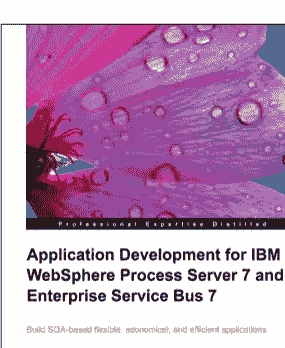
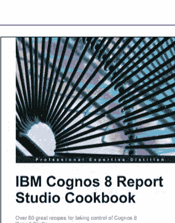
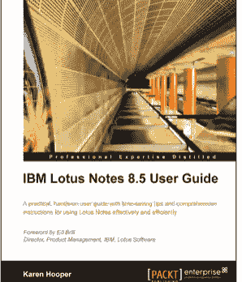
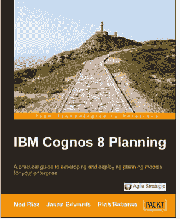
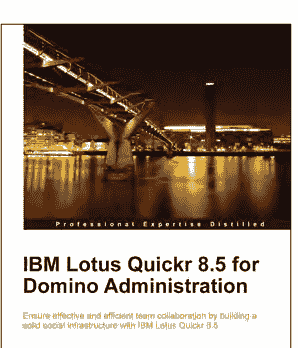
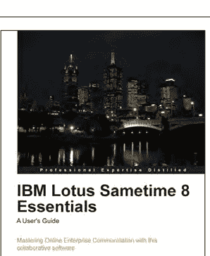
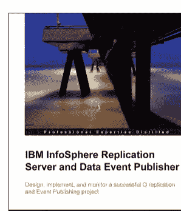
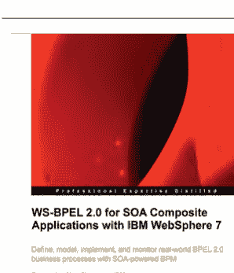

## 索引

- **符号**
- #CREATOR-OWNER 250
- .NET 客户端
  - 与 CEWS 用户 233
- /opt/ibm/dap/V6.2/bin/ldapsearch 命令 64
- **A**
- 访问控制项 (ACE) 241, 242
- 访问控制列表 (ACL)
  - 概述 241
  - 级别 244, 245
  - 权限 243, 244
  - 未使用的位 245
  - 用户和组访问 243
- Action.CodeModule 属性 220
- 适配器对象 258
- 附加组件
  - 概述 221
  - 优势 221
  - 编写 223
  - 组件 222
  - 创建 222
  - 安装 223
- AE
  - 概述 46, 73, 127, 151, 328
  - 与 XT 151
- AE UIS 328
- AIIM
  - 概述 17
  - DMA 17
  - ODMA 18
- AnnotatedObject 属性 255
- 注释基类 213
- 注释 213, 214
- 注释子类 214
- 匿名 236, 237
- API 传输
  - 概述 316
  - CEWS 传输 316, 317
  - 企业 JavaBeans (EJB) 传输 317
  - JAAS 上下文 319
  - 特定于传输的代码 319
  - 用户事务 318
- 应用程序引擎。参见 AE
- 应用程序，CM
  - FileNet 内容联合服务 4.5.1 295
  - IBM FileNet 应用程序引擎 4.0.2 和 WorkPlace XT 1.1.4 295
  - IBM FileNet 连接器，用于 SharePoint Web Parts V2.2 296
  - IBM FileNet 与 Microsoft Office 1.1 的集成以及 IBM FileNet 应用程序集成 295
  - IBM FileNet 服务，用于 Lotus Quickr 1.1.0 296
  - 企业内容管理系统的系统仪表板 4.5.1 295
  - WebDAV 服务器 296
- 应用程序服务器信任关系 230, 231
- ApplyStateId 属性 251
- 信息与图像管理协会。参见 AIIM
- 异步订阅 218
- 审计日志记录 219
- 身份验证 226
- 身份验证，在 CM 中
  - 概述 226, 227
- 匿名和来宾访问 236, 237
- 应用程序服务器信任关系 230, 231
- CEWS 客户端 232
- 模拟和以...身份运行 237, 238
- Java 身份验证和授权服务 (JAAS) 227–230
- 使用 CEWS 的 Java 客户端 232
- 单点登录 (SSO) 235, 236
- 厚 EJB 客户端 231
- **授权** 226
- **授权，在 CM 中**
  - #CREATOR-OWNER 250
  - 概述 240
  - 访问控制列表 (ACL) 241, 242
  - 默认实例安全 249, 250
  - 自主访问控制 240
  - 文档生命周期策略 250
  - 动态安全继承 252
  - 额外访问要求 247
  - 假设场景 263
  - 隐式规则 245
  - 强制访问控制 240
  - 标记控制属性 259
  - 修改访问请求 (MAR) 247, 248
  - 安全策略 250, 251
  - 安全模板 251
  - 目标访问请求 (TAR) 248
- **授权问题分析报告 (APAR)** 385
- **自动分类** 197

# B

- **BM 内容管理器** 70
- **引导** 400
- **精品** 326
- **BPF** 308
- **BPM** 11, 294, 308
- **业务流程框架。** 参见 **BPF**
- **业务流程管理。** 参见 **BPM**
- **业务，要求事项**
  - 限制流通 (RC) 文档 345
  - 限制数量 (RQ) 文档 344, 345

# C

- **CCL** 85
- **CCL** 另见 **COM 兼容性层**
- **CE**
  - 客户端安装 146, 147
  - 为 PE 配置 150
  - 部署功能 289
  - 企业目录 239
  - 安装 75
  - WAS 控制台调整 81–83
- **CE 4.5.1.4 客户端** 401, 402
- **CE 4.5.1.4 服务器** 395, 396
- **CE API**
  - 概述 314
  - API 传输 316
  - CEWS 3.5 协议 325
  - COM 兼容性层 325
  - 兼容性层 323
  - 数据，读取 314, 315
  - 数据，更新 315
  - Java 兼容性层 324
- **CE 客户端软件** 156
- **CE，为 CSE 配置**
  - 对象库，配置 138–141
  - P8 域，配置 137, 138
- **CE 安装**
  - 概述 75
  - 运行 CE 服务器安装程序 76
  - 配置管理器 76–80
  - 安装 FEM 83–87
  - 创建 ObjectStore 90–92
  - 启动 P8 域 88–90
  - 获取软件 75
- **CE Java API** 320
- **CE Java API，在 Eclipse 中**
  - 概述 329, 330
  - 应用程序代码 333–335
  - 运行应用程序 335, 336
  - CE API 依赖项 332, 333
  - 项目 330, 331
- **CE 元数据更改，DUCK 解决方案**
  - 概述 363
  - 注释子类 364
  - 审计日志记录配置 365, 366
  - 自定义文档属性 364
  - 自定义事件 364

- **CEMP** 23
- **CE .NET API**
  - 和 Java API 320
- **VS C# Express 中的 CE .NET API**
  - 关于 337
  - 应用程序代码 340, 341
  - 运行应用程序 342
  - CE API 依赖项 339
  - 创建项目 337
- **CE 服务器**
  - 重新部署已更新的 CE 服务器 398, 399
- **CE SQL** 125, 199
- **CE 拓扑**
  - 域 287
  - 服务器 287
  - 站点 287
  - 虚拟服务器 287
- **CE Web 服务 (CEWS)**
  - .NET 客户端和直接 CEWS 用户 233
  - 关于 232
  - 自定义身份验证和隧道传输 233
  - 委派身份验证 234, 235
  - 带有 Java 客户端 232
- **CEWS 3.5 协议** 325
- **CEWS 协议** 321, 322
- **CEWS 传输** 316, 317
- **CFS** 283
- **CFS-IS** 310
- **签入模型** 192
- **签出模型** 192
- **类定义**
  - 属性 210
- **类加载器配置** 159
- **类订阅** 217
- **集群**
  - 关于 284
  - 在 CM 中 284
- **CM**
  - 关于 93, 313
  - 组件 394, 395
  - 文档 380
  - 计划与场景 297
- **CM 组件**
  - 关于 294, 394, 395
  - 应用程序 295, 296
  - 连接器 295, 296
  - 环境组件 296, 297
  - 有限使用许可 294
  - 服务器组件 294
- **CMIS** 310, 311, 326, 327
- **CMS** 19
- **排序规则** 29
- **COM 兼容层** 325
- **COM 兼容层。** *另请参阅* CCL
- **COM 互操作** 325
- **公共语言运行时 (CLR)** 320
- **合规管理，ECM**
  - 关于 297, 298
  - 审计与报告 301
  - 分类 299
  - 声明 298, 299
  - 处置 299, 300
  - 保护 299
- **组件集成器** 173
- **复合文档** 197
- **CompoundDocumentState 属性** 197
- **配置对象，GCD**
  - 目录 96
  - 系统配置 96
- **连接器。** *参见* 应用程序，CM
- **容器管理身份验证 (CMA)** 160, 235
- **内容访问记录级别** 219
- **ContentAccessRecordingLevel 属性** 110
- **基于内容的检索 (CBR)** 129, 201
- **内容元素编号** 190
- **内容元素** 188
- **内容引擎。** *参见* CE
- **内容引擎 API。** *参见* CE APIs
- **内容引擎 (CE)** 23, 187
- **内容引擎多平台。** *参见* CEMP
- **内容引擎，P8 平台架构**
  - 关于 73
  - 内容 72
  - 域 72
  - 全局配置数据库 (GCD) 72
  - 元数据 72
- **内容引擎 Web 服务。** *参见* CEWS 传输
- **内容扩展操作** 173
- **用于图像服务的内容联合服务。** *参见* CFS-IS
- **内容集成**
  - 与工作流 281
- **ContentLocation URL** 349
- **内容管理互操作性服务。** *参见* CMIS
- **内容管理系统。** *参见* CMS
- **内容管理器。** *参见* CM
- **内容引用** 189
- **ContentReference 元素** 349
- **内容搜索引擎。** *参见* CSE
- **内容搜索引擎 (CSE) 组件** 201
- **内容存储**
  - 关于 281
  - 存储区域，类型 282
- **内容传输** 189
- **ContentType 属性** 190
- **贡献的 ACE** 253
- **CopyToReservation 属性** 210
- **创建类向导** 123
- **创建属性模板向导** 118
- **Creator 属性** 246
- **CRUD** 188
- **CSE**
  - 关于 74, 129
  - 通过 FEM 配置 CE 136
  - 命令行配置，步骤 133, 134
  - 通过 K2 Dashboard 配置 134, 136
  - 注意事项 288
  - 运行安装程序 130-132
  - 配置对象存储 138-141
  - 配置 P8 域 137, 138
  - 用户 130
  - 工作步骤 129
- **CSE 4.5.1.1 客户端** 396
- **CSE 4.5.1.1 服务器** 397, 398
- **自定义应用程序**
  - 注意事项 273
- **自定义对象** 212

## D
- **达尔文信息类型架构。** *参见* DITA
- **达尔文信息类型架构 (DITA) 发布** 198
- **数据库引擎 (DB2)** 127
- **数据库调优** 411, 412
- **数据模型** 356
- **DateContentLastAccessed 属性** 219
- **DB2** 393
- **DB2 客户端软件** 144, 145
- **DB2 数据库和表空间** 143
- **DB2 安装，环境组件配置**
  - 关于 40, 41
  - 和 WAS 51
  - 创建缓冲池定义 42
  - 删除默认用户表空间 42
  - 创建新数据库 42
  - 创建 OSTORE1 数据库 45
  - 设置参数 45
  - 具体要点 40
  - 创建表空间 43
  - 将用户添加到数据库 44, 45
- **DB2 用户权限** 144
- **DB2 Workgroup Server Edition 9.5**
  - 用于 FileNet Content Manager 4.5.1 297
- **去重功能，IBM Content Collector (ICC)** 305
- **DefaultInstanceOwner** 210
- **DefaultInstancePermissions** 210
- **DefaultInstancePermissions 属性** 249
- **DeletionAction** 212
- **DeletionAction 属性** 212
- **部署** 400
- **部署功能，CE**
  - 内容缓存 289
  - 请求转发 290
- **桌面快捷方式** 66
- **开发工具包 (JDK)** 329
- **DIME** 323
- **直接 Internet 消息封装。** *参见* DIME
- **目录，环境组件配置**
  - CE 特定条目 63
  - 组 62
  - 手动 TDS 查询 64
  - 填充 55
  - 服务器端排序 59
  - 后缀 59
  - TDS Web 控制台设置 56-58
  - 用户 60-62
  - 使用 54
- **灾难恢复 (DR)**
  - 关于 285
  - 规划因素 285, 286
- **自主访问控制** 240
- **分布式部署**
  - 带宽 286
  - CE 拓扑 287
  - 常见配置 291
  - CSE 注意事项 288
  - 延迟 287
  - PE 注意事项 288
  - 规划因素 286
- **DITA** 311
- **DMA** 17
- **DNS** 37
- **文档**
  - 关于 188
  - 添加 349, 350
  - 自动分类 196
  - 自动分类 197
  - 签入模型 192
  - 签出模型 192
  - 复合文档 197
  - 内容元素编号 190, 191
  - 内容元素 188
  - 内容引用 189, 190
  - 内容传输元素 189, 190
  - 达尔文信息类型架构 (DITA) 发布 198
  - 查看详细信息 350, 351
  - 生命周期 195, 196
  - MajorVersionNumber 194
  - MinorVersionNumber 194
  - 修改 352, 353
  - 多个内容元素 189
  - 呈现引擎 198
  - 限制分发 (RC) 文档 352
  - 限制数量 (RQ) 文档 351, 352
  - 冻结版本 193
  - 版本控制 191, 192
- **文档，CM**
  - IBM developerWorks 384
  - IBM Redbooks 383, 384
  - 信息中心 380, 381
  - 其他链接 382
  - 独立文档 381, 382
  - 全球 IBM ECM 社区 384
- **文档生命周期** 195
- **文档生命周期策略** 252
- **DocumentLifecyclePolicy 属性** 252
- **文档管理联盟。** *参见* DMA
- **文档属性**
  - 关于 356
  - 限制指示符 357
- **受控文档。** *参见* DUCk
- **域**
  - 组件 95
  - GCD 94
  - 拓扑级别 98
- **域级项目**
  - AddOn 102
  - AddOns 95
  - 内容缓存 109
  - 内容配置 105, 106
  - 浏览 100, 101
  - FCD 103
  - 营销集 96
  - 服务器缓存配置 103, 104
  - 跟踪日志 106, 107
  - 跟踪日志，组织 108
- **域名服务。** *参见* DNS
- **领域特定语言。** *参见* DSLs
- **DUCk** 343
- **Duck 项目** 371-373
- **DUCk 解决方案**
  - 注释子类 364
  - 审计日志配置 365, 366
  - CE 元数据更改 363
  - 修改代码模块 368-370
  - 自定义文档属性 364
  - 自定义事件 364, 365
  - 调试日志 370, 371
  - Duck 项目 371-373
  - DuckRQB 项目 367, 368
  - 部署 Duck.war 374
  - 导出 Duck.war 374
  - 配置事件处理程序代码模块 366
  - 新代码模块 368
- **Duck.war**
  - 部署 374
  - 部署描述符 375
  - 导出 374
  - 选择 JSF 运行时 376
  - 配置角色映射 377
  - 部署到 WAS 376
- **重复抑制。** *参见* 去重功能，IBM Content Collector (ICC)
- **dW ECW Zone**
  - URL 384
- **动态引用包含关系 (DRCR)** 205
- **动态安全继承**
  - 关于 252
  - 文件夹，作为适配器 259
  - 可继承深度 253
  - 对象值属性 (OVPs) 253
  - 父级和子级安全对象 253
  - 项目团队，适配器 257, 258, 259
  - 项目团队，示例 256, 257
  - 角色和适配器 256
  - SecurityProxyType 属性 254
  - 系统定义的继承 255

## E
- **EAR 文件部署** 156
- **Eclipse**
  - CE Java API 329, 330
- **ECM**
  - 关于 8, 9
  - 附加组件 14
  - 合规管理 297
  - 企业互操作性 14
  - 可扩展性 14
  - 特性 12
  - 非 CMS 20
  - 非数据库 20
  - 通知 15
  - 非 SCM 20
  - 合作伙伴生态系统 14
  - 平台支持 13
  - 安全存储库 13
  - 可伸缩性 14
  - 标准 16
  - 强大的 API 15
  - 强大的安全功能 13
  - 传统文档管理功能 15, 16
  - 触发器 15
  - 用例 9
  - 供应商 14
- **ECM，标准**
  - 关于 16
  - AIIM 17
  - CMIS 19
  - JCR 19
  - WebDAV 18
- **ECM 小部件** 327
- **ECM 小部件。** *参见* IBM Enterprise Content Management Widgets
- **eDA** 302
- **电子发现 (eD)**
  - IBM eDiscovery Analyzer (eDA) 302
  - IBM eDiscovery Manager (eDM) 303
- **eDM** 303
- **EJB 传输** 317
- **电子发现。** *参见* 电子发现 (eD)
- **ElementSequenceNumber** 190
- **电子邮件**
  - 用于电子邮件的 ICC 304
- **最终用户视图，设计**
  - 关于 345, 346
  - 常见登录屏幕 346
  - 查找文档 347, 348
- **企业内容管理。** *参见* ECM
- **企业目录** 239
- **Enterprise JavaBean 传输。** *参见* EJB 传输
- **企业需求，DUCK 应用程序** 354
- **条目模板**
  - 关于 172
  - 创建 172
- **环境组件配置**
  - 关于 33
  - 安装 DB2 40
  - 使用目录 54
  - 组帐户 34, 35
  - Red Hat Enterprise Linux 36
  - 安装 Tivoli Directory Server 52
  - 用户 34, 35
  - WAS 45
- **环境组件**
  - 关于 25
  - 应用程序服务器 30
  - 配置 33

database components, using 28
databases 30
directory components, using 28
directory servers 30
hardware requirements 29, 30
installation guides 30
operating systems 30
software requirements 29, 30
storage devices 30
tailored planning 30
environmental components, CM
  DB2 Workgroup Server Edition 9.5, for
    FileNet Content Manager 4.5.1 297
  WebSphere Application Server 6.1 and 7.0,
    for FileNet Content Manager 4.5.1 296
event 216, 217
EventActionHandler interface 220
event handler code module, DUCK solution
  code module, modifying 368-370
  debug logging 370, 371
  deploying 366
  DuckRQB project 367, 368
  new code module 368
event handlers 220
Event object 219

## F

FCD 103
FCDs 283
FCP 380
federation 283
FEM 32, 83, 93
  about 127, 165
  CE configuring, for CSE 136
  Object Store, configuring 138-141
  P8 Domain, configuring 137, 138
FileNet
  history 22, 23
FileNet Certified Professionals. See FCP
FileNet Content Federation Services 4.5.1
  295
FileNet Enterprise Manager. See FEM; See
  FEM
file systems
  ICC for 304
Fixed Content Devices. See FCD

fix packs
  about 391, 392
  installing 393
fix packs, installing
  CE 4.5.1.4 clients 401, 402
  CE 4.5.1.4 server 395, 396
  CM components 394
  CSE 4.5.1.1 client 396
  CSE 4.5.1.1 server 397, 398
  supporting components 393, 394
  updated CE server, redeploying 398-400
  XT 1.1.4.8 402-404
folders and containment
  about 204
  containment names 207
  filling 205, 206
  referential containment 204, 205
freezing, document version 193
functional tier deployments
  CE 272
  database 272
  diagram 270
  PE 272
  session state 271, 272
  web browser 270, 271
  web server 271, 272

## G

GCD
  about 94, 272
  components 95
  configuration objects 96
  Domain 94
  domain-level items 95
  pointers to components 96
  properties 95
GetContent servlet 349
Global Configuration Database. See GCD
groupOfNames class 60
guest access 236

## H

High Availability (HA) 285
hypothetical scenario
  business requirements 263, 264
  implementation 265, 266
players 263
strategy 265
test 267

## I

IBM Classification Module. See ICM
IBM Content Analytics. See ICA
IBM Content Collector. See ICC
IBM Content Integrator 8.5.1 295
IBM developerWorks (dW) 384
IBM documents
environment, planning 27
environment, preparing 27
Fix Pack Compatibility Matrix 28
infocenter 26
P8 documents 26
IBM ECM Widgets. See IBM Enterprise Content Management Widgets
IBM eDiscovery. See eDiscovery (eD)
IBM eDiscovery Analyzer. See eDA
IBM eDiscovery Manager. See eDM
IBM Enterprise Content Management Widgets 309
IBM Enterprise Records (IER) 298
IBM FileNet Application Engine 4.0.2 and WorkPlace XT 1.1.4 295
IBM FileNet Business Process Framework 308
IBM FileNet Business Process Manager (BPM)
about 141, 308
IBM Enterprise Content Management Widgets 309
IBM FileNet Business Process Framework 308
IBM FileNet Capture and Datacap 310
IBM FileNet Connector
for SharePoint Web Parts V2.2 296
IBM FileNet Content Engine 4.5.1 294
IBM FileNet Content Manager (CM) system 379
IBM FileNet Content Search Engine 4.5.1 294
IBM FileNet Image Services (IS) 309
IBM FileNet Integration for Microsoft Office 1.1 and IBM FileNet Application
Integration 295
IBM FileNet Process Engine 4.5.1 294
IBM FileNet Services
for Lotus Quickr 1.1.0 296
IBM FileNet System Monitor 309
IBM Redbooks 383, 384
IBM's business partners 380
IBM System Dashboard for ECM (SD)
about 162
configuration 162
ICA 311
ICC
about 303
deduplication feature 305
for Email 304
for file systems 304
for Microsoft SharePoint 304
task connectors 304
ICM 305, 306
IDE 22
Id property 208
IETF 18, 279
ImmediateSubclassDefinitions properties 210
impersonation 237
implicit rules
object owner 246
object store administrator 246
special query right 247
Information On Demand (IOD)
about 387
conference 387
IOD Global Conference 387
Regional IOD conference 387
infrastructure, Smart Archive Strategy 307
ingestion, Smart Archive Strategy 307
inheritable depth 253
InheritableDepth property 253
installing
CE 75
FEM 83
Installing Tivoli Directory Server. See TDS
instance subscription 217
Integrated Development Environment. See IDE
Integrated Windows Authentication (IWA) 342
interim fixes 389, 390
Internet Engineering Task. See IETF
Internet Engineering Task Force. See IETF
intersection mode 200
IOD Global Conference 387
IsolatedRegionNumber property 220
isolation 410, 411
IsSystemOwned property 211

## J

JAAS context 319
JAAS Subject 154
Java Archive (JAR) 220
Java Authentication and Authorization Service (JAAS) 227, 228
Java clients
  with CEWS 232
Java compatibility layer 324
Java Database Connectivity (JDBC) 202
Java Runtime Environment (JRE) versions 320
JavaServer Faces (JSF) 371
JOIN construct 201

## K

K2 Dashboard
  used, for configuring CSE 134, 136
Keyword Search 182

## L

LDAP
  configuring 152, 153
LDAP directory server (Tivoli) 127
Least Recently Used. See LRU
Lightweight Directory Access Protocol (LDAP) 239
Lightweight Third Party Authentication. See LTPA
LRU 289
LTPA
  about 154
  keys, exporting 154

## M

management, Smart Archive Strategy 307
mandatory access control 240
many-to-many relationships 214
Marking.ConstraintMask property 261
marking-controlled property 259
Marking.MarkingValue property 260
marking set
  about 259, 260
  example 261, 262
merged scope query 200
Message Transmission Optimization Mechanism. See MTOM
metadata, Object Store-level items
  about 114
  Choice Lists node, selecting 115, 116
  classes 116
  Property Template 114, 115
  subclassing example 117-124
Microsoft SharePoint
  ICC for 304
Microsoft Management Console. See MMC
MIME 322
MimeType property 190, 208
MMC 84
Model-View-Controller (MVC) framework 151
model-view-controller (MVC) web applications 328
Modification Access Required (MAR) 247, 248
MTOM 322
multi-factor authentication 227
multiple content elements 189
Multipurpose Internet Mail Extensions. See MIME

## N

Name property 208
navigational overview, DUck application 354, 355
Network Deployment (ND) edition 29
network security
configuring 278
firewalls 279
SSL 278
TLS 278
Network Time Protocol. See NTP
NTP 37

## O

OASIS 19
object owner 246
ObjectStore 72
object store administrator 246
Object Store-level items
auditing 111
cache configuration 113
Checkout Type 111
ContentAccessRecordingLevel property 110, 111
exploring 110
metadata 114
Object Browse 124
Query 124, 125, 126
repository objects 109
Text Index Date Partitioning 112
Object Stores
partitioning 277, 278
ODMA 18
online support resources
about 385
fix central 386
personalized notifications 386
PMRs and APARs 385
support portal 385
technotes 385
Open Document Management API. See ODMA
ORB uniqueness 160
Organization for the Advancement of Structured Information Standards. See OASIS
Owner property 246

## P

P8 Domain 94
P8 platform architecture
about 70
Application Engine (AE) 73
Content Engine 71
Content Search Engine (CSE) 74
Process Engine (PE) 74
Rendition Engine (RE) 74
parallel environments, building
development environment 274, 275
domains, requiring 275, 276
multiple Domains, using 276
pre-production environment, need for 274
parent and child security objects 253, 254
Parent property 255
PDF 26
PE 74, 172
PE APIs 326
PE client software 157
Permissions property 249
PersistenceType property 211
PE server
about 220
CE client, installation 146, 147
CE configuration 150
client software 151
configuration 147-149
connections, testing 150
database configuration 143
DB2 client software 144, 145
DB2 Database and Tablespaces 143
DB2 user permissions 144
installation 145, 146
installing, steps 142
shared memory 149
users and groups 142, 143
pointers to components, GCD
Content Cache Areas 96
Fixed Content Devices 96
ObjectStores 96
PE Connection Points and Isolated Regions 96
Text Search Engine 96
Pointers to components, GCD
Rendition Engines 96
Portable Document Format. See PDF
Problem Management Report (PMR) 385
Process Designer (PD) 221
Process Engine. See PE
Process Engine server. See PE server

- 产品发布 387、389
- 项目团队
  - 关于 256、257
  - 适配器 257、258
- 属性，GCD
  - 数据库模式 95
  - 名称和 ID 95
  - 权限 95
- PropertyDefinition.ModificationAccessRequired 属性 248
- PropertyDefinitionObject.TargetAccessRequired 属性 249
- 属性定义
  - 属性 210-212

### Q

- 查询
  - 手动 TDS 查询 64

### R

- Rational Application Developer (RAD) 329
- RE
  - 关于 74、198、163
  - 安装 164
  - 用例 163
- Red Hat Enterprise Linux
  - 关于 36
  - 文件存储区 38
  - 防火墙 39
  - 网络地址 37
  - 系统时钟 37
  - 不必要的端口 39
- 引用包含 204
- ReferentialContainmentRelationship 对象 255
- 引用包含关系 (RCR) 205
- ReflectivePropertyId 212
- 区域 IOD 大会 387
- 发布和修复
  - 关于 387
  - 修复包 391、392
  - 临时修复 389、390
  - 产品发布 387、389
- Rendition Engine。参见 RE
- 渲染支持 198
- 表述性状态传输。参见 REST
- RequiredClassId 211、212
- 资源 379
- REST 272
- 受限流通 (RC) 文档 345
  - 关于 352
  - 访问控制 359
  - 访问日志 358、359
  - 访问请求 359、360
- 受限数量 (RQ) 文档 344
  - 关于 361
  - 问题 361、362
- RetrievalName 文件扩展名 190
- RetrievalName 属性 190
- RHEL 393
- 角色对象 256
- run-as 237

### S

- SCM 21
- 范围 200
- 脚本
  - down.sh 66
  - up.sh 65
- SD。参见 IBM System Dashboard for ECM (SD)
- 搜索
  - 关于 199、200
  - JDBC 提供程序 202
  - 合并模式 200
  - 属性搜索 201、202
  - 可搜索属性 201
  - 搜索模板 (ST) 203
  - 可选择属性 201
  - 存储搜索 (SS) 203
  - 文本搜索 201、202
- Search Designer (SD) 183
- CM 搜索
  - 关于 180
  - 高级搜索 182、183
  - 关键字搜索 182
  - 搜索模板 (ST) 183、184
  - 简单搜索 181
  - 存储搜索 (SS) 183、184
- 搜索模板 (ST) 203
- 安全套接层。参见 SSL
- SecurityFolder 属性 255、259
- 安全模型 356
- SecurityParent 属性 255
- 安全策略
  - 与文档生命周期策略 250
  - 与安全模板 251
- SecurityPolicy 属性 251
- SecurityProxyType 属性 253、254
- SELECT 子句 201
- 服务器组件，CM
  - IBM FileNet Content Engine 4.5.1 294
  - IBM FileNet Content Search Engine 4.5.1 294
  - IBM FileNet Process Engine 4.5.1 294
- Settability 属性 211
- 单实例存储。参见 IBM Content Connector (ICC) 的重复数据删除功能
- 单点登录。参见 SSO
- Smart Archive Strategy
  - 关于 306
  - 基础设施 307
  - 摄取 307
  - 管理 307
- SOAP 323
- 源代码管理。参见 SCM
- 源文档 198
- SSL 278
- SSO 157、235、236、328
- 粘性会话 284
- 存储区，内容存储
  - CFS 283
  - Database Storage Area 282
  - FCDs 283
  - File Storage Area 282
- 存储搜索 (SS) 203
- 结构化查询语言 (SQL) 199
- Subscribable.raiseEvent(CustomEvent) 方法 217
- 订阅
  - 关于 217
  - 异步订阅 218
  - 同步订阅 218
- su 命令 65
- SuperclassDefinition 属性 210
- 支持平台
  - 考虑因素 280
- 同步订阅 218
- System Dashboard。参见 IBM System Dashboard for ECM (SD)
- System Dashboard for Enterprise Content Management 4.5.1 295
- 系统定义继承 255

### T

- 标记图像格式文件。参见 TIFF
- 目标 198
- Target Access Required (TAR) 248
- 目标环境
  - 关于 31
  - 硬件组件要求 33
  - 软件组件要求 31
- Task connectors 304
- TDS
  - 关于 52、393
  - 事件列表 53
  - 启动安装程序 52
  - 安装 52
  - Server Instance Administration Tool 53
- 厚 EJB 客户端 231
- TIFF 170、213
- TLS 278
- 拓扑级别，Domain
  - Domain 98
  - 服务器 99
  - 站点 98
  - 使用 100
  - 查看 98
  - 虚拟服务器 99
- 跟踪日志 410
- 传统文档管理功能
  - 审计 16
  - 历史 15
  - 元数据 16
  - 导航 16
  - 报告 16
  - 搜索 16
  - 版本控制 15
  - 工作流集成 16
- 传输 316
- 传输层安全。参见 TLS
- 传输特定编码 319
- 故障排除
  - 关于 404
  - 身份验证 407-409
  - 初始配置 406、407
  - 性能 409
  - WAS 启动信息 409
- 故障排除，性能
  - 关于 409
  - 数据库调优 411、412
  - 隔离 410、411
  - 跟踪日志 410
- 故障排除，防止
  - 备份 405
  - 配置控制 404
  - 快照 405
- 隧道 234
- 典型分布式部署
  - 远程应用程序和 CE 层配置 292
  - 远程应用程序层 291

### U

- 联合模式 200
- 非受限文档 344
- ECM 用例
  - 中央文档存储库 9、10
  - 合规性 10、11
  - 以文档为中心的工作流 11
  - 治理 10、11
- userPassword 属性 62
- 用户令牌 157
- UserTransaction 318

### V

- 版本控制
  - 关于 176-191
  - InProcess (值 2) 194
  - Released (值 1) 194
  - Reservation (值 3) 194
  - Superseded (值 4) 194
  - 版本系列 191
  - VersionSeries.Versions 191
- Victoria Electronic Records Strategy (VERS) 298
- VS C# Express
  - CE .NET API 337

### W

- WAS 393
- WAS，环境组件配置
  - 与 DB2 51
  - 性能调整 50
  - 端口 46、47
  - 进程属性 48-50
  - 配置文件 46、47
- WAT 151、328
- Web Application Toolkit。参见 WAT
- WebDAV Server 296
- Web Services Extensible Authentication Framework (WS-EAF) 234
- Web Services Extensions。参见 WSE
- Web Services Interface。参见 WSI transport
- WebSphere Application Developer (WSAD) 329
- WebSphere Application Server。参见 WAS，环境组件配置
- WebSphere Application Server 6.1 和 7.0 for FileNet Content Manager 4.5.1 296
- WHERE 子句 201
- WjcFormat 属性 119
- WjcWorkOfLiterature.Permissions 属性 248
- WorkFlo 22
- 工作流
  - 内容集成 281
- WorkflowDefinition 221
- 工作流交互
  - 关于 172
  - Fixed Approval Workflow 175
  - 一次性隔离区域设置 173、174
  - XT，任务 175
- Workplace Application Engine UI Service。参见 AE UIS
- Workplace XT。参见 XT
  - 关于 166、167
  - 添加文档 168-170
  - 查看文档 170、171
  - Entry Templates 172
  - 添加文件夹 167、168
  - 属性 179、180
  - 安全 179、180
- Workplace XT。另见 XT
- 全球 IBM ECM 社区 384
- WSE 85
- WSI transport 317
- XT
  - 关于 127、151
  - 部署 158、159
  - 安装过程 152
  - 运行安装程序 155、156
  - LDAP 配置 152、153
  - LTPA 154
  - 部署前配置 157、158
  - 运行 160、161
  - 信任关系 154
- XT 1.1.4.8 402-404
- XT，部署
  - 类加载器配置 159
  - ORB 唯一性 160
  - 特殊主题映射 160

### Z

- ZeroClick 技术 298

## [PACKT] enterprise

PUBLISHING

professional expertise distilled

## Application Development for IBM WebSphere Process Server 7 and Enterprise Service Bus 7

ISBN: 978-1-847198-28-0      Paperback: 548 pages

Build SOA-based flexible, economical, and efficient applications

- 1. Develop SOA applications using the WebSphere Process Server (WPS) and WebSphere Enterprise Service Bus (WESB)
- 2. Analyze business requirements and rationalize your thoughts to see if an SOA approach is appropriate for your project
- 3. Quickly build an SOA-based Order Management application by using some fundamental concepts and functions of WPS and WESB

## IBM Cognos 8 Report Studio Cookbook

ISBN: 978-1-849680-34-9      Paperback: 252 pages

Over 80 great recipes for taking control of Cognos 8 Report Studio

- 1. Learn advanced techniques to produce real-life reports that meet business demands
- 2. Tricks and hacks for speedy and effortless report development and to overcome tool-based limitations
- 3. Peek into the best practices used in industry and discern ways to work like a pro
- 4. Part of Packt's Cookbook series—each recipe is a carefully organized sequence of instructions to complete the task as efficiently as possible

Please check www.PacktPub.com for information on our titles

## IBM Lotus Notes 8.5 User Guide

ISBN: 978-1-849680-20-2     Paperback: 296 pages

A practical hands-on user guide with time saving tips and comprehensive instructions for using Lotus Notes effectively and efficiently

- 1. Understand and master the features of Lotus Notes and put them to work in your business quickly
- 2. Contains comprehensive coverage of new Lotus Notes 8.5 features
- 3. Includes easy-to-follow real-world examples with plenty of screenshots to clearly demonstrate how to get the most out of Lotus Notes

## IBM Cognos 8 Planning

ISBN: 978-1-847196-84-2     Paperback: 424 pages

A practical guide to developing and deploying planning models for your enterprise

- 1. Build and deploy effective planning models using Cognos 8 Planning
- 2. Filled with ideas and techniques for designing planning models
- 3. Ample screenshots and clear explanations to facilitate learning
- 4. Written for first-time developers focusing on what is important to the beginner
- 5. A step-by-step approach that will help you strengthen your understanding of all the major concepts

Please check www.PacktPub.com for information on our titles

[PACKT] enterprise
PUBLISHING
professional expertise distilled

## IBM Lotus Quickr 8.5 for Domino Administration

ISBN: 978-1-849680-52-3      Paperback: 250 pages

通过 IBM Lotus Quickr 8.5 建立坚实的社交基础设施，确保团队协作高效有效

- 1. 全面了解 IBM Lotus Quickr 8.5 团队协作、存储库和连接器
- 2. 升级到最新版 IBM Lotus Quickr 8.5 的推荐最佳实践
- 3. 在不费太多力气的情况下，按您的设计自定义标志、颜色、模板等

## IBM Lotus Sametime 8 Essentials: A User's Guide

ISBN: 978-1-849680-60-8      Paperback: 284 pages

借助这款协作软件掌握在线企业通信

- 1. 通过使用 Sametime 的即时消息和在线会议等功能，与组织内部和外部的同事和团队成员安全协作
- 2. 与其他即时消息服务和用户通信，例如 AOL 即时消息、Yahoo 即时消息和 Google Talk，并了解某人的在线状态如何帮助您更快、更高效地沟通

[PACKT] enterprise
PUBLISHING
professional expertise distilled

## IBM InfoSphere Replication Server and Data Event Publisher

ISBN: 978-1-849681-54-4        Paperback: 344 pages

设计、实施和监控成功的 Q replication 和事件发布项目

- 1. 涵盖实施成功 Q replication 项目所需的工具集
- 2. 面向 Linux、Unix 和 Windows 操作系统，同时许多概念也适用于 z/OS
- 3. 专门有一章介绍 DB2 DBA 的 WebSphere MQ
- 4. 以对话式且易于遵循的方式撰写

## WS-BPEL 2.0 for SOA Composite Applications with IBM WebSphere 7

ISBN: 978-1-849680-46-2        Paperback: 644 pages

使用 SOA 驱动的 BPM 定义、建模、实现和监控现实世界的 BPEL 2.0 业务流程

- 1. 使用 IBM 的 WebSphere SOA 平台开发 BPEL 和 SOA 复合解决方案
- 2. 对高级主题进行详细解释，例如安全、事务、人工作流、动态流程、故障处理等，使您能够更智能地工作

请访问 www.PacktPub.com 查看我们的图书信息

