## 什么是 Lumion？

Lumion 是一款功能强大、易于使用、有趣且高效的建筑可视化工具，任何人都可以借助它构建 3D 环境，然后创建精美的图像、令人印象深刻的视频演示和实时漫游。它是将 3D 模型快速拾取并在数分钟内创建场景的最快方式。本章将帮助你更好地了解 Lumion，并通过快速入门，你将立即开始使用 Lumion。

在本章中我们将涵盖以下主题：

- 为什么使用 Lumion？
- 我们能从 Lumion 获得什么？
- 版本之间的差异
- 导入格式
- 工作站规格
- Lumion 的界面
- Lumion 内部导航
- 使用 Lumion 工作

本章是对 Lumion 的非常概括性的概述。我会尽量避免用太多背景信息让你感到厌烦，但你将了解到该软件旨在让你做什么、它与其他 3D 替代方案相比如何，以及所有内容在哪里。

### Lumion 背景

首先，让我们讨论一下 Lumion 的简要历史。Act-3D 是 Lumion 的开发公司，你可能从 Quest3D 以及他们参与的其他一些项目中认识他们。然而，Act-3D 意识到众多客户都在使用 Quest3D 来制作建筑可视化。这是一项困难的任务，因为 Quest3D 并不是创建此类内容的最佳工具。事实上，使用 Quest3D 并非易事；你几乎需要成为一名大师才能创作出东西。最终，Act-3D 决定以这些客户为目标开发全新的软件。于是，Lumion 诞生了，它拥有实时可视化工具的强大功能，同时又对每个人都易于访问。

### 为什么使用 Lumion？

简短的回答是 Lumion 易于使用，最终产品质量良好。详细的回答是每个建筑项目都需要技术图纸和文档。虽然这些技术信息对施工团队来说没问题，但通常客户并不知道 CAD 平面图是什么意思。他们可能知道厨房或客厅会在哪里，但将这些 2D 信息转化为 3D 在客户脑海中并不总是容易。如果我们需要做演示或试图销售尚未建成的东西，这可能会成为问题。说实话，一张图片比文字更有说服力。这就是 Lumion 登场的地方。Lumion 是渲染高质量静止图片和视频的最快方式，并且它使从任何 3D 建模软件（如 SketchUp、AutoCAD、Revit、ArchiCAD 和 3ds Max）导入我们的 3D 模型并在数分钟内创建场景变得如此简单。因此，Lumion 3D 不仅因为渲染速度更快而成为独特的建筑可视化软件，也因为它非常用户友好且直观。

我们可以使用 Lumion 创建建筑可视化的另一个原因是，我们可以在一天中的任何时间或任何季节，以几分钟的时间就能很好地了解我们的项目在自然环境中会是什么样子。现在如果你是一名建筑师，毫无疑问你希望以最好的方式提升项目的特点。Lumion 可以帮助你在数小时内实现这一点，而不是不可避免的数天数周的渲染时间。

尽管如此，我们可以从这个应用程序中获得如此之多，以至于你会忘记照片级逼真的渲染。Lumion 是一个功能强大且先进的 3D 引擎，允许我们处理更重的模型，并且我们可以通过点击拖拽技术让场景栩栩如生。

为此，Lumion 配备了一个庞大的库，我们可以在其中找到：

- 2409 棵树、交通工具、室外和室内模型以及人物的模型
- 103 种环境、人物和机器音效
- 518 种材料和纹理类型
- 28 种景观类型

除了这份庞大的收藏外，还有更多可添加的功能；我们可以在场景中加入逼真的水体（海洋、河流、游泳池、瀑布和喷泉），我们可以塑造地形以适应我们的需求，并且我们可以添加雨、雪、雾、风、动画对象，以及添加摄像机特效。

你只需要一个空白的 3D 模型；导入并开始工作，因为正如你所见，Lumion 几乎配备了我们创建建筑可视化所需的一切。

### Lumion 各版本之间的差异

Lumion 有不同的版本。让我们从最基础的开始，即 **Lumion Free**。此版本只是为了分析 Lumion 是否是我们真正需要的。Lumion Free 不用于商业用途，最终输出会带有 Lumion 标志的水印。我们可以访问一些模型和功能，但不是整个收藏。

> 要下载最新版本的 Lumion Free，请使用此链接：
> 
> http://lumion3d.com/free/.
> 
> 如果你是学校、学院或教育机构，请使用 **Lumion Educational** 或购买 **Lumion Pro**。同样，每个版本可获得的内容存在一些限制。要了解有关 Lumion Educational 许可证的更多信息，请访问以下链接：
> 
> http://lumion3d.com/educational/.

然后，我们有付费版本。有两个选项：**Lumion** 和 **Lumion Pro**。Lumion 是标准版本，拥有大部分功能和内容。Lumion PRO 是专业工作室最理想的版本，因为你可以访问所有功能和内容。使用 Lumion PRO，我们可以获得超过 2000 个模型、3D 音效和动画角色。如果我们已有旧版本，例如 Lumion 3D 版本 2，升级成本与其他应用程序相比更低——这是 Lumion 相对于其他应用程序的一个优势。

### 导入我们的 3D 模型

使用 Lumion 时的导入工作流程非常出色。我们可以连同纹理一起导入 3D 模型，并且如果我们想渲染，模型就已准备就绪。另一个有用的功能是更新模型的能力。我们做出所需的更改，导出并使用相同名称保存，即覆盖模型。然后，Lumion 通过一个重新加载按钮处理这种情况。因此，Lumion 将重新导入模型并重新应用相同的材质。

Lumion 支持许多格式，例如以下：

- 3D 格式：
  - **Autodesk RealDWG:** *.dxf
  - **Autodesk RealDWG:** *.dwg
  - **COLLADA file:** *.dae
  - **FBX file:** *.fbx
  - **Max file:** *.max
  - **3ds file:** *.3ds
  - **Obj file:** *.obj
  - **SketchUp file:** *.skp
- 2D 格式：
  - **Windows Bitmap:** *.bmp
  - **Joint Photographic Experts Group:** *.jpg
  - **Truevision:** *.tga
  - **DirectDraw Surface:** *.dds
  - **Portable Network Graphics:** *.png
  - **Photoshop:** *.psd
  - **Tagged Image File Format:** *.tiff
  - **High Dynamic Range:** *.hdr
- 视频格式：
  - **MPEG-4 Part 14:** `*.mp4`

Lumion 还允许我们导入、移动、旋转和缩放动画。帧率需要设置为 25 FPS，并且 Lumion 对 FBX 文件的工作效果更好。

在 Lumion 中无法导入顶点动画、变形动画或基于骨骼的动画。我们可以使用 FBX 文件导入动画，只要这些动画仅在移动、旋转和缩放值上即可。如果你使用 Revit，Act-3D 已为 Revit 开发了一个 COLLADA 导出插件，你可以免费下载。

### 工作站规格

我们需要一台良好的工作站来使用 Lumion。有一些基本要求，但不必太担心。为什么？让我举个例子：推荐的系统内存为 6 GB，但我只用 4 GB 就完成了几个项目。下载 Lumion Free，看看你的工作站能否胜任。Lumion 附带了一些示例，可以帮助你评估这一点。

Lumion 建议以下最低要求：

- **OS:** Windows XP、Vista、7、8（32 位和 64 位）以及 DirectX 9.0c 或更高版本
- **System memory:** 3 GB
- **Graphics card:** NVIDIA GeForce GTS 450 或 ATI/AMD Radeon HD 4890，至少 1 GB 专用内存（非共享系统内存）

但要获得最大性能，需要以下配置：

- **OS:** Windows 7、8（64 位）
- **System memory:** 6 GB
- **Graphics card:** NVIDIA GTX 680 或 AMD Radeon HD 7970 或更快，至少 2 GB 专用内存（非共享系统内存）

## Lumion 的 3D 界面

现在我们已经知道使用 Lumion 可以做什么以及有哪些可用内容，我们将花一些时间来探索 Lumion 并上手操作。在我看来，也根据我的经验，如果在学习的同时应用所学内容，学习起来会容易得多。所以，在下一节中我们将探索 Lumion 的界面、菜单和不同的设置。但为了做到这一点，我们将使用一个小型教程作为快速入门。通过这样做，我们将探索 Lumion，同时也能看到制作出优秀成果是多么容易。在本章之后，我们就可以在后续章节中继续完善我们的技能和技巧。我们会发现 Lumion 比其他软件更容易学习、更易上手。

那么，打开 Lumion 吧，让我们在开始使用它之前先做一次快速浏览。我会向你解释每个标签页的作用，帮助你了解如何执行简单任务，例如保存和加载场景、更改设置以及创建新场景。让我们从 Lumion 显示的第一个标签页开始。

### 初识 New 标签页

启动时，Lumion 会直接进入 **New tab**。**New tab** 如其名所示，是创建新场景时很好的起点。我们可以基于几个预设创建新场景，也可以创建空场景。我们可以从 **Night, Sunset, Sunny Day, Flatlands, Island, Lake, Desert, Cold Climate** 以及 **Empty scene** 中选择。

我发现这些预设是快速帮助，可以节省一些时间，因为最终这些预设提供的一切，我们几分钟内就能自己创建。所以，它们并没有什么特别之处。当你启动 Lumion 时，这将是你看到的第一件事：

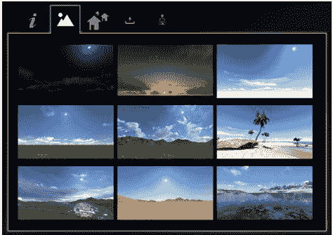

New 标签页上可以找到的九个预设

### 探索 Home 标签页

在我们左侧，有 **Home** 标签页。它是带有斜体 **i** 的那个。在这里，我们可以访问 **Settings** 以及在线内容，例如 **Tutorials**、**Profile** 和 **User Forum**。点击 **Settings** 以访问一些质量设置，帮助我们更好地使用 Lumion 3D。你的 **Settings** 窗口看起来会像下面这样：

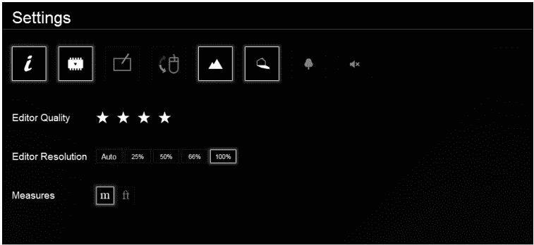

要了解每个按钮的作用，将鼠标悬停在按钮上，就会显示一个标签告诉你它们的功能。例如，点击第一个按钮可以 **Enable extra information in build mode**。例如，如果你使用图形[content]

## Lumion 的 3D 界面

现在我们已经知道使用 Lumion 可以做什么以及有哪些可用内容，我们将花一些时间来探索 Lumion 并上手操作。在我看来，也根据我的经验，如果在学习的同时应用所学内容，学习起来会容易得多。所以，在下一节中我们将探索 Lumion 的界面、菜单和不同的设置。但为了做到这一点，我们将使用一个小型教程作为快速入门。通过这样做，我们将探索 Lumion，同时也能看到制作出优秀成果是多么容易。在本章之后，我们就可以在后续章节中继续完善我们的技能和技巧。我们会发现 Lumion 比其他软件更容易学习、更易上手。

那么，打开 Lumion 吧，让我们在开始使用它之前先做一次快速浏览。我会向你解释每个标签页的作用，帮助你了解如何执行简单任务，例如保存和加载场景、更改设置以及创建新场景。让我们从 Lumion 显示的第一个标签页开始。

### 初识 New 标签页

启动时，Lumion 会直接进入 **New tab**。**New tab** 如其名所示，是创建新场景时很好的起点。我们可以基于几个预设创建新场景，也可以创建空场景。我们可以从 **Night, Sunset, Sunny Day, Flatlands, Island, Lake, Desert, Cold Climate** 以及 **Empty scene** 中选择。

我发现这些预设是快速帮助，可以节省一些时间，因为最终这些预设提供的一切，我们几分钟内就能自己创建。所以，它们并没有什么特别之处。当你启动 Lumion 时，这将是你看到的第一件事：

New 标签页上可以找到的九个预设

### 探索 Home 标签页

在我们左侧，有 **Home** 标签页。它是带有斜体 **i** 的那个。在这里，我们可以访问 **Settings** 以及在线内容，例如 **Tutorials**、**Profile** 和 **User Forum**。点击 **Settings** 以访问一些质量设置，帮助我们更好地使用 Lumion 3D。你的 **Settings** 窗口看起来会像下面这样：

要了解每个按钮的作用，将鼠标悬停在按钮上，就会显示一个标签告诉你它们的功能。例如，点击第一个按钮可以 **Enable extra information in build mode**。例如，如果你使用图形平板，点击按钮即可启用它。这是一个非常实用的工具，尤其是在我们想要修改地形时。

本节中的几乎所有内容都与质量相关。即使我们的工作站不是最好的——也就是说你不符合所有规格——我们仍然可以通过降低质量设置来使用 Lumion。别担心，因为最终的渲染或视频质量会保持相同。唯一的区别是我们能在 Build 模式下看到的质量。所以，继续尝试，看看哪种设置最适合你。

此外，在 Build 模式工作时也有快捷方式可以访问这些选项。以下是帮助我们调整质量设置的快捷键列表：

- *F1*: 按下后，**Editor Quality** 变为 **Low**
- *F2*: 按下后，**Editor Quality** 变为 **Medium**
- *F3*: 按下后，**Editor Quality** 变为 **High**
- *F4*: 按下后，**Editor Quality** 变为 **Very High**
- *F7*: 按下以在最高细节级别查看 Lumion 地形
- *F9*: 如果按下，所有视口中的树木和植物都将以最佳细节级别渲染

如果你觉得场景开始变慢，而你正在使用最高质量，按 *F3* 来降低质量等级。让我们继续看其他标签页。

### Examples 标签页

点击 **OK** 按钮返回 **Home** 标签页。第三个标签页，带有三栋房子的那个，叫做 **Examples**。可以说这是一个有用的标签页，主要是因为你可以通过查看其他艺术家如何使用材质、设置相机以及使用众多视频和图像效果，来看到用 Lumion 能取得什么成果。材质场景很有用，因为在这里你可以查看一些材质示例并测试不同的 518 种材质或你自己的材质。

我相信你已经迫不及待想试试了，并打开了这个场景。现在你一定在想如何返回。返回主菜单，点击右下角的 **Files** 按钮（软盘图标）。返回主菜单后，你可能会注意到界面有一些变化。对，就是现在你又多出了两个标签页：**Save scene** 和 **Export full scene**。

### Load scene 和 Save scene 标签页

在 **Examples** 标签页旁边，我们有 **Load scene** 标签页，这里存储着我们所有已保存的场景。不仅是已保存的场景，自动保存的场景也存储在这里。这些文件是 Lumion 为你自动保存的，以防出现问题，不过我建议你保存自己作品的多个版本。如果你想删除自动保存文件或其他场景，将鼠标悬停在缩略图上。然后，需要在右上角的小垃圾桶图标上双击以删除文件。

现在，正如我所说，当你创建新场景或打开之前保存的场景时，Lumion 会触发另外两个标签页。其中一个是让我们保存当前场景。操作方法很简单；给你的场景命名，如果想的话添加一些描述，然后点击 **OK** 按钮将其保存为 **Version 0**。每次保存场景时，Lumion 都会将其保存为不同版本。我总是将初始场景命名为 `Base Scene`。如果出现问题或我需要重新开始，我会使用这个场景。然后我再将其另存为 `Scene_v01`。我在这个场景上工作。如果我要做大的改动，我再将其另存为 `Scene_v02`。这样，如果我的场景出现问题，我总能回到某个特定点重新开始。

那么，让我们直接开始吧。我们需要的第一件事是一个 3D 模型，我将使用建筑师 Ludwig Mies Van der Rohe 设计的著名 Farnsworth House 的 3D 模型。这只是一个例子，所以请随意使用你想尝试的任何模型。我在 SketchUp 8 中建模了这栋房子，这是进行建筑建模的最佳解决方案之一。但正如你已经知道的，只要你能导出 Lumion 支持的格式，你就可以使用任何 3D 应用。以下是我要使用的 3D 模型：

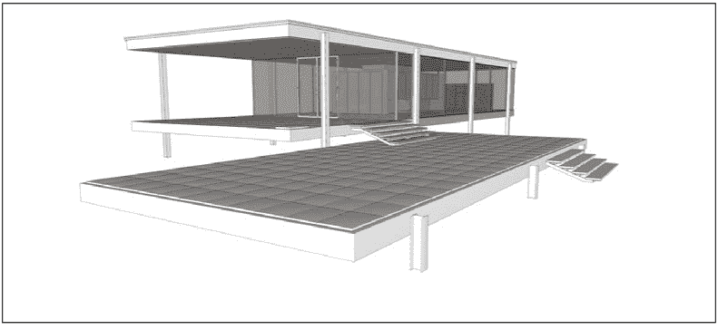

所以我们需要做的第一件事是导出模型。使用 SketchUp 请按以下步骤操作：

- 1. 进入菜单并导航到 **File | Export | 3D Model....**
- 2. 在导出模型窗口中，选择 **COLLADA File (*.dae)** 作为导出格式。然后，点击 **Options...** 按钮并选择以下选项：
  - **Triangulate All Faces** 选项
  - **Preserve Component Hierarchies** 选项
  - **Export Texture Maps** 选项
- 3. 如果你使用其他 3D 软件，请参阅 *Chapter 4, Working with Lumion,* 以获得帮助。
- 4. 导出后，启动 Lumion 并在 New 标签页上选择 Sunny Day 预设。Lumion 将打开一个带有此预设的场景。我们现在处于 Build 模式，看起来像下面这样：

  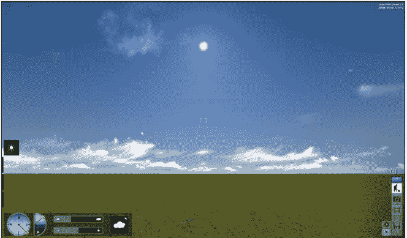

  Build 模式界面
- 5. 你在前一截图中间看到的括号是相机移动的目标。要在 Lumion 中导航，我们需要使用以下键：
  - **Up arrow key / W**: 这会使相机向前移动
  - **Down arrow key / S**: 这会使相机向后移动
  - **Left arrow key / A**: 这会使相机向左移动
  - **Right arrow key / D**: 这会使相机向右移动
  - **Q**: 这会使相机向上移动
  - **E**: 这会使相机向下移动
  - **Shift + W/S/A/D/Q/E**: 这会使相机速度加倍
  - **Space bar + W/S/A/D/Q/E**: 这会减慢相机
  - **Shift + Space bar + W/S/A/D/Q/E**: 这会使相机速度非常快
  - **右鼠标按钮 + 移动鼠标**: 这有助于你环顾四周

- **鼠标中键 + 移动鼠标**：在视口中平移
- **向上/向下滚动鼠标滚轮**：帮助您拉近或拉远视图
- *Ctrl + H*：将摄像机俯仰角重置为水平视角
- *O + 鼠标右键*：环绕摄像机

因此，您可以看到拥有一款三键鼠标对于在编辑器中控制摄像机有多么重要。学习并记住这些快捷键对于提高您的工作流程至关重要；不仅在放置内容时如此，在照片和电影模式下控制摄像机时也同样重要。

## 导入模型

既然我们已经了解了如何在 Lumion 中导航，接下来让我们导入一个模型。怎么做呢？在左侧，有一个带有太阳的方块；将鼠标移到那里，会出现另外三个方块。第一个用于更改天气，第二个用于处理地形，第三个用于导入模型，最后一个用于通过 Lumion 库添加对象。

如果我们点击 **导入** 按钮，底部的菜单会发生变化，如下面的截图所示：

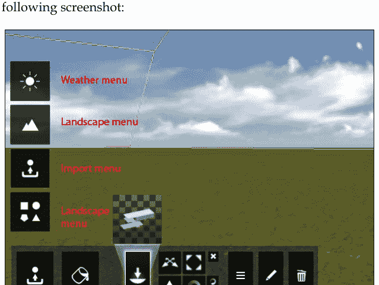

导入菜单

我的界面可能与您的不同。您可能会注意到我已经选择了要导入的模型。这是因为 Lumion 总是会选择您上次导入的模型。要从导入库中删除这些文件，请双击带有模型的缩略图。这将打开一个新窗口，其中显示了所有已导入的模型。要删除模型，请将鼠标光标移到缩略图上，然后双击垃圾桶图标。

点击右上角的小叉号，返回构建模式。点击第一个按钮导入您的模型。在开始一个 Lumion 项目时，最好先设置好您的文件结构。首先为项目创建一个主文件夹，并在其中包含子文件夹。当您将项目传输到另一台工作站时，可以整体抓取整个文件夹，以保持层级结构完整。

我从 SketchUp 导出的模型保存在 Import 文件夹中，而 SketchUp 模型则保存在 Assets 文件夹中。选择您导出的文件，但首先您可能需要选择正确的扩展名，以便模型能够被显示。一旦您点击 **打开**，会出现一个小窗口，我们可以在其中更改导入模型的名称，并选择是否导入动画（如果有的话）。点击 **确定** 将 3D 模型添加到库中。

此时，会出现一个黄色边界框，帮助我们将其放置在正确的位置。如果您看不到黄色边界框，可能需要使用鼠标滚轮滚动以稍微缩小视图。

> 不要忘记使用 O 键和鼠标右键来环绕摄像机。

要放置模型，请在您想要放置的位置点击鼠标左键。恭喜！您已经成功导入了模型。

- 如果在导入并放置到场景后看不到模型，请尝试以下方法：
  - 在导出之前将模型放置在 0,0,0 坐标处。
  - 检查模型的缩放比例。

## 使用图层

也许您在想：“哦，如果我能用图层来组织我的场景，那就太好了。” 是的，您可以做到。在左上角，您能看到一个带有小眼睛的数字吗？如果将鼠标移到那里，就会出现图层菜单。其工作原理如下：

- 要创建新图层，请点击加号图标
- 要设置当前图层，请点击标识每个图层的数字
- 要隐藏图层，请点击眼睛图标
- 要添加标签，请在文本框中输入来更改图层名称

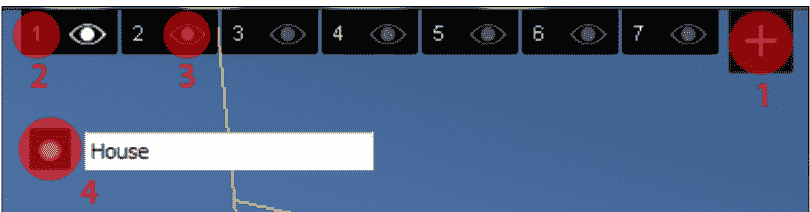

从一开始就用图层来组织场景，这确实是个好主意。我这样说是有经验的，因为有时候当场景中充满了对象时，在 Lumion 中很难选中某个东西。您可以在图层中组织的内容包括树木、草地、人物。这会带来很大的不同，相信我。

## 应用材质

我不打算深入讲解材质编辑。当我们导入模型后，如果点击带有墨水的桶图标，就可以为模型添加材质。在模型附近，有一个白点，我们需要点击它来选中模型。您可以通过模型变为绿色并带有边界框来判断您已选中它。

之后，我们需要点击加号图标，并在模型中选择某个部分。一旦我们这样做，左侧就会出现一个包含所有材质的菜单。以我为例，我会选择地板；为了向您展示其工作原理，我会选择材质 **Concrete_025_1024**，看看效果如何。下面的截图显示了该材质应用于外部地板的效果：

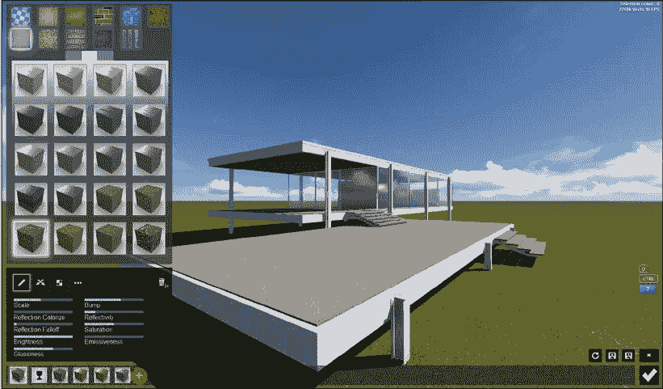

在底部，您可以看到应用于 3D 模型的材质。其中“添加材质”按钮已高亮显示。

尽管添加材质非常简单，但 Lumion 对材质提供了非常强大的控制。您可以在下面的截图中看到这一点：

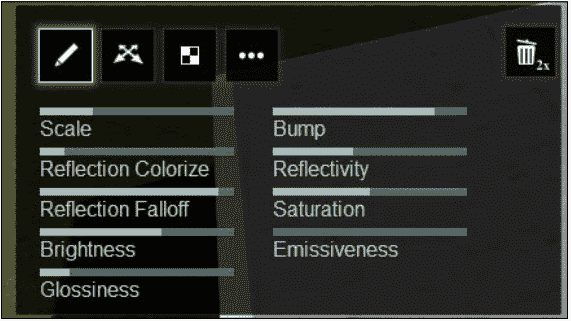

这些设置可用于调整材质，以最适合您的场景

点击第一个按钮可以更改一些材质属性，点击第二个按钮可以修改纹理的放置方式。第三个按钮允许我们更改纹理。例如，如果我们想要使用不同纹理的材质，我们可以点击纹理并加载一个新的纹理。**高级** 选项允许我们在需要时调暗或调亮纹理。

添加此材质后，我们需要点击加号图标来添加新材质。现在，您为什么不尝试添加一些材质呢？要添加新材质，只需点击加号图标并重复该过程。最后，点击 **确定** 按钮保存所有材质：

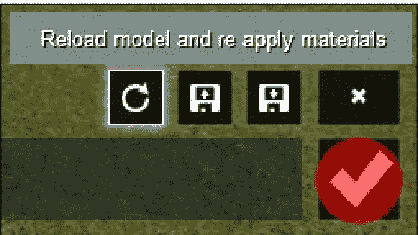

“确定”按钮（已高亮）以及一个非常重要的按钮，名为“重新加载模型并重新应用材质”

在进入下一个菜单之前，让我们看看两个有用的功能。第一个功能，正如我们在上面的截图中所看到的，是重新加载模型的选项，我之前提到过。

例如，我们导入了模型，但发现有问题，比如法线面方向错误。我们可以用 3D 应用程序修改，然后重新导出模型。但是，不必重新导入并因此再次添加材质，我们只需点击“重新加载”按钮。Lumion 会重新导入模型，并应用我们所做的所有更改，包括材质。现在，让我们看下面的截图：

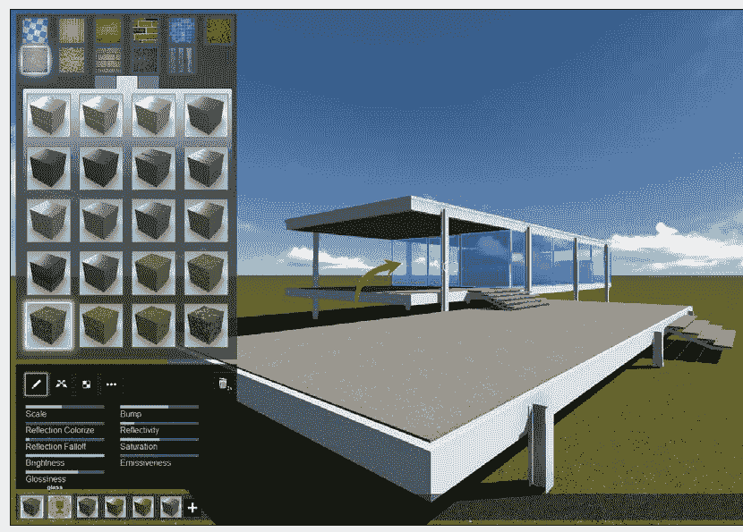

鼠标悬停在 Glass 材质上，您可以看到 Lumion 会指示该材质应用在何处

另一个有用的功能是，当我们将鼠标悬停在已应用材质的缩略图上时，Lumion 会自动显示该材质应用的位置。在本例中，我选择了 Glass 材质，它正在显示该材质应用的位置。

## 控制天气

应用材质后，我们现在要更改 **天气** 菜单中的一些设置。点击 **天气** 按钮，探索如何更改太阳的方向和高度。尝试实现不同的氛围，例如晴天、日落或美丽的夜晚。另外两个设置允许我们更改天空中云的数量和太阳的强度。最后，带有云朵的按钮允许我们更改云的类型。下面的截图向我们展示了这些选项：

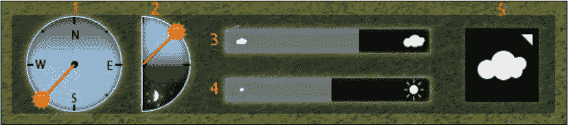

天气菜单包含不同的设置：1 – 太阳方向，2 – 太阳高度，3 – 云量，4 – 太阳亮度，5 – 云的类型

我将把环境设置为一个晴朗的日子，并添加一些云。我们可以从九种美丽的天空类型中进行选择。

## 更改地形

查看这个示例，我们看到地形需要一些处理。它太平坦了，如果您改变地形并添加一些山丘，不会有坏处的。要更改地形，我们选择 **地形编辑器**。我们有一组工具可供使用，帮助我们轻松地塑造地形，如下面的截图所示。我们可以升高、降低、平整、抖动或平滑地形。如下面的截图所示，我选择了 **降低** 工具：

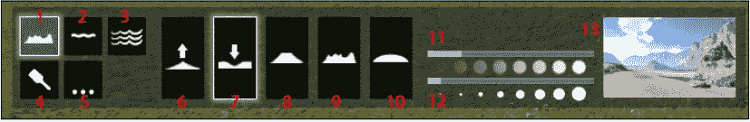

您可以在地形编辑器中找到以下选项：1 – 高度菜单，2 – 水菜单，3 – 海洋菜单，4 – 颜色菜单，5 – 地形菜单，6 – 升高笔刷，7 – 降低笔刷，8 – 平整笔刷，9 – 抖动笔刷，10 – 平滑笔刷，11 – 笔刷速度，12 – 笔刷大小，13 – 选择地形

让我们使用**抬高**和**降低**选项来为场景增添一些变化。在右侧，我们可以更改画笔的不透明度和大小。实际上，Lumion 将第一个选项称为速度，但本质上我们是在改变不透明度。这与我们在 Photoshop 中看到的原理相同。如果你有数位板，由于控制更精细，塑造地形会更容易；但别担心，大多数时候我用鼠标工作。

顺便问一句，我有没有告诉过你，你可以使用高度图来帮你完成所有这些工作？我们将在本书后面学习如何做到这一点；不过，是的，我们可以使用高度图，Lumion 会将该信息转换为地形。让我们把注意力转向地形。使用鼠标左键，点击我们要抬高或降低地形的位置。Lumion 还提供了撤销更改的功能。所以，为了增加一些变化，我们通过几次推拉操作改变了地形。

这个菜单中有一个有用的设置，可以更改单个元素，而不是整个地形。假设我们对场景很满意，但觉得草应该更绿，或者应该有不同种类的草。你会注意到，在**高度**菜单下方有一个**颜色**菜单。点击此菜单，即可访问代表场景中每个元素的四个缩略图，如下面的截图所示：

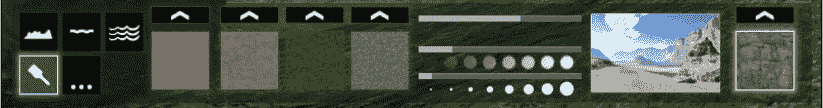

颜色菜单

点击每个箭头，你可以访问42种不同的纹理。如果没有，你也可以导入自己的纹理。或者，如果你愿意，可以点击带有山脉的缩略图来更改整个地形，并从20个可用预设中选择一个。

现在，让我们添加一些水。在**高度**按钮旁边，还有两个按钮。点击**水**按钮（带有单个波浪的那个）。在右侧，有一个缩略图，可以让我们在六种类型的水之间选择：**海洋**、**热带**、**池塘**、**山地**、**泥土**和**冰**。

这才是乐趣的开始。我们可以使用八类甚至更多的对象，例如**自然**、**交通**、**声音**、**特效**、**室内**、**人物与动物**、**室外**以及**灯光与特殊对象**。这些菜单中的每一个都有子类别。如果你使用的是 Lumion PRO 版本，可以从2000多个模型中进行选择。即使没有这个版本，也别灰心！你仍然可以导入自己的模型和纹理。只需按照我们导入房屋时的相同步骤操作即可。

添加模型非常简单。首先，我们需要选择要使用的类别。因此，在这种情况下，点击**自然**按钮。选中此类后，点击**放置**按钮上方的缩略图，将出现一个包含自然库的新窗口。

我们不只有树木，还有草、植物、花卉、岩石和组合。现在，让我给你展示一个小技巧。点击**草**选项卡，选择**Rough_Grass1_RT**。返回构建模式后，按住**Ctrl**键并点击地面。我们将随机添加10个该对象的副本，在这种情况下非常方便。所以，稍微使用一下 Lumion，我们就能得到类似下面截图的效果：

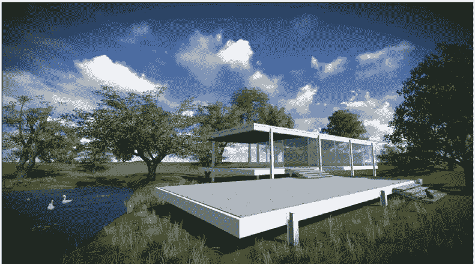

试想一下，我花了大约30分钟才创建出这样的效果。现在想象一下你能做什么。让我们保存场景，然后把注意力转向 Lumion 3D 界面的右侧，在那里可以看到如下截图所示的菜单：

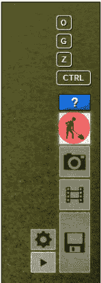

构建模式按钮

从上面截图的顶部开始，我们可以看到一个带有问号的蓝色矩形。如果将鼠标光标放在这个矩形上，就可以看到关于我们界面的快速帮助指南。

下一个按钮告知我们当前处于构建模式；例如，如果你正在照片或视频模式下工作，这个按钮可以让你返回场景。

## 照片模式

所以，如果你点击带相机的按钮（称为**照片**），我们的界面将切换到**照片**模式，就我而言，界面会像下面这样：

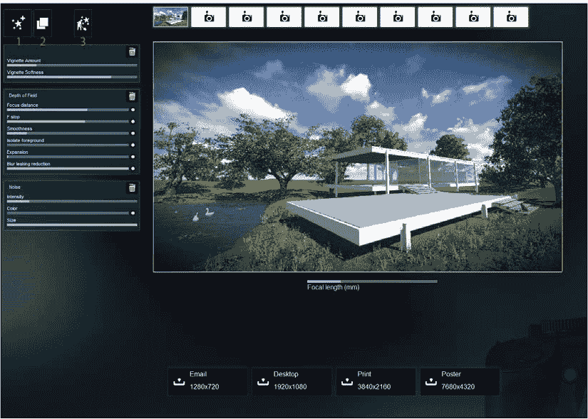

照片模式界面：1 - 新效果，2 - 复制效果，3 - 带效果的构建模式

在这里，我们可以渲染并导出静态图像。但在此之前，我们可以添加大量效果。我们可以添加一些**景深**和**暗角**，或者你可能想设置一个带有雨或雪的场景。尽管去尝试不同的效果吧。为此，请点击左上角的**效果**按钮。

Lumion 的另一个很酷的功能是，它可以让我们的构建模式应用这些效果。比方说，我想让场景显示一些雨，添加该效果，然后点击**带效果构建**按钮。

你能在屏幕顶部看到10个带有相机图标的缩略图吗？在上面的截图中，其中一个缩略图已经填充了图像。这是另一个很棒的功能。假设我们正在处理场景，调整好相机，而且非常喜欢——完美的角度和构图。现在，如果能保存这个相机视角就好了。事实上，我们可以按 Ctrl + 1 保存相机视角。我们可能会注意到界面出现短暂的变化，如果你的声音开启，还会听到一声提示音。这就是相机视角正在被保存。因此，稍后当我们回到照片菜单时，这个相机视角就已经保存好了。继续尝试更多相机角度，使用 Ctrl 加 0 到 9 之间的任意数字保存，然后再试试 Shift 加 0 到 9 之间的任意数字。

最后，如果需要，调整焦距，然后就可以导出图像了。如上面截图所示，我们有四种尺寸可选。可用格式有 JPG、BMP、DDS、PNG 和 TGA。

## 电影模式

然而，Lumion 的潜力并不仅限于照片模式。事实上，Lumion 最大的潜力在于它能快速创建令人惊艳的视频。所以，让我们进入电影模式。当你切换到这个菜单时，主界面显示如下：

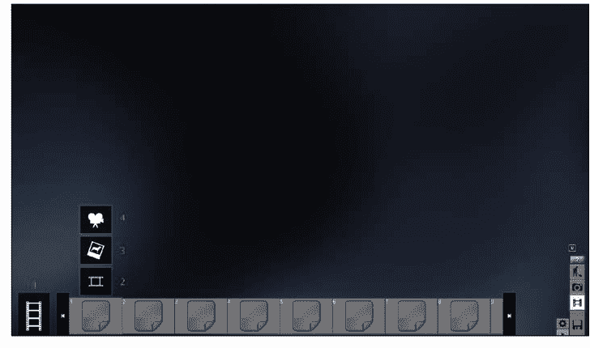

电影模式界面：1 - 整个影片，2 - 从文件导入影片，3 - 导入图像，4 - 录制

还记得我说过 Lumion 界面直观友好吗？这一部分就是一个例证。你可以用最简单、最轻松的方式创建影片。

在上面截图的底部，我们可以看到九个剪辑。每个剪辑可以存储一段小动画，或者如果你愿意，也可以存储整个影片。Lumion 还允许你导入图像或视频。所以，也许我们想在视频开头显示自己的标志；我们不需要在另一个应用程序中完成这件事。只需导入所需内容并添加到影片中即可。为此，点击第二个按钮导入图像，或点击第三个按钮导入影片。现在，让我们开始创建动画。点击第一个带有相机图标的按钮，如下面的截图所示：

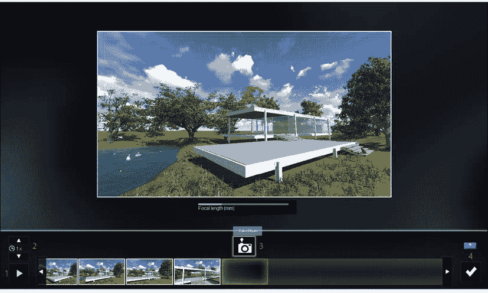

录制菜单：1 - 播放影片，2 - 剪辑速度，3 - 拍照，4 - 返回电影模式

正如我告诉你的，它的工作原理非常简单。你看到带相机的按钮了吗？点击开始你的第一个镜头。然后稍微移动相机到另一个角度，再次点击，重复操作直到你满意为止。之后，点击播放按钮，看看你的动画效果如何：

> 还记得我告诉过你，使用 Ctrl 键加数字键 0 到 9 可以保存相机视角吗？使用 Shift 键加数字键 0 到 9 可以加载已保存的视角。你也可以在此模式下使用该快捷键。

Lumion 的另一个实用功能是，你可以加快或减慢剪辑速度。在左侧有一个滑块，可以增加或降低速度。当对动画满意后，点击**确定**按钮就可以了。恭喜，你已经创建了自己的第一个动画。现在，电影界面会变成如下截图所示！

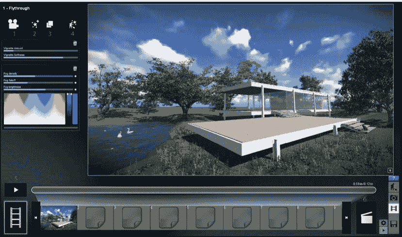

带有我们刚创建的剪辑的电影菜单界面：1 - 编辑剪辑，2 - 新效果，3 - 复制，4 - 带效果构建，5 - 播放，6 - 保存影片

现在，如果需要，我们可以再次编辑剪辑。点击剪辑，里面有两个按钮：一个允许我们返回并编辑剪辑，另一个用于删除它。这并不是唯一的方法。如果查看左上角，我们会有四个新按钮：

- **编辑剪辑：** 它会带你回到可以编辑剪辑的菜单。
- **新效果：** 它会给剪辑添加效果，而不会影响整个影片。
- **复制：** 我们需要在剪辑上应用一个效果，以便复制该效果并粘贴到另一个剪辑中。
- **粘贴：** 是的，我知道我说了四个按钮，但这个按钮只有在复制效果后才会出现。它允许我们将效果粘贴到另一个剪辑或整个影片中。
- **带效果构建：** 启用此选项，可在构建模式下查看已应用的效果。

## 什么是 Lumion？

在此模式下，Lumion 允许我们为每个片段和整部影片添加效果。例如，当我们想为某个特定片段添加淡入/淡出或更改景深时，此选项非常有用。我添加了一些暗角效果，并在背景中加入了一点雾气。在这种情况下，我们没有需要动画的内容，但我们可以通过使用高级功能（例如动画对象或隐藏图层）来在这里添加这些效果。

现在，要导出影片，请点击右侧的 **保存影片** 按钮。就是带有影片片段图标的那个按钮。导出影片或图像时，可以使用以下选项：

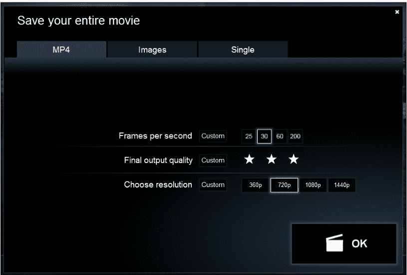

保存菜单

我们可以通过多种选项导出 MP4 格式，例如质量、每秒帧数和分辨率。另一个选项是将影片导出为一组图像，这是一个非常有用的选项。第三个选项是像照片菜单中那样保存单张图片，但拥有更多选项。这些选项包括保存多个渲染通道的可能性。

## 保存场景

为了完成本章，我们还需要知道如何保存场景。再看一下图片，我们可以看见保存按钮（软盘图标的那一个）。点击 **保存** 按钮，Lumion 会打开 **保存场景** 选项卡。在这里，我们可以为场景命名，也可以添加描述。请注意，当你点击红色的 **确定** 按钮时，Lumion 会在左侧提示我们现在正在处理版本号 1。每次我们保存时，这个数字都会增加。你可以在下面的截图中看到这个按钮：

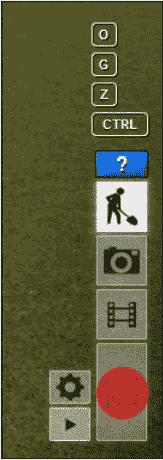

在进入下一章之前，还有两件事要说。带有齿轮的按钮允许我们返回 **设置**，并在需要时更改 **质量设置**；最后一个是剧院模式。因此，如果你的笔记本电脑上装有 Lumion，你可以进行实时漫游，而无需导出影片或图像。

## 总结

本章旨在帮助你开始使用 Lumion，并让你体验如何轻松、快速地获得出色的图像和视频。具体来说，你学习了保存和加载场景、导入模型、添加材质、更改地形和天气以及创建照片和视频的基本步骤。

这是在 Lumion 中取得出色成果的基本工作流程。现在，你可以在自己的项目中立即应用所学内容。本书的其余章节将帮助你提升技能和技巧。
