# 2 准备场景

我相信在读完第一章后，你现在已经迫不及待地想开始使用 Lumion 了。我们已经了解了基础知识，这肯定有助于你继续前进，但现在是时候完善我们的技能，并看看可以在哪里以及如何改进我们的工作流程了。本章与建模和准备场景有关，但我们不仅仅要做这些。我们将找出初学者常犯的一些错误，学习如何避免它们以防止之后在 Lumion 中出现问题，同时还会了解在哪里可以为场景找到模型，以及一些提升图像或视频真实感的技巧。

在本章中，我们将学习以下内容：

- 为可视化而建模
- 处理 CAD 图纸
- 细节的重要性
- 如何使用我们自己的模型
- 避免常见错误

正如我们在第 1 章“什么是 Lumion？”中所看到的，Lumion 是一款出色的工具，旨在让任何人都有机会创建惊艳的静态图像和视频。但在我们开始使用 Lumion 创建这些内容之前，我们需要一个可以随时在 Lumion 中使用的 3D 模型。因此，我们需要创建一个模型，同时考虑几个要点，不仅是为了帮助我们提升真实感，也是为了在将模型导入 Lumion 时避免问题。

### 需要建模帮助？

本书的范围不是教你如何使用 3ds Max、ArchiCAD 或 Revit 等 3D 应用程序进行建模。也许这是你第一次尝试创建自己的建筑可视化作品，而且你没有任何建模经验。

别担心，SketchUp 是适合你的完美解决方案，而且最重要的是，它是免费的！在 SketchUp 中建模非常容易，原因是 SketchUp 的开发目的是满足那些没有使用复杂 3D 应用经验的人的需求。所以，即使你没有任何经验，SketchUp 也能帮助你开始制作自己的可视化作品。

想试试 SketchUp 吗？请从 http://www.sketchup.com/download 下载。

### 为可视化而建模

为可视化而建模并不难；你只需要遵循一些基本规则即可开始。第一条基本规则是问自己：我会看到这个吗？这是我们在开始建模时必须问自己的一个重要问题。如果你看不到某些东西，或者不打算在最终图像或影片中展示它，就不要浪费时间建模。此外，建模你看不到的东西，会使文件变大，影响工作站性能和渲染时间。

这个问题显示了规划的重要性。你可能想知道规划与建模有什么关系。嗯，当我们想要创建建筑可视化时，我们需要从头开始创建一切。这种自由可能会适得其反，因为有太多的机会和可能性，我们可能会失去焦点，开始建模不必要的东西和细节。

因此，规划是成功的关键，良好的规划可以为我们节省大量时间。我们需要思考想要展示什么。你是要做一些特写镜头还是整栋建筑的视图？你能从鸟瞰图中看到门上的铰链吗？我想不能，但如果你打算在人的视线高度创建静态图像，你可能需要包含这个细节。你明白我所说的规划是什么意思吗？静态图像中所需的细节与影片不同，我们需要在开始建模之前提前思考。

有了明确的目标，那就去吧，拿起铅笔，为每个静态图像画一些草图。如果你想要一部影片，请为每个运动序列创建一个故事板。这将帮助你了解你需要建模什么，在哪里需要添加更多细节，以及在哪里需要制作一些基本形状。

### 准备 CAD 图纸

在画了一些草图后，我们需要 CAD 图纸。几乎每个项目都始于一个包含技术图纸和规格的 CAD 文件。这些文件构成了创建 3D 模型的基础，从一开始就正确准备它们对我们来说非常重要，以防止后续出现问题。这些原则适用于每个 3D 建模应用，而不仅仅是 SketchUp。

不管我们是从客户那里收到 CAD 图纸，还是由我们自己绘制图纸，我们总是需要先“清理”这些图纸。这是什么意思呢？嗯，在房屋或建筑模型中总会有一定量的不必要信息。通常，我会将图纸的副本保存为类似 Drawing_Clean.DWG 的文件。在图纸内部，我有包含墙壁、门、窗和立面的平面图。在清理图纸时，不要忘记检查外部引用并绑定它们，否则在导入图纸时它们将不会出现。检查是否有任何隐藏图层包含信息，并使用缩放范围选项来检查是否有比屏幕上所见更多的信息。有时，图纸可能相互离得很远。

因此，删除所有你不需要的内容，包括图层、线型和其他 CAD 元素。如果我们移除其中一些对象，CAD 图纸的文件大小和复杂性将降低，并且在我们 3D 应用内部管理内容也会更容易。下图展示了一个干净且准备就绪的 CAD 图纸：

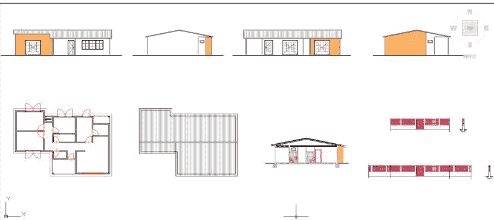

一个仅包含我们所需信息的 CAD 图纸示例

## 准备场景

如果我需要更多信息，我通常会保持 CAD 绘图打开以便快速查看。一件很重要的事情是，我们的绘图需要有比例。否则，当我们将其导入 SketchUp 或其他 3D 应用时，可能会出现两个基本问题：我们将无法看到我们的平面图，要么是因为它太小需要放大，要么是因为它太大需要缩小。而且即使你放大或缩小以查看平面图和建模，当我们将模型导入 Lumion 时问题仍然会存在。我们的模型要么巨大要么微小，我们需要回去重新缩放它。

完成所有这些步骤后，运行 `Purge` 和 `Audit` 功能，以确保所有不必要的信息都被删除并且错误得到修复。你最后需要确认的一件事是，你的绘图是否设置在原点位置 `(0,0,0)`。这非常重要，因为绘图可能不在原点，而是在远离原点的位置，当我们导入时，事情可能不会顺利。这不是世界末日，但你应该养成让绘图靠近原点位置的习惯。要将绘图移动到原点位置，使用命令 `Move (M)`，输入 0,0,0，然后按 *Enter*。

现在我们已经规划了镜头，拥有了干净的绘图，并且知道我们需要建模的内容，让我们开始建模吧。

## 使用 SketchUp、3ds Max 和 Maya 进行建模

建模过程本身相对直接。我在对房屋进行一些研究后建立了模型。我收集了网上和书籍中能找到的所有平面图和图像。由于这种经典设计有很好的记录，所以找到我需要的信息并不困难。建模部分相当简单，因为建筑物没有任何复杂的形状，因此这就是从盒子开始的多边形建模。因此，在这种情况下，我没有使用任何复杂的 CAD 绘图；只是一些用于核对尺寸的参考。

这个主题与建模有关，但再次说明，教你们如何建模超出了本书的范围。相反，我们将学习一些小技巧，我们可以用它们来在 Lumion 中准备场景并准备我们自己的模型，以及如何纠正建模过程中可能出现的一些错误。我将重点介绍我使用最多并且有经验的三个 3D 应用，但这里学到的所有内容都可以应用于任何 3D 应用。它们可能命令不同，但最终结果是相同的。

### 细节的重要性

细节的重要性有时会被低估。我们倾向于认为我们需要很棒的材料和出色的灯光来创建美丽的图像。那也很重要，但我们拥有所有这些东西，我们的渲染仍然会显得平淡或不怎么样。为什么？因为我们需要细节，细节，再细节。所以，我的意思是，你需要停下来，开始环顾自己，注意所有的小细节。我们将在本书后面讨论这个问题，但只是给你一个概念，如果我们在场景中成排直线添加花朵，你觉得会是什么样？假的，因为即使你有一个完美主义的花匠种植花朵，你仍然会有轻微的变化。现在，既然我们谈论的是建模房屋，我们如何为模型添加细节呢？好吧，让我们看看下一个主题并找出答案。

### 使用倒角边缘添加细节

通过添加以下截图中可以看到的此类细节，建筑可视化中可以实现很高的真实感。尖锐边缘的问题是，你会得到一种平坦而毫无生气的感觉，更难实现良好的真实感。

现实生活中几乎没有尖锐的边缘，甚至大多数人造物体都有轻微的圆润。倒角有助于突出细节，并通过让边缘正确捕捉来自灯光解决方案的高光来真正体现模型的真实感：

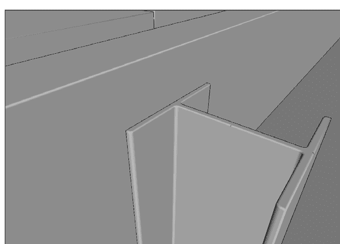

以下截图将帮助你更好地理解使用尖锐边缘和使用倒角边缘之间的区别。左侧显示没有倒角的边缘，右侧可以看到带倒角的边缘：

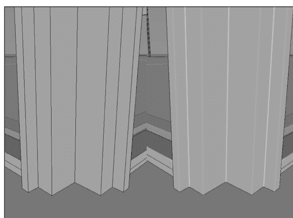

你觉得哪一个看起来更好？现在看看你的模型，看看你可以在哪里添加这种细节，但也要记住，如果你没有打算展示这些细节，就不要费心建模它们。相信我，倒角边缘会带来巨大的差异。

我们如何在 SketchUp 中做到这一点？SketchUp 没有任何特定工具来执行此操作，因此你需要下载一个插件。我使用了来自 Fredo6 网站的 RoundCorners 插件。在我们看到它如何工作之前，一句忠告：在进行这类操作时，最好先保存再建模。原因在于，这些是插件，因此不是应用程序的一部分，有时当我们执行此操作时，应用程序可能会崩溃，我们可能会丢失所有工作。使用此插件的工作方式相当简单，如以下步骤所述：

1. 选择你想要的圆角类型。你可以从圆角、尖角和倒角边缘中选择，如以下截图所示：

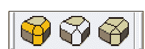

2. 然后，选择你想要倒角的边缘。我发现如果你选择整个几何体，插件将仅对边缘添加效果，如以下截图所示：

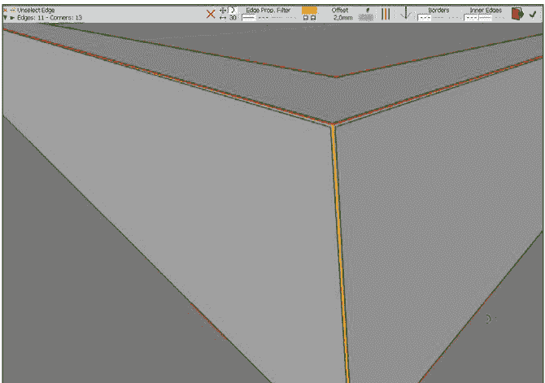

RoundCorners 菜单

3. 在截图顶部，我们可以看到菜单栏。你只需在 Offset 选项中插入一个值；如果你对结果满意，点击空白处或点击用绿色勾号符号表示的 OK 按钮。

> 你可以从 http://www.sketchup.com/training/videos.html 提供的培训视频中获得一些有用的提示。

如果使用 Maya，请执行以下步骤：

1. 选择你想要倒角的边缘。
2. 按 F3 选择 Polygons 菜单。
3. 选择 Edit Mesh 菜单，然后点击 Bevel 选项。这将打开一个名为 Bevel Options 的窗口。
4. 我们可以保留默认设置，只更改 Width 值和 Segments 数量。然后点击 Apply 而不是 Bevel，因为如果你想回去更改设置，只需按 Ctrl + Z 即可：

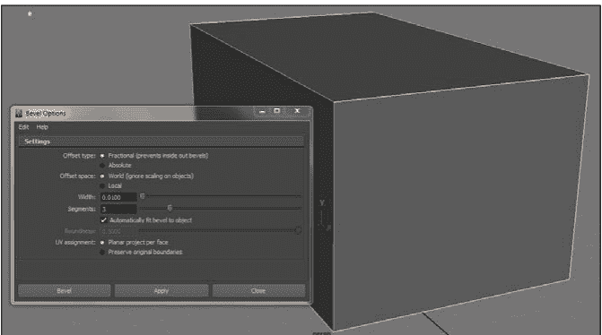

Bevel Options 菜单

在 3ds Max 中，我们可以通过以下步骤使用 Chamfer 选项：

1. 首先，你需要将 Edit Poly 修改器应用于对象。
2. 选择你想要倒角的边缘。
3. 在 Edit Edges 菜单中，点击 Chamfer 设置。
4. 在这里，你只需关心 Amount 和 Segments 值。如果对结果满意，不要忘记点击绿色勾号标记，如以下截图所示：

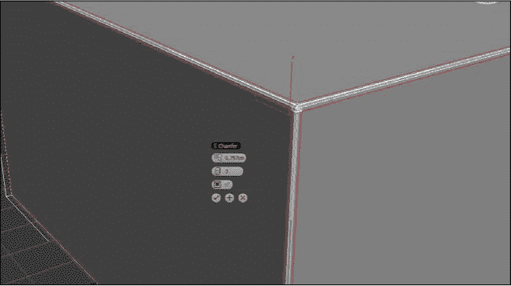

> 如果你正在寻找使用 3ds Max 或 Maya 进行建模的帮助，请查看 http://www.evermotion.org/tutorials/show/7979/tip-of-the-week-3d-building-modeling-part-1 提供的视频。

还有一些脚本可以帮助建筑可视化建模。以下是 SketchUp 有用的插件列表：

- **JointPushPull**：这有助于在曲面上执行推拉操作。
- **RoundCorners**：这用于倒角边缘。
- **SubdivideAndSmooth**：这有助于对表面进行细分以进行建模。
- **SketchyFFD**：这是一个自由变形矩阵，用于使你的模型可塑。
- **FreeScale**：这是 SketchUp 原生 `Scale` 功能的改进。
- **Boolen**：这有助于创建布尔运算。
- **Shapes**：这是一个创建复杂几何形状的有用工具。
- **Weld**：这有助于找到不可见的线缝隙并自动焊接断点。

使用 3ds Max 时，以下插件和脚本非常有用：

- **Floor Generator（地板生成器）：** 提供脚本，帮助你创建地板。
- **Bookmanager 1.0（图书管理器）：** 有助于将书籍直接放置在真实的书架多边形上。
- **MultiTexture 和 UniqueMaterialID：** MultiTexture 是一个插件，可加载多个纹理并按对象或材质 ID 随机分配它们。UniqueMaterialID 是一个脚本，用于为对象内的每个元素分配唯一的材质 ID。
- **Rock Generator（岩石生成器）：** 这是一个用于制作和实时环境的程序化岩石生成脚本。

对于 Maya，你可以看看以下这些：

- **1 Click Procedural Rock Generator：** 这是一个程序化岩石生成器。
- **Ninja Dojo（黑带）5.5.0：** 包含多种建模工具。
- **StairsCreator v3.0 3.0.0：** 用于创建楼梯。
- **ArchiTool 0.8：** 提供一系列不同的工具。

## 添加细节

如果你想让图像具有高度的真实感，其中很大一部分与细节处理有关。下面的截图展示了一个注重细节的示例：

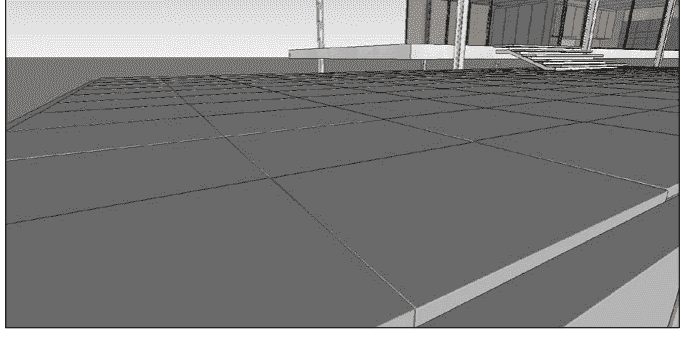

一些细节的特写，例如倒角边缘和高度不同的独立瓷砖

正如你所看到的，我花了时间为这个地板创建独立的瓷砖，这可能很难察觉，但每块瓷砖的高度都各不相同；每块瓷砖之间都有缝隙，而且它们并非完全对齐。你能看出使用法线贴图与直接建模瓷砖之间的区别吗？使用法线贴图可以获得非常不错的效果，但花时间添加这样的细节会带来天壤之别。如果你想知道什么是法线贴图，我们将在*第3章，创建材质*中学习。

## 使用附加模型

添加细节的另一个例子是使用对象填充场景。同样，一个优秀场景的秘诀在于它所包含的细节和对象的数量。Lumion 在这方面做得非常好，所以如果你没有庞大的模型库，也不必过于担心，因为我们可以利用 Lumion 的模型库。提醒一下，在 Lumion 中，你可以使用电子产品、食品、室内灯具、管道设备、椅子、沙发、橱柜、桌子以及许多此类物品。

但同样，只有使用 Lumion Pro 时，你才能访问所有模型。所以，如果你没有 Lumion Pro 和丰富的模型库，你仍然可以免费获得一些。以下是一些可以找到免费和付费模型的网站列表：

- **Creative Crash：** 可在 `http://www.creativecrash.com/marketplace/3d-models` 获取
- **3D Cafe：** 可在 `http://www.3dcafe.com` 找到（但你需要先分享一些模型才能下载）
- **Archive 3D：** 可在 `www.archive3d.net` 下载
- **Mr. Cad：** 可在 `www.mr-cad.com` 获取
- **3Delicious：** 可在 `www.3delicious.net` 获取
- **TurboSquid：** 可在 `www.turbosquid.com` 找到
- **Resources Blogscopia：** 可在 `www.resources.blogscopia.com` 获取
- **SketchUp Warehouse：** 可在 `http://sketchup.google.com/3dwarehouse/?hl=en` 下载

下面的截图包含了一些我将在场景中使用的模型：

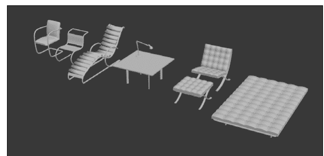

其中一些模型包括巴塞罗那椅和巴塞罗那沙发床

## 材质的重要性

现在，你可能想知道材质与建模有什么关系？我在这里介绍这个话题的原因是，Lumion 是使用模型中现有的材质来工作的。让我来解释一下。你刚刚完成了建模，添加了令人惊叹的细节，一切都准备就绪。于是你导出 3D 模型并将其导入 Lumion，而且由于你已经学会了如何在 Lumion 中添加材质，你开始尝试，但出了问题，如下面的截图所示：

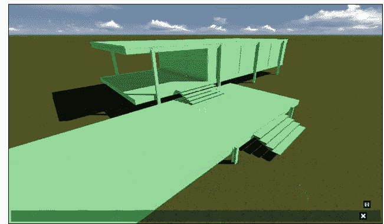

这是 Lumion 只允许我们为整个模型添加一种材质的示例

当你尝试添加材质时，你会意识到 Lumion 会将材质应用于整个模型。为什么？这是因为当我们在 SketchUp 或任何其他 3D 应用中建模时，每次我们创建对象都会使用默认材质。在 SketchUp 中，默认材质是**默认（Default）**，在 Maya 中是**朗伯（Lambert）**，在 3ds Max 中是**布林（Blinn）**。

这就是为什么在建模时，将我们知道会共享相同材质的对象分组非常重要，然后在最后阶段，为每个组添加不同的材质。这不需要很花哨；只需使用相同的材质并重命名即可。

## 常见问题

建模时可能会遇到一些问题。在这里，我们将看到最常见的问题及其解决方法。

首先可能发生的问题是面丢失。请看下面的图：

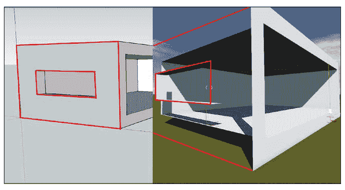

你能看出 SketchUp 模型和 Lumion 模型之间的区别吗？我相信你很容易发现有一个面丢失了。发生这种情况的原因是这个面朝向内部而不是朝向外部，如果你看一下 SketchUp 模型，你会注意到这个面的颜色不同。这是 SketchUp 在告诉我们：看，这个面指向了错误的方向。我们如何解决这个问题？

## 准备场景

使用 SketchUp 时，请执行以下步骤：

- 1. 右键单击该面。
- 2. 选择**反转面（Reverse Faces）**。

使用 Maya 时，请执行以下步骤：

- 1. 按*F3*选择**多边形（Polygons）**菜单。
- 2. 点击**法线（Normals）**菜单，然后点击**反转（Reverse）**（你可能需要先选择一个特定的面）。

使用 3ds Max 时，请执行以下步骤：

- 1. 选择一个或多个面。
- 2. 从修改器列表中选择**法线（Normal）**，以规范化你选择的面。

导入模型后可能发生的第二个问题是，你可能看不到模型。要解决此问题，你可能需要首先检查模型是否位于原点轴上，如果这不起作用，请检查模型的缩放比例。

另一个问题是，你无法将 Lumion 材质分配给单个表面。还记得前面的主题吗？Lumion 会合并使用相同材质的表面，如果你想在某个或某些特定表面上使用 Lumion 材质，你需要在导出模型之前为该表面分配一个唯一的材质。

最后，如果你在使用 COLLADA 文件时遇到问题，请检查你是否拥有最新版本的 COLLADA。你在使用 Revit 的 COLLADA 插件时可能会遇到一些问题，但通常一旦升级到最新版本，这些问题就会解决。

## 总结

在本章中，你学习了如何准备 CAD 图形，使其可以轻松导入到任何应用中作为建模的基础。你发现了为模型添加细节的重要性，以及这如何有助于提高真实感。你发现了一些可以找到免费和付费模型的地方，最后，还学习了一些常见的建模陷阱以及如何避免它们。花时间确保对象具有良好的几何结构和细节非常重要。当然，每个项目都是不同的。在大型项目中，我们需要对几何体进行良好的管理，以免冒着创建过重场景的风险。在下一章中，你将学习如何在 Lumion 中创建材质，以及如何使用 Photoshop 或 Gimp 创建自己的纹理。
