# 4 使用 Lumion

## 使用 Lumion

是时候开始使用 Lumion 了，本章将帮助你创建你选择的 3D 应用程序与 Lumion 之间的桥梁。导出 3D 模型并将其带入 Lumion 有时会造成问题。为了从一开始就做好准备，我们将在导出 3D 模型之前分析一些重要方面。一旦模型导出到 Lumion，我们将学习如何放置和调整模型。本章的编写目的是帮助你获得所需的一切，以便你无需延迟即可开始在 Lumion 中工作。

在本章中，你将学习以下主题：

- What is COLLADA?
- Exporting from SketchUp
- Exporting from 3ds Max
- Exporting from other 3D software
- Importing the model
- Working with layers
- Placing the model

正如介绍中所看到的，本章更偏向技术，但同时也很重要，因为你将在这里学习导出 3D 模型的正确方法。为了获得顺畅的工作流程，你需要密切关注本节。要回答这个问题：使用什么格式最好？COLLADA 是完美的答案。

## 什么是 COLLADA？

COLLADA 是一个 XML 命名空间和数据库模式，用于在不同的 3D 工具之间创建桥梁，使得 3D 几何体、着色器和效果的轻松共享成为可能。用通俗的话说，它允许你在 SketchUp、3ds Max、Maya、Revit 和 Lumion 之间移动 3D 文件。然而，没有什么能阻止你使用其他文件格式，例如以下格式：

- Autodesk RealDWG - *.dxf
- Autodesk RealDWG - *.dwg
- FBX file - *.fbx
- Max file - *.max
- 3ds file - *.3ds
- Obj file - .obj

使用 COLLADA 的原因在于，与我们之前提到的文件格式相比，它是一个更好的选择。正如我所说，没有什么能阻止你使用这些文件格式，但它们可靠性较低，并且不总是包含我们想要的所有数据。为了获得最佳结果并降低出错的可能性，COLLADA 是正确的选择。COLLADA 并非在所有应用程序中都可用，在某些情况下，例如当我们使用旧版本的 3ds Max 或 Maya 时，我们需要安装一个名为 OpenCOLLADA 的 COLLADA 插件。

在 https://code.google.com/p/opencollada/downloads/list 下载 OpenCOLLADA。

Lumion 团队做得很好，创建了一个名为 COLLADA exporter for Revit 的 COLLADA 插件。 这个插件的缺点是它不适用于 Revit LT 版本，并且唯一可用的版本是 Revit 2012 和 2013。

在 http://lumion3d.com/lumion-exporter-for-autodesk-revit 下载 COLLADA exporter。

在使用 ArchiCAD 等其他应用程序时有一些变通方法。根据 Lumion 团队的说法，如果你使用此软件，最佳解决方案是将模型导出为 SketchUp 文件。SketchUp 将用作 ArchiCAD 和 Lumion 之间的中间件。

> 此 ArchiCAD 插件可在 http:// www.graphisoft.com/products/archicad/addons/ google_earth/ 下载。

我建议如果你使用的 3D 软件没有导出 COLLADA 文件的选项，请使用 SketchUp 作为中间人。现在我们知道了 COLLADA 是什么以及为什么学习其使用如此重要，让我们看看如何从各种 3D 软件程序导出 3D 模型。

## 从 SketchUp 导出

Lumion 4 允许你直接导入 SketchUp 文件。但是，如果你使用的是之前的 Lumion 版本，这就是你需要做的。使用 SketchUp 导出模型是最简单的事情，在第 1 章《什么是 Lumion？》中，我们快速浏览了如何操作，但让我们现在使用一些图片来帮助你更好地理解所有步骤。在 SketchUp 中，选择 File 菜单，将鼠标悬停在 Export 选项上，然后选择 3D model。

现在，你需要设置一些选项以正确导出 3D 模型。点击 Options 按钮并选择以下选项：

- Triangulate All Faces
- Preserve Component Hierarchies
- Export Texture Maps

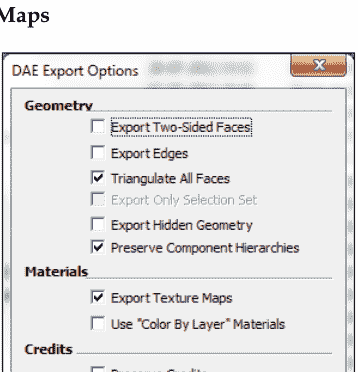

导出模型为 COLLADA 文件的正确设置

### 使用 Lumion

你需要选择 **Triangulate All Faces** 选项才能在 Lumion 中看到你的 3D 模型，并且 **Export Texture Maps** 选项将在你导出 3D 模型的文件夹中创建一个包含所有纹理贴图的文件夹。不要忘记为模型的每个部分分配不同的材质，因为你随 3D 模型导出的材质数量等于你在 Lumion 中可以更改的材质数量。继续前进，让我们看看如何使用 3ds Max 执行相同的操作。

## 从 3ds Max 导出

要使用 3ds Max，我们需要在导出 3D 模型之前考虑几个方面。不要忘记在 3ds Max 中建模时使用真实尺寸；否则，你的 3D 模型在导入 Lumion 后会非常小或非常大。还有几件事你需要更加注意。

在导出材质之前，将它们转换为标准材质，因为如果你在导入到 Lumion 时使用任何其他类型的材质，例如 V-ray 材质，模型将被导入但没有纹理。此外，在使用标准材质时，你可以使用两种纹理：一种放在 **Diffuse** 槽中，另一种放在 **Self-illumination** 槽中以使用光照贴图或提供额外细节。除此之外，材质中可能有的任何内容，例如高光贴图或凹凸贴图，都不会被导出。

现在是导出模型的时候了。选择 **OpenCollada**，或者如果你使用的是更新版本的 3ds Max，你可以选择 **Autodesk COLLADA**。如果你使用此选项，请在 Geometry 选项卡中选择 **Convert Deforming Dummies to Bones**，并在 Collada 选项卡中选择 **Triangulate** 和 **Single Matrix**。

你可以使用这个选项，但我推荐使用 OpenCOLLADA，尤其是因为它会创建一个文件夹，里面包含你使用的所有纹理，这样你就不必担心在过程中丢失任何东西。要使用 OpenCOLLADA 导出，请按照相同的步骤操作，但在选择文件格式时，选择 OpenCOLLADA 并使用以下截图所示的设置进行导出：

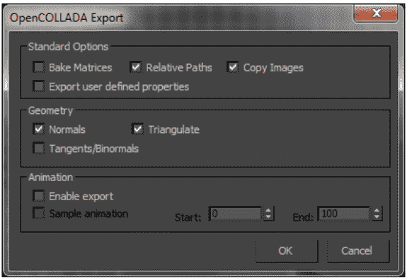

OpenCOLLADA 导出设置

### 导出动画

请记住，你可以在 Lumion 中导入来自 3ds Max 的动画。这该怎么做呢？首先，你需要将帧速率设置为 PAL。还要记住，Lumion 只能读取在移动、旋转和缩放值上带有关键帧的对象。考虑到这一点，你需要使用 FBX 文件格式导出动画，并且不要忘记选择 Autodesk Media & Entertainment 的预设。

### 从其他 3D 软件导出

从其他软件（如 Autodesk Maya、AutoCAD 和 Revit）导出时，我们基本应用相同的原则。对于 Maya，你需要安装 OpenCOLLADA 插件。对于 Revit，你需要从 Lumion 网站下载 COLLADA 插件。使用 AutoCAD 时，你需要使用 FBX 文件格式导出，并使用如下截图所示的设置：

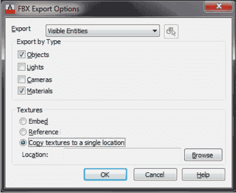

从 AutoCAD 导出 FBX 文件的正确设置

## 使用 Lumion 工作

现在我们将开始使用 Lumion 进行工作。我们已经了解了所需的一切：建模、材质和纹理、导出模型，以及修正某些问题，以便当我们把模型导入 Lumion 时一切完美。请记住，在开始这个过程之前，我们还需要做一些规划，这样当我们开始使用 Lumion 时，心中已经有了目标。这是创建出色建筑可视化的关键方面。

让我们开始使用 Lumion 并创建一个场景。我通常从阳光明媚的场景开始，因为它能给我一个良好的起点，带有平坦的地形和良好的光线。

你已经知道如何导入模型，如第 1 章“什么是 Lumion？”中所述，但为了提醒你，在屏幕左侧你会找到四个菜单。第三个菜单是“导入”菜单。单击它以激活底部的选项。单击“添加新模型”按钮，会出现一个窗口，你可以选择要导入的模型。双击文件或直接单击“打开”按钮。会出现另一个窗口，你需要为模型添加一个唯一的名称，如果 FBX 文件中有任何动画，请勾选“导入动画”旁边的复选框。

现在你已经导入了模型，在你想要放置模型的位置单击鼠标左键。如果碰巧你没有使用平坦地形，你可能会发现很难将模型放置在不与地形相交的位置。你可能会花费一些时间试图找到正确的位置，这就是为什么我建议你在地基处建模地形，这样你就可以轻松地使用景观材质与地形融合。Lumion 提供了多种选项来移动和调整我们刚导入的模型，但在这样做之前，最好使用图层来组织你的场景。以后当你的场景中有 50 棵树、20 个人和 5 辆车，你需要不受干扰地选择或编辑模型，却没有任何方法来选择和隐藏这些模型时，你会感谢自己。所以，别忘了使用左上角的“图层”菜单。

正如我所说，当你在 Lumion 中导入模型时，你可以使用一些非常有用的选项来移动和调整 3D 模型。回到“导入”菜单，注意最后三个图标。它们在以下截图中已被突出显示：

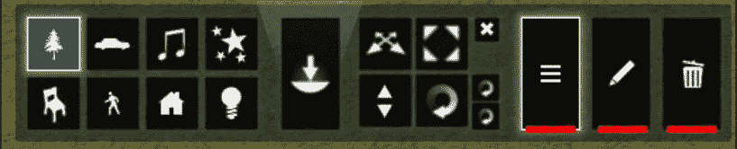

“上下文”、“编辑”和“删除”按钮

第一个是**上下文**菜单。当我们选择此选项并单击模型时，会出现两个菜单。第一个是**选择**，我们现在不打算分析它。我们需要第二个选项，**变换**。单击此项后，会弹出如下截图所示的菜单：

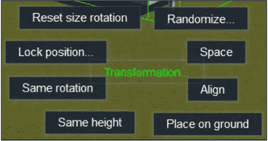

“变换”子菜单

其中大多数选项在你选中多个对象时都能使用。但为什么不试一试，比如**放到地面上**选项呢？使用此选项，你可以确保模型与地面接触。完成后，你可以使用**锁定位置...**选项来固定位置。回到**导入**菜单，在**上下文**菜单旁边，我们有**编辑属性**菜单。如下截图所示，此菜单允许你精确调整位置，不仅是你的模型，还有 Lumion 中每一个对象。这还能让你知道对象的位置所在。

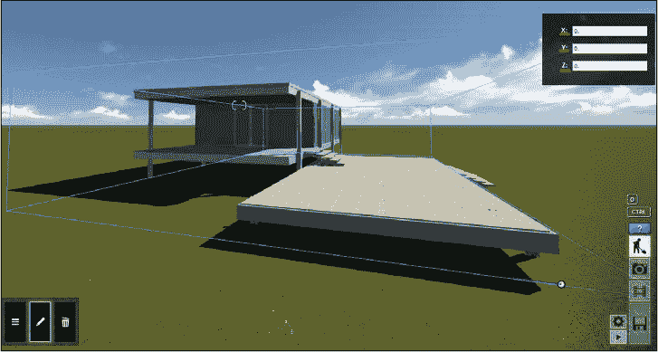

使用**编辑属性**菜单调整 3D 模型位置

再次提醒，务必始终通过创建图层来开始处理你的场景。它们是实现流畅工作流程的关键方面。它们不仅有助于组织你的场景，还有助于将注意力集中在特定模型上，隐藏不必要的内容，并允许流畅的相机移动。你甚至可以在编辑时利用它们获得更好的性能。最后，一旦你确定模型处于正确位置，永远不要忘记锁定该对象。考虑到这一点，你可以将注意力转向环境了。

### 总结

这是一个更偏技术的章节，我们学习了重要的主题，这帮助我们为使用 Lumion 打下了良好基础。我们了解了 COLLADA、它的用途，以及在导出模型时需要考虑的关键方面。最后，通过在我们使用的 3D 软件和 Lumion 之间建立桥梁，我们不仅学会了如何导入和使用图层来组织场景，还学会了使用**上下文**菜单和**编辑属性**菜单来移动和放置我们的 3D 模型。

模型已锁定到位并指定了材质，我们准备进入下一章，我们将学习如何修改地形，并开始使用 Lumion 模型填充场景。

## 雕刻地形

第一个选项是使用 3D 应用程序建模地形，如何操作以及使用什么技术完全由你决定。我总是建模一个小的底座，之后可以在 Lumion 中使用，通过指定**景观**材质来使其与地形完美融合或合并。如果你不需要特别的东西，这可能是最适合你的解决方案。

第二个选项就是我们在这本书开头看到的那个。我们可以使用 Lumion 提供的地形笔刷工具，通过创建山谷和丘陵来改变景观。让我们更深入地了解这个选项，如下截图所示：

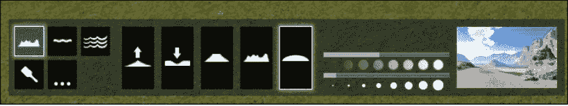

可用于修改地形的不同笔刷

如果你有数位板，现在正是使用它的好时机；如果没有，我们仍然可以用鼠标达到几乎相同的结果。按钮上的图标相当形象地说明了每个工具的功能。最有用的工具可能是**抬高**和**降低**选项，以及**平整**和**平滑**选项。**抖动**可以用来为景观添加一些微小的变化，但我们需要使用小笔刷和较低的速度。

在这些选项旁边，还有雕刻地形的关键设置。第一个选项叫做**笔刷速度**，它的工作方式是值越低，你需要按住鼠标左键的时间就越长才能修改地形，反之亦然。第二个选项使用起来更简单。使用大笔刷在较大的区域进行修改，使用较小的笔刷来添加细节。

大多数时候，我使用在 SketchUp 或其他应用程序中已经建模好的地形，但如果我有一定的自由度，我会先抬高和降低地形，稍微平整一下以放置 3D 模型，最后应用一些平滑来消除生硬的边缘。这样，我就能创建出不错的地形。Lumion 允许你在雕刻时返回，但**撤销**按钮的范围非常有限，因为你只能撤销上一个操作。但是，假设你想重新开始，那该怎么办？地形菜单可以帮助你做到这一点。

## 修改地形

**地形**菜单是另一个包含一些实用工具的菜单。单击此菜单可打开如下截图所示的窗口：

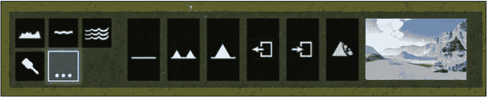

我们可以找到三个修改地形的选项。使用最左侧的选项可以将整个地形夷平，使用中间的选项可以创建山脉，使用最后一个选项可以创建一座大山。没错，就是一座大山。单击带有山脉图标的按钮，创建类似下面截图所示的效果：

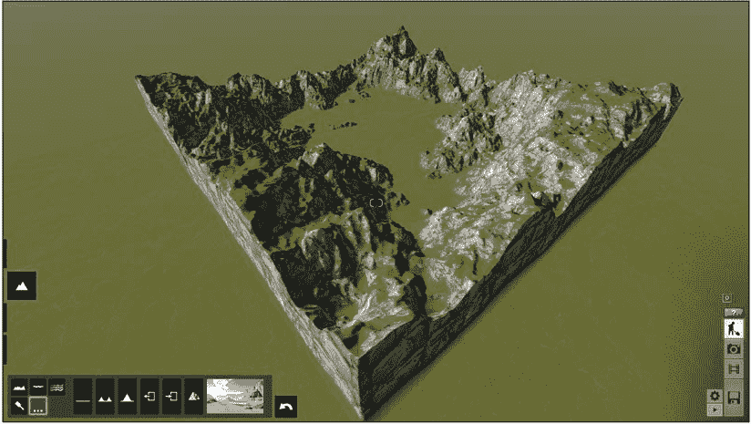

通过这个按钮，Lumion 会为你生成一个非常漂亮的地形。使用**高度**和**地形**菜单，你可以为建筑创建理想的地形，并且你可能会发现导出和导入地形图的选项也非常有用。因此，你可以创建多个地形，导出它们，然后看看哪一个最适合你；或者不必为另一个项目重新雕刻相似地形，而是直接导入之前制作的地形。但在 Lumion 中还有一种创建地形的方法。你何不去看看最后一个按钮有什么作用呢？

### 创建高度图

在*第 1 章，什么是 Lumion？*中，我们提到可以使用高度图纹理来替我们完成繁重的工作。Lumion 能够读取这种包含我们希望地形如何呈现的信息的高度图，并将这些 2D 信息转换为 3D 地形。然而，Lumion 有一些限制，因为在 Lumion 中可编辑的地形区域是一个 2048 x 2048 米的正方形。当我们创建高度图时，需要记住纹理会被拉伸到正方形的最边缘。下面的截图展示了高度图的样子，但问题是我们如何创建一个高度图呢？

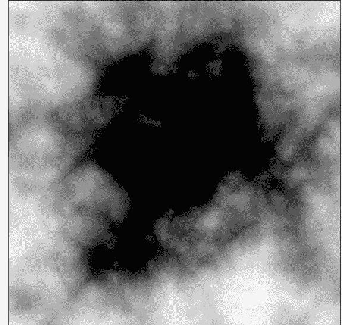

这是当你导出地形图时 Lumion 创建的高度图

还记得我们之前创建的山脉吗？其实，上图就是生成这些山脉的高度图。我们可以看到其中有 100% 的黑色、100% 的白色以及介于两者之间的不同深浅灰色。100% 黑色对应地形高度 0 米，100% 白色对应地形高度 200 米。此外，还有 254 级灰色可用于实现不同的高度。

我们可以使用以下文件格式来创建这种纹理：

- Windows 位图：*.bmp
- 联合图像专家组：*.jpg
- DirectDraw 表面：*.dds
- 便携式网络图形：*.png

为了打开和编辑 Lumion 导出的纹理，我们需要使用 `.dds` 文件格式。如果你使用的是 Adobe Photoshop 或 Gimp，则需要安装一个插件才能打开和编辑该文件格式。

> 从 https://developer.nvidia.com/nvidia-texture-tools-adobe-photoshop 下载适用于 Adobe Photoshop 的 NVIDIA 纹理工具。
> 从 https://code.google.com/p/gimp-dds/ 下载 GIMP DDS 插件。

让我们尝试使用 Adobe Photoshop 或 Gimp 创建一个简单的地图。这里有一个小技巧，可以帮助你查看模型在纹理图中的位置。使用“抬高”或“降低”工具（用哪个其实无关紧要），改变模型周围的地面，然后导出高度图地形。当你打开纹理文件时，可以看到这些变化表现为微小的白色圆点。我不能一步步向你展示如何操作，但以下是一些帮助你入门的指导方针。始终从黑色纹理开始，然后使用非常小的灰色增量。为了让地形更有变化，可以尝试使用不同的画笔类型，并调整不透明度。当我创建高度图时，我总是使用相同的灰色级别，但我改变的是不透明度。别忘了始终将纹理保存为 32f 格式的 32 位 DDS 高度图。

### 改变地形材质

我之前提到过，我们可以选择更改地形的一些元素。也许我们想要不同类型的草，或者想要使用枯叶来代替岩石。要访问这些选项，我们需要使用**颜色**菜单，如下面的截图所示：

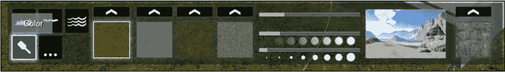

颜色菜单，你可以在其中调整地形上看到的纹理

使用此菜单有两种方式。第一种方式是更改各个元素。四个缩略图代表地形中存在的四种元素。起初你可能看不到它们，但一旦你开始雕刻地形并对其进行抬高和降低，这些元素就会开始出现。要更改这些元素，请单击缩略图上方的箭头以选择另一种纹理。如下面的截图所示，你有一个包含 42 种不同纹理的列表，但你也可以使用自己的贴图：

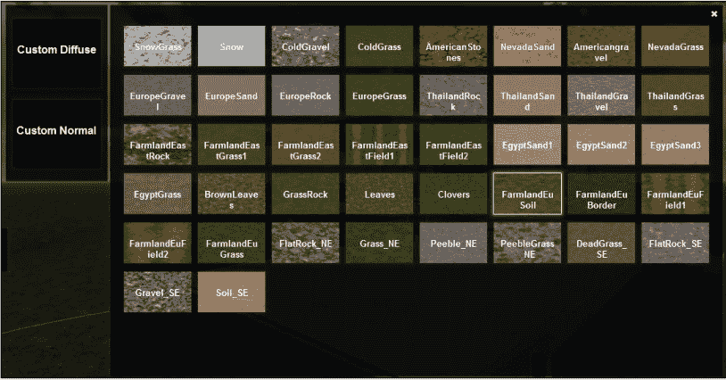

你可以使用的 42 种不同纹理

在纹理旁边，我们可以找到两个大按钮：**自定义漫反射**和**自定义法线**。可以说，漫反射纹理是赋予我们颜色的纹理，而法线纹理是 Lumion 获取信息以在你的地形上添加不规则细节的纹理。我们可以使用的文件格式如下：

- Windows 位图：*.bmp
- 联合图像专家组：*.jpg
- Truevision：*.tga
- DirectDraw 表面：*.dds
- 便携式网络图形：*.png
- Photoshop：*.psd

使用这些元素的第二种方式是直接在地形上绘制它们。为此，请单击带有纹理的缩略图，并调整**画笔速度**和**大小**滑块。还有第三个滑块用于调整平铺大小，换句话说，就是纹理的大小。

### 添加水面

在我为本书使用的示例中，最近的水体是福克斯河，离房子不远。如果你需要创建游泳池，请记住使用**水**材质会容易得多。在本节中，Lumion 允许你轻松创建六种类型的水，如下面的截图所示：

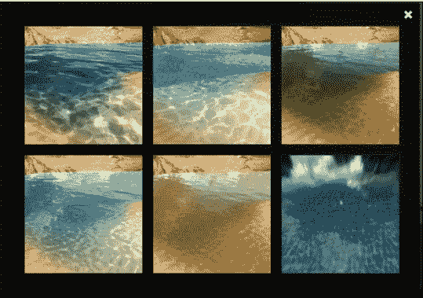

一旦你点击所需的预设，然后点击场景放置一个平面，并使用四个顶点上的图标调整高度和大小。遗憾的是，一旦添加了水材质，你就无法更改任何设置。唯一可以改变外观的水体是海洋。

### 创建海洋

选择海洋菜单，并单击带有开/关电源开关符号的按钮来开启或关闭海洋。一旦你开启此选项，我们就可以访问各种设置来控制海洋的外观，如下面的截图所示：

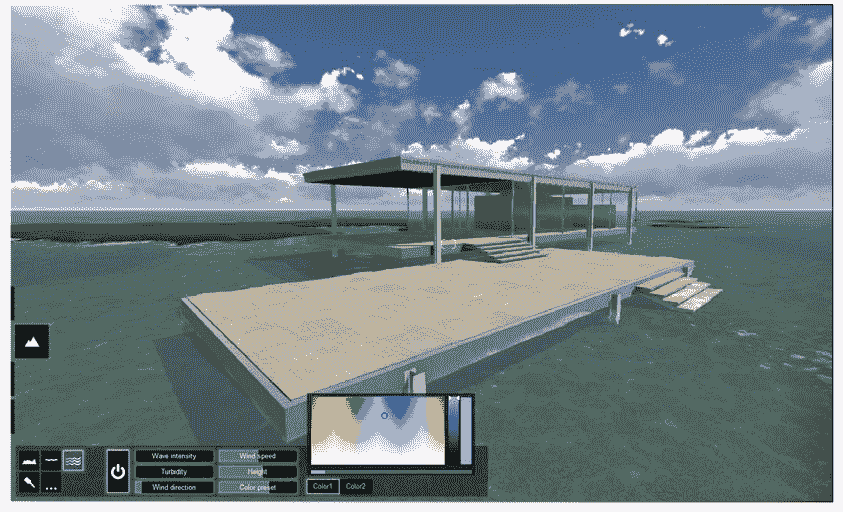

海洋菜单及其不同设置

与 Lumion 中的其他所有功能一样，这个菜单非常直观且易于使用。我们可以改变波浪图案，以及风向影响波浪的方式。如果你想对滑块进行精确调整，别忘了在调整滑块时使用 Shift 键。你为什么不试试使用颜色预设能得到什么效果呢？

## 设置天气

当我们对地形和水体感到满意后，就可以开始关注细节了。我们可以从使用**天气**菜单开始。同样，这个菜单相当不言自明。我们可以改变太阳的方向和高度，从九种给定类型中更改云的类型，并调整滑块以创建晴朗的天空或阴天，如下面的截图所示：

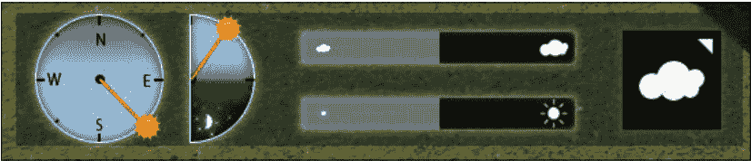

天气菜单，我们可以在这里控制太阳和天空

这部分我们能做的并不多，如果我们想要添加一些特殊的天气条件，如雨和雪，可以在之后的照片或视频模式中进行。

## 为场景添加内容

我们已经达到了一个阶段：地形已定义，天气已设置，3D 模型也已拥有漂亮且逼真的材质。所以现在，我们需要开始向场景中添加模型和小细节，以创造出更有趣、更生动的内容，而 Lumion 在这方面非常出色。虽然我将使用一些自己的模型，但我们几乎可以在 Lumion 库中找到所需的一切。在下一节中，我们将学习如何添加模型，以及如何更改、操作和组织它们。

## 构建环境

### 添加树木、人物和其他模型

让我们从 **对象** 菜单中的第一个选项开始——自然，正如你在下面的截图中所见：

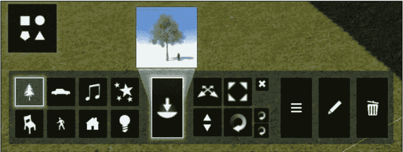

这个菜单允许你访问超过2000个模型。

一旦我们点击这个子菜单，右侧会出现一个小缩略图，显示当前模型。经过几次搜索，我找到了在范斯沃斯住宅附近可以找到的各种树木。它们是**美国皂荚、椴树、白蜡树、橡树、枫树、柳树、朴树、紫荆、桤木**和**河桦**，其中大多数都可以在Lumion中找到。

再次提醒，在添加这些细节和模型时，记得使用图层。你最多可以添加20个图层，所以没有理由不使用图层。我也为房子建了一个图层，如果你的建筑过于复杂，可以在另一个图层上使用低多边形版本，这样你就能轻松布置环境。我们先添加一些树木。为树木创建一个图层，然后点击带有树木图形的缩略图。这将让你进入库。在这里，我们可以找到不同的自然元素，对于树木，我们有六个选项卡，其中可以找到**叶子、松树**和**棕榈树**。

一旦我们选中想要的树，Lumion会返回构建模式，我们可以轻松看到一个黄色边界框。这个框代表树，可以帮助我们判断是否将树放置在与其他物体相交的位置，例如房子。当我们在放置对象时，Lumion足够智能，不仅能识别地面，还能识别地面以上的面，正如你在下面的截图中所见：

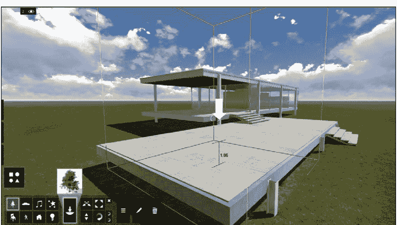

Lumion告诉我们，如果我们将树放置在这里，它将会高出地面1.06米。

所以，正如你在上面的截图中所见，会出现一条带数字的红线，好像是在警告你：如果将该树放置在此位置，它会离地面1.06米。如果你按下G键并用鼠标左键单击放置对象，对象将被放置在地面上，即使这意味着会与某个面或其他对象相交。

我建议的一件事是，按Ctrl键并同时按数字1到9中的任意一个，可以将顶视图保存为相机视口。这在我们放置树木和其他对象时会很有帮助。选中任何模型后，我们需要用鼠标左键单击来放置它，但如果我们要放置树木、花朵或草等对象，要一棵一棵地放置20棵同类型的树，确实非常乏味且耗时。因此，在放置模型时，我们可以使用以下两个快捷键来帮助我们完成这项工作：

- **Z**：此键会在每次放置对象时更改大小。
- **Ctrl**：此键会放置所选对象的10个副本。

好消息是，我们可以使用Ctrl + Z组合键加鼠标左键来放置10个不同大小的对象副本。放置这么多对象可能会产生副作用；你的视口会开始变得卡顿，但对于树木和其他植物，我们不需要在视口中看到树的完整质量。记得使用F9键来切换完整质量的开启或关闭，正如你在下面的截图中所见：

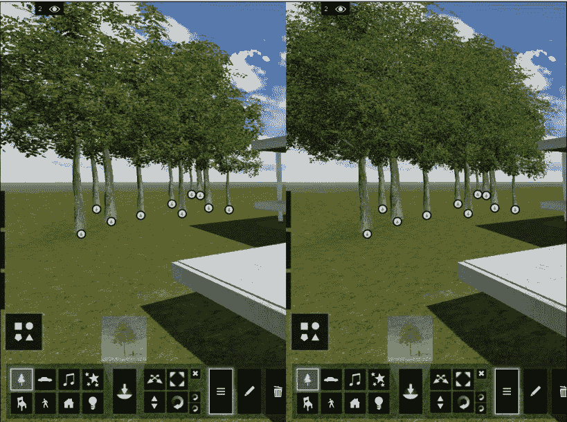

在左侧，我们按下了F9键以关闭质量，在右侧则是完整质量。

能够放置多个副本是一个很棒的功能，但请记住，Lumion中的对象越多，工作站运行就越慢，因为你正在消耗更多内存和其他资源。我们还可能会遇到一些需要调整的情况。假设我们在右侧创建了另一组特定类型的树，并希望将所有树向左移动更多。感谢Lumion团队，我们不需要逐一移动每棵树。在这种情况下，我们可以更好地利用上下文菜单。一旦我们点击此菜单，每棵树上都会出现白色圆点，点击白色圆点会打开两个子菜单：“选择”和“变换”，我们之前在导入模型时见过它们。

在这种情况下，我们选择 **选择**，新的选项将可用。让我们探讨几种情况以及如何使用此菜单来帮助我们。在第一个例子中，我想把右侧的树再向左移动一些。我们使用哪个选项？让我们尝试点击 **选择所有相似类别** 选项。这会选择你拥有的所有属于树木类别的模型。所以，如果你的场景中有更多树木，就像这个例子一样，你会选中每一棵树，但这不是我们想要做的；我们只想选择那些特定类型的树。点击 **全部取消选择** 选项以清除选择。让我们尝试 **选择所有相似项** 选项。使用这个选项，我们只选择属于特定树种的树。

使用键盘快捷键可以更改所选对象的位置、缩放和方向。但还有其他的快捷键，你不仅可以用它们来选择对象，还可以复制粘贴和更改高度：

- 按住 *Ctrl* 并拖动鼠标左键将进行矩形选择以选中多个对象，并且在矩形的上方，Lumion会提示你目前已选中的对象数量。
- 按住 *Ctrl* + *Shift* 并拖动鼠标左键将进行另一个矩形选择。将此选择添加到之前完成的另一个选择中。
- 按住 *M* + *Alt* 将复制并粘贴所选对象。
- 按住 *M* + *F* 将调整所有对象（树木和植物除外）的方向，并相应调整其他对象的表面角度。
- 按住 *M* + *Shift* 将水平移动所选对象并保持相同高度。
- 按住 *R* + *Shift* 将关闭旋转吸附。

在 **选择** 菜单中还有两个有用的功能。第一个功能是能够用库中的另一个元素替换你的选择，并查看你在库中正在使用哪个模型。其工作方式很简单；假设我们想把现有的树换成另一种树。我们需要做的第一件事是进入 **库** 并选择我们想要的模型。完成后，使用 **上下文** 菜单选择要替换的树，然后选择 **库** 选项。在此菜单中，我们可以找到另外两个选项：**在库中选择** 和 **替换为库中选择的内容**。点击第二个选项，就可以用当前模型替换你已选择的所有树或其他模型。另一个选项，**在库中选择**，在我们不知道正在使用什么类型的树或模型时非常有用。因此，如果我们选择模型，使用 **上下文** 菜单，选择 **库**，然后选择 **在库中选择**，我们就能看到库中当前选中的模型已经发生了变化。

现在，让我们将注意力转向另一个名为 **变换** 的菜单。此菜单帮助我们编辑模型的位置和其他方面。例如，**随机化** 菜单通过随机化 **位置**、**旋转** 和 **缩放** 值来为场景增添变化。另一个有用的选项是 **间距**，因为它允许你按一定间距对齐。

**对齐** 选项使你能够将已选中的对象定位到其枢轴点处于相同位置，但这会使对象重叠。因此，如果你需要移动这些对象，请将鼠标光标放在小的重叠对象选择图标上，然后使用鼠标滚轮或上下方向键在对象之间切换。

在场景中放置了一些模型后，你意识到自己没有使用正确的图层，或者更糟，根本没有使用任何图层。这是否意味着你需要从头再来？不，因为有一种简单的方法可以将模型添加到正确的图层。按住 *Ctrl* 并用鼠标左键拖动，以选择要添加到图层的对象，如下面的截图所示：

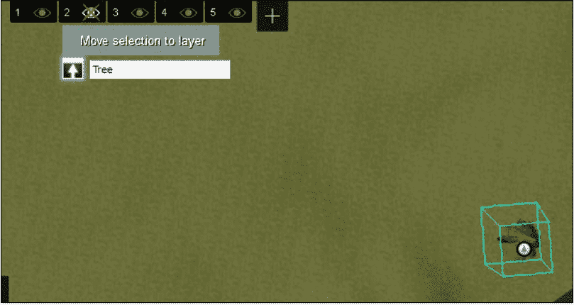

当你转到 **图层** 菜单并选择另一个图层时，我们会看到图层名称旁边有一个向上箭头。点击此箭头即可将所选内容移动到该图层。

既然你已经知道如何添加模型、控制它们以及它们的外观，请随意探索库中可以找到的其他模型，例如 **交通工具**、**室内**、**人物** 和 **户外**。

## 摘要

本章旨在帮助你开始在场景中放置模型，并学习如何操作它们。你看到了填充场景以增添生机以及改变景观是多么容易和快速。你还学习了改变地形、创建高度图以及使用特效对象的[content]

## Summary

本章旨在帮助你开始在场景中放置模型，并学习如何操作它们。你看到了填充场景以增添生机以及改变景观是多么容易和快速。你还学习了改变地形、创建高度图以及使用特效对象的基本步骤。

在下一章中，你将学习如何创建和添加效果，以及导出精美的静止图像和视频。

## 构图的要点

什么是构图，为什么它如此重要？构图是在画面内对元素的安排，以吸引观众的视线。与其使用*规则*的术语，不如让我们用一组可以增减以创作出优质视频或图像的要素来审视构图。

关键是要记住，你不会在准备的每道菜中使用所有食材。同样，在制作图像或视频时，你也不需要使用所有这些构图要素。

让我们来看一下构图的某些要点：

- **图案：** 生命中充满了图案，在捕捉重复性时，你可以强调这些图案，也可以打破它们
- **对称：** 你可以创建两种类型的图像；一种具有对称性，另一种具有不对称性
- **景深：** 这可以将主体与其背景和前景隔离开来
- **线条：** 你可以使用对角线、水平线、垂直线和汇聚线；它们都会以不同的方式影响图像
- **形状和定位：** 这两者都是不同元素非常重要的因素
- **对比度比例：** 这给出了明暗之间的划分

这些只是创建良好构图的几个方面。这个主题过于复杂，无法在本书记载，然而，这些要点可以帮助你迈出正确的第一步。

> > 学习摄影，你就能完成一半的工作来创建出色的建筑可视化。

## 构图的 framing 重要性

构图中的一个重要事项是使用 framing 的概念。什么是 framing？Framing 是指我们在场景中使用某些元素来引导观众的注意力聚焦于场景的某些方面。看一下下面的截图，例如，我们如何使用两侧的树木来将观众的注意力引向房屋：

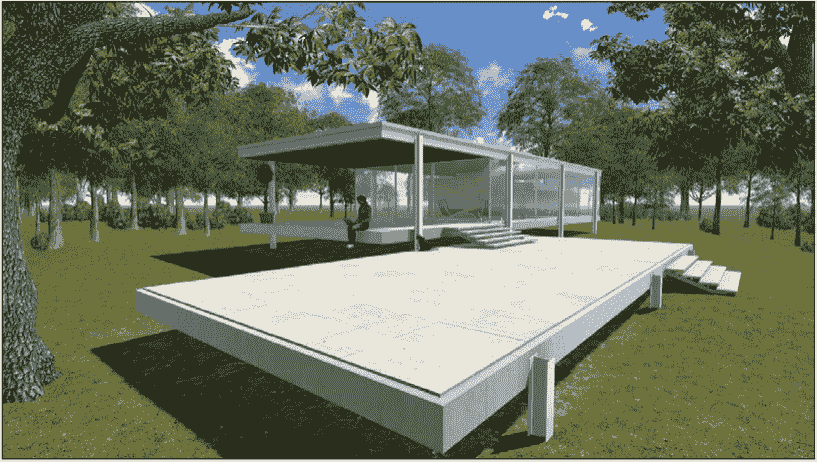

我们几乎可以用场景中的任何东西来框定镜头，包括树木、岩石和其他建筑物，仅举几例。

## 使用 Photo 模式导出图像

让我们进入 Photo 模式，应用一些效果，然后导出图像。在 Lumion 屏幕的右侧，点击 Photo 模式图标，即带有相机图标的那个，如以下截图所示：

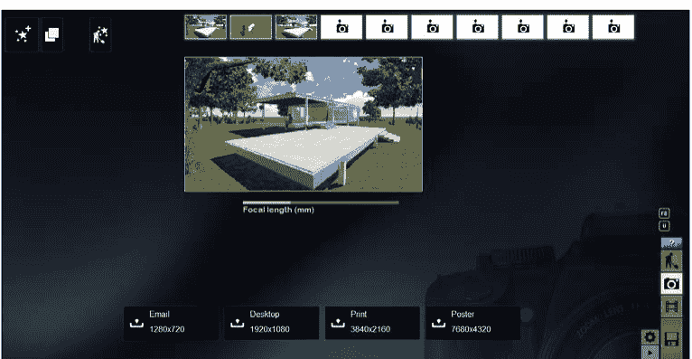

启用 Photo 模式并显示我们的第一张静止图像

如前面的截图所示，我们有多个可调整的设置，因此，我们将从效果开始。点击页面左上角的 New effects 图标，以星号和加号为特征，开始添加效果。可用效果如下：

- World: Sun, Shadow, Contrails, Underwater, Global Illumination, and Reflection
- Weather: Cloud, Fog, Rain, Snow, VolumeClouds, Folliage wind, and Horizon Cloud
- Camera: Vignette, Depth of Field, Lens flare, Near Clip Plane, Fish eye, Handheld Camera, and Exposure
- Style: Bloom, Overlay image, Noise, Sharpness, Selective saturation, Color correction, and Bleach
- Artistic: God rays, Painting, Watercolor, Sketch, Manga, and Chromatic Aberrations

## 准备渲染

Lumion 通过显示应用效果后的缩略图来帮助你了解效果的外观。了解每个效果作用的最好方法是逐一尝试。不仅能让你了解可以得到什么，还能轻松识别场景的需求以及如何通过使用效果解决特定问题。

我在场景中最常用的效果如下：

- **Global Illumination**
- **Foliage wind**
- **Depth of Field**
- **Chromatic Aberrations**

还有一些事情我希望在后期制作阶段添加，例如 **Vignette**、**Color correction** 和 **Bloom**。原因是我在 Lumion 中应用这些效果后，如果之后想返回并移除效果，就需要再次导出图像。如果我们使用非破坏性工作流程，例如在 Photoshop 或 Gimp 中使用图层，就能轻松添加或移除这些效果。还有复制效果并粘贴到另一段剪辑的选项，如果我们想导出多张具有相同效果的图像，这非常有帮助。如果 **Photo** 模式中较小的窗口不足以检查我们应用的效果，**Build with effects** 是一个很酷的功能，允许你在保持效果应用的情况下返回到 **Build** 模式。

最后，你可以更改焦距，它的工作方式类似于缩放工具。如果需要将相机向左或向右移动更多，或更改其他设置，你无需返回 **Build** 模式，调整相机并保存新的视口。你只需将鼠标放在窗口上并使用所有键盘快捷键来更改相机位置即可。

现在你已准备好导出最终图像。Lumion 允许你使用以下格式导出四种图像分辨率：

- Windows Bitmap: *.bmp
- Joint Photographic Experts Group: *.jpg
- Truevision: *.tga
- DirectDraw Surface: *.dds
- Portable Network Graphics: *.png

在导出图像之前，务必检查一切是否就绪，以及是否需要使用 F8 键来切换聚光灯阴影，以及 U 键来更新反射或云。

## 使用 Movie 模式创建视频

让我们创建一个电影。在 Lumion 中创建电影非常简单直观。点击 Movie 图标开始创建电影；界面如下图所示：

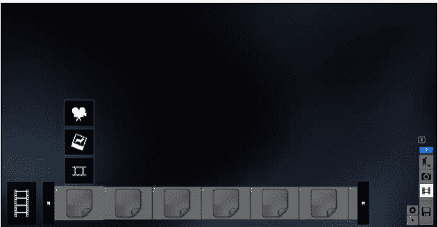

Movie 模式

你可以通过使用此功能来创建电影的各个片段。没有什么比 Lumion 开始渲染视频时在最后一刻崩溃或遇到问题，导致你丢失视频文件更糟糕了。如果你创建整个电影，你需要从头开始，但通过使用单独的片段，你只需从最后一个片段开始即可。有三个选项可用于通过导入图像或视频来创建视频，但我们只关注第一个选项，并通过点击 Record 图标开始为其创建动画，如下图所示：

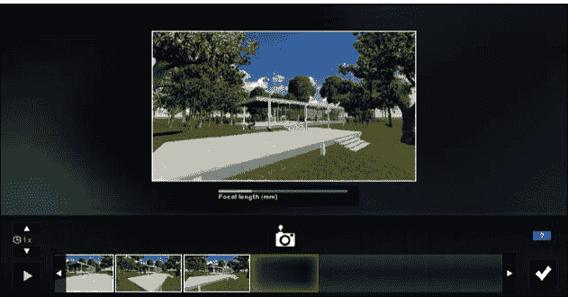

创建单独的片段

## 准备渲染

点击带有相机图标的按钮开始你的第一个镜头，然后移动相机并再次点击，重复直到满意为止。之后，点击 **Play** 图标查看动画效果。你可以按下 *Shift* 以及 1 到 9 之间的任意数字来加载已保存的视口，并使用这些视口来创建电影。

Lumion 另一个有用的功能是可以加快或减慢剪辑的速度。在你的左侧有一个滑块，允许你增加或减少速度。当你最终对动画满意时，点击 **Ok** 按钮。

现在，如果需要，我们可以再次编辑剪辑。选择剪辑，在其上方我们有两个按钮，如下图所示：

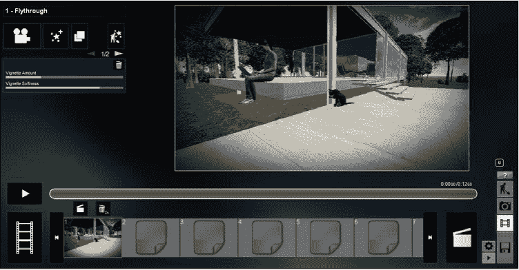

选择剪辑以删除或编辑它

在 **Movie** 模式下，Lumion 允许我们为每个剪辑和整个电影添加效果。此选项在我们想要为特定剪辑添加例如 **Fade In** 或 **Fade Out** 选项，或更改另一个剪辑的 **Depth of Field** 值时很有用。我在背景中添加了一些 **Vignette** 和 **Fog** 效果。

通过点击 **Entire Movie** 图标，即左下角带有胶片条特征的那个，为整个视频而不是单个剪辑添加效果。如果我们点击此图标，我们将进入另一个菜单，在那里我们可以编辑整个电影并为整个电影添加效果，而不是为单个剪辑添加。这在你想为所有剪辑添加相同效果时特别有用。现在，要导出电影，点击右侧的 **Save Movie** 图标；即带有电影拍摄符号的那个。

我们可以在 **MP4** 格式下导出，它有几个选项，例如 **Quality**、**Frames per second** 和 **Resolution**。但我建议使用第二个选项，**Images**，如下图所示：

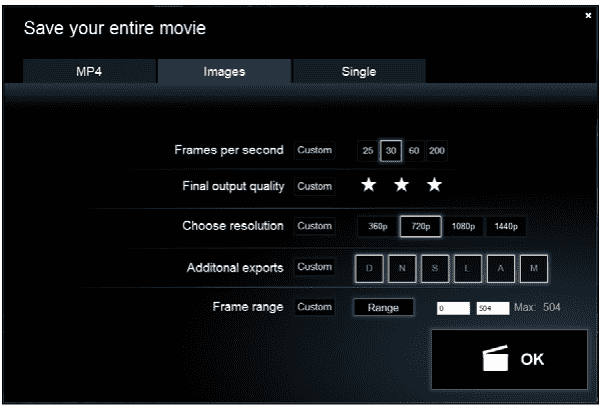

导出一组图像而不是整部电影

如你所见，你有相同的选项，外加一些额外的选项，允许你导出可以在 Photoshop 或 Gimp 中稍后使用的渲染通道。我建议使用此选项，因为你可以在使用视频编辑器时获得更多控制权。缺点是你需要空间来存储这么多图像。

最后一个选项是导出单张图像和一个渲染通道。如果你只想导出一张图像，最好使用 **Images** 菜单下的 **Frame range** 选项。

## Summary

在本章中，你学习了什么是构图以及它如何帮助我们创建平衡且有吸引力的图像或视频。你还学习了如何使用三分法则及其构图概念。然后，你更深入地了解了 **Photo** 模式以及如何添加不同的效果并调整它们。最后一个主题是电影模式，在本节中你学习了如何创建电影、添加效果，最后如何使用不同的输出保存它们。

在下一章中，我们将选择导出的电影或图像，并学习如何提高质量、进行微小更改以及使用导出的渲染通道。

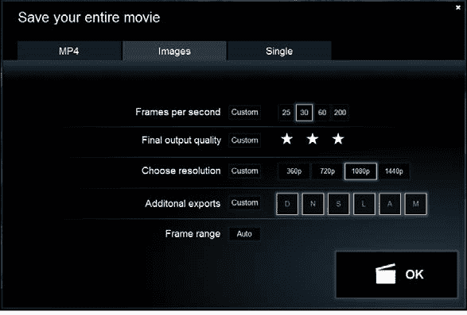

使用 Video 模式，我们可以导出一些有用的渲染通道

点击 OK 按钮，选择一个文件夹并保存你的图像。一旦你点击 Save，Lumion 将开始工作，你可以看到进度。Lumion 将首先处理彩色图像，然后导出渲染通道。如果你导出所有渲染通道，你将得到七张图像；每一张都不同，如下所示：

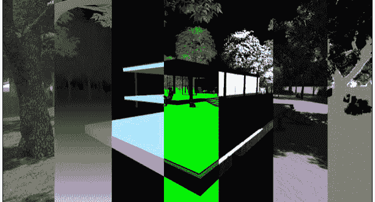

一个展示你得到的七张不同图像的构图

从左到右，我们有 **color image**、**depthmap**、**material ID**、**normalmap**、**specular reflection map**、**lighting map** 和 **sky alpha map**。你不需要导出所有渲染通道，例如，我除了极少数情况外不用 normal map 和 material ID。现在，让我们使用 Photoshop 打开这些图像。

Photoshop 使用图层，如果我们开始时为不同的图层添加名称然后创建组，这是一个好主意。因此，考虑到这一点，我将在 **Layer** 菜单中创建一个文件夹并将名称更改为 `Base`。将 colormap 拖到此文件夹中或使用 `Ctrl + G` 的组合为图像创建组。以 `.PSD` 格式保存文件，以便你以后可以编辑图层。

现在，右键单击 **Base** 组，选择 **Duplicate Group...**，并将其重命名为 `Render Passes`。完成后，我们可以开始导入渲染通道，当你在 Photoshop 中打开图像时，每张图像都会作为新标签打开。因此，我们需要将每张图像拖到原始 PSD 文件中。转到 depthmap 并使用组合键 `Ctrl + A` 选择整个图像并使用 `Ctrl + C` 复制该图像。然后，返回原始 PSD 文件，创建一个新图层，并使用组合键 `Ctrl + V` 粘贴图像。不要忘记每次创建新图层时重命名图层。你应该得到类似以下内容：

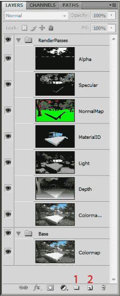

- 1 - 创建一个新组
- 2 - 创建一个新图层

## Accurate selection with material ID

让我们使用 **material ID** 贴图来移除玻璃上的高光贴图效果并配合图层蒙版。让我先解释图层蒙版的工作原理以及如何使用它们，为此你只需要知道黑白之间的区别。

图层蒙版允许你控制图层的透明度级别。但我们可以使用 **Opacity** 选项（是的，你可以！）；区别在于 **Opacity** 选项会一次性改变整个图层的透明度级别。在这种情况下，我只想降低高光贴图对玻璃的影响，而不是对整个图像的影响。因此，我们需要一种方法来单独控制图层不同区域的透明度，这时我们使用图层蒙版。

选择高光图层并转到 **Layer** 菜单，选择 **Layer Mask** 选项并选择 **Reveal All**。这是你需要记住的一件事；白色显示，黑色隐藏。这意味着我们使用白色图层蒙版来显示所有内容，并使用画笔工具选择黑色颜色进行绘画和隐藏。

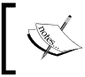

> 如果你开始绘制图像，这意味着你没有选择图层蒙版。点击图层蒙版并使用画笔工具；你应该在图层蒙版缩略图上看到结果。

我们可以开始在窗户周围绘画，但这可能是一项艰巨的任务，因为不小心我们可能会在不希望的地方隐藏效果。我们可以使用套索工具，但我们将使用 material ID 图层来准确选择特定区域。让我展示如何轻松地仅选择带玻璃的窗户。

## The sky alpha map

我们对 material ID 所做的操作，也可以对 sky alpha map 进行。如果你想更改天空，你可以从 CGTextures 获取一张，然后将图像拖到 PSD 文件中，并使用颜色范围选择白色区域并创建蒙版，就像我们之前做的那样。

> 要获取一些天空，使用链接 `http://cgtextures.com/` 进入 CGTextures 网站，然后选择 **Skies Partial**。

## The importance of adjustment layers

在使用混合模式后，我们可以复制组并将所有内容合并为一个图层并命名为 Passes。然后，我们创建一个名为 CC 或 Color Correction 的组。在此组中，我们开始使用调整图层。要添加它们，请转到 Layer 菜单，选择 **New Adjustment Layer** 开始添加一些调整，例如 **Curves…**、**Hue/Saturation…** 和 **Color Balance…**。

使用调整图层有两个重要原因。首先，调整图层的工作方式是你在透明图层上进行更改而不实际触及任何内容；因此，它们是非破坏性的。其次，我们甚至可以返回并编辑这些调整图层；我们还可以堆叠这些图层，它们会累积，最后我们可以使用图层蒙版将调整隔离到特定区域。

色彩校正是复杂的主体，我们很难深入解释如何操作，主要是因为每张图像都不同，我们在一张图像中使用的内容不一定适合另一张。我建议你阅读一些 *Making of* 文章，在那里你可以了解其他艺术家如何对他们的图像进行色彩校正。

> 你可以通过访问以下链接找到一些非常好的文章：
> 
> - `http://www.ronenbekerman.com/category/tutorials/making-of/`
> - `http://www.cgarchitect.com/features/category/making-of`

## Working with Curves

通常，我们想要找到图像中最亮和最暗的部分，并使用一些特殊的吸管工具点击这些部分。我们可以使用 Threshold 调整图层来检查此信息，然后删除此图层并创建 Curves 调整图层。右键单击 Curves 调整图层并选择 **Create Clipping Mask**。我们这样做是为了让调整图层仅影响以下图层而不是其他图层：

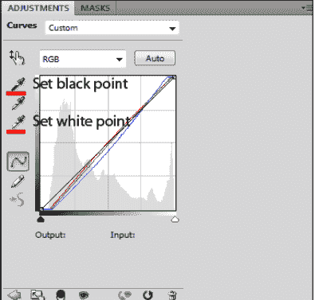

使用吸管选择黑白点

请注意前一屏幕截图左侧的三个吸管。使用第一个，我们将点击图像上最暗的区域，使用第三个，我们点击图像上最亮的点。当我们用暗色吸管点击时，它会测量该区域的红色、绿色和蓝色量并调整使其平衡。然后，它会将该区域变暗到最大程度。使用白色吸管时，避免纯白色区域；否则，你的图像会看起来有点奇怪。有时，你可能只需要使用黑色和灰色吸管。最后，我们点击中间的吸管并寻找灰色色调。你可能需要点击多个点，直到找到最 pleasing 的颜色，这真的取决于图像。尝试使用 Saturation 调整图层来降低图像的饱和度，并使用 Color Balance 调整图层来创建温暖或冷色调的外观。

## 应用镜头效果

让我们添加一点真实感，其中一种方式就是给图像添加细微的**色差**。色差是由镜头色散引起的，不同颜色的光在穿过镜头时速度不同。因此，拍摄照片时，照片可能会看起来模糊，或者物体周围出现彩色边缘。这就是实现真实感并添加瑕疵的技巧。如何在Photoshop中添加色差呢？

### 在Photoshop中添加色差

再次，创建一个色彩校正组的副本，右键单击该组，然后选择**合并组**。现在，我们得到了一张应用了颜色校正的图像，我们可以将这个图层移动到一个新组，命名为`Lens`。复制该图层，进入**滤镜**菜单，点击**扭曲**选项，然后选择**镜头校正**。

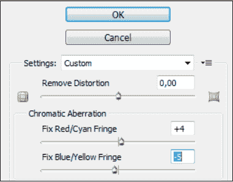

这些是我用来添加色差的设置

调整**修复红/青边**的值，但要非常微妙。我们不希望观察者注意到这个效果。人们会下意识地习惯看到这种镜头误差，而细微的调整有助于去除CG感，让画面看起来更真实。我之所以告诉你在另一个图层上添加此效果，是因为你现在可以调整**填充**滑块，看看什么值能让图像看起来更好。

## 一点锐度

接下来，我们给图像添加一些锐度。步骤相同：创建组的副本，合并，后面的步骤你知道的。这个组将命名为“Sharpness”。再次，创建图层的副本，进入“图层”菜单，点击“锐化”选项，然后选择“锐化”滤镜。但那样变化太大，我们不需要。所以，再次使用“填充”滑块来调整你想要的图像锐化程度。

## 景深

现在，我们要添加一些景深，为此，我们需要从Lumion导出的深度贴图。使用之前合并的组创建一个组，复制该图层，并将其重命名为DOF。接下来要做的，是使用Ctrl + A组合键选择整个图层，再使用Ctrl + C复制天空Alpha贴图。现在天空Alpha贴图已在内存中，我们回到DOF图层并添加一个图层蒙版。执行此操作时，蒙版预览会显示在图层旁边，我们可以通过按住Alt键并用鼠标左键单击来访问该蒙版图层。屏幕变成白色，我们使用Ctrl + V组合键粘贴天空Alpha贴图，然后使用Ctrl + D取消选择。之后，点击DOF图层，在“滤镜”菜单下的“模糊”中选择“镜头模糊...”。

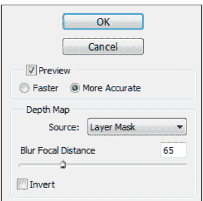

这些是我用来添加景深的设置

使用**更精确**选项，并在**深度映射**中选择**图层蒙版**。然后，你需要调整**模糊焦距**，看看哪个值最适合你。点击**确定**按钮，然后右键点击图层蒙版，选择**删除图层蒙版**。同样，我们可以使用**填充**滑块来调整我们想要的图像中景深的程度。

## 用噪点和暗角进行最后修饰

复制并合并DOF组后，我们再创建一个组，例如命名为`Final`。在这个最后一个图层的顶部，我们创建一个名为`noise`的空图层，为此，我们可以使用*Shift + Ctrl + N*组合键。选择这个新图层，按*Shift + F5*，然后选择**50%灰**。接着，进入**滤镜**菜单，在**杂色**选项下选择**添加杂色**。对于**数量**值，使用非常低的值，如**2%**或**3%**，然后点击**确定**按钮。现在，我们需要将此图层的混合模式设置为**叠加**，以便在图像中添加一些噪点。

最后，创建另一个名为`Vignette`的图层，并填充白色。选择该图层，进入**滤镜**，在**扭曲**菜单下选择**镜头校正**。

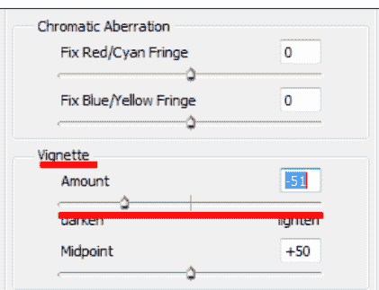

在**暗角**字段下，将**数量**值改为负值，这样就能得到一些暗角。点击**确定**按钮，将该图层的混合模式设置为**正片叠底**，然后查看结果，如下面的截图所示：

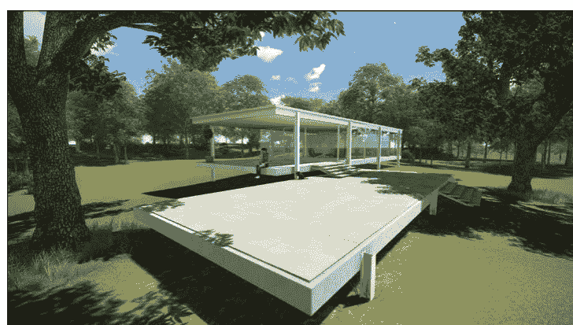

我们完成所有后期处理的最终图像

最后，我们的图像准备好了。经过所有这些努力，很容易看出最终图像与没有任何后期处理的图像之间的区别，如下所示：

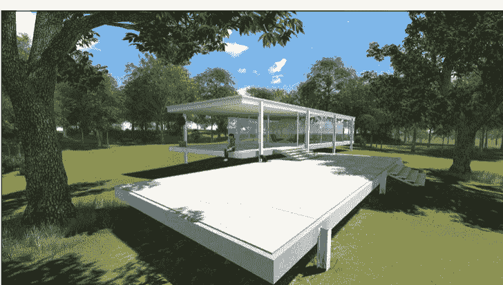

我们没有任何后期处理的初始渲染

## 小结

这一章真的很有趣，你学到了很多东西。你学会了如何使用Lumion随主图像导出的不同渲染通道对图像进行一些基本的后期处理。在使用镜面反射、材质ID、光照和天空Alpha贴图之后，你学会了如何为最终图像添加一些镜头效果。不过，这只是非常基础的操作指南章节，我真心鼓励你学更多，学习不同的技术，以及如何通过后期处理节省时间。

D
DirectDraw Surface 9
E
示例选项卡 13
导出完整场景选项卡 14
F
FBX文件 9, 10
Floor Generator插件 44
取景 91
FreeScale插件 43
G
Gimp
  关于 58, 77, 100
  下载网址：100
GIMP DDS插件
  下载网址：77
Gimp-normalmap
  网址：60
H
高度图
  创建 76, 77
高动态范围 9
主页选项卡 12, 13
I
图像后期处理
  关于 100
  使用材质ID进行精确选择 105, 106
  使用光照贴图添加对比度 106
  应用镜头效果 109
  天空Alpha贴图 107
  添加镜面反射贴图 104
  处理图像 100-102
图像
  使用照片模式导出 93, 94
  处理图像 100-102
导入完整场景选项卡 14
不可见材质 56
J
联合图像专家组 9
JointPushPull插件 43
K
构图的关键要素
  景深 90
  线条 90
  图案 90
  定位 90
  对比比例 90
  形状 90
  对称 90
L
景观
  材质修改 78, 79
  建模 73
  雕刻 74
景观（Lumion）
  控制 23-25
景观材质 57, 58
图层
  使用图层 19, 103
镜头效果应用
  关于 109
  使用Photoshop添加色差 109
  添加景深 110
  使用噪点和暗角进行最后修饰 111, 112
  为图像应用锐度 110
光照贴图
  用于添加对比度 106
加载场景选项卡 13
Lumion
  导入3D模型 9, 10
  关于 5, 35, 63, 64
  背景 6
  优势 7, 8
  入门 14-17
  控制景观 23-25
  使用图层 19
  应用材质 19-22
  创建材质 58, 60
  导入模型 17, 18
电影模式 29-32
导航键 16, 17
添加对象 25-27
照片模式 28, 29
保存场景 33
用法 6, 7
版本 8, 9
与Lumion Pro对比 9
控制天气 23
使用 68-71
工作站规格 10
Lumion 3D界面
  关于 11
  示例选项卡 13
  导出完整场景选项卡 14
  主页选项卡 12, 13
  导入完整场景选项卡 14
  加载场景选项卡 13
  新建选项卡 11
  保存场景选项卡 13
Lumion 4 65
Lumion教育版
  关于 8
  URL：8
Lumion免费版
  关于 8
  URL：8
Lumion材质
  关于 52
  高级选项菜单 55
  自定义菜单 56
  属性菜单 52-54
  纹理放置 55
  纹理选项菜单 55
Lumion Pro
  与Lumion对比 9
  Lumion Pro版本 8
M
材质
  应用 19-22
  在Lumion中创建 58, 60
  重要性 46
Max文件 9
Maya
  关于 64
  插件 44
建模
  使用倒角边添加细节 39-42
  常见问题 47, 48
  添加细节 44
  细节的重要性 39
  针对可视化的建模 36
Lumion模型
  导入 17, 18
电影模式
  关于 29-32
  使用其创建视频 95, 96
MPEG-4第14部分 10
Mr. Cad
  网址：45
Multitexture 1.0插件 44
N
Lumion导航键
  使用 16, 17
新建选项卡 11
Ninja Dojo（黑带）5.5.0 44
NVIDIA纹理工具（用于Adobe Photoshop）
  下载网址：77
NVIDIA纹理工具（用于Adobe Photoshop）
  网址：60
O
对象
  添加 25-27
  用对象填充场景 45
Obj文件 9
海洋
  创建 80
OpenCOLLADA
  关于 64
  下载网址：64
OSCoolean插件 43
P
照片模式
  关于 28, 29
  使用其导出图像 93, 94

Photoshop 9
插件，3ds Max
  Bookmanager 1.0 44
  Floor Generator 44
  Multitexture 44
  UniqueMaterialID 44
插件，Maya
  1 Click Procedural Rock Generator 44
  ArchiTool 0.8 44
  Ninja Dojo (Black Belt) 5.5.0 44
  StairsCreator v3.0 3.0.0 44
插件，SketchUp
  FreeScale 43
  JointPushPull 43
  OSColean 43
  RoundCorners 43
  Shapes 43
  SketchyFFD 43
  SubdivideAndSmooth 43
  Weld 43
便携式网络图形 9
后期制作
  调整图层，重要性 107
属性菜单
  关于 52
  亮度 54
  凹凸 54
  光泽度 54
  反射着色 53
  反射衰减 54
  反射率 54
  饱和度 54
  缩放 53
清除功能 38

R

资源 Blogscopia
  URL 45
Revit 36, 64, 68
Rock Generator 脚本 44
RoundCorners 插件 40, 43
三分法 92

S

保存场景选项卡 13, 33
场景
  填充 81-86
  填充，使用对象 45
场景，Lumion
  保存 33
场景，填充
  人物，添加 82
  声音，添加 87
  特殊效果 87
  树木，添加 82
脚本，3ds Max
  Rock Generator 44
Shapes 插件 43
SketchUp
  关于 36, 64
  导出 65, 66
  插件 43
  URL，用于下载 36
  URL，用于培训视频提示 41
SketchUp 文件 9
SketchUp Warehouse
  URL 45
SketchyFFD 插件 43
天空 Alpha 贴图 107
声音
  添加，到场景 87
高光贴图
  添加 104
StairsCreator v3.0 3.0.0 44
SubdivideAndSmooth 插件 43

T

标签图像文件格式 9
地形
  修改 75, 76
纹理
  放置 55
纹理选项菜单 55
Truevision 9
TurboSquid
  URL 45

U

UniqueMaterialID 插件 44

V

视频
  创建，使用电影模式 95-97

W

水面
  添加 79, 80

天气
  设置 81

天气，Lumion
  控制 23

Weld 插件 43

Windows 位图 9

工作站规格，Lumion 10

Z

缩放范围选项 37

感谢购买
《Lumion 3D 入门指南》

## 关于 Packt Publishing

Packt（发音为“packed”）于 2004 年 4 月出版了其第一本书 *《精通 phpMyAdmin，实现有效的 MySQL 管理》*，此后一直专注于出版针对特定技术和解决方案的高度聚焦书籍。

我们的书籍和出版物分享了您的 IT 同行在改编和定制当今系统、应用程序和框架方面的经验。我们基于解决方案的书籍为您提供知识和能力，以定制您正在使用的软件和技术来完成工作。Packt 的书籍比您过去所见过的 IT 书籍更专业、更少泛泛而谈。我们独特的商业模式使我们能够为您带来更聚焦的信息，让您获得更多需要知道的内容，减少不需要的内容。

Packt 是一家现代而又独特的出版公司，专注于为开发者、管理员和新手社区制作高质量、前沿的书籍。如需了解更多信息，请访问我们的网站：www.packtpub.com。

## 为 Packt 写作

我们欢迎所有对写作感兴趣的人士前来咨询。图书提案请发送至 author@packtpub.com。如果您的图书想法尚处于早期阶段，希望在撰写正式提案之前先进行讨论，请联系我们；我们的一位策划编辑将与您联系。

我们不仅仅寻找有出版经验的作者；如果您拥有扎实的技术技能但缺乏写作经验，我们经验丰富的编辑可以帮助您发展写作事业，或者让您的专业知识获得额外回报。

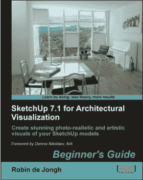

# SketchUp 7.1 建筑可视化入门指南

ISBN：978-1-84719-946-1    平装：408 页

为您的 SketchUp 模型创建令人惊叹的照片级真实感和艺术视觉效果

+   1. 为您的 SketchUp 模型创建完美画面的照片级真实感 3D 建筑渲染
+   2. 对 SketchUp 输出进行后期处理，创建数字水彩和铅笔艺术效果
+   3. 遵循专业可视化工作室的工作流程

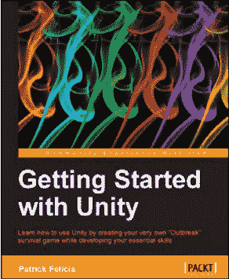

# Unity 入门

ISBN：978-1-84969-584-8    平装：170 页

通过创建您自己的“Outbreak”生存游戏来学习如何使用 Unity，同时培养您的基本技能

+   1. 使用基础 AI 技术让您的游戏栩栩如生
+   2. 学习如何使用 Mecanim；创建状态并通过脚本管理它们
+   3. 使用脚本管理图形界面、碰撞、动画、持久数据或场景之间的过渡

