# 前言

多年来，机器人和其他先进的电子奇迹只能在电视、电影或大学或军事实验室中看到。然而，近年来，新颖且价格低廉的硬件以及免费和开源软件的可用性，为几乎任何具有一点技术知识和想象力的人提供了构建这些技术奇迹的机会。第一波项目由 Arduino 提供动力，Arduino 是一种价格低廉且易于编程的微控制器。下一波则由 Raspberry Pi 的引入而进一步推进，Raspberry Pi 是一种由 Linux 操作系统驱动的更强大的处理器。

现在有一种更便宜、更强大的微处理器：Raspberry Pi Zero。这款小处理器将足够运行 Linux 的处理器封装在更小、更便宜的封装中。这种能力，再加上一些额外的动力、低成本硬件和免费开源软件，为项目提供了平台，从简单的轮式机器人到先进的飞行机器。

## 本书涵盖内容

*第 1 章，Setting Started with Raspberry Pi Zero*，旨在详细介绍在 Raspberry Pi Zero 上设置有用的开发环境的细节。本章从如何连接电源的讨论开始，一直延续到设置完整的系统，配置好并准备连接到任何令人惊叹的设备和 SW 能力，以开发先进的机器人应用。

*第 2 章，Programming Raspberry Pi Zero*，回顾了对于已熟悉的人来说，在本书其余部分有用的基本 Linux、编辑和编程技术。您将学习如何从命令行交互，如何使用编辑器创建和编辑文件，以及基本的 Python 编程。


## 本书结构

*第3章，访问 Raspberry Pi Zero 上的 GPIO 引脚*，通过构建和控制一些简单的 LED 电路来讨论 Raspberry Pi Zero 的 GPIO 能力。

*第4章，构建和控制一个简单的轮式机器人*，讨论了使用 Raspberry Pi Zero 可以实现的一个令人惊叹的功能，即控制一个简单的轮式机器人。本章将向您展示如何添加电机控制，以便您可以构建自己的自主移动机器人。

*第5章，构建一个会走路的机器人*，介绍了另一个令人印象深刻的机器人项目，一个可以行走的自主机器人。这是通过使用伺服器实现的，其位置可由 Raspberry Pi 和一些额外的 USB 控制硬件控制。

*第6章，添加语音识别和语音 - 一个语音激活机器人*，介绍了语音激活机器人。今天的计算机系统的一个重要新功能是能够在没有屏幕或键盘的情况下输入命令并提供输出。几年前，概念上可以说话和倾听的计算机是科幻小说，但今天它已成为新手机的标准组成部分。本章介绍 Raspberry Pi Zero 如何既能收听语音又能做出相应回应。这并不像听起来那么容易（双关语意在其中），您将接触到一些基本功能，同时了解其中的一些关键限制。您将把一个标准玩具变成一个有反应的机器人。

*第7章，将 Raspberry Pi Zero 添加到遥控车辆*，介绍了 Raspberry Pi Zero 的另一个惊人功能，即为您的项目添加“视力”。Raspberry Pi Zero 通过支持开源软件和 readily available USB 网络摄像头使这变得非常容易。通过添加此设备和一个遥控器，您可以构建一辆遥控车辆，可以绕过拐角，进入房间，您想去的任何地方。

*第8章，用 Raspberry Pi Zero 玩石头剪刀布*，介绍了我们如何使用工具包来构建和控制一只可以感知并对周围世界做出反应的机械手。在这种情况下，您将编程您的手来玩石头剪刀布。

*第9章，将 Raspberry Pi Zero 添加到四轴飞行器*，谈到了构建一个会走路、会说话或玩空气曲棍球的机器人很酷，但能够飞行的机器人才是终极目标。

## 本书所需

您需要一台 Raspberry Pi Zero。您可以参考本书的软件列表以及代码包。

## 本书适合谁

本书专为初学者设计。它只需要一点丰富的想象力和学习编程和硬件配置基础的愿望。

## 约定

在本書中，您会找到一些区分不同类型信息的文本样式。以下是这些样式的示例及其含义的解释。

代码词、数据库表名、文件夹名、文件名、文件扩展名、路径名、虚拟 URL、用户输入和 Twitter 账号显示如下：“要安装 Nmap，输入 sudo apt-get install nmap。要运行 Nmap，输入 sudo nmap -sp 10.25.155.1/154。”

代码块设置如下：

```
a = input("Input value: ")
b = input("Input second value: ")
c = a + b
print c
```

当我们希望引起您对代码块中特定部分的注意时，相关行或项目以粗体显示：

```
a = input("Input value: ")
**b = input("Input second value: ")**
c = a + b
print c
```

任何命令行输入或输出都写成如下形式：

```
cd /home/pi/Desktop
```

**新术语**和**重要词语**以粗体显示。您在屏幕上看到的词语，例如菜单或对话框中的词语，在文本中如下所示：“点击 **Scan** 选择器会扫描连接到网络的所有设备。”

警告或重要说明会以如下框形式出现。

提示和技巧如下所示。

## 读者反馈

我们始终欢迎读者的反馈。请告诉我们您对本书的看法——您喜欢或不喜欢什么。读者反馈对我们非常重要，因为它有助于我们开发您能真正从中获益的书籍。

如需发送一般反馈，只需发送电子邮件至 feedback@packtpub.com，并在邮件主题中提及本书的标题。

如果您在某个主题方面有专业知识，并且有兴趣撰写或为书籍做出贡献，请参阅我们的作者指南 www.packtpub.com/authors。

## 客户支持

现在您已成为 Packt 书籍的自豪拥有者，我们有一系列服务可以帮助您充分利用您的购买。

## 下载示例代码

您可以从 http://www.packtpub.com 在您的账户中下载本书的示例代码文件。如果您在其他地方购买了本书，您可以访问 http://www.packtpub.com/support 并注册以便将文件直接发送到您的电子邮件。

您可以通过以下步骤下载代码文件：

- 1. 使用您的电子邮件地址和密码登录或注册我们的网站。
- 2. 将鼠标指针悬停在顶部的 **SUPPORT** 选项卡上。
- 3. 点击 **Code Downloads & Errata**。
- 4. 在 **Search** 框中输入本书的名称。
- 5. 选择您要下载代码文件的书籍。
- 6. 从下拉菜单中选择您购买本书的地点。
- 7. 点击 **Code Download**。

下载文件后，请确保使用最新版本解压缩或提取文件夹：

- WinRAR/7-Zip for Windows
- Zipeg/iZip/UnRarX for Mac
- 7-Zip/PeaZip for Linux

## 下载本书的彩色图片

我们还为您提供了一份 PDF 文件，其中包含本书中使用的屏幕截图/图表的彩色图片。彩色图片将帮助您更好地理解输出的变化。您可以从 http://www.packtpub.com/sites/default/files/downloads/GettingStartedwithRaspberryPiZero_ColorImages.pdf 下载此文件。

## 勘误

尽管我们已尽一切努力确保内容的准确性，但错误仍会发生。如果您在我们的书籍中发现错误——可能是文本或代码中的错误——我们将非常感激您向我们报告。通过这样做，您可以节省其他读者的挫败感，并帮助我们改进本书的后续版本。如果您发现任何勘误，请访问 http://www.packtpub.com/submit-errata，选择您的书籍，点击 **Errata Submission Form** 链接，并输入您的勘误详情。一旦您的勘误得到验证，您的提交将被接受，勘误将被上传到我们的网站或添加到该标题的勘误部分下的现有勘误列表中。

要查看之前提交的勘误，请访问 https://www.packtpub.com/books/content/support 并在搜索字段中输入书籍名称。所需信息将出现在 **Errata** 部分下。

## 快速开始使用 Raspberry Pi Zero

电子产品和计算机可访问性的重大转变是由 Raspberry Pi 微型计算机及其变体的引入所推动的。凭借完全不同的价格点以及显著扩展的支持社区，Raspberry Pi 在将廉价计算带给广大受众方面取得了前所未有的成功。Raspberry Pi Zero 延续了这一重要方法，以更低的价格点提供前所未有的计算机性能。

Raspberry Pi Zero 特别有用，因为它可以与廉价硬件和开源软件配对，以完成各种不同的 Do-It-Yourself 项目。您将在本书中了解其中的许多项目。您将学习如何控制直流电机，如何控制伺服器，如何连接麦克风进行语音识别，甚至如何连接网络摄像头来查看和解释外部世界。

Raspberry Pi Zero 可以做令人惊叹的事情，但首先您需要了解如何访问所有这些功能。在本章中，您将学习如何：

- 为板提供电源
- 连接显示器、键盘和鼠标
- 加载和配置操作系统
- 配置板以进行远程访问


## 设置 Raspberry Pi Zero

虽然 Raspberry Pi Zero 是一款功能强大的电脑，但要访问其功能，你需要一些额外的硬件。以下是本章项目所需的物品：

- 一个 Raspberry Pi Zero
- 一根 micro USB 数据线和电源适配器为板供电
- 一个带 HDMI 视频输入的显示器
- 一个键盘、一个鼠标和一个带电的 USB 集线器
- 一张 microSD 卡 – 容量至少为 4 GB
- 一个 microSD 卡写入器
- 一台连接互联网的另一台电脑
- 一个 WLAN USB 适配器
- 一个 40x2 针连接器排针

开始之前，让我们先熟悉一下 Raspberry Pi Zero。以下是硬件的图像：

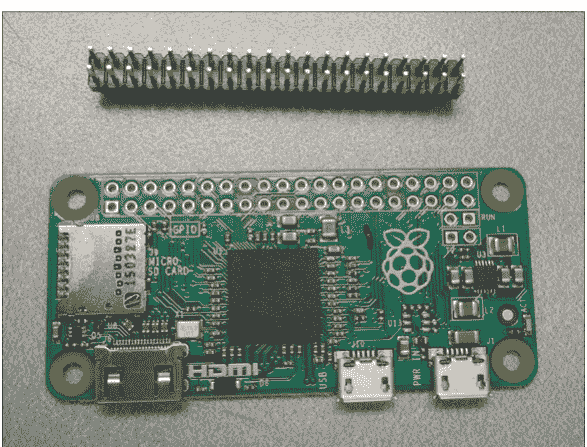

请注意 GPIO 针脚的公头针座尚未预先焊接到板上；你需要自己焊接。你可以在大多数在线电子零售商处购买这些针座。你还应该熟悉板上的各种连接。以下是焊接好连接器并为你标注连接的 Raspberry Pi Zero：

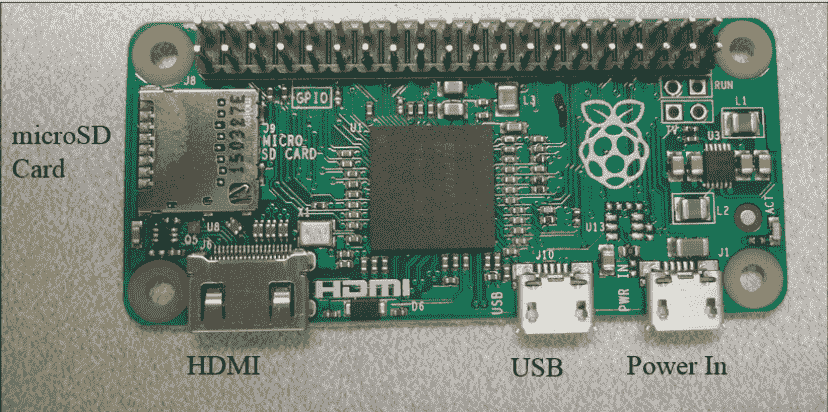

### 为板供电

你需要考虑的第一个问题之一是如何为板供电。为此，你需要通过 USB 电源连接进行连接。为 Raspberry Pi Zero 供电有两种选择：

1. 将标有电源的 microUSB 连接器连接到由 USB 电源适配器供电的 5V DC 电源。这可以是可直接插入插座的电源适配器，也可以是由大多数电脑上提供的带电 USB 端口供电的电源。
2. 将 microUSB 连接器连接到电池。最简单的连接方式是使用带有 USB 连接器的电池，例如用于为手机充电的电池。以下是此类电池的图像：

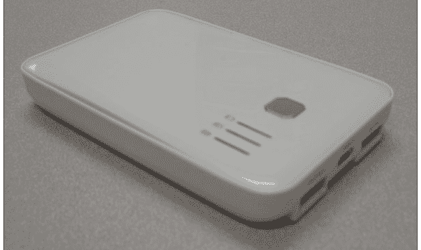

在两种情况下，都要确保该设备能够提供足够的电流。你需要一个能够提供至少 1000 mA、5 伏特的电源。该电池上有两个 USB 充电连接，这使得 Raspberry Pi Zero 可以插入其中一个，而带电的 USB 集线器可以插入另一个。不要现在就插入板子，你首先需要连接其余硬件并配置 microSD 卡。但是，你现在就可以连接其余硬件了。

### 连接键盘、鼠标和显示器

下一步是将键盘、鼠标和显示器连接到 Raspberry Pi Zero。你可能已经有大部分这些设备了，但如果你没有，在购买额外设备之前，有一些事情需要考虑。让我们先从键盘和鼠标开始。

要将任何设备连接到 Raspberry Pi Zero，你需要某种适配器或集线器。你可以购买一个简单的集线器，它将 Raspberry Pi Zero 上的 microUSB 连接器连接到更常见的标准连接器。你可以在大多数电子在线零售商处找到这些集线器，外观如下：

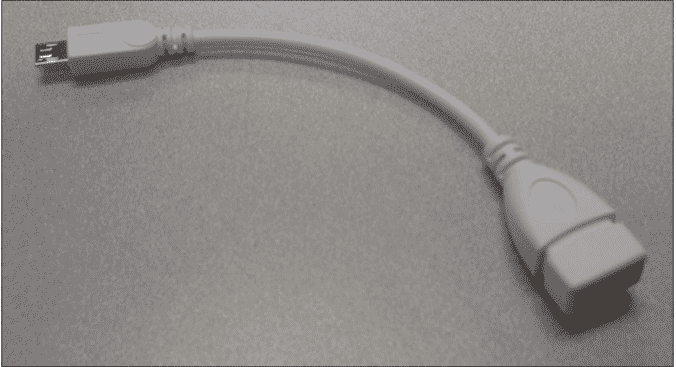

然而，在某些项目中，你可能需要将多个设备连接到 Raspberry Pi Zero。对于这些情况，你可能需要考虑购买一个带电的 USB 集线器。在决定要连接到板子的集线器之前，你需要了解带电 USB 集线器与从 USB 端口本身获取电力的集线器之间的区别。

几乎所有 USB 集线器都不是带电的，也就是说，你不需要单独为 USB 集线器供电。原因在于几乎所有这些集线器都连接到具有非常大电源的电脑上，从电脑为 USB 设备供电并不是问题。对于你的板子来说并非如此。板子上的 USB 端口的供电能力非常有限，因此如果你要连接需要大量电力的设备 – 例如 WAN 适配器或网络摄像头 – 你就需要一个带电的 USB 集线器，它通过单独的电源为设备供电。以下是此类设备的图像，可在 http://www.amazon.com/ 及其他在线零售商处购买：

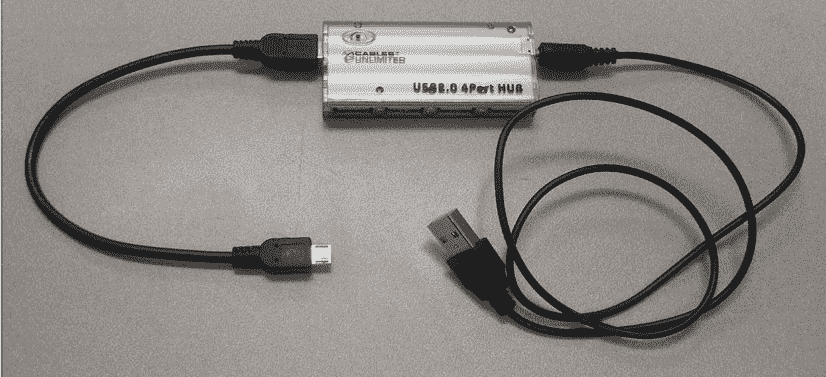

请注意该集线器上有两个连接。最右边的是电源连接，它将插入电池或带有 USB 端口的 USB 电源适配器。左侧的连接是 USB 连接，它将插入 Raspberry Pi。为将电源 USB 板连接到 Raspberry Pi Zero，你需要一根连接到 microUSB 连接器的线缆。现在，你将有更多的连接来添加鼠标和键盘、网络摄像头以及 USB WLAN 设备。

现在，你还需要一个显示器。幸运的是，你的 Raspberry Pi Zero 提供了很多选择。有许多不同的视频标准；以下是一些最常见的视频标准的图像供参考：

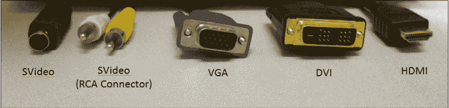

Raspberry Pi Zero 上有一个迷你 HDMI 连接器。要将其连接到 HDMI 显示器，你需要一个迷你 HDMI 到标准 HDMI 适配器或线缆。你也可以购买一端为迷你 HDMI 连接器、另一端为普通 HDMI 连接器的线缆。以下是适配器的图像：

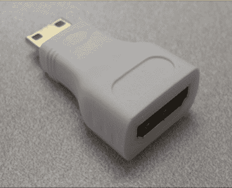

要使用此连接器，只需将适配器连接到你的 Raspberry Pi Zero，然后将带有普通 HDMI 连接的线缆连接到适配器和具有 HDMI 输入连接器的电视或显示器。HDMI 显示器相对较新，但如果你有一台具有 DVI 输入的显示器，你可以购买相对便宜的适配器来在 DVI 和 HDMI 之间提供接口。

> 不要被声称可从 HDMI 或 DVI 到 VGA，或从 HDMI 或 DVI 到 S-video 的适配器所迷惑。这些是两种不同的信号类型：HDMI 和 DVI 是数字标准，而 VGA 和 S-video 是模拟标准。确实有能够完成此转换的适配器，但它们必须包含电路并需要供电，而且价格比任何简单适配器都贵得多。

你几乎准备好插入 Raspberry Pi Zero 了。将 HDMI 线缆连接到显示器和 Raspberry Pi Zero。将 USB 集线器连接到 Raspberry Pi Zero，并将键盘和鼠标连接到 USB 集线器。确保在开机前连接好所有设备。大多数操作系统支持热插拔，这意味着你可以在系统通电后连接设备，但这有点不稳定。你在连接新硬件时应始终循环电源。以下是所有连接好的图片：

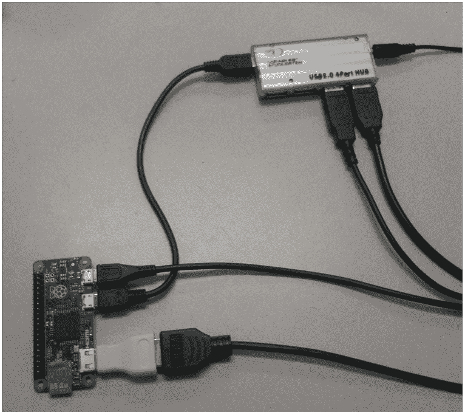

USB 连接器已连接到 USB 电源适配器。即使你的硬件配置已完成，你仍需要完成下一部分才能为设备供电。因此，让我们弄清楚如何安装操作系统。

### 安装操作系统

现在你的硬件已准备就绪，你需要下载并将操作系统镜像到 microSD 卡。Raspberry Pi Zero 提供了很多不同的选择。你将在 Raspberry Pi Zero 上使用 Linux，一种 Unix 的开源版本。与 Windows、Android 或 iOS 不同，Linux 不受单一公司的严格控制。它是一个由广泛社区推动的草根努力，大多是开源的，虽然可以免费获得，但其发展和演进方式有点混乱。

出现了许多不同版本的 Linux，每个版本都建立在称为 Linux 内核的核心功能集之上。这些核心功能都基于 Linux 规范。然而，它们被打包的方式略有不同，并且由不同的组织开发、支持和打包。Raspberry Pi 社区已标准化为 **Raspbian**，这是一个专为 Raspberry Pi 设计的 **Debian** Linux 发行版。因此，你将在 Raspberry Pi Zero 上安装并运行 Raspbian。

Debian 的最新版本称为 **Jessie**，以《玩具总动员》中的牛仔女孩命名。这是 Debian 的命名惯例，你需要下载这个版本的 Raspbian。

你可以购买一张已安装 Raspbian 的卡，也可以将其下载到个人电脑然后安装到卡上。要下载发行版，你需要决定是使用 Windows 电脑下载并创建 SD 卡，还是使用 MAC OS X 或 Linux 机器。我将在此处为 Windows 和 Linux 机器提供简要说明。


> 有关 MAC OS X 的说明，请访问：`http://www.raspberrypi.org/documentation/installation/installing-images/mac.md`。

首先，你需要下载一个镜像。对于 Windows 和 Linux 来说，这一过程是相似的。打开一个浏览器窗口。前往 Raspberry Pi 组织的网站，`https://www.raspberrypi.org/` 并选择页面顶部的 **Downloads** 选项。这将为你提供各种下载选择。前往 **Raspbian** 部分，并选择图像标识符右侧的 `.zip` 文件。你需要最新版本，但不是精简版。这将下载一个包含 Raspbian 操作系统镜像的归档文件。请注意默认的用户名和密码；稍后你需要它们。


## 使用 Raspberry Pi Zero 入门

如果你使用的是 Windows，你需要使用像 7-Zip 这样的归档程序来解压文件，可在 http://www.7-zip.org/ 获取。这会得到一个带有 .img 扩展名的文件，可以将该文件写入你的卡。接下来，你需要一个可以将映像写入卡的程序。我使用 Image Writer for Windows。你可以在 https://www.raspberrypi.org/ 网站下载部分的顶部找到此程序的链接。将你的卡插入 PC，运行此程序，你应该会看到以下内容：

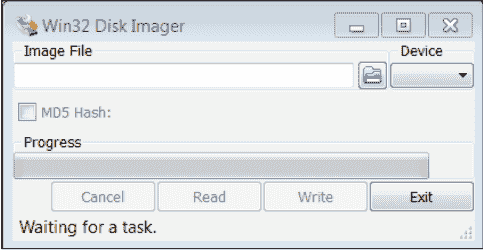

选择设备卡并下载映像；它应该看起来像这样：

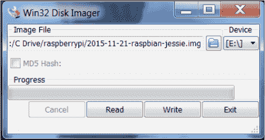

然后，点击 **Write** 按钮。这需要一些时间，可能长达 15 分钟，但完成后，退出程序，你就拥有了带有映像的 microSD 卡。

如果你使用的是 Linux，你需要解压文件然后将其写入卡。你可以用一条命令完成所有操作。但是，你需要找到卡的 /dev 设备标签。你可以用 `ls -la /dev/sd*` 命令来做。如果你在此之前插入卡，可能会看到如下截图：

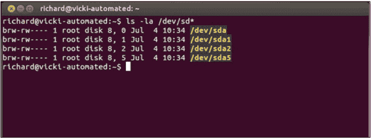

插入卡后，你可能会看到如下截图：

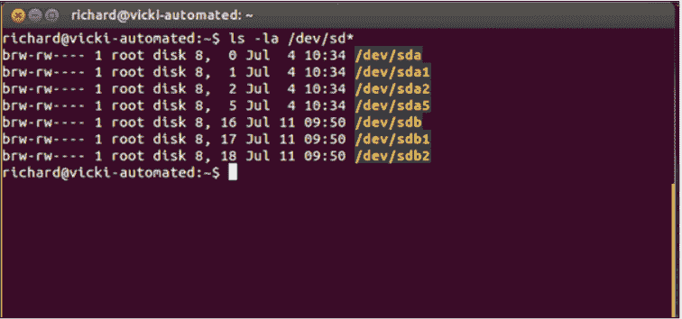

注意你的卡在 sdb。现在进入你下载了归档映像文件的目录，并使用以下命令：

```bash
sudo dd if=2015-11-21-raspbian-jessie.img of=/dev/sdX
```

`2015-11-21-raspbian-jessie.img` 命令将替换为你下载的映像文件，而 `/dev/sdX` 将替换为你的卡 ID，在此示例中为 `/dev/sdb`。请务必指定正确的设备，因为这可能会覆盖你驱动器上的数据。此外，这可能需要几分钟时间。一旦文件写入完成，弹出卡，你就可以将其插入主板并通电了。

## 快速上手指南

确保你的 Raspberry Pi Zero 未通电并将 SD 卡安装到插槽中。然后为设备供电。设备启动后，你应该会看到以下屏幕：

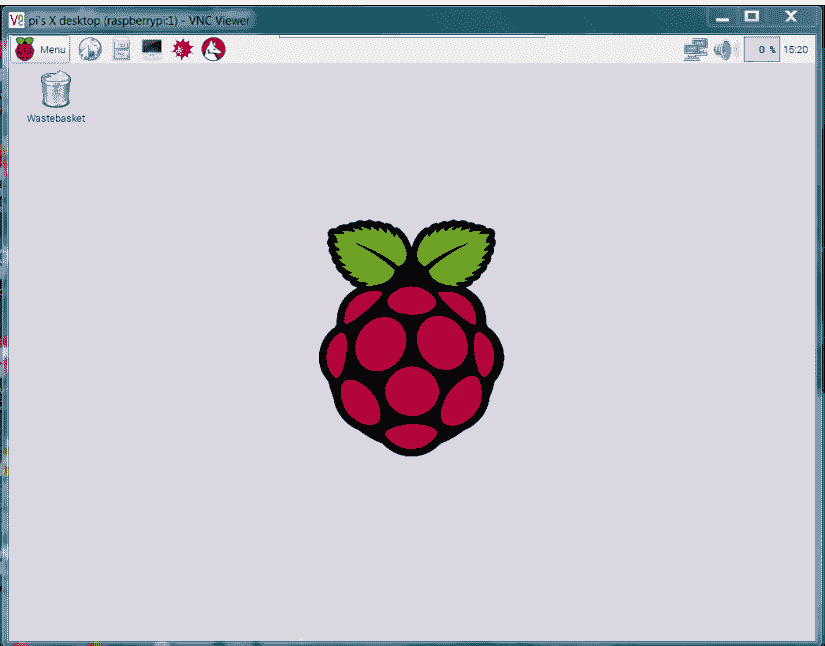

你已经可以正常运行了！

> 请注意，如果你使用带电的 USB 集线器，它可能为你的 Raspberry Pi 提供足够的电力，但在某些情况下可能无法提供你所需的所有电力。我强烈建议你使用不同的电源，一个用于你的 Raspberry Pi Zero，一个用于你的集线器。

你还需要做一件事情来完成配置。为此你需要进入 raspi-config 应用程序。所以，通过点击左上角看起来像一个小电脑屏幕的图标打开一个终端窗口。

现在，输入 sudo raspi-config。你应该会在屏幕上看到此应用程序：

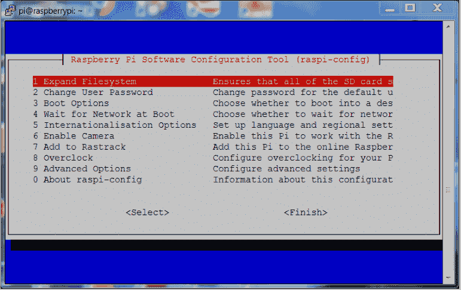

你需要扩展文件系统以占用整张卡。选择 **1 Expand Filesystem**，按 *Enter* 键，你会看到以下屏幕：

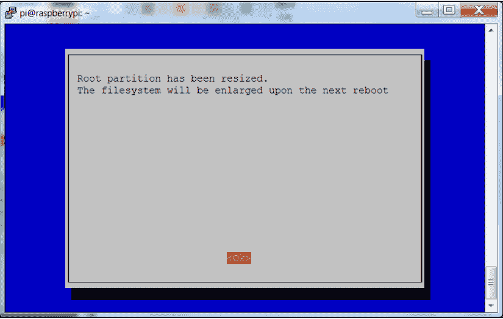

你还需要为此过程连接一个带电的 USB 集线器，以便你可以同时访问键盘和鼠标以及 USB 无线 LAN 设备。现在，将设备连接到带电的集线器。

启动系统，然后通过输入 sudo nano /etc/wpa_supplicant/wpa_supplicant.conf 编辑 wpa_supplicant.conf 文件。你需要将其更改为如下所示：

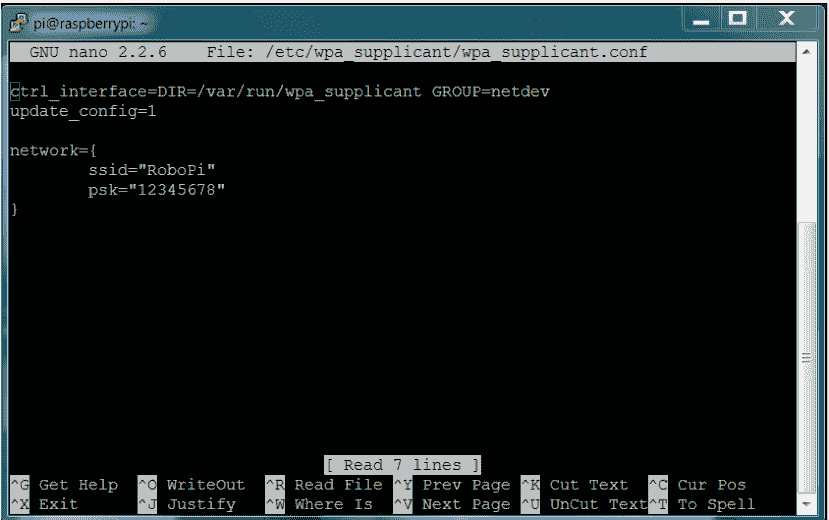

这里的 wpa-ssid 和 wpa-psk 值当然必须与你的无线接入点要求相匹配。重新启动后，你的设备应该已连接到无线网络。你可以通过查看屏幕右上角来判断是否已连接，你应该会看到以下内容：

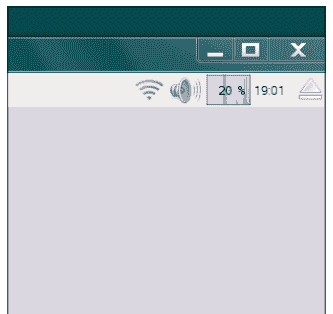

你现在可以从互联网下载你想要安装的任何附加功能。

如果你想连接到实际的 LAN 有线连接，你需要一个从 USB 到 LAN 的设备。此站点 http://elinux.org/RPi_USB_Ethernet_adapters 列出了许多不同的可能性。以下是此类设备之一的图像：

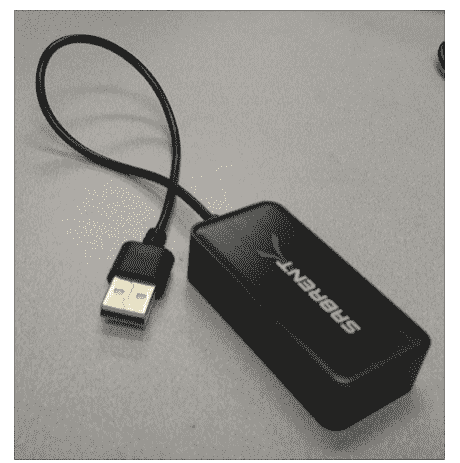

以这种方式连接 Raspberry Pi Zero 实际上非常简单。只需将 USB 到 LAN 适配器插入带电的 USB 集线器，连接一条活动 LAN 电缆，你就应该可以访问互联网。

## 从主机 PC 访问你的 Raspberry Pi Zero

一旦你为设备建立了互联网网络连接，你就可以从主机计算机访问它。有三种方式可以从远程计算机访问你的系统：

- 第一种是通过名为 **SSH** 的终端界面。
- 第二种方式是使用名为 **VNC server** 的程序。这允许你远程打开一个图形用户界面，该界面镜像 Raspberry Pi 上的图形用户界面。
- 最后，你可以通过名为 **WinSCP** 的程序传输文件，该程序是专门为此目的而定制的。你也可以使用名为 **SCP** 的程序用于 Linux。

所以，首先，确保你的基本系统已启动并正常运行。打开一个终端窗口并检查你的单元的 IP 地址。无论你如何与系统通信，你都需要它。通过使用 `ifconfig` 命令来完成。它应该会产生以下截图：

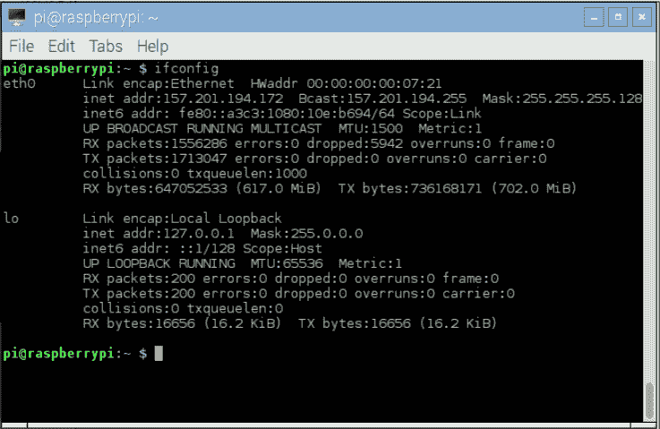

你需要 inet addr，它显示在前一截图的第三行，以便通过以太网联系你的板。如果你使用无线设备来访问互联网，你的 ifconfig 将如下所示：

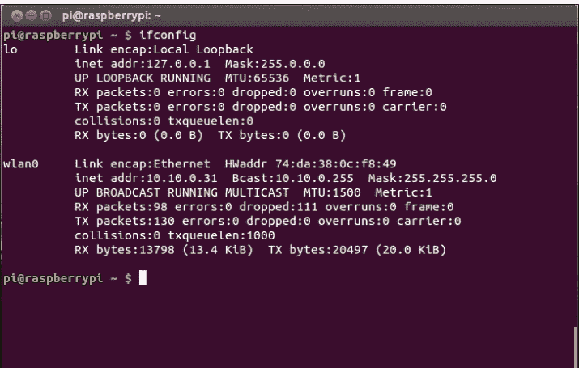

与 wlan0 连接关联的 inet addr，在本例中为 10.10.0.31，是你将用于访问 Raspberry Pi 的地址。

你还需要在远程计算机上运行 SSH 终端程序。SSH 终端是一个 Secure Shell（SSH）连接，这意味着你将能够通过在远程计算机上输入命令来访问你的板并向其发出命令。来自 Raspberry Pi Zero 的响应将出现在远程计算机终端窗口中。

> 如果你想了解有关 SSH 的更多信息，请访问：https://www.siteground.com/tutorials/ssh/。

如果你运行的是 Microsoft Windows，你可以下载一个替代应用程序。我个人最喜欢的是 PuTTY。它是免费的，并且在保存配置方面做得非常好，这样你就不必每次都输入它。在搜索引擎中输入 putty，你很快就会来到一个支持下载的页面，或者你可以前往 http://www.putty.org/。

将 PuTTY 下载到你的 Microsoft Windows 机器上。然后，运行 `putty.exe`。你应该会看到一个配置窗口，其外观类似于以下截图：

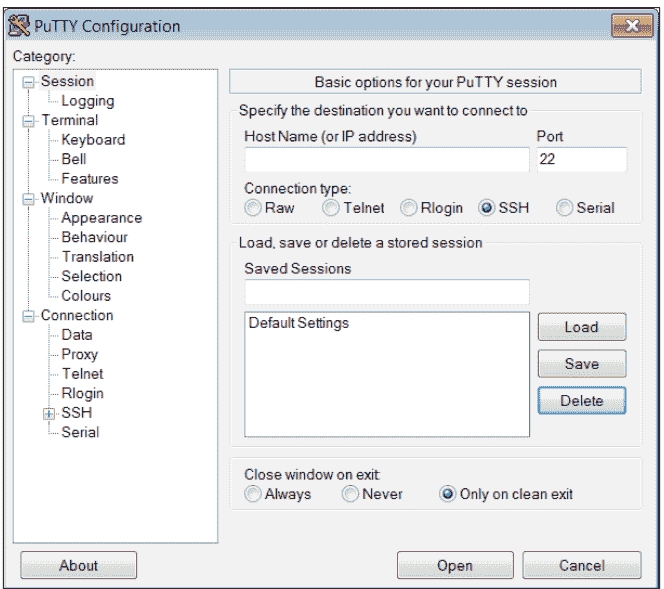

在 **Host Name** 空格中输入前一页的 `inet addr`，并确保 **SSH** 选择已选中。你可能希望将此配置保存为 Raspberry Pi，以便每次都可以重新加载。

## 远程访问设置

当你点击 **Open** 时，系统将尝试通过 LAN 连接在你的 Raspberry Pi 上打开一个终端窗口。第一次这样做时，你会收到有关 RSA 密钥的警告，因为两台计算机彼此不认识。因此 Windows 会抱怨一台它不认识的计算机即将以相当亲密的方式连接。只需点击 **OK**，你应该会得到一个带有登录提示的终端，如以下截图：

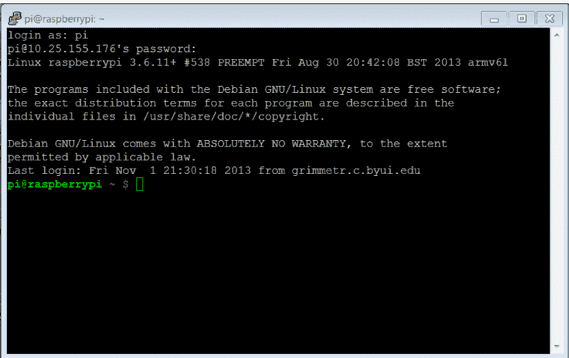

现在你可以登录并向你的 Raspberry Pi Zero 发出命令。如果你想从 Linux 机器上执行此操作，过程甚至更简单。打开一个终端窗口，然后输入 `ssh pi@xxx.xxx.xxx.xxx`，其中 `xxx.xxx.xxx.xxx` 是你的设备的 `inet addr`。这将带你进入 Raspberry Pi Zero 的登录屏幕，其外观应与前一截图相似。

**SSH** 是与你的 Raspberry Pi Zero 通信的一个非常有用的工具。然而，有时你需要对系统进行图形化查看，而你不一定想连接到显示器。你可以在远程计算机上通过使用名为 **vncserver** 的应用程序获得此功能。你需要在 Raspberry Pi Zero 上安装此版本的应用程序，通过在 Raspberry Pi Zero 上的终端窗口中输入 `sudo apt-get install tightvncserver`。顺便说一下，这正是使用 SSH 的绝佳机会。


**Tightvncserver** 是一个允许你远程查看完整的 Raspberry Pi Zero 的应用程序。安装完成后，你需要在 Raspberry Pi Zero 的终端窗口中输入 `vncserver` 来启动服务器。然后系统会提示你输入密码，再提示你验证密码，然后询问你是否想要一个只读密码。记住你输入的密码，你需要它通过 VNC Viewer 远程登录。

你需要为远程计算机提供一个 VNC Viewer 应用程序。在我的 Windows 系统上，我使用一个名为 **RealVNC** 的应用程序。启动该应用程序时，会出现以下截图：

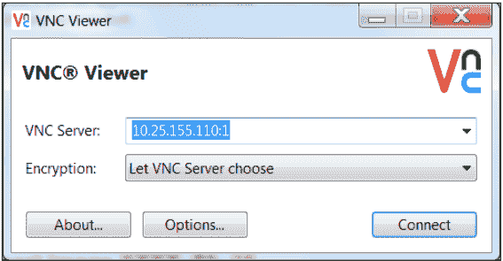

输入 **VNC Server** 地址，即你的 Raspberry Pi Zero 的 IP 地址，然后点击 **Connect**。你会看到一个弹出窗口，如下图所示：

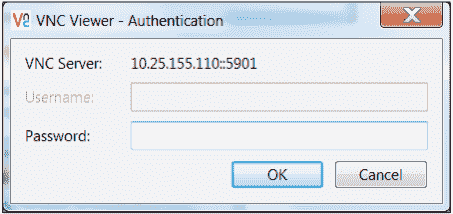

## Getting Started with Raspberry Pi Zero - Overview

输入你在启动 vncserver 时刚刚输入的密码，然后你应该会看到一个类似以下截图的 Raspberry Pi 图形界面：

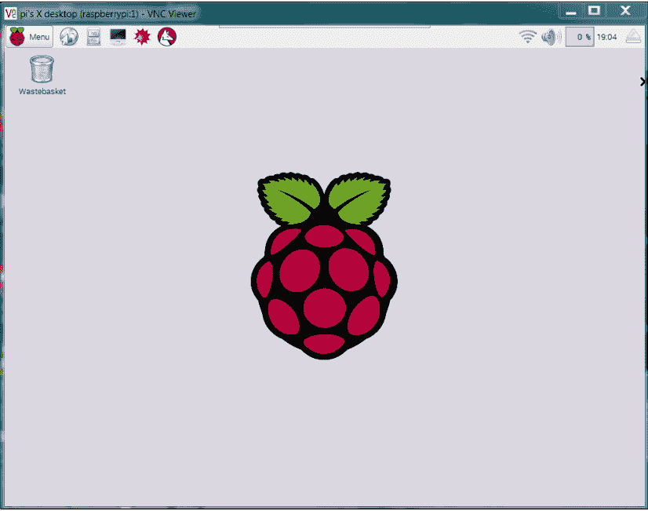

现在你可以访问系统的所有功能，尽管如果你进行图形密集型数据传输，速度可能会变慢。

> 有办法让 vncserver 在启动时自动启动。我没有使用过它们；我更喜欢在需要应用程序运行时从 SSH 应用程序输入 vncserver 命令。这样可以保持运行的应用程序最少，更重要的是，减少了安全风险。如果你想在每次启动时启动它，互联网上有多个地方展示如何配置。尝试以下网站：http://www.havetheknowhow.com/Configure-the-server/Run-VNC-on-boot.html。

要从运行例如 Ubuntu 的远程 Linux 计算机查看此 Raspberry Pi 桌面，你可以输入 `sudo apt-get install xtightvncviewer`，然后使用 `xtightvncviewer 10.25.155.110:1` 启动它并提供所选密码。

Linux 具有图形界面的查看器，例如 **Remmina Remote Desktop Client**（选择 **VNC-Virtual Network Computing protocol**），它可以替代 `xtightvncviewer` 使用。以下是 **Remote Desktop Viewer** 的截图：

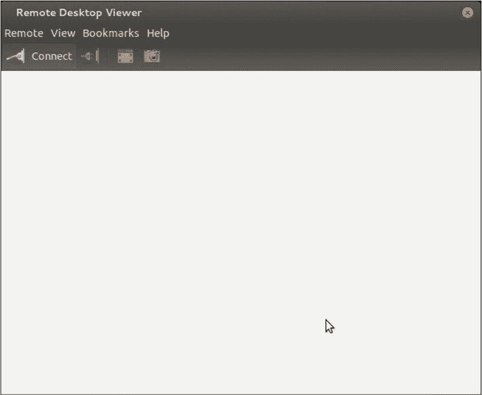

确保 vncserver 在 Raspberry Pi Zero 上运行。最简单的方法是通过 SSH 登录并在提示符下运行 vncserver。现在，在 **Remote Desktop Viewer** 上点击 **Connect**。在 **Protocol** 选择下，填写屏幕如下，选择 **VNC**，你应该会看到以下截图：

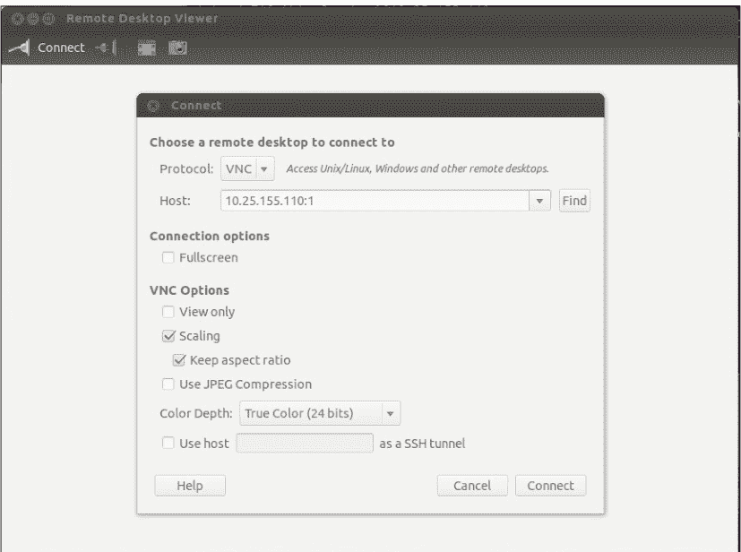

现在，输入 **Host** 互联网地址，确保在末尾包含 :1，然后点击 **Connect**。你需要输入设置的 vncserver 密码，如下图所示：

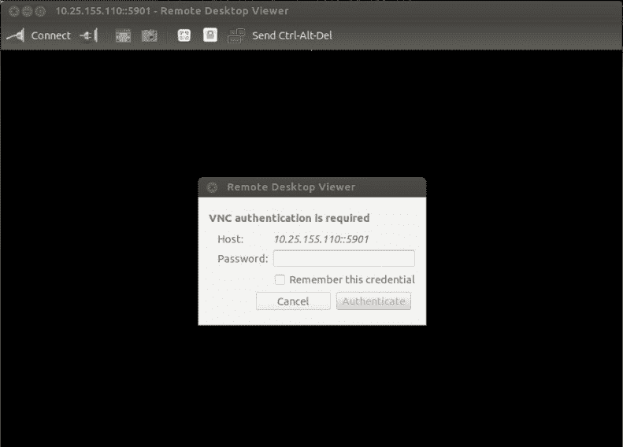

现在你应该能够看到 Raspberry Pi 的图形屏幕。要从 Mac 或其他 Apple 设备图形化访问 Raspberry Pi Zero，你仍然可以使用 Real VNC Viewer，更多信息请参阅 https://www.realvnc.com/products/。

## Getting Started with Raspberry Pi Zero - Setup

我喜欢与 Windows 一起使用的最后一款软件是名为 WinSCP 的免费应用程序。要下载和安装此软件，请访问 https://winscp.net/ 并按照说明下载和安装。安装后，运行程序。它将打开以下对话框：

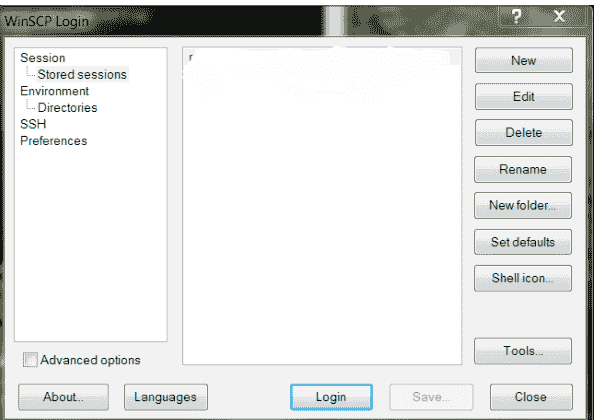

点击 New，你将得到以下截图：

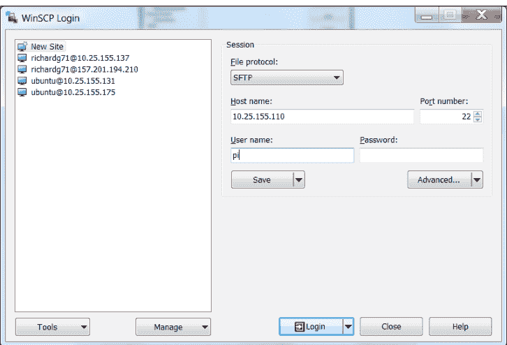

在这里，在主机名选项卡中填写 IP 地址，在用户名选项卡中填写 pi，并在密码栏中填写密码（不是 vncserver 密码）。点击 Login，你应该会看到警告显示，如下图所示：

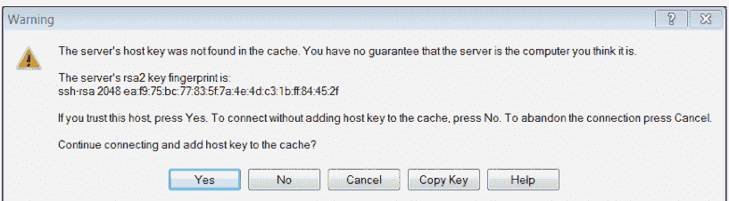

主机计算机再次不认识远程计算机。点击 Yes，应用程序将显示以下截图：

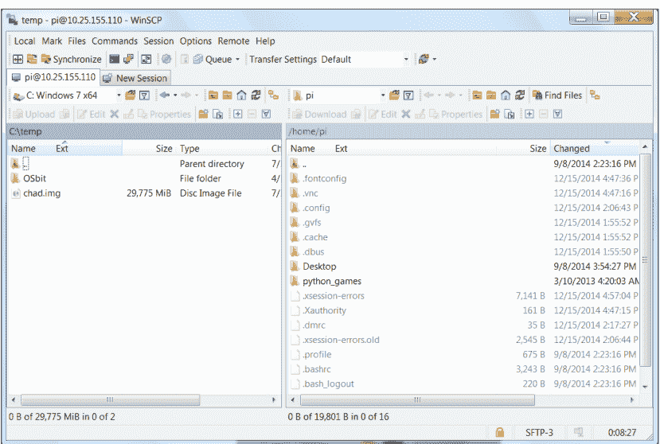

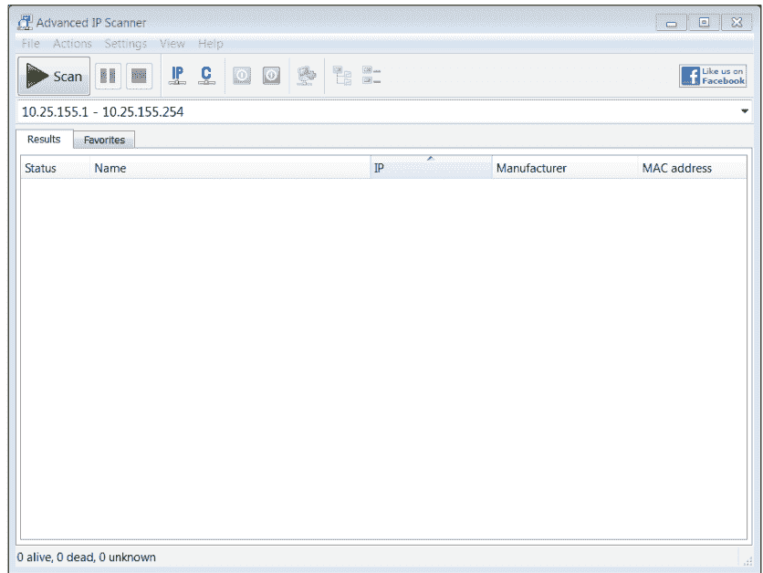

点击 Scan 选择器会扫描连接到网络的所有设备。你也可以在 Linux 中执行此操作；Linux 中用于 IP 扫描的一个应用程序称为 Nmap。要安装 Nmap，输入 sudo apt-get install nmap。要运行 Nmap，输入 sudo nmap -sp 10.25.155.1/154，扫描器将扫描从 10.25.155.1 到 10.25.155.154 的地址。

> 有关 Nmap 的更多信息，请参阅：http://www.linux.com/learn/tutorials/290879-beginners-guide-to-nmap。

这些扫描器会让你知道哪些地址正在使用，这应该能让你在不输入 ipconfig 的情况下看到你的 Raspberry Pi 地址。

## Getting Started with Raspberry Pi Zero - Summary

你的系统具有许多功能。随意尝试系统——尝试了解其中已有的内容以及从软件角度需要添加的内容。请记住，你的 USB 端口功率有限，因此请确保你熟悉插入 Raspberry Pi 的配件的功耗需求。对于许多项目，你可能需要使用带电的 USB 集线器。

## Summary

恭喜！你已完成旅程的第一阶段。你的 Raspberry Pi Zero 已启动并运行。不会让这块硬件在垃圾箱里积灰。它现在已准备好以各种有趣的方式连接到各种有趣的设备。到现在为止，你已经安装了 Raspbian 操作系统，学会了如何连接所有适当的外部设备，甚至掌握了如何远程访问系统，这样你需要的唯一连接就是电源线和 LAN 线。

现在，你已准备好开始指挥你的 Raspberry Pi Zero 执行某些操作。下一章将介绍 Linux 操作系统和 Emacs 文本编辑器。它还将展示 Python 和 C/C++ 编程语言中的一些基本编程概念。然后，你就可以将开源软件添加到廉价硬件上并开始构建你的机器人项目。
