# 第2章 编程 Raspberry Pi Zero
## Programming Raspberry Pi Zero

现在你的系统已启动并运行，你的 Raspberry Pi Zero 已准备好执行某些操作。这需要你创建自己的程序或编辑他人的程序。在本章中，你将学习如何编辑文件以创建可在 Raspberry Pi Zero 上运行的程序。

在本章中，我们将涵盖以下主题：

- Basic Linux commands and navigating the filesystem on Raspberry Pi Zero
- Creating, editing, and saving files on Raspberry Pi Zero
- Creating and running Python programs on Raspberry Pi Zero
- Some of the basic programming constructs in Python on Raspberry Pi Zero

你可以通过将键盘、鼠标和显示器连接到 Raspberry Pi Zero，或通过 vncserver 或 SSH 远程登录来创建和运行本章中讨论的程序。

## Powering up Raspberry Pi Zero with Linux

完成第 1 章 Getting Started with Raspberry Pi Zero 中讨论的任务后，你将拥有一个运行名为 Raspbian 的 Linux 版本的工作 Raspberry Pi Zero。因此，启动你的 Raspberry Pi Zero 并使用有效的用户名和密码登录。如果你打算通过 SSH 或 vncserver 远程登录，现在就建立连接。首先，你将快速浏览 Linux。这不会很深入，但你将只是浏览一些基本命令。

## Programming Raspberry Pi Zero

登录后，打开一个终端窗口。如果你使用键盘、鼠标和显示器登录，或使用 vncserver，你会通过在屏幕顶部选择图标集选择中的 Terminal 应用程序找到终端，如下图所示：

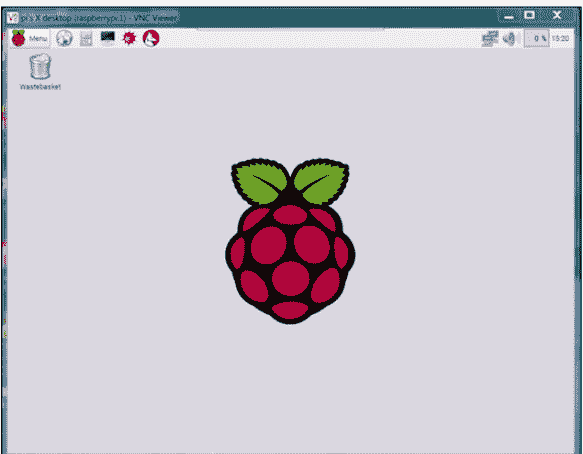

如果你使用 SSH，你已经在终端模拟器程序中了。无论哪种方式，终端应该看起来类似于以下截图：

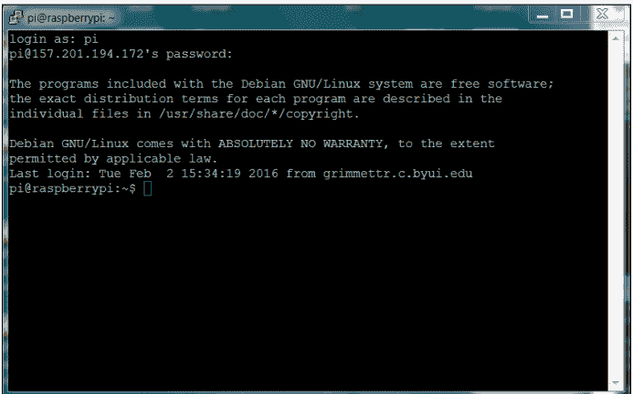


你的光标位于命令提示符处。与 Microsoft Windows 或 macOS 不同，在 Linux 中，我们的大部分工作都是通过在命令行中实际输入命令来完成的。所以，让我们试试几个命令。当你输入 `ls` 时，你应该能看到类似于以下截图的结果：

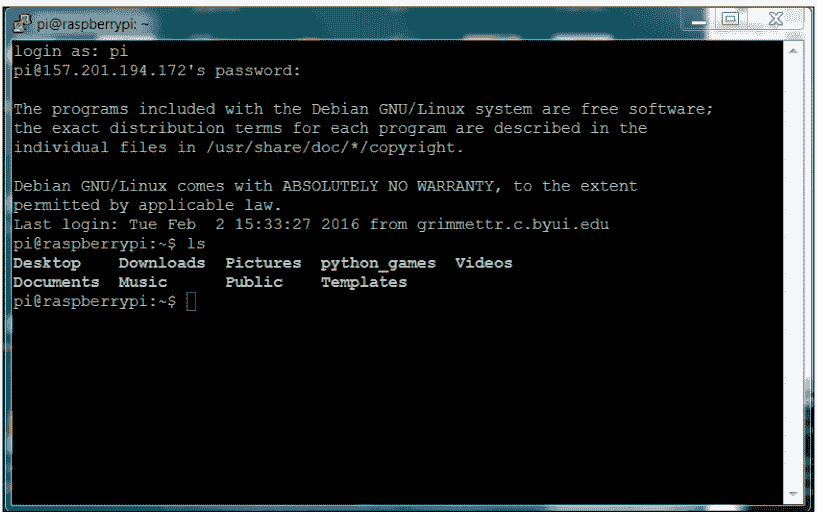

在 Linux 中，`ls` 命令列出当前目录中的所有文件和目录。你可以通过它们通常不同的颜色来区分不同的文件类型和目录。你也可以使用 `ls -l` 来查看有关文件的更多信息。

你可以通过发出 `cd`（change directory，切换目录）命令在目录结构中移动。例如，如果你想查看 Desktop 目录中的内容，输入 `cd Desktop`。如果现在发出 `ls` 命令，你应该会看到类似于以下截图的内容：

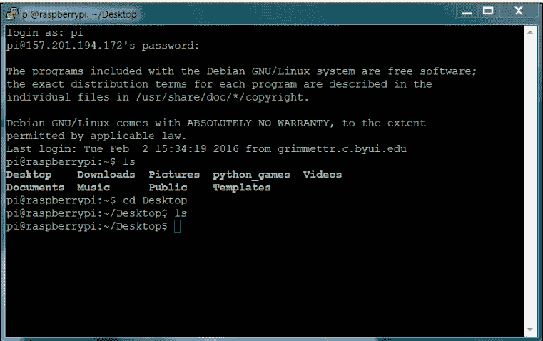

这个目录是空的；它没有任何文件。`cd` 命令会更改目录。你本可以输入 `cd /home/pi/Desktop` 并得到完全相同的结果；这是因为你当时在 `/home/pi` 目录中，这是在你首次登录系统时总是开始的目录。

如果你想随时查看自己所在的目录，只需输入 `pwd`，它代表 print working directory（打印工作目录）。如果你这样做，你会得到结果，类似于以下截图：

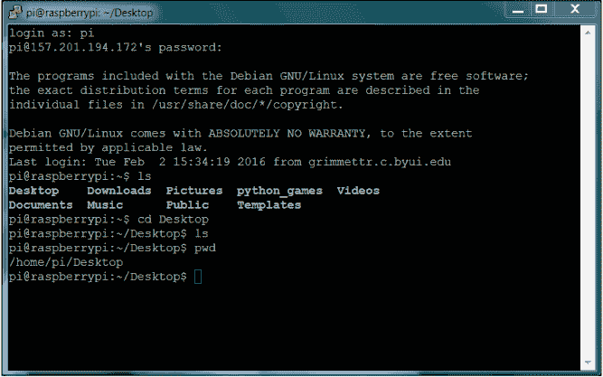

运行 `pwd` 命令的结果是 `/home/pi/Desktop`。现在，你可以使用两种不同的快捷方式导航回默认目录。第一种是在终端上输入 `cd ..`；这会带你到层级结构中当前目录的上级目录。然后输入 `pwd`；你应该会看到以下截图作为结果：

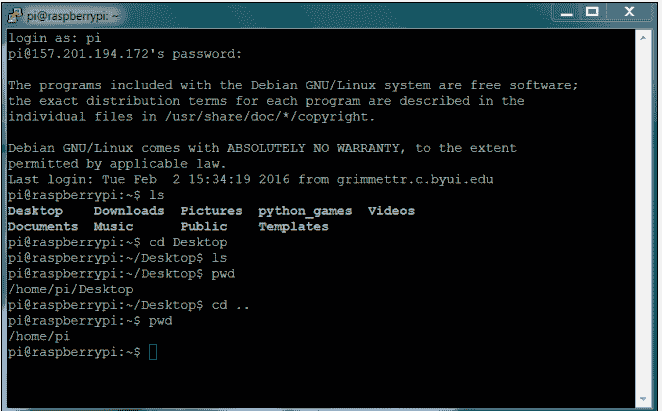

另一种返回主目录的方法是输入 `cd ~`；这总会将你返回到你的主目录。你也可以输入 `cd` 来返回到你的主目录。如果你从 Desktop 目录这样做，然后输入 `pwd`，你会看到以下截图作为结果：

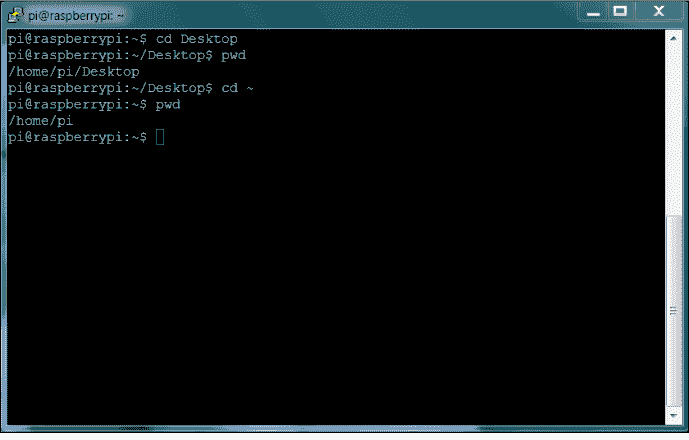

你可以使用其完整路径名进入特定目录。在这种情况下，如果你想从文件系统的任何位置进入 `/home/pi/Desktop` 目录，只需输入 `cd /home/pi/Desktop`。

还有许多其他 Linux 命令在你编程时可能会有用。以下是一些最有用的命令的表格：

| Linux commands | What it does |
|---|---|
| `ls` | This command lists all the files and directories in the current directory by just their names. |
| `rm filename` | This command deletes the file specified by `filename`. |
| `mv filename1 filename2` | This command renames `filename1` to `filename2`. |
| `cp filename1 filename2` | This command copies `filename1` to `filename2`. |
| `mkdir directoryname` | This command creates a directory with the name specified by `directoryname`; this will be made in the current directory unless specified otherwise. |
| `clear` | This command clears the current terminal window. |
| `sudo` | If you type the `sudo` command at the beginning of any command, it will execute that command as the super user. This may be required if the command or program you are trying to execute needs the permission of the super user. If, at any point, you type a command or the name of the program you want to run and the result seems to suggest that the command does not exist or that permission is denied, try doing it again with `sudo` at the beginning. |

现在，你可以随意使用这些命令来查看你的系统和可用的文件。但要小心！Linux 不像 Windows；默认行为是如果你尝试删除或替换文件，它不会警告你。

## Creating, editing, and saving files

现在你已经可以登录并轻松在目录之间移动并查看你的文件，你将希望能够编辑这些文件。为此，你需要一个允许你编辑文件中字符的程序。如果你习惯于在 Microsoft Windows 上工作，你可能使用过 Microsoft Notepad、WordPad 或 Word 等程序来完成此操作。这些程序在 Linux 中不可用。还有其他几种编辑器的选择，所有这些都是免费的。在本章中，你将使用一个名为 Emacs 的编辑程序。其他可能性是 nano、vi、vim 和 gedit 等程序。程序员对使用哪种编辑器有强烈的偏好，所以如果你已经有最喜欢的编辑器，可以跳过本节。

> 如果你想使用 nano 作为编辑器，它已经在 Raspbian 发行版上可用。有关 nano 的更多信息，请参阅 http://www.nano-editor.org/。


如果你想使用 Emacs，通过输入 `sudo apt-get install emacs` 下载并安装它。安装后，你只需输入 `emacs filename` 即可运行 Emacs，其中 `filename` 是你想要编辑的文件的名称。如果文件不存在，Emacs 将创建它。以下截图显示了你在提示符下输入 `emacs example.py` 时会看到的内容：

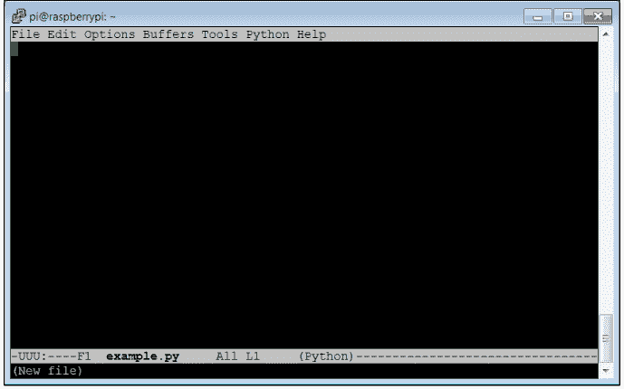

请注意，与 Windows 不同，Linux 不会自动分配文件扩展名；由你来指定你想要创建的文件类型。Emacs 编辑器还在屏幕左下角指示你已打开一个新文件。现在，如果你在使用 Raspbian GUI 界面中的 Emacs，无论是因为你连接了显示器、键盘和鼠标，还是因为你正在运行 vncserver，你都可以用鼠标以与在 Microsoft Word 中相同的方式使用它。

然而，如果你通过 SSH 运行 Emacs，你将无法使用鼠标。因此你需要使用光标键导航文件。你还必须使用一些按键命令来保存文件，以及完成你通常会使用鼠标选择的许多其他任务。例如，当你准备好保存文件时，你必须按 Ctrl + X 和 Ctrl + S，这将以当前文件名保存文件。当你想退出 Emacs 时，你必须按 Ctrl + X 和 Ctrl + C。这将停止 Emacs 并返回到命令提示符。

以下是一些你可能会觉得有用的 Emacs 按键命令：

| Emacs commands | What it does |
|---|---|
| `Ctrl + X` and `Ctrl + S` | Save: This command saves the current file. |
| `Ctrl + X` and `Ctrl + C` | Quit: This command makes you exit Emacs and return to the command prompt. |
| `Ctrl + K` | Kill: This command erases the current line. |
| `Ctrl + _` | Undo: This command undoes the last action. |
| Left-click on the text you wish to copy, then place the cursor at the place you want to paste, then right-click | Cut and paste: If you select the text you want to copy by clicking the mouse, move the cursor to where you want to paste the code and then right-click on it; the code will be pasted in that location. |

现在你有了编辑文件的能力，你将在下一节中使用这种能力来创建程序。

## Creating and running Python programs

现在你准备开始编程，你需要选择一种语言。有很多可供选择，例如 C、C++、Java、Python、Perl 以及许多其他可能性。我将首先向你介绍 Python，原因有两个：它是一种简单、直观且非常易于使用的语言，并且它使用了机器人世界的大量开源功能。我们在本章中也会介绍一些 C/C++，因为某些功能仅在 C/C++ 中可用。然而，从 Python 开始是有意义的。要完成本节中的示例，你需要安装一个 Python 版本。幸运的是，基本的 Raspbian 系统已经自带一个，所以你已准备好开始。

我们在这里只会介绍一些非常基础的概念。如果你是编程新手，有许多不同的网站提供交互式教程。如果你想通过这些教程练习 Python 中的一些基本编程概念，请访问 https://www.codecademy.com 或 http://www.learnpython.org/ 或 https://docs.python.org 并试试看。


在本节中，我们将介绍如何创建并运行一个 Python 文件。实际上，Python 可以交互式地使用，因此你可以一次输入一条命令。在你熟悉语言特性和模块时，交互式使用会非常有帮助。但你想用 Python 来创建程序，因此你需要在 Emacs 中输入命令，然后在命令行中通过调用 Python 来运行它们。让我们开始吧。

输入 `emacs example.py` 打开一个示例 Python 文件。现在，让我们在文件中写入一些代码。以下面截图所示的代码开始：

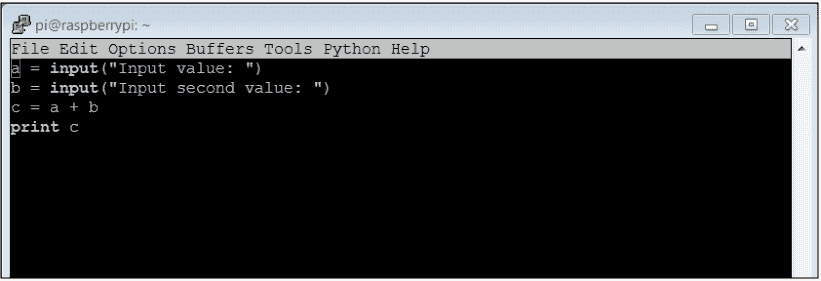

让我们逐行看一下代码，了解发生了什么。代码行如下：

- `a = input("Input value: ")`：程序的基本用途之一是获取用户的输入；`input` 允许我们做到这一点。数据将由用户输入并存储在 `a` 中。提示符 `Input value:` 将显示给用户。
- `b = input("Input second value: ")`：该数据也由用户输入并存储在 `b` 中。提示符 `Input second value:` 将显示给用户。
- `c = a + b`：这是你可以对数据执行的操作的一个示例；在这个示例中，你可以将 `a` 和 `b` 相加。
- `print c`：我们程序的另一个基本用途是打印结果。`print` 命令会打印出 `c` 的值。

> 该代码是用 Python 2 编写的。如果你使用的是 Python 3，你需要将 `print` 改为 `print(c)`。有关可能需要进行的其他更改，请访问 http://learntocodewith.me/programming/python/python-2-vs-python-3/。

创建程序后，保存它（使用 *Ctrl + X* 和 *Ctrl + S*）并退出 Emacs（使用 *Ctrl + X* 和 *Ctrl + C*）。现在，在命令行中，输入 `python example.py` 来运行你的程序。你看到的结果应类似于以下截图：

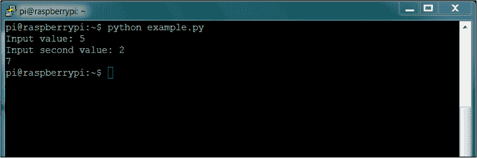

你也可以在命令行中不输入 `python example.py` 来运行程序，只需在程序中添加 `#!/usr/bin/python` 一行。之后程序看起来类似于以下截图：

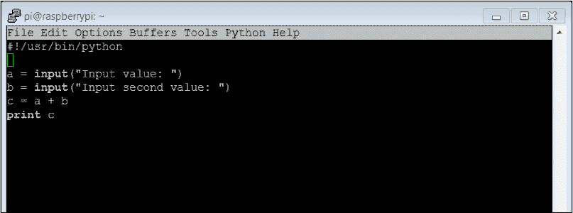

将 `#!/usr/bin/python` 作为第一行，只是让这个文件可以在命令行中被直接执行。保存文件并退出 Emacs 后，输入 `chmod +x example.py`。这将更改文件的执行权限，因此计算机现在会接受并执行它。

你应该可以直接输入 `./example.py` 并看到程序运行，如下截图所示：

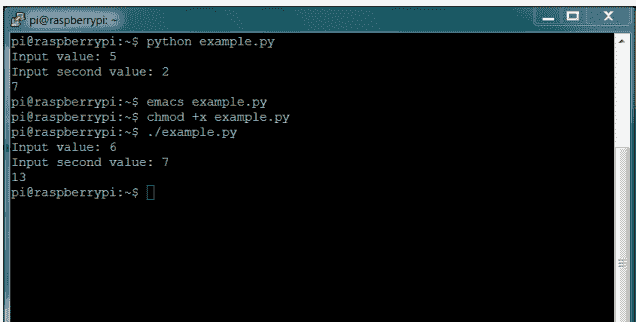

请注意，如果直接输入 `example.py`，系统将找不到该可执行文件。在这里，文件没有被系统注册，因此你必须为系统提供它的路径。在这种情况下，`./` 表示当前目录。

## 下载示例代码

你可以从你的账户中下载本书的示例代码文件，网址为 http://www.packtpub.com。如果你在其他地方购买了本书，可以访问 http://www.packtpub.com/support 注册，文件将通过电子邮件直接发送给你。

你可以按照以下步骤下载代码文件：

- 使用你的电子邮件地址和密码登录或注册我们的网站。
- 将鼠标指针悬停在顶部的 SUPPORT 选项卡上。
- 点击 Code Downloads & Errata。
- 在搜索框中输入书名。
- 选择你要下载代码文件的书。
- 在下拉菜单中选择你购买本书的地点。
- 点击 Code Download。

文件下载后，请确保使用最新版本的解压软件解压文件夹：

- Windows 系统使用 WinRAR/7-Zip
- Mac 系统使用 Zipeg/iZip/UnRarX
- Linux 系统使用 7-Zip/PeaZip


以下是上一张截图中代码的详细说明：

- `#!/usr/bin/python`：包含这一行是为了使你的程序可执行。
- `a = input("Input value: ")`：数据将由用户输入并存储在 `a` 中。`b = input("Input second value: ")`：该数据也由用户输入并存储在 `b` 中。
- `if a > b:`：这是一个 `if` 语句。在此情况下被求值的表达式是 `a > b`。如果它为 `True`，程序将执行下一句或多句缩进的语句；在此情况下，即 `c = a - b`。如果不是，它将跳过该语句。
- `else:`：`else` 语句是该命令的一个可选部分。如果 `if` 语句中的表达式被求值为 `False`，则执行 `else:` 之后的缩进语句；在此情况下，即 `c = b - a`。
- `print c`：我们程序的另一个基本用途是打印结果。`print` 命令会打印出 `c` 的值。

你可以多次运行前面的程序，检查 `if` 表达式的 `True` 和 `False` 两种情况，如下截图所示：

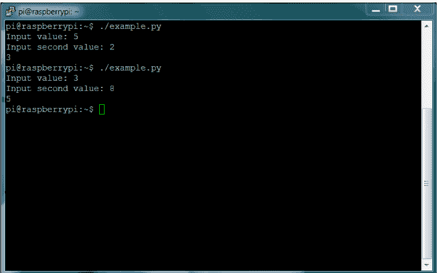

## while 语句

另一个有用的结构是 `while` 结构；它允许我们一遍又一遍地执行一组语句，直到满足特定条件。下面的截图显示了使用该结构的一组代码：

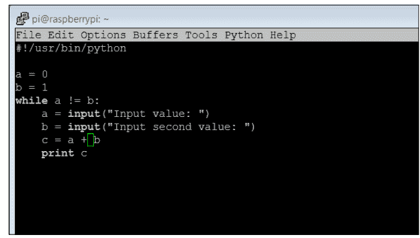

以下是上一张截图中代码的详细说明：

- `#!/usr/bin/python`：包含这一行是为了使你的程序可执行。
- `a = 0`：此行将变量 `a` 的值设置为 0。我们只需要它来确保循环至少执行一次。
- `b = 1`：此行将变量 `b` 的值设置为 1。我们只需要它来确保循环至少执行一次。
- `while a != b:`：对表达式 `a != b`（此处 `!=` 表示“不等于”）进行验证。如果为 `True`，则执行缩进的语句。当语句被求值为 `False` 时，程序跳转到缩进部分之后的语句（在此示例中没有）。
- `a = input("Input value: ")`：数据将由用户输入并存储在 `a` 中。
- `b = input("Input second value: ")`：该数据也由用户输入并存储在 `b` 中。
- `c = a + b`：变量 `c` 被赋值为 `a` 和 `b` 的和。
- `print c`：`print` 命令会打印出 `c` 的值。

现在你可以运行该程序。注意，当你为 `a` 和 `b` 输入相同的值时，程序将停止，如下截图所示：

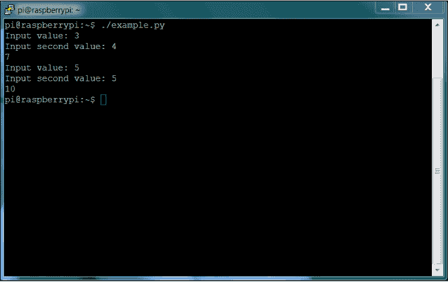

## 使用函数

接下来需要介绍的概念是如何将一组语句放入一个函数中。我们使用函数来组织代码，并在有意义时将一组语句分组到同一个位置。例如，如果我们有一个可能需要执行多次的特定计算，与其每次执行时都复制这组语句，不如将它们组合成一个函数。这里我将使用一个相当简单的示例，但如果该计算需要大量编程语句，你可以看到函数会让我们的代码更易于维护，因为我们不需要一遍遍地重复代码。它还可以让我们的代码更易于阅读。下面的截图显示了代码：

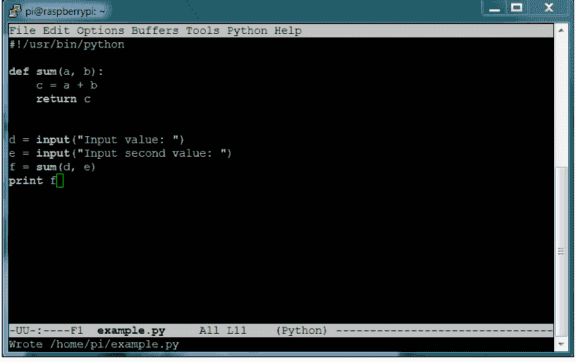

以下是前一个示例代码的说明：

- `#!/usr/bin/python`：包含这一行是为了使你的程序可执行。
- `def sum(a, b):`：此行定义了一个名为 `sum` 的函数。`sum` 函数以 `a` 和 `b` 作为参数。
- `c = a + b`：每当调用此函数时，它都会将变量 `a` 中的值与变量 `b` 中的值相加。
- `return c`：当函数执行时，它会将变量 `c` 返回给调用表达式。

## 对 Raspberry Pi Zero 进行编程

- `d = input("Input value: ")`：该数据也由用户输入并存储在 `d` 中。提示符 `Input second value:` 将显示给用户。
- `e = input("Input second value: ")`：该数据也由用户输入并存储在 `e` 中。提示符 `Input second value:` 将显示给用户。
- `f = sum(d, e)`：调用了 `sum` 函数。程序随后进入 `sum` 函数并执行它。变量 `d` 中的值被复制到变量 `a`，变量 `e` 中的值被复制到变量 `b`。该函数返回值，然后将其存储在变量 `f` 中。
- `print f`：`print` 命令会打印出 `f` 的值。

以下截图是运行代码后得到的结果：

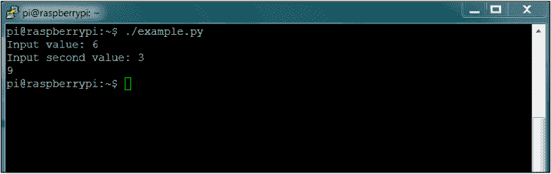

## Python 中的库/模块

接下来我们需要介绍的主题是如何使用库/模块为我们的程序添加功能。库或模块（在 Python 中有时这样称呼）包含某人已经创建好、并你想添加到代码中的功能。只要该功能存在且你的系统知道它，你就可以将库包含在代码中。


那么，让我们再次修改代码，加入这个库，如下面的截图所示：

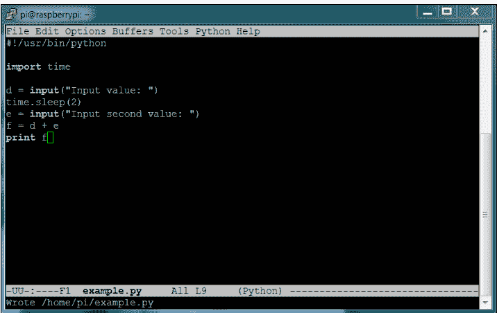

下面是对代码的逐行说明：

- `#!/usr/bin/python`：包含这一行是为了让程序可以直接执行。
- `import time`：包含 time 库。time 库中包含一个函数，可以让你暂停指定的秒数。
- `d = input("Input value: ")`：这些数据将由用户输入并存储在 d 中。提示语“Input value:”会显示给用户。
- `time.sleep(2)`：这一行调用 time 库中的 sleep 函数，这将产生 2 秒的延迟。
- `e = input("Input second value: ")`：这些数据也将由用户输入并存储在 e 中。提示语“Input second value:”会显示给用户。
- `f = d + e`：变量 f 被赋值为 d + e。
- `print f`：print 命令会打印出 f 的值。

运行上面的示例代码后，结果如下面的截图所示：

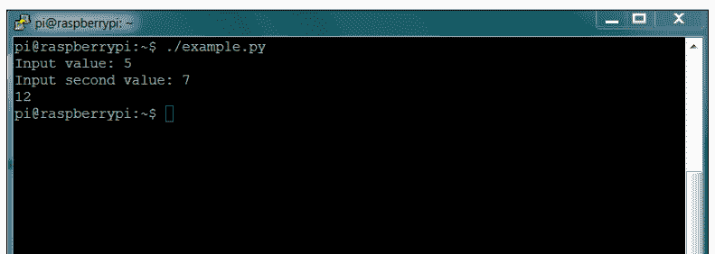

当然，这看起来与其他结果非常相似。但你会注意到，在输入第一个值之后，到第二个值出现之前，会有一段暂停。

## 小结

在本章中，你学习了如何使用命令行与 Raspbian 操作系统交互，以及如何使用 Emacs 创建和编辑文件。你还接触了 Python 和 C 两种编程语言。如果这是你第一次接触编程，那么如果你对于编程整体上仍然感到很不适应，尤其是对 if 和 while 语句，不要感到惊讶。你在第一次接触英语时可能也同样感到不适，尽管你可能已经不记得了。

尝试新事物总是有点困难。不过，我会尽量给出明确的输入指令，帮助你顺利完成操作。使用计算机有一个重大挑战：它们总是严格按你告诉它们的去做，而不一定是按你想要的去做。因此，如果遇到问题，请多次检查，确保你的代码与示例完全一致。现在，让我们开始真正的编码吧！

在下一章中，你将开始编写代码，从而能够创造令人惊叹的项目。你将首先让你的系统具备说话和听懂命令的能力。

## 访问 Raspberry Pi Zero 上的 GPIO 引脚

以下是 40 个引脚的特写：

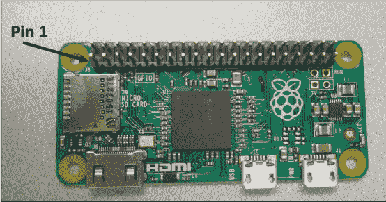

以下是引脚列表及其与 Raspberry Pi Zero 的连接：

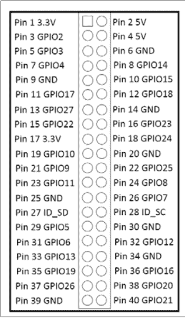

其中一些引脚的用途非常明确。引脚 1 和 17 用于提供 3.3 伏电压，引脚 2 和 4 提供 5 伏电压，而引脚 9、25、39、6、14、20、30 和 34 在 Raspberry Pi Zero 上都连接到地。其余引脚具有各种功能，你将在本章中了解。让我们从可用于向外部世界提供简单直流信号的引脚开始。

### 简单的 GPIO 数字电压输出

也许你能与 Raspberry Pi 上的 GPIO 建立的最简单连接，就是连接到一个引脚，从而输出一个简单的数字电压。为此，你将使用 GPIO I/O 引脚点亮一个 LED。要顺利完成，你需要四件硬件：一块无焊面包板、一些跳线、一个 LED 和一个电阻。以下是这些部件的更多细节：

- 面包板是一种简单的设备，让你可以轻松连接各种电子元件。它们有各种尺寸、形状和颜色。下面是一张面包板的图片：
  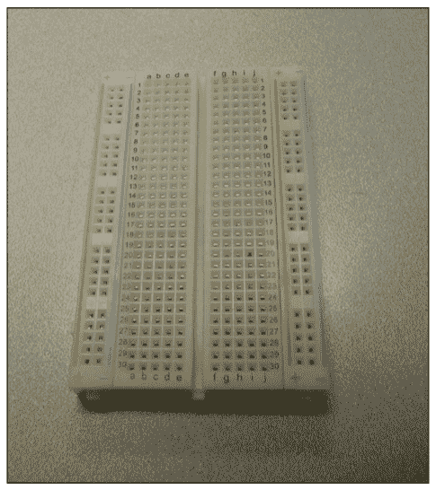

  许多在线商店和爱好商店都有出售。
- 跳线用于连接各种电子元件。根据连接类型的不同，跳线的两端分为母头和公头。下面是一张公对母跳线的图片，并标明了接头：
  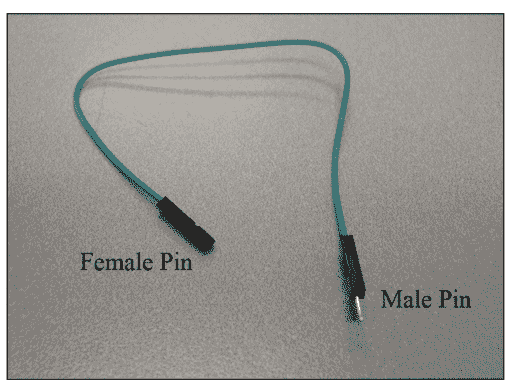

  对于这些项目，你需要一些母对公跳线和一些母对母跳线。
- 发光二极管（LED）是一种带有两个引脚的小型元件，在施加电压时会发光。它们有各种各样的颜色。如果你想在线购买，可以搜索 3 mm LED。它们有各种颜色。你也可以在大多数电子商店买到。下面是一个 LED：
  
- 你还需要一个电阻来限制提供给 LED 的电流。220 欧姆的电阻大小合适。同样，你可以在网上或大多数电子商店买到。下面是一组此类电阻的图片：
  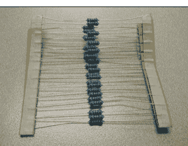

如果你各买两个 LED 和电阻，就可以使用多个 GPIO I/O 引脚。现在你已经备齐了所有零件，让我们开始构建你的第一个硬件项目。在插入任何东西之前，我们先花一点时间看看面包板，以便了解你将如何使用它进行连接。你会把导线插入面包板上的孔中。面包板上的孔以独特的方式连接，从而实现你想要的电路连接。

在面包板的中间，孔是横向连接的。因此，如果你将一根导线插入某个孔中，再将另一根导线插入紧挨着它的孔中，这两根导线就会连通，就像这样：

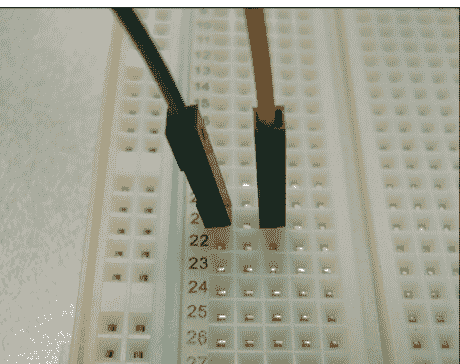

面包板两侧的两排通常用于供电，因此它们是纵向连接的。将引脚 2（5 伏）连接到 + 接口，将引脚 6（GND）连接到面包板的 - 排，如图所示：

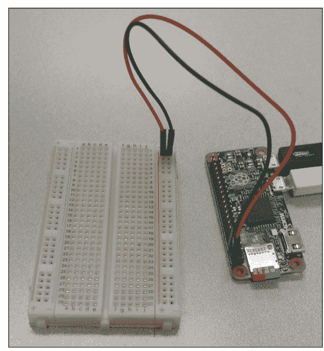

现在你可以将电子元件放到面包板上。放置 LED 时，让一根引脚位于面包板中间分隔槽的一侧。LED 的方向很重要；确保两根引脚中较长的那根位于孔的左侧。

现在将电阻放在 LED 一侧的孔中，电阻的另一根引脚连接到面包板的 GND 排。电阻的方向没有影响。你的电路应该与下图类似：

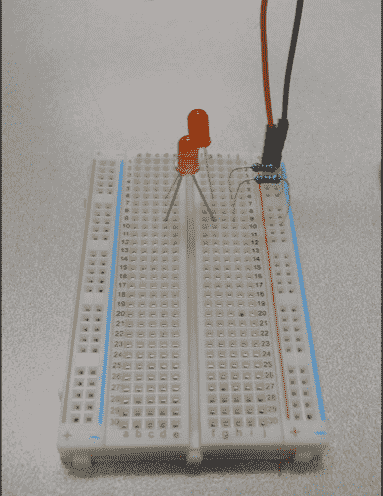

现在，你将使用跳线连接到 Raspberry Pi Zero 的 GPIO 引脚。你将连接到引脚 13（GPIO 27）和引脚 15（GPIO 22），如图所示：

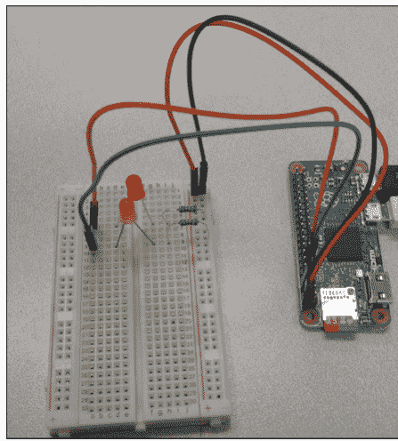

选择正确的引脚很重要，因为并非所有引脚都可以输出 GPIO 电压。下面是 GPIO 引脚的另一种视图，标注了分配给它们的一些专用功能：

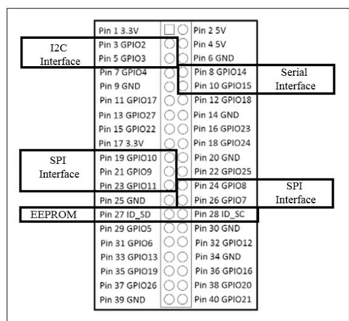

在本章以及本书后续内容中，你将进一步了解这些专用功能。现在硬件已经正确配置，你需要添加代码来驱动 LED。

### Raspberry Pi Zero 与 LED 代码

要编写代码，你现在需要在 Raspberry Pi Zero 上启动系统、登录并打开终端窗口。你将使用 Python 创建一个简单的程序来控制 LED 的亮灭。代码如下：

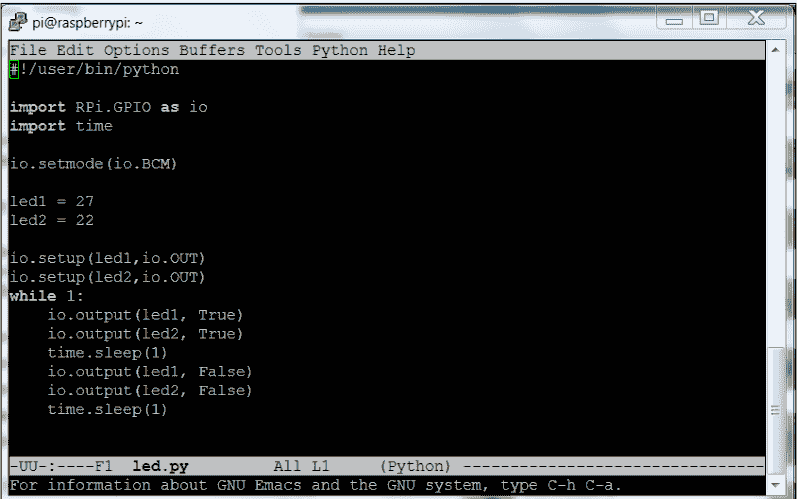

现在输入该程序。让我们逐行分析这个程序：

- `#!/usr/bin/python`：这一行让你无需在文件名前输入 python 即可运行该程序。你将在这些说明的末尾学习如何做到这一点。
- `import RPi.GPIO as io`：这让你可以导入 RPi.GPIO 库，从而控制 GPIO 引脚。
- `import time`：time 库提供了多个基于时间的函数。在这里，你将使用它让程序暂停几秒钟。
- `io.setmode(io.BCM)`：这会将 GPIO 引脚的规格模式设置为 Broadcom SOC 通道编号（BCM）。这意味着你将指定要控制的引脚的 GPIO 编号，而不是实际的物理引脚编号。


## 添加超声波传感器

你刚刚构建的基础电路是一个很好的开始。现在你将把一个更复杂的设备——超声波传感器——与 Raspberry Pi Zero 接口。以下是你将添加的超声波传感器的图片：

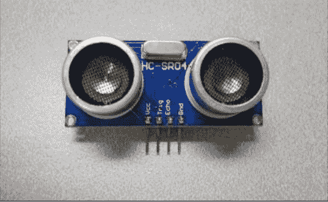

该设备是 HC-SR04，可在大多数在线电子零售商处买到。现在让我们将设备连接到 Raspberry Pi Zero。为此，首先让我们看看 Raspberry Pi Zero 上 GPIO 引脚的布局：

| Pin 1 3.3V |  | Pin 2 5V |
| Pin 3 GPIO2 |  | Pin 4 5V |
| Pin 5 GPIO3 |  | Pin 6 GND |
| Pin 7 GPIO4 |  | Pin 8 GPIO14 |
| Pin 9 GND |  | Pin 10 GPIO15 |
| Pin 11 GPIO17 |  | Pin 12 GPIO18 |
| Pin 13 GPIO27 |  | Pin 14 GND |
| Pin 15 GPIO22 |  | Pin 16 GPIO23 |
| Pin 17 3.3V |  | Pin 18 GPIO24 |
| Pin 19 GPIO10 |  | Pin 20 GND |
| Pin 21 GPIO9 |  | Pin 22 GPIO25 |
| Pin 23 GPIO11 |  | Pin 24 GPIO8 |
| Pin 25 GND |  | Pin 26 GPIO7 |
| Pin 27 ID_SD |  | Pin 28 ID_SC |
| Pin 29 GPIO5 |  | Pin 30 GND |
| Pin 31 GPIO6 |  | Pin 32 GPIO12 |
| Pin 33 GPIO13 |  | Pin 34 GND |
| Pin 35 GPIO19 |  | Pin 36 GPIO16 |
| Pin 37 GPIO26 |  | Pin 38 GPIO20 |
| Pin 39 GND |  | Pin 40 GPIO21 |

这两种电阻的组合将电压降低到所需水平。
以下是面包板上的电路图：

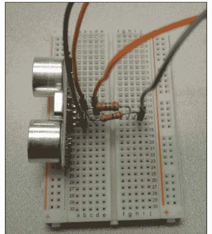

最后，如图所示将传感器连接到 Raspberry Pi Zero：

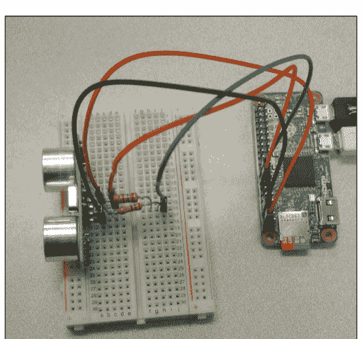

现在设备已连接，你需要一些代码来读取值，确保其稳定（产生稳定的测量值），然后将其转换为距离。

## Raspberry Pi Zero 和超声波传感器代码

以下是与超声波传感器通信的 Python 代码：

```
#!/usr/bin/python
import RPi.GPIO as io
import time

io.setmode(io.BCM)

trig = 23
echo = 24

io.setup(trig,io.OUT)
io.setup(echo,io.IN)

io.setup(trig, False)
time.sleep(1)
io.output(trig, True)
time.sleep(.00001)
io.output(trig, False)

while io.input(echo) == 0:
    start = time.time()

while io.input(echo) == 1:
    end = time.time()

duration = end - start
distance = duration * 17150
distance = round(distance, 2)
print "Distance: ", distance, " cm"
io.cleanup()
```

以下是代码的解释：

- #!/usr/bin/python: 这一行让你可以在不输入 python 的情况下运行此程序。你将在这些说明的末尾学习如何做到这一点。
- `import RPi.GPIO as io`: 这让你可以导入 RPi 库，这将允许你控制 GPIO 引脚。
- `import time`: time 库提供了多个基于时间的功能。在这种情况下，你将使用它来暂停程序一段时间并测量一定的时间延迟。
- `io.setmode(io.BCM)`: 这将 GPIO 引脚的规范模式设置为 Broadcom SOC 通道号（BCM）。这意味着你将指定要控制的 GPIO 引脚号，而不是实际的物理引脚值。
- `trig = 23`: 这将值 23 分配给 trig 变量。
- `echo = 24`: 这将值 24 分配给 echo 变量。
- `io.setup(trig, io.OUT)`: 这将 GPIO 引脚 23 设置为输出。
- `io.setup(echo, io.IN)`: 这将 GPIO 引脚 24 设置为输入。
- `io.setup(trig, False)`: 这将向 trig 线、引脚 23 输出零。
- `time.sleep(1)`: 此命令将使程序暂停一秒。
- `io.output(trig, True)`: 这将向 trig 线、引脚 23 输出一个，5 伏。
- `time.sleep(.00001)`: 这将使程序等待大约 10 微秒。
- `io.output(trig, False)`: 这将向 trig 线、引脚 23 输出零。
- `while io.input(echo) == 0:`: 当引脚 24 的输入为零时。
- `start = time.time()`: 持续重置开始时间。当引脚 24 变高时，start 将保存引脚 24 的值为低时的最新时间。
- `while io.input(echo) == 1:`: 当输入引脚 24 为 1 时执行以下命令集。
- `end = time.time()`: 持续重置结束时间。当引脚 24 变低时，end 将保存引脚 24 的值为高时的最新时间。
- `duration = end - start`: duration 现在将保存结束时间和开始时间之间的时间距离。
- `distance = duration * 17150`: distance 将持续时间转换为距离值。
- `distance = round(distance, 2)`: 将距离四舍五入到小数点后两位。
- `print "Distance: ", distance, " cm"`: 打印出距离。
- `io.cleanup()`: 重置接口。

## 在 Raspberry Pi Zero 上访问 GPIO 引脚

现在你应该保存并运行程序并获得结果，如以下屏幕截图所示：

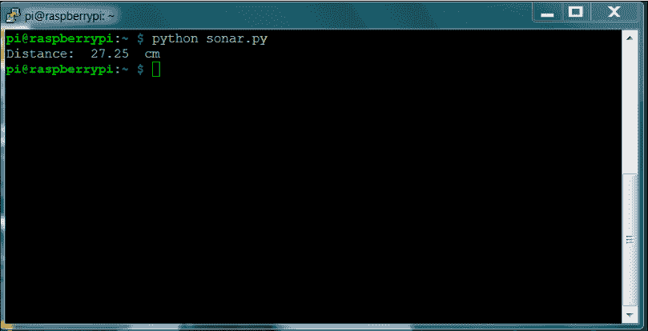

现在你可以用 Raspberry Pi Zero 感知距离！

## 将数字罗盘连接到 Raspberry Pi Zero

现在你已经为 Raspberry Pi Zero 创建了一些非常基础的连接，打开和关闭线路并感知高或低信号。现在让我们探索 Raspberry Pi Zero 上可用的其他接口之一，I2C 接口。为此，你将连接一个使用这种接口的数字罗盘。

> 有关 I2C 接口的更多信息，请参阅 `http://www.robot-electronics.co.uk/i2c-tutorial`。

有几种芯片提供数字罗盘功能；其中最常见的是 **HMC5883L**，一种 *3 轴* 数字罗盘芯片。该芯片由多家公司封装在模块中，但几乎所有模块的结果都具有相似的接口。

以下是 **GY-271 HMC5883L** 的图片，这是一款三轴罗盘磁力计传感器模块，可在多家在线零售商处买到：

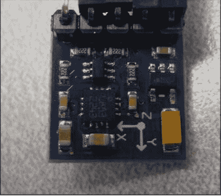

这种类型的数字罗盘使用磁传感器来测量地球的磁场。这些传感器的输出随后通过一组寄存器使外部世界可以访问，允许用户设置诸如采样率和连续或单次采样之类的内容。X、Y 和 Z 方向的输出也使用寄存器。

该芯片使用 **Inter IC (I2C)** 总线与 Raspberry Pi Zero 通信。Raspberry Pi 的 GPIO 接口上有三个串行总线可用。第一个是标准的 **Universal Asynchronous Receiver/Transmitter (UART)** 接口。UART 接口使用一个引脚用于 RX 或接收信号，一个引脚用于 TX 或发送信号。UART 接收字节数据并以顺序传输各个位。在目的地，第二个 UART 将位重新组装成字节。此接口仅限于与单个外部设备通信。有关 UART 接口及其工作原理的更多信息，请访问 `https://www.freebsd.org/doc/en/articles/serial-uart/`。

第二个可用的接口是 I2C 接口。I2C 接口与 UART 接口类似；它也使用两条线进行通信，在本例中为数据线和时钟线。然而，它更复杂一些，因为它允许一个主设备与多个从设备之间进行通信。它通过寻址主设备想要通信的设备来实现这一点。有关 I2C 接口的更多信息，请参阅 `http://www.robot-electronics.co.uk/i2c-tutorial`。

最后一个可用的接口是 **Serial Peripheral Interface (SPI)** 接口。与 I2C 接口一样，SPI 接口允许主设备与多个从设备之间进行通信。然而，每个从设备都使用不同的选择数据线进行选择。SPI 主设备使用 **serial clock (SCK)**、**Master Out Slave In (MOSI)**、**Master In Slave Out (MISO)** 和 **Slave Select (SS)** 线与从设备通信。SCK、MOSI 和 MISO 信号可以由从设备共享，而每个从设备都有唯一的 SS 线。有关 SPI 接口的更多信息，请参阅 http://www.corelis.com/education/SPI_Tutorial.htm。

由于你要使用的设备是 I2C 设备，罗盘模块背面将有三个连接，一个用于电源（VCC），一个用于地（GND），一个用于时钟（SCL），一个用于数据（SDA）。连接如以下图像所示：

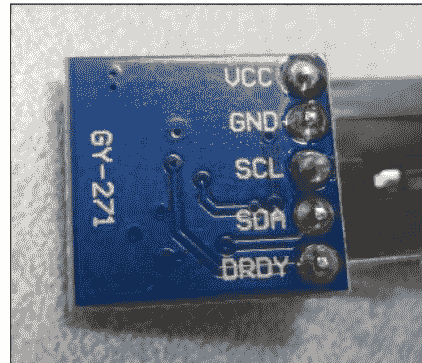


要连接该设备，您需要连接 Raspberry Pi Zero 上的 I2C 接口引脚。以下是 GPIO 引脚的详细说明：

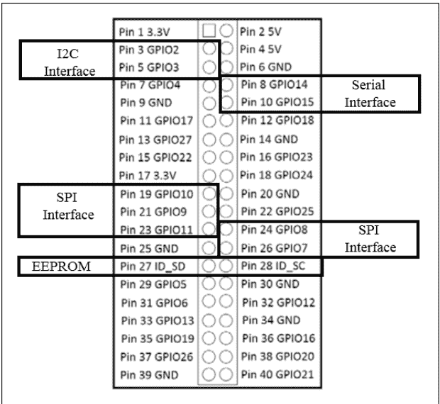

您将把设备连接到引脚 1、3、5、7 和 9。对于这些连接，您需要使用母对母跳线：

- 1. 将模块上的 VCC 引脚连接到 Raspberry Pi Zero 上的引脚 1 3.3 V，并将 GND 连接到引脚 9 GND。
- 2. 然后将模块上的 **SCL** 连接到 **引脚 5 GPIO3**，并将 **SDA** 连接到 Raspberry Pi Zero 上的 **引脚 3 GPIO2**。请注意，您不会连接罗盘上的 **数据就绪 (DRDY)** 引脚；这是设备的可选连接。以下是连接：

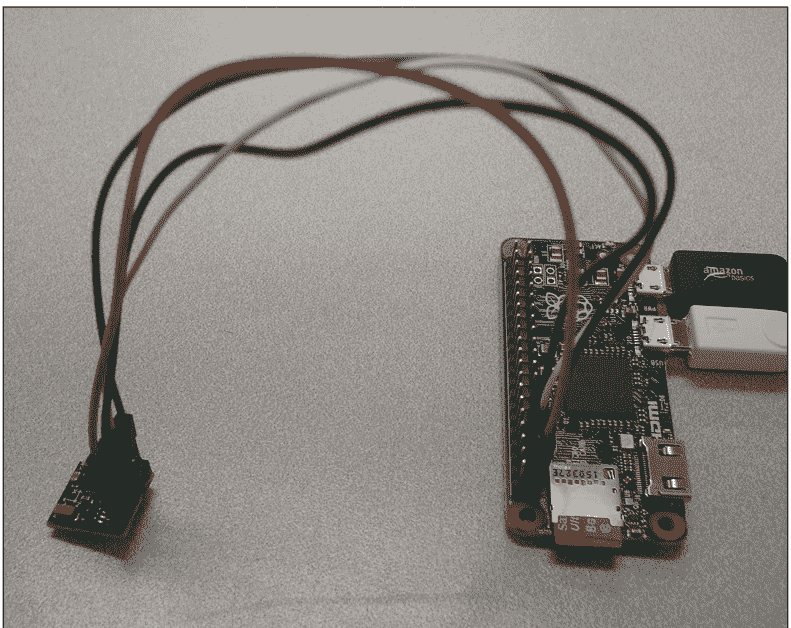

现在，您已准备好与设备通信。

## 以编程方式访问罗盘

现在设备已连接，您需要通过软件配置访问权限。以下是步骤：

- 1. 为了访问罗盘功能，您需要在 Raspberry Pi Zero 上启用 I2C 库。要启用此总线，请运行 `sudo raspi-config` 并选择 **9 高级选项**，如下所示：

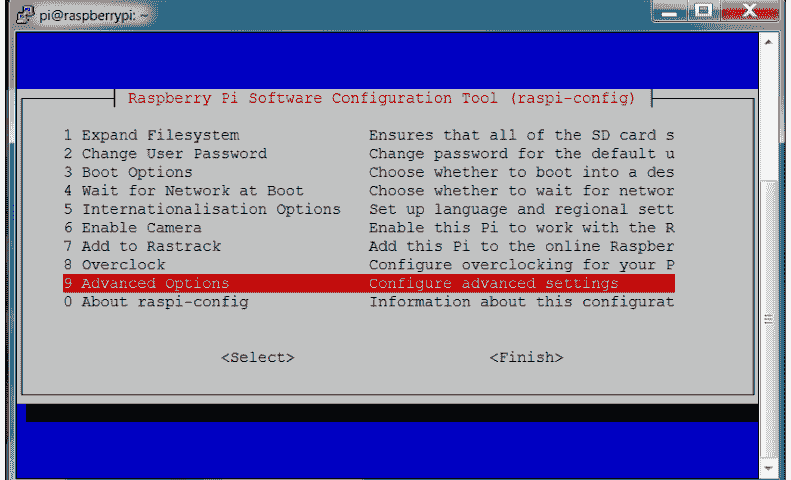

- 2. 然后转到 A7 I2C 选择并启用 I2C，如以下屏幕截图所示：

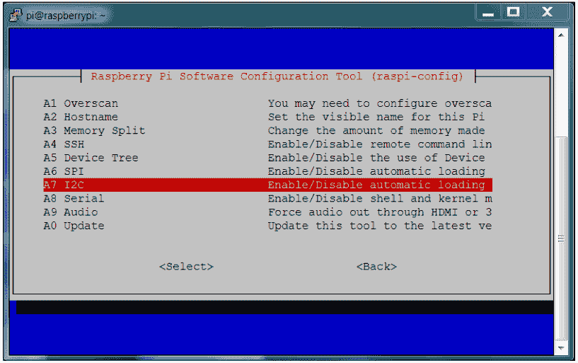

- 3. 选择 **是** 以启用 I2C 接口，如以下屏幕截图所示：

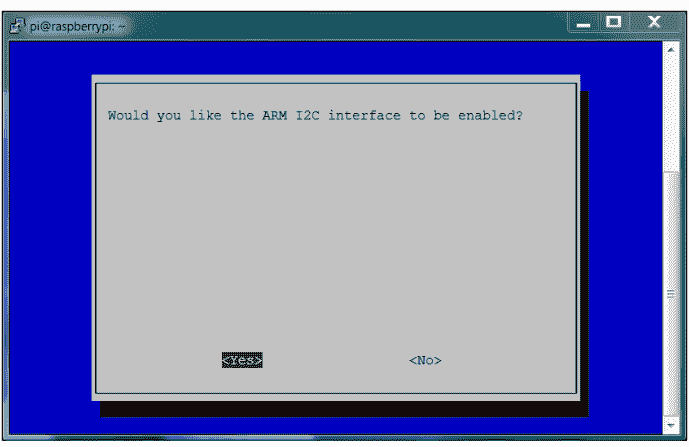

- 4. 在下一个屏幕上选择 **确定**，然后在询问是否要默认加载 I2C 内核模块的屏幕上选择 **是**，如下所示：

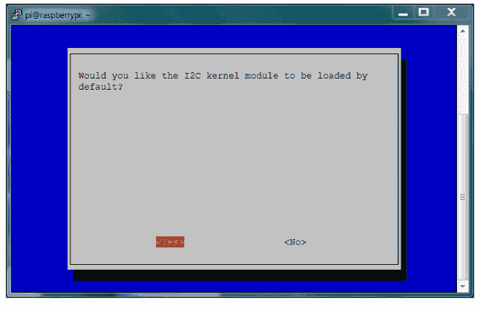

- 5. 选择 **确定** 返回主选择，然后退出并重新启动您的 Raspberry Pi Zero。

现在您可以检测设备是否已连接。通过输入 sudo apt-get install i2c-tools 安装 I2C 工具包。您可以通过输入 sudo i2cdetect -y 1 来查看 I2C 是否已启用，然后您应该会看到类似于以下屏幕截图的内容：

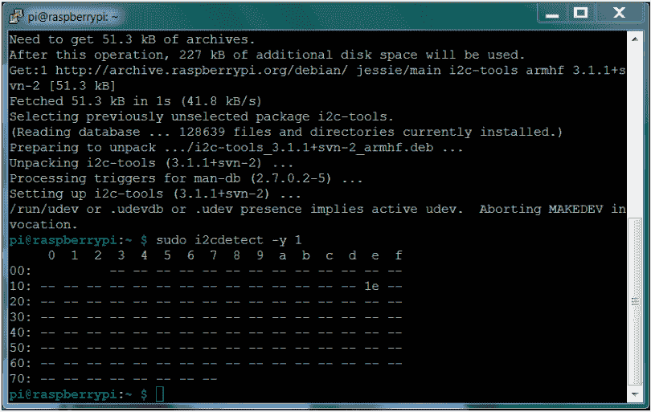

您可以在 1e 看到设备。现在您可以与您的数字罗盘通信。以下是步骤：

- 1. 您需要创建一个 Python 程序。在创建 Python 代码之前，您需要安装 SMBus 功能以访问 I2C。这可以通过输入 sudo apt-get install python-smbus 来完成。

## 访问 Raspberry Pi Zero 上的 GPIO 引脚

- 2. 现在重新启动 Raspberry Pi；您可以使用 smbus 库功能来读取和写入您的 I2C 设备。幸运的是，在这种情况下，设备附带了一些示例代码，说明如何配置设备然后读取值。以下是一个 Python 代码示例：

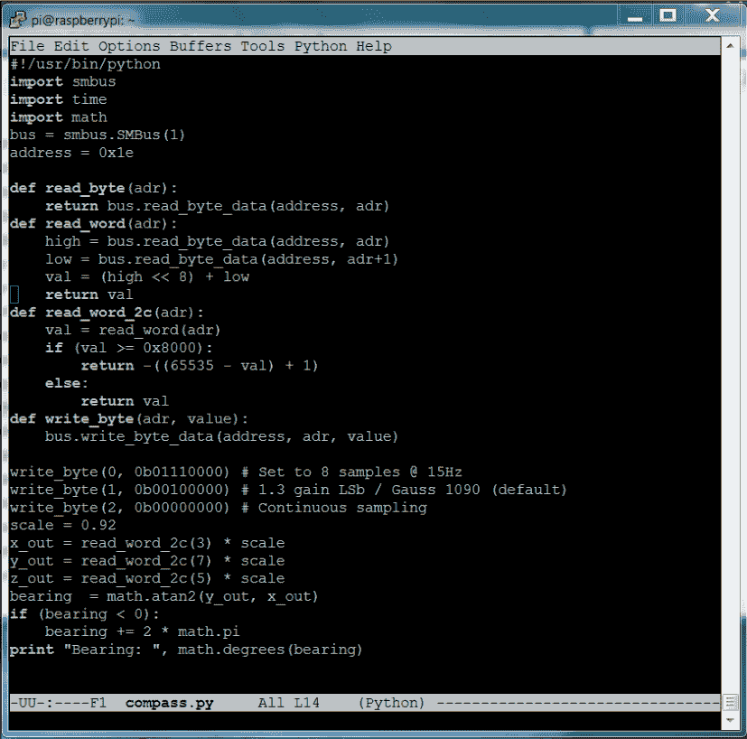

```
```python
#!/usr/bin/python
import smbus
import time
import math
bus = smbus.SMBus(1)
address = 0x1e

def read_byte(adr):
    return bus.read_byte_data(address, adr)
def read_word(adr):
    high = bus.read_byte_data(address, adr)
    low = bus.read_byte_data(address, adr+1)
    val = (high << 8) + low
    return val
def read_word_2c(adr):
    val = read_word(adr)
    if (val >= 0x8000):
        return -((65535 - val) + 1)
    else:
        return val
def write_byte(adr, value):
    bus.write_byte_data(address, adr, value)

write_byte(0, 0b01110000) # Set to 8 samples @ 15Hz
write_byte(1, 0b00100000) # 1.3 gain LSB / Gauss 1090 (default)
write_byte(2, 0b00000000) # Continuous sampling
scale = 0.92
x_out = read_word_2c(3) * scale
y_out = read_word_2c(7) * scale
z_out = read_word_2c(5) * scale
bearing = math.atan2(y_out, x_out)
if (bearing < 0):
    bearing += 2 * math.pi
print "Bearing: ", math.degrees(bearing)
```
```

通过输入 `python compass.py` 运行代码，您应该会看到以下输出：

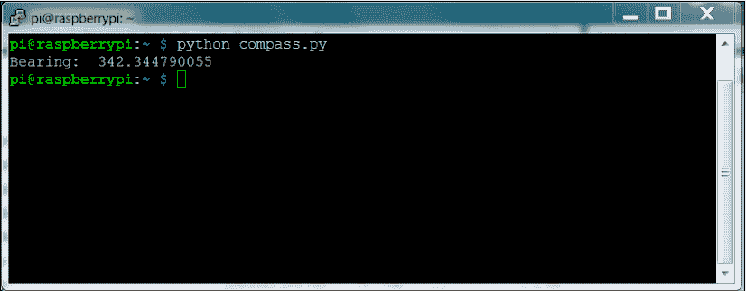

当您移动设备时，您应该会看到该值发生变化，以反映设备的罗盘方向。

这只是一个如何连接 I2C 设备的示例。还有许多其他不同设备可以连接到 Raspberry Pi Zero 的 GPIO 总线。

## 总结

就这样！您已完成了第一个硬件项目。现在您应该对 Raspberry Pi Zero 的 GPIO 总线至少感到有点熟悉。在下一章中，您将学习如何创建一个由 Raspberry Pi Zero 控制的汽车。
