# 第4章 构建和控制一个简单的轮式机器人

## 构建和控制一个简单的轮式机器人

您现在应该熟悉如何编程您的 Raspberry Pi Zero 以及如何使用 GPIO 与外部世界通信。现在，让我们实际构建一个移动项目。让您的项目移动的最简单方法之一是使用轮式平台。在本章中，您将了解有关操纵直流电机以及使用 Raspberry Pi Zero 控制轮式平台的速度和方向的一些基础知识。

在本章中，您将学习如何执行以下操作：

- 使用 Raspberry Pi Zero GPIO 控制直流电机
- 使用 Raspberry Pi Zero 以编程方式控制您的移动平台
- 在 Raspberry Pi Zero 上实现一些简单的路径规划算法

## 基本平台

为了使您的项目移动，您需要添加一些硬件，特别是轮式或履带式平台。您将使用一个使用差速运动来推进和转向车辆的平台。这仅仅意味着，与其转动车轮，您将改变驱动车轮或履带的两个电机的速度和方向。有很多选择。有些是完全组装好的，而有些需要一些组装；或者您可以购买组件并自行构建定制的移动平台。

让我们看一下几个更受欢迎的单元，它们是完全组装好的或可以用简单工具（螺丝刀或钳子）组装的。最简单的移动平台是具有两个直流电机的平台，每个电机控制一个车轮。在轮式平台上，前部或后部有一个小轮子或滚珠。以下是可在许多在线电子零售商处购买的一个轮式平台示例：

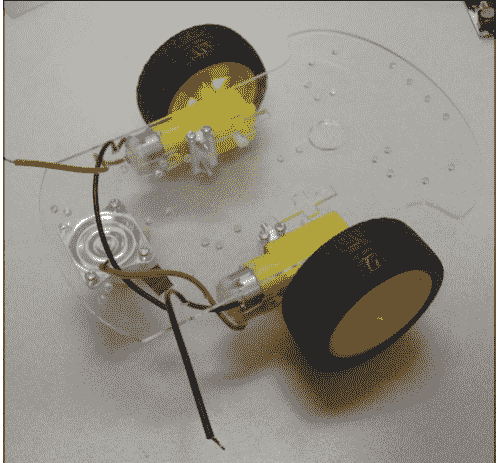

以下是另一个简单的轮式平台，也由许多在线电子零售商销售：

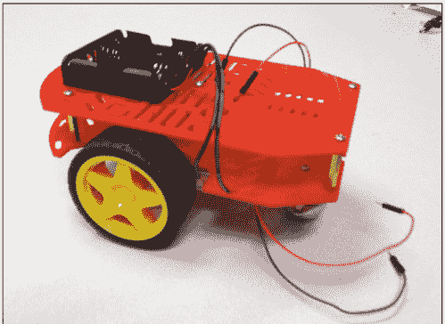

这个也需要组装，但相当简单。您也可以选择履带式平台而不是轮式平台。履带式平台具有更大的牵引力，但灵活性不如轮式平台，因为转弯需要更长的距离。同样，制造商生产预组装单元。以下图像是 Dagu 生产的预组装履带式平台的示例。它被称为 Dagu Rover 5 履带底盘：

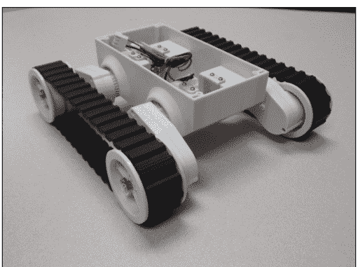

作为平台的一部分，您需要为 Raspberry Pi Zero 和您的车辆提供移动电源。我个人喜欢外部 5V 可充电手机电池，这些电池在几乎任何销售手机的地方都有售。这些电池可以使用 USB 电缆通过 DC 电源或直接从计算机 USB 端口充电，如下图所示：

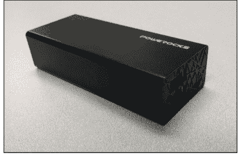

您还需要一根 USB 电缆将电池连接到 Raspberry Pi Zero。现在您拥有了基本平台，可以开始使用 Raspberry Pi Zero 控制它了。

然而，您可以通过使用 H 桥直流电机控制器将 Raspberry Pi Zero 连接到直流电机。H 桥是一个相当简单的设备。它基本上由一组电子开关组成，并提供额外的功能，允许电流方向反转，以便电机可以在正向或反向运行。

让我们通过构建 H 桥电路并控制单个电机来开始这个示例。为此，您需要获取一个 H 桥。最常见的选项之一是 L293 双 H 桥芯片。该芯片允许您控制直流电机的方向。这些在大多数电子商店和在线商店都有售。一旦您拥有 H 桥，请使用以下图像中所示的 Raspberry Pi Zero、电机、跳线、4AA 电池盒和面包板构建电路：

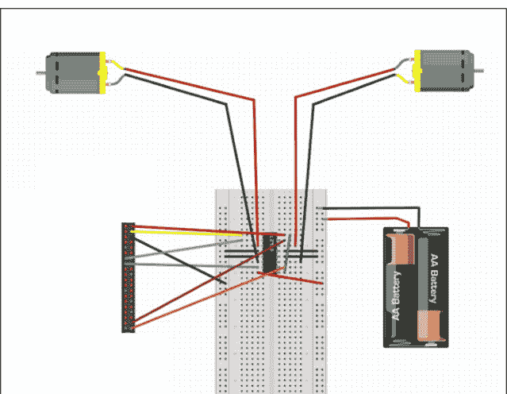


此外，在你开始连接导线之前，这里有一张 Raspberry Pi Zero 板上 GPIO 引脚的图像：

| Pin 1 3.3V |  | Pin 2 5V |
| Pin 3 GPIO2 |  | Pin 4 5V |
| Pin 5 GPIO3 |  | Pin 6 GND |
| Pin 7 GPIO4 |  | Pin 8 GPIO14 |
| Pin 9 GND |  | Pin 10 GPIO15 |
| Pin 11 GPIO17 |  | Pin 12 GPIO18 |
| Pin 13 GPIO27 |  | Pin 14 GND |
| Pin 15 GPIO22 |  | Pin 16 GPIO23 |
| Pin 17 3.3V |  | Pin 18 GPIO24 |
| Pin 19 GPIO10 |  | Pin 20 GND |
| Pin 21 GPIO9 |  | Pin 22 GPIO25 |
| Pin 23 GPIO11 |  | Pin 24 GPIO8 |
| Pin 25 GND |  | Pin 26 GPIO7 |
| Pin 27 ID_SD |  | Pin 28 ID_SC |
| Pin 29 GPIO5 |  | Pin 30 GND |
| Pin 31 GPIO6 |  | Pin 32 GPIO12 |
| Pin 33 GPIO13 |  | Pin 34 GND |
| Pin 35 GPIO19 |  | Pin 36 GPIO16 |
| Pin 37 GPIO26 |  | Pin 38 GPIO20 |
| Pin 39 GND |  | Pin 40 GPIO21 |

你需要将 Raspberry Pi Zero 上的这些 GPIO 引脚连接到 H 桥上的引脚，如下表所示：

| Raspberry Pi Zero GPIO pin | H-bridge pin |
| 4 (5V) | 1 (Enable pin) |
| 13 (GPIO 27) | 2 (Forward) |
| 15 (GPIO 22) | 7 (Backward) |
| 4 (5V) | 11 (Enable 2) |
| 38 (GPIO 6) | 10 (Forward) |
| 40 (GPIO 13) | 15 (Backward) |
| 6 (GND) | 4, 5, 12, 13 (GND) |
| 2 (5 Volts) | 16 (VCC) |
| Battery positive terminal | 8 (Vc) |
| Battery negative terminal | GND (connect to the same GND as previous GND pins) |

连接完成后，你可以测试系统。要使这一切正常工作，你需要添加一些代码，我们将在下一节中看到。

## 使用 Raspberry Pi Zero 以编程方式控制你的移动平台

现在你的基本电机控制器功能已经运行，你需要将两个电机控制器都连接到 Raspberry Pi Zero。本节将介绍这一点，并向你展示如何以编程方式控制整个平台。

你将在最初尝试控制电机时使用 Python。用 Python 编码、运行和调试代码非常简单。你要创建的第一个 Python 程序显示在以下屏幕截图中：

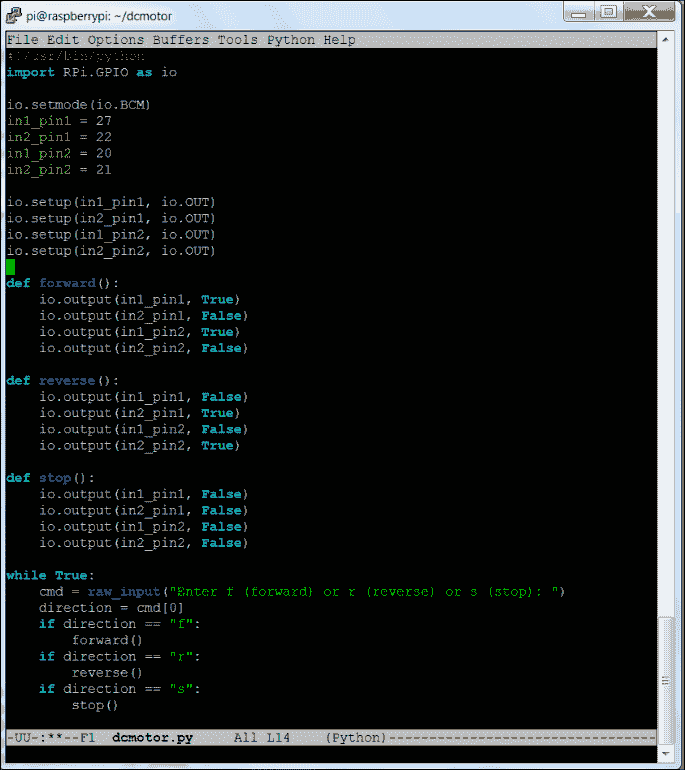

按照以下步骤创建此程序：

要创建此程序，在你的主目录中创建一个名为 dcmotor 的目录，输入 mkdir dcmotor，然后输入 cd dcmotor。现在，通过输入 emacs dcmotor.py 打开文件（如果你使用不同的编辑器，请新建一个名为 dcmotor.py 的文件）。

现在，输入程序。让我们逐步讲解程序：

- #!/usr/bin/python: 这一行让你可以在不输入 python 的情况下运行程序，而是在文件名之前。你将在这些说明的最后学习如何做到这一点。
- import RPi.GPIO as io: 这让你可以导入 RPi 库，该库允许你控制 GPIO 引脚。
- io.setmode(io.BCM): 这将 GPIO 引脚的规范模式设置为 Broadcom SOC 通道（BCM）编号。这意味着你将指定要控制的引脚的 GPIO 编号，而不是实际的物理引脚值。
- in1_pin1 = 27: 这将值 27 分配给 in1_pin1 变量。
- in2_pin1 = 22: 这将值 22 分配给 in1_pin1 变量。
- in1_pin2 = 20: 这将值 20 分配给 in1_pin1 变量。
- in2_pin2 = 21: 这将值 21 分配给 in1_pin1 变量。
- io.setup(in1_pin1, io.OUT): 这将 GPIO 引脚 27 设置为输出控制。
- io.setup(in2_pin1, io.OUT): 这将 GPIO 引脚 22 设置为输出控制。
- io.setup(in1_pin2, io.OUT): 这将 GPIO 引脚 20 设置为输出控制。
- io.setup(in2_pin2, io.OUT): 这将 GPIO 引脚 21 设置为输出控制。
- def forward(): 这定义了 forward 函数。你需要打开 GPIO 27 和 GPIO 20，并关闭 GPIO 22 和 GPIO 21。
- io.output(in1_pin1, True): 在 in1_pin1 上输出 3.3 伏信号（这是 GPIO 27）。
- io.output(in2_pin1, False): 在 in2_pin1 上输出 0 伏（这是 GPIO 22）。
- io.output(in1_pin2, True): 在 in1_pin2 上输出高电压（这是 GPIO 20）。
- io.output(in2_pin2, False): 在 in2_pin2 上输出 0 伏（这是 GPIO 21）。
- def reverse(): 这定义了 reverse 函数。你将打开 GPIO 22 和 GPIO 21，并关闭 GPIO 27 和 GPIO 20。
- io.output(in1_pin1, False): 在 in1_pin1 上输出 0 伏（这是 GPIO 27）。
- io.output(in2_pin1, True): 在 in2_pin1 上输出高电压（这是 GPIO 22）。
- io.output(in1_pin2, False): 在 in1_pin2 上输出 0 伏（这是 GPIO 20）。
- io.output(in2_pin2, True): 在 in2_pin2 上输出高电压（这是 GPIO 21）。
- def stop(): 这定义了 stop 函数。你将 GPIO 22、GPIO 21、GPIO 27 和 GPIO 20 的电平设置为 0。
- io.output(in1_pin1, False): 在 in1_pin1 上输出 0 伏（这是 GPIO 27）。
- io.output(in2_pin1, False): 在 in2_pin1 上输出 0 伏（这是 GPIO 22）。
- io.output(in1_pin2, False): 在 in1_pin2 上输出 0 伏（这是 GPIO 20）。
- io.output(in2_pin2, False): 在 in2_pin2 上输出 0 伏（这是 GPIO 21）。
- while True: 这会反复循环。你可以通过按 Ctrl + C 来停止程序。
- cmd = raw_input("Enter f (forward) or r (reverse) or s (stop): "): 输入一个字符，表示你希望机器人执行的操作。
- direction = cmd[0]: 只取输入的第一个字符。
- if direction == "f": 如果方向是 "f"，则执行下一条语句。
- forward(): 执行 forward 函数。
- if direction == "r": 如果方向是 "f"，则执行下一条语句。
- reverse(): 执行 reverse 函数。
- if direction == "s": 如果方向是 "f"，则执行下一条语句。
- stop(): 执行 stop 函数。

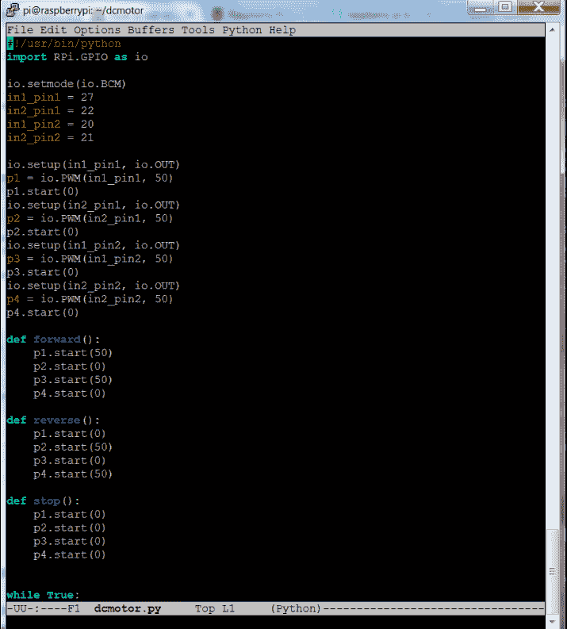

以下是你刚刚添加的代码行的解释：

- io.setup(in2_pin1, io.OUT): 这将 GPIO 27 设置为输出。
- p1 = io.PWM(in1_pin1, 50): 而不是简单的开或关设置，此 PWM 设置允许程序员设置脉冲的相对宽度。这在 GPIO 27 上初始化此功能。
- p1.start(0): 这以 0% 的脉冲宽度，即关闭，启动 p1、GPIO 27 上的脉冲。
- io.setup(in2_pin1, io.OUT): 这将 GPIO 22 设置为输出。
- p2 = io.PWM(in2_pin1, 50): 这在 GPIO 22 上初始化此功能。
- p2.start(0): 这以 0% 的脉冲宽度，即关闭，启动 p2、GPIO 22 上的脉冲。
- io.setup(in1_pin2, io.OUT): 这将 GPIO 20 设置为输出。
- p3 = io.PWM(in1_pin2, 50): 这在 GPIO 20 上初始化此功能。
- p3.start(0): 这以 0% 的脉冲宽度，即关闭，启动 p3、GPIO 20 上的脉冲。
- io.setup(in2_pin2, io.OUT): 这将 GPIO 21 设置为输出。
- p4 = io.PWM(in2_pin2, 50): 这在 GPIO 21 上初始化此功能。
- p4.start(0): 这以 0% 的脉冲宽度，即关闭，启动 p3、GPIO 21 上的脉冲。
- def forward(50): 此函数通过将脉冲宽度设置为 50% 的前进方向来使单元向前移动。
- p1.start(50): 这将 p1（GPIO 27）的值设置为 50% 开和 50% 关。这应导致电机以半速向前运行。
- p2.start(0): 这将 p2（GPIO 22）的值设置为 0%。这有效地关闭了该引脚。
- p3.start(50): 这将 p3（GPIO 20）的值设置为 50% 开和 50% 关。这应导致电机以半速向前运行。
- p4.start(0): 这将 p4（GPIO21）的值设置为 0%。这有效地关闭了该引脚。
- def reverse(50): 此函数通过将脉冲宽度设置为 50% 的反向来使单元反向移动。
- p1.start(0): 这将 p1（GPIO 27）的值设置为 0%。这有效地关闭了该引脚。
- p2.start(50): 这将 p2（GPIO 22）的值设置为 50% 开和 50% 关。这应导致电机以半速反向运行。
- p3.start(0): 这将 p3（GPIO 20）的值设置为 0%。这有效地关闭了该引脚。
- p4.start(50): 这将 p4（GPIO21）的值设置为 50% 开和 50% 关。这应导致电机以半速反向运行。
- def stop(): 此函数将所有 PWM 信号设置为 0%，有效地停止电机。
- p1.start(0): 这将 p1（GPIO 27）的值设置为 0%。这有效地关闭了该引脚。


- `p2.start(0)`: 这将把 p2（GPIO 22）的值设为 0%。这实际上关闭了该引脚。
- `p3.start(0)`: 这将把 p3（GPIO 20）的值设为 0%。这实际上关闭了该引脚。
- `p4.start(0)`: 这将把 p4（GPIO 21）的值设为 0%。这实际上关闭了该引脚。

其余程序与第一个 dcmotor.py 文件相同。运行此程序应使单元以第一个程序一半的速度运行。你可以通过更改发送到各个 start 函数的值轻松更改此速度。

你也可以通过使用直流电机控制器将直流电机连接到 Raspberry Pi Zero 来控制直流电机。例如，Pololu，可在 https://www.pololu.com/ 找到，生产了适用于 Raspberry Pi 的 DRV8835 双电机驱动器套件。另一个选择是可在 http://www.monkmakes.com/ 获得的 RasPiRobot Board V2。对于本示例，我们将使用 RasPiRobot Board V2。

## 使用电机控制器板控制直流电机

要构建此项目，你首先将电机控制器板安装在 Raspberry Pi Zero 之上，如下所示：

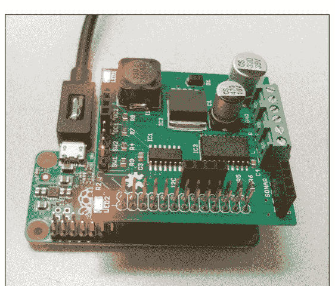

该板为车辆上的直流电机提供驱动信号。你也可以通过分别驱动每个电机来转向车辆。你可以通过反转信号来改变车辆的方向并做出非常急转弯。以下步骤说明如何连接电机控制板：

- 1. 将电池电源连接器连接到板上的电源连接器。使用 6 至 7.4 伏的电池；你可以使用 4 节 AA 电池盒或 2S LiPo RC 电池。将地线和电源线连接到电机控制板，如图所示：

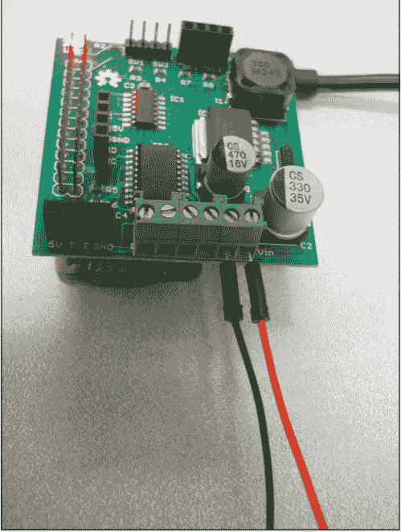

2. 接下来，将其中一个驱动信号连接到板上的电机 1 连接器。将电机 1 连接到右侧电机，电机 2 连接到左侧，如图所示：

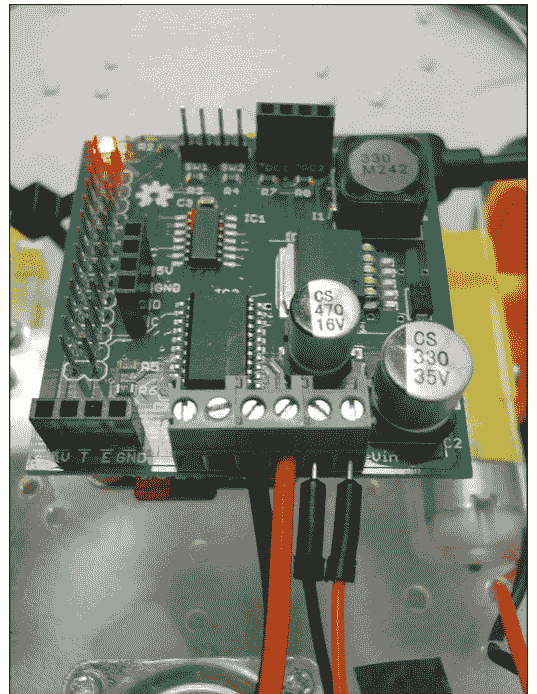

3. 然后，将第二个驱动连接器连接到板上的电机 2 连接器。整个连接集应如下所示：

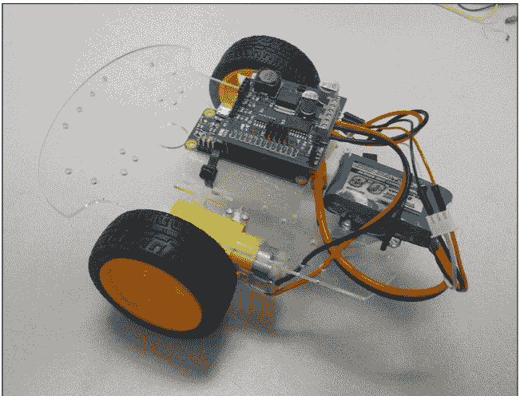

现在你可以使用 Raspberry Pi Zero 驱动你的车辆了。

## 使用 Raspberry Pi Zero 在 Python 中控制车辆

要利用该功能，首先需要安装与控制板关联的库，可在 http://www.monkmakes.com/?page_id=698 找到。你需要使用有线或 WLAN 连接将 Raspberry Pi Zero 连接到互联网。在 Raspberry Pi Zero 上的终端窗口中输入以下命令：

- 1. 输入 wget https://github.com/simonmonk/raspirobotboard2/raw/master/python/dist/rrb2-1.1.tar.gz：这将把库下载到你的 Raspberry Pi。
- 2. 输入 tar -xzf rrb2-1.1.tar.gz：这会解压库。
- 3. 输入 cd rrb2-1.1：这会将目录更改为文件所在的位置。
- 4. 输入 sudo python setup.py install：这会安装库。

现在你已安装了库代码，你需要创建一些 Python 代码来允许你访问两个电机。代码的第一部分应如下所示：

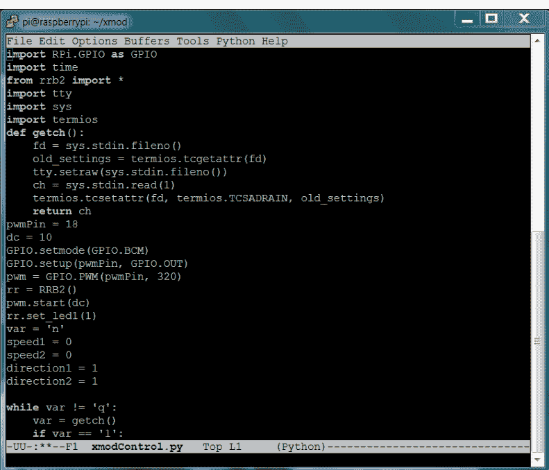

驱动两个不同电机、基于你想要向前、向后、向右或向左转的代码第二部分如下所示：

```
while var != 'q':
    var = getch()
    if var == 'l':
        speed1 = 1
        direction1 = 1
        speed2 = 1
        direction2 = 0
        stop = 1
    if var == 'r':
        speed1 = 1
        direction1 = 0
        speed2 = 1
        direction2 = 1
        stop = 1
    if var == 'f':
        speed1 = 1
        direction1 = 1
        speed2 = 1
        direction2 = 1
        stop = 0
    if var == 'b':
        speed1 = 1
        direction1 = 0
        speed2 = 1
        direction2 = 0
        stop = 0
    if var == 's':
        speed1 = 0
        direction1 = 0
        speed2 = 0
        direction2 = 0
    rr.set_motors(speed1, direction1, speed2, direction2)
    if stop == 1:
        time.sleep(1)
        rr.set_motors(0, 0, 0, 0)
GPIO.cleanup()
```

rr.set_motors() 函数允许你独立指定每个电机的速度和方向。此程序接收单个字符然后向电机发送命令。f 使车辆向前移动，b 使其向后移动，l 使其向左转，r 使其向右转，s 停止车辆。

现在你有了驱动履带式车辆的基本代码，你可以对其进行修改，使每个操作都包含在函数中。这样，你就可以从另一个 Python 程序调用这些函数。你还需要添加校准移动，以便你的履带式车辆能够以特定角度转弯并向前移动设定距离。以下示例显示代码应如下所示：

```
import RPi.GPIO as GPIO
import time
from rrb2 import *

rr = RRB2()

def init_vehicle():
    rr.set_led1(1)

def turn_left(angle):
    rr.set_motors(1, 1, 1, 0)
    time.sleep(angle/20)
    rr.set_motors(0, 0, 0, 0)

def turn_right(angle):
    rr.set_motors(1, 0, 1, 1)
    time.sleep(angle/20)
    rr.set_motors(0, 0, 0, 0)

def forward(value):
    rr.set_motors(1, 1, 1, 1)
    time.sleep(value)
    rr.set_motors(0, 0, 0, 0)

def backward(value):
    rr.set_motors(1, 0, 1, 0)
    time.sleep(value)
    rr.set_motors(0, 0, 0, 0)

def stop():
    rr.set_motors(0, 0, 0, 0)

def cleanup():
    GPIO.cleanup()
```

turn_right(angle) 和 turn_left(angle) 函数中的 time.sleep(angle/20) 命令允许履带式车辆移动适当的时间，以便车辆通过所需角度移动。你可能需要修改此数字以获得正确的移动角度。time.sleep(value) 命令使机器人移动特定时间，基于 value 中给出的数字。

如果你选择使用 RasPiRobot Board V2，你也可以使用其特殊连接和库来连接 HC-SR04 超声波传感器。以下是板上特殊连接器的图片：

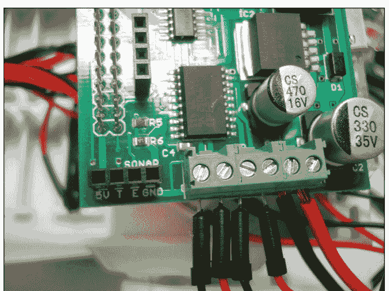

要使用此连接器，只需将 VCC 连接到 5V，将 Trig 连接到 T 连接，将 Echo 连接到 E 连接器，将 GND 连接到 GND 连接。然后你可以使用电机控制器板的库并简单调用函数 rr.get_distance()。同样，如果你想为移动项目添加指南针，还有用于 I2C 接口的特殊连接器和库。

## 规划你的路径

现在你有了轮式或履带式车辆，你可能想要做一些基本的路径规划。为此，你需要一个框架来了解你的机器人所在位置并确定目标位置。最常见的框架之一是 x-y 网格。以下图表是这种网格类型的示例：

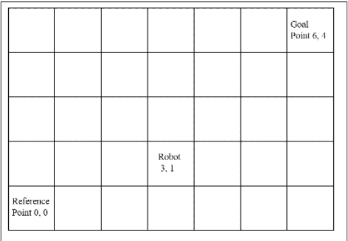

在此网格上有三个关键点你需要理解。以下是它们的解释：

- 左下角点是一个固定的参考位置。方向 x 和 y 也是固定的，所有其他位置都是相对于此位置和这些方向测量的。每个单位都是根据单元在单个单位时间内行进的距离来测量的。
- 另一个重要点是你的机器人的起始位置。你的机器人将使用其 x 和 y 坐标来跟踪其位置，相对于某个固定参考位置在 x 方向上的位置，或相对于某个固定参考位置在 y 方向上到目标的位置。它使用指南针来跟踪这些方向。
- 第三个重要点是目标的位置，也以相对于固定参考位置的 x 和 y 坐标给出。如果你知道机器人的起始位置和角度，你可以规划一条最优（最短距离）路径到此目标。为此，你可以使用目标位置、机器人位置和一些相当简单的数学来计算从机器人到目标的距离和角度。


要计算距离，请使用以下公式：

d = √((Xgoal − Xrobot)² + (Ygoal − Yrobot)²)

你使用这个公式来告诉你的机器人需要行驶多远才能到达目标。第二个公式告诉你的机器人需要以什么角度行驶：

θ = arctan((Ygoal − Yrobot) / (Xgoal − Xrobot))

> 如果你想了解路径规划的基础数学教程，请参阅 https://www.khanacademy.org/math/trigonometry/trigonometry-right-triangles。

以下是这两种信息的图形表示：

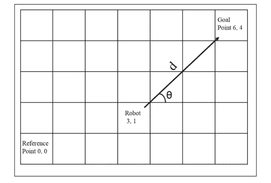

现在你有了目标角度和距离，你可以编程让你的机器人移动。为此，你需要编写一个程序来进行路径规划并调用本章前面创建的移动函数。你需要知道你的机器人在一定时间内会行驶的距离，这样你就可以用时间单位而不是距离单位来告诉机器人行驶多远。

你还需要能够转换你的机器人在运行电机时每个时间单位可能行驶的距离。如果你知道角度和距离，你就可以通过转动机器人然后向前运行一段时间来使机器人朝向目标移动。

以下是你需要遵循的步骤：

- 1. 计算你的机器人到达目标所需行驶的距离单位。将此距离转换为实现该距离所需的时间单位数量。
- 2. 计算你的机器人需要行驶以到达目标的角度。你需要使用指南针和机器人的转向功能来转向并实现该角度。
- 3. 现在，调用步进函数指定的次数以使机器人在正确的距离上移动。

就这样。现在你可以使用一些非常简单的 Python 代码来执行这些步骤，使用移动机器人向前和转动的函数。在这种情况下，有意义的是创建一个名为 robotLib.py 的文件，其中包含所有执行实际舵机设置以使轮式机器人前进和转动机器人的函数。然后你使用 from robotLib import * 语句导入这些函数，以便你的 Python 程序可以调用这些函数。这使得路径规划 Python 程序更小、更易于管理。

有关如何从一个 Python 文件导入函数到另一个 Python 文件的更多信息，请参阅 http://www.tutorialspoint.com/python/python_modules.htm。

以下是该程序的屏幕截图：

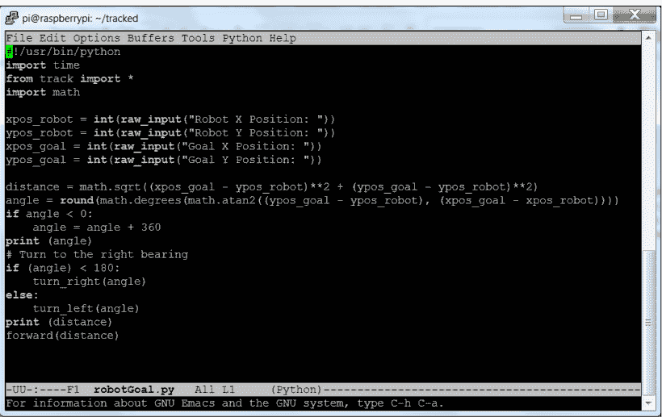

## Building and Controlling a Simple Wheeled Robot

在这个程序中，用户确定目标位置，机器人通过读取角度来决定到所需位置的最短方向。为了简化，机器人位于网格中，朝向 0 度的方向。如果目标角度小于 180 度，机器人将向右转。如果大于 180 度，机器人将向左转。机器人转动直到期望角度和测量角度在几度之内。然后，机器人采取到达目标所需的步数。作为额外的挑战，你可以添加一个循环来测量实际角度，并在达到目标角度时停止它。

## Summary

本章为你提供了一个机会来为你的 Raspberry Pi Zero 创建一个移动平台。你可以添加超声波传感器或来自 *Chapter 3, Accessing the GPIO Pins on Raspberry Pi Zero* 的指南针，以赋予它更多功能。在下一章中，你将学习如何构建一个带有腿的 Raspberry Pi Zero 平台机器人，这是一个更灵活的移动平台。
