# 第5章 构建一个会走路的机器人

## Building a Robot That Can Walk

现在你已经熟悉了使用履带或轮子导航的机器人，让我们构建一个可以行走的机器人。行走机器人很有趣，因为它们可以在轮式或履带式车辆无法通行的地形上导航。它们还提供高级功能，机器人可以用腿来做行走以外的用途。

在本章中，你将构建基础的四足平台。为此你将学习：

- 伺服电机的工作原理
- 如何使用 Raspberry Pi 通过伺服控制器控制大量伺服电机
- 从简单的伺服命令创建复杂运动

### Robots that can walk

在本章中，你将构建四足机器人。你将使用 12 个伺服电机，以便每条腿有三个可以移动的点，或三个自由度（DOF）。在这个项目中，你将同时控制 12 个伺服电机；因此，使用一个可以为所有 12 个伺服电机提供控制信号和供电电压的外部伺服控制器是有意义的。由于伺服电机是本项目的主要部件，因此也许有用的是通过教程了解伺服电机并学习如何控制它们。

## How servo motors work

伺服电机与直流电机相似；然而，有一个重要的区别。虽然直流电机通常设计为以给定的速度连续旋转 360 度的方式移动，但伺服电机通常设计为在有限的一组角度内移动。换句话说，在直流电机世界中，你通常希望你的电机以你控制的连续旋转速度旋转。在伺服电机世界中，你希望你的电机移动到你控制的特定位置。这是通过在伺服电机的控制连接器上发送脉冲宽度调制（PWM）信号来完成的。PWM 只是意味着你将改变每个电脉冲的持续时间以控制某物。在这种情况下，该脉冲的长度将控制伺服电机的角度，如图所示：

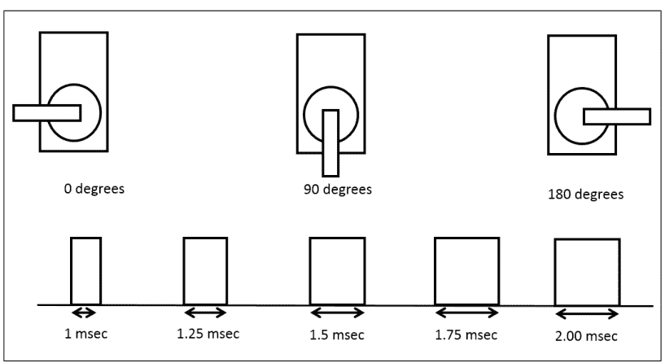

这些脉冲以 60 Hz 的重复频率发送。你可以通过设置正确的控制脉冲将伺服电机定位在任何角度。

## Building the quadruped platform

你首先需要一些零件，才能构建你的四足机器人。有几个套件可能性，包括在 http://www.trossenrobotics.com/p/PhantomX-AX-12-Quadruped.aspx。然而，这样的套件可能很昂贵；因此，对于这个示例，你将使用一套 Lynxmotion 零件创建自己的套件。这些零件可在多个在线零售商处获得，例如 http://www.robotshop.com/。要构建这个四足机器人，你需要两套两种腿部零件，然后每种身体一套。以下是零件及其 Robotshop 零件编号：

| Quantity | Description |
|---|---|
| 1 | Lynxmotion Symmetric Quadrapod Body Kit - Mini QBK-02 |
| 2 | Lynxmotion 3" Aluminum Femur Pair |
| 2 | Lynxmotion Robot Leg "A" Pair (No Servo) RL-01 |
| 4 | Lynxmotion Aluminum Multipurpose Servo Bracket Two Pack ASB-04 |
| 2 | Ball Bearing with Flange - 3mm ID (pair) Product Code: RB-Lyn-317 |

最后一个零件不是 Lynxmotion 零件，而是你需要将腿连接到身体的轴承。

你还需要 12 个标准尺寸的伺服电机。有几个可能的选择，但我个人喜欢 Hitec 伺服电机。它们是非常便宜的伺服电机，你可以在大多数爱好商店和在线电子零售商处购买。现在是时候了解一些关于选择伺服电机型号的细节了。伺服电机有不同的型号编号，主要基于它们能产生的扭矩量。

**扭矩** 是伺服电机可以施加以移动与其连接的部件的力。在这种情况下，你的伺服电机需要抬起和移动与四足机器人相关的重量，因此你需要一个扭矩足够的伺服电机。在这种情况下，我建议你使用八个型号 HS-485HB 伺服电机。你将使用它们用于连接到腿末端的伺服电机和身体。然后你将使用四个型号 HS-645MG 伺服电机用于腿部中间；这是需要最高扭矩的伺服电机。你也可以只使用十二个 HS-645MG 伺服电机，但它们比 HS-485 贵，所以使用两种不同的伺服电机会更便宜。

以下是组装四足机器人的步骤：

- 1. 将右腿的下部组装起来；它应该看起来像以下图像：

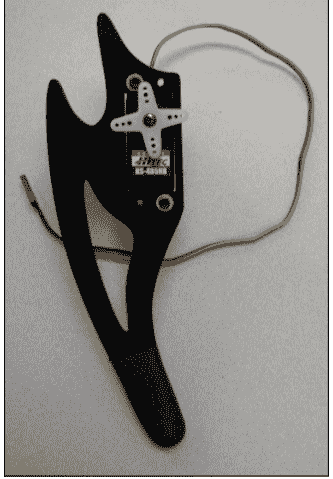

- 2. 现在将此组件连接到一个互连件，如图所示：

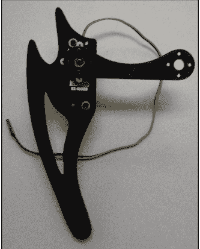


3. 通过将两个舵机支架以直角连接起来完成腿部，将 HS-645MG 安装到其中一个支架上，然后将此舵机连接到连接件，如图所示：

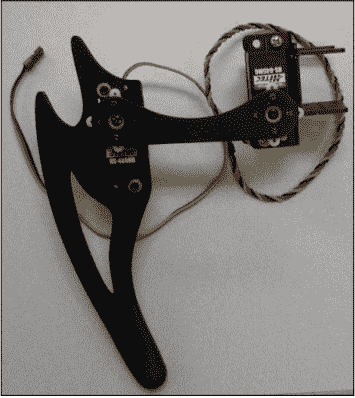

4. 组装另一条右腿。

5. 现在按照前面的步骤组装两条左腿，但采用左腿配置。它们看起来类似于以下图像：

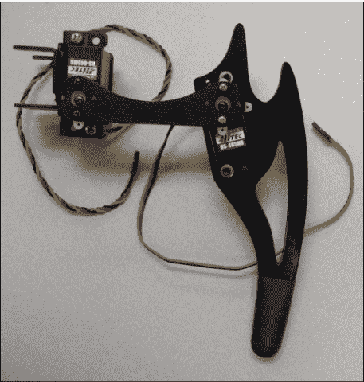

- 6. 下一步是构建身体套件。你可以在 http://www.lynxmotion.com/images/html/sq3u-assembly.htm 上找到说明。
- 7. 现在将每条腿连接到身体套件。以下是身体套件的图片：
- 8. 现在，如图所示将舵机连接到空的舵机支架和机身上：

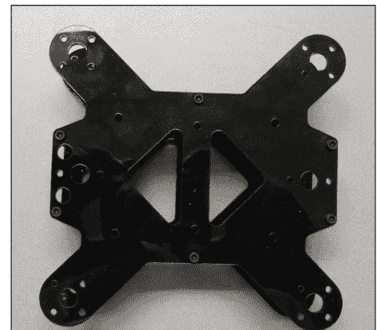

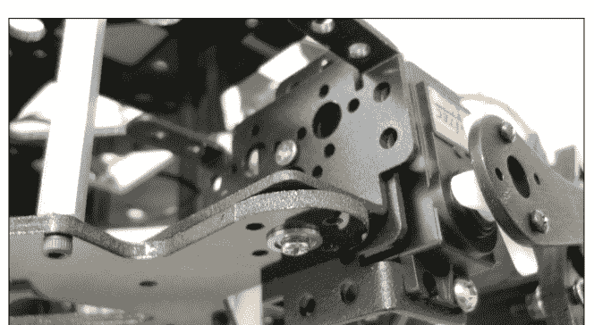

你的四足机器人现在应该类似于以下图像：

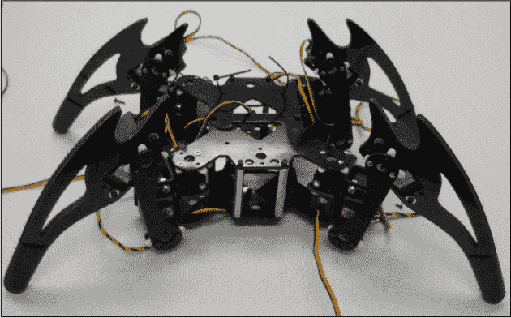

现在你已经组装了基本硬件，可以将注意力转向电子设备。

## 使用舵机控制器控制舵机

要让你的四足机器人行走，首先需要将舵机马达控制器连接到舵机。你将为此项目使用的舵机控制器是一款来自 Pololu 的简单 USB 舵机马达控制器：Pololu 产品编号 1354，可在 https://www.pololu.com/ 购买，可控制 18 个舵机。以下是该单元的图像：

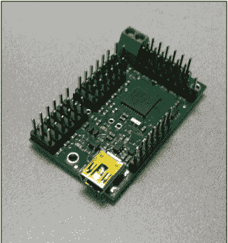

确保你订购的是组装版本。这块硬件会将来自 Raspberry Pi Zero 的 USB 命令转换为控制你的舵机马达的信号。Pololu 制造了多种不同版本的控制器；每个版本可控制一定数量的舵机。在这种情况下，你可能希望选择 18 舵机版本，这样你就可以用一个控制器控制全部 12 个舵机，还可以额外增加一个舵机来控制摄像机或传感器的方向；你也可以选择 12 舵机版本。18 舵机控制器的一个优点是通过螺丝型连接器轻松为单元供电。

要开始使用，你需要对舵机控制器进行两个连接：第一个连接到舵机马达，第二个连接到电池。

首先，将舵机连接到控制器。为了保持一致，让我们使用以下配置将你的 12 个舵机连接到控制器上标记为 0 到 11 的连接处：

| 舵机连接器 | 舵机 |
|---|---|
| 0 | 右前下腿 |
| 1 | 右前中腿 |
| 2 | 右前上腿 |
| 3 | 右后下腿 |
| 4 | 右后中腿 |
| 5 | 右后上腿 |
| 6 | 左前下腿 |
| 7 | 左前中腿 |
| 8 | 左前上腿 |
| 9 | 左后下腿 |
| 10 | 左后中腿 |
| 11 | 左后上腿 |

以下是控制器的背面图像；这将告诉我们舵机的连接位置：

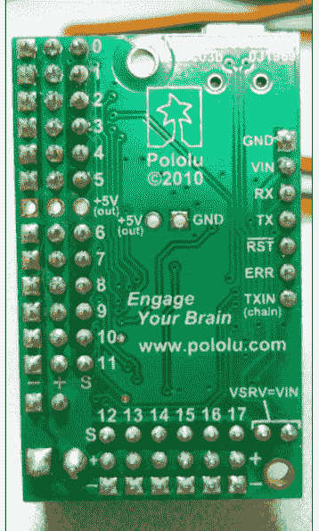

现在你需要将舵机马达控制器连接到电池。对于此项目，你可以使用 2S RC LiPo 电池。2S 表示电池有两节电芯，输出电压为 7.2 伏。它将提供你的舵机所需的电压和电流，约为 2 安培，如下图所示：

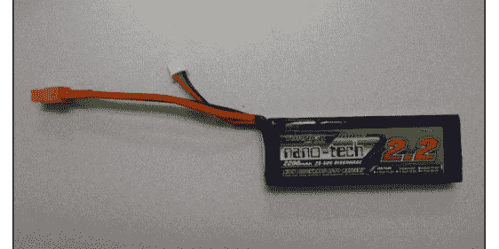

此电池将附带两个连接器，一个带有较大线规的电线用于正常使用，以及一个较小的连接器用于连接到电池充电器。你需要制作可连接到舵机控制器螺丝型连接器的连接器。我购买了一些 XT60 连接器对，并将一些电线焊接到电池的配套连接器上，然后将其拧入舵机控制器。

你的系统现在可以使用了。现在你将把马达控制器连接到个人电脑以检查是否可以与其通信。为此，将迷你 USB 电缆连接到舵机控制器和个人电脑。我将以 PC 为例进行说明，但你也可以使用 Mac 或 Linux 来完成此步骤。你可以在 https://www.pololu.com/docs/0J40 上找到详细信息。

## 在舵机控制器和 PC 之间通信

现在硬件已连接，你可以使用 Pololu 提供的一些软件来控制舵机。让我们使用个人电脑来完成。首先，从 www.pololu.com/docs/0J40/3.a 下载 Pololu 软件并根据网站上的说明进行安装。安装完成后，运行软件，你应该能看到此屏幕：

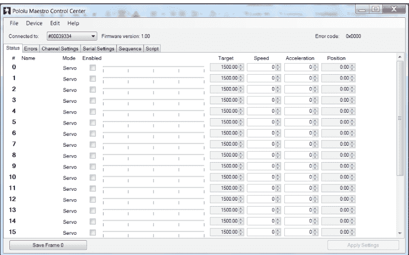

你首先需要更改 **Serial Settings** 中的配置，因此选择 **Serial Settings** 选项卡，你应该会看到以下内容：

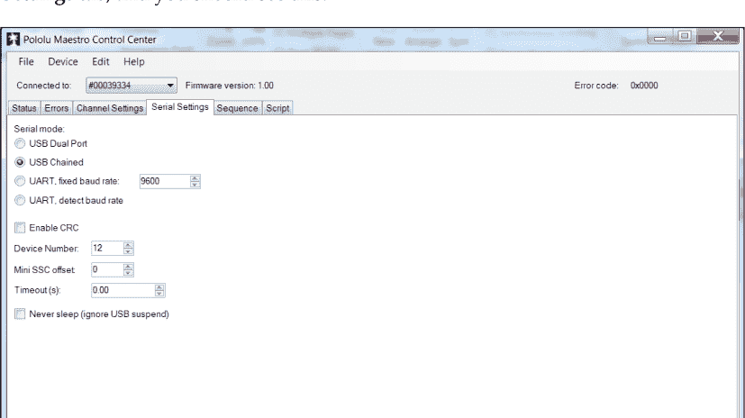

## 构建可行走的机器人

确保已选择 **USB Chained**；这将允许你通过 USB 连接和控制马达控制器。现在通过选择 **Status** 选项卡返回主屏幕；现在你可以实际打开 12 个舵机。屏幕应如下所示：

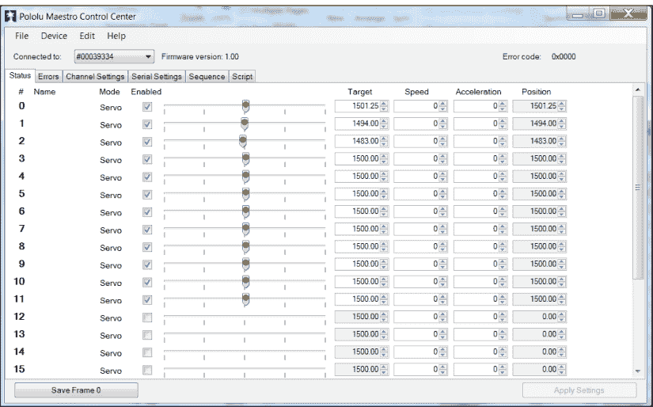

## 将舵机控制器连接到 Raspberry Pi Zero

你已检查了舵机马达控制器和舵机；现在你将把马达控制器连接到 Raspberry Pi Zero 并确保可以从其控制舵机。拔下 PC 上的 USB 电缆并将其连接到 Raspberry Pi Zero。整个系统应类似于以下图像：

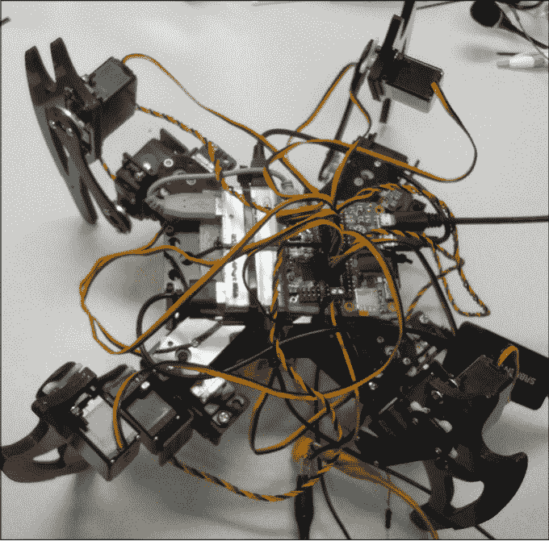

Raspberry Pi Zero 在中间，马达控制器在右侧，带电的集线器在左侧。下面的鳄鱼夹连接到电源；最终你希望将它们连接到电池。

让我们通过从 Pololu 下载 Linux 代码 www.pololu.com/docs/0J40/3.b 来与马达控制器通信：

- 1. 也许最好的方法是登录到你的 Raspberry Pi Zero 通过 PuTTY，然后输入 wget http://www.pololu.com/file/download/maestro-linux-100507.tar.gz?file_id=0J315。
- 2. 然后，使用 mv maestro-linux-100507.tar.gz?file_id=0J315 maestro-linux-100507.tar.gz 移动文件。
- 3. 通过输入 tar -xzfv maestro-linux-100507.tar.gz 解压文件。
- 4. 这将创建一个名为 maestro_linux 的目录。输入 cd maestro_linux 进入该目录，然后输入 ls -l；你应该会看到类似以下内容：

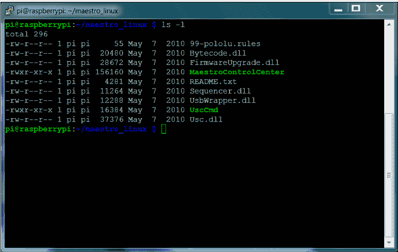

文档 README.txt 将为你提供有关如何安装软件的明确说明。这基本上分为两个步骤：

- 1. 首先，通过输入 sudo apt-get install libusb-1.0-0-dev mono-runtime libmono-winforms2.0-cil 安装一组支持库。
- 2. 然后，通过输入 sudo cp 99-pololu.rules /etc/udev/rules.d/ 复制配置文件。

不幸的是，你无法在 Raspberry Pi Zero 上运行 Maestro Control Center，因为你的 Windows 版本不支持图形，但你可以使用 UscCmd 命令行应用程序来控制舵机，以确保它们已连接并且工作正常。

首先，输入 ./UscCmd --list 你应该会看到以下内容：

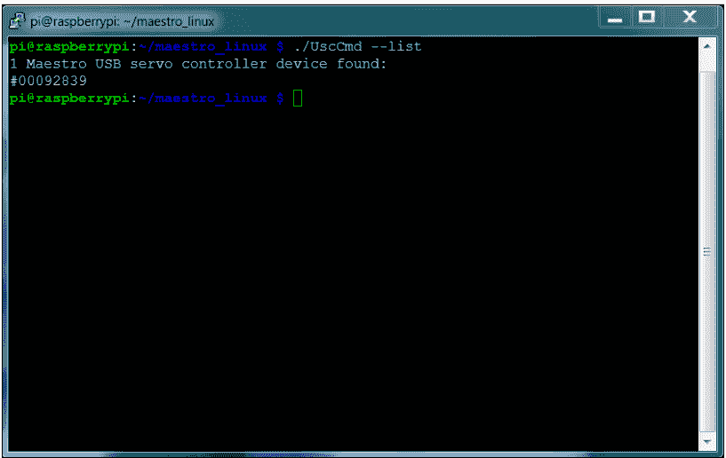

该单元检测到我们的舵机控制器。如果你只输入 ./UscCmd，你可以看到可以发送到控制器的所有命令：

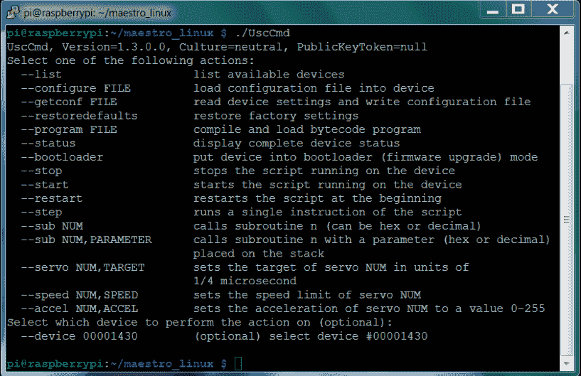

请注意，你可以向舵机发送特定的目标角度，但目标不是角度值，因此很难知道你将舵机发送到何处。

尝试输入 ./UscCmd --servo 0, 10。舵机将移动到其最大角度位置。

输入 ./UscCmd - servo 0, 0 它将停止舵机尝试移动。

在下一节中，你将编写一些 Python 代码，将你的角度转换为舵机控制器希望将其移动到特定角度位置的命令。

> 如果你没有运行 Windows 版本的 Maestro Controller 并将 Serial Settings 设置为 USB Chained，你的马达控制器可能不会响应。重新运行 Maestro Controller 代码并将 Serial Settings 设置为 USB Chained。


## 在 Linux 中创建程序来控制你的四足机器人

你现在知道如何与舵机控制器通信并移动舵机了。在本节中，你将创建一个 Python 程序，让你可以通过它来控制舵机移动到特定角度。

让我们从一个简单的程序开始，让你的腿式移动机器人的舵机都移动到 90 度（这应该接近 0 到 180 度可设置范围的中间位置）。要访问串口，你需要确保已安装 Python 串口库。如果没有，请输入 sudo apt-get install python-serial。安装串口库后，你可以通过输入 sudo python quad.py 来运行程序。

这个特定的控制器使用两个字节的信息，因此 setAngle 函数中的代码会将通道和角度的输入转换为控制器可以理解的数字。有关更具体的信息，请参阅 http://www.pololu.com/docs/0J40。以下是代码：

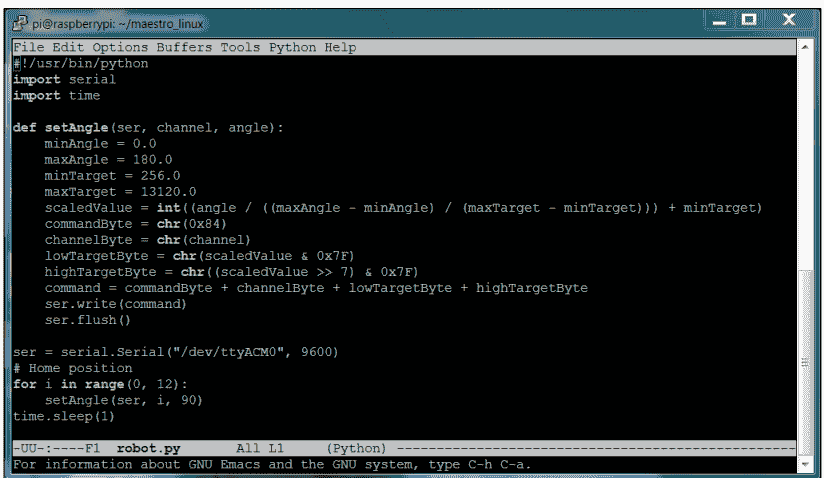

以下是代码的解释：

- #!/usr/bin/python: 这一行允许你从命令行执行此 Python 文件。
- `import serial`: 这一行导入了 `serial` 库。你需要 `serial` 库才能通过 USB 与你的设备通信。
- `def setAngle(ser, channel, angle)`: 此函数将你对舵机和角度的期望设置转换为舵机电机控制器所需的串行命令。
- `ser = serial.Serial("/dev/ttyACM0", 9600)`: 这会打开与舵机控制器的串口连接。
- `for i in range(0, 12)`: 这个 `for` 循环将访问每个舵机。
- `setAngle(ser, i, 90)`: 现在，你可以将每个舵机设置为中间（初始）位置。默认情况下，每个舵机都设置为 90 度。如果你的腿不在中间位置，你可以通过调整每个舵机上舵机臂的位置来调整它们。

设置好基本的初始位置后，你现在可以让你的机器人执行操作了。让我们先让你的四足机器人挥手。以下是 Python 代码：

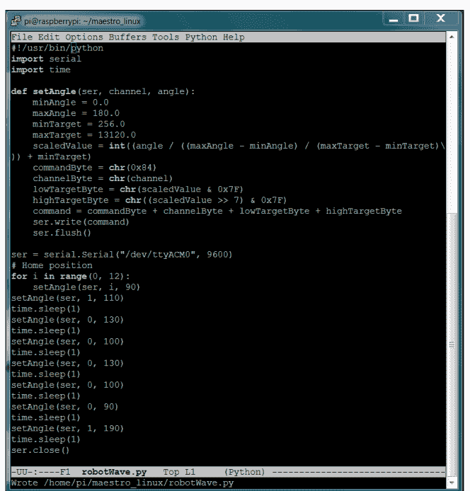

在这种情况下，你使用 setAngle 命令来设置舵机以操纵机器人前右臂。中间的舵机抬起手臂，然后下方的舵机在 100 度角和 130 度角之间来回移动。

你希望机器人执行的最基本动作之一就是向前行走。以下是如何操纵腿部来实现这一点的示例：

```
ser = serial.Serial("/dev/ttyACM0", 9600)
# Home position
for i in range(0, 12):
    setAngle(ser, i, 90)

setAngle(ser, 4, 110)
time.sleep(1)
setAngle(ser, 5, 100)
time.sleep(1)
setAngle(ser, 4, 90)
time.sleep(1)

setAngle(ser, 7, 70)
time.sleep(1)
setAngle(ser, 8, 80)
time.sleep(1)
setAngle(ser, 7, 90)
time.sleep(1)

setAngle(ser, 1, 110)
time.sleep(1)
setAngle(ser, 2, 100)
time.sleep(1)
setAngle(ser, 1, 90)
time.sleep(1)

setAngle(ser, 10, 70)
time.sleep(1)
setAngle(ser, 11, 80)
time.sleep(1)
setAngle(ser, 10, 90)
time.sleep(1)

for i in range(0, 12):
    setAngle(ser, i, 90)

ser.close()
```

该程序一次抬起并向前移动每条腿，然后将所有腿移动到初始位置，从而使机器人向前移动。不是最优雅的，但它确实有效。有更复杂的四足机器人行走算法；请参阅 http://letsmakerobots.com/node/35354 和 https://www.youtube.com/watch?v=jWP3RnYa_tw。一旦程序运行正常，你需要将所有硬件打包到移动机器人上。

你可以让你的机器人执行许多令人惊叹的事情，例如向前行走、向后行走、跳舞和转圈；各种动作都是可能的。最好的学习方法是尝试舵机的不同位置。

## 总结

你现在已经拥有了一台可以行走的机器人！你还可以添加其他传感器，例如你在轮式机器人上发现的传感器，可以监视障碍物的传感器，或其他了解你移动方向的传感器。

在下一章中，你将开始一个新的机器人项目。你将把 Raspberry Pi Zero 与一个玩具机器人结合起来，并构建一个能够说话并响应语音命令的项目。
