# 第6章 语音控制机器人
添加语音识别和语音 – 一个语音激活的机器人

你已经开始了一些相当基础的项目，但你可以通过修改带 Raspberry Pi Zero 的机器人玩具来进一步发挥所学概念。有一种玩具非常适合你的项目，那就是 WowWee 的一系列机器人玩具。你可以从公司网站 http://wowwee.com/ 购买这些玩具，但你也可以在 eBay 上以明显更低的价格找到这些玩具的二手版本。

在本章中，你将学习以下内容：

- 如何拆开玩具并为你的项目提供控制信号
- 如何发送和接收语音命令来控制机器人
- 如何解释命令并启动操作

有几种玩具具有很高的可能性。其中一个玩具是 **WowWee Roboraptor**。以下图片显示了这款机器人：

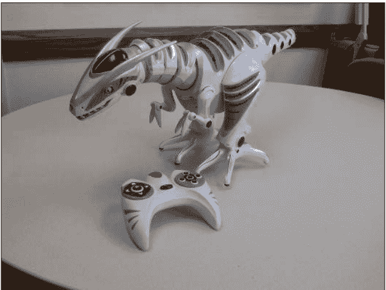

另一个选择是 **WowWee Robosapien**。以下是这款机器人的图片：

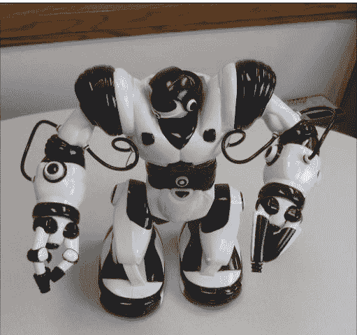

我们将使用这款机器人进行项目，因为它功能更多且更容易修改。

## Raspberry Pi Zero 与机器人之间的通信

你将连接到内部串行总线，以便你而不是遥控器发送命令。你将添加一个 Arduino 来处理 Raspberry Pi Zero 与机器人之间的实时通信。以下是步骤：

- 1. 首先，你需要拆开机器人以获得主控制器板的访问权限。为此，将机器人面朝下放置，以便你能够接触到背面。拆下背面的板子，拧下固定它的四个螺丝。现在，在暴露的板子上方，你应该能看到主连接器。以下图像是连接器的特写照片：

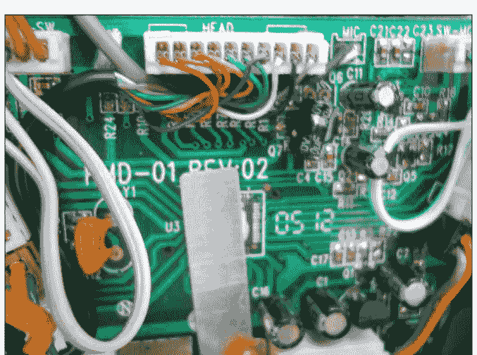

你只对其中两根线感兴趣。第一根是黑色线，它是 Robosapien 系统的 GND。第二根是白色线。这是控制 Robosapien 命令的串行连接。

你可能希望添加一些热缩管来覆盖你的连接。

- 4. 最后，在机器人的后壳上钻一个孔，以便你可以将这两根电缆从单元中引出，如下图所示：

- 5. 这张图片还显示了外壳两侧的另外两个孔，你可以使用它们与扎带一起将 Raspberry Pi 固定到机器人上。现在你可以将外壳重新装回机器人上。

- 6. 现在，你需要将这两根线连接到 Arduino。有几种 Arduino 版本可以使用，但最常见的是 Arduino Uno。如果你使用具有不同定时器的不同 Arduino，Arduino 代码中的延迟常量可能需要调整。你需要使用 Arduino 的原因是发送给机器人的位模式以相当高的速率发送，需要由专门用于这种实时通信的处理器创建。这允许 Raspberry Pi Zero 执行其他处理器密集型活动，例如语音，同时保持通信以正确的速率进行。

有关如何使用 Arduino 系列处理器的开发环境的具体信息，请访问 https://www.arduino.cc。有关如何使用 Raspberry Pi 创建和上传程序到 Arduino 的信息，请参阅 http://www.instructables.com/id/Arduino-On-Pi/ 或 https://www.youtube.com/watch?v=wCxQrW96jTM。

- 7. 将 GND 线连接到 Arduino 上的其中一个 GND 引脚。然后，将另一根线连接到 Arduino 的第 9 引脚。这些连接应类似于以下图片：

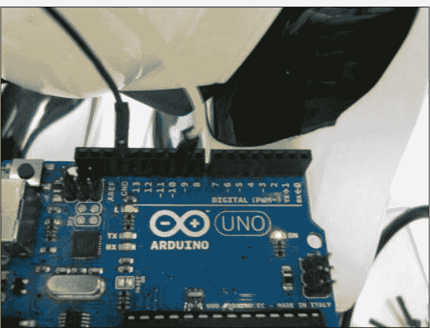

- 8. 最后一步是获取代码以向 Arduino 板发送正确的命令。本书的代码可在 PacktPub 代码下载部分或 http://playground.arduino.cc/Main/RoboSapienIR 获取。此 Arduino 代码接收来自串行监视器的输入，在本例中是来自 Raspberry Pi Zero 的 USB 连接，并将其转换为 WowWee 机器人的适当命令。一旦你将代码上传到 Arduino，无论是通过外部 PC 还是 Raspberry Pi Zero，你都可以使用 Arduino IDE 的串行监视器功能发送单个字母命令，机器人应响应这些命令。

> 如果你不熟悉 Arduino IDE 应用程序，Arduino 在 https://www.arduino.cc/ 上有完善的文档，其中包括如何上传代码以及使用串行监视器与 Arduino 通信的说明。

现在机器人可以工作了，你可以添加以下 Python 程序来发送命令：

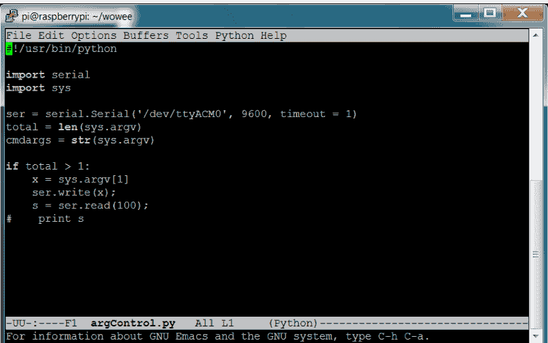

要运行此程序，输入 python argControl.py f，机器人将响应该命令。要在不使用 Python 命令的情况下使此程序可执行，输入 chmod +x argControl.py，然后你就可以通过输入 ./argControl.py f 来运行程序。当你以后想从语音控制程序运行此程序时，你需要这样做。

## 让你的机器人接受语音命令

现在你的机器人知道如何响应来自 Python 程序的命令，你可以让你的机器人能够响应语音命令。你还可以让你的机器人说话，这将使机器人更具交互性。

## 添加语音识别和语音合成 – 一个语音激活的机器人

要为你的机器人添加这些功能，你需要添加一些新的硬件。本项目需要一个 USB 麦克风和扬声器适配器。你需要以下三件硬件：

- 一个 USB 设备以便插入麦克风和扬声器；一个效果很好的设备是 Sabrent USB 外置立体声音频适配器，适用于 Windows 和 Mac，如下所示：

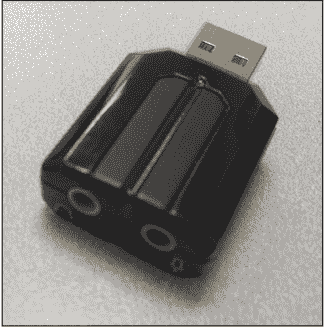

- 一个可以插入 USB 设备的麦克风；任何此类设备都可能有效，如下图所示：

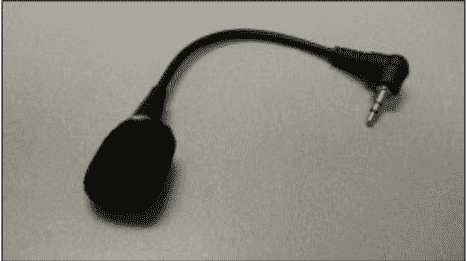

- 一个可以插入 USB 设备的带电扬声器；任何可以插入你的 USB 适配器的设备都可以使用，例如与下图所示类似的东西：

幸运的是，这些设备价格低廉且随处可买。确保扬声器是带电的，因为你的板通常无法为无源扬声器提供足够的应用功率。扬声器可以使用内置电池供电，也可以从 USB 连接获取电力。

现在，我们继续让 Raspberry Pi Zero 访问这些设备。你可以通过以下两种方式中的任一种来遵循这些说明：

- 如果你仍连接到显示器、键盘和鼠标，请登录系统并通过打开终端窗口使用 GUI
- 如果你仅通过 LAN 连接，你可以通过使用 SSH 终端窗口来完成所有操作；一旦你的板指示已通电，请使用 PuTTY 或任何类似的终端模拟器打开 SSH 终端窗口

将设备插入 USB 端口。一旦终端窗口出现，输入 `cat /proc/asound/cards`。你将得到以下响应：

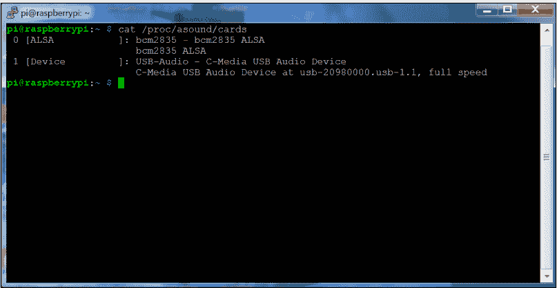

你可以使用两种可能的音频设备。第一个是内部 Raspberry Pi 音频，它连接到音频端口，第二个是 USB 音频插件。你可以使用 USB 音频插件来录制声音并使用 Raspberry Pi 进行音频输出来播放声音，但使用 USB 音频插件来创建和录制声音会更容易。

首先，你需要播放一些音乐来测试 USB 音频设备是否正常工作。你需要配置系统以搜索你的 USB 音频插件并将其用作播放和录制声音的默认插件。为此，你需要向系统添加几个库。第一个库是 **Advanced Linux Sound Architecture (ALSA)** 库。如果执行以下步骤，这些库将启用 Raspberry Pi 上的声音：

- 1. 通过输入 `sudo apt-get install alsa-base alsa-utils` 安装与 ALSA 关联的两个库。
- 2. 然后，通过输入 `sudo apt-get install libasound2-dev` 安装有助于提供声音库的那些文件。

3. C-Media USB Audio Device 是我的 USB 音频设备。你现在应该可以看到一个与以下屏幕截图类似的屏幕：

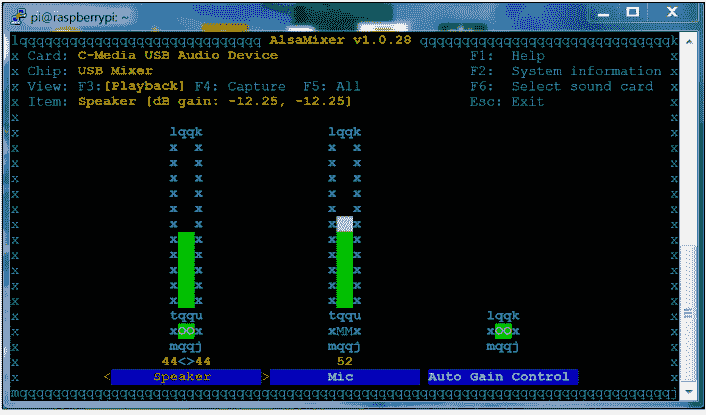

4. 你可以使用箭头键为扬声器和麦克风设置音量。使用 M 键取消静音麦克风。在前面的屏幕截图中，MM 表示静音，oo 表示取消静音。

5. 让我们确保我们的系统知道我们的 USB 音频设备。在命令提示符下，输入 `aplay -l`。你现在应该可以看到以下屏幕截图：

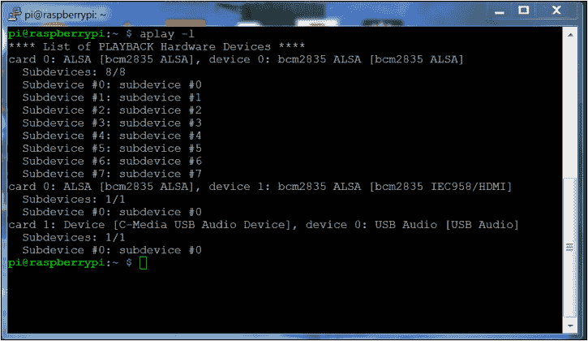

如果这不起作用，请尝试 `sudo aplay -l`。你需要在主目录中添加一个名为 `.asoundrc` 的文件。系统会读取它并用于设置默认配置。为此，请执行以下步骤：

- 1. 使用你选择的编辑器打开名为 `.asoundrc` 的文件。
- 2. 输入 `pcm.!default sysdefault:Set`。`Set` 是 `aplay -l` 命令输出中 `card 1:` 后面出现的变量。
- 3. 保存文件。文件应如下所示：

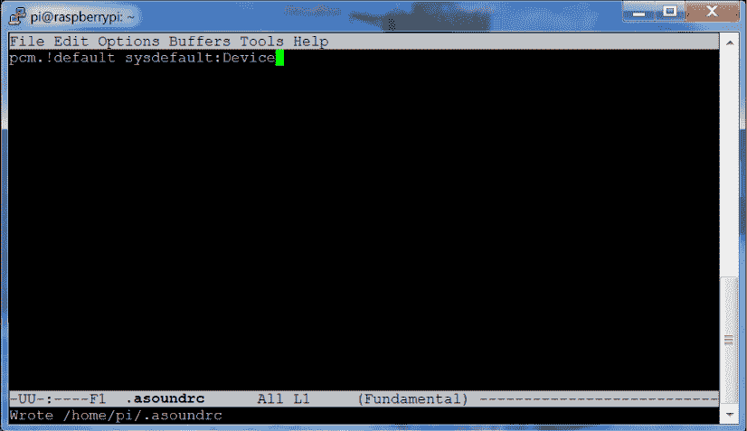

这将告诉系统使用你的 USB 设备作为默认设备。重新启动系统。

## 添加语音识别和语音合成 – 一个语音激活的机器人

现在，你可以播放一些音乐。为此，你需要一个音频文件和一个播放设备。你可以将一个简单的 .wav 文件复制到你的 Raspberry Pi Zero。如果你的主机是 Linux 机器，你也可以从命令行使用 scp 命令传输文件。你可以通过使用网络浏览器将音乐下载到 Raspberry Pi Zero，如果你已连接键盘、鼠标和显示器。你使用名为 **aplay** 的应用程序来播放声音。输入 `aplay Dance.wav` 来查看你是否可以使用 aplay 音乐播放器播放音乐。你将看到结果（并且希望能听到它），如下图所示：

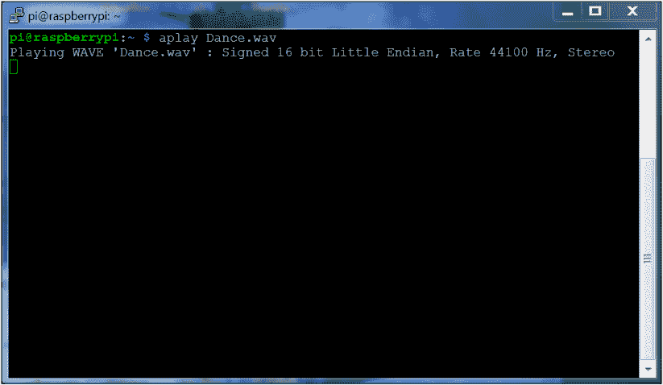

如果你听不到任何音乐，请检查 alsamixer 上的音量级别和扬声器电源线；aplay 对于它接受的文件类型有点挑剔，因此你可能需要尝试不同的 .wav 文件直到 aplay 接受一个。还有一件事可以尝试，如果系统似乎不知道该程序，请输入 `sudo aplay Dance.wav`。

现在你能播放声音，你也可以录制声音。为此，你必须使用 **arecord** 程序。在提示符下，输入 `arecord -d 5 -r 48000 test.wav`。这以 48000 Hz 的采样率录制 5 秒的声音。一旦你输入了命令，请对着麦克风说话或发出其他可识别的声音。你将在终端中看到以下输出：

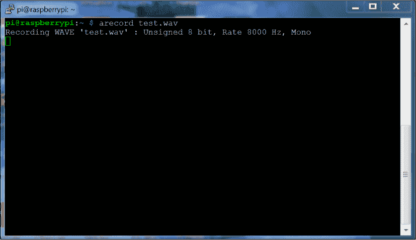

录制完一些音频后，按 *Ctrl + C* 停止录制。创建文件后，使用 aplay 播放它。输入 `aplay test.wav`，你应该能够听到录音。如果你听不到录音，请检查 alsamixer 以确保你的扬声器和麦克风都未静音。

现在你可以使用 Raspberry Pi 播放音乐或其他声音文件。你可以更改扬声器的音量并在系统上录制你的声音或其他声音。你现在已准备好进行下一步。

## 使用 eSpeak 让你的机器人用可听见的声音做出响应

声音是我们机器人工具包中的重要工具，但你希望做的不只是播放音乐。让我们让我们的机器人说话。你将首先启用 **eSpeak**，这是一个开源应用程序，为我们提供计算机化语音。它是一个语音生成应用程序。要获得此免费功能，请在提示符下输入 `sudo apt-get install espeak` 下载 eSpeak 库。下载可能需要一段时间，但完成后提示符将重新出现。现在，让我们看看 Raspberry Pi Zero 是否有声音。输入 `espeak hello` 命令。扬声器应该以计算机生成的声音发出“hello”。如果没有，请检查扬声器和音量级别。

现在我们已经有了计算机生成的语音，你可能想要对其进行自定义。eSpeak 提供了完整的自定义功能，包括大量语言、语音和其他选项。要访问这些功能，你可以在命令行提示符下输入选项。例如，输入 `espeak -v +f3 hello`，你应该能够听到女声。你甚至可以通过输入 `espeak -v en-sc +f3 hello` 来添加苏格兰口音。

使用 eSpeak 时可供选择的语音有很多。这取决于你自己的偏好，但你可能喜欢带有英式口音的女声。随意尝试并选择你最喜欢的语音。然后，编辑默认文件将其设置为该语音。此默认文件位于 eSpeak 的主目录中。但是，不要指望能得到电影中电脑那种声音；那些是演员而不是电脑。然而，有一天，我们希望能够达到电脑听起来更像真人的阶段。

## 使用 pocketsphinx 来接受你的语音命令

现在你的机器人可以说话了，你也希望它能服从语音命令。本节将向你展示如何为你的机器人项目添加语音识别。这并不像说话部分那么简单，但幸运的是，你得到了开源开发社区的很大帮助。你将下载一套名为 **pocketsphinx** 的功能，它将允许我们的项目收听我们的命令。

第一步是下载 pocketsphinx 软件。不幸的是，这并没有 eSpeak 过程那么用户友好，所以请仔细按照以下步骤操作。有两种方法可以做到这一点。如果你连接了键盘、鼠标和显示器，或想通过 vncserver 连接，你可以通过图形方式执行以下步骤：

- 1. 前往由 **卡内基梅隆大学 (CMU)** 主办的 Sphinx 网站 `http://cmusphinx.sourceforge.net`。这是一个开源项目，可为你提供语音识别软件。在我们较小的嵌入式系统上，我们将使用此代码的 pocketsphinx 版本。

- 2. 你需要下载两个软件——**sphinxbase** 和 pocketsphinx。在页面顶部选择 **DOWNLOAD** 选项，然后找到这两个软件包的最新版本。下载软件包的 `.tar.gz` 版本并将它们移动到你的树莓派的 `/home/pi` 目录。

另一种方法是直接从树莓派的命令行提示符使用 **wget**。如果你想这样做，请执行以下步骤：

- 1. 要在你的主机上使用 wget，请找到你想要下载的文件的链接。在本例中，前往由 CMU 主办的 Sphinx 网站 `http://cmusphinx.sourceforge.net`。这是一个开源项目，可为你提供语音识别软件。在你的较小的嵌入式系统上，你将使用 pocketsphinx 版本的此代码。

- 2. 你需要下载两个软件，即 sphinxbase 和 pocketsphinx。在页面顶部选择 **DOWNLOAD** 选项，然后找到这两个软件包的最新版本。右键单击 `sphinxbase-0.8.tar.gz` 文件（只要 0.8 是最新版本）并选择 **Copy link location**。现在在你的树莓派中打开一个 PuTTY 窗口，登录后，输入 `wget` 并粘贴你刚刚复制的链接。这将下载 sphinxbase 的 `.tar.gz` 版本。现在，对 pocketsphinx 的最新版本重复相同的操作。

在构建这些软件之前，你需要另一个库。该库称为 **Bison**。这是一个通用开源解析器，被 pocketsphinx 使用。要获取此软件包，输入 `sudo apt-get install bison`。

一旦所有内容都下载完毕并且库已安装，你就可以解压并构建 pocketsphinx。要解包并构建 sphinxbase 模块，输入 sudo tar -xzvf sphinxbase-0.y.tar.gz，其中 y 是版本号，在本例中为 8。这应该会将归档中的所有文件解压到名为 sphinxbase-0.8 的目录中。现在，输入 cd sphinxbase-0.8。文件列表应如下所示：

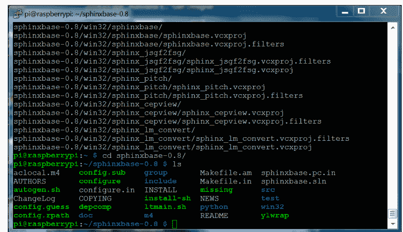

要构建应用程序，首先发出 sudo ./configure --enable-fixed 命令。此命令检查系统是否一切正常，然后配置构建。

现在你准备好构建 sphinxbase 代码库了。这是一个两步过程，具体如下：

- 1. 输入 sudo make，系统将构建所有可执行文件。
- 2. 输入 sudo make install 将所有可执行文件安装到系统上。

现在，你需要制作系统的第二部分——pocketsphinx 代码。进入主目录并通过输入 `tar -xzvf pocketsphinx-0.8.tar.gz` 解压缩和解归档代码。现在，文件将被解归档，你可以构建代码。安装这些文件是一个三步过程，具体如下：

- 1. 输入 `cd pocketsphinx-0.8` 进入 pocketsphinx 目录，然后输入 `sudo ./configure` 检查你是否准备好构建文件。
- 2. 输入 `sudo make` 并等待所有内容构建完成。
- 3. 输入 `sudo make install`。

> 如果你打算使用 Python 作为编程语言使用 pocketsphinx 功能，我们库安装的其他添加项稍后会很有用。你可以使用 `sudo apt-get install python-dev` 安装 **Python-Dev**。同样，你可以使用 `sudo apt-get install cython` 获取 **Cython**。你也可以选择安装 `pkg-config`，这是一个在处理复杂编译时有时有帮助的实用程序。使用 `sudo apt-get install pkg-config` 安装它。

安装完成后，你需要让系统知道你的文件在哪里。为此，使用你喜欢的编辑器更改 `/etc/ld.so.conf` 文件，通过向文件中添加一行使其如下所示：

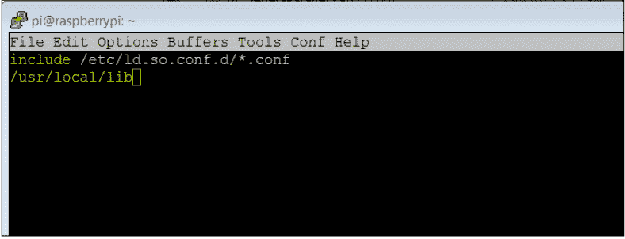

## 添加语音识别和语音 – 一个语音激活的机器人

输入 `sudo /sbin/ldconfig`，系统将意识到你的 pocketsphinx 库。现在一切都已安装，你可以尝试语音识别。重新启动系统并输入 `cd /home/pi/pocketsphinx-0.8/src/programs` 进入尝试演示程序的目录。然后，输入 `./pocketsphinx_continuous`。由于某种原因，我必须输入 `sudo ./pocketsphinx_continuous`，让它失败，然后再输入 `./pocketsphinx_continuous` 才能使其工作。此程序从麦克风获取输入并将其转换为语音。运行命令后，你会得到大量无关信息，然后你会看到以下截图：

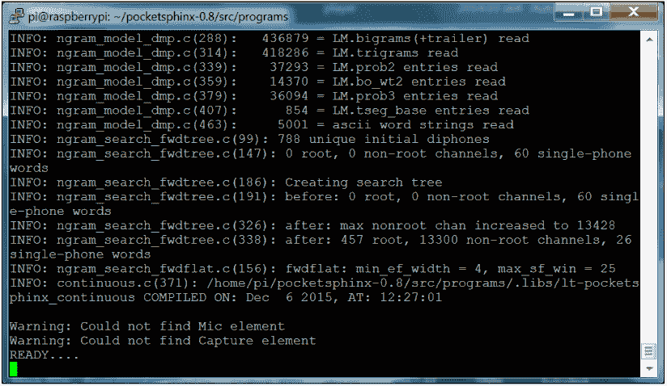

INFO 和 Warning 语句来自 C 或 C++ 代码，用于调试目的。最初，它们会警告你找不到你的 Mic 和 Capture 元素，但当你的树莓派找到它们时，它会打印出 `READY.....`。如果你按照前面所述设置好一切，你就可以给你的树莓派一个命令了。对着麦克风说“hello”。当它检测到你停止说话时，它会处理你的语音，并在给出大量无关信息后，最终显示命令，如下图所示：

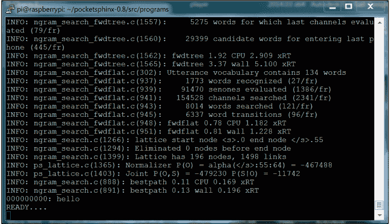

注意 `00000000: hello` 命令。它识别了你的语音！你也可以尝试其他单词和短语。系统非常敏感，因此可能会拾取背景噪音。你也会发现它并不十分准确。我们稍后会处理这个问题。要停止程序，请按 **Ctrl + C**。

使语音识别更准确有两种方法。一种是训练系统更准确地理解你的声音。这相当复杂，但如果你想了解更多，请访问本章前面提到的 CMU pocketsphinx 网站。

提高准确性的第二种方法是限制系统用于确定你在说什么的单词数量。默认情况下有数千个单词可能性，因此如果两个单词发音相似，pocketsphinx 可能会选择错误的单词。为了避免这种情况，你可以制作自己的词典来限制 pocketsphinx 可供选择的单词。要创建自己的词典，请按照 `http://cmusphinx.sourceforge.net/wiki/tutorialdict` 上的说明进行操作。

你的系统现在可以理解你的语音命令了！在本章下一节中，你将学习如何使用此输入来创建响应。

## 解释命令并启动动作

现在系统既能听也能说，你需要为机器人提供响应你的语音并根据语音输入执行命令的能力。接下来，你将配置系统以响应简单命令。

为了做出响应，我们将编辑 /home/pi/src/programs 目录中的 continuous.c 代码。我们可以创建自己的 C 文件，但该文件已在 make 系统中设置好，是一个极佳的起点。你可以保存当前文件的副本为 continuous.c.old，这样如果需要时可以随时返回到起始程序。然后，你需要编辑 continuous.c 文件。它很长而且有点复杂。然而，你正在代码中寻找特定部分，如下图所示。查找 /* Exit if the first word spoken was GOODBYE */ 注释行：

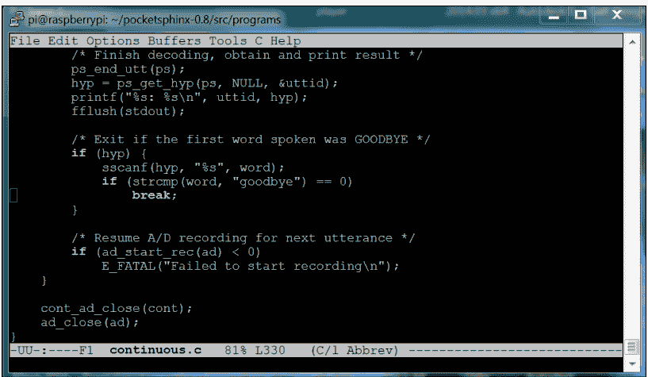

在此代码段中，单词已经解码并保存在 hyp 变量中。你可以在此处添加代码，以便根据我们解码的单词所关联的值让系统执行操作。首先，让我们尝试添加对 hello 和 goodbye 命令的响应能力，看看是否能让程序对这些命令做出响应。你需要按以下方式修改代码：

- 1. 找到 /* Exit if the first word spoken was GOODBYE */ 注释
- 2. 在语句 if (strcmp(word, "goodbye") == 0) 中，将 word 改为 hyp 并将 goodbye
- 3. 在 break; 语句周围插入括号，并在 break; 语句之前添加 system("espeak \"good bye\\\""); 语句
- 4. 通过键入 else if (strcmp(hyp, "hello") == 0) 在子句中添加其他 else if 语句。在 else if 语句后添加括号，并在括号内键入 system("espeak \"hello\\\"");

文件现在应如下所示：

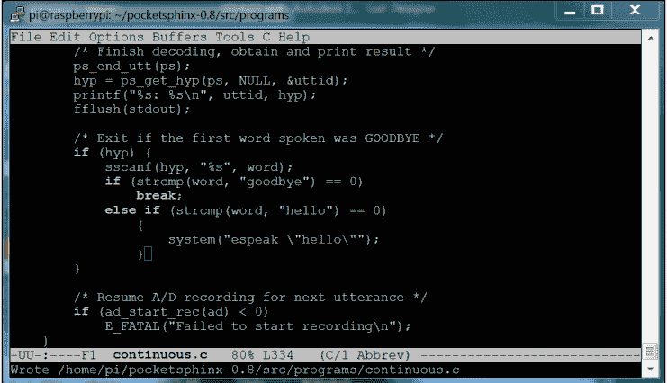

## 添加语音识别和语音 – 一个语音激活的机器人

现在你需要重新构建代码。由于 make 系统已经知道如何构建 pocketsphinx_continuous 程序，如果你在任何时候更改了 continuous.c 文件，它将重新构建应用程序。只需键入 sudo make，文件就会编译并创建 pocketsphinx_continuous 的新版本。要运行新版本，键入 ./pocketsphinx_continuous。请确保在开头键入 ./。同样，我不得不键入 sudo ./pocketsphinx_continuous，让它失败，然后键入 ./pocketsphinx_continuous 才能使其工作。

如果一切设置正确，说出“hello”应会得到树莓派的“hello”响应。说出“goodbye”应会引发“goodbye”的响应并关闭程序。请注意，system 命令可用于运行任何从命令行运行的程序。现在你可以使用此程序根据命令启动和运行其他程序。在这种情况下，你需要更改所示的代码以调用你的 Python 代码来向机器人发出命令，如下图所示：

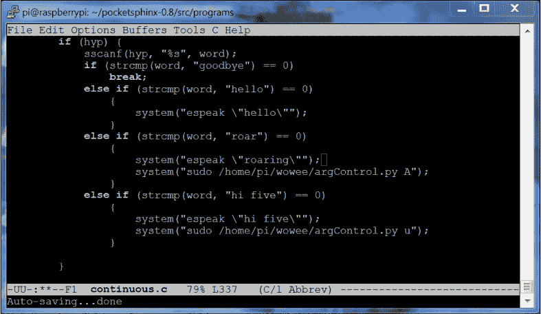

在这种情况下，你只连接了机器人可以响应的众多命令中的两个；你可以通过使用相同的技术将剩余的命令添加到 continuous.c 文件中。现在，你可以给机器人下语音命令，它就会服从！使用本章前面部分的说明，你还可以使用单字符命令远程控制机器人并添加网络摄像头。你拥有自己的机器人仆人！

## 摘要

在本章中，你学习了使用树莓派黑客入侵玩具机器人的基础知识。请随意尝试；你可以看到你能用新玩具玩各种游戏。在下一章中，你将学习如何构建一辆遥控车，可以进入房间并将所见内容显示回中央位置。
