# 第7章 为 RC 车辆添加 Raspberry Pi Zero
### 为 RC 车辆添加 Raspberry Pi Zero

你现在已经构建了可以滚动、行走并响应语音命令的机器人。在本章中，你将修改一辆 RC 汽车以添加 Raspberry Pi Zero 来控制车辆。此外，你将添加一个网络摄像头，以便你能够远程看到汽车所看到的内容。

在本章中，你将学习以下主题：

- 如何使用 Raspberry Pi Zero 修改 Xmods RC 汽车
- 如何进入汽车的控制电路并使用 Raspberry Pi 控制它
- 如何使用无线通信为汽车添加遥控功能
- 如何添加网络摄像头以便你可以通过 **第一人称视角 (FPV)** 控制汽车

## 使用 Raspberry Pi Zero 配置和控制 RC 汽车

在这个项目中，你将使用一辆简单的 RC 汽车，与此处所示的汽车类似：

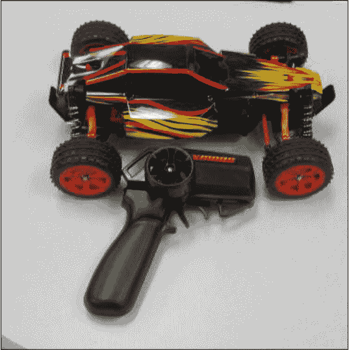

这辆特定的汽车是 Xmods 汽车，最初由 Radio Shack 出售。然而，现在最好的购买地点是 eBay。这套特定的优势在于，驱动系统和转向的输入非常容易访问。

下图显示了汽车中心控制机构暴露的情况：

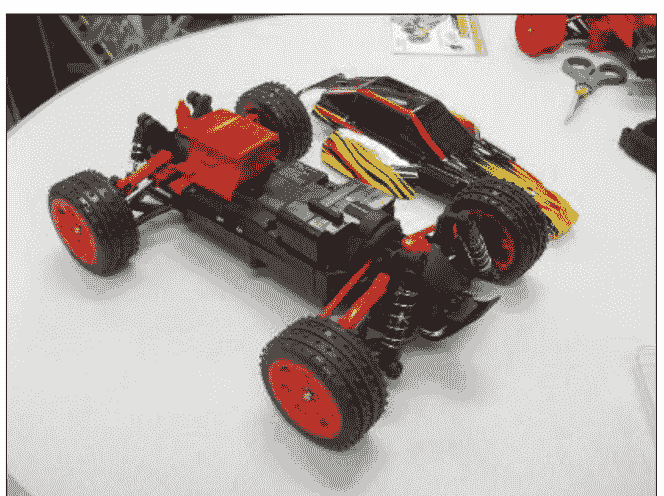

有两处连接你需要直接访问。第一个是驱动电机，第二个是转向机构。对于这种特定型号的 RC 汽车，驱动机构位于后部。你通常要寻找的是两根线，它们可以直接驱动汽车的直流电机。在此系统中，汽车后部有一个连接器；它看起来与以下图像相似：

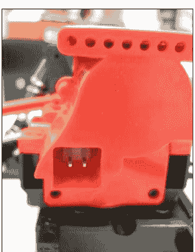

在汽车的主控制部分，你可以看到有一个连接器插入这两根线，以便控制汽车的速度，如下所示：

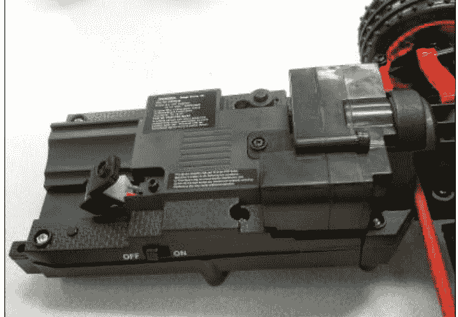

拔下此插头和这些电线；你将使用 Raspberry Pi Zero 和电机控制器为汽车的驱动系统提供电压。电机将根据施加到这些电线的电压快慢运行，而电压的极性将决定方向。Raspberry Pi Zero 需要提供正负 6 伏信号来控制汽车的速度和方向。

你还需要替换通往汽车前部用于转向的控制信号。这有点困难。以下是通往汽车前部的连接器：

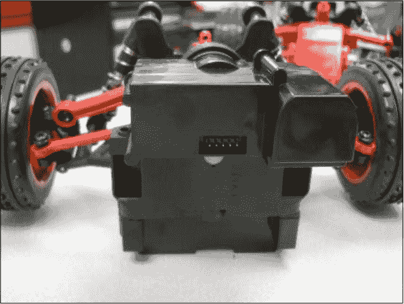

来自控制模块的五针连接器如下图所示：

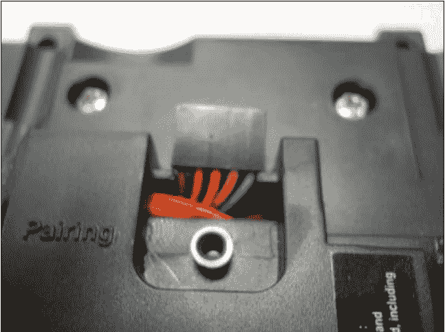

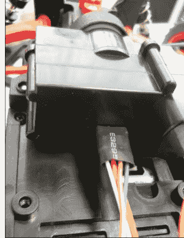

你还需要访问汽车后轮舱以驱动两个后轮。以下是访问方式的外观：

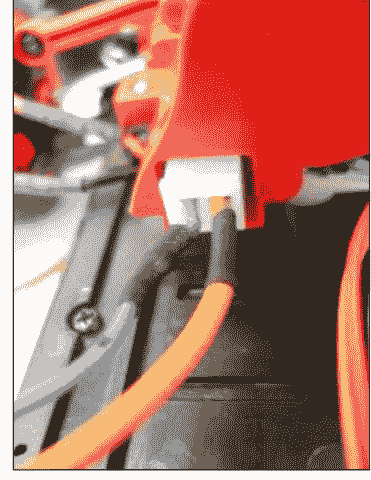

## 为 RC 车辆添加 Raspberry Pi Zero

你还需要将电池电源连接到 Raspberry Pi Zero。以下是从汽车获取电池电源的修改连接：

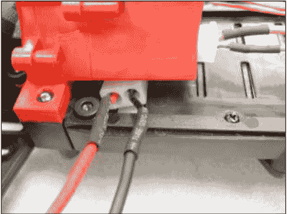

要控制汽车，你需要提供每个控制信号。+ 或 - 6 伏信号不能直接由 Raspberry Pi Zero 提供。你需要某种电机控制器来为汽车的后轮驱动和转向机构提供信号。提供这些信号的最简单方法是使用电机盾，这是一块额外的硬件，安装在 Raspberry Pi Zero 之上，可以提供电压和电流来为这两个机构供电。第 4 章《构建和控制简单轮式机器人》中使用的 RaspiRobot Board V2 可以提供这些信号，如下图所示：

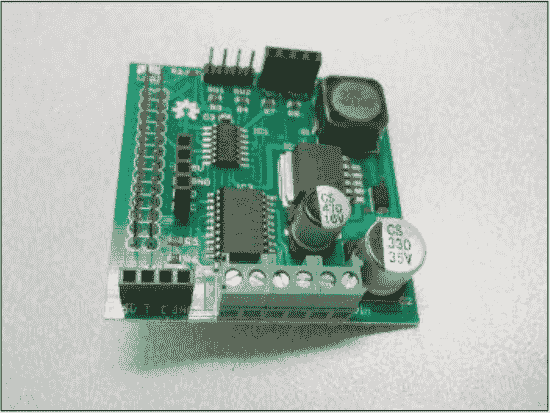


> 有关该板的详细信息可在以下网址找到：
> http://www.monkmakes.com/?page_id=698.

该板将为你提供遥控车的两个关键信号：驱动信号和转向信号。你还需要一个额外的信号，即启用转向控制的PWM信号。以下是将Raspberry Pi连接到该板的步骤：

- 1. 首先，将电池电源连接器连接到板上的电源连接器，如下图所示：

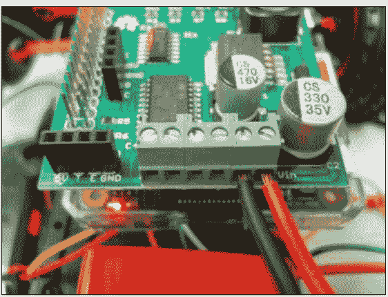

## 将Raspberry Pi Zero添加到遥控车

- 2. 接下来，将后轮驱动信号连接到板上的电机1连接器，如下图所示：

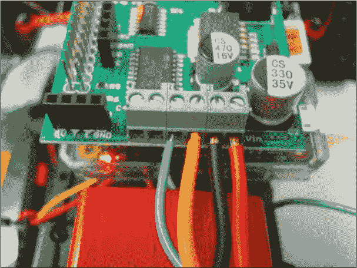

- 3. 将前轮驱动连接器连接到板上的电机2连接器，如下图所示：

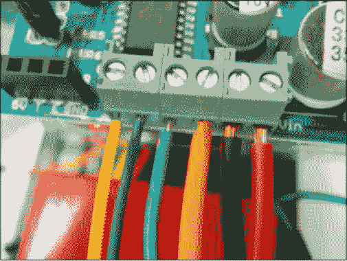

4. 将3.3伏和GND连接器连接到Raspberry Pi的通用输入/输出（GPIO）引脚。下面是这些引脚的布局：

| Pin 1 3.3V | Pin 2 5V |
|---|---|
| Pin 3 GPIO2 | Pin 4 5V |
| Pin 5 GPIO3 | Pin 6 GND |
| Pin 7 GPIO4 | Pin 8 GPIO14 |
| Pin 9 GND | Pin 10 GPIO15 |
| Pin 11 GPIO17 | Pin 12 GPIO18 |
| Pin 13 GPIO27 | Pin 14 GND |
| Pin 15 GPIO22 | Pin 16 GPIO23 |
| Pin 17 3.3V | Pin 18 GPIO24 |
| Pin 19 GPIO10 | Pin 20 GND |
| Pin 21 GPIO9 | Pin 22 GPIO25 |
| Pin 23 GPIO11 | Pin 24 GPIO8 |
| Pin 25 GND | Pin 26 GPIO7 |
| Pin 27 ID_SD | Pin 28 ID_SC |
| Pin 29 GPIO5 | Pin 30 GND |
| Pin 31 GPIO6 | Pin 32 GPIO12 |
| Pin 33 GPIO13 | Pin 34 GND |
| Pin 35 GPIO19 | Pin 36 GPIO16 |
| Pin 37 GPIO26 | Pin 38 GPIO20 |
| Pin 39 GND | Pin 40 GPIO21 |

5. 你将使用Pin1 3.3V作为3.3伏信号，使用Pin 9 GND作为接地信号。你将连接其中一个GPIO引脚，以便创建320Hz、10%占空比的信号来启用转向。连接GPIO引脚18，即物理引脚12，如下图所示：

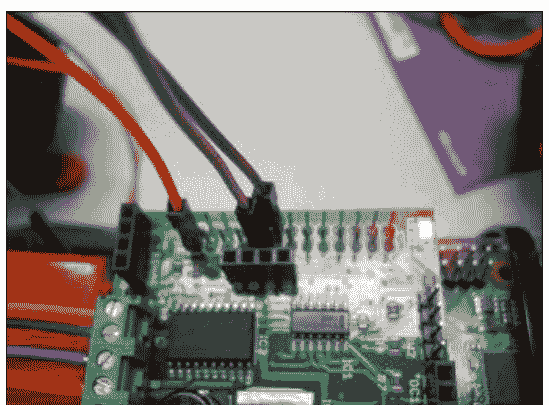

现在硬件已经连接好了。

## 用Python控制遥控车

硬件已准备好，现在你可以从Raspberry Pi Zero访问所有这些功能。首先，安装与控制板相关的库，该库位于 `http://www.monkmakes.com/?page_id=698`，然后执行以下步骤：

- 1. 运行命令 `wget https://github.com/simonmonk/raspirobotboard2/raw/master/python/dist/rrb2-1.1.tar.gz`。这将获取该库。
- 2. 然后，运行 `tar -xzf rrb2-1.1.tar.gz`。这将解压文件。
- 3. 输入 `cd rrb2-1.1`。这将把目录切换到文件所在位置。
- 4. 输入 `sudo python setup.py install`。这将安装文件。

现在你将创建一些Python代码，以便能够同时访问驱动电机和转向电机。代码将类似于以下截图：

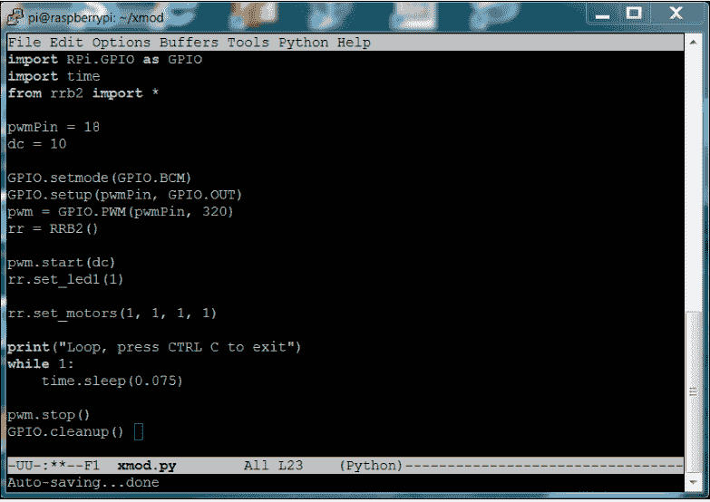

代码的具体说明如下：

- - `import RPi.GPIO as GPIO`：这将导入RPi.GPIO库，允许你向前轮转向机构发送PWM信号。
- - `import time`：这将导入time库，允许你使用time.sleep(number_of_milliseconds)，它会产生一个固定的延迟。
- - `from rrb2 import *`：这将导入rrb2库，允许你控制两个直流电机。rrb2就是你刚从GitHub下载的库。
- - `pwmPin = 18`：这将把PWM引脚设置为GPIO引脚18，也就是Raspberry Pi上的物理引脚12。
- - `dc = 10`：这将把PWM信号的占空比设置为10%。
- - `GPIO.setmode(GPIO.BCM)`：这会将RPi.GPIO库中的定义模式设置为BCM模式，允许你指定PWM信号的GPIO编号。
- - `GPIO.setup(pwmPin, GPIO.OUT)`：这将把PWM引脚设置为输出，以便你可以驱动转向部分的控制电路。
- - `pwm = GPIO.PWM(pwmPin, 320)`：这将在正确的引脚上初始化PWM信号，并将PWM信号设置为320Hz。
- - `rr = RRB2()`：这将创建一个电机控制器实例。
- - `pwm.start(dc)`：这将启动PWM信号。
- - `rr.set_led1(1)`：这将点亮电机控制板上的LED 1。
- - `rr.set_motors(1, 1, 1, 1)`：这将使两个电机转动，从而让车辆向前行驶。此命令允许你将电机设置为正转或反转，并以特定速度运行。第一个数字是电机1的速度，范围从0到1。第二个数字是电机1的方向，1表示前进，0表示后退。第三个数字是电机2的速度，同样从0到1，第四个数字是电机2的后退和前进设置，值为1或0。
- - `print("Loop, press CTRL C to exit")`：这将提示用户如何停止程序。
- - `while 1:`：这将一直循环，直到按下Ctrl + C。
- - `time.sleep(0.075)`：使程序等待0.075秒。
- - `pwm.stop()`：这将停止PWM信号。
- - `GPIO.cleanup()`：这将清理GPIO驱动，并为关闭做准备。

## 将Raspberry Pi Zero添加到遥控车

现在你可以输入 `sudo python xmod.py` 来运行程序。运行时，控制板上的LED 1应该点亮，后轮应该向前移动，转向也会转动。这确认你已正确连接所有部件。为了让这个更有趣，你可以通过添加一些控制代码来对电机进行更动态的控制。以下是Python代码的第一部分：

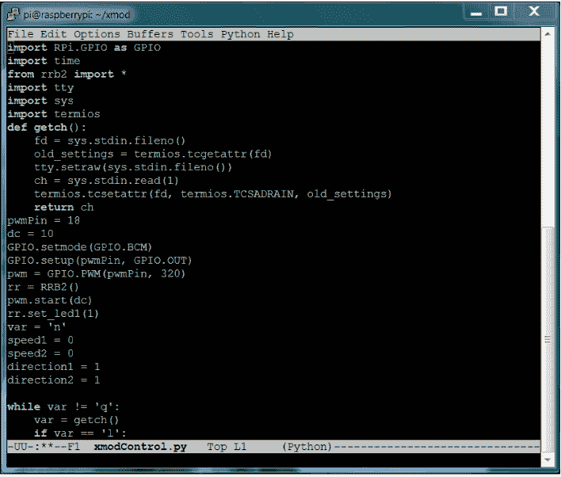

在开始之前，你可能希望将Python代码复制到一个新文件中；你可以把它命名为 `xmodControl.py`。在这段代码中，你会有一些额外的 `import` 语句；这些语句允许你在不按回车键的情况下感知键盘按键，这会让实时界面显得更具实时性。`getch()` 函数用于感知实际的按键。

这段代码的其余部分看起来与之前的程序类似。现在，这段代码的第二部分如下：

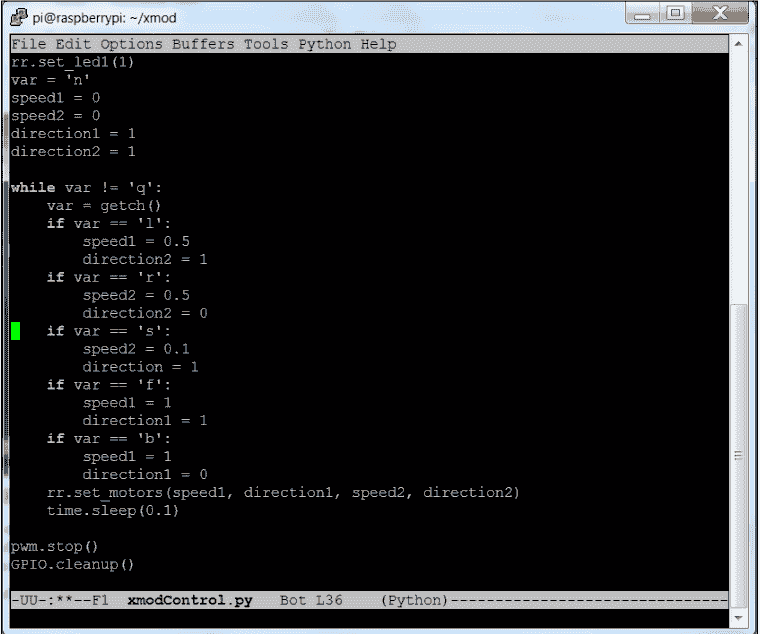

代码的第二部分是一个while循环，它接收输入并将其转换为遥控车的命令，包括前进、后退、左转和右转。这个程序非常简单；你几乎肯定想要添加更多命令，以提供更多控制速度和方向的方法。

## 远程访问遥控车

你现在可以控制你的遥控车了，但你肯定希望在不连接任何线缆的情况下进行控制。本节将展示如何添加无线局域网设备，以便远程控制你的车。在*第1章，Raspberry Pi Zero入门*中，你学习了如何从主机访问Raspberry Pi Zero。然而，要实现这一点，你需要将Raspberry Pi Zero连接到网络，无论是通过LAN线缆还是无线网络。如果你想在没有网络的地方驾驶你的车，但仍能连接它，该怎么办？你可以通过将Raspberry Pi Zero设置为无线接入点来实现。

## 将Raspberry Pi Zero添加到遥控车

将Raspberry Pi Zero设置为WLAN接入点取决于你选择的USB WLAN适配器；有关受支持的一些设备以及如何配置它们，请参阅 `http://elinux.org/RPI-Wireless-Hotspot`。我选择了Edimax USB WLAN适配器，如下图所示：

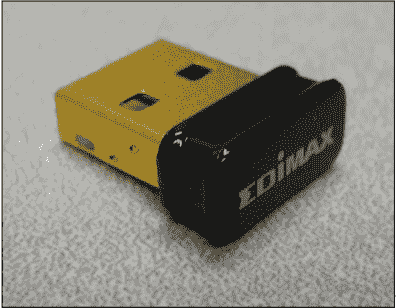

这个设备可以使用位于 `http://blog.sip2serve.com/post/4889983167/rtl8188-access-point-install-script` 的脚本进行配置。步骤如下：

- 1. 输入 `wget https://dl.dropboxusercontent.com/u/1663660/scripts/install-rtl8188cus.sh`。这将获取脚本内容。
- 2. 输入 `sudo chown root:root install-rtl8188cus.sh`。这将更改所有者，以便你安装脚本。
- 3. 输入 `sudo chmod 755 install-rtl8188cus.sh`。这将更改脚本的可执行权限，以便你执行它。
- 4. 最后，输入 `sudo ./install-rtl8188cus.sh` 来运行脚本。这将运行脚本并配置设备。系统会要求你提供要用于接入点的名称和密码。


## 连接网络摄像头

现在，你可以将计算机、平板电脑或手机连接到无线接入点。使用像 PuTTY 这样的终端仿真程序，你可以使用 SSH 协议按照第 1 章《入门 Raspberry Pi Zero》中所述访问你的设备。然后你可以执行你的 vncserver 并在远程设备上运行 vncviewer 程序。

现在你准备好观察连接到汽车的 USB 网络摄像头的输出了。这非常简单；只需插入一个 USB 网络摄像头并下载一个视频查看器即可。其中一个效果很好的视频查看器是 guvcview。要安装它，输入

```
sudo apt-get install guvcview.
```

安装好所有这些工具后，你现在可以运行 vncview。当你在 Raspberry Pi Zero 的图形屏幕上查看时，输入 guvcview -r 2，你将能够看到网络摄像头的视频。你可以通过运行之前编写的 xmodControl.py 程序来远程控制你的 RC 汽车。屏幕看起来会与以下截图类似：

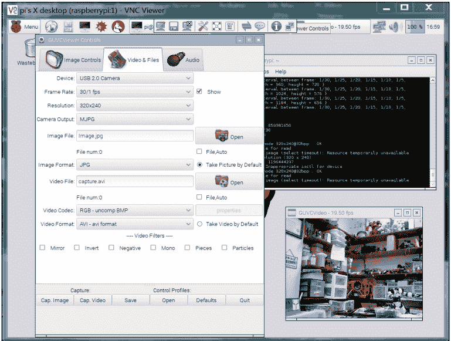

你会注意到，随着分辨率的降低，更新率会提高；这与图像的大小有关。你可以对你的 Raspberry Pi 控制的汽车进行很多改进，例如添加摇杆控制或更多自主性。但是，让我们继续下一个项目。

## 总结

现在你知道如何使用 Raspberry Pi 为现有硬件添加其功能，在本例中是 RC 汽车。在下一章中，你将学习如何使用 Raspberry Pi Zero 构建一个可以玩石头、剪刀、布的机器人。
