# 第8章 机械手
使用 Raspberry Pi Zero 玩石头、剪刀、布

你现在已经使用 Raspberry Pi Zero 构建了多个项目。现在，你将把其中一些功能添加到一个新项目中，例如使用 USB 网络摄像头和一个名为 OpenCV 的开源库来“看到”并判断你周围发生了什么。在本项目中，你将控制一个机械手来玩经典的决策游戏；石头、剪刀、布。

在本章中，你将构建一个基本的机械手，然后用它来玩石头、剪刀、布。在本章中，你将学习：

- 如何使用 Raspberry Pi Zero 控制将控制机械手的舵机
- 如何向项目添加 USB 网络摄像头以“看到”你周围的世界
- 如何使用 OpenCV，一个开源图像处理库，来判断人类对手是否出示石头、剪刀或布

## 一个机械手

在本章中，你将构建一个具有四根手指、一根拇指和一个可旋转手腕的人类手。实际上，有几种可能的机械手配置可供购买或自行制作。如果你想购买一个已经 3D 打印好的手，我个人最喜欢的是由 Christopher Chappelle 和 Easton LaChappelle 设计的手，已经在 http://www.shapeways.com/product/Z5CZ2RKLY/3d-printed-hand-right?li=search-results-1&optionId=42512474 上 3D 打印好了。以下是手的图像：

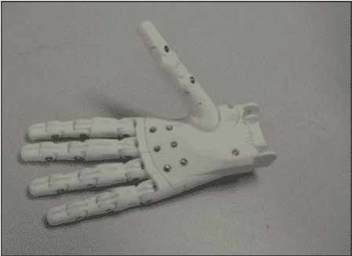

如果你有 3D 打印机，也可以下载并自行打印手。以下是链接：https://www.thingiverse.com/thing:288856。组装好手后，你需要添加舵机来控制手和手腕。要控制手，你需要拉动从手伸出的五根独立的钓鱼线。以下是这些钓鱼线的图像：

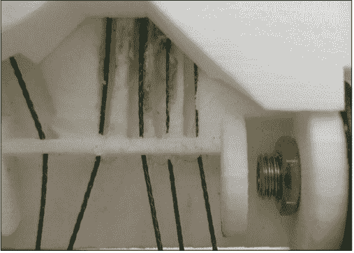

手通常是完全张开的。当你拉动线时，手的每个手指都会闭合。当你松开线时，每个关节背面的橡皮筋会迫使手指和拇指重新张开。你将使用舵机来控制手指和拇指。对于本项目，你只需要三种状态：完全闭合的手（石头）、手腕向侧面时完全张开的手（布），以及拇指、环指和小指闭合而食指和中指完全张开（剪刀）。

以下是如何将钓鱼线连接到舵机的图像：

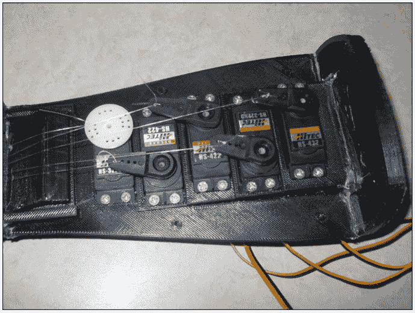

将每个手指连接到一个舵机，然后将整个手连接到一个支架；这将作为手腕。你还将把它连接到一个可以转动手腕的舵机。

## 移动机械手

为了移动舵机，你将使用一个类似于第 5 章《构建一个可以行走的机器人》中介绍的舵机控制器来控制六个舵机，这些舵机将控制手指、拇指和手腕。如第 5 章《构建一个可以行走的机器人》中所述，你将为本项目使用的舵机控制器是 Pololu 使用 USB 的简单舵机电机控制器。但是，由于你只需要控制五个舵机，你可以订购可在 https://www.pololu.com 上获得的六舵机控制器版本。以下是该单元的图像：

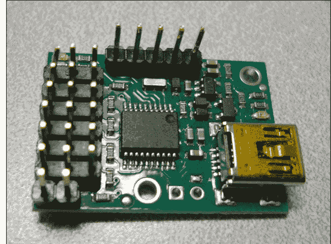

确保你订购的是组装版本。这块硬件会将来自 Raspberry Pi Zero 的 USB 命令转换为控制舵机电机的信号。你需要对舵机控制器进行两个连接才能开始：第一个连接到舵机电机，第二个连接到电源。

首先，将舵机连接到控制器。为了保持一致，让我们将六个舵机连接到控制器上标记为 0 到 5 的连接处，使用以下配置：

| 舵机连接器 | 舵机 |
|---|---|
| 0 | 拇指 |
| 1 | 食指 |
| 2 | 中指 |
| 3 | 环指 |
| 4 | 小指 |
| 5 | 手腕 |

以下是控制器的背面图像；这将告诉我们在哪里连接我们的舵机：

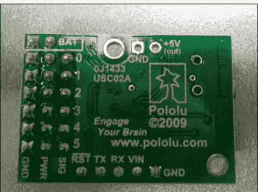

## 使用 Raspberry Pi Zero 玩石头、剪刀、布

现在，你需要将舵机电机控制器连接到电源。对于本项目，你可以使用电池，也可以使用专用电源。以下是专用电源的图像，可在大多数在线电子商店购买，可提供大约 3 安培 6 伏的电量，这对项目是必需的：

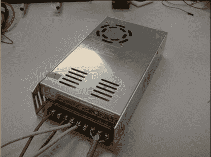

电源上的连接已明确标记；你将把 6 伏电源和 GND 连接连接到舵机控制器上标记为 BAT 的连接上。

> 对这种电源要非常小心，从未在电源插入时对连接到电源的线路进行操作，并且在完成所有连接后最好将电源放在保护外壳中。

你的系统现在是功能性的。现在，你将把电机控制器连接到你的个人电脑，以检查是否可以像 *第 5 章《构建一个可以行走的机器人》* 中所示那样与之通信。为此，将迷你 USB 电缆连接到舵机控制器和你的个人电脑之间。

现在，你可以使用 Pololu Maestro Control Center 上的滑块实际控制舵机。确保舵机 0 移动拇指，1 移动食指前中舵机，2 移动右前上舵机，依此类推。你也可以用它来校准舵机。

将所有舵机设置在滑块条的一侧，滑块位于一侧，你希望这成为打开设置。滑块条另一侧的设置会拉动钓鱼线，从而将相关手指或拇指移动到闭合设置。现在，拧下每个舵机上的舵机角，直到舵机定位到使手张开时处于舵机运动的一端。当舵机移动到范围的另一端时，手应该闭合。

你的手现在准备好实际做点什么了。现在，你需要向舵机发送它们需要发出的电子信号以表示石头、剪刀或布。

## 将舵机控制器连接到 Raspberry Pi Zero

你已经检查了舵机电机控制器和舵机；现在你将把电机控制器连接到 Raspberry Pi Zero 并确保可以从它控制舵机。拔下 USB 电缆与 PC 的连接并将其连接到 Raspberry Pi Zero。

让我们现在专注于电机控制器，通过从 Pololu 下载 Linux 代码 `www.pololu.com/docs/0J40/3.b`。也许最好的方法是登录你的 Raspberry Pi Zero 通过 PuTTY，然后输入 `wget http://www.pololu.com/file/download/maestro-linux-100507.tar.gz?file_id=0J315`。然后，使用 `mv maestro-linux-100507.tar.gz\?file_id\=0J315 maestro-linux-100507.tar.gz` 移动文件。通过输入 `tar -xzfv maestro-linux-100507.tar.gz` 解压文件。这将创建一个名为 `maestro_linux` 的目录。通过输入 `cd maestro_linux` 进入该目录，然后输入 `ls -l`；你应该能看到类似以下的内容：

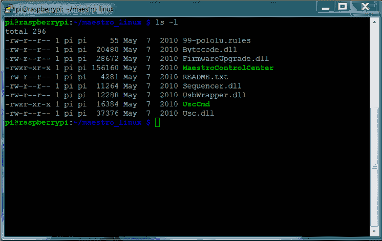


文档 README.txt 将会明确说明如何安装软件。这基本上分为两个步骤。首先，通过输入 sudo apt-get install libusb-1.0-0-dev mono-runtime libmono-winforms2.0-cil 安装一组支持库，然后通过输入 sudo cp 99-pololu.rules /etc/udev/rules.d/ 复制配置文件。

不幸的是，你无法在你的 Raspberry Pi Zero 上运行 Maestro Control Center，因为你的 Windows 版本不支持图形界面，但你可以使用 UscCmd 命令行应用程序来控制你的舵机，以确保它们已连接并且工作正常。首先，输入 ./UscCmd --list，你应该能够看到以下内容：

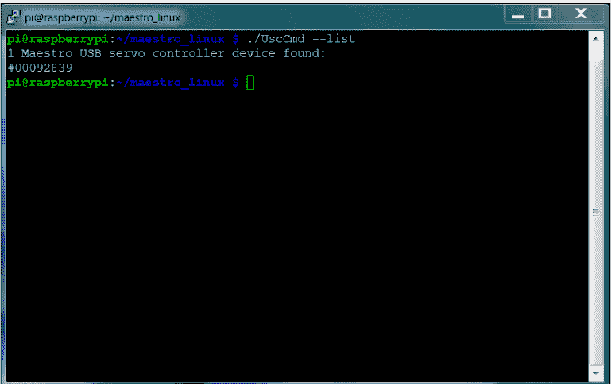

单元检测到你的舵机控制器。如果你只输入 ./UscCmd，你可以看到可以发送给控制器的所有命令：

```
pi@raspberrypi:~/maestro_linux $ ./UscCmd
UscCmd, Version=1.3.0.0, Culture=neutral, PublicKeyToken=null
Select one of the following actions:
  --list                  list available devices
  --configure FILE        load configuration file into device
  --getconf FILE          read device settings and write configuration file
  --restoredefaults       restore factory settings
  --program FILE          compile and load bytecode program
  --status                display complete device status
  --bootloader            put device into bootloader (firmware upgrade) mode
  --stop                  stops the script running on the device
  --start                 starts the script running on the device
  --restart               restarts the script at the beginning
  --step                  runs a single instruction of the script
  --sub NUM               calls subroutine n (can be hex or decimal)
  --sub NUM,PARAMETER     calls subroutine n with a parameter (hex or decimal) placed on the stack
  --servo NUM,TARGET      sets the target of servo NUM in units of 1/4 microsecond
  --speed NUM,SPEED       sets the speed limit of servo NUM
  --accel NUM,ACCEL       sets the acceleration of servo NUM to a value 0-255
Select which device to perform the action on (optional):
  --device 00001430       (optional) select device #00001430
pi@raspberrypi:~/maestro_linux $
```

请注意，你可以发送舵机到特定的目标角度，尽管目标不是以度为单位，所以很难知道你将舵机发送到哪里。尝试输入 ./UscCmd --servo 0, 10。舵机将移动到其最大角度位置。输入 ./UscCmd - servo 0, 0 它将停止舵机试图移动。在下一节中，你将编写一些 Python 代码，将你的角度以度为单位转换为舵机控制器希望看到的命令，以便将其移动到特定角度位置。

> 如果你没有运行 Windows 版本的 Maestro Controller 并将 Serial Settings 设置为 USB Chained，你的电机控制器可能不会响应。重新运行 Maestro Controller 代码并将 Serial Settings 设置为 USB Chained。

## Creating a program on Raspberry Pi Zero
### so that you can control your hand

你现在知道你可以与你的舵机电机控制器对话并移动你的舵机。在本节中，你将创建一个 Python 程序，让你可以与你的舵机对话以将其移动到特定角度。

让我们从一个简单的程序开始，该程序将定位你的手，使舵机设置为范围的一端（这应该打开手），然后移动到范围的另一端（这应该关闭你的手）。此程序以你在 *Chapter 5, Building a Robot That Can Walk* 中编写的代码开始。以下是控制舵机的基本代码：

```
```python
#!/usr/bin/python
import serial
import time

def setAngle(ser, channel, angle):
    minAngle = 0.0
    maxAngle = 180.0
    minTarget = 256.0
    maxTarget = 13120.0
    scaledValue = int(angle / ((maxAngle - minAngle) / (maxTarget - minTarget))) + minTarget
    commandByte = chr(0x84)
    channelByte = chr(channel)
    lowTargetByte = chr(scaledValue & 0x7F)
    highTargetByte = chr((scaledValue >> 7) & 0x7F)
    command = commandByte + channelByte + lowTargetByte + highTargetByte
    ser.write(command)
    ser.flush()

ser = serial.Serial("/dev/ttyACM0", 9600)
# Home position
for i in range(0, 12):
    setAngle(ser, i, 90)
time.sleep(1)
```
```

以下是代码的解释：

- `#!/usr/bin/python`: 这一行允许你从命令行执行此 Python 文件。
- `import serial`: 这一行导入 serial 库。你需要 serial 库通过 USB 与你的单元对话。
- `def setAngle(ser, channel, angle)`: 此函数将你期望的舵机和角度设置转换为舵机电机控制器需要的串行命令。
- `ser = serial.Serial("/dev/ttyACM0", 9600)`: 这打开到你的舵机控制器的串行端口连接。
- `for i in range(0, 12)`: 对于每个舵机
- `setAngle(ser, i, 90)`: 现在你可以将每个舵机设置为中间位置。这应该使你的手指半开。如果你的手不在中间位置，你可以通过调整每个舵机上舵机角的位置来调整它。

要访问串行端口，你需要确保你已安装 Python serial 库。如果没有，则输入 `sudo apt-get install python-serial`。安装 serial 库后，你可以通过输入 `sudo python hand.py` 运行你的程序。

一旦你知道将舵机设置为中间角度位置的角度，每个舵机打开或关闭手的角度设置大约在两侧各 20 度。最后，你现在可以要求你的手关闭拇指、环指和小指的舵机，这将是剪刀手。你需要为每三种不同位置各提供一个 Python 函数。在这种情况下，你可以使用你的 `setAngle` 命令设置你的舵机来操纵你的手的六个舵机，以执行纸牌（全部打开）、石头（全部关闭）或剪刀（两个手指伸出，其余关闭）。

由于每个都是一个函数，此代码也具有可被包含在库中以便在你的系统中使用网络摄像头的能力。

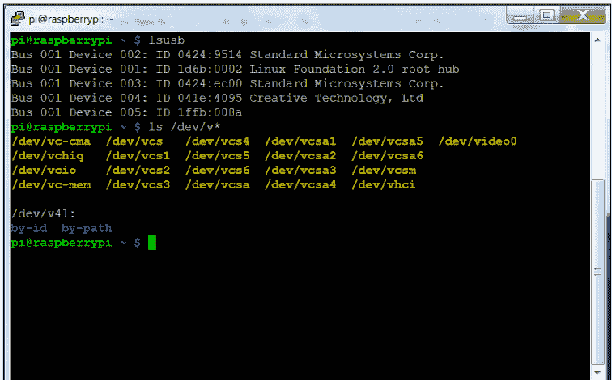

The /dev/video0 is the webcam device. Now that your device is connected, let's actually see if you can capture the images and video.

> 虽然许多 USB 网络摄像头都可以使用，为了确保这一点，你可能希望从 Logitech 等主要网络摄像头制造商处购买网络摄像头。

# Playing Rock, Paper, or Scissors with Raspberry Pi Zero

有几个工具可以让你访问网络摄像头，但一个带有视频控制的简单程序称为 guvcview。要安装它，输入 `sudo apt-get install guvcview`。安装应用程序后，你需要运行它。为此，你需要直接连接到显示器或使用 vncviewer 连接到远程计算机。在 Raspberry Pi 上打开一个终端窗口并运行 guvcview。你应该会看到类似以下内容：

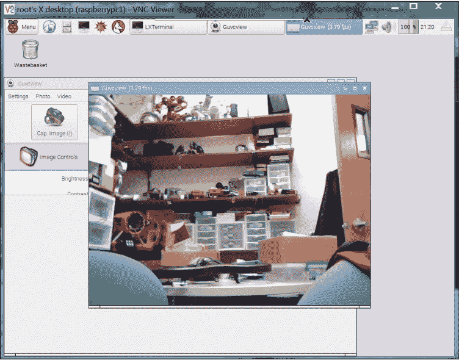

不用担心你将捕获的图像质量，你将在 OpenCV 中处理你的图像，OpenCV 是一个视觉框架。

## Downloading and installing OpenCV – a fully featured vision library

现在你已连接了摄像头，你可以访问开源社区提供的一些惊人功能。打开一个终端窗口并输入以下命令：

- `sudo apt-get update`: 你将下载许多新的软件包，因此确保一切都是最新的很有好处。
- `sudo apt-get install libavformat-dev`: 此库提供了一种编码和解码音频和视频流的方法。
- `sudo apt-get install libcv2.4 libcvaux2.4 libhighgui2.4`: 此命令显示基本的 OpenCV 库。请注意命令中的数字。随着新版本的 OpenCV 可用，这几乎肯定会发生变化。如果 2.4 不起作用，请尝试 3.0 或在 Google 上搜索 OpenCV 的最新版本。
- `sudo apt-get install python-opencv`: 这是 OpenCV 所需的 Python 开发工具包，因为你将使用 Python。
- `sudo apt-get install opencv-doc`: 此命令将下载 OpenCV 的文档，以防你需要它。
- `sudo apt-get install libopencv-dev`: 此命令下载用于编译 OpenCV 的头文件和静态库。
- `sudo apt-get install libopencv-dev`: 此命令下载用于编译 OpenCV 的更多开发工具。
- `sudo apt-get install libhighgui-dev`: 这是另一个提供用于编译 OpenCV 的头文件和静态库的软件包。

现在，输入 `cp -r /usr/share/doc/opencv-doc/examples /home/pi/`。这将复制所有示例到你的主目录。


你可能想要尝试调整分辨率，以找到适合你应用的最佳设置。较大的图像很棒——它们能让你更详细地查看世界——但它们也会占用显著更多的处理能力。随着你真正要求系统执行一些实际的图像处理任务，你会更频繁地调整此分辨率。注意，如果你打算使用 vncserver 来了解系统性能，这会显著降低更新速率。宽度/高度是两倍大小的图像将涉及四倍的处理量。你现在可以使用此功能来执行许多令人印象深刻的任务。

## 手势检测

OpenCV 和你的网络摄像头也可以跟踪物体。当你希望项目能够区分你的手与背景时，这将很有用。OpenCV 通过提供一些高级库使这变得异常简单，这些库可以帮助我们完成此任务。为此，你将编辑一个文件，使其看起来与以下屏幕截图中所示相似：

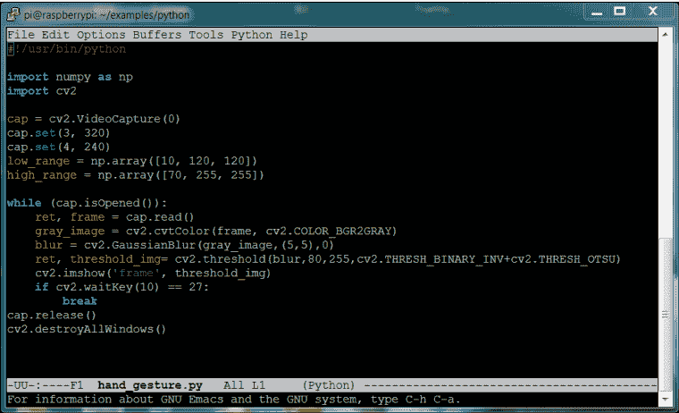

## 使用 Raspberry Pi Zero 玩剪刀石头布

以下屏幕是测量你手部纸张的画面：

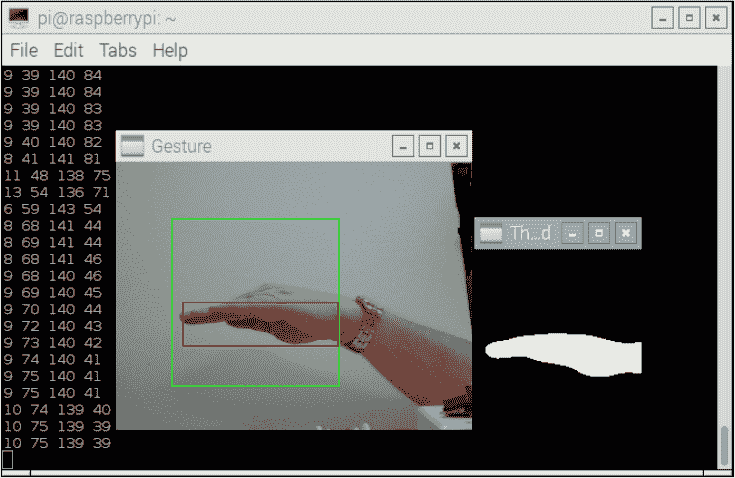

你可以通过使用 *x* 和 *y* 的比率添加一些简单的代码来判断你的手是在出石头、剪刀还是布。在前面的图片中，你可以看到纸张的宽度与高度的比率大约为 140/80。对于石头，该比率大约为 85/55。对于剪刀，它将为 140/40。以下是确定石头/布/剪刀的库代码：

```
import math

cap = cv2.VideoCapture(0)
cap.set(3, 320)
cap.set(4, 240)

def getHand():
    while(cap.isOpened()):
        ret, img = cap.read()
        cv2.rectangle(img, (200,200), (50,50), (0,255,0),0)
        crop_img = img[50:200, 50:200]
        grey = cv2.cvtColor(crop_img, cv2.COLOR_BGR2GRAY)
        value = (35, 35)
        blurred = cv2.GaussianBlur(grey, value, 0)
        _, thresh1 = cv2.threshold(blurred, 127, 255, cv2.THRESH_BINARY_INV+cv2.THRESH_OTSU)
        cv2.imshow('Thresholded', thresh1)
        contours, hierarchy = cv2.findContours(thresh1.copy(),cv2.RETR_TREE, cv2.CHAIN_APPROX_NONE)
        max_area = -1
        for i in range(len(contours)):
            cnt=contours[i]
            area = cv2.contourArea(cnt)
            if(area>max_area):
                max_area=area
                ci=i
        cnt=contours[ci]
        x,y,w,h = cv2.boundingRect(cnt)
        print x, y, w, h
        if w != 148 and h !=148: # not starting rectangle
            if w/h >= 3:
                return 3  # scissors
            elif w/h < 3 and w/h > 1:
                return 2
            else:
                return 3
        cv2.rectangle(crop_img, (x,y), (x+w,y+h), (0,0,255),0)
        cv2.imshow('Gesture', img)
        k = cv2.waitKey(10)
        if k == 27:
            break

print getHand()
```

现在你知道了人类对手的手势状态。为了完成整个项目，你需要添加代码为计算机手的状态进行随机选择，调用本章前面各节中的函数使手移动到该状态，然后比较机器人手和用户手的随机选择以确定获胜者。玩剪刀石头布从未如此简单！

## 总结

你现在拥有了一只可以玩剪刀石头布的手！到目前为止，你应该已经拥有了许多可以添加到几乎任何项目中的不同功能。在最后一章中，你将把 Raspberry Pi Zero 添加到四轴飞行器上，构建一个可以飞行的项目。
