# 第9章 为四轴飞行器添加 Raspberry Pi Zero
### 为四轴飞行器添加 Raspberry Pi Zero

你已经有机会构建了许多不同类型的机器人，现在让我们以最令人惊叹的机器人作为结尾，一种可以飞行的机器人。

> 在开始之前，有一些安全警告需要考虑。当然，永远不要在人或建筑物附近飞行。此外，要非常小心不要飞出你的视距范围。在许多国家，对四轴飞行器的飞行地点和时间都有限制。一些国家，包括美国，要求你注册你的四轴飞行器。

还需要注意的是，本章并非旨在作为构建可飞行四轴飞行器的完整分步指南。那需要很多章节。本章旨在让你入门，如果你考虑构建一个可使用 Raspberry Pi Zero 控制的四轴飞行器。在本章中，你将学习以下主题：

- 构建基本四轴飞行器平台
- 将 Raspberry Pi Zero 与飞行控制器接口
- 讨论远程通信
- 使用 GPS 进行定位
- 添加自主飞行

## 构建平台

构建四轴飞行器硬件可能令人望而生畏；然而，有几个优秀的网站可以引导你完成整个过程，从组件选择到构建细节以及使用无线电编程和控制你的四轴飞行器。http://www.arducopter.co.uk/ 网站是那些对四轴飞行器飞行感兴趣的新手的好起点。前往 http://copter.ardupilot.com/，这也是另一个信息丰富的优秀网站。

对于本项目，你希望选择使用 **Pixhawk** 飞行控制器的项目。还有其他价格明显更低的飞行控制器，但这个特定的飞行控制器为 Raspberry Pi Zero 提供了便捷的访问。以下是一些可以指导你完成构建过程的网站：http://learnrobotix.com/uavs/quadcopter-build/pixhawk/connecting-the-q-brain-esc.html、http://learnrobotix.com/uavs/quadcopter-build/pixhawk/connecting-components-pixhawk-flight-controller.html 和 http://www.flying-drone.co.uk/how-to-build-a-quadcopter-with-a-pixhawk-flight-controller-step-11/。

在 http://copter.ardupilot.com/wiki/advanced-pixhawk-quadcopter-wiring-chart/，你会找到一个关于如何连接所有东西的优秀接线图。让我们逐步进行构建我们自己的四轴飞行器。

首先，你需要一个机架。你将构建一个尺寸为 450 mm 的四轴飞行器，这是最便宜的机架之一，可在大多数在线零售商处购买，具有玻璃纤维臂，如下图所示：

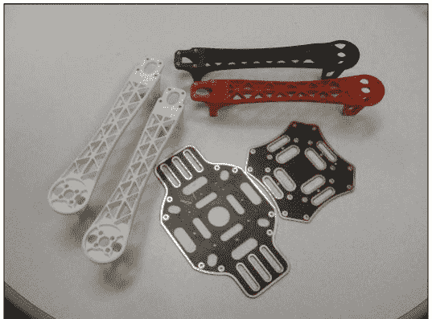

现在，执行以下步骤完成你的四轴飞行器组装：

- 1. 第一步是按照说明建议组装四轴飞行器。
- 2. 第二步是将四个 **电子调速器 (ESCs)** 焊接到每个电机上，并将电池连接焊到底板上。以下是底板的图像：

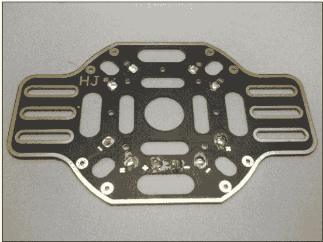

注意 + 和 - 连接；每个连接将焊接到所有 ESC 上。以下是电机控制器的图像：

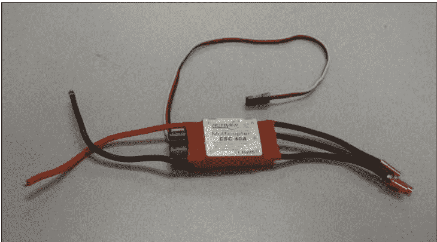

## 为四轴飞行器添加 Raspberry Pi Zero

红黑线连接器是焊接到底盘底板的连接器。其他三个连接器将连接到电机。

- 3. 第三步是在机架上安装电机。你需要 1000 KV 范围内的电机，以下是此类电机的图像：

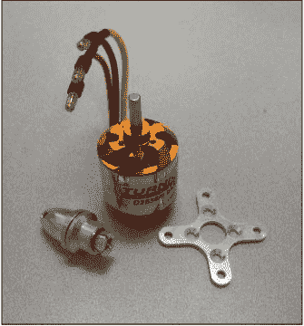

再次，按照随附机架的说明将电机附上。然后将来自 ESC 的三个连接附到电机上。

- 4. 一个可选步骤是为单元添加一套起落架。有很多此类产品可供选择；以下是非常坚固的一个的图像：

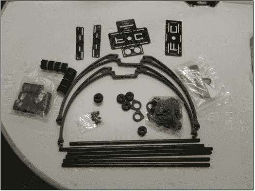

- 5. 现在你将在机架上安装 Pixhawk 并连接其相关电子设备。细节在 http://copter.ardupilot.com/wiki/advanced-pixhawk-quadcopter-wiring-chart/ 中显示并描述。这将把 Pixhawk 连接到 ESC、电池、RC 发射器、遥测无线电以及一个开关，该开关将防止四轴飞行器在你准备好之前飞行。
- 6. 最终，你将在四轴飞行器上安装四个螺旋桨；然而，你必须等到校准 ESC、电机和 RC 发射器后才能安装它们。你需要四个螺旋桨，其中两个设计为顺时针旋转，另外两个设计为逆时针旋转。对于这个四轴飞行器，你希望螺旋桨的螺距为 10x4.7。以下是其中一个螺旋桨的图像：

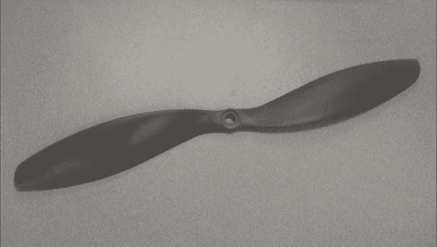

以下是使用 Pixhawk 飞行控制器的整个四旋翼飞行器的图像：

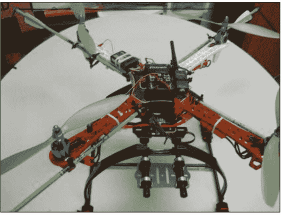

> 请注意四旋翼飞行器上排列的箭头和线缆。这并不是为了让它看起来凶猛，而是为了防止它撞到东西并损坏螺旋桨。市面上也有商业护罩可供购买；不过该系统也有效，而且成本更低。

你需要用 RC 发射器/接收器对组装并飞行你的四旋翼飞行器；这将使你熟悉四旋翼飞行器及其飞行方式，同时也能让你调整所有设置以使其稳定。一旦四旋翼飞行器稳定后，你就可以执行一些简单的自主飞行。让我们使用任务规划软件，该软件运行在远程计算机上。

## 任务规划软件

任务规划软件可在 http://planner.ardupilot.com/ 获取。实际上有两种应用可执行类似操作，但 Mission Planner 是一个很好的地方，可以熟悉如何通过计算机程序与四旋翼飞行器通信。

为此，你需要确保遥测电台已连接到 Pixhawk 和计算机。这将避免需要使用长 USB 数据线直接连接到 Pixhawk。当你开始任务规划软件时，你会看到以下屏幕：

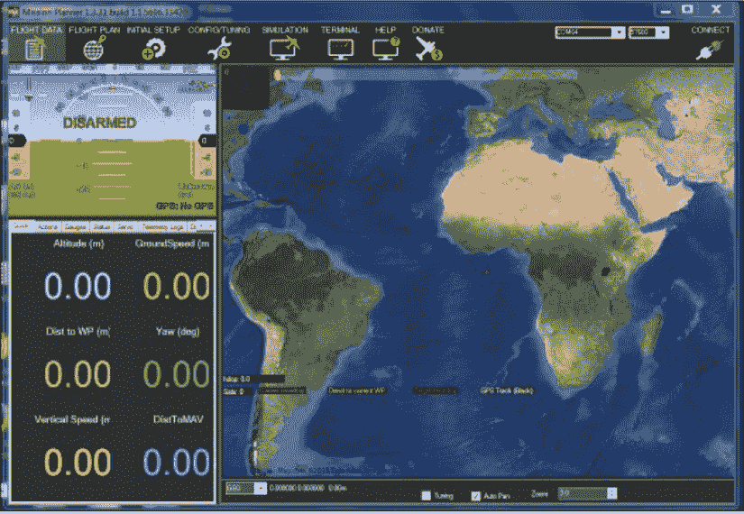

这是基本屏幕。然后你需要配置无线电的 COM 端口，然后按下屏幕右上角的 CONNECT 按钮。随着你移动四旋翼飞行器，你会看到测量值发生变化。如果你在连接 Pixhawk 时遇到问题，网站上有大量帮助。

现在你已连接，你实际上可以用此应用程序看到四旋翼飞行器的飞行情况。软件通过 MAVLink 与 Pixhawk 控制器通信，MAVLink 是一个串行控制链路，从软件应用程序发出，经由遥测电台发出，被遥测电台接收，然后路由到 Pixhawk。Pixhawk 不仅知道如何发送信息，还知道如何接收信息。

软件连接后，你需要校准 RC 无线电连接；这可以通过软件完成。你还需要校准 ESC；请参考 http://learnrobotix.com/uavs/quadocopter-build/pixhawk/calibrating-electronic-speed-controllers-with-pixhawk.html 获取具体说明。

现在连接后，你可以使用 MAVLink 从 Raspberry Pi Zero 访问 Pixhawk。你需要添加并配置 Raspberry Pi Zero 以完成连接。为此，运行 `raspi-config` 并选择 **8 Advanced Options, Configure advanced settings** 选项，如以下屏幕截图所示：

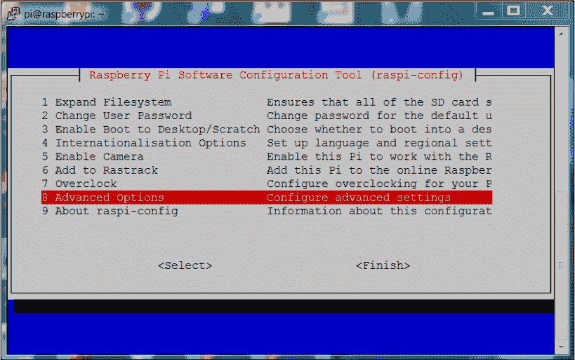

现在你准备好安装一些额外软件了。要安装此软件，请执行以下步骤：

- 1. 输入 `sudo apt-get update`：这会更新本地软件包列表，以便你的系统可以找到合适的软件。
- 2. 输入 `sudo apt-get install screen python-wxgtk2.8 python-matplotlib python-opencv`：这会安装一个图形包、一个绘图包和一个版本的 OpenCV。
- 3. 输入 `sudo apt-get install python-numpy`：这将安装 **NumPy**，一个用于 Python 的数值库，尽管你可能已从之前完成的项目中拥有它。
- 4. 输入 `sudo apt-get install python-dev`：这是一组文件，将允许你在 Python 环境中进行开发。
- 5. 输入 `sudo apt-get install python-pip`：这是一个帮助你安装 Python 包的工具。
- 6. 输入 `sudo pip install pymavlink`：这是一组实现 MAVLink 或 Pixhawk 的通信配置文件的代码，以 Python 编写。
- 7. 输入 `sudo pip install mavproxy`：这最后一步安装 **Unmanned Aerial Vehicle (UAV)** 地面站软件包，用于基于 MAVLink 的系统，该系统基于 Pixhawk。

现在你已安装了所有软件，可以测试链接。为此，输入 `sudo -s`；这会将你设为超级用户。然后输入 `mavproxy.py --master=/dev/ttyAMA0 --baudrate 57600 --aircraft MyCopter` 你将看到以下内容：

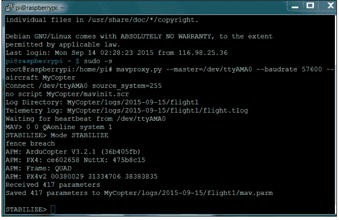

现在链接已建立，你可以发送命令来设置或显示参数。例如，输入 param show ARMING_CHECK；它应显示参数的值，如以下屏幕截图所示：

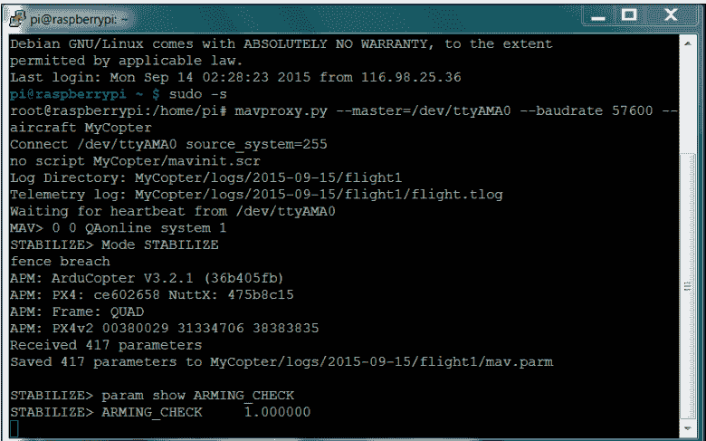

所有可用命令的详细信息可在 http://dronecode.github.io/MAVProxy/html/uav_configuration/index.html 找到。

你可以直接发出这些命令，但你也可以使用与 Mission Planner 界面类似的界面连接到 Pixhawk，而你之前已使用过该界面。为此，你需要安装 DroneKit 代码。DroneKit 的总体说明和文档可在 http://python.dronekit.io/1.5.0/guide/getting_started.html 找到，但让我们在这里看一个示例。

首先，输入 sudo pip install droneapi。你可以通过输入 git clone http://github.com/dronekit/dronekit-python.git 下载一些示例脚本。现在 cd 到 dronekit-python/examples/vehicle_state 目录。你会看到 vehicle_state.py 文件，它展示了如何使用 MAVLink 与 Pixhawk 通信以获取信息，以及设置值和发出命令的绝佳示例。

## 向四旋翼飞行器添加 Raspberry Pi Zero

你还可以将 MAVProxy 系统与运行在远程计算机上的 Mission Planner 接口。使用一台无线电连接到 Pixhawk 的 TELEM 1 端口，以及你的 Raspberry Pi Zero 连接到 Pixhawk 的 TELEM 2 端口，通过添加 `--out <ipaddress>:14550` 修改 MAVProxy 启动命令，其中 ipaddress 为运行 Mission Planner 的远程计算机的地址。在 Windows 机器上，可以使用 `ipconfig` 命令确定此 IP 地址。

例如，你的 mavproxy 命令可能看起来像这样：`mavproxy.py --master=/dev/ttyAMA0 --baudrate 57600 --out ipaddress:14550 --aircraft MyCopter`。一旦连接到 MAVProxy，你就可以使用 UDP 连接连接到 Mission Planner 软件，如以下屏幕截图所示：

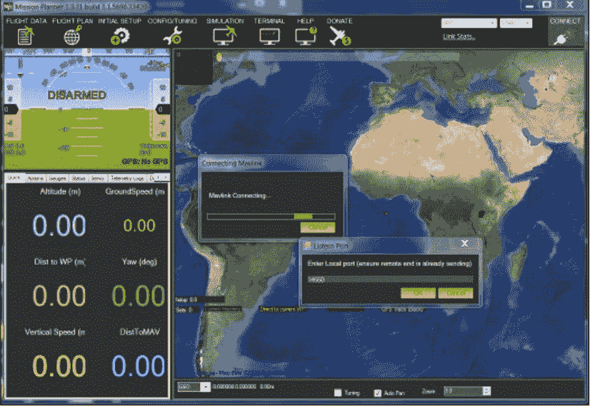

现在，你可以运行你的 MAVProxy 脚本并在 Mission Planner 软件上查看结果。

## 摘要

就这样。你现在拥有了多种不同的机器人平台，它们以 Raspberry Pi Zero 作为中央控制器运行。这些章节只是向你介绍了你的平台的一些最基本功能；你现在可以探索每个平台并扩展其功能。唯一的限制是你的想象力和时间。
