## 致谢

感谢我出色的妻子苏珊，感谢你在四年半全职工作、就读法学院以及随后多年以创业公司的节奏工作并承担无数副业（包括这本书）期间给予我的无限耐心和支持。你无休止的支持推动着我，让我得以不断为我们未来的美好生活而努力。

感谢我的父母，没有你们早年的支持，我就不会成为今天的我——永远好奇，不断挑战技术的边界，去做大多数人不会做的事情，比如写这样一本书。我永远感激你们给予我出色的人生起点，以及你们一如既往的关爱与支持！

**Thomas Ferris Nicolaisen** 是一名软件开发者，博客、演讲和播客内容涵盖程序员使用的工具和技术。他持续关注所有平台上优秀的命令行工具，并在多年前开始使用 tmux。从那以后，他在服务器工作和桌面终端窗口中都一直在使用并享受 tmux。

你可以在 www.tfnico.com 找到他的博客，以及他在 www.gitminutes.com 上的最新播客项目。

**Gustavo Sampaio** 是一名软件开发者，拥有多种专长。他熟悉多种编程语言和平台（Android、iOS、Windows、Linux、Web 以及微控制器 Arduino）。

他还从事过数字图像处理和计算机图形学方面的工作，包括高级渲染技术（全局光照、着色器、光线追踪等）、自然语言处理（朴素贝叶斯分类器和词性标注器），以及使用 OpenMPI 库进行并行计算。

他目前正在攻读计算机科学学位，并在其领域有发表成果。

**Ian Yang** 拥有多年的软件开发经验。他喜欢摆弄各种生产力工具。他也是一个键盘爱好者，倾向于仅用键盘完成工作。tmux 是他最爱的工具之一。

他作为一名 Web 开发者远程工作多年。目前他作为联合创始人和 CTO 运营一家移动游戏初创公司。

## 前言

tmux 凭借其广泛的功能和简单的配置，正在迅速成为终端复用器的事实标准。由于它在最大化终端窗口生产力方面的强大能力，它是开发者工具箱中增长最快的工具之一。大量时间在终端中度过的开发者将极大地受益于学习如何利用 tmux 及其强大功能。通过将单个终端窗口变成多个窗口，每个窗口都有自己的状态，tmux 就像是为你的控制台加装了一个超级增压器。

我们将从对 tmux 的简单介绍开始，学习一些在日常终端使用中帮助提升生产力的方法。接着，我们将继续配置和定制 tmux，使其外观和操作方式最适合你的需求。在此过程中，我们有大量的教程和截图，方便你跟随学习而不会迷路。我们还将解释 tmux 的一些核心概念，包括它如何使用会话、窗口和窗格来划分内容和运行中的程序。

在学习了一些入门主题之后，我们将深入探讨一些高级 tmux 概念。我们将介绍如何执行文本操作，在一个窗口与另一个窗口之间甚至与文件之间复制和粘贴文本。我们将学习如何使用 tmux 进行容错的 SSH 会话或结对编程，最后还将讨论一些可以与 tmux 一起使用的其他开源工具，使其更加强大。

tmux 是一个非常强大的工具，其中有一些概念可能难以掌握。本书将以 tmux 手册页中找不到的方式，通过大量解释和丰富示例来帮助厘清这些难点。

在本书结束时，你将更深入地理解 tmux 及其能力，以及为你的终端体验加速所需的所有工具。本书涵盖以下主题：

第 1 章“直接开始”将让我们迅速进入实战状态，体验一个典型的 tmux 工作流程，并沿途解释一切。这会让我们感受到 tmux 的用途，以及如何将其融入你的日常工作流程。

第 2 章“配置 tmux”将教我们如何更改和配置 tmux 几乎所有的行为，从它的外观和操作感到加载时执行的命令。你甚至可以配置 tmux 响应的每一个按键组合。在本章中，我们将介绍配置 tmux 的各种方式，并使其为你的工作流程进行定制。

第 3 章“会话、窗口和窗格”将帮助我们全面了解会话、窗口和窗格。这些是构成 tmux 窗口管理功能的基本组件，本章将帮助我们理解它们是什么以及它们之间的关系。我们将通过示例学习许多使用它们的方法，从而用 tmux 加速我们的终端。

第 4 章“文本操作”帮助我们了解 tmux 中用于文本操作的强大工具。这些工具以复制模式和粘贴缓冲区形式出现，我们将进一步学习它们以及如何使用它们进行非常强大的文本操作，例如滚动浏览已滚出屏幕的文本，以及从窗口历史记录中的任意位置复制文本并粘贴——通常完全不需要触碰鼠标。

第 5 章“深入探索”涉及我们已介绍主题的更多细微方面。这些主题包括 tmux 命令及其命令模式、高级粘贴缓冲区用法，以及窗口和窗格的一些高级用法。最后，我们将学习如何启动一个带有默认窗口的 tmux 会话。

第 6 章“用于 SSH、结对编程等的 tmux”将带我们了解一些可能非常强大的使用模式。它将帮助我们学习如何通过 SSH 使用 tmux 进行长会话结对编程，同时我们将使用 Vagrant 来提高可预测性和安全性。

第 7 章“将其他工具与 tmux 一起使用”将让我们讨论一些可以与 tmux 一起运行并添加更强大功能的第三方工具。我们将了解 tmuxinator（它简化了 tmux 启动配置）和 wemux（它将 tmux 的多用户体验提升到一个全新水平）。我们还将了解这些工具以及一些其他技巧和实用程序。

附录包含三个部分，即“为什么选择 tmux？”、“配置参考”和“键绑定与命令参考”。


### 本书所需

一台运行 tmux 1.8+ 的计算机（Unix、Linux 或 OS X），可从以下链接下载：

```
http://tmux.sourceforge.net
```

### 本书适合谁

本书面向软件开发人员、DevOps 工程师以及在日常工作流程中大量使用终端的其他专业人士。熟悉终端是有用的，但无需事先使用过 tmux 或其他终端多路复用器（如 GNU Screen）的经验。

### 约定

在本书中，你会看到多种文本样式，用来区分不同类型的信息。以下是这些样式的示例，以及它们的含义。

当我们描述要按下的键时，它会以斜体显示，如下所示：“Please press the letter b now.” 通常我们会描述一个键组合，即同时按下多个键，它会显示如下：Ctrl + b。 这意味着按住 Control 键并按下字母 b。 我们还会看到多个键组合，按顺序按下。它们会以逗号分隔并显示如下：Ctrl + b, c。 这意味着按住 Ctrl 键并按下字母 b，然后松开两个键并按下字母 c。

文本中的代码词、数据库表名、文件夹名、文件名、文件扩展名、路径名、示例 URL、用户输入和 Twitter 账号显示如下：“Simply run the tmux command show-options with a flag for which set of options you want to view.”

配置代码块设置如下：

```
# Set the status bar background to blue
set-option -g status-bg blue
# Set the status bar text to white
set-option -g status-fg white

# Set the active window background in the status bar
set-window-option -g window-status-current-bg magenta
```

当我们希望引起你对代码块中特定部分的注意时，相关行或项目会以粗体显示：

```
# Set the active window background in the status bar
set-window-option -g window-status-current-bg magenta
```

```
# Rebind the prefix key
set-option -g prefix C-t
```

```
# Add a key binding for reloading our configuration
bind-key C-r source-file ~/.tmux.conf
```

任何命令行输入或输出写成如下形式：

```
$ tmux attach-session -t tutorial
```

**新术语**和**重要词语**以粗体显示。你在屏幕上看到的词语，例如菜单或对话框中出现的词语，在文本中如下显示：“You will see **Search Up:** appear in the lower left-hand corner.”

警告或重要说明会出现在如下的框中。


提示和技巧如下所示。


### 读者反馈

我们始终欢迎读者的反馈。请告诉我们你对本书的看法——你喜欢什么或可能不喜欢什么。读者反馈对我们开发你能最大程度受益的书籍标题非常重要。

如需发送一般反馈，只需发送电子邮件至 feedback@packtpub.com，并在邮件主题中提及书名即可。

你也可以在 Twitter 上关注或直接向作者 @victorquinn 发推。

如果你在某个主题上具有专业知识并且有兴趣撰写或为一本书做出贡献，请参阅 www.packtpub.com/authors 上的作者指南。

不过，你应该注意到现在终端窗口底部有一条栏。这可以在以下终端窗口的屏幕截图中看到：

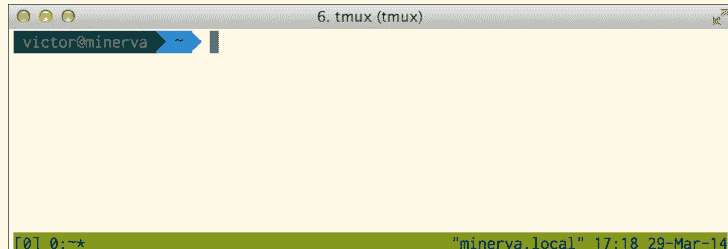

恭喜！你现在正在运行 tmux。

底部那条栏由 tmux 提供。我们称这条栏为状态行。状态行会提供有关你当前查看的会话和窗口的信息，以及此会话中还有哪些其他窗口可用等信息。

其中一些内容现在可能看起来像乱码，但随着我们在本書的进展，我们将了解更多关于这些内容含义的信息。我们还将学习如何自定义状态栏，以确保它始终显示对你的工作流程最有用的项目。这些自定义包括 tmux 本身的一部分内容（如时间、日期、你连接的服务器等）或第三方库中的内容（如笔记本电脑的电池电量、当前天气或未读邮件数量）。

## 会话

通过不带任何参数运行 tmux，你会创建一个全新的会话。在 tmux 中，基本单元称为会话。一个会话可以有一个或多个窗口。一个窗口可以被拆分为一个或多个窗格。我们将在专门的章节中重新讨论这个主题（有关更多信息，请参阅第 3 章，会话、窗口和窗格）；不过，作为一个预告，我们当前屏幕上显示的是一个会话中一个窗口占据整个窗口的单个窗格。想象一下，它可以被拆分为两个或多个不同的终端，每个终端运行不同的程序，每个终端的可视分割就是一个窗格。有关此内容的更多信息将在后面的章节中介绍。

### tmux 中的会话是什么？

将 tmux 会话视为你计算机上的登录会话可能很有用。你可以登录计算机，从而启动一个新的会话。登录后输入用户名和密码，你会到达一个空的桌面。这类似于一个全新的 tmux 会话。你可以在此会话中运行一个或多个程序，每个程序都有自己的窗口或窗口，每个窗口都有自己的状态。

在大多数操作系统中，你可以注销、重新登录并返回到同一个会话，窗口与你离开时完全相同。通常，你在注销时打开的一些程序仍会在后台继续运行，即使它们的窗口不再可见。

tmux 中的会话以非常相似的方式工作。因此，将 tmux 视为一个迷你操作系统是有用的，它在会话内管理运行的程序、窗口等。


你可以同时运行多个会话。如果你希望为正在处理的每个任务设置一个会话，这很方便。你可能有一个用于独自开发的应用程序的会话，另一个用于结对编程。或者，你可能有一个用于开发一个应用程序，另一个用于开发另一个应用程序。这样一切都可以井井有条、干净且分开。

### 为会话命名

每个会话都有一个你可以设置或更改的名称。注意状态栏最左侧的 [0]？ 这是会话名称，用括号括起来。这里，由于你只是不带任何参数启动了 tmux，它被命名为 0。然而，这不是一个很有用的名称，所以让我们更改它。

在提示符下，只需运行以下命令：

```
$ tmux rename-session tutorial
```

### 立即上手

这告诉 tmux 你想要重命名当前会话，而 tutorial 是你希望它具有的名称。当然，你可以随意命名。你应该会看到状态栏已更新，因此现在左侧不再是 [0]，而应显示 [tutorial]。

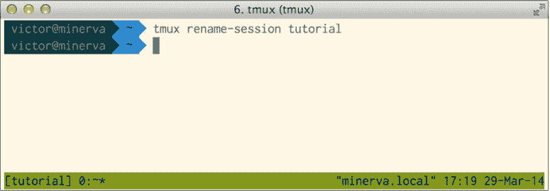

当然，很好的是状态栏现在有一个我们定义的有趣名称而不是 0，但它提供的实用功能远不止于此，我们稍后会看到！

值得注意的是，这里我们为会话命名，但此相同命令也可以用于重命名现有会话。

### 窗口字符串

状态栏有一个字符串代表每个窗口，以告知我们当前正在运行的内容。以下步骤将帮助我们进一步探索这一点：

1. 让我们启动一个文本编辑器来假装我们在进行编码：

   ```bash
   $ nano test
   ```

2. 现在在其中输入一些内容来模拟在一些代码上非常努力地工作：

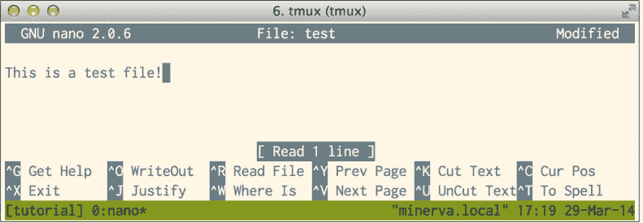


果然，现在窗口 1 已处于活动状态，所有内容都在，就像我们离开时一样。刚才我们在这里输入了一些无意义的命令，但这里也完全可以是一个正在运行的活动进程，例如单元测试、代码检查或 `top`。任何此类进程都可以在 tmux 中于后台运行，不会有任何问题。


> 这是 tmux 最强大的功能之一。
>
> 在传统环境中，如果想让一个长时间运行的进程留在终端窗口中，同时又在终端里处理其他事情，就需要打开两个不同的终端窗口；如果不小心关闭其中一个窗口，该窗口中完成的工作就会丢失。
>
> tmux 允许你只打开一个终端窗口，而这个窗口内部可以包含许多不同的窗口，并运行各种不同的进程。关闭这个终端窗口不会终止正在运行的进程；tmux 会继续在后台运行，所有程序也会继续在幕后执行。

## 查看按键绑定帮助

现在，细心的观察者可能会注意到，输入窗口编号这一技巧只适用于前 10 个窗口。这是因为窗口编号达到两位数后，tmux 无法判断你何时输入完毕。如果这种使用前缀键加数字的技巧只适用于前 10 个窗口（窗口 0 到 9），那么我们该如何选择编号超过 10 的窗口呢？

值得庆幸的是，tmux 提供了许多在窗口之间切换的强大方式。我最喜欢的方法之一就是选择窗口界面。

不过，哎呀！这有点尴尬。看起来作者完全忘记了进入选择窗口界面的按键组合。但别担心，tmux 内置了一种很方便的方式，可以查看所有按键绑定。让我们使用它吧！

按下 <Prefix>, ?，屏幕会发生变化，显示一个列表：左侧是 `bind-key`，中间是按键绑定，右侧是它所运行的命令。你可以使用方向键上下滚动，但其中的条目非常多！

值得庆幸的是，还有一种更快的方式，可以直接找到你想要的条目，而不必一直滚动。

按下 Ctrl + s，你会看到一个提示符，显示为 `Search Down:`。此时你可以输入字符串，帮助文档就会搜索该字符串。

## Emacs 模式或 vi 模式

tmux 努力与开发者的默认设置保持良好配合，因此针对两种最流行的终端编辑器 Emacs 和 vi，它实际上为许多按键组合提供了两种不同的模式。这些模式在 tmux 术语中分别称为 `status-keys` 和 `mode-keys`，其值可以是 Emacs 或 vi。

tmux 默认对所有按键组合使用 Emacs 模式，但可以通过配置改为 vi 模式，我们将在第 2 章“配置 tmux”中介绍相关内容。它也可能根据 shell 中的全局 `$EDITOR` 设置自动设为 vi 模式。

如果你习惯使用 Emacs，那么 Ctrl + s 应该会让你感到非常自然，因为这是 Emacs 用来搜索的命令。

因此，如果你尝试按下 Ctrl + s 却没有任何效果，那么你的按键很可能处于 vi 模式。对于这类与模式相关的按键，我们会尽量提供相应说明：在默认按键后面的括号中，附上 vi 模式下的对应按键。

例如，在本例中，该命令应写作 Ctrl + s (/)：默认模式下使用 Ctrl + s，而 vi 模式下使用 `/`。

输入 `choose-window`，然后按 Enter 向下搜索，你会找到 `choose-window` 的按键绑定。看！它就在这里：`w`：

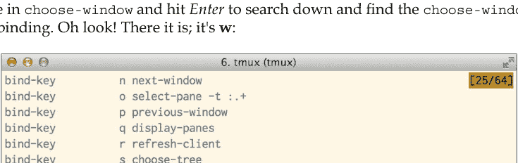

不过，这究竟是什么意思呢？

简单来说，我们可以先输入前缀键（<Prefix>），再输入帮助文档中显示的按键，从而运行所提到的命令。首先，让我们退出帮助文档。要退出这类由 tmux 生成的帮助页面或其他类似界面，只需按下 `q` 表示退出，你就会回到窗口 2 的 shell 提示符。

如果你忘记了某个按键绑定，这应该是你首先采取的步骤。

> 这个按键绑定帮助页面的一个优点是：当你更改按键绑定时，它会动态更新。
>
> 稍后讲到**配置**时，你可能会想要更改绑定或绑定新的快捷键。它们都会根据你提供的配置显示在这个界面中。
>
> 这可是手册页做不到的！

现在，要打开选择窗口界面，只需输入 <Prefix>, w，因为帮助文档显示 `w` 绑定到了 **choose-window**，然后就可以了：

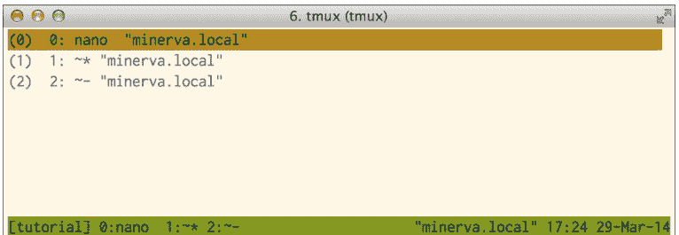

注意，它以类似任务管理器的界面整齐地列出了当前打开的所有窗口。

这个界面也是交互式的。你可以使用方向键上下移动，突出显示你想要的窗口，然后按 Enter 打开它。让我们打开正在运行 nano 的窗口。向上移动以突出显示窗口 0，然后按 Enter。

浏览按键绑定帮助时，你可能会发现更多方便且直观的方式，可以在当前活动窗口之间切换。例如，<Prefix>, p 会切换到上一个窗口，而 <Prefix>, n 会切换到下一个窗口。无论是重新熟悉已经学过的按键绑定，还是探索新的按键绑定，按键绑定帮助都是一个非常优秀的资源。

## 搜索文本

现在我们只有三个窗口，因此很容易记住每个窗口中的内容，但如果有 30 个或 300 个窗口呢？使用 tmux，这完全有可能。（不过，这种情况既不太可能，也不太实用！你会用 300 个活动窗口做什么呢？）

另一种在窗口之间切换的便捷方式是使用 **find-window** 功能。它会提示我们输入一些文本，然后搜索所有活动窗口，并打开包含该文本的窗口。

如果你一直跟着操作，那么当前打开的应该是运行 nano 的窗口（窗口 0）。还记得我们在窗口 1 中打开了一个 shell，并输入了一些无意义的命令吗？让我们尝试使用 **find-window** 功能切换到那个窗口。

输入 `<Prefix>, f`，你会看到如下截图所示的 **find-window** 提示符：

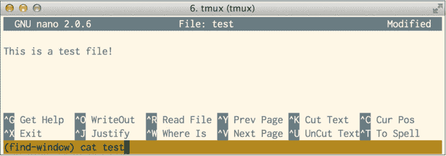

在这里输入 `cat test`，然后按 *Enter*。

你会看到自己已经切换到了窗口 1，因为其中包含 `cat test` 命令。

不过，如果搜索的文本具有歧义，会发生什么呢？例如，如果你一直跟着操作，就会看到单词 **test** 在窗口 0 和窗口 1 中都出现了多次。因此，如果只使用单词 **test** 尝试执行 **find-window**，它就无法立即神奇地完成切换，因为它不知道你指的是哪个窗口。

值得庆幸的是，tmux 足够智能，能够处理这种情况。它会显示一个类似于前面介绍的 *choose-window* 界面的提示符，但其中只包含与查询匹配的窗口（在本例中是窗口 0 和窗口 1；窗口 2 中没有单词 test）。它还会显示每个窗口中包含该文本的第一行，以便提供上下文。

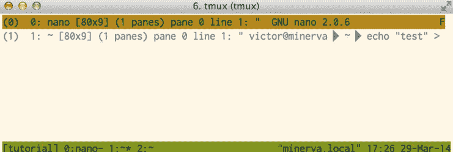

选择窗口 0 将其打开。

## 分离与重新连接

现在按下 <Prefix>, d。

糟糕！看起来 tmux 不见了！熟悉的状态栏不再显示。<Prefix> 键也不再起作用。

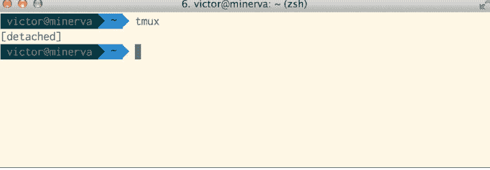

你可能会认为我们这些作者把你引入了歧途，导致你丢失了工作。没有正在 nano 中编写的那份详细文档，你该怎么办呢？

不要害怕，探索者；我们只是在演示 tmux 的另一个非常强大的功能。<Prefix>, d 只会将当前活动会话分离，但会让它继续在后台愉快地运行！

没错，虽然看起来它已经消失了，但我们的会话仍然运行良好。

我们该如何回到它呢？首先，让我们查看活动会话。在终端中运行以下命令：

```
$ tmux list-sessions
```

你应该会看到一个清晰的列表，其中包含会话名称、窗口数量、创建日期和尺寸。如果你有多个会话，也会在这里看到它们。

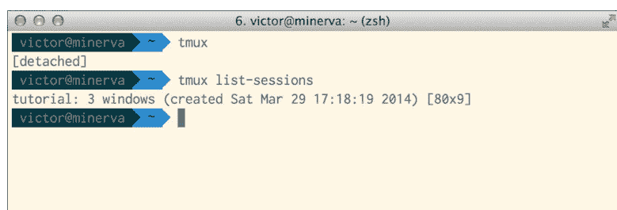

要将已分离的会话重新连接到当前会话，只需运行以下命令：

```
$ tmux attach-session -t tutorial
```

这条命令告诉 tmux 连接一个会话，并将要连接的会话指定为目标（因此使用 `-t`）。在本例中，我们要连接名为 tutorial 的会话。果然，你应该已经回到了 tmux 会话中：底部显示着现在熟悉的状态栏，你在 nano 中创作的杰作也重新出现在眼前。

注意，这是该命令最完整的写法。如果只有一个正在运行的会话，就像我们这个场景一样，实际上可以省略目标参数。这会将命令缩短为 `tmux attach-session`。由于 `attach-session` 还有一个更短的别名 `attach`，因此还可以进一步缩短。这样，我们只需使用 `tmux attach` 就能完成同样的操作。

在全文中，我们通常会使用更完整的写法，因为它们往往描述得更清楚，并将较短的对应写法留作读者练习。

## 解释 tmux 命令

现在你可能会注意到，`attach-session` 听起来像是一个相当长的命令。`list-sessions` 也是如此，而且 tmux 命令词汇表中还有许多其他看起来相当冗长的命令。


### Tab 补全

长命令的复杂性比看起来要小，因为大多数命令都可以通过 Tab 补全。试着打开你的命令行提示符并输入以下内容：

```
$ tmux list-se
```

接下来，按 Tab 键。你应该会看到它补全为：

```
$ tmux list-sessions
```

因此，多亏了 Tab 补全，记住这些长命令的需求就很少了。

请注意，Tab 补全只在某些配置的 shell 中有效，所以如果 Tab 补全技巧不起作用，你可能需要搜索网络并找到一种方法来为 tmux 启用 Tab 补全。

### 别名

大多数命令都有别名，即每个命令的较短形式，可以使用。例如，list-sessions 的别名是 ls。new-session 的别名是 new。

你可以通过运行 tmux 命令 list-commands（别名 lscm）轻松查看它们全部，如以下代码片段所示：

```
$ tmux list-commands
```

这将显示所有 tmux 命令及其别名，完整名称后用括号括起来。

在整篇文章中，我们将始终使用完整形式以求清晰，但你同样可以轻松使用别名（当然也可以使用 Tab 补全）。

你会最有可能注意到的一件事是，在你的终端中只有最后几行是可见的。如果你拿起鼠标并尝试向上滚动，那也不起作用！如何查看放置在上面的文本？我们需要进入名为 Copy mode 的东西，它在本文本后面有自己的章节（参见第 4 章，Manipulating Text）。

### 重命名窗口

假设你想给一个窗口一个更有描述性的名称。如果你有三个不同的窗口，每个窗口都打开了 nano 编辑器，看到每个窗口都是 nano 就不会很有帮助了。幸运的是，重命名窗口非常容易。只需切换到你想要重命名的窗口。然后 <Prefix>, 会提示你输入新名称。让我们将 nano 窗口重命名为 masterpiece。

请看状态栏已更新，现在显示窗口 0 及其 masterpiece 标题，如以下屏幕截图所示。幸运的是，tmux 不够智能，无法检查窗口的内容；否则，我们不确定 masterpiece 标题是否能通过。

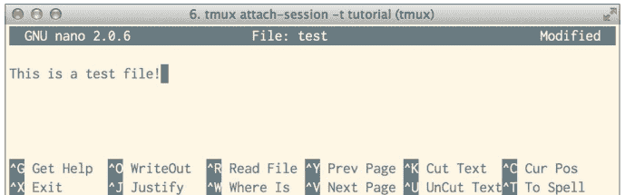

### 关闭窗口

作为我们虚拟之旅的最后一站，让我们杀掉一个不再需要的窗口。使用我们的 find-window 技巧切换到窗口 1，输入 <Prefix>, f, cat test, Enter 或者当然我们也可以使用不太令人兴奋的 <Prefix>, l 命令移动到最后打开的窗口。

现在让我们向这个窗口告别。按 <Prefix>, & 来杀掉它。你会收到一个提示，需要确认你是否要杀掉它。

这是一个破坏性过程，不像分离，所以请确保你关心的任何内容都已保存。

一旦你确认，窗口 1 将不复存在。可怜的窗口 1！你会看到现在只剩下窗口 0 和窗口 2：

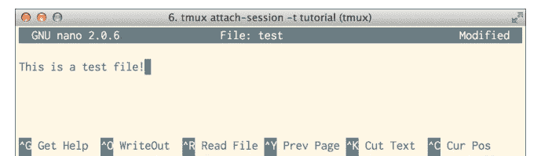

你还会看到现在 <Prefix>,f, cat test, Enter 不再加载窗口 1，而是显示 **No windows matching: cat test**。所以，窗口 1 真的已经不在我们身边了。

每当我们创建一个新窗口时，它将采用最低可用的索引，在本例中将是 1。所以窗口 1 可以再次出现，但这次作为一个新且不同的窗口，对过去几乎没有记忆。我们也可以重新编号窗口，如后面将看到的，所以如果窗口 1 缺失会冒犯你的审美感，不用担心，可以补救！

### 总结

在本章中，我们直接上手，对 tmux 中一些最酷的功能进行了旋风式巡游。

以下是本章涵盖的功能的快速总结：

- Starting tmux
- Naming and renaming sessions
- The window string and what each chunk means
- Creating new windows
- The prefix key
- Multiple ways to switch back and forth between windows
- Accessing the help documents for available key bindings
- Detaching and attaching sessions
- Renaming and killing windows

在下一章中，我们将研究配置以及 tmux 可以以多种方式进行自定义以适应你的口味和工作流程。

对于本章及以后所有章节中学习到的所有命令的参考，你可以参考 *Appendix* 中的 *Key binding and command reference* 部分。

- Binding a new prefix key
- Binding keys without the prefix key
- Unbinding keys
- Revising the status bar
- Option types
- Handy configuration tips

到本章结束时，我们还将构建一个示例配置文件，你可以用它作为你自己的个性化配置的起点。

### 使用 set-option 命令

在 tmux 中设置和配置选项的主要方式是通过恰如其名命名的 `set-option` 命令。

此命令可以单独调用以临时设置选项。然而，大多数时候，我们将使用它在 tmux 配置文件中设置选项，以便每次启动 tmux 时，选项都会按我们希望的方式设置。

为了体验使用 `set-option` 命令临时设置选项，打开一个终端窗口并启动 tmux；或者，如果你一直在按照第 1 章 Jump Right In 进行操作，只需在窗口中输入以下命令：

```
$ tmux set-option status off
```

一旦你这样做，状态栏就会消失！此设置仅是临时的，所以如果你保持原样，结束会话并重新启动 tmux 或创建新会话，它将不会加载此设置。换句话说，状态栏将会出现。

你所做的是告诉 tmux 将选项 `status` 设置为值 `off`。你可以使用此命令以这种方式即时设置任何 tmux 选项。没有状态栏可能会有点不安，所以让我们把它重新打开：

```
$ tmux set-option status on
```

如果我们希望这些配置选项在 tmux 重启和会话之间保持不变，我们需要某种方法告诉 tmux 它们的值应该是什么。我们将通过创建 tmux 配置文件来做到这一点。

### 创建 tmux 配置文件

为了在重新启动 tmux 后保留设置，我们将创建一个配置文件，其中包含我们想要设置的所有选项及其值的相关信息。

像许多其他基于 Unix 的实用程序一样，配置 tmux 只需在你的主目录中创建一个名为 .tmux.conf 的文件即可。

然而，与许多其他配置文件不同，tmux 配置文件不包含程序的某种特定配置语言，而是由一系列在 tmux 启动时按顺序运行的 tmux 命令组成。我们将看到的大多数命令都是简单的 set-option 命令，类似于我们在前面的示例中玩过的命令。让我们创建并开始构建我们的配置文件：

```
$ cd ~
$ touch .tmux.conf
```

在你喜欢的文本编辑器中打开这个新创建的文件，我们就可以开始了！

> 与大多数基于 Unix 的实用程序一样，你个人目录中的此文件仅包含你自己的用户的配置。
> 也可以设置将应用于系统所有用户的全局 tmux 配置。它遵循与个人配置文件相同的格式，但通常位于 /etc/tmux.conf。
> 然而，由于系统上并非所有用户都想要相同的全局配置，最好只修改你自己的个人配置。

### Emacs 或 vi 模式

正如我们在第 1 章 Jump Right In 中发现的那样，tmux 试图通过为两种最广泛使用的文本编辑器各提供一套键绑定来帮助开发者。如果你更倾向于其中一种，这很可能是你想要首先更改以使 tmux 对你感觉正确的事情之一。

tmux 的默认设置是使用 Emacs 模式键，所以如果你是 Emacs 用户，你可能已经准备就绪。tmux 也会尝试提供帮助，并可能基于环境变量默认切换到其中一组或另一组。要检查 tmux 当前处于哪种模式，运行以下命令：

```
$ tmux show-options -g | grep key
```


## 修改状态栏的背景颜色

让我们在配置中添加一项，用来改变状态栏的颜色。通过前面的快速上手，我们看到状态栏的默认颜色是某种绿色。注意，我们的配置中恰好也有一种绿色，但在你的终端上很可能显示为不同的颜色，除非你使用的配色方案与我们相同。

> 作者使用的配色方案叫做 Solarized。这是一套包含深色和浅色两种变体的配色方案，专为终端和可读性优化。它由 Ethan Schoonover 开发，因其精确性、对称性，以及能让几乎任何代码看起来都相当漂亮，在技术社区中获得了不少追随者。更多信息请访问 http://ethanschoonover.com/solarized。

我们当前终端的配色方案如下面的截图所示：

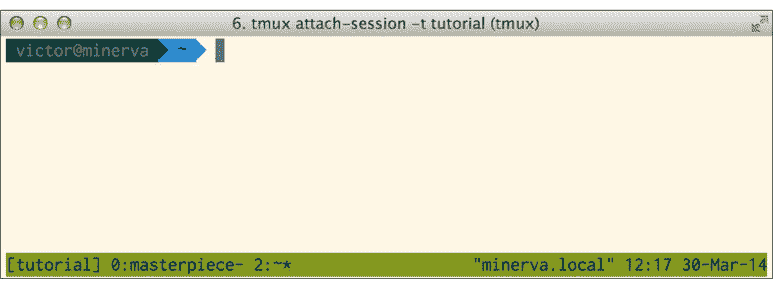

哎呀！在我们当前的配色方案下，这看起来相当难看。

假设我们希望它变成一种更好看的蓝色。打开你喜欢的文本编辑器，编辑 `~/.tmux.conf`，添加下面这一行：

```
set-option -g status-bg blue
```

这一行指定我们希望状态栏为蓝色，而不是默认颜色（在我们的系统上默认恰好是绿色）。

你应该会看到状态栏立即变成蓝色（同样，这取决于你的 shell 和终端程序对颜色的支持能力）。

注意，我们做的只是把写入配置文件的那段文本，在 tmux 后面输入一遍，然后就搞定了。

回想一下，像这样在 shell 中运行的任何命令都只是临时的，所以我们仍然需要配置文件；不过，这是一种快速测试某个命令是否能按预期工作的好方法。

## 重新加载配置

现在，我们有了一个全新的配置文件，里面包含改变状态栏颜色的新命令，但在我们重新加载配置、让 tmux 从新文件中加载命令之前，这个配置是没有用的。

保存配置文件后，它已经准备好生效了，但是看，你的状态栏仍然是绿色的！我们如何告诉 tmux 去获取最新的配置并重新加载窗口以使用该配置呢？有两种方法可以告诉 tmux 重新加载配置。

第一种是彻底终止所有会话，然后重新启动 tmux。这不是一个很吸引人的选项，因为它需要关闭我们所有的 tmux 会话，这也就意味着要关闭所有当前打开并运行的程序。然后，我们必须重新启动所有的 tmux 会话和窗口，并重启所有程序，才能回到之前的状态——仅仅是为了重新加载配置。这样做可行，但总体而言是个相当混乱的解决方案。一般来说，tmux 在重启时会加载新的配置文件，这是相当不错的，因为这意味着之后任何 tmux 启动都会使用我们最新的配置，这很合理。然而，这迫使我们关闭所有正在运行的应用来加载它，这并不理想。

第二种更常见也更有用的方法是使用 `tmux source-file` 命令。这个命令会告诉 tmux 去获取最新的配置并立即加载。在这种情况下，无需离开 tmux！

在 tmux 中进入命令行提示符（如果你跟着第 1 章“直接上手”操作过，你会知道只需按下 <Prefix>, 2 就能调出我们留在那里的命令提示符）。如果当前没有打开的窗口，只需在 tmux 中打开一个新窗口（<Prefix>, c），默认就会以命令提示符启动。现在在提示符中输入以下命令并按回车：

```
$ tmux source-file ~/.tmux.conf
```

和下面的截图类似，你应该会看到状态栏现在是蓝色的了！

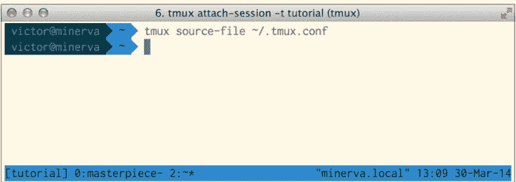

## 修改状态栏的前景颜色

现在蓝色状态栏看起来不错！不过文字有点难以阅读；背景和文字之间的对比度不够。让我们来修复这个问题！

再次打开 `.tmux.conf` 文件，这次添加第二行：

```
set-option -g status-bg blue
set-option -g status-fg white
```

使用我们之前讨论的方法，用 `source-file` 命令重新加载配置。现在，如下面的截图所示，状态栏上的文字应该更容易阅读了！

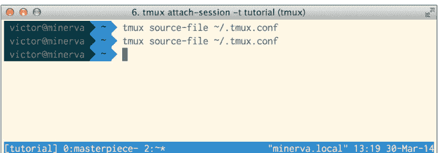

## 高亮当前活动窗口

让我们更容易看出哪个是当前活动窗口。星号也能起到作用，但既然我们有这些颜色，也许可以更直观一些。

再次打开 `.tmux.conf` 文件，这次添加第三行：

```
set-option -g status-bg blue
set-option -g status-fg white
set-window-option -g window-status-current-bg magenta
```

这里我们看到了第一个窗口选项。前两个选项是全局的。这意味着在所有窗口中，状态栏始终会有蓝色背景。

这一新行的意思是，对于每个窗口，如果它是当前窗口，就将其背景设置为洋红色。再次使用 `tmux source-file ~/.tmux.conf` 重新加载配置，看看效果，如下面的截图所示：

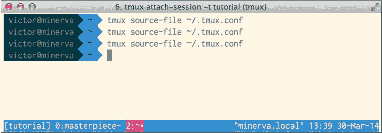

切换到另一个窗口，观察洋红色高亮会跟着移动。

你可能注意到，每次我们都要输入很多内容来重新加载配置，完整地敲一遍 `tmux source-file ~/.tmux.conf` 命令。肯定有更好的办法吧！

坏消息是，tmux 默认没有提供重新加载配置的按键组合。好消息是，我们可以绑定自己的按键来让这个任务更简单！

幸运的是，通过查看按键绑定列表，似乎 `Ctrl + r` 目前没有绑定到任何 tmux 命令。所以它可以自由使用。在按键绑定界面中，所有以 `C-` 开头的键都表示你需要按下 Ctrl 键。因此，`C-r` 的使用方式与 `Ctrl + r` 相同。

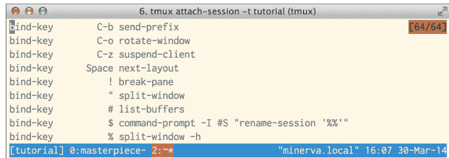

这会相当方便，因为默认的前缀键也使用 Ctrl 键。所以假设当前默认前缀键是 `Ctrl + b`，我们将能够按住 Ctrl，依次轻按 B 和 R 来重新加载配置。

## 将 Ctrl 重新绑定到 Caps Lock


我最喜欢的一个编程效率技巧，就是在系统范围内将 Caps Lock 重新绑定为 Ctrl。这在大多数计算机的操作系统层面都很容易实现，甚至在一些功能更强的键盘上也可以。

大多数电脑用户很少使用 Caps Lock，但它位于主键盘行上，按起来很方便。由于 Ctrl 键经常被命令行程序员使用，而它在键盘上的位置又比较难按，交换两者会非常有帮助。通过交换，万一你真的需要用到 Caps Lock，它仍然可以通过键盘上原来的 Ctrl 键位置来访问。

作者是 Emacs 的忠实粉丝，而 Emacs 大量使用 Ctrl 键，tmux 也是另一个重度使用 Ctrl 键的程序。

这绝不是强制要求，但如果你发现自己经常使用 Ctrl 键，可以考虑使用这个小技巧！

在 Mac 上，这非常简单，不需要额外软件。在其他一些系统上会稍微麻烦一点，但到处都能实现。

详细教程请访问 http://vq.io/rebindcaps。

> 注意，我们还在一些逻辑分组之间添加了一些空格。幸运的是，tmux 配置会忽略空白字符，所以我们可以按自己喜欢的方式分隔它们。

## 绑定新的前缀键

我们也可以重新绑定前缀键，让它变得更方便，或者设置成不会与其他程序冲突的方式。

你们中的一些人可能来自使用 GNU screen 的背景，那是另一个终端复用器，使用 `Ctrl + a` 作为前缀键。所以与其学习 tmux 的按键，你可能想直接把 `Ctrl + a` 重新绑定为你的 tmux 前缀键。

或者，你可能是 Emacs、nano 或其他大量使用 `Ctrl + b` 来将光标向后移动一个字符的程序的频繁用户。在这种情况下，`Ctrl + b` 并不是一个适合全局重新绑定的方便按键。

这类用户可能会选择将前缀键重新绑定为在 Emacs 或其他程序中较少使用或不太重要的键，比如 `Ctrl + t`。这还顺便有助于提供按键提示（t 代表 tmux！）。

无论你的动机是什么，重新绑定前缀键都是可能的。那么，作为练习，让我们把它重新绑定为 `Ctrl + t`。如果这让你感到不适，你可以在自己的配置中忽略它。不过，重新绑定前缀键与重新绑定其他键略有不同。你可能会认为在 `.tmux.conf` 文件中写下下面这行就能生效，但事实并非如此：

```
bind-key C-t prefix
```

回想一下，tmux 中的所有按键绑定首先都需要按下前缀键才能生效。所以这段代码片段，用大白话来说，本质上是在说：“在你按下前缀键之后，再按 Ctrl 和 t 作为前缀键。”它并不是在说：“这是新的前缀键，请使用它。”

因此，要设置前缀键，请在我们不断增长的 `.tmux.conf` 中添加以下几行：

```
## 将状态栏背景设置为蓝色
set-option -g status-bg blue
## 将状态栏文字设置为白色
set-option -g status-fg white
```


注意到 `-n` 选项了吗？这允许你在不先按下前缀键的情况下直接按下绑定键。因此，你可以直接按下 `F1` 而无需任何前缀，立即切换到窗口 1！

这听起来像是一个非常酷的技巧（通常也确实如此），直到你在 tmux 中运行哪怕一个需要使用 `F1` 键的程序。到那时，由于你已经在全局范围内为 tmux 捕获了 `F1`，该键击就无法在该程序或任何其他程序中使用，因为 tmux 会捕获它，将其用于你指定的用途，并且永远不会将其传递给程序。同样，你可以使用诸如将 `<Prefix>, F1` 绑定为向底层窗口发送 `F1` 的技巧；然而，对于大多数用户来说，养成全局覆盖按键的习惯可能并不是一个好做法。

所以，这里最可能出现的结果是，你可以为类似功能创建一些很酷的全局快捷键，它们会正常工作一段时间，直到你遇到一个例外。然后你会取消它们的绑定，并最终不得不说服自己的肌肉记忆去忘记它已经学到的东西。

## 取消按键绑定

现在，假设有一个你想出于某种原因移除的键绑定。这非常简单；只需在你的 `.tmux.conf` 文件中添加一个 `unbind` 指令即可。

假设出于某种原因，我们想取消 `0` 默认的“选择窗口 0”操作。为此，只需将以下代码片段添加到你的配置中：

```
unbind 0
```

请注意，在将某个键绑定到其他功能之前，无需显式地取消该键的绑定；每个键只能有一个绑定。因此，我们发现这个实用功能很少用到，但知道它在需要时可用也是件好事。

## 重新审视状态栏

上次我们修改状态栏时，更改了它的颜色，但没有对其内容做任何改动。tmux 允许我们更改状态栏内容的许多不同方面。我们不会深入探讨每一种可能的配置，但会解释相关概念并展示一个示例。

所以，状态栏基本上分为三个部分：

- **status-left**：这表示状态栏左侧的内容，包括当前会话

假设我们想更改 `status-left` 的值，使其看起来类似于 `{username@host}`，其中用户名和主机名自动填充；我们可以轻松做到这一点。只需将以下行添加到 `.tmux.conf` 并重新加载配置（请注意，我们还加宽了状态栏，因为默认值是 10，内容会被截断）：

```
set-option -g status-left-length 25
set-option -g status-left "#(whoami)@#H"
```

这将为我在状态栏中填充 `{victor@minerva.local}`，因为它执行了 `whoami` 命令，将该命令的输出放入 `@` 之前的字符串中，并在其后填充主机名。

## 选项类型

到目前为止，我们设置的所有选项都带有 `-g` 标志。这意味着该选项是全局生效的。然而，选项有三种类型：服务器选项、会话选项和窗口选项。

还有多个标志用于指示给定选项应如何影响或被影响。听起来很复杂，但实际上相当简单。

服务器选项将应用于连接到 tmux 的任何客户端。在底层，当你第一次输入并运行 tmux 命令时，tmux 会创建一个服务器；然后，它会创建你的客户端并连接到它所启动的服务器。这就是允许你分离会话、稍后重新连接，并让一切保持你离开时状态的魔法，因为 tmux 服务器会在后台持续运行。因此，使用 `-s` 标志指定的选项将应用于服务器，这意味着它会影响任何连接到该服务器的客户端。

会话选项将应用于当前会话。这意味着两个客户端可以连接到同一个服务器，并且各自可以拥有略有不同的会话选项。这与服务器选项形成对比，服务器选项是每个客户端无论是否愿意都拥有相同的选项。会话选项没有标志；它们是通过省略标志来设置的，因为它们是默认类型。

然后是窗口选项，它们仅应用于单个窗口。要设置窗口选项，请使用 `-w` 标志指定。

在配置选项时，它们是向下级联的。因此，使用 `-g` 指定的全局选项将作为主集。然后，链中任何更下层的选项都将继承全局设置，或者可以用自己的设置覆盖全局设置。

要做到这一点，只需在你的 `.tmux.conf` 文件中添加一个 `bind-key` 条目，并将与前缀键相同的按键组合绑定到 `last-window` 命令。例如，如果你按照前面的步骤将前缀键设置为 `Ctrl + t`，那么以下行在你的 `.tmux.conf` 文件中是合适的：

```
## 双击前缀键跳转到上一个窗口
bind-key C-t last-window
```

现在，切换到上一个窗口就像按住 `Ctrl` 并轻敲两次 `t` 一样简单。

## 更改转义时间

我听说一些 vim 用户反映，tmux 会在命令之间增加一个短暂的、几乎察觉不到的延迟，这可能导致在 tmux 内运行 vim 时出现奇怪的行为。

在 tmux 术语中，这种延迟被称为 `escape-time`（转义时间）。默认情况下，它设置为 500 毫秒。要解决 vim 的问题，请将以下行添加到你的配置文件中，将 `escape-time` 设置为 0：

```
set-option -s escape-time 0
```

请注意，这个选项显然存在是有原因的，所以做此更改时务必谨慎，因为你可能会遇到意外行为。然而，我们听说许多 vi 用户做了这个更改后，再也没有回头。另外请注意，如前所述，这个选项带有 `-s` 标志，因此它是一个会话特定的选项，这意味着如果其他人连接到同一服务器，他们可以为 `escape-time` 设置不同的值。

## 增加历史记录限制

tmux 只有有限数量的回滚历史。回滚历史是指它保存在内存中、已经滚出屏幕并且可以在复制模式（参见第 4 章《处理文本》）中访问的行数。

然而，tmux 的默认 `history-limit` 是 2,000，对于许多使用场景来说可能相当低。为了调高它，请将以下行添加到你的配置文件中：

```
set-option -g history-limit 10000
```

请注意，增加此历史记录限制的同时，也会增加 tmux 的内存占用。因此，如果设置得过高，可能需要进行一些调整，特别是如果你倾向于打开大量窗口和窗格的话。

## 增加显示时间

某些命令会导致 tmux 向你显示一条消息，用其显示的文本替换状态栏。消息显示的时间被称为 `display-time`（显示时间）。

开箱即用时，tmux 的 `display-time` 值相当低。尝试在另一个窗口中搜索你知道不存在的文本。例如，按 `<Prefix>, f`，然后输入任何你确定在其他窗口中不存在的搜索字符串，例如 `potato`。

你会看到文本 `No windows matching: potato` 出现在状态栏的位置，然后眨眼间就消失了：

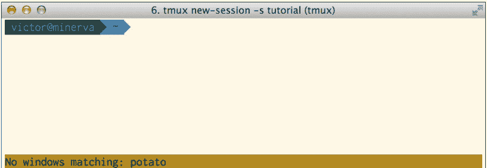

它会一闪而过，因为它只会在屏幕上停留当前 `display-time` 的时长，而默认情况下只有 750 毫秒。将 `display-time` 的值调高一些可能是个好主意，这样消息就能显示得更久一点，至少在你对 tmux 更熟悉之前是这样。要做到这一点，请将以下行添加到你的配置文件中，将持续时间改为 2 秒：

```
set-option -g display-time 2000
```

对于 2 秒的持续时间，我们将 `display-time` 设置为 2000，因为显示时间是以毫秒为单位的。

## 总结

现在让我们把所有内容整合起来。请参阅 *附录* 以查看最终成果，即我们在本章中构建的 `.tmux.conf` 文件。

在本章中，我们学到了许多关于配置 tmux 的知识。从一个空白的 `.tmux.conf` 配置文件开始，我们构建了一个更大的配置，改变了我们使用 tmux 体验的许多方面。

我们通过修改状态栏改变了外观和感觉，并学习了如何绑定按键，包括前缀键。我们向你展示了如何将多个命令绑定到同一个按键绑定，以及如何取消按键绑定。我们学习了如何通过添加注释来保持文件的可管理性和良好的文档化，以及如何在不使用前缀键的情况下绑定按键。我们了解了可以在配置文件中设置的不同类型的选项，以及一些可能对大多数读者来说不太容易显而易见的实用配置技巧。

到本章结束时，我们已经构建了一个非常丰富的示例配置文件，它可以成为你个人定制的绝佳起点。我们还学习了一些如何浏览手册页以获取可用选项的详尽列表的方法。

我们希望你将这个 `.tmux.conf` 文件视为一份活的文档，并用你发现的其他有趣内容更新它，同时移除或修改现有的任何部分。根据你的需求个性化它；毕竟这就是它的用途！

既然我们已经学习了所有关于配置的知识，在下一章中，我们将继续讨论 tmux 的主要基础之一：会话、窗口和窗格的概念。


窗口（window）和窗格（pane）与它们对应的现实世界事物是非常完美的类比。看一看各种不同的现实世界中的物理窗户，你会发现其中许多都被整齐地分割成多个窗格。

> tmux 中的窗格相较于现实世界窗户上的窗格，一个很大的好处在于：它们可以根据你的需求轻松地创建、销毁和调整大小。而大多数物理窗户上的窗格可做不到这一点。

## 动手体验会话、窗口和窗格

现在我们已经有了一个高层面的理解，接下来就稍微逛一逛会话、窗口和窗格。让我们从一个全新的终端窗口、没有任何现有 tmux 会话的状态开始。先创建一个名为 work 的会话：

```
$ tmux new-session -s work
```

你会看到一个名为 work 的新会话启动。这个会话当前只有一个窗口，窗口中只有一个窗格。

让我们再创建一个窗口。回想一下，这可以通过按下 <Prefix>, c（c 代表 create/创建）来完成。现在你有一个会话、两个窗口和两个窗格。每个窗口都只有一个窗格，如下面的截图所示：

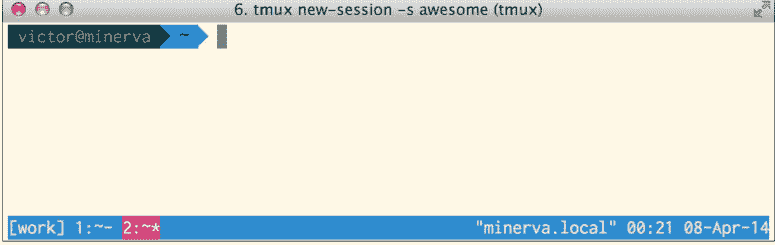

## 多个会话

现在让我们看看同时使用多个会话是什么感觉。首先分离当前会话。回想一下，要做到这一点，我们需要按下 <Prefix>, d（d 代表 detach/分离）。

现在 work 会话已被分离，我们回到了命令行提示符，你的屏幕应该与下一张截图类似。我们不要重新附加 work 会话，而是创建一个新会话，并将其命名为 play：

```
$ tmux new-session -s play
```

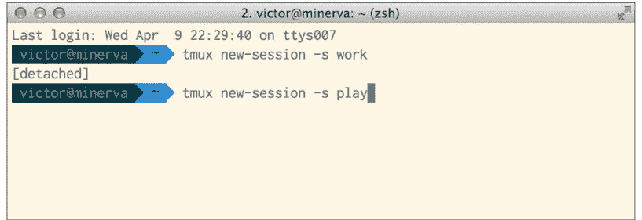

现在看起来我们有了一个完全不同的会话。我们的状态栏也不一样了，左下角显示的是会话名称 [play]，而不是 [work]。

现在要切回 work 会话，我们可以分离 play 会话，回到一个没有 tmux 的终端，然后重新附加会话，这次以 work 会话为目标；不过实际上还有一种更简单的方法。

只需按下 <Prefix>, s（以交互方式选择会话），就会弹出一个对话框，我们可以从中选择要附加到哪个会话。所以，我们甚至不需要离开当前所在的会话就能切换到另一个会话。使用方向键高亮你想要的会话，或者直接点击与该会话对应的数字即可切换。

试着切换到另一个会话，再切回来，但等等，还有一种更简单的方法。只需使用 <Prefix>, )（下一个会话）和 <Prefix>, (（上一个会话）在会话之间循环切换。你会发现切换会话非常容易。这里我们跳过多个窗口之间的切换，因为你已经从第一章知道了如何操作；让我们直接进入多个窗格的部分。

## 多个窗格

现在让我们把这个窗口拆分成两个窗格。输入 <Prefix>, %（垂直分割窗口），可以看到窗口现在被垂直分隔线从中间分开了；我们有了另一个命令提示符。这就是第二个窗格，如下面的截图所示：

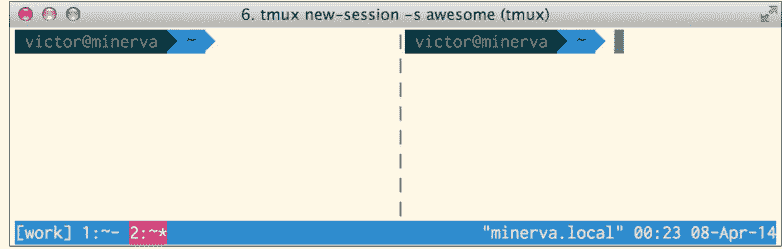

现在我们有两个会话、三个窗口和四个窗格。一个会话、一个窗口和一个窗格构成 play 会话（它现在不可见，但在后台正常运行），而一个会话、两个窗口和三个窗格构成我们在上一张截图中看到的 work 会话。

让我们稍微摆弄一下窗格。首先，试着输入一些文本。你会看到光标在右侧窗格中。要让它移动到左侧窗格，只需按下 <Prefix>, o（o 代表 other/其他）。现在你的光标就在另一个窗格中了。输入一些内容来确认光标在哪个窗格中。

实际上，有一种比输入随机内容更好的方法来判断光标在哪个窗格中。从之前的截图中可能很难分辨；然而，当一个窗口被垂直分割成两部分时，如果光标在左侧窗格中，分割这两个窗格的垂直分隔线的上半部分会着色；如果光标在右侧窗格中，下半部分会着色。在之前的截图中，下半部分以绿色显示，表示光标在右侧窗格中。当窗格超过两个时，tmux 会尝试不同的方案让我们知道哪个窗格处于活动状态，我们很快会看到。

你也可以使用 <Prefix> 加右方向键、<Prefix> 加左方向键、<Prefix> 加下方向键或 <Prefix> 加上方向键，将光标移动到右侧、左侧、下方或上方的窗格。这样更容易记住，并且在窗格结构更复杂时也更有用。

## 使用更多窗格

现在，<Prefix>, %（垂直分割窗格）并不是创建窗格的唯一方式。它只是将当前窗格垂直分割成两个较小的窗格。如果你再执行一次，它会用另一条垂直分隔线将当前窗格再一分为二，如下面的截图所示：

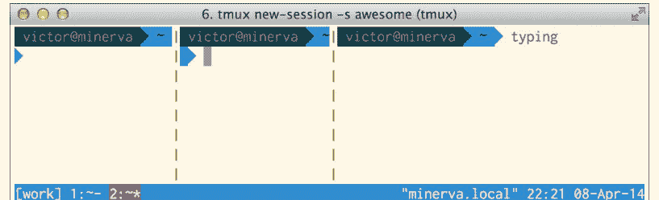

不过这看起来有点愚蠢和拥挤。首先，让我们杀掉那个窗格，然后尝试垂直分割。要杀掉我们创建的新窗格，我们可以终止该窗格中正在运行的程序——在这种情况下，输入 exit 并按下回车，因为这会结束 shell 进程。或者，我们可以按下 <Prefix>, x（杀死窗格），然后会被询问是否要杀死该窗格。

> 注意，杀死一个正在运行进程的窗格会立即终止该进程，而不会优雅地结束它，因此你将会丢失该窗格中的任何现有数据。请务必小心！

确认 y，你就回到了两个窗格的状态。注意，当一个窗格被移除时，周边内容会自动调整到合适的大小。让我们尝试水平分割左侧窗格。为此，输入 <Prefix>, "（水平分割窗格），如下面的截图所示：

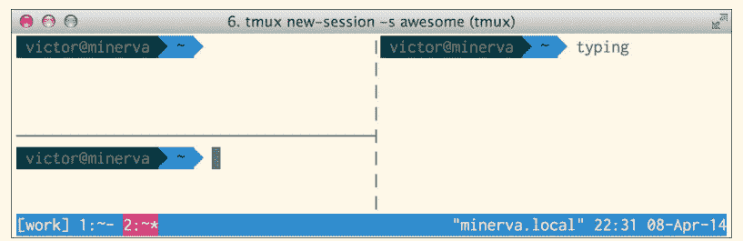

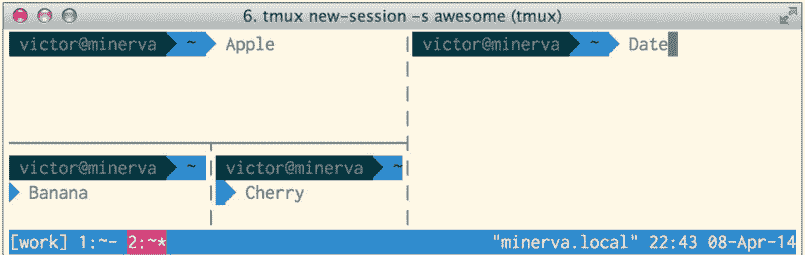

让我们尝试用合理的增量来调整窗格大小。使用 <Prefix>、方向键或 <Prefix>, o 将光标移到 Date 窗口上。

现在要调整它的大小，让我们试试 <Prefix>, Meta 加右方向键。你应该会看到最右侧的窗格变小了一点。再试一次，它会变得更小。再试试 <Prefix>, Meta 加左方向键，你应该会看到最右侧的窗格变大了一点。

> 如果你看看自己的键盘，发现没有 Meta 键，你并没有错过什么；大多数键盘上都没有这个键。
>
> Meta 是终端程序中经常使用的一个键，在历史上它曾在键盘上占有一席之地，但现在不再有了。
>
> iTerm 和 Mac 自带的终端程序都可以选择将 Option 键用作 Meta。其他操作系统通常也有某种方式将 Alt 键用作 Meta。
>
> 尽管这可能让人困惑，但本书中使用 Meta 是因为这是历史沿用的称呼，更重要的是，因为这是 tmux 文档中所指的键。

谢天谢地，你不需要每次想稍微调整大小时都输入前缀键；一旦你开始调整大小，就可以不带前缀键一遍又一遍地输入增大或缩小的命令。所以先用 <Prefix>, Meta 加右方向键，然后你应该可以按住 Meta 键并按左方向键、右方向键或左方向键来改变窗格大小。你会看到窗格不断扩展和收缩，而不必每次都停下来输入前缀键。

这是改变窗格大小的一种方式。实际上，这每次以五个单元格为单位进行调整（每个单元格基本上就是一个等宽字符所占的空间）。

## 会话、窗口和窗格

我们还可以更精细地调整，每次以一个单元格为单位改变大小。只需按下 <Prefix>, Ctrl 加方向键。不过，这样移动的增量要小得多，而且在 OS X 上会与切换空间（Space）的命令冲突。

如果你已经跟着*第 2 章 配置 tmux*操作过，并且开启了 mode-mouse 选项，以及 mouse-select-pane 和 mouse-resize-pane 选项，那么你也可以使用鼠标来选择活动窗格。只需点击活动窗格即可完成选择，还可以通过点击并拖拽来调整窗格大小，使其变为活动窗格。虽然这样做的缺点是不得不伸手去拿鼠标，但这可能是快速达到所需窗格布局的最简单方法。

## 按编号在窗格之间切换

既然我们有了这么多窗格，在它们之间切换可能会有点笨重。方向键很不错，但可能还是有点烦人。谢天谢地，有一种更简单的方法。按下 <Prefix>, q，你会看到每个窗格中都会出现一个数字，然后很快就会消失。

当前活动的窗格会以不同于其他窗格的颜色显示。这还会显示每个窗格的尺寸。

就像每个窗口都被分配了一个唯一编号一样，每个窗格在每个窗口中也被分配了一个唯一编号。如果你再次按下 <Prefix>, q，并在数字消失之前输入出现在那个窗格中的数字，你就会自动切换到那个窗格。

默认情况下，这些数字在屏幕上停留的时长是 1 秒，但你可以通过在 .tmux.conf 文件中添加以下选项来更改：

```
set-option -g display-panes-time 3000
```

这会将窗格编号显示在屏幕上的时间延长到 3000 毫秒（即 3 秒），让你有更多时间通过索引选择窗格。

所以，要跳到输入了 Apple 这个词的窗格，只需按下 <Prefix>, q，然后按 1。因为你之前位于哪个窗格并不重要，因为这个窗格被赋予了索引 1；使用这个组合键就会跳到那个窗格。

## 循环切换窗格布局

tmux 为我们提供了几种不同的方式来自动改变窗格布局，这样你就不必用别扭的方式精心分割和调整大小来达到想要的结果了。


这组按键中功能最丰富的要数一个键绑定，每次按下组合键时，它都会循环切换到一种不同的预设窗格布局。这个组合键是 <Prefix>，空格键（循环切换窗格布局）。

试试看；按下 <Prefix>，空格键，你会看到窗格移动。内容保持在窗格中，因此其中的任何程序都会继续正常运行，但每次使用该组合键时，窗格都会以不同的方式重新排列和调整大小。

如果你查看状态栏，会看到布局的名称。你可以循环切换五种不同的预设布局，分别是：水平均分、垂直均分、主水平、主垂直和平铺。

在你了解特定用例中自己喜欢哪种布局之前，循环切换是查看各种可能性的一个好方法。

一旦你足够熟悉这些布局，就可以直接切换到它们，无需循环遍历所有布局。方法是按下 <Prefix>，然后按 Meta 和预设布局在之前列表中的索引。例如，你可以使用 <Prefix>，Meta + 1 切换到水平均分视图，<Prefix>，Meta + 2 切换到垂直均分视图，依此类推。

## 其他窗格操作

窗格操作实在太多，本书无法详尽地全部覆盖；对于大多数未讨论的操作，我们恳请你深入查阅 tmux 的手册页：

```
$ man tmux
```

或者，你可以在网络上参考 http://man.cx/tmux。

既然你了解了窗格，手册页中关于窗格的内容应该很容易理解和掌握。

你可以做很多事情，比如将一个窗格拆分为独立窗口；旋转窗格；将一个窗格与另一个窗格交换；将窗格移动到另一个窗口；以及将所有的窗格水平排列、垂直排列、平铺排列，等等。

还有更多用于调整窗格大小的命令，其中许多甚至没有键盘快捷键，因为它们并不常用。当然，你可以添加自己的快捷键，如果你阅读了第 2 章“配置 tmux”，你的工具箱中就应该有相应的工具来实现这一点。

## 本章小结

在本章中，我们学习了 tmux 中关于会话、窗口和窗格的大量知识。我们了解了它们各自如何融入 tmux 的层级结构，并通过实践操作来巩固这些概念。我们创建了多个会话，将窗口拆分为多个窗格，移动它们，并学习了在窗格之间切换光标的多种方式。

在下一章中，我们将进入文本处理部分，学习如何回滚窗口历史、如何将窗口历史中的文本复制到粘贴缓冲区，以及如何粘贴这些内容。
