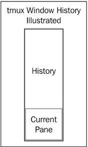
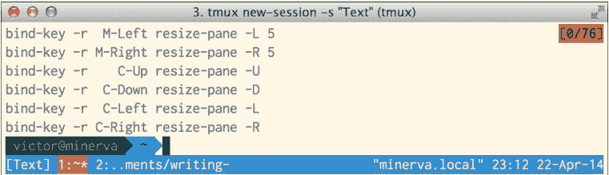
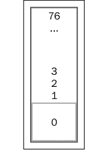
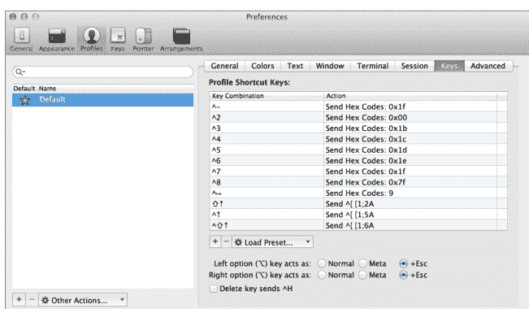
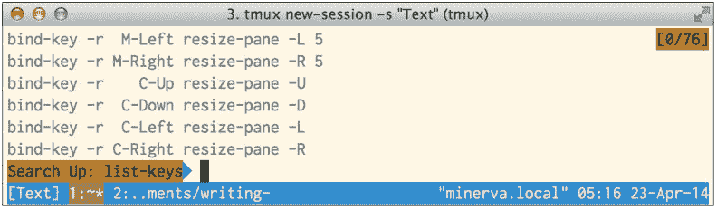
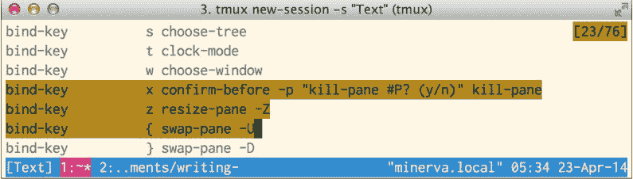
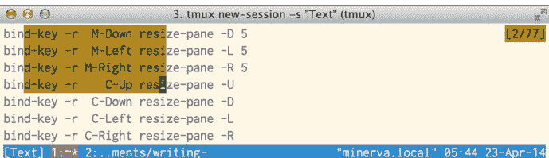
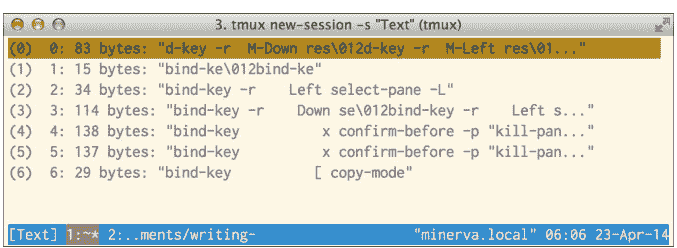

## 文本处理

tmux 中有两个重要组件我们还没有详细讨论，即**复制模式**和**粘贴缓冲区**。

复制模式是 tmux 中我们可以切换的一种模式；它允许我们选择屏幕上已经出现的文本并复制。此外，它还允许我们将光标移动到屏幕上的任何位置，甚至移动到已滚出屏幕的区域。

当从复制模式复制某个项目时，它最终会进入粘贴缓冲区。顾名思义，这个缓冲区用于存放所有被复制的内容，以便稍后粘贴。

以下是本章将要介绍的功能的快速摘要：

- 窗口历史以及 tmux 如何处理移出屏幕的文本
- 解释 tmux 的两种模式
  - 向上滚动窗口历史
  - 通过搜索或行号跳转
  - 将文本复制到粘贴缓冲区
- 与粘贴缓冲区交互
  - 粘贴最后复制的项目
  - 查看整个粘贴缓冲区堆栈
  - 交互式选择要粘贴的项目

在本章结束时，我们将全面了解如何在 tmux 中处理文本。

## 解释窗口历史

你可能在前几章中注意到，输出文本过多的命令似乎被截断了。你可以看到结尾部分，但其余部分似乎跑到窗口上方去了。如果你尝试向上滚动，却无法滚动。这是怎么回事？

命令的开头并没有永远丢失。它仍然存在；只是滚出了屏幕。

为了实现其神奇功能并将所有内容保留在单个终端窗口中，tmux 必须隐藏所有无法适应当前查看窗格的文本。它将这些文本全部存储在一个叫做**窗口历史**的缓冲区中。

可以把这想象成一本实体书的页面。一本书包含的文本远多于你在任意时刻能看到的，但为了便于管理，所有这些文本都在同一时间不可见的页面上。唯一可见的页面是你打开的那一页。

类似地，tmux 会保留所有未适应当前查看窗格的文本，并将它们收纳到窗口历史中。

当然，tmux 不需要像传统书籍那样把页面堆叠起来，一页压在一页上面。因此，只要配置了历史记录，这些文本就会按顺序一个接一个地向下排列。

下面的插图有助于直观理解：



## 选择文本

- **时钟模式：** 该模式显示当前时间，与其说是一种实际模式，不如说是一种新奇/实用工具。可以通过 `<Prefix>, t` 访问。
- **控制模式：** 该模式允许第三方应用程序通过纯文本协议与 tmux 交互。

此外，这也是我们开始接触 tmux 中文本处理技巧的地方。当我们进入复制模式时，可以回滚查看窗口历史，还可以使用一些很酷的文本处理工具。

让我们用一个复制模式的示例工作流来走一遍。

## 复制模式工作流示例

如果你从本章开头一直跟随我们，那么你应该已经启动了一个 tmux 会话。让我们先重新运行之前用来列出可用键绑定的那个长输出命令：

```
```bash
$ tmux list-keys
```
```

正如我们上次运行这个命令时所看到的，当前窗格中只显示了最后几行。然而，现在我们掌握了一些关于窗口历史的知识，可以推测其余的行仍然存在，只是滚动到屏幕之外了。我们如何向上滚动查看那些文本呢？复制模式！

## 进入复制模式

让我们进入复制模式，以便回滚查看其余内容，这些内容存储在窗口历史中。按 `<Prefix>, [` 切换回复制模式。

你会注意到的第一件事是屏幕上新增了一个界面元素。终端屏幕右上角会出现一个新框，显示 **[0/76]**，如下面的截图所示：



这向我们展示了历史记录中的行数（76）以及光标当前所在的行号（0）。

请注意，这些行是按逆时间顺序排列的，因此 0 代表我们当前查看的窗格，1 是它上面的一行，2 是第 1 行上面的一行，而 76 是窗口历史最顶部的内容。这有助于在我们向上滚动时了解我们在历史记录中的位置。

回到我们的窗口历史示意图，这些行可以理解为下图所示：



[0/76] 中的第一个数字会显示当前视图中最低可见行的索引。有时这会有点令人困惑，因为当你向上滚动时，似乎第一个数字在你将光标滚动过当前窗格之前不会开始增加；然而，当你向下滚动并逐行将文本带入当前视图时，这就更合理了。

## 移动光标

既然你处于复制模式，就可以一次一个字符地向上、下、左、右移动光标。这很直观，即使用上箭头、下箭头、左箭头或右箭头键，或者 Ctrl + p、Ctrl + n、Ctrl + b、Ctrl + f（k、j、h、l）。试着在复制模式下稍微移动一下光标。

## 复制模式的 Emacs 或 vi 风格键绑定

实际上，在 tmux 中为复制模式绑定按键有主要两种方式：Emacs 风格键绑定或 vi 风格键绑定。

这可以使用 mode-keys 选项进行配置。我们将主要介绍默认（Emacs 风格）键绑定，并在其后附上 vi 键绑定作为括号说明。然而，请注意，正如我们在第 1 章“直接上手”中所见，tmux 很智能，可能会根据你的环境变量更改默认值。因此，虽然 Emacs 是通常的默认值，但在没有任何配置的情况下，基于另一种配置，你可能会默认使用 vi 模式，而 tmux 开箱即用就是这样设置的。

如果你是 vi 用户，要知道你可以设置 vi 风格的模式按键；如果这么做了，浏览复制模式的按键方式与浏览 vi 的正常模式非常相似。

复制模式的 Emacs 键绑定可以通过以下命令查看：

```
tmux list-keys -t emacs-copy
```

复制模式的 vi 键绑定可以通过以下命令查看：

```
tmux list-keys -t vi-copy
```

或者，你可以查看 mode-keys 下的手册页，了解有关配置以及哪个键做什么的更多细节（http://man.cx/tmux 或在终端中运行 man tmux）。


现在让我们向上滚动，看看后面留下了什么。

## 滚动浏览窗口历史

要向上滚动一页，你可以使用 Page Up 或 Meta + v（Ctrl + b），你会看到每次按下时，右上角的数字都会从 [0/76] 变化，与你当前所在的位置匹配。


你还会注意到，很快你就会看到之前不可见的文本。没错，现在你正在向上滚动到 Window 历史记录中！当然，你也可以使用 Page Down 或 Ctrl + v（Ctrl + f）来向下导航到下一页。

你可能会发现 Meta + v 在 tmux 中无法向上滚动。如果遇到这种情况，很可能是由于终端的配置设置所致。

如果你在 Mac 上使用 iTerm2，你可以指定终端如何发送 Option 键。要访问此设置，请访问 Preferences | Profiles | Keys，你应该会看到 Left option (^) key acts as。将其设置为 +Esc 即可使 Option 键像 Meta 一样工作，如以下截图所示：



如果你在 Mac 上使用 Terminal，你也可以指定终端如何发送 Option 键。要访问此设置，请访问 Preferences | Profiles，选择你的活动配置文件，选择 Keyboard 选项卡，并勾选 Use Option as Meta key。

对于其他操作系统，Alt 通常开箱即用即可作为 Meta。

你也可以直接使用 Meta + > (g) 跳转到 Window 历史记录的顶部，并使用 Meta + < (G) 返回到底部。

## 通过搜索或行跳转

通常，当你回溯历史记录时，你确切地知道自己在寻找什么。当这种情况成立时，你可以通过搜索词跳转到特定行。

例如，在 Copy mode 中，按 Ctrl + r（?）。你会在左下角看到出现 Search Up：，如以下截图所示：



输入 list-keys 然后按 Enter。你会看到你直接跳转到了 Window 历史记录中该词 list-keys 的最后一次使用。再次尝试，你就会跳转回我们第一次输入它的时间。

如果你没有确切的搜索词，你仍然可以直接跳转到行号。只需按 g（:）即可提示你输入要跳转到的行。这在你不确定具体要搜索什么但想回跳几页时很有帮助。

## 退出复制模式

要退出 Copy mode 并返回到 Default mode，只需按 Esc 或 q 即可离开 Copy mode。

还有许多其他键可以导航到 Copy mode，但描述每一个都太繁琐了。不过我们已经见过大部分，其余的可以在 tmux 手册页上找到：

```
$ man tmux
```

或者，你也可以使用 tmux 命令 list-keys -t emacs-copy 或 list-keys -t vi-copy 来查找，具体取决于你选择的键绑定。

你可以在 http://man.cx/tmux 上在线查看更多用于导航到 Copy mode 的键。

## 将文本复制到粘贴缓冲区

现在我们已经尝到了在 Copy mode 中导航的滋味，让我们来实际使用它。

Copy mode 不仅仅是为了让你可以滚动浏览 Window 历史记录，也是为了提供一种从过去复制文本并重用的方式。

通过按 `<Prefix>, [` 进入 Copy mode 并滚动直到找到感兴趣的文本。一旦找到想要复制的内容，确保光标位于想要复制的起始位置并按 `Ctrl + Space bar`（Space bar）。这会设置选择的起点。

现在使用前面提供的相同键移动光标，你会看到选择被高亮并随着你远离选择起点而增长。你选择的区域背景颜色会与其他区域不同。以下截图就是一个示例：



当你对选择满意时，只需按 `Meta + w (Enter)` 复制文本，你会立即离开 Copy mode 并滚动回你所在的位置。你选择的文本将被复制并添加到你的 paste buffer 中（稍后会详细介绍）。

需要注意几点如下：

- 这是按照 Emacs（或 vi）的键命令来建模的，几乎完全相同，用于导航、复制等。如果你使用 Emacs 或 vi，应该会感到相当熟悉。如果你不熟悉两者，可能会觉得有点陌生，需要一些时间适应。
- 请注意，tmux 中的复制操作始终是非破坏性的。你已从 Window 历史记录中复制了文本，但完全没有更改 Window 历史记录。因此，你可以一遍又一遍地复制同一文本而不会干扰历史记录。
- 如果你尝试从多行复制文本，你可能会注意到选择包裹的行。你可以在 Copy mode 中在开始选择之前或之后随时按 R (v) 将其切换为矩形。这在以下截图中显示：



- 你也可以使用 Ctrl + k 键盘命令抓取光标右侧的所有文本或单行文本的末尾，就像 Emacs 中的 kill line 一样。同样，tmux 的 Copy mode 是非破坏性的，因此这不会像 Emacs 中那样实际删除该行，而是将其复制到 paste buffer。

## 与粘贴缓冲区交互

Paste buffer 是存放你将复制的所有文本的暂存桶，你稍后可以访问它并粘贴到任何 pane。

它实际上是一个栈，因此每次从 Copy mode 复制的项目都会添加到栈顶，每个新项目都会添加到顶部，而其他项目则向下移动一位。Paste buffer 中的每个项目都根据其进入栈的顺序分配一个编号。

## 从粘贴缓冲区粘贴文本

现在你已经抓取了一些文本，你想从 paste buffer 中取出它。

在 tmux 中运行的任何程序中，将光标移动到想要粘贴文本的位置并按 <Prefix>, ]。

例如，让我们启动 nano：

```
$ nano
```

一旦我们这样做，就用 <Prefix>, ] 粘贴我们最后复制的内容。

果然，我们的文本出现了！注意这种很好的对称性，你使用 <Prefix>, [ 进入 Copy mode，而使用 <Prefix>, ] 粘贴文本。

现在 <Prefix>, ] 很适合粘贴最近复制的文本片段，但对于复制两项然后粘贴两项等更复杂的情况怎么办？不用担心，tmux 已经涵盖了！

## 从粘贴缓冲区选择项目

Paste buffer 不仅仅是保存最后复制内容的单个文本块；它实际上是所有先前复制项目的栈。你可以按任何顺序访问它并从中粘贴。

要访问此列表，只需按 <Prefix>, =。这会调出一个交互式列表，显示你之前复制的最后几项，如以下截图所示，你只需高亮其中一项并按 Enter 即可粘贴它：



默认情况下，每次复制时，它都会被添加到 paste buffer 栈中。有趣的是，默认情况下，当你从 paste buffer 中取出一个项目时，它不会将最新复制的项目从缓存中弹出。

命令 <Prefix>, ] 只是快速从栈顶（0）抓取并粘贴。

## 使用粘贴缓冲区

在使用 paste buffer 时，我们还可以做一些其他有用的事情。

你可以通过在 tmux 配置中将 buffer-limit 选项设置为一个数字，来选择性地设置存储在此栈中的项目数量限制。如果出于安全原因，你只想保留最近复制的例如五项，这会很有用。

你也可以通过按 <Prefix>, :（list-buffers）并按 Enter 来非交互式地列出 paste buffers，这将以列表形式显示所有缓冲区，你可以滚动浏览。注意每个缓冲区都有一个索引，即一个数字，后跟该缓冲区的大小。按 q（Esc）关闭此列表。

此缓冲区索引可用于多种操作。它可用于删除缓冲区、将缓冲区复制到另一个会话、在特定索引加载缓冲区、设置特定缓冲区的內容、将缓冲区写入文件等等。关于缓冲区可以完成的所有事情超出了本书的范围，但我们将在第 5 章《Diving Deeper》中重新审视一些非常有用的任务。

与前几章一样，附录中提供了完整的键绑定和命令参考，其中包含了本章学到的所有键和命令，集中在一处。

## 总结

在本章中，我们学习了很多关于文本操作的内容，从了解 Window 历史记录开始，到学习 tmux 中用于向上滚动 Window 历史记录的两种不同模式。我们接着学习了按搜索词或行跳转、将文本复制到 paste buffer、使用 Copy mode 复制文本。我们最后讨论了如何将项目从 paste buffer 粘贴到底层窗口、如何查看整个 paste buffer 栈以及如何限制 paste buffer 中存储的项目数量。

在下一章中，我们将进入一些更高级的使用主题，包括对 paste buffer 的更深入理解、关于会话和窗口的更多内容，以及一个启动 tmux 并使用默认设置的机会。


