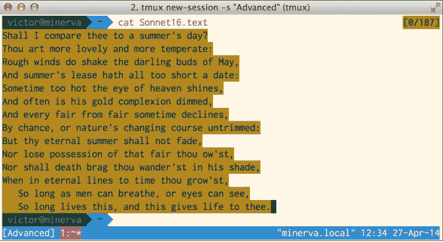
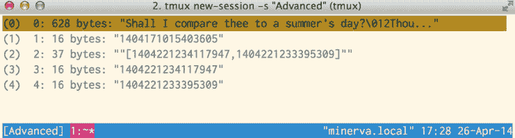
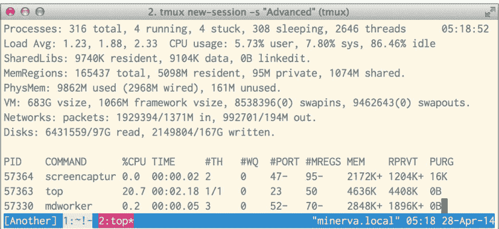
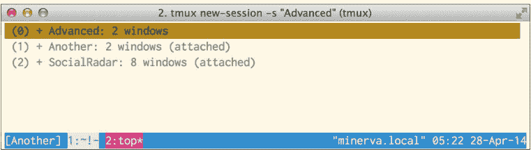
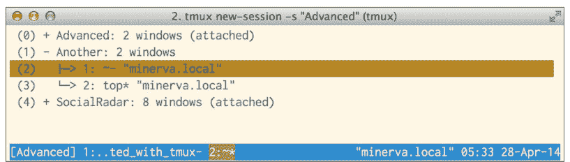
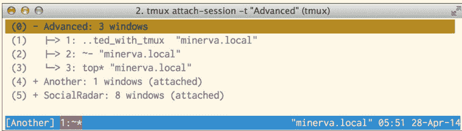
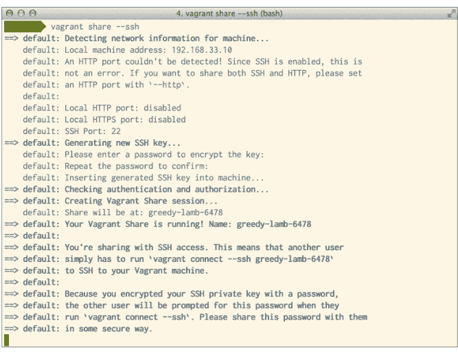
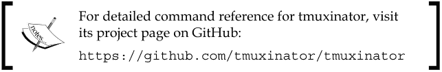
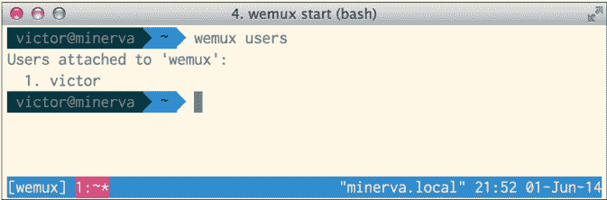

## 深入探讨

既然我们已经学习了如何使用复制模式和粘贴缓冲区进行文本操作，也就讨论了 tmux 的大部分基础操作。现在让我们深入探讨一些更高级的使用主题，这些主题在你的日常工作中可能会很有帮助。

我们已经对这些内容有了一些了解，但这一次我们将更深入地探索它们。在本章中，我们将介绍以下主题：

- 理解 tmux 命令与命令模式
- 高级粘贴缓冲区用法
- 从一个会话中的窗口跳转到另一个会话中的窗口
- 移动窗口
- 在会话之间链接窗口
- 拆分窗格
- 合并窗格
- 使用默认窗口启动会话

### 理解 tmux 命令与命令模式

你可能已经注意到，在前面几章中，我们使用不同的方法访问了某些命令。例如，我们演示了如何列出当前的键绑定。这可以通过以下方式完成：

- 使用组合键 `<Prefix> ?`。
- 直接在 shell 中键入命令，并在命令前加上 tmux 关键字，例如 `tmux list-keys`。

### 将粘贴缓冲区保存到文件

假设你刚刚将大量优秀文本复制到了粘贴缓冲区，现在想将其保存到文件中。

当然，你可以打开文本编辑器，粘贴缓冲区的内容，然后保存一个新文件；然而，tmux 提供了一种便捷的方法，可以毫不费力地将粘贴缓冲区直接保存到文件中。

所以，请回到你的 tmux 会话中，或者启动一个新会话，我们开始吧！

1. 首先，找一些要复制的文本。可以是任何包含文本的文件。例如，我们有一个示例文件，通过 `cat filename` 将其内容打印出来。你可以使用计算机上的任何文件。
2. 回想一下，我们可以通过按 `<Prefix> [` 进入复制模式。
3. 然后，按 `Ctrl + Spacebar` 开始复制文本。
4. 继续移动以高亮文本。
5. 然后，按 `Ctrl + w` 复制文本。



好了，现在我们的粘贴缓冲区索引 0 中有一些文本。我们可以通过 `<Prefix> =` 查看。



该粘贴缓冲区中有 628 字节。按 `q` 关闭该对话框。现在我们可以运行 tmux 命令 `save-buffer -b 0 [path]`；这里，`[path]` 是我们保存文件的位置，`-b 0` 表示我们要保存来自索引 0 的粘贴缓冲区的文本，也就是我们刚刚复制的文本。运行此命令后，我们会得到一个包含该缓冲区内容的新文件。

例如，`<Prefix> : save-buffer -b 0 ~/sonnet16.poem` 会将粘贴缓冲区的内容保存到文件中。这在许多情况下都非常有用。例如，假设你正在使用 `tail` 实用程序实时跟踪日志文件。如果屏幕上出现有用的片段，进入复制模式，将其复制到粘贴缓冲区，然后保存到文件，这是一种将相关文本复制到文件的便捷方式。或者，想象你正在阅读手册页，想把一个有用的片段保存到文件中以备后用。在这种情况下，先将片段复制到粘贴缓冲区，再直接将该缓冲区写入文件，就能快速保存供以后使用。

### 从文件加载粘贴缓冲区

我们也可以实现相反的操作，即将文件内容加载到粘贴缓冲区中。要做到这一点，只需运行 tmux 命令 `load-buffer [path]`，该文件的内容就会被加载到粘贴缓冲区中。

如果你有文件中的文本想要粘贴到 tmux 内运行的任何程序中，这会非常有用；你无需在编辑器中导航并打开该文件、用光标选中文件中的所有文本，然后复制它才能粘贴。

这可能非常有用，例如，可以利用 tmux 的核心功能打造一个非常强大的代码片段管理器。

假设你在代码中经常编写各种常见的样板代码，例如 for 循环、函数定义或类声明。你可以为每段样板代码创建一个简单文件，直接将其加载到粘贴缓冲区，然后在 tmux 中粘贴。如果你的主目录中有一个名为 `~/snippets` 的文件夹，并且有一个名为 `~/snippets/forloop` 的 for 循环样板文件，你可以使用 tmux 命令 `load-buffer ~/snippets/forloop` 加载它，然后通过 `<Prefix> ]` 直接粘贴到当前缓冲区。随着时间推移，当你为大量样板代码积累片段时，可以节省大量击键操作。

默认情况下，如果未指定索引，文件内容将被加载到索引 0，就像你通过 `<Prefix> [` 正常复制它一样（其他粘贴缓冲区会向上移动一个索引）；不过，也可以指定要将文件内容加载到的缓冲区索引。

请注意，如果指定了缓冲区索引，该索引必须是已经存在的缓冲区索引，并且它会覆盖你提供的索引对应的粘贴缓冲区内容。因此，例如，使用 tmux 命令 `load-buffer -b 0 ~/snippets/forloop` 指定缓冲区 0 时，内容不会进入索引 0 并将所有缓冲区向上推一位；相反，它会完全替换索引 0 中之前可用的任何内容。

### 直接设置粘贴缓冲区

也可以直接用 tmux 设置缓冲区。如果你想多次粘贴相同的文本，这可能会很有用。无需先完整输入文本，然后复制它再进行粘贴；你可以直接设置缓冲区的内容。

例如，假设我们想直接把一个句子放入缓冲区。我们可以通过执行 tmux 命令 `set-buffer` 来实现，也可以选择指定索引并提供要放入该缓冲区的文本。以下步骤将指导你直接设置粘贴缓冲区：

1. 尝试执行 `<Prefix> : set-buffer "The quick brown fox jumped over the lazy dog"`。
2. 由于我们没有指定缓冲区索引，它会被推入堆栈顶部，即缓冲区索引 0，其余缓冲区向下移动一个索引。我们可以使用 tmux 命令 `show-buffer` 查看该缓冲区的内容。果然，你会看到内容正是我们刚刚设置的句子。
3. 现在使用 `<Prefix> ]` 将其粘贴到屏幕上。

当然，肯定有某种方法可以清除窗口历史记录，以帮助防止这种情况。确实有，那就是 tmux 命令 `clear-history`。你可以选择提供一个目标窗格，它将清除该窗格的历史记录。例如，`clear-history -t 1` 将清除窗格 1 的历史记录，即使该窗格不是你当前活动的窗格。

> 清除历史记录时，它会清除该窗格中已滚动出窗格的所有窗口历史记录，但会保留该窗格当前可见的所有内容。要清除历史记录以及该窗格中的所有内容，最好先运行 Unix 命令 `clear` 将内容推出屏幕，然后运行 tmux 命令 `clear-history` 来清除所有内容。
>
> 请注意，如果有极其敏感的信息需要清除，最好在清除窗口历史记录后重启 tmux。这些敏感信息虽然已从窗口历史记录中删除，因此无法在复制模式中获取，但仍然可能被能力很强的黑客嗅探到。其数据位可能会残留在 tmux 的内存转储中并可被恢复，因此重启 tmux 是确保它也从内存中消失的唯一方法。虽然这是一种相当边缘的情况，但值得一提。


### 高级会话与窗口用法

之前讨论会话时，我们介绍了如何从一个会话切换到另一个会话。当时没有涉及一些更高级的内容，例如从一个会话中的一个窗口直接切换到另一个会话中的另一个特定窗口、在会话之间移动窗口以及在会话之间共享窗口。

#### 从一个会话中的窗口跳转到另一个会话中的窗口

几章之前，我们讨论了如何使用 `<Prefix> s` 调出会话列表并选择任意会话来在多个会话之间切换。

好的！让我们先做一些准备。我们需要两个活动会话，每个会话有几个窗口。如果你跟上了上一节的内容，我们应该已经有一个活动会话了；现在让我们使用 tmux 命令 `new-session -s "Another"` 创建另一个会话。

现在让我们使用 `<Prefix> c` 创建另一个窗口，并在其中运行一些命令，例如 `top`：

```
$ top
```


The output of this command is shown in the following screenshot:



Let's switch back to our other session with <Prefix> s and then highlight and select the other session we want, as shown here:



Jump onto the other session (Advanced, as shown in the preceding screenshot). Now if we do the same thing again, using <Prefix> s and switch back to the Another session, we will arrive back in Another, in window 2 that is running top. This is because tmux will take us back to the last window we were viewing in an active session.

However, what if we wanted to move directly from one session to a specific window in another? Surely, we should not have to switch to the session and then select the window. Well, we can directly choose a window within a session, and tmux actually makes this a breeze.

Bring up the choose-tree interface again with <Prefix> s. Notice the plus symbols to the left of the session names? They're there because that session can be expanded to show the windows running in those sessions. Simply highlight the session you want to drill into and tap the Space bar or right arrow key to unfold that session and see a list of the windows in that session. Notice how it resembles a file tree, as shown in the following screenshot. This is why this command has the name that it does.



Recall from our first chapter what some of the magic characters on the window mean? The characters are as follows:

- The character * indicates the currently active window
- The character - indicates the previously active window

In the preceding screenshot, you can see that window 2 running top was our currently active window. If we just selected the session by choosing (1), we would be plopped back into that session with the window running top. However, if we want to go directly to the other window, we can do this by highlighting it, refer to the previous screenshot, and hitting Enter.

## 移动窗口

So we've got top running in the session named Another. Imagine that we want to move that window to our session named Advanced. First, switch to the window with top running. Now run the tmux command move-window. It is conveniently bound to the keyboard shortcut <Prefix> . so you can type that and then provide the name of the destination session which, in our case, is Advanced.

Note how that window is gone; now our Another session has only one window. The window with top was moved to the Advanced session, but we are still in the Another session. tmux opened the other window to keep us in the current session.

Now pull up the session list again using <Prefix> s and then expand Advanced. In the following screenshot, we can see how it now has three windows, the last of which is the window that we just moved by running top:



Note that this same command can also be used to move a window to a different index within the same session. We can specify the numerical index we'd like the window moved to within this session rather than providing a session name. For instance, to move a window to index 5, we could run the same move-window command via <Prefix> . and then enter 5; by doing this, the status bar will be updated to reflect this window's new index.

When being moved from one session to another, the window will, by default, be placed at the lowest available base index. So, if you have set the base index to 1 and have windows in index 1 and 3, the moved window will land in this session with index 2.

To specify both the session and window index as the home for the window, specify both, separating them with a colon. For example, to move this window to the Another session in window index 7, you could use the move-window command with the argument Another:7 where the session comes before the colon and the window index after.

This is also useful to move a window to a session with a numeric name, such as the default session name 0. By default, if you specify a number alone to the move-window command, tmux will assume you meant the window index 0 and not the session named 0. To specify this, you will use the command move-window 0: to explicitly specify the session named 0.

## 在会话之间链接窗口

Now moving the window between sessions is quite useful, but what if we want to use the same program in multiple sessions and not have multiple instances of it running? Note that if you do this, killing a pane or window in one place will kill it at both places.

To later remove a window from one session but not the other, you will need to unlink the window rather than kill it by using the tmux command, unlink-window.

## 拆分窗格

The act of taking a pane within a window and moving it to its own window is called breaking that pane. It can be accomplished with the tmux command break-pane or the keys <Prefix> !.

By default, the break-pane command will operate on the currently selected pane; however, any arbitrary pane can be specified using the same syntax we saw in the previous example to select a window within a session, specifically separating the session and window name by a colon. However, of course, a pane also has an index, which can be added after the window separated by a period. This all sounds complex, but it is actually rather intuitive.

For example, to select pane 2 in window 1 in the session Advanced and break it into its own window, we could use the command break-pane -s Advanced:1.2.

Remember that you can see the current pane indexes flash on the screen briefly with the key binding <Prefix> q.

When you break a pane, tmux automatically switches the window to select the window that now contains that pane.

## 合并窗格

In addition to linking windows between one session and another, you can also do something called joining panes. The name can seem a bit misleading at first, but essentially, this is used to take a pane in one window and move it to another window.

It can be used to move one pane in a multipaned window to another window, but it can also be used to take a window, which has only one pane, and join it with another (now its name is probably a bit less misleading). This is very useful if you have two windows running different things but decide you'd prefer them as two panes of the same window.

For example, let's say we have a pane running in one window and we want to join it with another window. In the simplest case, we could switch to the pane we want to join and run the command `join-pane -t :1` where `:1` indicates that we want the window in index 1 in the current session. After running this command, the window index 1 in the current session will have the contents of any panes it had before in addition to the new pane we just joined to it.

Using the same elaborate `session:window.pane` syntax we saw previously, we can specify a source pane and target destination to get really slick about it. Say we want to take the pane in the session **Advanced**, window 2, pane 1, and move it to the session **Another**, window 1, and not specify a pane number so it defaults to the lowest available index. We can do this with the command `join-pane -s Advanced:2.1 Another:1`

As you can now see, joining panes is an incredibly powerful tool in your tmux arsenal that will allow you to combine multiple panes into one. Now you have learned how to break a pane off into its own window, how to combine it with other panes, how to move windows and link them between sessions, and more.

## 使用默认设置启动

Imagine you integrate tmux into your workflow such that you get very used to certain things being in certain places, perhaps a shell at the root of your code repository in window 1, Emacs in window 2, top in window 3, and so on. Now every time you reboot your machine, you spend some time to set up everything again, start a new session, create three windows, launch the programs in each window, and so on; there must be a better way. Of course there is!

tmux gives us some ways to configure things with nice defaults out of the box. We'll also see another way to do this later in *Chapter 7, Using Other Tools with tmux*, with a third-party utility.

So let's take the previous example and run through it. There are ways to make some of this happen within your `.tmux.conf` file but it's generally more powerful to do it externally via a separate bash script. So hop into your favorite editor and start editing a new file named `.tmux.defaults`. You can name this file anything, so if you have multiple sessions you may want to name it based on the session name.

Now let's specify our configuration. In this file, copy the following code:

```
new -n term zsh
neww -n emacs emacs
neww -n htop htop
```


当然，你的命令可能会根据你的系统配置以及你希望默认运行的内容而略有不同。

现在，要使用此配置文件运行，请按如下方式启动 tmux：

```
$ tmux source-file ~/.tmux.defaults
```

就这样！你会看到自己在一个新的会话中启动，其中有三个窗口：第一个运行终端，第二个在 Emacs 中，第三个在 top 中。

同样，你可以通过简单地为每个想要自动化的会话创建多个文件来创建多个这样的配置。

> 要了解有关使用默认设置启动 tmux 的更多详细信息，请查看 tmux 手册中关于会话初始化的部分：https://wiki.archlinux.org/index.php/Tmux#Session_initialization

可以创建比前一个示例更复杂的会话初始化，但复杂配置通常更适合由第三方工具处理，我们将在第 7 章《使用其他工具与 tmux》中看到这一点。

## 总结

在本章中，我们重新回顾了几个 tmux 主题，比前几章深入得多。到目前为止，你应该对粘贴缓冲区、会话、窗口、窗格以及我们在本章中深入探讨的其他所有主题都有很好的掌握和深入的了解。

在下一章中，我们将不会再学习 tmux 本身的更多机制，而是学习大量使用技巧，可以帮助最大化你的生产力。

## 6

## tmux 用于 SSH、结对编程等

到目前为止，我们已经几乎涵盖了 tmux 机制的方方面面。综合前几章的内容，我们现在已经了解了配置、会话、窗口和窗格、文本操作，以及诸如粘贴缓冲区、移动窗口、窗格，甚至使用某些默认值启动会话等主题中的高级使用。因此，在这一点上，我们可以用许多很棒的方式使用、配置和自定义 tmux。

现在，我们将不会探索使用 tmux 的机制中的新概念，而是探索新的利用我们已经学到的东西的方法，以便简化日常工作流程。在本章中，我们将涵盖以下主题：

- 通过 SSH 使用 tmux 进行长期会话
  - 使用 Vagrant 设置虚拟机
  - 通过 SSH 使用 tmux 的工作流程
  - 在连接时通过 SSH 启动 tmux
- 使用 tmux 进行结对编程
  - 连接到同一会话
  - 使用 Vagrant Cloud 进行结对编程
  - 使用分组会话进行配对

## 通过 SSH 使用 tmux 进行长期会话

有多少次你通过 SSH 连接到远程服务器，却因为网络波动导致会话终止，让你在重新连接时回到原点？

使用 tmux，你可以连接到远程服务器，启动一个 tmux 会话，并按你喜欢的方式设置窗口和窗格。然后，如果你因任何原因与远程服务器断开连接——无论是网络波动、SSH 会话超时、断开 VPN，还是简单地关闭笔记本电脑回家——你稍后可以 SSH 到该机器并重新连接到你的 tmux 会话，该会话一直在运行，保留了你离开时的状态。

这是我最喜欢的 tmux 用法，也是我在日常工作流程中节省最多时间的方法。不仅因为它可以优雅地处理网络连接问题，而且因为大多数运行 Linux 的远程服务器很少被终止；这意味着一旦你启动 tmux 会话，它可以持续数周或数月。

从实际角度来说，这意味着你每天连接到某个远程服务器时，都可以通过使用 tmux 节省设置时间。你不必切换到通常想要在某个窗口中打开的目录，你不必在另一个窗口中连接 tail 到日志文件，你也不必在另一个窗口中打开你喜欢的文本编辑器中的文件。它们都会在那里，就像你之前离开时一样——多亏了 tmux。

让我们通过一个实际示例来演示这一点。为此，要么通过 SSH 连接到远程服务器，要么我们提供了使用 Vagrant 在本地创建虚拟机的简短说明，你可以连接到它。

### 使用 Vagrant 的好处

Vagrant 是一个非常简单的方式，使用虚拟化在本地启动一台机器。我们建议在这里使用它以保持一致性。

我们提供的说明应该适用于几乎任何 Linux 服务器的连接，但由于有如此多的不同 Linux 发行版、版本等，肯定会有一些细微的不一致。

通过使用 Vagrant，我们可以确保作者本地的环境与我们提供的说明相匹配，而这些说明将与读者本地的环境相匹配，如果你也使用 Vagrant 来设置环境的话。

现在关闭你的终端窗口。是的，我是认真的，相信我——一切都会继续运行！想象一下这就像掉线、SSH 超时或回家度过一天一样。打开一个全新的终端窗口。运行以下我们之前运行过的 SSH 命令：

```
$ ssh -i ~/.vagrant.d/insecure_private_key vagrant@tmux.dev
```

一旦通过 SSH 连接，运行以下命令：

```
$ tmux attach-session -t MyServer
```

你甚至可以运行以下命令的简写版本来附加你之前运行的会话：

```
$ tmux attach
```

瞧！一切都和你离开时一样！它会一直持续通过所有断开连接，只要该服务器保持运行。想象一下每天早上连接到服务器或任何时候断开连接时不必打开所有这些窗口所节省的时间！

## 在 SSH 连接时自动启动 tmux

你也可以触发 tmux 在 SSH 连接时自动运行，这样你就不必先连接然后再启动 tmux。再次关闭你的终端窗口并打开一个新窗口。在这个新窗口中，运行以下命令：

```
$ ssh -i ~/.vagrant.d/insecure_private_key vagrant@tmux.dev -t -- 'tmux attach-session -t "MyServer"'
```

这告诉 SSH，在你连接后，你希望立即运行 tmux attach-session 命令并重新附加你之前拥有的会话。这很方便，但你连接到服务器的命令变得相当长了！我们可以将这个长命令放在一个可执行的 shell 脚本中并运行该脚本来连接到你的远程服务器。或者，我们也可以通过将其大部分内容隐藏在我们的 SSH 配置中来使事情变得更容易。打开你喜欢的编辑器并编辑 ~/.ssh/config 文件。该文件可能已经存在；它在你使用 SSH 连接到服务器时使用。将以下行添加到文件中：

```
Host tmux
  HostName tmux.dev
  User vagrant
  IdentityFile ~/.vagrant.d/insecure_private_key
```

现在你可以使用以下简化命令更轻松地连接：

```bash
$ ssh tmux -t -- 'tmux attach-session -t MyServer'
```

> 不幸的是，没有很好的方法可以将 tmux 命令隐藏在 ~/.ssh/config 文件中。但是，有一种方法可以在服务器上通过调整 ~/.ssh/authorized_keys 文件来实现。
> 
> 我们把这个作为用户的练习，因为这深入到了概念中，而且并非总是希望每次连接到远程主机时都启动 tmux。
> 
> 它也可能导致连接到远程主机的問題。例如，想象一下你指定在连接时远程会话应始终运行 tmux attach-session -t MyServer。但是，如果会话 MyServer 尚不存在会怎样？你可能会被锁定在服务器之外！所以亲爱的读者，请谨慎行事。

## 使用 tmux 进行结对编程

所以我们看到了如何创建会话以及如何附加现有会话，但你是否想过如果多个终端附加到同一个会话会发生什么？

能够将多个终端连接到同一个会话最终成为 tmux 提供的最大优势之一。通过允许两个或多个终端窗口连接到同一个 tmux 会话，tmux 成为一个极其强大的协作工具。使用 tmux，两个或更多人可以同时看到甚至交互相同的内容！

## 本地连接到同一会话

在进行完整的结对编程之前，让我们先尝试在两个不同的终端窗口中本地连接到同一个会话，看看会发生什么。

如果你按照之前的说明进行操作，你应该能够通过打开一个新终端窗口并运行以下命令来调出你的 tmux 会话：

```bash
$ ssh tmux -t -- 'tmux attach-session -t MyServer'
```


So let's get started. The following steps will guide you in using Vagrant:

- 1. Go to https://vagrantcloud.com/ and sign up. It's free to create an account.
- 2. Next, go back to a terminal, one not in the SSH session already (you can open a new one or detach one of the existing tmux sessions with the keyboard command <Prefix>, d), and enter the following command:
  $ vagrant login
- 3. Provide your username and password and you'll be logged in.
- 4. Navigate back to the directory where you created your Vagrantfile and run the command:
  $ vagrant share --ssh
- 5. You will be prompted to provide a password to encrypt the SSH key. Give it something that is a decent password but which you can share with the person you're pairing with.
- 6. On the screen, Vagrant will give instructions for the other user to connect and issue your machine a random name. Your current screen will look similar to the following screenshot:



- 7. Now open another terminal window (simulating another user on a remote machine) and run the command it suggested. In my case, the command used was:
```
$ vagrant connect --ssh greedy-lamb-6478
```
However, the machine name will be different for you since it's randomized. After entering the SSH key password, you'll be connected via SSH to the server! This could be a person on the other side of the world.

- 8. Now run tmux and attach the session of interest:
```
$ tmux attach-session -t MyServer
```
And you're ready to rock.

Of course, the other person connecting will also have to sign up for Vagrant Cloud in order to connect. This is an incredibly easy way to come up with a relatively safe pair programming environment so two (or more) people can collaborate in real time over the Web without fear of compromising one of the collaborator's environments.

If the worst happens and one of the pair is nefarious, the worst they can do is make a mess of this virtual machine, which was created with only a handful of commands.

## 使用分组会话进行结对编程

You may have seen the previous pairing and thought, "Well that's great and seeing what the other person sees in real time is cool, but what if you want each person to be able to have different windows?"

This is where grouped sessions come in. You can have one person create a session and the next to join create a new session, but specify the grouped session as well. This way, each person has their own control over the windows in a session, but anything they do in each session is shared. This allows one person to be in one window and the other in another.

They can switch to each other's sessions at will, but otherwise don't need every command and keystroke to enact on both windows. To create a grouped session, one person must initiate the session as we discussed previously. If you still have the MyServer session running, you can use that.

In a new terminal window, connect to the same server but instead of attaching that same session with tmux, run the following command:

```
$ tmux new-session -t MyServer -s MySession
```

This instructs tmux to create a new session, but with the same target. This initializes a grouped session. The MyServer session is the grouped session, so the new connector can view it, but new connector can also switch to another window without stealing the initial user's view.

While this new session shares the same target, it essentially clones the original session and creates another for the second viewer. They are linked; so as one user opens new windows or changes anything in one session, the same will happen in the other session, but both sessions can have different names and both sessions will appear in the list of sessions as two different sessions. This way, if the second viewer kills their session (with the tmux command kill-session -t {session name}), the first session will continue running.

This allows the second user that connected to go off and do their own thing, creating more windows, using a different program, and so on, but without stealing the spotlight and forcing the host to watch their every move.

Now in each of our examples, we only showed two clients connecting to the same session. However, that could just as easily be 3, 13, 37, 359, or more. While there is no stated limit to the number of clients that can connect to a session simultaneously, there will be a practical limit on throughput and bandwidth and memory at some point. However, tmux does not enforce a set limit.

## 总结

We learned some tricks of using tmux in a daily workflow. We learned how it can be used to help created long-lived SSH sessions and how it can be used for pair programming with a stop along the way to learn about using Vagrant to set up a shareable virtual machine.

In the next chapter, our last, we will discuss how we can use some other third-party tools with tmux to make it even more powerful.

A sample usage would be to run a command like the following:

```
$ cat Sonnet16.text | pbcopy
```

This command will print out the contents of the Sonnet16.text file and pipe them into the pbcopy program, which will then make the contents of that file easy to be pasted in OS X in any program with simply ⌘ + v.

The problem is that if you try this trick within a tmux session, it won't work! This is because the OS X Pasteboard doesn't play nicely. A short way to explain it is that because tmux runs its server as a daemon (which is what allows you to detach then reattach with it still running), OS X denies permission for it to access the Pasteboard. This is done for security purposes, so other programs running in the background are unable to access the Pasteboard. However, programs we'd like to have access to the Pasteboard, such as tmux, cannot access it without some tricks.

> For the more information, see this lengthy description in README for a utility that fixes the issue: https://github.com/ChrisJohnsen/tmux-MacOSX-pasteboard#mac-os-x-pasteboard-access-under-tmux-and-screen.

However, since we do want tmux to have access to the OS X Pasteboard, surely there must be some way around this security restriction! Thankfully, some smart minds have come before us and solved the problem.

It'll take two steps. First, we'll install the small utility program. Second, we'll update our .tmux.conf file to launch every new window using this utility.

Let's first install the program. If you are a developer, you may already have Homebrew or MacPorts installed. (If not, we recommend that you install Homebrew: http://brew.sh)

Now, use the following command to install this utility using Homebrew:

```
$ brew install reattach-to-user-namespace
```

You can even use the following command if you prefer MacPorts:

```
$ port install tmux-pasteboard
```

Now, add the following lines to your .tmux.conf file:

```
# 让 tmux 与 OS X 剪贴板友好协作
set-option -g default-command "reattach-to-user-namespace -l zsh"
```

Here, `zsh` can be replaced by your shell of choice, so it could be `bash`, or `fish`, or any other shell of your choice. By adding these lines to your configuration, you are basically telling tmux that any new window it launches should launch with that command rather than just a normal new shell. This new command is a shell that has been patched to play nicely with the OS X Pasteboard so `pbcopy` and `pbpaste` work as intended.

You may notice that this will only work on a system with the `reattach-to-user-namespace` utility installed and will cause issues on Linux or another Mac that did not have that installed. This can be remedied by using the following formulation instead:

```
if-shell 'test -x /usr/local/bin/reattach-to-user-namespace' 'set-option -g default-command "reattach-to-user-namespace -l zsh"'
```

This will run only on systems that have this `reattach-to-user-namespace` command. The `if-shell` bit is a very useful little tmux command that will run the second command that follows it, provided the first command that follows it returns success. In our case, using the `test -x` command allows us to check and see whether the `reattach-to-user-namespace` file exists. If it does, it runs the tmux `set-option` to use the fixed item. If not, it runs nothing, so it will not break on systems that do not have this script.

## tmux configuration from the maximum-awesome project, by Square

While we're on the topic of configuration, we should discuss the maximum-awesome project, and the configuration files for Vim and tmux from the folks at Square. Square specializes in payments and is very active in the open source community.

They have put a ton of thought and effort over the years into curating what they consider to be the ideal configuration for Vim and tmux and they have it freely available on GitHub: https://github.com/square/maximum-awesome.

Be forewarned, their configuration is rather Vim opinionated, but that caveat aside, they have baked up a truly awesome set of configurations.

Our favorite thing about these configuration files is that they provide a good set of defaults and recently added support for a `.tmux.conf.local` file intended for user overrides and custom commands. They are both great drop-in configuration files and great sources of inspiration for creating your own configuration.


那么，让我们来试试 maximum-awesome 吧。导航到一个你可以克隆这个仓库的目录。例如，我们就在主目录下操作。输入以下命令开始：

```
$ cd
```

然后，用以下命令克隆仓库：

```
$ git clone https://github.com/square/maximum-awesome.git
```

接下来，进入该目录：

```
$ cd maximum-awesome
```

运行 rake 命令来安装项目：

```
$ rake
```

> 这里，rake 是 Ruby 命令 make 的简称，相当于 Ruby 中的 make。如果你没有安装它，可以通过命令 `gem install rake` 来安装。如果你没有安装 gem，请参考 RubyGems 网站上的说明：https://rubygems.org/pages/download。

现在，gems 应该已经安装好了！如果你现在启动 tmux，就会进入 maximum-awesome 的配置环境。

> 另外，需要提醒你的是，加载 maximum-awesome 可能会覆盖你本地已有的 `.tmux.conf` 文件（因为本质上，它的核心就是一个很棒的 `.tmux.conf` 文件）。所以，在运行这个命令之前，请务必备份好你的 `.tmux.conf` 文件。

## 使用 tmuxinator 让会话管理更轻松

在第 5 章“深入探索”中，我们在“使用默认配置启动”一节里简单提到了如何用一些默认会话配置来启动 tmux。

你可能已经注意到，即使是一个相当简单的配置，也可能变得有些复杂和棘手。这正是 tmux 核心功能中不尽如人意的地方之一。

幸运的是，开源社区挺身而出，创建了一个名为 *tmuxinator* 的优秀工具，让这类配置变得简单得多。

tmuxinator 使用 Ruby 构建，安装容易，功能强大。它允许你使用简单直观的 YAML 语法来指定窗口的布局方式、启动时要运行的程序等等。tmuxinator 允许你创建在任何窗口配置运行之前执行的钩子，并且让指定一组默认窗口和窗格比在 tmux 核心功能中要容易得多。

让我们来走一遍安装和创建示例 tmuxinator 配置文件的完整流程。

### 安装 tmuxinator

由于它是用 Ruby 构建的，所以作为 Ruby gem 提供，安装起来非常轻松。在命令行中，直接运行：

```sh
$ gem install tmuxinator
```

> 根据你的系统设置，可能需要使用 sudo 来安装 gems。我们建议先尝试不用 sudo，如果安装失败再使用 sudo。

tmuxinator 会在安装过程中友好地提示，它包含一个 `tmuxinator doctor` 命令，可以用来检查你本地的系统配置，确保一切正常。我们建议现在就运行它，并修复它发现的任何问题：

```sh
$ tmuxinator doctor
```

当你看到所有项目都确认为 **Yes** 时，就可以继续了。

### 理解 tmuxinator 配置

首先，打开终端，运行以下命令来创建初始的 tmuxinator 配置文件：

```sh
$ tmuxinator new tutorial
```

`tmuxinator new` 命令会启动一个新的 tmuxinator 配置文件，我们给它命名为 `tutorial`。当然，你可以随意给你的文件起任何名字。

你将会直接进入你喜欢的编辑器，里面已经包含了 tmuxinator 配置文件的默认内容。关于这个文件，有几点需要注意：

-   它位于 `~/.tmuxinator/<name>.yml`（在我们的例子中是 `~/.tmuxinator/tutorial.yml`）。这是 tmuxinator 存储所有配置文件的地方。这样很好，因为你可以有多个配置文件，它们都存放在一个地方，并且 tmuxinator 都可以访问。
-   在几行之后，有一大堆注释。这些注释表示可以使用的选项，但默认情况下并未启用。我们稍后会深入探讨。
-   在文件的底部是实际布置窗口、窗格等的 YAML。tmuxinator 包含了一套默认的布局。

tmuxinator 包含它自己特有的一种领域特定语言，用于构建包含窗口、窗格以及在其中运行的默认程序的丰富配置。

例如，下面是一个示例配置文件。我们在每一行之前添加了以 `#` 开头的有用注释，以描述该行在做什么：

```
# 设置这个 tmuxinator 配置的名称
name: tutorial
# 设置根目录，所有新窗格都会从
# 打开到这个目录的终端开始
root: ~/

# 这是窗口规格说明的开始部分
windows:
  # 指定第一个名为 "editor" 的窗口
  - editor:
    # "editor" 窗口应该采用垂直布局
    layout: main-vertical
    # 指定 "editor" 窗口应该有两个
    # 窗格
    panes:
      # emacs 应该在一个窗格中运行
      - emacs
      # top 应该在另一个窗格中运行
      - top
  # 现在我们有第二个名为 "server" 的窗口，它应该在打开时
  # 运行命令 "node ~/myapp.js"
  - server: node ~/myapp.js
  # 应该有第三个名为 "logs" 的窗口，它应该
  # 启动时运行 tail 命令来查看日志
  - logs: tail -f log/development.log
```

### 将其他工具与 tmux 结合使用

我们还没有深入讨论过 socket，因为这会涉及比较专业深入的领域，但第一行允许你指定一个 socket 名称。

默认情况下，当 tmux 首次启动时，会在机器上启动一个服务器，该服务器会创建一个 socket 并开始监听。然后启动客户端并连接到这个 socket。这在正常使用中都是无缝衔接的。

这个 socket 的持久性使得你可以分离 tmux 会话并重新连接。实际上，当你分离时，你终止的是客户端；然而，tmux 服务器会继续运行，监听该 socket 上的传入连接。当你决定重新连接到一个会话时，你就是启动一个客户端并连接到该 socket。

这个 socket 也是允许多人连接到一个 tmux 会话的原因，正如我们在*第 6 章“tmux 用于 SSH、结对编程等”*中讨论使用 tmux 进行结对编程时看到的那样。

到目前为止，每当我们运行 tmux 命令进行连接时，都会无缝地连接到那个默认 socket，但你可以启动 tmux 并指定你自己的 socket 路径或名称。这样我们就可以在同一台机器上运行多个独立的 tmux 实例。

所以，这个配置选项允许我们在使用 `tmuxinator start <name>` 启动时指定 socket 名称。

接下来从 `pre` 命令开始的部分，复制在下面的代码片段中：

```text
# 在所有操作之前运行。用它来启动守护进程等。
# pre: sudo /etc/rc.d/mysqld start
```

正如其名称所示，这部分允许你指定在 tmuxinator 会话启动时要运行的任何命令。这对于启动那些没有界面但你希望它们在会话期间运行并可用的后台任务非常有用。这很方便，因为它避免了我们不得不打开一个新窗格（或多个窗格）、启动一个程序，然后让它一直挂在那里却又不予理睬的情况。下面的代码片段允许我们为这个 tmuxinator 实例指定可能不会出现在标准 `.tmux.conf` 文件中的 tmux 选项：

```text
# 在每个窗口和窗格中、窗口/窗格特定命令之前运行。
# 对于设置解释器版本很有用。
# pre_window: rbenv shell 2.0.0-p247
```

这个命令允许我们在创建的每个窗口或窗格中运行一个命令，而不仅仅是在 tmux 启动时运行。在下面的命令中，我们传递的是配置文件：

```text
# 向 tmux 传递命令行选项。对于指定不同的
# tmux.conf 很有用。
# tmux_options: -f ~/.tmux.mac.conf
```

可能有一些更简单的命令，比如更改前缀键或我们在*第 2 章“配置 tmux”*中看到的任何其他内容，也可能有更强大的命令，比如示例中加载另一个配置文件并吸收其所有命令。下面的代码允许我们更改调用 tmux 的命令：

```text
# 更改调用 tmux 的命令。这可以用于 tmux 的衍生/封装工具，
# 比如 byobu。
# tmux_command: byobu
```

这段代码提到了 byobu，它是一个基本上运行在 tmux（或 GNU Screen）之上并为其添加额外功能的程序。这行的理念是，如果你更倾向于使用 tmuxinator 来调用 tmux 之外的某些封装了 tmux 的其他命令，你可以通过这一行来实现。

### 总结 tmuxinator

总而言之，tmuxinator 是一个非常强大的程序，它为 tmux 添加了许多有用的功能，并且将为任何 tmux 用户节省大量时间，每次他们需要重新启动 tmux 并设置好环境时都能派上用场。

它不仅能节省大量时间，对于初学者来说也极其有用，它可以充当辅助轮的角色，直到 tmux 用户熟悉了创建窗口和窗格的所有细节。正如我们在*第 3 章“会话、窗口和窗格”*中看到的，创建和操作窗格可能相当困难。有一个简单的 tmuxinator 配置文件，可以毫不费力地快速启动这个过程，这将会非常有帮助。




## 使用 wemux 简化多用户体验

社区构建的另一个很棒的实用工具是 **wemux**。它旨在简化 tmux 中的多用户体验。正如我们在上一章中所看到的，将 tmux 设置用于结对编程是 tmux 的一个很棒的功能。它在此基础上构建，使配置变得更容易，并增加了一些非常有用的功能。

前往 wemux 的 GitHub 页面开始使用并安装 wemux：

```
https://github.com/zolrath/wemux
```

如果您正在进行一个活动的 tmux 会话，请在继续之前先分离它 `<Prefix>, d`。

现在让我们进入 wemux。从您的终端运行以下命令：

```
$ wemux start
```

Boom！但等等，你可能会说这看起来完全像 tmux。你说得对，wemux 是 tmux 的一个包装器，所以它就是你所熟悉和喜爱的 tmux，只是添加了一些特殊功能来促进多用户概念。

从你的命令行运行以下命令：

```
$ wemux users
```

此命令的输出可以在以下截图中看到：



你应该会看到包含一个用户的列表。可以想象，如果有其他用户连接，他们也会出现在这个列表中。此外，如果列表中还有另一个用户，而我们想将其从当前 wemux 会话中踢出，你可以运行以下命令：

```
$ wemux kick username
```
