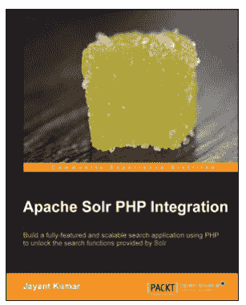
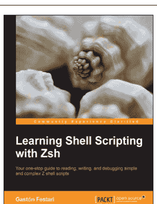

## 索引

### A

活动窗口
  高亮 33
高级粘贴缓冲区用法
  概览 74
  从粘贴缓冲区删除复制的文本 79
  在粘贴缓冲区中捕获窗格内容 78
  清除粘贴缓冲区历史记录 79, 80
  从文件加载粘贴缓冲区 76, 77
  将粘贴缓冲区保存到文件 75, 76
  直接设置粘贴缓冲区 77
高级会话和窗口用法
  在会话之间链接窗口 83, 84
  在会话中跳转窗口 80-82
  移动窗口 82, 83
aggressive-resize 设置 98
别名 21

### B

背景颜色
  修改状态栏的背景颜色 29, 30
绑定按键
  概览 34
  配置文件中的注释 37
  查看当前绑定 34-36
  将多个命令链接到
    单个按键 37
  绑定前缀键 38, 39
  教程 URL 35
  不使用前缀键 39
break-pane 命令 85

### C

capture-pane 命令 78
选择窗口界面 15
clear-history 命令 80
时钟模式 64
命令模式 63, 74
命令参考 121
已注释的行，tmuxinator 109-111
配置参考 120
控制模式 64
复制的文本
  从粘贴缓冲区删除 79
复制模式
  概览 61-63
  移动光标 66
  Emacs 风格键绑定 66
  进入 64, 65
  按搜索或行跳转 68
  退出 68
  参考 68
  vi 风格键绑定 66
  工作流程 64
Ctrl 到 Caps Lock
  重新绑定 35

### D

默认模式 63
默认窗口
  使用默认窗口启动会话 86, 87
delete-buffer 命令 79

### E

**Emacs 模式** 16, 27, 28  
**Emacs 风格键绑定，复制模式** 66

### F

**文件**  
  从文件加载粘贴缓冲区 76, 77  
  将粘贴缓冲区保存到文件 75, 76  
**前景颜色**  
  修改状态栏的前景颜色 32

### G

**分组会话**  
  用于配对 100, 101

### H

**实用配置技巧**  
  概览 43  
  起始索引设为 1 46  
  延长显示时间 45, 46  
  双击前缀键，绑定到  
    last-window 43  
  修改转义时间 44  
  延长历史记录限制 44  
**Homebrew**  
  URL 104

### I

**安装 tmuxinator** 107  
**条目**  
  从粘贴缓冲区选择条目 71

### K

**键绑定**  
  概览 121  
  帮助页面 15–17  
**按键**  
  解除绑定 40

### L

**link-window 命令** 84  
**load-buffer [path] 命令** 76

### M

**手册页**  
  访问 47  
  示例参考 47, 66  
**镜像模式，wemux** 113  
**tmux 模式**  
  时钟模式 64  
  命令模式 63  
  控制模式 64  
  复制模式 63  
  默认模式 63  
**wemux 模式**  
  镜像 113  
  配对 113  
  独行 113  
**鼠标模式**  
  启用 28  
**多个窗格**  
  使用多个窗格 54–56  
**多个会话**  
  使用多个会话 53

### O

**选项类型** 42, 43  
**OS X 剪贴板**  
  与 tmux 一起使用 103–105

### P

**配对模式，wemux** 113  
**tmux 结对编程**  
  概览 96  
  本地连接到同一会话 96, 97  
  使用分组会话 100, 101  
  使用 Vagrant Cloud 实现更安全的结对  
    编程 98–100  
**窗格内容**  
  在粘贴缓冲区中捕获 78  
**窗格布局**  
  循环切换 58, 59  
**窗格**  
  优点 52  
  拆分 85  
  合并 85, 86  
  操作 59  
  概览 51

- 参考 59
- 调整大小 56-58
- 在...之间切换 58
- 使用 52
- 缩放 56
- **密码存储机制**
  - URL 79
- **粘贴缓冲区**
  - 关于 61
  - 已复制文本，从中删除 79
  - 历史记录，清除 79, 80
  - 交互 70
  - 项目，从中选择 71
  - 加载，从文件 76, 77
  - 窗格内容，捕获到其中 78
  - 保存，到文件 75, 76
  - 设置，直接 77
  - 文本，复制到其中 69
  - 文本，从其中粘贴 70
  - 使用 71, 72
- **pbcopy 工具 103**
- **pbpaste 工具 103**
- **前缀键**
  - 关于 13-15
  - 绑定 38, 39
- **R**
- **Rogue 模式，wemux 113**
- **RubyGems**
  - URL 106
- **S**
- **会话**
  - 关于 8, 9
  - 连接 19
  - 分离 19
  - 启动，使用默认窗口 86, 87
  - 命名 9, 10
  - 概述 49, 50
  - 窗口，在...之间链接 83, 84
  - 使用 52
- **set-option 命令**
  - 使用 26
- **show-buffer 命令 78**
- **显示选项 47**
- **Solarized**
  - 关于 29
  - URL 29
- **source-file 命令 34**
- **SSH 连接**
  - tmux，在连接时启动 95, 96
- **状态栏**
  - 关于 40, 41
  - 背景颜色，修改 29, 30
  - 配置，重新加载 31
  - 前景颜色，修改 32
  - 打开窗口的列表 41
  - 修改 28
  - status-left 40
  - status-right 41
- **状态行 8**
- **T**
- **Tab 补全 21**
- **Teamocil**
  - 关于 114
  - URL 114
- **终端多路复用器。参见 tmux**
- **文本**
  - 复制，到粘贴缓冲区 69
  - 粘贴，从粘贴缓冲区 70
  - 搜索 18
- **tmux**
  - 关于 7, 117
  - 功能 15
  - 启动，在 SSH 连接时 95, 96
  - 必要性 117-120
  - 参考 121
  - 运行 7, 8
  - 使用，与 OS X 剪贴板 103-105
- **tmux 命令**
  - 关于 20, 73, 74
  - 别名 21
  - Tab 补全 21
- **tmux 配置**
  - 关于 105, 106
  - 文件，创建 27
  - 参考 105
- **tmuxinator**
  - 关于 107
  - 注释行 109-111

## 感谢您购买《tmux 入门指南》

## 关于 Packt Publishing

Packt，发音为'packed'，于 2004 年 4 月出版了其第一本书《精通 phpMyAdmin，实现高效的 MySQL 管理》，此后继续专注于出版针对特定技术和解决方案的高度聚焦的书籍。

我们的书籍和出版物分享了您的 IT 同行在适配和定制当今系统、应用程序和框架方面的经验。我们基于解决方案的书籍赋予您定制软件和技术以完成工作的知识与能力。Packt 的书籍比您过去所见的 IT 书籍更加具体，而非泛泛而谈。我们独特的商业模式使我们能够为您带来更聚焦的信息，让您获得更多需要了解的内容，减少不必要的信息。

Packt 是一家现代且独特的出版公司，专注于为开发者、管理员和初学者等各类人群制作高质量、前沿的书籍。如需更多信息，请访问我们的网站：www.packtpub.com。

## 关于 Packt Open Source

2010 年，Packt 推出了两个新品牌——Packt Open Source 和 Packt Enterprise，以继续其专业化聚焦。本书属于 Packt Open Source 品牌，该品牌出版围绕开源许可证构建的软件相关书籍，为从高级开发者到初出茅庐的网页设计师等各类人群提供信息。Open Source 品牌还运营着 Packt 的开源版税计划，根据该计划，Packt 会向每一个其软件有相关书籍售出的开源项目支付版税。

## 为 Packt 撰稿

我们欢迎所有对写作感兴趣的人士前来咨询。书籍提案请发送至 author@packtpub.com。如果您的书籍构思尚处于早期阶段，希望在撰写正式提案之前先进行讨论，请联系我们；我们的策划编辑之一将与您取得联系。

我们不仅仅寻找已经出版过作品的作者；如果您拥有扎实的技术技能但没有写作经验，我们经验丰富的编辑可以帮助您发展写作事业，或者让您的专业知识获得额外回报。

## [PACKT] open source

出版

社区经验精粹

## Apache Solr PHP 集成

ISBN：978-1-78216-492-0 平装：118 页

使用 PHP 构建一个功能完备且可扩展的搜索应用程序，解锁 Solr 提供的搜索功能

1. 了解可用于 PHP 与 Solr 之间通信的工具及其内部工作原理。
2. 使用 PHP 代码探索 Solr 的基本搜索功能，如排序、加权、分面和高亮显示。
3. 了解 Solr 的一些高级特性，如拼写检查、分组以及使用 PHP 代码实现的自动补全功能。

## 使用 Zsh 学习 Shell 脚本编程

ISBN：978-1-78328-293-7 平装：132 页

您阅读、编写和调试简单与复杂 Z Shell 脚本的一站式指南

1. 一本循序渐进的指南，将向您展示如何使用 zsh 及其丰富的强大功能来提高日常任务的效率。
2. 学习如何配置和使用 zsh。
3. 探索 zsh 的一些高级特性，如进程与参数替换、在受限功能模式下运行以及模拟其他 Shell。

