## 1 介绍版本控制和 GitHub

This first chapter is like a launching pad for your exciting GitHub journey! We’re going to introduce you to GitHub and version control, which is a superpower for coders. We’ll guide you through step-by-step processes, providing practical tips and easy-to-follow examples.

First off, we’ll help you understand the core of GitHub and why version control is so awesome. Think of version control like a magic time-traveling book that lets you see and undo all your changes, keeping your code organized and safe.

Next, we’ll dive into the fun stuff! We’ll show you how to create your special space on GitHub, called a `repository`. Think of it as your treasure chest where you keep all your coding gems. You’ll learn how to add your code, make changes to it, and share it with others.

We’ll also explore how GitHub can be a fantastic tool for working together with friends or even with coders from around the world! It’s like having a coding party where everyone brings their own unique ideas and creations.

Here’s a sneak peek of what we’ll cover in this chapter:

*   Exploring the benefits of GitHub to young coders
*   Understanding version control in GitHub – keeping track of your changes
*   Getting started with Git and GitHub
*   Setting up your GitHub account and account types
*   Navigating the GitHub interface – a guide for beginners

By the end of this chapter, you’ll feel at home in the GitHub universe, understand the magic of version control, and be ready to start your own coding adventures and share them with the world. Let’s code together and have a blast!

# Exploring the benefits of GitHub to young coders

Have you been coding for a little while and are looking to improve your skills further? Whatever stage you’re at, GitHub is a platform you’ll want to get familiar with.

Let’s explore why:

*   **Learning from the community**: Have you ever found yourself stuck on a coding problem, not sure how to proceed? On GitHub, you can find countless projects and code snippets. Seeing how others tackle problems can provide a new perspective and help solve your own coding dilemmas.
*   **Collaboration**: Ever worked on a group project and found it hard to keep track of who did what? GitHub makes teamwork smoother with its collaboration features. You can work with others easily, track changes, and combine everyone’s work seamlessly.
*   **Building a portfolio**: Do you dream of landing a cool job in tech? GitHub can act as your portfolio, showcasing your projects to potential employers. It’s like your public coding diary, demonstrating your skills and the journey of your progress.
*   **Version control**: Ever made a change to your code and realized you liked it better the way it was the day before? Git’s version control allows you to go back in time and compare changes so you never lose your work.
*   **Receiving feedback**: Want to get better at coding? GitHub allows you to build up the community, which can provide valuable feedback on your projects. Repository and/or community members can point out bugs, suggest improvements, and help you become a better coder.
*   **Access to resources**: Looking for a library or a tool to make your coding project easier? GitHub hosts a great number of resources, many of which are free to use.
*   **Integration with tools**: Do you use other coding tools? GitHub integrates with many tools and platforms that can improve your workflow, making your coding process more efficient and enjoyable.

GitHub is not just a place to store your code. It’s a platform where you can learn, collaborate, showcase your work, and grow as a coder. So, why wait? Dive into GitHub and start exploring the endless possibilities it offers to young coders like you!

In the next section, we’re going to learn how GitHub helps you keep track of every change you make to your projects, just like keeping a detailed diary of your work. We’ll look at different ways to manage changes with version control systems, understand the concepts of deltas and snapshots, and explore how distributed version control systems keep teams in sync. It’s all about making sure you can always see what’s been done and by whom, making teamwork smoother and more organized.

# Understanding version control in GitHub – keeping track of your changes

Have you ever stopped to ask yourself how developers manage the ever-evolving versions of their software? Think of it like you’re writing a story. You write the first draft, then the second, and so on. Each draft is unique, with its own set of changes, yet all of them are interconnected. Now, what if you wanted to go back to a particular draft to revisit some ideas, or share your drafts with fellow writers for a collaborative masterpiece? This is where version control steps in as your time-traveling companion in the digital domain!

In coding, **version control systems** (`VCSs`) are like magical journals that keep a record of every change made to a project. They allow developers to travel back in time to any version of their project, compare different versions, and even merge changes made by different people. It’s like having a superpower that lets you not only undo mistakes but also collaborate without a problem.

GitHub is the place where developers come together to share and collaborate on projects. GitHub is built on top of `Git`, a popular `VCS` that we will explain later in the *Getting started with Git and GitHub* section, making it a robust platform for team-based projects. It’s like a massive online library, but instead of books, it houses code. Every project on GitHub lives in its own `repository` (or `repo` for short), a nicely ordered digital shelf where all versions of a project are stored and organized.

### Curious about how this all comes together?

Let’s say you and your friends decide to build a portfolio website. Each one of you has unique ideas to make the website cooler. Alice suggests adding a top menu, Bob wants a gallery, and Charlie is keen on a blog. You all set out to work on your individual parts, but how do you bring it all together without stepping on each other’s toes?

## Here’s where “Git” version control and GitHub shine together!

Each one of you creates a `branch` from the `main branch` (a `branch` is a separate workspace where you can make changes and try out new ideas without affecting the main version of your project) and works on your ideas, and once you’re satisfied, you propose the changes back to the `main branch` through a `pull request`. Your friends can review the changes, discuss them, and even suggest tweaks. Once everything looks good, the changes are merged into the `main branch`. Your collaborative portfolio website now has a gallery, a top menu, and a blog section, all built together without any problems.

And guess what? All the discussions, changes, and versions are nicely recorded, thanks to `Git`’s version control magic and GitHub’s collaborative platform. So, if someday you decide that the blog should include news, you know exactly where to go and how to make it happen without disrupting the rest of your website!

This journey of creative collaboration and organized evolution is what makes GitHub very popular among developers. It’s not just a platform; it’s a community where ideas grow, mix, and come to life, one version at a time.

## Understanding the types of VCS

### What are centralized version control systems?

Picture a train station at the heart of a large city full of activities. This station is no ordinary one; it’s the nerve center where all the city’s data trains come and go. Now, what if this city represented a software project, and the train station, a **centralized version control system** (`CVCS`)?

Interesting, isn’t it?

# 集中式版本控制系统 (CVCS)

一个 `CVCS` 就像这样一个中央车站，所有对项目的更改都存储并管理于此。在这个数字城市中，开发者是数据列车的司机，每列车都携带一组独特的更改或更新。他们都在中央车站会合，存放自己的更新，并取走他人所做的更改。

听起来很井然有序，对吧？但让我们再深入一点。

你是一名开发者司机。每天早上，你驶入中央车站，取走项目的最新版本，然后在一天中进行更改。一旦满意，你就将数据列车驶回中央车站存放你的更新。这个循环不断进行，使项目不断演进，同时保持一种秩序感。

然而，`CVCS` 也有其弊端。想象一个阳光明媚的日子，我们的中央车站人声鼎沸。突然，一场风暴袭来，车站发生了停电，如图 1.1 所示。恐慌席卷城市，因为承载所有项目数据的核心现在无法访问。开发者带着他们的更新被困住，无法共享或访问他人的更改。

图 1.1 – 一个 `CVCS` 作为中央车站

此场景说明了 `CVCS` 的一个显著特征（也是一个潜在缺点）——其单点故障。所有内容都存储在中央服务器上。如果它宕机或出现问题，更新的流动就会停止，导致项目产生连锁反应。

现在，让我们把注意力转向另一个方面。还记得每个司机如何从中央车站取走项目的最新版本吗？这说明了 `CVCS` 的集中化特性。每一条数据、每一次更新和每个版本都存放在一个中央位置。

使用 `CVCS` 有一种简洁有序的感觉。它就像有一个纪律严明、集中的政府来管理数据流动。它更容易管理、控制访问，并确保每个人都在同一页面上。然而，这种集中化特性也带来了一些挑战，例如单点故障的潜在风险以及对中央服务器网络访问的依赖。

## 这对编码如何运作？

在编码中，`CVCS` 充当一个中央仓库，所有代码及其版本都存储其中。开发者从该中央服务器 `check out (pull)` 代码的最新版本，在本地机器上工作以进行更改，然后 `check in (push)` 将其更新返回到中央仓库。这样，每个人都可以访问代码的最新版本，并且所有更改都集中跟踪。

在此设置中，`CVCS` 记录了所有更改、谁做的以及何时做的。这是在团队环境中管理代码的有序方式。然而，它也有其缺点。例如，如果中央服务器宕机，开发者就无法共享或从仓库访问更新。此外，每次操作都依赖于中央服务器，如果网络缓慢或团队分布在不同地点，可能会减慢流程。你可以从图 1.2 中了解有关 `CVCS` 的情况：

图 1.2 – `CVCS` 流程

简单性和集中控制使 `CVCS` 易于管理并确保代码库的一致性，但代价是潜在的瓶颈和单点故障。

## 版本控制中的增量是什么？

想象你是一名艺术家，每天都在你的画作上添加新的一层，用新鲜的细节、色彩和表现力来增强它。每一层只修改画作的一部分，留下其他部分不变。随着时间的推移，你的艺术作品成为这些层的生动集合，每一层都为画作的整体故事做出了贡献：

图 1.3 – 画作的层次

在版本控制的世界中，`delta` 的工作原理类似。它是一组应用于文件或一组文件的更改或更新。`VCSs` 通常不会在每次更改后保存文件的完整新副本，而是将这些更改保存为 `deltas`。这意味着它们只记录发生了什么变化。

例如，假设你正在编写一本数字书籍。每天，你都会输入新想法或编辑之前写的内容。你的 `VCS` 跟踪每一次编辑，无论是添加段落还是修正拼写错误。这些更改存储为 `deltas`，使系统能够记录你的书籍随时间演变的过程，而无需在每次更改时重新保存整个文档。

当你需要查看文档的早期版本时，你的 `VCS` 使用这些 `deltas` 来重建它。这就像能够穿越时空，查看文档在任何给定日期时的样子。

## 增量在编码中如何工作？

在编码中，`deltas` 指的是文件或文件之间两个版本之间的差异或更改。这些对版本控制至关重要，因为它们有助于在不存储每个阶段的完整文件副本的情况下跟踪项目的演变。

当你或他人对代码进行更改时，`VCS` 会计算出 `delta`——添加或删除了什么——并将其保存。这就像所有编辑的详细记录，使处理更改变得更易于管理且更高效。

这些 `deltas` 也称为 `diffs`，对团队合作至关重要。它们让每个人都能清楚地看到发生了什么变化、谁做的以及何时做的。通过以这种方式跟踪更改，`VCS` 有助于管理项目的进展，并确保即使许多人协作并持续更改，也不会丢失任何内容。

图 1.4 – 随时间推移的 `deltas` 提交

该图表以可视化方式展示了项目中随时间推移对文件进行的更改，例如对你的单页作品集网站的更新。每一行代表一个不同的文件，标记为 `File A`、`File B` 和 `File C`。列代表你项目的不同版本，从 `Version 1` 到 `Version 5`：

* 在 `Version 1` 中，三个文件都是原始版本
* 到 `Version 2` 时，`File A` 和 `File C` 已被更改（`Δ1`），而 `File B` 仍为原始版本
* 在 `Version 3` 中，`File A` 自 `Version 2` 以来未更改，`File B` 未被更改，而 `File C` 已从其原始版本更新（`Δ1`）
* 进入 `Version 4`，`File A` 有另一个更改（`Δ2`），`File B` 已被更改（`Δ1`），而 `File C` 与 `Version 3` 相同
* 最后，在 `Version 5` 中，`File A` 与 `Version 4` 相同，`File B` 有另一个新更改（`Δ2`），而 `File C` 还有另一次更新（`Δ3`）

“Δ”符号代表更改或“`delta`”。因此，`File A` 上的 `Δ1` 表示对 `File A` 原始版本的第一次更改集，而 `File A` 上的 `Δ2` 表示第二次更改集。

这种跟踪方式让你可以看到每个文件的更新历史，通过比较这些版本，你可以了解你的网站随时间如何演变。这有点像查看你的网站的照片相册，展示每个部分从一个版本到下一个版本是如何变化的快照。

# 理解分布式版本控制系统

一个 `distributed version control system` (`DVCS`) 例如 `Git` 为开发者在本地机器上提供完整的项目历史记录。这使他们能够独立于代码工作，修复错误或添加功能，而不必担心破坏主项目。

现在，设想一个开发者 Ada 正在处理一个棘手错误的场景。她克隆仓库，在 `DVCS` 中创建自己的版本。凭借计算机上的项目完整副本，她对代码进行工作、测试解决方案并解决错误。在整个过程中，她与其他开发者的工作隔离，并且不会影响他们的进度。

当 Ada 对自己的解决方案充满信心时，她会将其分享到中央仓库。在 `GitHub` 的上下文中，她会创建一个 `pull request`，这是一份详尽记录的变更摘要，供同事审阅。他们评估她的贡献并讨论可能的调整，一旦大家达成一致，变更就会合并到主项目仓库中。

如果 Ada 直接与其他开发者使用 `Git` 而不使用 `GitHub` 协作，她可以通过直接 `push` 到共享仓库的方式分享自己的变更。这仍然可以实现协作和代码审查，但缺少了 `pull request` 的结构化工作流程。

使用 `DVCS` 时，每位开发者的输入，无论是 bug 修复、功能还是优化，都是宝贵的贡献，通过协作进行分享、审查和改进，推动项目借助团队的综合知识和技能迈向新颖且令人兴奋的可能性。

在使用 `Git` 与 `GitHub` 的上下文中，你兼得两者之长：`DVCS` 的去中心化能力，加上使贡献管理更轻松、更结构化的协作工具，类似于 `CVCS` 的某些功能，但具有更强的灵活性和独立性。

*图 1.5* 显示了 `DVCS` 的表示：

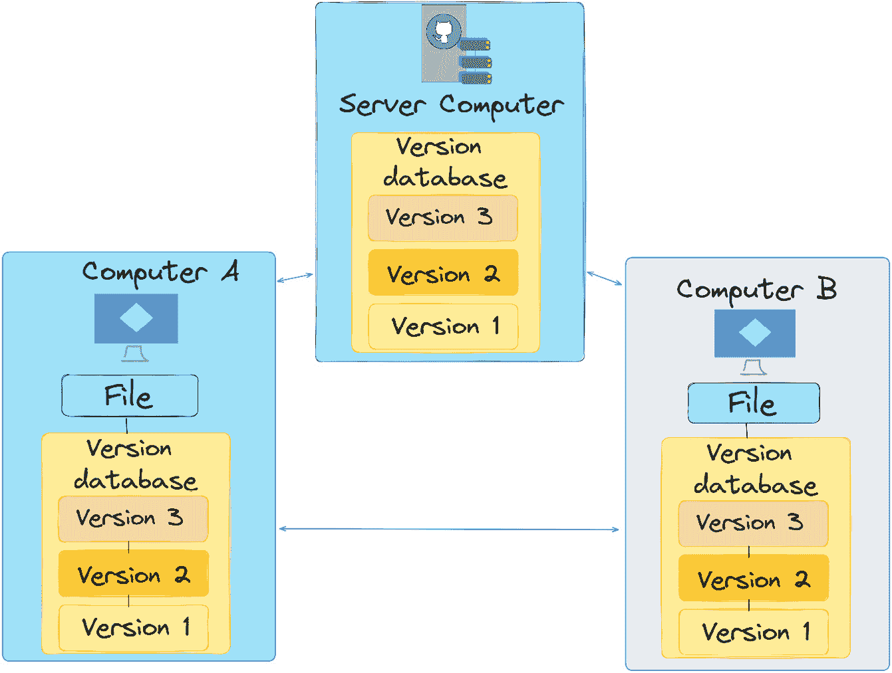

图 1.5 – 一个 DVCS

在 `DVCS` 中，你保存的变更就像快照，或像你随时间所做一切变更的图像。

## 版本控制中的快照是什么？

`Snapshots` 就像照片，在特定时刻捕捉项目的状态。每个快照都保存着代码在当时样子的图像。

那么，这种魔力是如何发生的？每当你达到一个里程碑，无论多么微小，你都可以对代码进行快照。在 `Git` 中，这被称为 `commit`。每个 `commit` 都是一个快照，是项目开发时间线上的一个里程碑。

随着时间的推移，你的代码会增长，但有时会出现 bug。这正是快照的强大之处发挥作用的地方。你可以回到过去，重新访问每个快照，以弄清 bug 何时以及如何进入代码。

快照允许你将当前代码与过去版本进行比较，帮助你了解代码的演变过程。如果必要，你甚至可以在一切运行顺畅时回滚到之前的快照。

这些快照并非孤立的；它们按时间顺序连接成一条链，每个快照都导向下一个。它们讲述了项目从开始到现在的故事。

*图 1.6* 说明了一组文件如何随着时间在不同项目版本中发生变化，例如你的一页式作品集网站的更新：

*   `File A` 在 `Version 1` 中没有任何变更开始。在 `Version 2` 中，它有一组变更（记为 `A1`），在 `Version 3` 中保持不变。然后，在 `Version 4` 中，`File A` 出现了另一组变更（`A2`），并延续到 `Version 5`。
*   `File B` 在 `Versions 1`、`2` 和 `3` 中开始时未变更，但在 `Version 4` 中有一组变更（`B1`）。这些变更保留在 `Version 4` 中。但到 `Version 5` 时，`File B` 有一组新的变更（`B2`），该变更在 `Version 5` 中再次更新（`B2`）。
*   `File C` 在 `Version 2` 中有第一组变更（`C1`）。在 `Version 3` 中，它有一组新的变更（`C2`），在 `Version 4` 中保持不变。最后，在 `Version 5` 中，`File C` 有另一组新的变更（`C3`）。

这里的模式显示，每个文件可以在不同版本中独立更新。例如，`File C` 在除 `Version 4` 外的每个版本中都被更新，而 `File B` 直到 `Version 4` 才发生变化。这样，你可以追踪哪些文件在何时被更新，保持项目每个部分随着成长和改进的清晰历史。这就像为网站的每个部分保留一本日记，在变更发生的日期记录下每次变更。

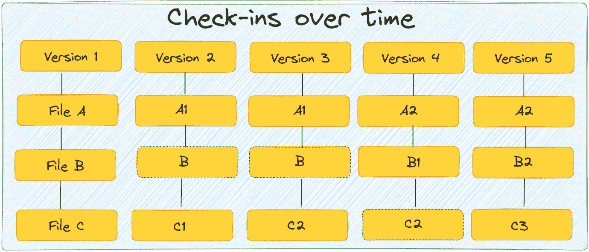

图 1.6 – 随时间推移的签入

在版本控制中进行快照，就像捕捉项目的当前状态。如果你之后做出变更，会拍摄新的快照，保留变更的同时保持之前的快照完整。

现在我们已经介绍了版本控制的基础知识以及它如何帮助跟踪你的变更，让我们继续前进。在下一节中，我们将把这些概念付诸实践，展示如何实际应用。你将学习如何在机器上设置 `Git`、开始在 `GitHub` 上管理项目，并有效地与其他人协作。这份逐步指南将帮助你在编码项目中充分利用这些强大的工具。

## 开始使用 Git 和 GitHub

那么，什么是 `Git`？

想象一个充满活力的数字城市，代码作为基础，版本作为重要的参考点。在这个城市里，`Git` 充当你可靠的伴侣，一本神秘的日记，记录你编码冒险的每一步，无论是构建、修订，还是偶尔删除代码结构：

图 1.7 – Git 作为一个充满活力的数字城市

*现在，为什么开发者需要这样的记录？*

想象你在制作一件数字雕塑，添加部件时，突然另一个部件掉了下来！当你意识到昨天的工作现在受损时，恐慌随之而来。这正是 `Git` 如同时光旅行机器般介入的地方。只需一个迅速的动作，`Git` 就把时间倒转，你的工作得以恢复！

*GitHub 在这段旅程中扮演什么角色？*

现在，让我们探究 `GitHub` 的生态系统，这是一个充满活力的都市，来自数字领域各处的开发者在此相聚（*图 1.8*）。但是什么让 `GitHub` 不仅仅是一个聚会点？

图 1.8 – GitHub 作为一个繁忙的都市

把 `GitHub` 想象成一座巨大的图书馆，`Git` 是伟大的图书管理员（*图 1.9*）。每位进入的开发者都会获得无限的书架，用来存放他们的代码书籍。每本书，即一个仓库，都保存着一个项目的故事，由 `Git` 精确编年。

图 1.9 – GitHub 作为一座巨大的图书馆

但与世间任何普通图书馆不同，这座图书馆靠协作成长。你不仅仅是沉默的订阅者，你是社区的一部分，一章一章、一行一行地书写创新的史诗。

现在，当你写下你的故事时，你可能会偶然发现另一位作者写的一章，激发了新的想法。怀着兴奋之情，你决定在此基础上构建。在 `GitHub` 中，这种协作分支的行为是被鼓励的。你复制该章节，添加自己的部分，并提议将其与原文合并。另一位作者感谢你的贡献，接受了它，故事变得更加丰富。

但 `GitHub` 不仅仅关乎代码制作的严肃业务。它是一个平台，你可以在此与他人协作、为各种项目做出贡献，并从其他开发者的作品中学习。你的个人资料充当作品集，展示你的项目、贡献和编码技能，使你在开发者社区中更容易联系和协作。

在下一节中，你将学习如何设置你的 `GitHub` 账户，以便在线开始管理项目。我们将介绍两种类型的账户：

*   `User account`：这是你的个人账户，你可以在此管理自己的项目、为他人的项目做出贡献等。把它想象成你在 `GitHub` 上的个人工作区。
*   `Organization accounts`：如果你与团队一起工作，这种类型的账户会很有用。它就像团队共享的空间，每个人可以在此共同协作项目。

你将了解这些账户有何不同，以及如何使用每种类型来保持项目井然有序并让合适的人能够访问。这项知识将帮助你充分利用 GitHub，无论你是独自工作还是作为团队的一部分。

# 设置你的 GitHub 账户和账户类型

现在是时候为你设置第一个 GitHub 账户了。创建 GitHub 账户非常简单。你可以按照以下简单步骤设置免费账户：
1. 前往 [`github.com/`](https://github.com/) 并点击右上角的 **注册** 按钮：
 
图 1.10 – GitHub 注册
1. 你将被重定向到以下页面，在此需要输入你的电子邮件地址和密码：
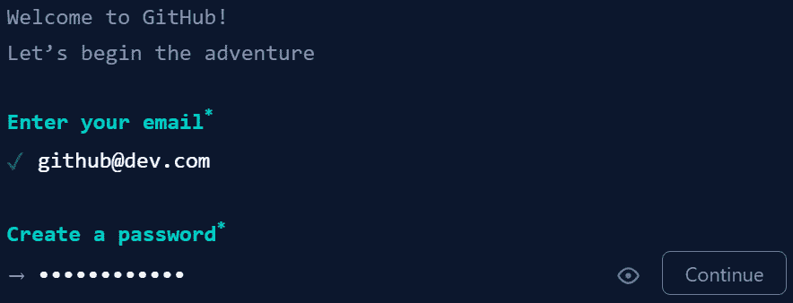 
图 1.11 – GitHub 账户创建
1. 你将在创建 GitHub 账户时提供的地址收到一封验证邮件。
2. 点击链接完成验证流程并创建 GitHub 账户。

如果你已有账户，请导航至 [`github.com/`](https://github.com/) 并点击右上角的 **登录** 按钮：
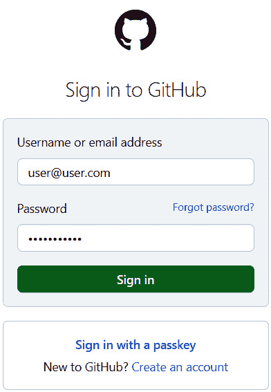 
图 1.12 – GitHub 登录

在我们深入 GitHub 仓库之旅之前，让我们先聊聊不同类型的 GitHub 账户。

## 什么是用户账户？

用户账户是你自己的个人 GitHub 账户。你可以在此处理你的项目，无论是独自进行还是与少数朋友合作。以下是你可以用用户账户完成的操作：
* **创建仓库**：你可以在个人空间构建各种项目
* **贡献：** 你可以访问其他人的仓库并帮助他们完成项目
* **个人资料**：你拥有一个个人资料，其他人可以在此查看你的身份和工作内容，甚至可以关注你以了解你的活动动态

*准备好探索你的 GitHub 用户账户视图了吗？让我们 **开始吧**.*

你的 GitHub 个人用户资料包含多个不同的部分，如 *图 1**.13* 所示：
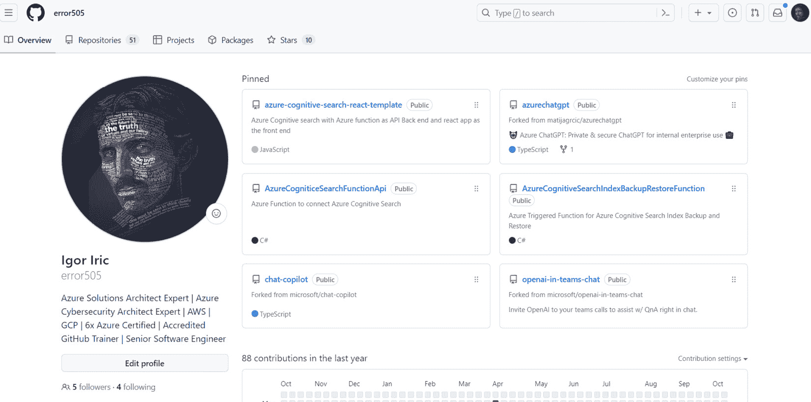 
图 1.13 – GitHub 的用户账户概览

让我们详细了解这些部分：
* **用户账户导航标签**：这些标签包含用于访问用户账户各个部分的按钮，包括 **概览**、**仓库**、**项目**、**Wiki**、**软件包** 等：
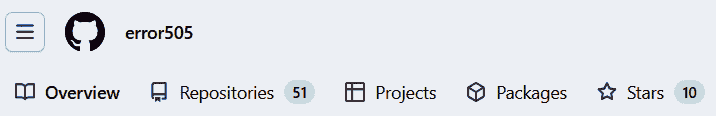 
图 1.14 – GitHub 的用户导航标签
* **全局导航**：你可以通过点击位于左上角的 *汉堡菜单* 图标访问全局导航菜单。该菜单提供指向基本功能的链接，如 **主页**、**问题**、**拉取请求**、**讨论**、**市场**、**通知** 以及其他实用资源：
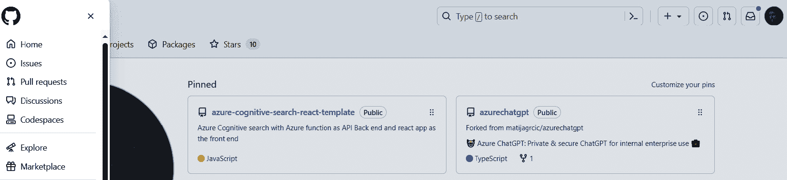 
图 1.15 – GitHub 的全局导航
* **仓库视图**：位于 **概览** 页面中央，**仓库视图** 是你可以在 GitHub 中轻松访问和管理已置顶仓库的地方。在这里，你可以方便地组织和展示对你最重要的仓库，以便快速、轻松地访问你的关键项目和贡献：
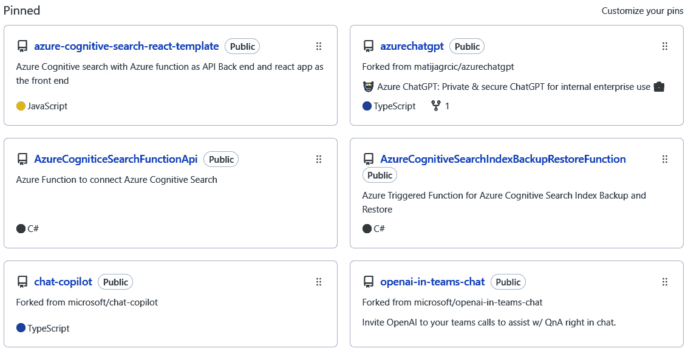 
图 1.16 – GitHub 的仓库视图
* **个人简介视图**：位于页面左侧，这里可以通过点击 **编辑资料** 按钮来撰写关于你的个人简介。在你的资料下方，你会找到有关你关注的用户数量和关注你的人数在 GitHub 上的统计数据。此外，你还可以展示你的成就徽章并列出你所属的组织：
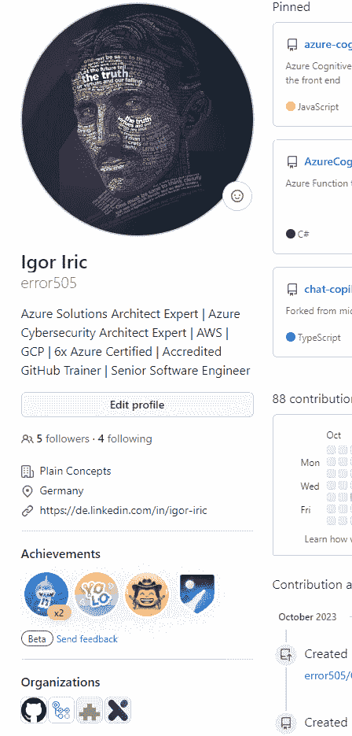 
图 1.17– GitHub 的个人简介视图
* **贡献视图**：位于页面底部，提供你在 GitHub 上所选年份内对仓库的所有贡献的宝贵见解。它展示了你的提交活动、拉取请求、打开的问题等，让你能够跟踪你在开源项目中的参与情况和开发历程。此视图有助于你可视化你在 GitHub 社区中的影响力和贡献：
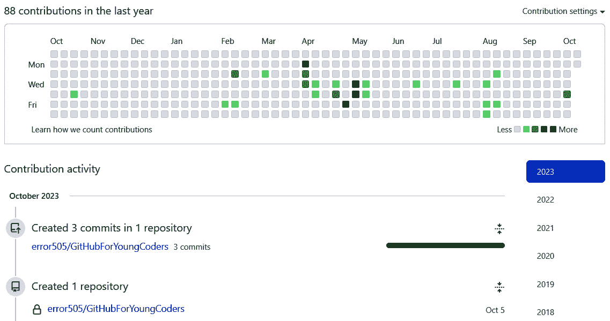 
图 1.18 – GitHub 的贡献视图

## 组织账户 – 团队总部

组织账户就像一栋大办公楼，整个团队或公司可以在此共同工作。它拥有更多空间和额外功能，帮助团队在多个项目上协作。以下是详细说明：
* **团队管理**：你可以创建各种团队，分配不同项目，并为成员设置特定角色
* **多个仓库**：就像你的大楼里有几层楼，每层对应一个不同的项目
* **更多隐私选项**：你可以拥有只有特定成员可以访问的私人房间
* **统一计费**：不必单独支付费用，所有开支统一处理，使预算更轻松
* **专业资料**：在专业的设置中展示你的团队、项目和成就

在 *图 1**.19,* 你可以看到 GitHub 上组织账户的样子：
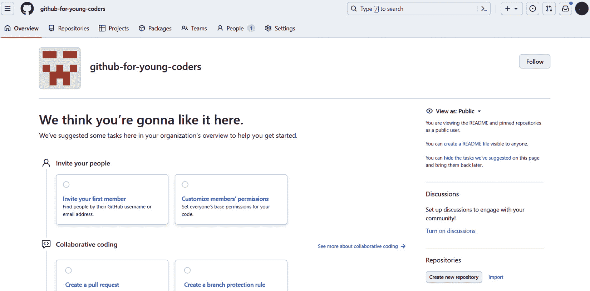 
图 1.19 – GitHub 的组织视图

现在你已经熟悉了如何设置 GitHub 账户以及可用的不同账户类型，让我们更仔细地看看如何在项目中实际使用 GitHub。接下来，我们将指导你浏览 GitHub 界面，在那里你将了解 **代码** 部分、**问题**、拉取请求等关键功能。这将帮助你了解一切所在位置以及如何使用每个功能有效地管理项目。无论你是刚开始还是希望从 GitHub 获得更多收益，本节将为你提供所需的工具，帮助你导航并充分利用 GitHub 体验。

# 浏览 GitHub 界面 – 初学者指南

将 GitHub 想象成一个多功能工具箱，每个工具都为项目仓库中的特定任务而设计。以下是本数字工具箱中主要工具的友好介绍，例如 **代码**、**问题**、**拉取请求**、**项目** 等。你可以在 *图 1**.20* 中看到其外观：
 
图 1.20 – GitHub 的各部分

## 那么，代码部分是关于什么的？

将 **代码** 部分视为 GitHub 项目仓库的核心。你的项目就存在于此。它就像你电脑上的主文件夹，你在其中保存所有项目文件。它包含项目所需的所有代码文件、文档和资源：
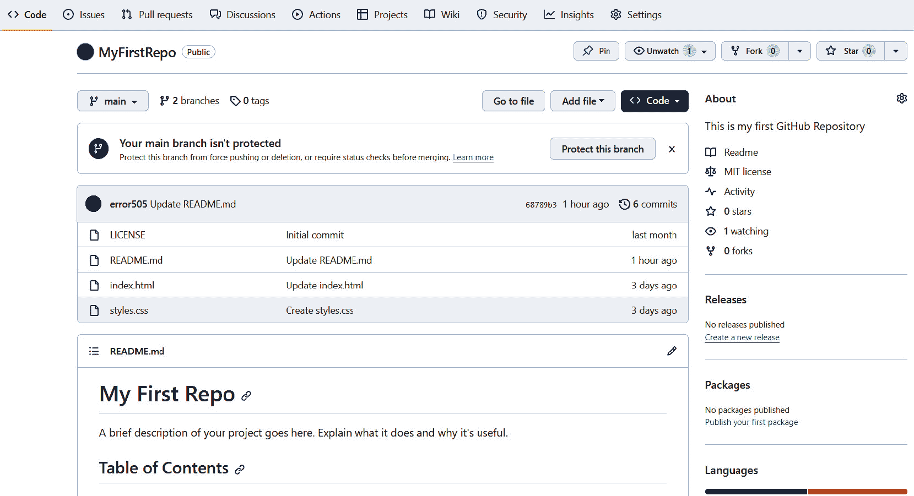 
图 1.21 – GitHub 的代码部分

在下一章 *掌握 GitHub 核心要点* 中，我们将深入探讨 GitHub **代码** 视图的各个方面。我们还将探索如何在 GitHub 上创建和管理仓库，从而全面了解这些基本工具。

## 而问题又是什么？

**问题** 部分是你的项目仓库的公告板。发现 bug 了？有想法？在这里发布。它就像为团队留下便签，说：“*嘿，让我们修复这个* 或 *要不要试试这个？*” 你可以在下图中一窥此部分。
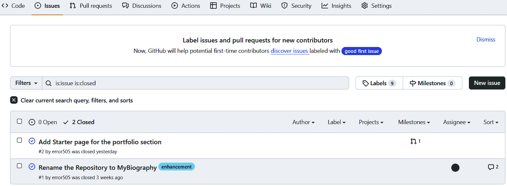 
图 1.22 – GitHub 的问题部分

## 拉取请求 – 听起来很重要？

Pull 请求是你说“*我做出了很酷的东西，让我们把它加入到我们的项目中吧！*” 的方式。就像向团队展示你的工作，并在你的代码加入派对之前征求他们的点赞：

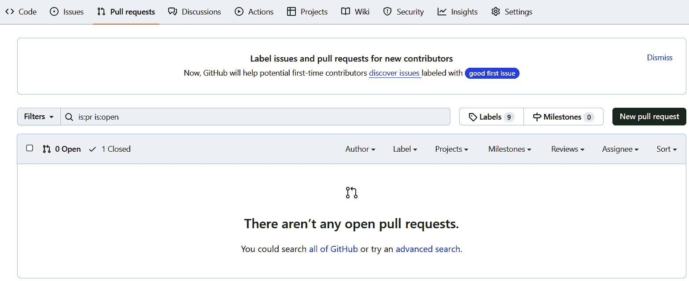
图 1.23 – GitHub 的 PR 部分

## Discussions，是像会议吗？

没错！**Discussions** 部分是你的项目的聊天室。这里是想法飞舞、问题被提出、协作发生的地方。它是你的 GitHub 项目的虚拟水吧：

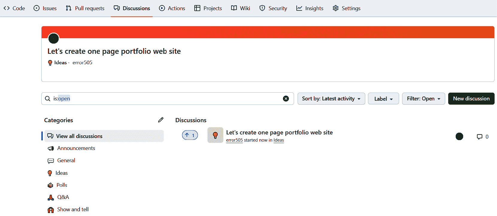
图 1.24 – GitHub 的 Discussions 部分

## Actions，它们会替我工作吗？

好吧，有点像！**Actions** 是你的自动化助手。它们处理诸如测试你的代码或更新和部署你的网站等任务，为你做重复性的工作，这样你就可以专注于有趣的事情：

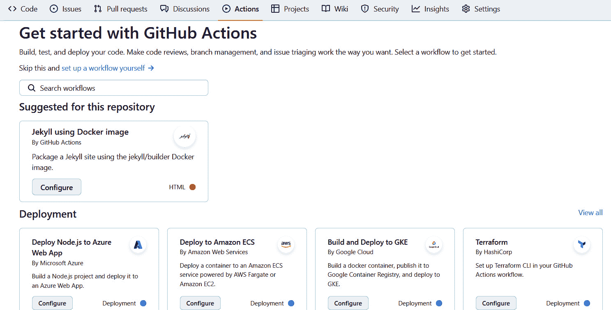
图 1.25 – GitHub 的 Actions 部分

## Projects – 听起来很严肃？

GitHub 的 **Projects** 部分充当管理工作的中心枢纽。在这个空间里，你可以组织任务、监控进度并分配职责。它充当你的战略规划板，确保你的项目的各个方面保持一致并按计划进行：

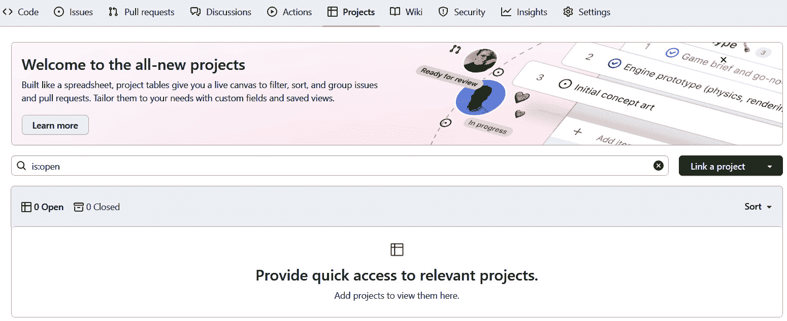
图 1.26 – GitHub 的 Projects 部分

## Wiki，是像维基百科吗？

完全正确！你项目的 **Wiki** 部分是它的知识库。它是文档、操作指南、准则以及你关于项目所积累的所有智慧的首选之地：

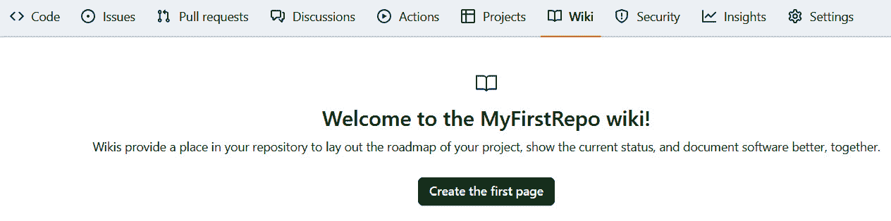
图 1.27 – GitHub 的 Wiki 部分

## Security 部分有什么？

把 **Security** 想成你项目的保镖。它帮助你查找和修复任何安全弱点，让你的项目免受虚拟的磕碰和擦伤：

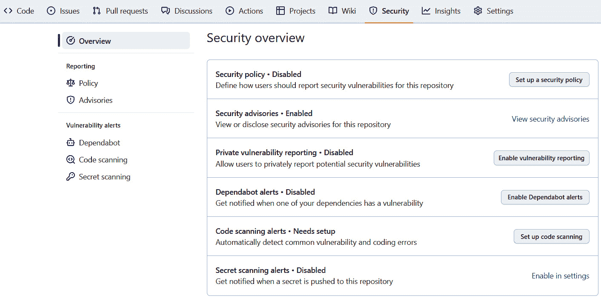
图 1.28 – GitHub 的 Security 部分

## Insights，能预知未来吗？

不太像，但很接近！**Insights** 部分就像一份成绩单，显示你的项目表现如何。它提供有关项目健康状况、进度和团队贡献的统计数据和图表：

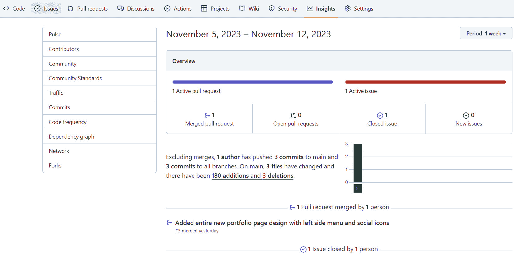
图 1.29 – GitHub 的 Insights 部分

## Settings – 我可以在那里设置什么？

**Settings** 部分是你的控制室。在这里，你管理协作者、设置规则并调整项目的设置。这就是你根据项目需求定制 GitHub 体验的地方：

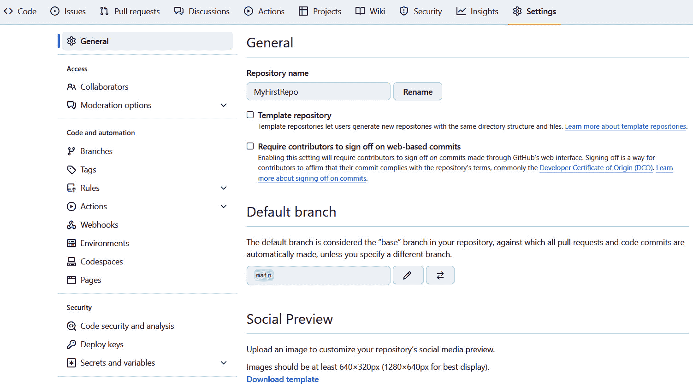
图 1.30 – GitHub 的 Settings 部分

现在我们已经介绍了 GitHub 界面的基本导航，并探索了 Code、Issues、Pull Requests、Discussions、Actions、Projects、Wiki、Security、Insights 和 Settings 等部分，让我们看看你学到了多少。

你会找到一个 *Quiz* 部分，旨在测试你的知识并帮助巩固我们讨论的内容。这是一个有趣的方式，可以确保你在进入更高级主题之前理解关键要点。准备好测试你的技能了吗？让我们开始吧！

## Summary

本章解释了 GitHub 如何使用版本控制，这就像一本神奇的书，让你可以看到对代码所做的所有更改，甚至在需要时撤销它们。它让一切保持安全和井然有序。然后它向你展示了如何在 GitHub 上创建自己的空间，称为 *repository*，你可以把它想象成你编程项目的宝箱。你已经学会了如何添加代码、更改它并与他人分享，就像向世界展示你的艺术作品一样。

接下来，本章谈到了 GitHub 在与他人协作方面的优势。它就像一个大派对，每个人都在分享他们的编程想法。这让编程变得更有趣、更具创造性。

使用 GitHub 的好处非常酷。你可以看到其他人如何解决编程问题，这可以帮助你学习新的解决方法。如果你做了更改而不喜欢，GitHub 的版本控制可以让你回到之前的状态。此外，你还可以从其他程序员那里获得建议和提示，这可以帮助你改进。

在下一章，你将以一种有趣的方式潜入泳池的深处！一切都与以一种好的方式弄脏双手有关，使用 Git 和 GitHub。你将学习如何在 GitHub 中使用一些强大的工具，就像学习控制你的编程宇宙的咒语一样。它将超级有趣，并且对你的编程冒险非常有用！

## Quiz

通过以下测验问题检查你通过阅读本章获得的知识：

1.  GitHub 使用什么来帮助管理和组织代码？

    1.  版本控制

    2.  拼写检查

    3.  语法校正

    4.  自动格式化

    *Answer*: A. 版本控制

2.  真假：GitHub 仅供专业程序员使用。

    1.  真

    2.  假

    *Answer*: B. 假

3.  填空：GitHub 中的版本控制就像一个 \_\_\_\_\_\_\_\_\_，让你可以看到并撤销所有更改。

    *Answer*: 神奇的时光旅行书

4.  为什么版本控制被认为是程序员的超能力？

    *Answer*: 它允许程序员轻松跟踪和还原更改，保持代码井然有序和安全。

5.  以下哪一项是使用 GitHub 管理代码的关键好处？

    1.  它增加文件大小

    2.  它使代码安全性降低

    3.  它有助于组织和跟踪更改

    4.  以上全部

    *Answer*: C. 它有助于组织和跟踪更改

6.  真假：版本控制只能跟踪文本文件的更改。

    1.  真

    2.  假

    *Answer*: B. 假

7.  本章用来解释 GitHub 功能的类比的来源是什么？

    1.  一个工具箱

    2.  一本时光旅行书

    3.  一本食谱书

    4.  一张路线图

    *Answer*: B. 一本时光旅行书

8.  填空：GitHub 是一个令人难以置信的 \_\_\_\_\_\_\_\_\_ 和版本控制的世界。

    *Answer*: 编程

9.  真假：GitHub 版本控制中做的每一次更改都会自动永久保存。

    1.  真

    2.  假

    *Answer*: A. 真

10.  本章中提到的使用 GitHub 版本控制的有效实用技巧是什么？

     *Answer*: 定期提交更改以有效跟踪进度
