## 2 精通 GitHub 基础

在本章中，我们将深入了解 Git 和 GitHub 的基础知识。你将学习如何设置你的工作区、使用 Git 命令进行有效的项目管理以及与其他人协作。本章为你提供了克隆存储库、理解 Git 的基本命令、管理个人访问令牌以及创建有意义的 `README` 文件的知识。

到本章结束时，你将能够设置项目、保存更改，并在 GitHub 上协作工作。

在本章中，我们将涵盖以下主要主题：

*   Git 如何与 GitHub 交互 – Git 命令和 GitHub 工作流

*   GitHub 上的存储库是什么？

*   准备好你的工具 – 下载和安装 Git

*   创建和管理个人访问令牌

## Technical requirements

开始之前，请确保你的机器上已安装 Git。你可以从 [`git-scm.com/`](https://git-scm.com/) 下载它。此外，创建一个名为 `ch2` 的 GitHub 文件夹，以组织与本章相关的任何文件或项目。你可以从 [`github.com/PacktPublishing/GitHub-for-Next-Generation-Coders/tree/main/Chapter%202`](https://github.com/PacktPublishing/GitHub-for-Next-Generation-Coders/tree/main/Chapter%202) 下载本章的代码。

## How Git interacts with GitHub – Git commands and GitHub workflows


假设你刚刚加入一个开发团队，参与一个托管在 GitHub 上的令人兴奋的新项目。你渴望立刻投入其中，但在开始之前，让我们先了解本地机器上的 Git 命令如何与 GitHub 交互，从而使协作变得无缝且高效。

## Git clone – 克隆你的第一个 GitHub 仓库（欢迎包）

当你加入一个项目时，第一件事就是使用 `git clone` 命令将项目从 GitHub 复制到你的本地机器。可以把它想象成在新工作第一天收到欢迎包。这个包包含了项目已有的所有工作：


图 2.1 – GitHub 欢迎包

那么，你最终想把 GitHub 仓库克隆到本地电脑吗？好的，让我们看看如何实现：

1. 导航到你在 GitHub 上之前创建的仓库 `MyFirstRepo`，并点击绿色的 `Code` 按钮：

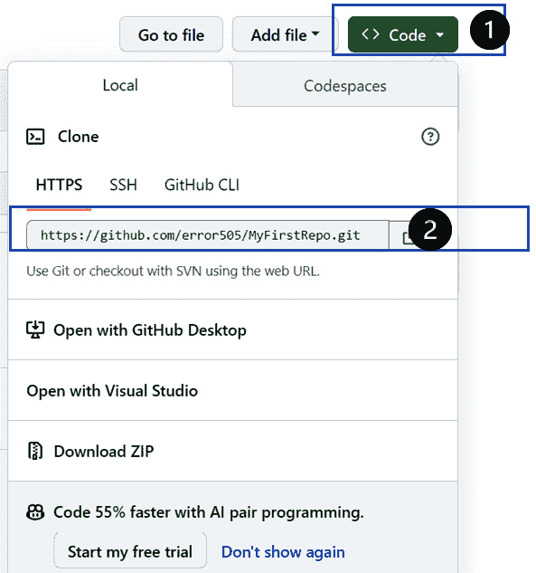

图 2.2 – 克隆 GitHub 仓库

1. 你会看到一个 URL（它应以 `.git` 结尾）。复制此 URL。

2. 现在，返回你的 Git Bash 或终端，导航到你希望项目所在的文件夹，并输入以下命令，将 `URL` 替换为你刚刚复制的 URL：

```
$ git clone URL
```

3. 现在你可以在本地访问项目了。克隆过程完成后，导航到克隆过程中创建的项目文件夹：

```
$ cd MyFirstRepo
```

现在，在你的本地机器上，你有三个重要区域：

* `Working directory`：这就是你进行所有工作、做出更改并创建新文件的地方。

* `Staging area` (`index`)：一旦你对更改满意，就将它们移至暂存区，有点像把完成的草稿放入“to be reviewed”文件夹。

* `Local history`：当你完全满意更改时，就提交它们。这就像把最终草稿保存在“completed work”文件夹中。

就是这样。你现在已经设置了 Git，完成了自我介绍，并将 GitHub 项目带到了本地机器。你准备好深入项目并开始取得进展了。

## Git add – 以本地方式和 GitHub 方式向仓库添加文件

在工作目录中进行一些代码更改后，你使用 `git add` 将它们移至暂存区，就像把物品分类打包进盒子，准备运送到项目在 GitHub 上的主存储：


图 2.3 – 向仓库添加文件

想象你的仓库就像一个包裹存储。现在它是空的，但你即将添加一些物品（包裹或组件）来创建有价值的内容（你的项目）。你可以直接在本地电脑上创建物品（在你的包裹中），也可以从存储（GitHub）获取一些预制物品并将其包含在你的包裹中。让我们探索这两种方法！

使用 `git add` 和 `touch` 命令在本地创建包裹（文件），请按以下步骤操作：

1. `创建你的包裹（文件）`：

1. 打开你的 Git Bash 或终端。

2. 使用 `cd MyFirstRepo` 命令导航到你的仓库文件夹。

3. 现在，让我们创建一个文件。输入 `touch index.html` 来创建一个名为 `index.html` 的新文件。

2. `存储你的包裹`：你的包裹（文件）已准备好，但尚未放入存储。输入 `git add index.html` 来告知 Git 你已准备好将此包裹放入存储。

### 直接在 GitHub 上创建文件

在本节中，我们将学习如何直接在 GitHub 上创建文件，这是一项有用的技能，可在无需本地文件管理的情况下快速向仓库添加内容。此过程简单明了，可完全通过 GitHub 网站完成，使其成为管理项目文件的一种便捷选择。

让我们深入每个步骤，确保你确切知道如何在 GitHub 上创建和管理文件：

1. 在 GitHub 上创建你的包裹（文件）：

1. 导航到你在 GitHub 上的仓库。

2. 点击 `Add file` 按钮并选择 `Create new file`：

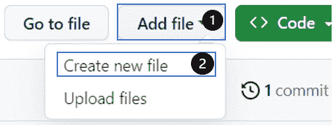

图 2.4 – 使用 GitHub 界面添加文件

1. 给你的文件命名为 `index.html`：

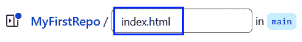

图 2.5 – 为文件命名

1. 你可以在编辑按钮下方的文本框中在文件中写点东西，例如 `Hello, World!`。稍后，我们将开始构建你自己的作品集页面，并免费托管在 GitHub 上。

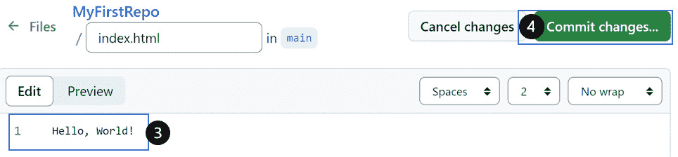

图 2.6 – 使用 GitHub 界面提交更改

1. 在右上角，点击绿色的 `Commit changes` 按钮，将你的新包裹（文件）保存到社区花园。

2. 一个新的弹出窗口将会出现，允许你定义提交信息并提供描述：

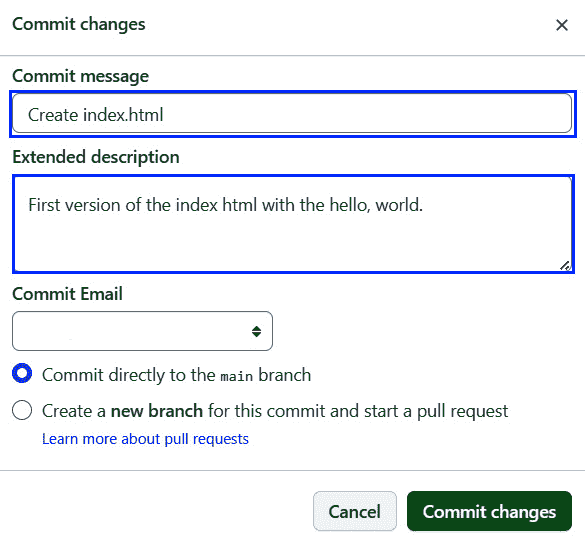

图 2.7 – 提交信息和详细描述

提供有意义的提交信息和描述至关重要，因为它们使同事能够了解对仓库所做的添加及其目的。

## Git commit – 保存你的快照

在本地工作时将更改发送到 GitHub 之前，`git commit` 会对暂存区的更改进行快照。它就像为盒子准备一份打包清单，详细说明其中包含的内容（*图 2.8*）。


图 2.8 – Git commit

在此实例中，你已向 main 分支进行了提交，这可能不是理想的做法。然而，我们将学习更多关于分支和分支策略的知识，以提高你的理解。

## Git push – 将更改交付到 GitHub

现在是时候与团队分享你的工作了。`git push` 是将你的更改盒子从本地机器运送到 GitHub 的送货卡车，使项目中的每个人都可以使用：


图 2.9 – Git push

## Git fetch – 更新检查器

在你工作时，你的队友也在进行更改。`git fetch` 是你在不将这些更新合并到本地项目的情况下检查 GitHub 上有什么新内容的方式，就像检查包裹送达但尚未将其带入室内一样：


图 2.10 – Git fetch

## Git pull – 将一切整合

当你准备好将 GitHub 的最新更新集成到本地机器时，`git pull` 会完成这项工作。它就像把包裹（你队友的更改）带入室内并打开它们以添加到你的项目中。它在一个命令中结合了获取最新更新并将其合并到本地项目。

## 网络交互

在这些命令中，`git clone`、`git push`、`git fetch` 和 `git pull` 是通过网络与 GitHub 交互的关键参与者，在你的本地机器和 GitHub 上的在线仓库之间架起桥梁。

这些命令是协作工作流程的工具包，确保你和你的团队在项目上工作时保持同步，无论你身在何处。

你现在已经了解了 Git 如何通过各种命令和工作流程与 GitHub 交互。我们已涵盖使用 `git clone` 克隆仓库、在本地和直接在 GitHub 上添加文件、使用 `git commit` 保存更改、使用 `git push` 推送更新，以及使用 `git fetch` 和 `git pull` 保持一切同步。这一基础有助于你有效地管理代码并与其他人协作。


接下来，我们将探讨 GitHub 上的仓库到底是什么。理解仓库至关重要，因为它们是你在 GitHub 上项目的核心。我们将了解如何创建、管理和使用仓库来保持项目的有序和可访问。

# GitHub 上的仓库是什么？

想象你刚搬到一个新城市，正在寻找一个居住的地方——一个你可以称之为自己的空间，你的所有物品和回忆都将存放在那里。在开发中，仓库（或简称为 *repo*）就充当你项目的家：


图 2.11 – GitHub 仓库

一个 **仓库** 是项目文件和修订历史集中存放的位置。它就像一个大文件柜，所有项目相关的材料，如代码文件、文档等，都存放在其中并得到整理。每个文件在这个柜子里都有自己的抽屉，而对这些文件的每一次更改都被详细记录，就像一本记录了谁在何时更改了什么的日志簿。

现在，让我们深入到这个城市 *GitHub* 的社区，这里就是仓库的所在地。

## GitHub 社区

GitHub 就像一个拥有数百万户房屋（仓库）的大型社区。每栋房子都属于从事各种项目的不同个人或团队。有些房子活动频繁，有许多人在贡献和修改，而其他房子可能很安静，只有零星一两个人居住。

在这个社区里，你可以参观其他房屋，欣赏它们的设计（代码），甚至提出改进建议（贡献）。如果你特别喜欢某栋房子的设计，你可以复制它（`fork`），并拥有自己的版本进行修改。

## 在 GitHub 上创建和管理仓库

当你决定在这个社区建造自己的房子时，你会在 GitHub 上创建一个新仓库。这里是你存放项目所有计划、设计和进展的地方。随着工作的进行，你会做出许多更改——添加新房间、粉刷墙壁或修理管道。每一次更改都会记录在你的仓库中，使你（以及其他人）能够追踪项目随时间的演变。

到现在为止，你应该真的很想开始创建新仓库了，所以让我们开始：

1. 点击 GitHub 主页右上角的 **+** 图标。
2. 从下拉菜单中选择 **New repository**：

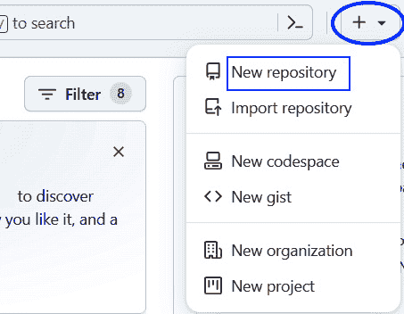

图 2.12 – 创建新仓库

1. 现在你必须填写所有必填字段来创建新仓库，但首先，让我们填写仓库的所有者和名称：

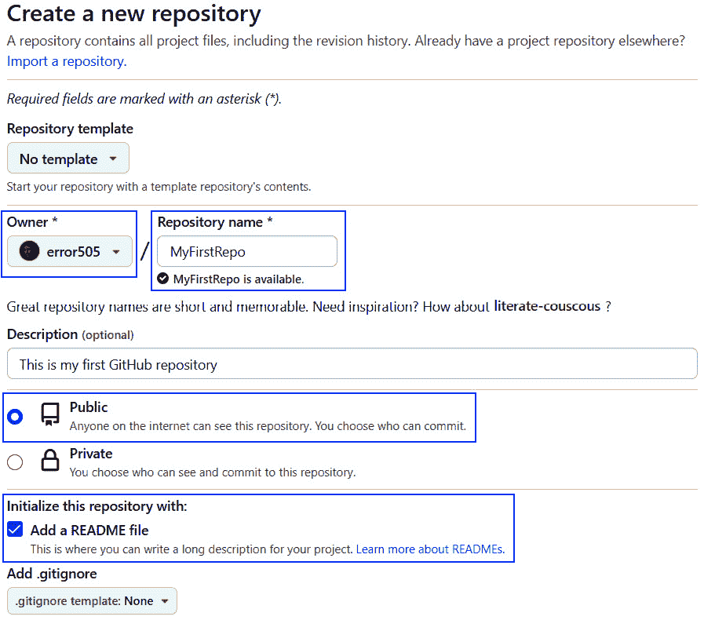

图 2.13 – 配置仓库

1. 最后，选择许可证类型；在此例中，我们将选择 **MIT License**。然后，点击绿色的 **Create repository** 按钮继续：

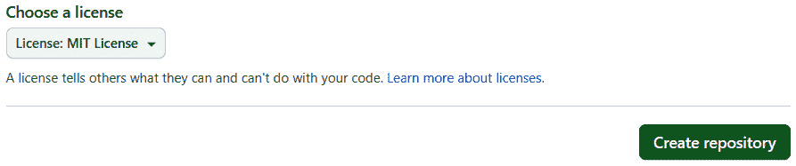

图 2.14 – 为仓库选择许可证

下一个屏幕将显示新创建的仓库以及 GitHub 仓库视图，其中包括 README 文件：

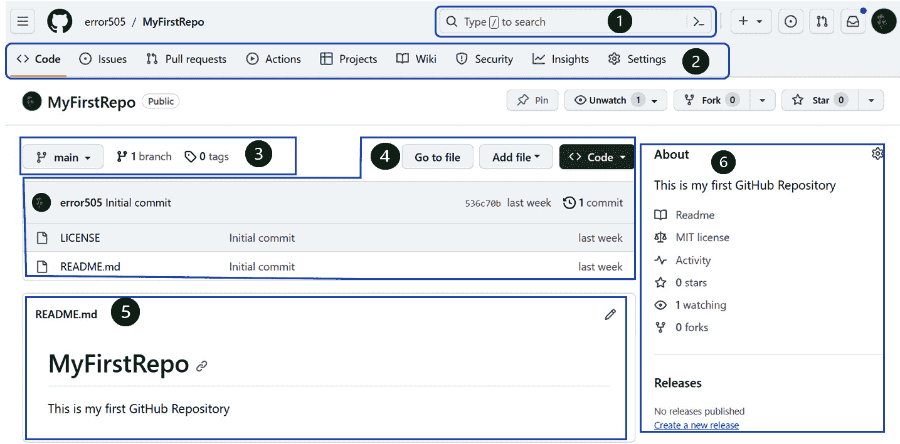

图 2.15 – 仓库概览

让我们分解 GitHub 仓库页面：

1. **搜索栏**：这里你可以输入并查找 GitHub 上的任何内容。可以把它想象成 Google 搜索，但仅限于 GitHub。
2. **仓库管理**：此部分就像你项目的控制中心。你可以看到项目的不同部分，例如 issues（你想要修复的问题）、pull requests（你或他人想要添加的更改）等。
3. **分支**：想象你的项目就像一棵树。树的主干是 `main` 分支。但有时，你想尝试新东西而不改变主树，于是你会创建一个较小的分支。这就是 GitHub 中的分支——项目的不同版本。
4. **文件**：此区域显示项目中的所有文件和文件夹，就像你电脑上的文件和文件夹一样！
5. **`README`**：这是一个特殊文件，你可以在其中写关于你的项目。它就像一个欢迎牌，告诉人们你的项目是什么以及如何使用它。对于你在 GitHub 上创建的每个仓库，都非常重要地拥有一个好的 `README` 文件。
6. **元数据**、**发布**、**包** 和 **贡献者**：
   * **元数据**：这是 **关于** 部分，是项目简短的描述
   * **发布**：这里可以发布项目的新的版本供他人使用

这就是 GitHub 仓库页面的简单分解。GitHub 就像你项目的巨大游乐场，这些部分帮助你组织和与他人分享你的工作！接下来，让我们看看如何下载和设置 Git。

# 准备工具 – 下载和安装 Git

开始使用 Git 和 GitHub 的旅程就像在开始创意项目前布置工作空间。第一步是确保你拥有合适的工具。以下是开始的方法：

1. 访问 Git 网站 [Git 官网](https://git-scm.com/)。
2. 点击 **Download** 按钮，网站将自动为你的操作系统——无论是 Windows、Mac 还是 Linux——推荐合适的版本：

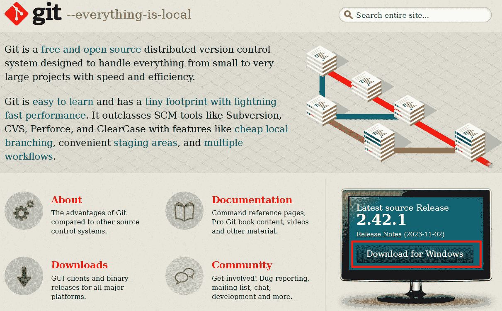

图 2.16 – 下载 Git

1. 下载完成后，打开安装程序。
2. 按照屏幕上的说明操作。如果你是 Git 新手，通常使用默认设置是安全的：

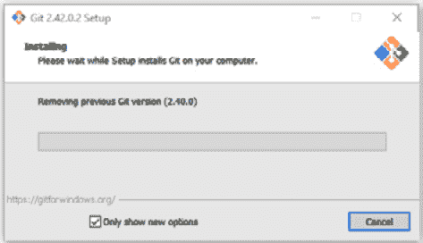

图 2.17 – 本地安装 Git

现在你已经安装了 Git，是时候向它介绍你自己了。Git 需要知道你是谁，以便将你的姓名和电子邮件地址附加到你所做的更改上。

但在继续之前，让我们先了解以下 Git 配置级别：

* `--system`
* `--global`
* `--local`

### 了解 Git 配置级别

想象你住在一栋有许多房间的大房子里，你有一个喜欢在闲逛时吹口哨的喜欢的曲调。现在，你决定每个房间都应有对这首曲调独特的回声，而且房子里的每个人都应遵循一个共同的节奏，但仅限于在房子里。最后，当你走出房子时，有一个社区节奏是该地区所有人都遵循的。

在 Git 中，设置配置有点像在这个场景中设定音乐规则。你可以在三个级别上设置偏好：系统、全局和本地。让我们逐一分解：

#### 系统（`--system`）

* 这就是我们故事中的 *社区节奏*
* 当你在系统级别设置配置时，就像为整台计算机设定规则，无论谁使用它

例如，如果你设置一个系统级规则，规定 **每个文件名都应大写**，那么在这台计算机上工作于任何项目的每个人都必须遵循该规则。

#### 全局（`--global`）

* 这就是我们故事中的 *房屋节奏*
* 全局配置就像为自己设定规则，但它们适用于你在计算机上工作的任何地方

例如，假设你更喜欢某种文件命名方式，例如以日期开头。所以你设置了一个全局规则，现在，无论你在哪个房间（项目）中，都遵循此规则。

#### 本地（`--local`）

* 这就是我们故事中的 *独特的房间回声*。
* 本地配置是最个人的。它们仅适用于你所在的房间（项目）。

例如，在某个特定项目（房间）中，你决定以特殊方式命名所有文件，例如以 **_final** 结尾。此规则仅在此项目中适用。


So, when you’re setting your preferences in Git using `git config`, you decide which level to apply them to, much like deciding where your musical rules apply in our story. Here’s how you might set a username at each level:

* **System**: `git config --system user.name "Your Name"`
* **Global**: `git config --global user.name "Your Name"`
* **Local**: `git config --local user.name "Your Name"`

Each of these commands sets your username for different scopes within your computer, from broad to narrow: everyone, just you, or just you in a specific project.

Let’s configure Git on your local machine:

1. **Start your Terminal**: Open the Git Bash on Windows or Terminal on Mac/Linux .

2. **Set your username**: Type the following command, replacing Your Name with your actual name:

```
$ git config --global user.name "Your Name"
```

3. **Set your email address**: Similarly, set your email address with the following command, replacing you@example.com with your actual email address:

```
$ git config --global user.email you@github.com
```

4. **View your configuration settings**: To view your current Git configuration, you can run the following command:

```
$git config --list
$git config --global --list
```

Figure 2.18 shows the result of using the `git config --list` command. This command lists all the Git configuration settings for the user. It includes information like the `username`, `email`, and other settings that control how Git behaves. For example, it shows the user’s name and email address, the text editor used for writing commit messages, and various alias commands to make working with Git easier.

Key Points in the Figure:

* `user.name` and `user.email`: These lines show the configured name and email of the user, which Git uses to label the author of each commit.
* `core.editor`: This specifies the text editor that Git will open when you need to write a commit message.
* `alias.` commands: These are shortcuts for Git commands. For instance, `alias.lol` is a shortcut for a longer `git log` command that shows a graph of commits.

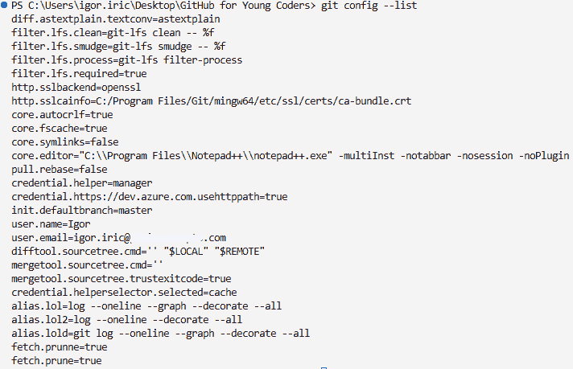

Figure 2.18 – Git 配置列表

You’ve now got your tools ready by downloading and installing `git`, and configuring your local git setup. With everything set up, you can now start managing your projects efficiently.

Next, let’s move on to creating and managing personal access tokens. These tokens are important for securely accessing your GitHub account and automating certain tasks. We’ll learn how to create these tokens and use them effectively.

# Creating and managing personal access tokens

*What’s a personal access token?* Think of a personal access token (PAT) as a special password that you can create to access your GitHub account, without using your regular password. It’s a way to let certain apps or tools have limited access to your account.

## How to create a PAT

Follow these steps to create a PAT:

1. Go to your GitHub account in your web browser and log in. Now, click on your profile picture in the top-right corner and select Settings from the drop-down menu:

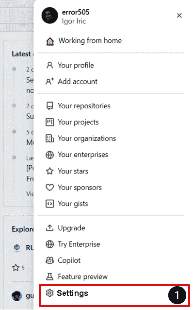

Figure 2.19 – 令牌创建用户设置菜单

1. On the left sidebar, click Developer settings:

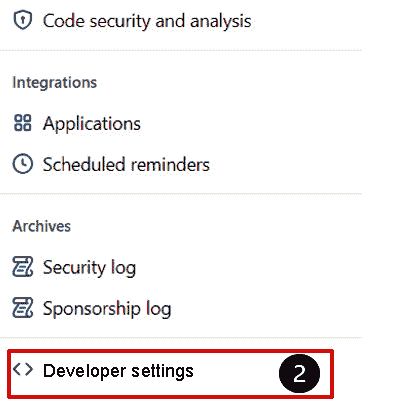

Figure 2.20 – 令牌创建：开发人员设置

1. Now click on Personal access tokens.

2. Select Tokens (classic):

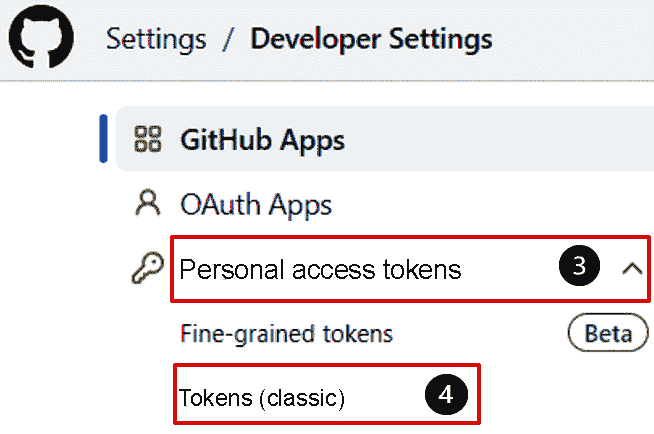

Figure 2.21 – 令牌创建：经典令牌

Now, let’s look at how to make your token.

1. Click on Generate new token.

2. Select Generate new token (classic):

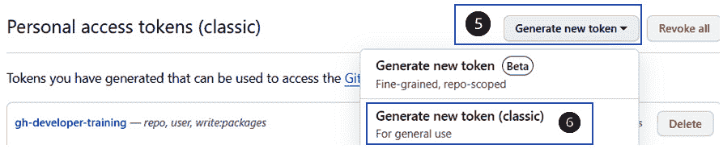

Figure 2.22 – 令牌创建：生成经典令牌

1. Name your token something that will help you remember what it’s for, such as `token-for-my-app`.

2. Choose the permissions or scopes you want this token to have. For example, to let it access your repositories, check `repo`.

3. Select for how many days you want your token to be valid:

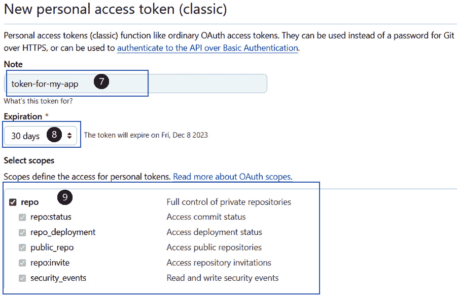

Figure 2.23 – 配置 PAT

1. Click on Generate token at the bottom of the page:

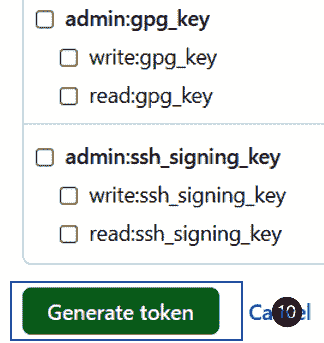

Figure 2.24 – 生成 PAT

## Keeping your token safe

You’ll see your new token now. Make sure to copy it and keep it somewhere safe, because you won’t be able to see it again! If you lose it or think someone else might have seen it, you can come back here to make a new one or delete the old one.

## Using your token with Git

Now that you have your token, you can use it to log in to GitHub from Git on your computer. Open your terminal on your computer. You’ll use a command to tell Git to use this token to log in to GitHub:

1. Type in this command to configure Git to use your GitHub token: `git remote set-url origin https://YOUR-TOKEN@github.com/username/repo.git`.

2. Replace `YOUR-TOKEN` with the token you just made, `username` with your GitHub username, and `repo` with the name of your repository:


Figure 2.25 – 配置本地 Git 使用你的 PAT

Now you can use Git to push or pull changes to and from GitHub without needing to type in your GitHub password each time.

## Why a good README file is like a welcoming front door on GitHub

When you create a new repository on GitHub for your one-page portfolio website, think of the README file as the front door to your project. It’s the first thing visitors see, and it can make a big difference in how people perceive and interact with your project. Here’s why it’s so important.

### The README file – your project’s introduction

Just like the front page of your website gives the first impression to your guests, your README file is the first thing people see when they visit your GitHub repository.

A well-written README file is inviting and informative, making visitors more likely to explore your project and understand what it’s all about:

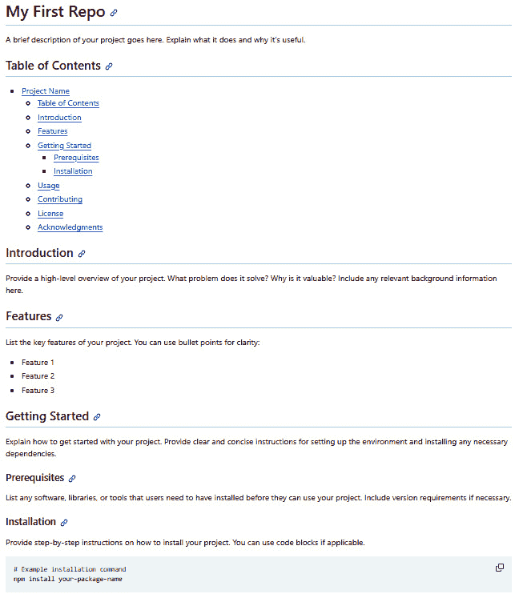

Figure 2.26 – 示例的良好 README 文件

### Explaining what your project is

Imagine a friend is visiting your GitHub project. The README file should answer their basic questions, such as *What is this project about?* and *What does this website do?*

It’s like having a sign on your front door that says, “Welcome to my portfolio website project!”

### How to get started

The README file can provide instructions on how to view or use your portfolio website. It’s like giving your friend a quick tour of your website and showing them where everything is.

It might include steps such as how to open the website, any special features they should check out, or how to navigate through your project files.

### You should encourage collaboration!

If you want others to help you with your project, a good README file is crucial. It’s like inviting friends over and giving them a guide on how they can help you decorate or improve your website.

It tells potential collaborators how they can contribute, what kind of help you’re looking for, and any important guidelines they should follow.

### Can I show my project’s status?

A README file can also include information such as how far along your project is (is it just starting, halfway done, or nearly complete?). It’s like telling your friends how much of the website is finished and what parts are still under construction.

### Tips for a great README file


一些制作优秀 README 文件的建议如下：

* **保持简洁清晰**：使用通俗易懂的语言并简明扼要，就像向一个对建网站一无所知的好友解释一样。
* **定期更新**：随着项目的演进，保持 README 文件的更新。就像保持你的前廊干净整洁、令人[content]
一些制作优秀 README 文件的建议如下：

* **保持简洁清晰**：使用通俗易懂的语言并简明扼要，就像向一个对建网站一无所知的好友解释一样。
* **定期更新**：随着项目的演进，保持 README 文件的更新。就像保持你的前廊干净整洁、令人欢迎一样。
* **必要时使用视觉元素**：有时，一张图片或截图可以帮助更好地解释事物。

GitHub 上一份良好的 README 文件就是你项目的问候。它为你的项目定下基调，可能决定了别人只是路过，还是停下来、进入，甚至留下帮忙。

以下是我们将为第一个仓库使用的 Markdown，以开始制作一份良好的 README 文件：

```markdown
# My First Repo
```

在此处添加你项目的简短描述。说明它做什么以及为什么有用。

```markdown
## Table of Contents
- Project Name
  - Table of Contents
  - Introduction
  - Features
  - Getting Started
    - Prerequisites
    - Installation
  - Usage
  - Contributing
  - License
  - Acknowledgments
## Introduction
```

提供你项目的整体概述。它解决了什么问题？为什么有价值？在此处包含任何相关的背景信息。

```markdown
## Features
```

列出你项目的关键特性。你可以使用项目符号以提高清晰度：

```markdown
- Feature 1
- Feature 2
- Feature 3
## Getting Started
```

说明如何开始使用你的项目。提供设置环境和安装任何必要依赖项的清晰简洁说明。

```markdown
### Prerequisites
```

列出用户在使用你的项目之前需要安装的任何软件、库或工具。如有必要，包含版本要求。

```markdown
### Installation
```

提供安装你项目的逐步说明。如适用，可使用代码块。

```bash
# Example installation command

npm install your-package-name
```

## 在 GitHub 上直接编辑 README 文件（动手实践）

1. **前往我们之前创建的 GitHub 仓库**：这就像打开你电脑上保存文档的文件夹。
2. **在文件内容右上角查找铅笔（）图标**：这是编辑按钮。点击它：

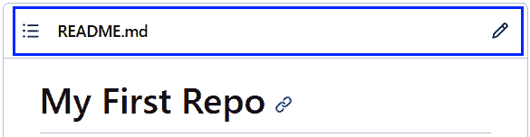
图 2.27 – 编辑 README 文件

3. **打开文件**：文件现在将在一个可编辑的文本框中打开，类似于简单的文本编辑器。现在，你准备好进行更改了：

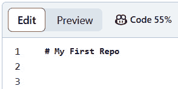
图 2.28 – 向 README 文件添加更改

4. **进行更改**：只需在文本框中输入即可对文件进行更改。这就像编辑 Word 文档或电子邮件一样。
5. **添加你的 Markdown**：现在使用 Markdown 代码并替换 README 文件的所有内容。
6. **查看你的更改**：你会看到一个名为 **Preview**（）的部分。这显示了你的编辑效果。这就像在打印前预览文档一样。
7. **提交你的更改**：一旦对编辑满意，你需要 *commit* 这些更改（在 GitHub 术语中，*committing* 就像保存你的更改一样）：

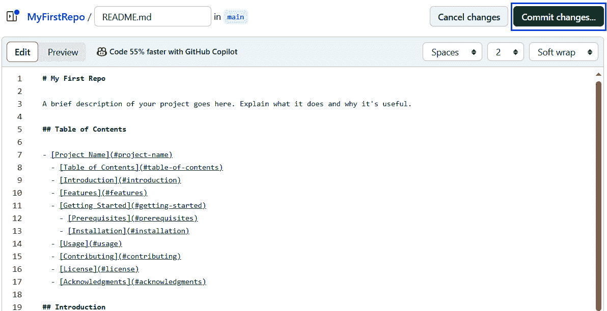
图 2.29 – 保存更改

8. **添加你的提交信息**：接下来，你会看到一个框，可以输入一条简短的消息来说明你做了哪些更改（这有助于你和其他人了解更改了什么以及为什么）：

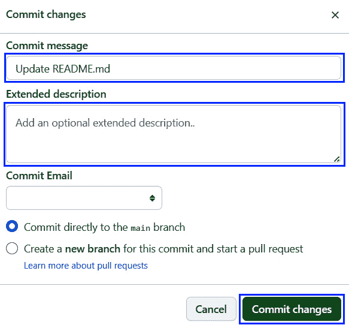
图 2.30 – 提交更改

9. **完成提交**：添加消息后，点击绿色按钮上的 **Commit changes**。这就像在文档上点击 **Save**。

你的更改现在已保存并立即在 GitHub 上的文件中更新。

# 总结

在本章中，我们学习了 Git 和 GitHub 的基础知识，包括如何克隆仓库、使用 Git 命令、保存更改以及与其他人协作。这些技能对于管理项目和在编程中作为团队工作至关重要。

接下来，我们将探索 GitHub 用于项目协作的功能，例如邀请朋友加入项目、处理问题、创建拉取请求、管理通知、参与讨论、设置项目以及使用洞察和图表。这将在我们奠定基础知识的基础上，帮助我们更有效地协作。

# 测验

通过以下测验问题检查你通过阅读本章获得的知识：

1. GitHub 中的“repository”是什么？
   1. 代码和项目文件的集合
   2. 开发人员的聊天室
   3. 一种编程语言
   4. 一个网站构建器
   *Answer*: A. 代码和项目文件的集合

2. 真或假：Git 和 GitHub 是同一件事。
   1. 真
   2. 假
   *Answer*: B. 假

3. 填空：要开始使用 GitHub，你需要为你的项目创建一个 ______________。
   *Answer*: repository

4. 为什么在你的机器上设置 Git 很重要？
   *Answer*: 它允许你从本地机器与 GitHub 交互，从而更有效地管理和协作项目。

5. “克隆一个仓库”是什么意思？
   1. 删除一个项目
   2. 将项目复制到你的本地机器
   3. 更改项目的名称
   4. 将项目发送给朋友
   *Answer*: B. 将项目复制到你的本地机器

6. 真或假：你只能将 GitHub 用于编码项目。
   1. 真
   2. 假
   *Answer*: B. 假

7. Git 命令的目的是什么？
   1. 玩游戏
   2. 与 Git 通信并管理你的项目
   3. 画画
   4. 写文章
   *Answer*: B. 与 Git 通信并管理你的项目

8. 填空：当你对代码进行更改时，你需要 ________ 它们以便在 GitHub 上保存并更新你的项目。
   *Answer*: push

9. 真或假：你可以在不使用 Git 的情况下在 GitHub 上与其他人协作。
   1. 真
   2. 假
   *Answer*: B. 假

10. 命名本章中提到的一个基本 Git 命令及其用途。
    *Answer*: `git push` 命令用于将本地仓库内容上传到远程仓库

# 挑战 – 启动你的太空冒险！

准备好开始一次出乎意料的冒险了吗？在本章中，我们探索了 GitHub 和版本控制的基础知识。现在是时候将这些知识付诸实践，使用你自己的太空主题游戏：*Space Explorer！*

你的任务？

在 GitHub 上启动 **Space Explorer Game** 仓库：


图 2.31 – Space Explorer 游戏

## 成功步骤

以下是你的成功步骤：

1. **Fork 仓库**：访问官方 **Space Explorer Game** 仓库 [`github.com/PacktPublishing/GitHub-for-Next-Generation-Coders`](https://github.com/PacktPublishing/GitHub-for-Next-Generation-Coders)。
2. **点击 Fork 按钮**：这将在你的 GitHub 账户中创建游戏的副本——想象成克隆一艘外星飞船，这样你就有了一艘属于自己的！
3. **克隆你的 fork**：一旦你 fork 了仓库，是时候把它带到你的电脑上了。在终端中使用 `git clone` 命令克隆仓库。（需要复习？重温我们关于克隆的部分。）你正把飞船直接传送到你的电脑上！
4. **探索你的本地副本**：在你喜欢的代码编辑器中打开克隆的项目。偷看一下！你会找到 HTML、CSS 和 JavaScript 文件——太空冒险的构建模块。


### 5. 在本地浏览器中测试游戏
在浏览器中运行 HTML 文件，并在 `Game Start` 文件夹中查看 *Space Explorer* 游戏的基础版本。它活了！

### 6. 坚定你的使命
先做一个小改动。不如在 HTML 文件中更改标题以包含你的名字？例如，`<title>[Your Name]'s Space Explorer</title>`。

### 7. 保存并提交更改
保存你的更改并使用诸如 `Personalize game title` 的信息提交它们。你正在这个编程宇宙中标记你的领地！

### 8. 推送更改
使用 `git push` 命令将你的更改推送到你的 GitHub fork。你的个性化宇宙飞船现在在 GitHub 宇宙中可见了！

### 9. 反思你的旅程
在线查看你的 GitHub 仓库。看到那里的提交了吗？你刚刚完成了一个基本的 GitHub 循环：fork、clone、edit、commit 和 push！

## 奖励挑战
在你的仓库的 `README` 文件中写一篇简短的“船长日志”条目，描述你的第一次任务。发挥你的想象力！有什么令人兴奋的？你对 GitHub 和编程有什么发现？
