## 3 用于项目协作的 GitHub 功能
在本章中，我们将了解改进项目协作的 GitHub 功能，教你如何邀请协作者、管理问题、创建 pull requests、处理通知、使用讨论进行团队沟通、设置项目以及使用洞察和图表。这些工具旨在简化团队合作，使跟踪进度、讨论想法和高效共享更新变得更容易。

在本章中，我们将涵盖以下主要主题：
* 设置你的团队 – 在 GitHub 上邀请协作者
* 了解 GitHub 问题 – 我们项目的困扰是什么？
* pull request 简介
* 有什么动静？管理 GitHub 通知
* 探索 GitHub Discussions
* 在 GitHub 上设置项目
* 了解 GitHub 上的 Wiki
* 什么是 GitHub 仓库洞察？

### 技术要求
需要一个 GitHub 账户和对 `Git` 的基本熟悉。确保 `Git` 已安装在你的计算机上并为练习设置一个 GitHub 仓库。访问 `https://github.com` URL 进行本章的所有活动。创建一个名为 `ch3` 的 GitHub 文件夹以组织你的工作。

### 设置你的团队 – 在 GitHub 上邀请协作者
曾经参加过派对吗？当你邀请朋友时，会更有趣，对吧？现在，把你的 GitHub 项目想象成一个派对。当更多人，例如你的队友或朋友加入并做出贡献时，它会变得更好。那么，你如何邀请他们参加你的 GitHub 项目派对呢？让我们一步步来。

#### 找到邀请位置
1. 打开你的网络浏览器并前往你的 GitHub 项目页面。在我们的例子中，它叫做 `MyFirstRepo`。现在，在页面的右上角查找名为 Settings 的标签并点击它。这就像打开你派对的大门。将其视为 *步骤零*。
2. 进入设置后，在左侧查找名为 Access 的部分。点击 Collaborators。这个部分就像你的宾客名单。
3. 现在，点击绿色按钮 Add people：
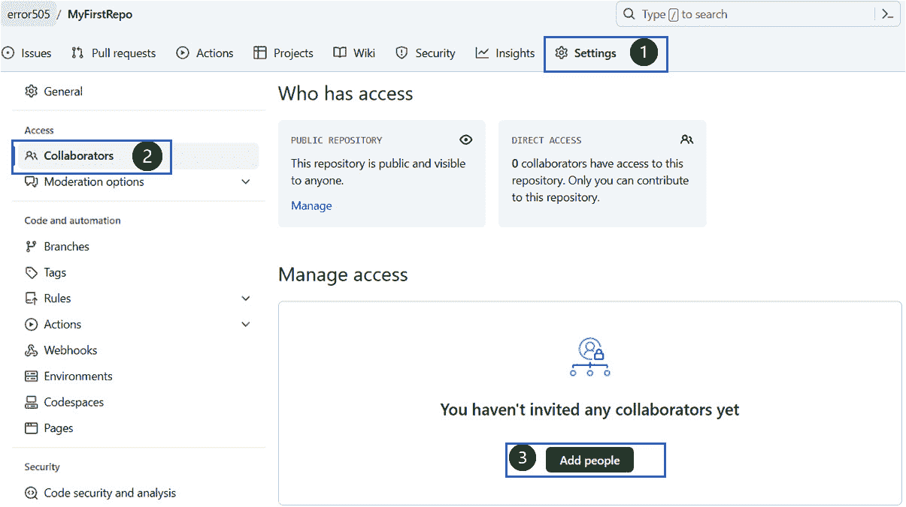
图 3.1 – 邀请协作者
4. 在这里，你可以输入你想要邀请的朋友的用户名或电子邮件地址。当你开始输入时，GitHub 会通过建议名称来帮助你：
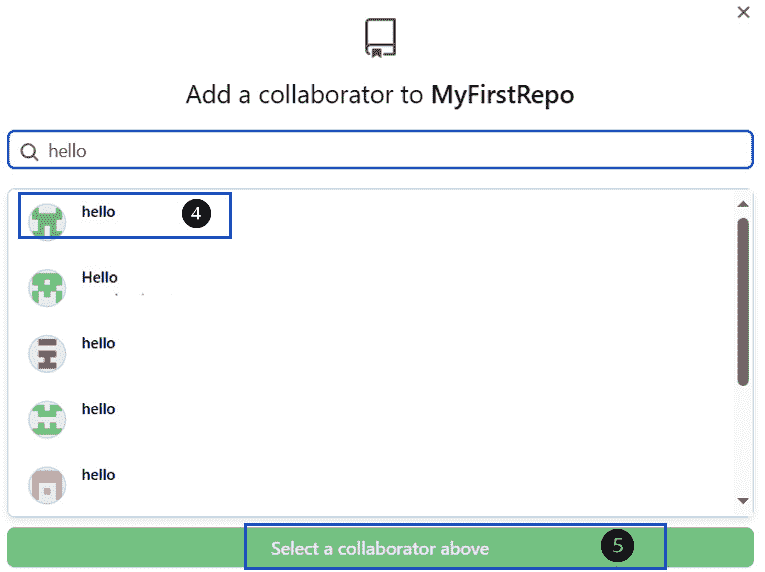
图 3.2 – 从列表中选择协作者
5. 从列表中选择你想要邀请的朋友，或完成输入他们的用户名或电子邮件，然后点击上方的 Select a collaborator 按钮发送邀请。这就像向你的派对发送邀请卡。

#### 等待他们的 RSVP（répondez s’il vous plaît – 请回复）
你的朋友将通过电子邮件和 GitHub 上的通知收到你的邀请。一旦他们接受，他们就可以加入你的项目，查看你一直在工作的所有酷东西，并开始贡献他们自己的想法！

#### 检查宾客名单
随时你可以返回项目设置中的 Collaborators 部分，查看谁接受了你的邀请以及谁加入了派对。
现在，你的 GitHub 项目派对已经设置好，邀请已发送，随着朋友们的加入，真正的乐趣和创造力开始了。一起，你们将创造出令人惊叹的东西，也许在途中还能互相学习一两件事。接下来，让我们了解一个重要主题：GitHub 问题。

### 了解 GitHub 问题 – 我们项目的困扰是什么？
想象你和一群朋友一起拼一个大拼图。你们都在拼凑碎片，但突然，你注意到拼图的某个部分看起来有点奇怪。也许缺少一块，或者几块拼不起来。你想让朋友们知道这一点，以便大家都了解并有人帮忙修复。在通过 GitHub 进行项目协作中，这就是 *问题* 发挥作用的地方。
GitHub Issues 就像你项目的公告板。每当你或你的队友发现一个问题、有疑问或想提出一个想法时，你就可以将其发布在 Issues 板上。这是一个大家可以讨论正在发生的事情并共同想出解决方案的地方。例如，如果你正在从事一个网站项目并且联系表单无法工作，你可以创建一个诸如 *网站错误* 的问题以便修复它。

#### 创建一个问题
1. 前往 GitHub 上的项目仓库。点击 Issues 标签。
2. 接下来，点击绿色 New issue 按钮：
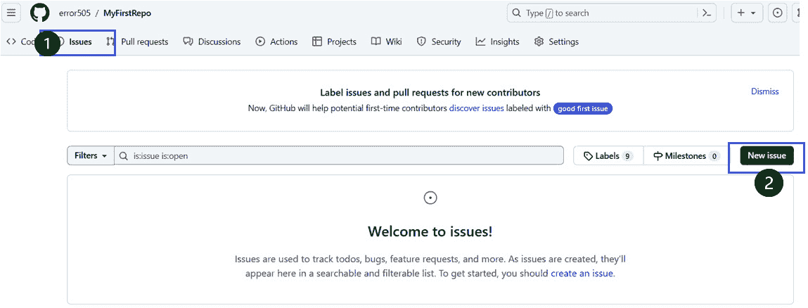
图 3.3 – 创建新问题
创建新问题的页面将打开。
3. 为你的问题提供一个标题，例如 `Rename the Repository to MyBiography`，并详细描述问题：
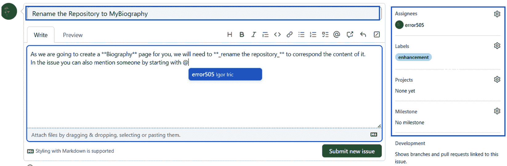
图 3.4 – 问题标题和描述
你甚至可以添加诸如 `bug` 或 `enhancement` 的标签来对其进行分类并将其附加到项目中，我们将在下一节中创建这些项目：
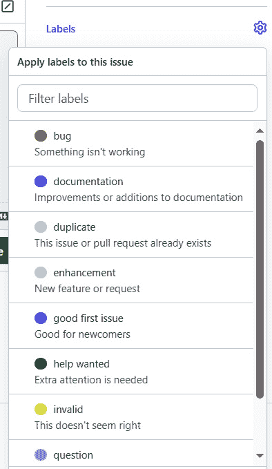
图 3.5 – 问题标签
现在，你的问题已在公告板上。你的队友可以看到它，对其发表评论，甚至提出解决方案。

#### 讨论问题
你可以在问题页面上直接进行对话，分享代码片段、屏幕截图或任何其他有用信息：
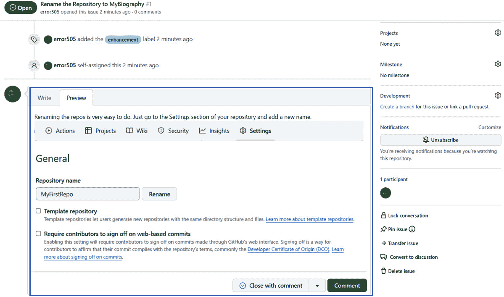
图 3.6 – 对问题发表评论
如果你的某个队友有很好的修复问题的方法，你或你的项目经理可以将问题分配给他们。

#### 分配问题
你可以像这样将问题分配给某个人：
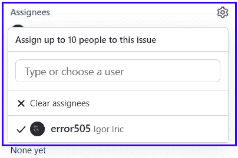
图 3.7 – 将问题分配给团队成员
他们现在有一个任务可以工作，每个人都知道他们是正在处理这个问题的那个人。

一旦你的队友在本地机器上修复了问题，他们就可以创建一个拉取请求（我们将在“介绍拉取请求”部分讨论）。

# 链接到拉取请求
在拉取请求中，他们可以提及问题编号，例如 `Fixes #1`，以表明此拉取请求中的更改旨在解决该问题。GitHub 很智能；一旦拉取请求被合并，它将自动关闭问题，表明问题已得到解决：

图 3.8 – 将问题链接到拉取请求

通过这种简单、有条理的系统，GitHub Issues 有助于让每个人都清楚项目中需要关注的内容。这就像一份鲜活的待办清单，每个人都可以贡献和互动，确保在项目不断完善的过程中不会有任何事情被遗漏。有了这些知识，让我们继续进入下一部分！

# 介绍拉取请求
你在和朋友们一起制作一个单页作品集网站。每个人都有不同的想法和贡献来让网站看起来很棒，就像一群艺术家在共同创作一幅大型壁画。现在，如何确保每个人的想法都能很好地融合在一起，让壁画最终看起来很棒呢？这就是 GitHub 拉取请求发挥作用的地方！图 3.9 显示了拉取请求在 GitHub 上的外观：

图 3.9 – 在 GitHub 上管理拉取请求

## 什么是拉取请求？
基本上，拉取请求是对合并代码更改的请求。拉取请求就像是在问团队：“嘿，我们可以在网站上添加我的博客页面吗？”

这是一种讨论更改的方式：在团队同意之前，他们会查看你的博客页面，提出建议，或表示它已经完美无缺。

## 在你的网站项目中使用拉取请求
假设你为网站创建了一个新部分，例如“关于我”页面。你在 GitHub 上提交一个拉取请求，这就像向团队展示你的草稿。图 3.10 演示了如何打开拉取请求：

图 3.10 – 为代码更改打开拉取请求

## 审查和反馈
你的队友会检查你的“关于我”页面。他们可以提出更改建议，例如“这里也许可以用不同的字体？”，如果他们喜欢，还可以点赞。

这是每个人讨论和完善想法的机会，确保网站保持一致性。以下图示展示了如何审查拉取请求：

图 3.11 – 审查拉取请求

## 合并拉取请求
一旦大家达成一致，你的更改就会合并到主项目中：

图 3.12 – 合并拉取请求

你的“关于我”部分现在已成为官方网站的一部分！

这就像把你的作品添加到壁画中，使其更加丰富和完整。

## 为什么拉取请求很重要？
拉取请求确保更改经过审查并与整体设计良好契合。

拉取请求鼓励协作和学习。它们开启了关于不同想法和方法的对话。这是一个很好的方式，让大家互相学习并作为团队改进项目。拉取请求确保网站保持功能正常、外观良好且无错误。接下来，让我们学习通过管理通知来优化你的 GitHub 体验。

# 有什么动静？管理 GitHub 通知
你是否曾因手机的嗡嗡声和蜂鸣声感到不知所措，尤其是在你参与活跃的在线社区或繁忙的项目团队时？这就像置身于一个房间里，每个人都在同时说话，而你正努力跟上所有内容。现在，想象一下这种情况发生在 GitHub 上的数字工作空间中。代码行的每条评论、每个新打开的问题或每个拉取请求都会向你发送通知。这很快就会变得烦人！那么，如何在不迷失在通知海洋中的情况下，关注重要的对话呢？

GitHub 通知是你跟踪与你相关的讨论和活动的方式。它们就像轻微的提醒或肩膀上的轻拍，告诉你需要关注的地方。让我们在 GitHub 上穿行于这个充满想法的嘈杂市场中，而不迷失方向。

## 发现通知
当你登录 GitHub 时，你会在页面右上角注意到一个收件箱图标：

图 3.13 – 通知

那里汇集了你所有的通知，等待你的关注。

## 调整渠道
点击铃铛图标，你会看到所有通知的列表。左侧有一个侧边栏，可帮助你筛选这些通知。你可以选择查看特定仓库的通知或直接提及你的通知：

图 3.14 – 通知列表

你可以按仓库、状态或讨论类型、通知原因、作者或组织来筛选通知：

图 3.15 – 筛选通知

## 标记通知
在浏览通知时，你可以将它们标记为已读，这样它们就不会再吸引你的注意，或者如果你需要更多时间，可以将它们保持为未读。选择通知前面的复选框，点击三个点按钮，你将看到“标记为已读”和“标记为未读”选项：

图 3.16 – 阅读和标记通知

## 使用筛选器减少通知泛滥
GitHub 还允许你根据通知的状态进行筛选，例如未读、参与中或被提及。这就像有一位智能助手，知道哪些文件应该放在你的办公桌上。你甚至可以通过点击齿轮图标创建自己的筛选器：

图 3.17 – 筛选器

一个新窗口将打开，其中包含几个默认筛选器，从那里你可以创建新的筛选器：

图 3.18 – 创建自定义筛选器

## 自定义提醒
如果你觉得提醒太多，可以通过点击左侧的“管理通知”选项来自定义通知设置：

图 3.19 – 管理通知选项

如果点击“通知设置”，你将被重定向到通知页面，在那里你可以选择 GitHub 何时以及如何向你发送通知：

图 3.20 – 通知管理部分

你可以决定接收每项活动的通知或仅接收重点通知。

## 通过电子邮件接收更新
如果你更喜欢不那么打扰的方式，可以让 GitHub 将所有通知发送到你的电子邮件。你可以在有空时再查看这些通知。

现在你已经学会了如何有效地管理 GitHub 通知并保持项目更新整洁且相关，让我们将注意力转向 GitHub 的另一个互动功能。我们将看看如何使用 GitHub Discussions 来进一步增强项目协作。本节将展示如何将 Discussions 用作分享想法、收集反馈以及与团队更开放沟通的平台。

# 探索 GitHub Discussions

# GitHub 讨论

你是否曾希望有一个地方，你和你的团队成员可以在那里讨论项目、分享想法或提问？它就像你项目的专属社交媒体平台。这正是 **GitHub Discussions** 的用途！

## 项目协作的酷炫之处

所以，你正和朋友们一起创建一个单页作品集网站。这不仅仅是编码和设计，对吧？你需要头脑风暴想法、理清问题，有时也只是聊聊酷炫的功能。这就是 GitHub Discussions 登场的地方。

## 它就像你项目的聊天室

把 Discussions 想象成一个数字咖啡馆，你和朋友们可以在那里谈论与网站相关的所有事情，从设计想法到决定包含什么内容。

与其在不同的应用之间 juggling 对话或丢失重要的建议，项目相关的所有内容都集中在一个有组织的场所。

## 我们可以进行哪些类型的讨论？

可以进行多种讨论，例如：

*   **General**：通用的空间，适合任何不属于其他类别的内容。它就像 *杂项* 抽屉：
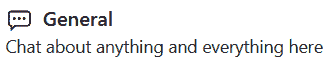
图 3.21 – 通用讨论
*   **Ideas**：有好点子或建议吗？这里就是你的舞台！

图 3.22 – 创意讨论
*   **Q&A**：如果你有问题，这里就是提问的地方。如果你有答案，这里就是分享的地方：

图 3.23 – 问答讨论
*   **Show and tell**：为自己做的事情感到自豪吗？这里就是你展示光芒的时刻！

图 3.24 – 展示与分享讨论
*   **Polls**：想象你有一个问题，想知道大家的想法。投票让每个人都能投出自己的票。就像问“我们的项目标志应该是蓝色还是绿色？”然后每个人都可以点击自己的选择：
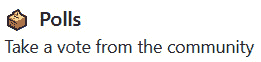
图 3.25 – 投票讨论
*   **Announcements**：这里分享重要新闻。把它想象成咖啡馆里的公告板，重要通知被钉在上面：
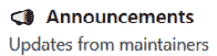
图 3.26 – 公告讨论

## 如何开始一个讨论？

开始讨论，请按以下步骤操作：

1.  导航到 **Discussions** 选项卡。
2.  在左侧菜单中选择一个类别，在那里开始讨论：
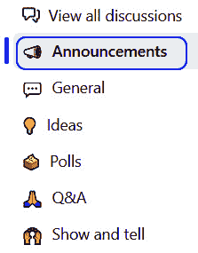
图 3.27 – 讨论分类
1.  要开始新的讨论，有一个按钮写着 **New discussion**。点击它就像举手开始一个新话题：
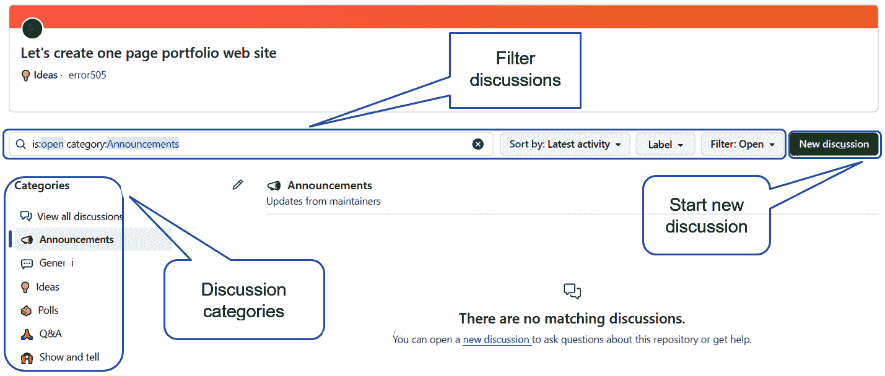
图 3.28 – 讨论概览
1.  就像一个对话开场白，给你的讨论起一个吸引人的标题，并在此处分享你的想法、问题或创意。这就像在社交媒体上发帖：
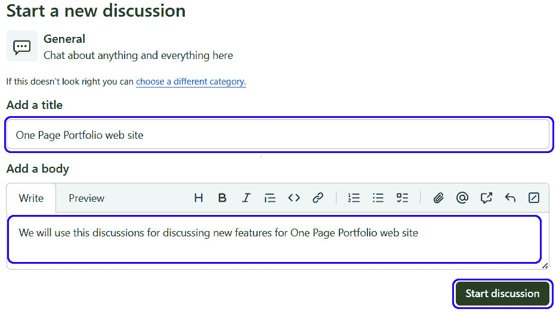
图 3.29 – 创建讨论
1.  **Post it**：点击 **Start discussion** 按钮，你就上线了！
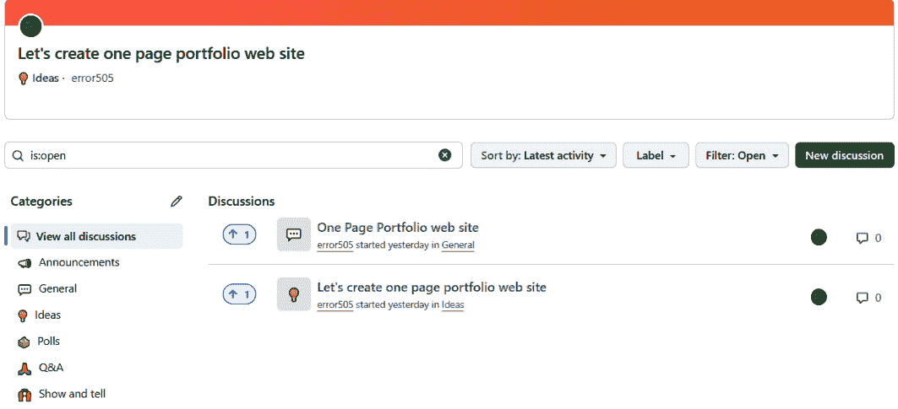
图 3.30 – 讨论列表

## 建设更强大的团队

这些讨论为你的项目创建了历史记录。对任何新团队成员来说都很有价值，可以快速上手并追踪过去的决策和想法。当每个人都参与对话时，你会得到更好的想法、更多的承诺和社区感。就像让所有朋友为你的网站贡献独特的想法，使其更丰富、更个性化。

# 在 GitHub 上设置项目

假设你正和朋友们计划一场后院烧烤派对。你有一个清单要买汉堡、设置烤架、邀请人，也许计划一些游戏。在 GitHub 上为你的单页网站设置项目有点像这样，但针对的是编码。

## 为什么项目在 GitHub 上很重要？

就像派对需要计划一样，你的网站需要组织。GitHub Projects 帮助你和你的朋友（或团队成员）知道谁在做什么以及何时做。但这不仅仅是代码。它关乎人们共同工作、聊天、分享想法并互相帮助。把它想象成在烤汉堡时进行的愉快聊天和击掌。

## 为你的单页作品集网站设置项目

1.  **先制定计划**：想象你在绘制派对地图。在 GitHub 上，你为网站创建一个 *项目*。这里是你概述让网站变得很棒的所有步骤的地方。
2.  **将其分解为任务**：你不会让客人自己烤汉堡，对吧？同样地，在你的项目中，你创建任务（例如设计主页、编写内容等等）并分配给朋友。每个人都知道自己需要做什么。
3.  **跟踪进度**：就像在派对清单上勾选项目一样，你可以跟踪哪些任务已完成、哪些正在进行中、还有什么剩余。就像知道饮料已准备好但游戏还没设置好一样。
4.  **协作与沟通**：使用 GitHub 的功能讨论任务、提供反馈并进行更改。就像讨论在哪里设置烤架或播放什么音乐一样。
5.  **庆祝里程碑**：主页完成了？联系表单正常工作了？庆祝这些小胜利吧！就像第一批汉堡准备好时欢呼一样。

### 在 GitHub 上为你的单页网站设置 Kanban 项目

Kanban 到底是什么？

**Kanban** 就像一个公告板，上面有便签显示不同的任务，例如 *添加个人资料图片* 或 *添加联系部分*。每张便签从一个类别移动到另一个类别，例如 **Todo**、**In Progress** 和 **Done**：
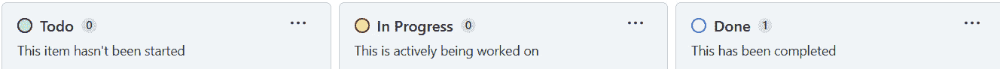
图 3.31 – Kanban 泳道

这就是 Kanban —— 一种直观查看项目进度的方式。

*好吧 – 那么如何在 **GitHub 上** 创建项目？*

### 在 GitHub 上创建项目

1.  在 GitHub 中，进入你的网站仓库并点击 **Projects**。在那里，你将看到项目的概览。点击 **Projects**，然后点击 **New project**：
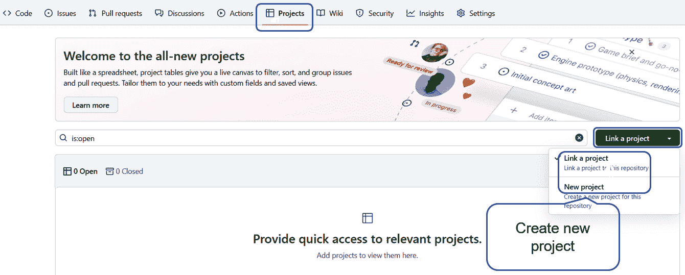
图 3.32 – 项目概览页面
1.  一个新的弹出窗口将打开，你可以在其中选择从头创建项目作为表格、看板或路线图，或从模板开始：
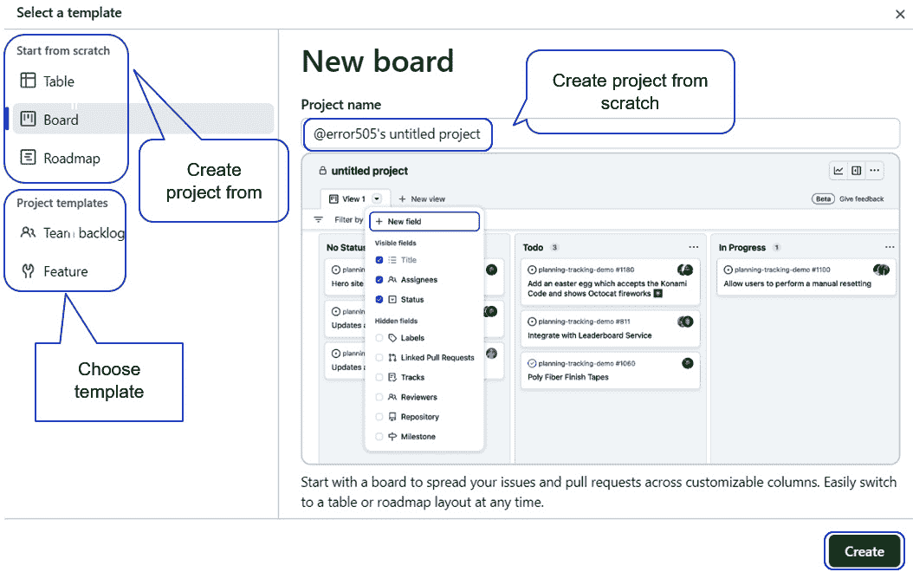
图 3.33 – 创建新项目

将其命名为类似 **One-Page Website Development**。就像为你的 DIY 书架项目命名一样。在你点击 **Create a new project** 后，一个 **One-Page Website Development** 项目将被创建，其中已创建的列例如 **Todo**、**In Progress** 和 **Done**。这些就像公告板上的部分，显示计划中、正在进行中和已完成的内容：
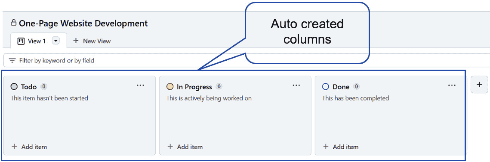
图 3.34 – 新项目已创建
1.  **创建新列**：
    1.  很可能，你的项目需要更多列。要设置新列，只需点击加号图标并开始创建新列。
    2.  为你的列提供标签、颜色和描述：
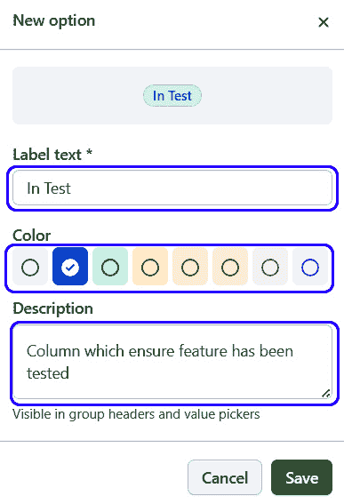
图 3.35 – 配置新列
1.  **将任务添加为卡片**：
    1.  网站的每个任务都成为一张卡片。
    2.  为诸如 *设计主页*、*撰写关于我部分* 等事物创建卡片。
    3.  将它们放在 **Todo** 列中。就像在看板的 **Todo** 部分放置便签一样。只需点击 **Add Item** 并开始添加：
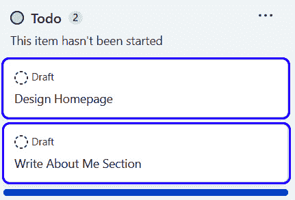

## 创建任务

通过点击其中一个为新条目添加更多详细信息。将打开一个新页面，您可以在其中添加其他详细信息，例如描述、将问题分配给团队成员、归档或删除它：

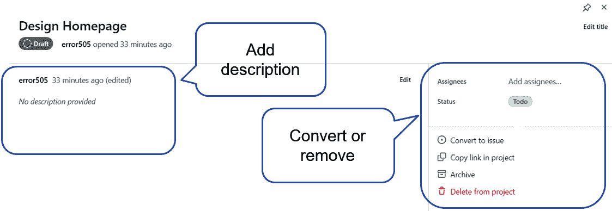
图 3.37 – 任务视图

1. **移动卡片**：
    1. 当你开始处理任务时，将其卡片移至 **进行中**。
    2. 完成后，将其移至 **已完成**。
    就像当书架的一部分完成时，将便签从 **待办** 移到 **已完成** 一样。
2. **协作并更新**：你的团队可以为每个卡片添加评论、建议或更新。就像你的朋友在便签上写下关于网站进展的笔记一样。

## 为什么使用看板？

看到卡片从 **待办** 移到 **已完成** 令人满意且鼓舞人心，就像看着网站成形一样。

协作很简单，因为每个人都能看到需要做什么以及已完成什么。不会混淆谁负责设计，谁负责编写代码。

这是一种非常灵活的方式，可以根据需要添加新任务或重新排列它们。就像在构建网站时如果你发现更好的方法，可以调整你的步骤一样。

在 GitHub 上为你的单页网站设置看板项目，就像组织和可视化有趣的 DIY 项目的步骤一样。它使一切保持清晰、协作和灵活，使构建网站的过程变得愉快！

## 如何更改我的项目设置？

在项目的 **设置** 部分，你有许多选项，例如更改项目名称和描述、添加 README 文件、管理访问权限，以及额外添加自定义字段的可能性：

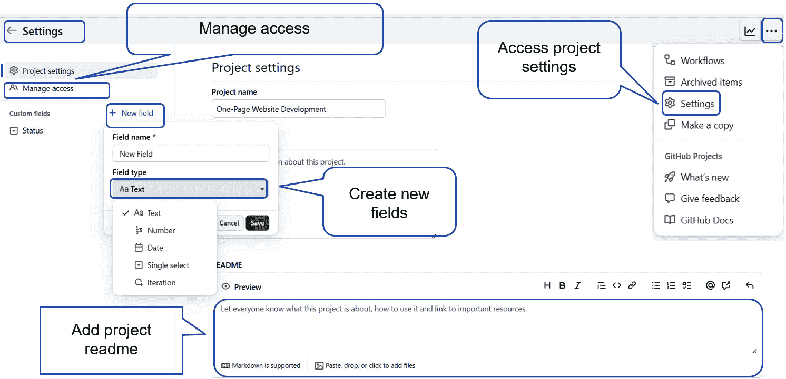
图 3.38 – 项目设置

现在我们已经介绍了如何在 GitHub 上设置项目、使用看板进行组织，并深入了解以监控项目的进展，让我们继续前进。接下来，我们将学习如何使用 GitHub Wiki。这将帮助你为单页网站创建一个任何人都可以参考的综合指南。就像为你的网站建立一份手册，使其他人更容易理解并为你的项目做出贡献。

# 在 GitHub 上理解 Wiki

GitHub 上的 **wiki** 是什么？它是在你的 GitHub 仓库中可以编写和存储项目重要信息的地方。可以把它想象成一个数字笔记本，你和你的团队可以在其中记录有关构建单页网站的一切。

## Wiki 如何提供帮助？

就像把构建网站的所有说明放在一个地方一样，Wiki 将项目的所有信息保存在一个位置。这可以包括设计指南、编码标准，甚至会议记录。

团队中的任何人都可以添加或编辑页面。如果有人找到了为网站的某个部分编码或更新设计的更好方法，他们可以快速更新 Wiki。

当有新人加入项目时，他们可以阅读 Wiki 来快速上手。就像给他们网站的使用说明书，让他们确切知道该做什么。

## 在 GitHub 上为你的单页网站创建 Wiki

要为你的单页网站创建 Wiki，请按照以下步骤操作：

1. 转到 GitHub 上网站的仓库，找到 **Wiki** 标签，通常在 **Projects** 旁边。点击 **创建第一个页面** 开始撰写你的第一个 Wiki 页面：
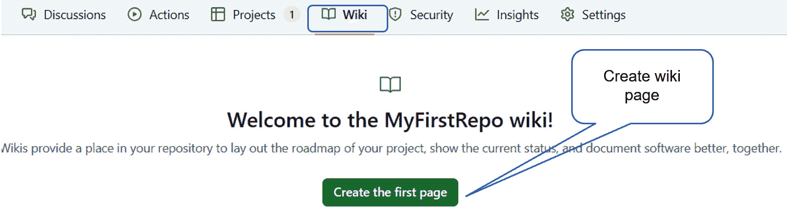
图 3.39 – Wiki 概览
2. 将网站项目的简要介绍作为网站的介绍页面。包括网站是关于什么的以及此 Wiki 的目标：
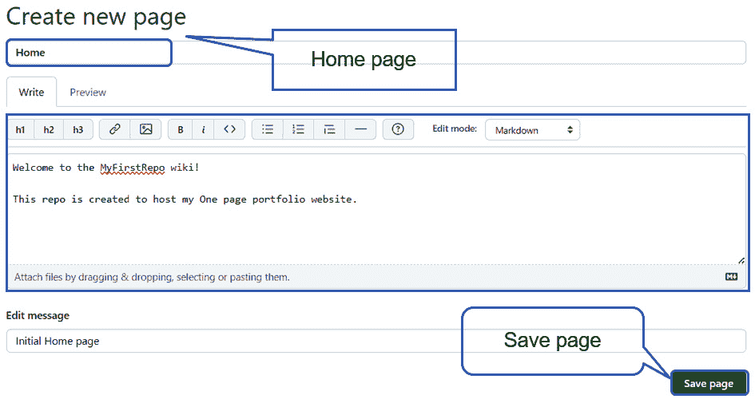
图 3.40 – 创建新的 Wiki
3. 点击 **新建页面** 添加更多内容：
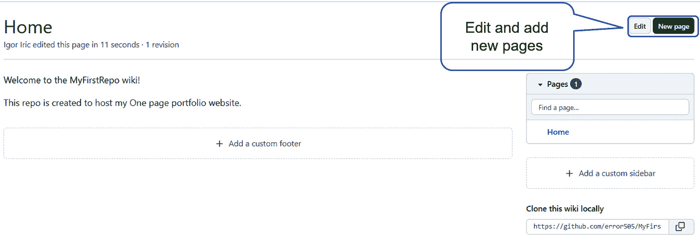
图 3.41 – 创建新的 Wiki 页面
4. 为不同方面创建页面，例如 **设计指南**、**编码标准** 或 **项目时间线**。就像为你的网站添加部分一样——一个用于联系，一个用于作品集，等等。

接下来，让我们看看使用 Wiki 的一些最佳实践：

* **保持有序**：就像你会用章节和目录组织笔记本一样，对你的 Wiki 也这样做。为网站项目的不同方面创建不同的页面，例如 **设计指南**、**编码标准** 等。为每个页面使用清晰且描述性的标题。不要为每个微小细节创建一个页面。为所有页面使用相似的格式。
* **定期更新**：保持 Wiki 的最新状态。如果项目中有什么变化，请更新 Wiki 以反映它。就像在你找到构建飞机部件的更好方法时更新使用说明书一样。
* **鼓励协作**：确保每个人都感到舒适地添加和编辑 Wiki。贡献的人越多，内容就越丰富。
* **链接到其他资源**：如果你的设计存储在其他地方或代码片段在你的仓库中，请在 Wiki 中链接到它们。就像在你的使用说明书中对飞机部件有参考一样。

在 GitHub 上为你的单页网站使用 Wiki 就像为你的项目拥有一个全面的协作式使用手册。它集中知识，使协作变得容易，并让每个人保持在同一页面上。这样，构建你的网站就成为一个井然有序的团队努力，就像用一套清晰的说明组装模型飞机一样。接下来，我们将学习 GitHub 仓库洞察。

# 什么是 GitHub 仓库洞察？

想象你和朋友们一起合作完成一个小组项目，例如烘焙蛋糕。你会想知道谁擅长做糖霜，谁是烘焙高手，以及整个做蛋糕过程进展如何，对吧？这就是 **GitHub 仓库洞察** 在你的单页网站项目中发挥作用的地方。它们就像一个仪表板，显示每个人对蛋糕的贡献，或者在这种情况下是对你的网站的贡献。它们为你的网站项目提供图表和数据。就像一份关于蛋糕烘焙（网站构建）进展的总结报告。

## 如何使用洞察

你可以通过点击  **Insights** 标签轻松访问 **Insights**，在网站的 GitHub 仓库中：

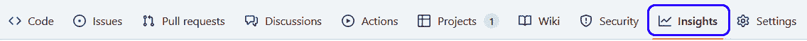
图 3.42 – Insights 标签

### 贡献者

在 **贡献者** 中，你可以看到提交图表。每次提交就像某人做出的一个小贡献，例如向网站添加一行代码。

你会看到谁在贡献以及贡献的频率。也许 Alice 添加了大部分主页内容，或者 Bob 修复了很多错别字：

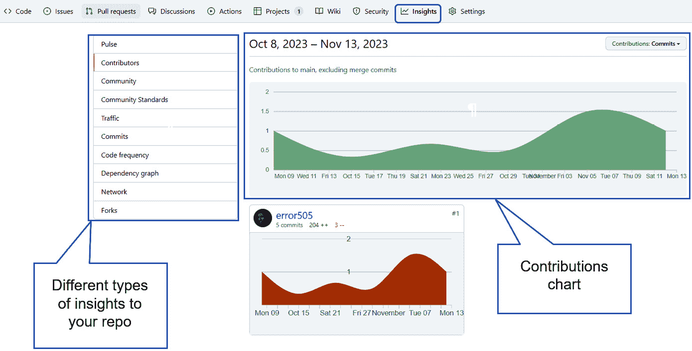
图 3.43 – Insights 贡献

### 流量

**流量** 显示有多少人在访问你的项目。就像追踪有多少朋友偷看网站以查看你的作品集一样。

你可以看出是什么吸引了更多观众。也许你的 **关于我** 页面非常受欢迎！

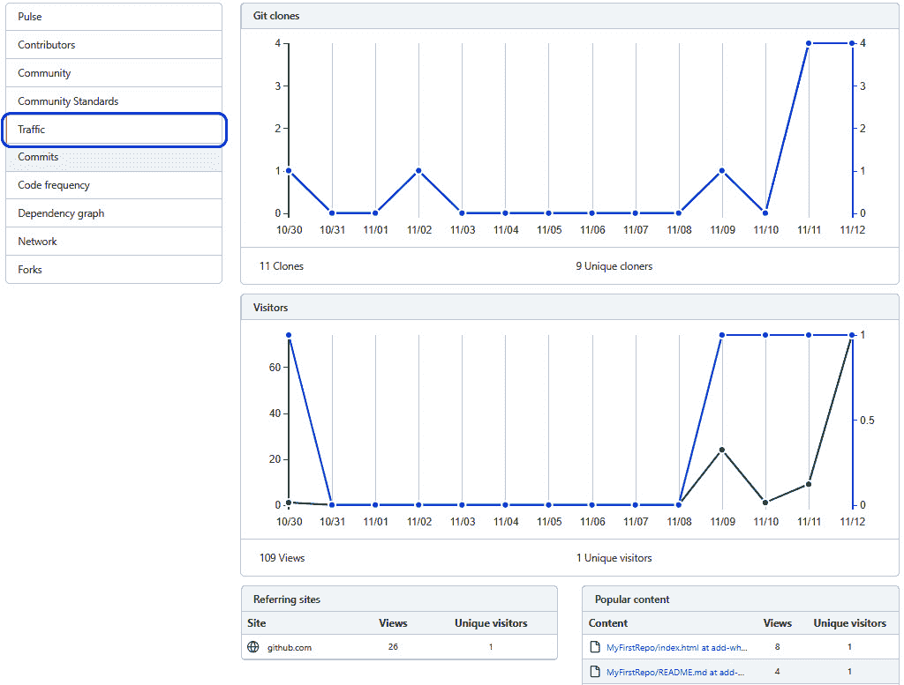
图 3.44 – Insights 流量

### 脉冲

**Pulse** 为你在一段时间内发生了什么提供快速概览，例如一周。就像你网站进展的每周总结：谁做了什么；完成了什么。

它显示最近的更改、开放和关闭的问题（任务或建议）等：

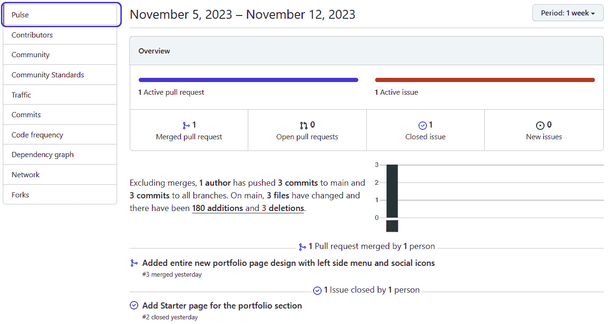
图 3.45 – Insights Pulse

### 代码频率

**代码频率** 图表显示代码随时间的添加和删除情况。可以把它想象成显示每周向你的网站添加或删除了多少行代码：

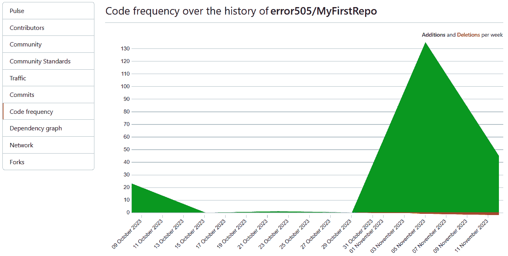
图 3.46 – Insights 代码频率

## 为什么洞察很有帮助？

你可以看出你的网站如何演变。就像看着蛋糕在烤箱里升起并逐渐成形一样。

洞察显示谁在哪些方面贡献更多。也许 Alice 在设计方面很出色，而 Bob 在撰写内容方面更擅长。

通过了解彼此的优势和工作模式，你可以更好地协作。这就像知道谁最擅长打蛋或给蛋糕抹霜。

GitHub 仓库洞察为你的单页网站提供了一种清晰、直观的方式来了解项目进展如何以及每个人如何参与其中。这就像在你的团体蛋糕烘焙项目上有一份方便的报告，帮助你把握大局并微调团队合作！

# 摘要
在本章中，我们学习了如何使用 GitHub 在项目上进行有效协作，包括邀请朋友、管理问题、通过拉取请求分享想法、处理通知、参与讨论、设置项目以及利用洞察和图表。这些技能对于一起进行编码项目至关重要，使协作更加顺畅高效。

在下一章中，我们将介绍 GitHub Flow、创建分支、实践中理解 GitHub Flow、克隆、本地添加和提交文件，以及将更改推送到 GitHub。这将帮助我们更有效地管理工作的不同版本，在协作技能的基础上继续发展。

# 测验
测试你的知识，请回答以下问题：

1. 邀请朋友加入你的 GitHub 项目的目的是什么？
    1. 使项目私有
    2. 协作并为项目做出贡献
    3. 在不编辑的情况下查看项目
    4. 参与编码挑战
    *Answer*: B. 协作并为项目做出贡献

2. GitHub 中的问题用于跟踪和讨论项目中的问题。
    1. 真
    2. 假
    *Answer*: A. 真

3. 在 GitHub 中，“\_\_\_\_\_\_\_\_\_\_” 用于向团队展示你的项目部分以获取反馈。
    *Answer*: 拉取请求

4. 为什么在 GitHub 中讨论和寻找问题的解决方案很重要？
    *Answer*: 它有助于识别、跟踪和解决项目中的问题，确保协作顺畅和进展。

5. 你可以在 GitHub 上使用什么来与团队分享和讨论想法？
    1. 表情符号
    2. 问题和拉取请求
    3. 直接消息
    4. 个人资料图片
    *Answer*: B. 问题和拉取请求

6. 你可以使用 GitHub 独自进行编码项目，而无需任何协作。
    1. 真
    2. 假
    *Answer*: A. 真

7. GitHub 中哪个功能就像举办派对并邀请朋友加入？
    1. 创建仓库
    2. 设置仪表板
    3. 邀请协作者
    4. 编写 README 文件
    *Answer*: C. 邀请协作者

8. 要查看你的项目进展情况，你可以在 GitHub 上设置一个 \_\_\_\_\_\_\_\_\_\_。
    *Answer*: 仪表板

9. GitHub 中的拉取请求仅用于展示已完成的工作，而不是接收反馈。
    1. 真
    2. 假
    *Answer*: B. 假

10. 使用 GitHub 讨论对你的项目有什么好处？
    *Answer*: 讨论允许团队成员有效沟通、分享想法并协作做出决策，从而增强项目的开发。

# 挑战 – 为星际任务组队！
欢迎回来，太空探索者！*第 3 章* 全部关于在 GitHub 的广阔宇宙中进行团队合作和协作。现在，是时候应用这些技能来改进你的 *太空探索者* 游戏了。准备好将你的单人太空任务变成星系团队冒险吗？

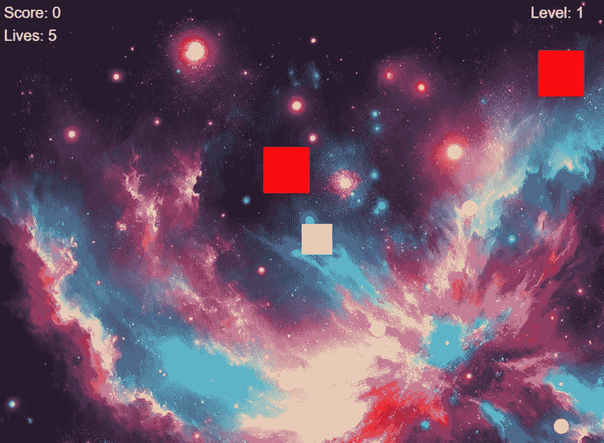

图 3.47 – 太空探索者游戏屏幕

## 你的任务
通过与朋友组队、管理问题并获取反馈来扩展你的 *太空探索者* 游戏。

## 成功步骤
以下是你的成功步骤：

1. **邀请你的船员**：
    1. 在 GitHub 上打开你的 **太空探索者** 游戏仓库。
    2. 就像邀请朋友参加派对一样，将协作者添加到你的项目中。导航到 **设置** | **管理访问** | **邀请协作者**。输入你朋友的 GitHub 用户名并邀请他们登上你的宇宙飞船！

2. **识别并创建问题**：
    1. 玩你的游戏并寻找任何故障或需要改进的地方。也许某个障碍太难了，或者星星不够闪亮？
    2. 为这些每一点在你的 GitHub 仓库中创建问题。这就像在你的宇宙飞船上钉一张便条，说明需要修复或升级的内容。

3. **新功能的拉取请求**：
    1. 我们已向游戏中添加了飞行障碍物和星星！现在是时候让你将它们集成进来了。
    2. 创建一个新分支并添加这些功能。然后，打开一个拉取请求并邀请你的团队审查你的代码。这就像展示你宇宙飞船新机翼的草图并在绘制之前征求反馈。

4. **管理通知**：有了你的船员登船，你的 GitHub 可能会变得繁忙。设置你的通知偏好设置，以便在不迷失在太空中的情况下跟踪更新。

5. **开始讨论**：使用 GitHub Discussions 聊聊你的下一个大功能或如何改进游戏。这就像在你的宇宙飞船控制室里举行团队会议。

6. **计划你的下一次冒险**：使用 **项目** 功能来组织即将进行的游戏增强。创建项目看板并添加任务，例如 *添加新关卡* 或 *设计 **外星飞船***。

7. **审查银河系（洞察和图表）**：查看仓库中的 *洞察* 和 *图表*。看看你的项目进展如何以及谁贡献最多。谁是你的船员中最活跃的宇航员？

## 4 GitHub 和 Git 中的分支
## GitHub 和 Git 中的分支
准备好 *第 4 章* 了吗？这就像在你的编程冒险中升级。本章全部关于在项目中为自己创造空间、添加很酷的新功能并与团队分享你的工作。

第一节将教你如何在项目内创建自己的小世界，在那里你可以尝试新想法而不影响主项目。你将学习如何创建这些分支以及它们为何非常有帮助。

然后，你将学习如何进行更改、提交项目的一部分，然后保存它们，就像视频游戏中的检查点一样。你将看到如何跟踪你添加或更改的所有很酷的东西。

我们还将讨论推送你的精彩更改，在那里你将学习如何将它们与团队在 GitHub 上分享。

我们将在本章中介绍以下主题：
* 使用 GitHub Flow 进行分支并在 GitHub 上创建分支
* 实践中理解 GitHub Flow – 两名开发者、两个功能、一个项目
* 创建仓库的本地副本（克隆）
* 向本地仓库添加和提交文件
* 理解 Git 的工作区、暂存区和历史记录并将更改推送到 GitHub

## 技术要求
对于本章，重点是 GitHub 和 Git 中的分支，你需要执行以下操作：
* 在你的计算机上安装 Git 以处理版本控制任务
* 创建一个 GitHub 账户以执行创建分支和提交拉取请求等操作

请参考本书的 GitHub 仓库以找到本章的代码示例：[`github.com/PacktPublishing/GitHub-for-Next-Generation-Coders/tree/main/Chapter%204`](https://github.com/PacktPublishing/GitHub-for-Next-Generation-Coders/tree/main/Chapter%204)。确保你克隆仓库，以便拥有一个本地副本进行操作。这对于练习分支和合并至关重要。此外，通过在 GitHub 上创建一个名为 `ch4` 的文件夹来组织你的工作。这将帮助你分别管理不同的章节。

这种设置将使你能够有效地学习和应用 GitHub 的分支策略，使你的编码项目更易于管理和协作。

## 使用 GitHub Flow 进行分支并在 GitHub 上创建分支

让我们更深入地探索 GitHub，在这里我们将学习分支的工作原理以及分支为何重要。你和你的朋友们正在构建一个单页作品集网站。你希望在不破坏已有内容的情况下添加新功能。这就是 GitHub Flow 登场的地方。

GitHub Flow 在分支的上下文中，是一种简单而有效的方式来管理项目中的变更，例如在构建单页作品集网站时。

## 设置你的专属空间 – 创建新的功能分支

开始使用 GitHub Flow，我们需要创建一个新的 `feature branch`。

那么，什么是分支？可以把它想象成网站的副本，你可以在其中进行实验，而不会影响主网站（`main` 分支）。

你决定为网站添加一个技能部分。因此，你创建了一个名为 `add-skills-section` 的新分支。现在，你有一个单独的空间来处理这个功能。

### 了解主分支

`main` 分支是网站的最终、公开版本。这里的一切都井然有序、经过测试且可展示。

为什么不直接在 `main` 分支上工作？这样做风险很大，就像在忙碌的厨房中间第一次烹饪一道新菜一样。错误会影响每个人。

### 决定添加新功能

假设你想为网站添加一个联系我表单。这是一种你从未开发过的全新表单样式。

你创建一个从 `main` 分支衍生的分支。这就是你的工作区。取一个清晰的名字，例如 `add-contact-form`。

为什么使用 `feature branch`？

如果你的分支出现问题，主网站不受影响。就像在单独的网站上试验你的新联系表单一样。你可以专注于你的 Contact Me form，而不用担心搞乱主网站。这是你实验、犯错和学习的地方。创建后，请确保将工作目录切换到你的新分支。

在 GitHub Flow 中创建 `feature branch` 就像在共享项目中设置一个工作站。它让你可以自由实验并开发项目中的部分内容（如你的 Contact Me form），而不会妨碍他人。一旦功能准备好并通过测试，它就可以无缝集成到主项目中，以你的贡献丰富整体。

## 进行更改和提交

图 4.1 显示了在 git 中创建新的 `feature branch` 的过程。它直观地展示了 `feature branch` 如何从 `main` 分支创建，让你能够独立工作于新功能而不影响主项目。这有助于在新功能开发和测试期间保持 `main` 分支稳定。一旦新功能准备好并通过测试，它可以合并回 `main` 分支。这种工作流程确保开发过程井然有序，且主项目保持稳定。

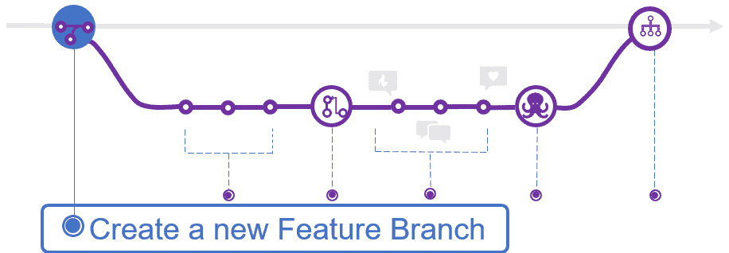
图 4.1 – GitHub Flow – 创建新的功能分支

一旦你创建了新的 `feature branch`es，你就可以开始进行一些更改，同时向你的 `feature branch` 添加新文件。

你开始为联系我表单添加元素。这可能涉及为布局编写 `HTML`、为样式编写 `CSS`，或为交互功能编写 `JavaScript`。也许你会先搭建基本结构，然后添加一些样式，最后微调细节。

在这个个人工作区，你可以添加、编辑或删除文件。请随意在这里实验，因为你的更改在你决定合并之前不会影响主项目。

一旦你对更改满意，你就可以 `commit` 它们。这就像说，“我这一部分暂时完成了。”

### 什么是 commit？

把 `commit` 想象成一个检查点。每个 `commit` 代表你所做的更改或添加的集合。

使用 Git，你会将已更改的文件添加到暂存区（使用 `git add`），然后使用 `git commit` 创建一个 `commit`。在这个 `commit` 中，你会写一条描述你所做工作的信息——例如，Added basic layout for the blog section。最好经常 `commit`，因为这样可以让你看到何时做了哪些更改。如果出现问题或不符合预期，如果你有更小、更频繁的 `commit`s，回滚到之前的 `commit` 会更容易。每个 `commit` 都是你在特定时间点的快照。如果以后出现问题，你始终可以返回到之前的 `commit`。

每个 `commit` 都记录在分支历史中。这意味着你可以随着时间的推移看到你的 Contact Me form 的演变，了解何时做了哪些更改：

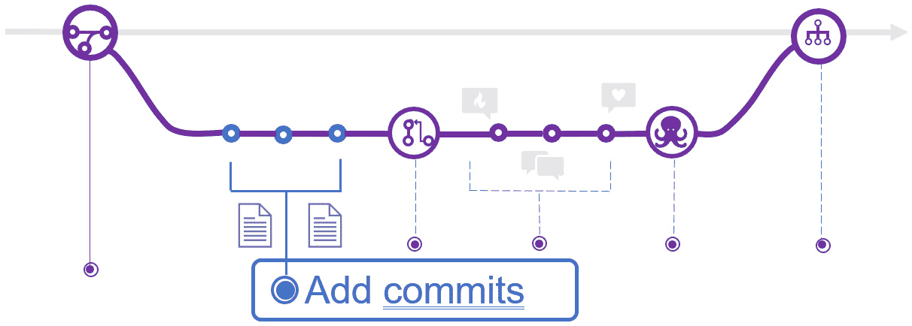
图 4.2 – GitHub Flow – 向功能分支添加提交

### 推送更改

一旦你完成了一系列代表你工作的重要部分（例如完成联系我表单的布局）的 `commit`s，你就可以将这些 `commit`s `push` 到 GitHub。这会使用你在本地所做的所有更改来更新 GitHub 上的分支。

推送后，你的 `commit`s 对队友可见。他们可以清楚地看到你所做的更改，按 `commit` by `commit` 查看。

## 展示与说明 – 创建拉取请求

一旦你完成了更改并准备好向朋友展示你的技能部分，你就可以创建一个 `pull request`。这就像把你绘制的壁画部分展示出来供反馈。就像在说，“嘿，我做了一些更改，有人能看看吗？”

为什么要 `pull request`（`PR`）？这让你的团队可以看到你做了什么，提供建议，或表示它已准备好成为主网站的一部分。这一步非常适合从团队其他成员那里获得反馈：

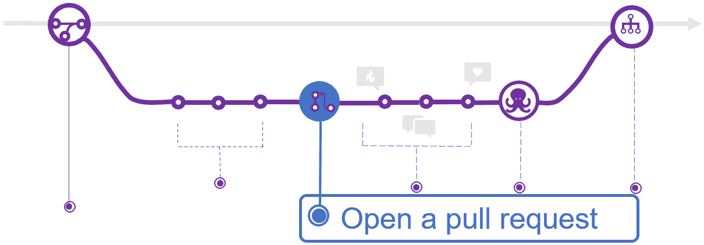
图 4.3 – GitHub flow – 打开 PR

打开一个 `PR` 就像对你的工作进行小型庆祝，同时也是头脑风暴。它让你的努力变成团队的努力，将每个人的才华汇聚在一起，使你的单页作品集网站变得尽可能出色！

## 团队合作 – 讨论和审查 PR

你的朋友们查看你的新技能部分。假设有人建议 Add more color here 或 Align this text better。他们可能会给你一些关于如何添加测试或遵循哪些命名约定的建议。这都是关于共同工作和相互学习。根据这些反馈，你调整你的部分。你所做的每一次更改都会在 `PR` 中更新：

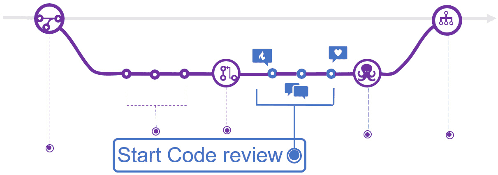
图 4.4 – GitHub Flow – 开始代码审查

## 批准 PR

一旦每个人都对建议的更改和改进感到满意，并喜欢技能部分，就该将其定稿并正式成为网站的一部分了：

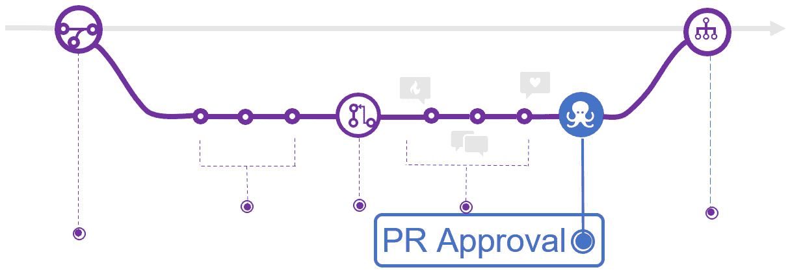
图 4.5 – GitHub Flow – PR 批准

## 正式化 – 合并 PR

一旦你的更改经过审查并获得批准，你就可以合并 `PR`。这意味着你的更改将被添加到主项目中。就像在说，“好的，这些更改可以了！”

现在，你的技能部分已准备好在网站上上线：

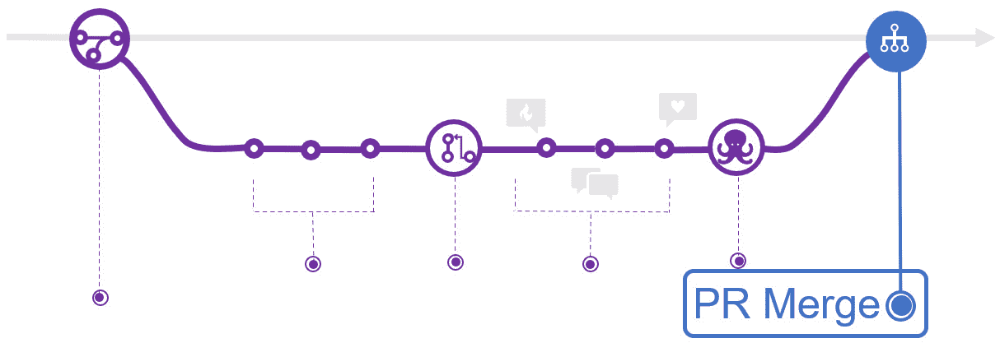
图 4.6 – GitHub Flow – 将 PR 合并到主分支

## 清理时间

合并后，你可以删除你工作的分支。这有点像在完成项目后清理工作区。但不用担心——你的更改历史仍然被保存。

And that’s it! By following these simple steps, you’ve learned how to use GitHub to build something amazing with your friends. Using GitHub Flow, you and your friends can work on different parts of your one-page portfolio website simultaneously and efficiently. Each branch is a playground for new ideas, and PRs are where those ideas get polished and readied for the world to see. It’s a smooth, collaborative process that helps keep your project organized and moving forward!

# 实践中理解 GitHub Flow – 两名开发者、两个功能、一个项目

让我们通过一个例子来探索 GitHub Flow 的工作原理，例子中有两位开发者 Alex 和 Jamie，他们正在合作改进一个网站的项目。他们各自负责不同的功能，并使用 GitHub Flow 来无缝管理他们的贡献。

`main` 分支始终是创建功能分支的起点。这是项目的稳定版本，就像建筑物的地基一样。Alex 和 Jamie 都将从这里开始工作。

*让我们试着解释这个步骤**一步一步**。*

Alex 需要添加一个联系表单。他们从 `main` 分支创建名为 `feature/contact-form` 的分支。这个分支是他们的 workspace。

当 Alex 在之前创建的新功能分支上工作时，Jamie 在名为 `feature/gallery` 的分支上开始了一个画廊功能：

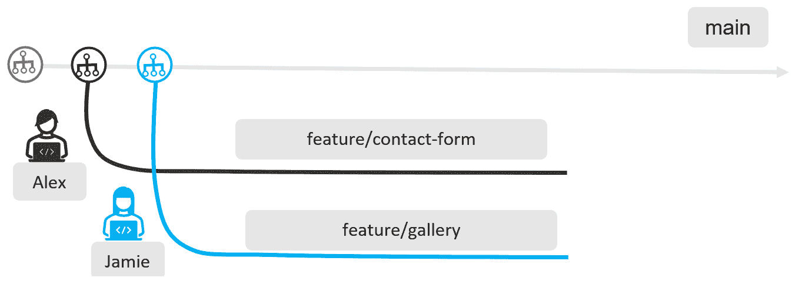 

图 4.7 – GitHub Flow – 分支创建

Alex 和 Jamie 都在编写他们的功能，定期将更改提交到他们的功能分支。这些提交就像他们工作中的检查点：

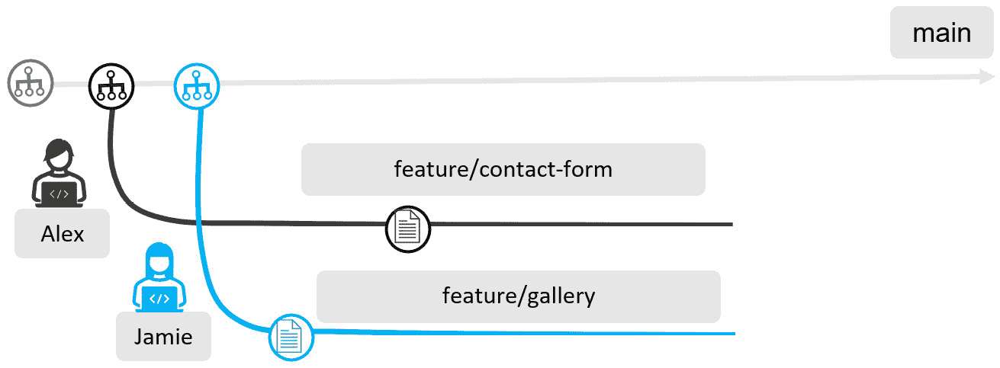 

图 4.8 – GitHub Flow – 添加和提交文件

一旦联系表单运行良好，Alex 就将他们的分支推送到 GitHub。他们在 GitHub 上创建了一个 PR，要求将 `feature/contact-form` 合并到 `main` 分支中。这就像说，“*嘿团队，我认为它已准备好成为我们**主要项目**的一部分。*”

团队审查 Alex 的工作。一旦获得批准，PR 就合并到 `main` 分支中。`feature/contact-form` 分支被删除以清理分支。`main` 分支现在包含新的联系表单功能：

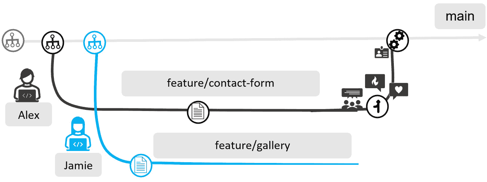 

图 4.9 – GitHub Flow – 推送分支、在 GitHub 上创建 PR 并合并 PR

在 Alex 合并其联系表单后，Jamie 拉取最新的 `main` 分支以更新 `feature/gallery`。此步骤可确保 Jamie 的分支是最新的，从而降低冲突风险。Jamie 继续在画廊上工作，对其分支进行提交：

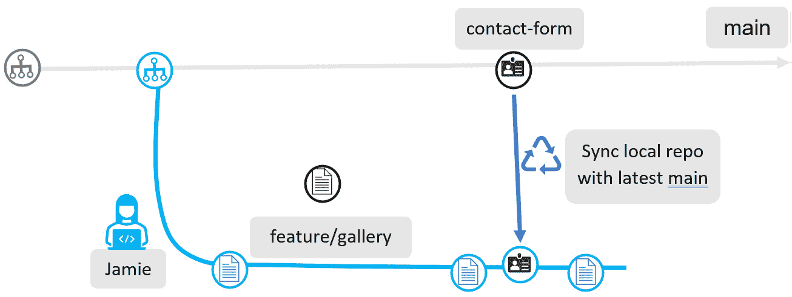 

图 4.10 – GitHub Flow – 将本地仓库与最新的 main 分支同步

满意后，Jamie 将其分支推送到 GitHub 并打开一个 PR 以合并到 `main` 分支。团队审查 Jamie 的画廊功能。他们可能会提出更改或改进建议。在进行任何最终调整并获得团队批准后，Jamie 的画廊功能将被合并到 `main` 分支中：

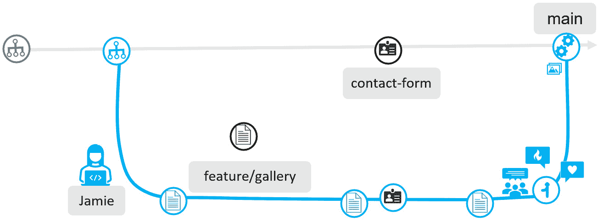 

图 4.11 – GitHub Flow – 在 GitHub 上创建 PR 并合并它

这种流程的结果是什么？一个协作增强的项目。

`main` 分支现在包含 Alex 的联系表单和 Jamie 的画廊，因为它们已被无缝集成。通过定期使用最新的 `main` 分支更新他们的功能分支，Alex 和 Jamie 避免了合并冲突，使集成更加顺畅。PR 的使用允许团队提供意见和审查，确保项目的高质量增添。

通过 GitHub Flow，Alex 和 Jamie 能够独立地在他们的功能上工作，同时确保他们的工作与不断发展的项目保持一致。这种方法鼓励协作，保持项目稳定，并确保新功能顺利集成：

 

图 4.12 – GitHub Flow – 包含所有功能分支的实际 main

你现在已经看到了 GitHub Flow 在实践中如何运作，两名开发者在不同的功能上工作并保持项目井然有序。此过程有助于保持顺畅的工作流程，并确保新功能集成时不会破坏主项目。

接下来，让我们学习如何通过克隆来创建存储库的本地副本。此步骤对于在计算机上本地处理项目至关重要。我们将逐步介绍克隆存储库的过程，以便你立即开始进行更改并为项目做出贡献。

# 创建存储库的本地副本（克隆）

如果你还没有从 GitHub 克隆你的存储库 **My First Repo**，现在就是这样做的时机。在 *第 2 章* 中，我们解释了如何从 GitHub 克隆存储库，但让我们在这里快速回顾一下。

你将要处理一个单页作品集网站，并且需要添加左侧菜单、个人资料图片、社交图标以及一些 CSS 样式。让我们从克隆项目到添加和提交更改的步骤开始。

## 克隆项目

按照以下步骤操作：

1.  **导航到 GitHub 上的 Code 选项卡**：在 GitHub 上找到你的项目存储库：

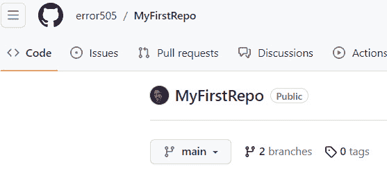 

图 4.13 – GitHub 存储库

1.  **克隆存储库**：点击 **Clone** 或 **Download** 按钮并复制提供的 URL：

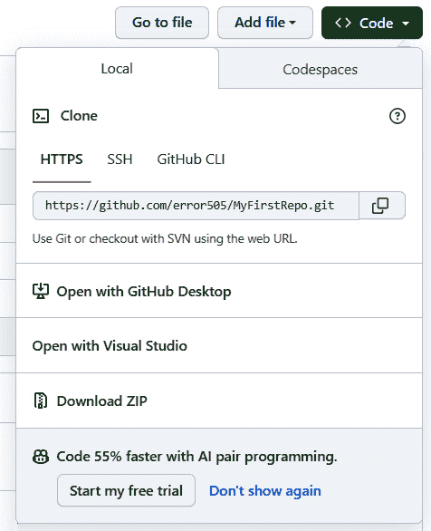 

图 4.14 – GitHub 存储库克隆 URL

1.  **打开 Git Bash 或使用你的终端**：在你的计算机上打开 Git Bash 应用程序或终端。

2.  **运行 git clone**：输入 `git clone <CLONE-URL>`，将 `<CLONE-URL>` 替换为你复制的 URL。此命令会将存储库的完整副本下载到你的本地机器：

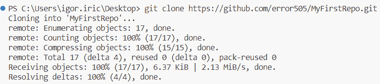 

图 4.15 – 运行 git clone 命令

1.  **更改目录**：输入 `cd <REPOSITORY-NAME>`，将 `<REPOSITORY-NAME>` 替换为你刚刚克隆的存储库的名称。这将使你进入存储库的目录：

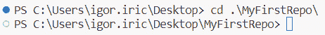 

图 4.16 – 进入你的新存储库文件夹

现在我们已经克隆了项目，让我们切换到正确的分支。

## 切换到正确的分支

按照以下步骤操作：

1.  **列出所有分支**：输入 `git branch -a` 以查看所有可用的分支，包括本地和远程：

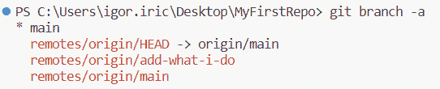 

图 4.17 – 运行 git branch -a 命令列出所有分支

1.  **切换分支**：如果需要处理特定分支，请使用 `git switch <BRANCH-NAME>`，将 `<BRANCH-NAME>` 替换为要切换到的分支名称。如果需要创建新分支，则使用 `git switch -c <BRANCH-NAME>`：

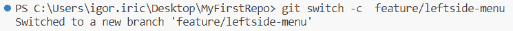 

图 4.18 – 运行 git switch 命令创建新分支并切换到它

现在你已成功从 GitHub 克隆了项目并切换到正确的分支，你可以开始添加新文件、网站的各个部分以及不同的样式。在下一节中，你将开始构建你的单页作品集网站。

# 向本地存储库添加和提交文件

现在你已经克隆了仓库并切换到正确的分支，可以开始构建你的单页作品集网站了。在本动手实践部分，你将创建一个左侧菜单，添加个人资料图片和一些社交图标，并使用 CSS 对所有内容进行样式设置。你希望这些更改能被记录在你的本地 Git 仓库中。

## 将新文件添加到 Git

在本动手实践部分，我们将向 `index.html` 文件添加一些 HTML 代码以替换欢迎文本。

使用你喜欢的代码编辑器在 `index.html` 文件中进行更改。你可以使用 Visual Studio Code，这是一款由 Microsoft 创建的免费代码编辑器。你可以从 [`code.visualstudio.com/download`](https://code.visualstudio.com/download) 下载并在本地安装。在 *第 8 章* 中，*实用工具和 Git 命令*，我们将更多地谈论 Visual Studio Code 及其酷炫功能。

现在，你可以用以下代码替换文件的内容：

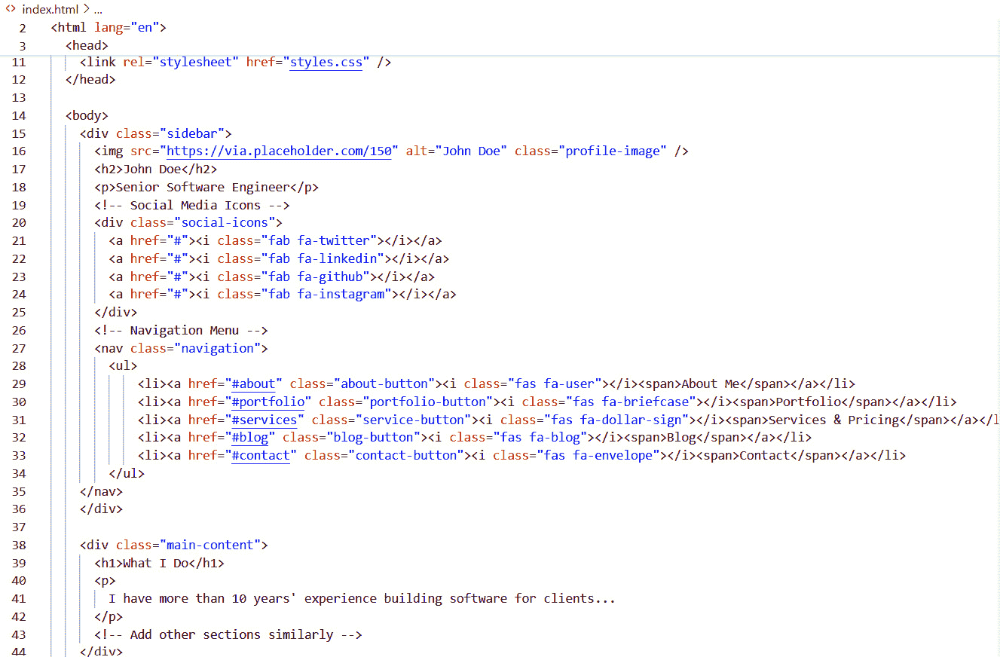
图 4.19 – 网站代码

将 **John Doe** 替换为你的姓名。完成此操作后，你可以向名为 `styles.css` 的新文件添加一些 CSS。

以下是你将用于 `styles.css` 文件的代码片段：

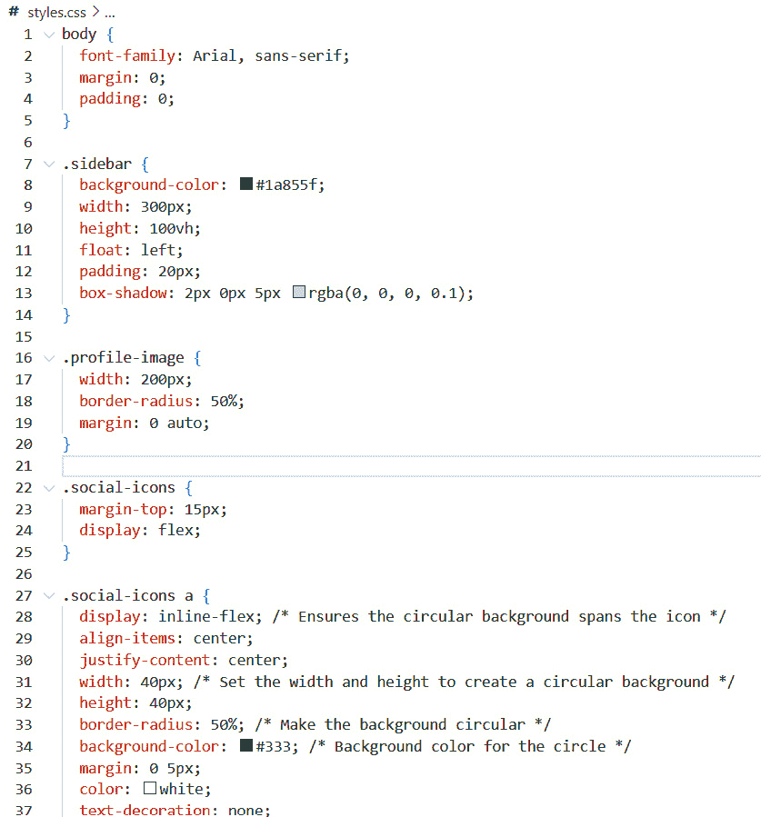
图 4.20 – 网站的 CSS 样式

保存 `index.html` 和 `styles.css` 文件后，你可以在浏览器中运行 `index.html`。你应该会看到类似以下内容的页面：

图 4.21 – 单页作品集网站 – 左侧菜单

## 了解 Git 中的“检查未跟踪文件”

**未跟踪文件**是什么？在使用 Git 时，它会监视项目目录中的文件。但当你添加新文件或进行 Git 从未见过的更改时，它会将它们标记为 *未跟踪*。

### 为什么是“未跟踪”？

**未跟踪** 表示 GitHub 仓库中的新文件或已更改的文件。Git 看到了这些文件，但尚未被告知要跟踪它们。它们就像 Git 当前对项目的理解中的陌生人。由于 Git 尚未在历史记录中记录这些文件，因此它们不是仓库时间线的一部分。

### 检查未跟踪文件

这个命令就像是在问 Git，“*嘿，**我的项目？** 中的文件发生了什么？*”

输入 `git status`。你会看到你创建或更改的文件列为 *未跟踪*（Git 知道它们存在，但它们尚未成为项目历史的一部分）。

Git 会返回一个显示文件状态的列表。未跟踪文件通常会被突出显示或明确标记：

图 4.22 – 运行 git status 命令

### 为什么要检查未跟踪文件？

它有助于查看项目中 Git 尚未开始跟踪的新内容或更改。你可能不想跟踪每个文件（例如临时文件或个人笔记）。检查未跟踪文件可以让你决定将哪些文件添加到 Git。

检查未跟踪文件会显示你添加的新元素（例如左侧菜单、个人资料图片和社交图标）以及你修改的任何 CSS 文件。这就像在决定要包含在项目官方历史中的内容之前，对新内容或更改进行盘点。

## 将新文件更改添加到 Git 暂存区

*添加到 Git* 是什么意思？你的 Git 仓库就像你项目的数字剪贴簿。当你向 Git *添加* 文件时，你是在告诉 Git，“*嘿，我希望这些新部件（你的菜单、图片、图标等等）成为我项目剪贴簿的一部分。*”你是在将其标记为包含在下一个快照中。

### 如何添加文件？

如果你只想添加一个文件，例如 `index.html`，你需要输入 `git add index.html`：

图 4.23 – 运行 git add index.html 添加索引

如果你想添加所有新文件或更改的文件，输入 `git add .`：

图 4.24 – 添加所有文件

这里，`.` 告诉 Git 将所有新文件和已修改文件包含到暂存区。一旦你添加了文件，它们就会移动到 **暂存区**。把暂存区想象成一个提交前的暂存区。就像你在说，“*这些是我希望在我的**下一个快照**中被记住的文件。*”

添加文件后，你的更改就可以提交了。提交就像在剪贴簿中把所有东西粘牢，使布局永久化。将新文件添加到 Git 就像选择你希望永久包含在项目历史中的新项目。这是在组织和跟踪作品集网站演变过程中的关键步骤。你可以再次输入 `git status` 来查看所有已添加到暂存区的文件：

图 4.25 – 在所有文件都已添加到暂存区后运行 git status

现在我们知道了如何在本地 Git 仓库中添加和暂存文件，我们将学习 Git 的不同区域，例如工作区、暂存区和仓库本身。我们还将介绍如何将更改推送到 GitHub，以便每个人都能看到你所做的更新。这样，你就能完整了解你的工作如何从本地机器进展到可供协作者访问。

## 了解 Git 的工作区、暂存区、历史记录以及将更改推送到 GitHub

当你为项目（如你的单页作品集网站）使用 Git 时，将 Git 想象成有三个主要区域会有所帮助。把它们想象成工作坊中的空间，在那里项目的不同阶段会发生。

### 工作区（或工作目录）——它是什么？

这里是你进行所有工作的地方——即创建、编辑、删除和组织文件。它就像你的编码工作区，一切都摆在你面前。当你在作品集中添加文本、选择字体或调整布局时，你就在工作区中：

图 4.26 – Git 阶段 – 工作区

### 暂存区（或索引）——它是什么？

这是在更改成为项目历史的一部分之前准备更改的区域。把它想象成一个等候室，在那里你收集和审查更改。

假设你已向作品集添加了一个新部分并修复了一个拼写错误。你对这些更改感到满意，并希望它们成为下一个快照的一部分。你使用 `git add` 将这些更改移动到暂存区：

图 4.27 – Git 阶段 – 暂存区

### 历史记录（或仓库）

这里存储了所有快照（提交）。它充当你所做的每一次更改的记录，安全地保存在项目历史中。

暂存更改后，你提交它们。此过程会拍摄暂存区的快照并将其存储在历史记录中。这就像在完成项目的重要部分后拍摄工作台的照片并将其放入相册中。要创建更改的历史记录，你可以使用 `git commit -m "your commit message"` 命令。

Tip
请记住，你应始终编写简短的提交信息，长度约为 50 个字符。

仔细描述提交中引入的更改，以便你的团队更好地了解提交的内容。这里的最后一步是使用 `git push` 命令将更改推送到远程 GitHub 仓库。

### 将更改推送到 GitHub

你已经完成了你的单页作品集网站，并且刚刚完成了新的左侧菜单并为其添加了链接和社交图标。你在本地的 `feature/leftside-menu` 分支中完成了修改。现在，你希望这些更改能在 GitHub 上可用，以便他人查看或贡献。这就是 `git push` 发挥作用的地方。

通常，你只需输入 `git push`，这会告诉 Git 你想要将提交从本地仓库传输到远程仓库（如 GitHub）。

在这种情况下，你会收到一条错误信息，提示你无法推送到远程仓库，因为你在本地创建的分支在 GitHub 仓库中仍然不存在：

图 4.28 – 运行 git push 命令

如你所见，该消息还提供了如何使用 `--set-upstream` 将本地功能分支推送到远程仓库并设置上游的说明。这就像为未来的推送设置默认路径。你是在告诉 Git，“*嘿，下次我从此分支推送更改时，我希望它们去同一个地方，而无需我再次指定。*”

命令的下一部分是 `origin`。这是 Git 为你克隆的远程仓库默认命名的名称。在大多数情况下，`origin` 只是你 GitHub 仓库 URL 的简写，而 `feature/leftside-menu` 是你的分支名称。你是在指定想要推送此分支的提交。

## 运行此命令时会发生什么？

通过使用 `--set-upstream`，你是在本地分支 `feature/leftside-menu` 与 GitHub 上的分支（`origin`）之间建立链接。如果该分支在 GitHub 上尚不存在，此命令将为你创建它。

Git 会将你在 `feature/leftside-menu` 分支中所做的所有提交上传到 GitHub，并将其放在同名分支中。

一旦你设置过上游，你就可以在 `feature/leftside-menu` 分支中使用 `git push`，Git 就知道将更改发送到哪里。那么，让我们在终端中运行此命令，看看会发生什么：

图 4.29 – 推送到远程的 Git

通过将分支推送到 GitHub，你让团队成员可以看到你的新左侧菜单、提供反馈或添加自己的调整。

如你所见，我们的新功能分支已在 GitHub 中创建，并且所有对文件的更改都已随分支一起推送。GitHub 已为我们提供了一条消息，提示访问 <YOUR-REPOSITORY-URL>/MyFirstRepo/pull/new/feature/leftside-menu。这就是我们应该创建 PR 的地方。

现在，你可以创建 PR 将其合并到主项目中，将你时尚的左侧菜单集成到主要的作品集网站中。

## 这些区域为什么重要？

这些区域帮助你组织工作。你可以在工作区中进行实验，在暂存区决定喜欢哪些更改，并在历史记录中保存最佳工作。这种分离让你能够控制项目的演进。你可以进行更改、尝试新事物，并且只提交你确定的那些。如果出现问题，你始终可以回到历史记录中的先前状态。

# 摘要

本章提供了关于编码中团队合作和创造力的[content]
你已经完成了你的单页作品集网站，并且刚刚完成了新的左侧菜单并为其添加了链接和社交图标。你在本地的 `feature/leftside-menu` 分支中完成了修改。现在，你希望这些更改能在 GitHub 上可用，以便他人查看或贡献。这就是 `git push` 发挥作用的地方。

通常，你只需输入 `git push`，这会告诉 Git 你想要将提交从本地仓库传输到远程仓库（如 GitHub）。

在这种情况下，你会收到一条错误信息，提示你无法推送到远程仓库，因为你在本地创建的分支在 GitHub 仓库中仍然不存在：

图 4.28 – 运行 git push 命令

如你所见，该消息还提供了如何使用 `--set-upstream` 将本地功能分支推送到远程仓库并设置上游的说明。这就像为未来的推送设置默认路径。你是在告诉 Git，“*嘿，下次我从此分支推送更改时，我希望它们去同一个地方，而无需我再次指定。*”

命令的下一部分是 `origin`。这是 Git 为你克隆的远程仓库默认命名的名称。在大多数情况下，`origin` 只是你 GitHub 仓库 URL 的简写，而 `feature/leftside-menu` 是你的分支名称。你是在指定想要推送此分支的提交。

## 运行此命令时会发生什么？

通过使用 `--set-upstream`，你是在本地分支 `feature/leftside-menu` 与 GitHub 上的分支（`origin`）之间建立链接。如果该分支在 GitHub 上尚不存在，此命令将为你创建它。

Git 会将你在 `feature/leftside-menu` 分支中所做的所有提交上传到 GitHub，并将其放在同名分支中。

一旦你设置过上游，你就可以在 `feature/leftside-menu` 分支中使用 `git push`，Git 就知道将更改发送到哪里。那么，让我们在终端中运行此命令，看看会发生什么：

图 4.29 – 推送到远程的 Git

通过将分支推送到 GitHub，你让团队成员可以看到你的新左侧菜单、提供反馈或添加自己的调整。

如你所见，我们的新功能分支已在 GitHub 中创建，并且所有对文件的更改都已随分支一起推送。GitHub 已为我们提供了一条消息，提示访问 <YOUR-REPOSITORY-URL>/MyFirstRepo/pull/new/feature/leftside-menu。这就是我们应该创建 PR 的地方。

现在，你可以创建 PR 将其合并到主项目中，将你时尚的左侧菜单集成到主要的作品集网站中。

## 这些区域为什么重要？

这些区域帮助你组织工作。你可以在工作区中进行实验，在暂存区决定喜欢哪些更改，并在历史记录中保存最佳工作。这种分离让你能够控制项目的演进。你可以进行更改、尝试新事物，并且只提交你确定的那些。如果出现问题，你始终可以回到历史记录中的先前状态。

# 摘要

本章提供了关于编码中团队合作和创造力的[content]
你已经完成了你的单页作品集网站，并且刚刚完成了新的左侧菜单并为其添加了链接和社交图标。你在本地的 `feature/leftside-menu` 分支中完成了修改。现在，你希望这些更改能在 GitHub 上可用，以便他人查看或贡献。这就是 `git push` 发挥作用的地方。

通常，你只需输入 `git push`，这会告诉 Git 你想要将提交从本地仓库传输到远程仓库（如 GitHub）。

在这种情况下，你会收到一条错误信息，提示你无法推送到远程仓库，因为你在本地创建的分支在 GitHub 仓库中仍然不存在：

图 4.28 – 运行 git push 命令

如你所见，该消息还提供了如何使用 `--set-upstream` 将本地功能分支推送到远程仓库并设置上游的说明。这就像为未来的推送设置默认路径。你是在告诉 Git，“*嘿，下次我从此分支推送更改时，我希望它们去同一个地方，而无需我再次指定。*”

命令的下一部分是 `origin`。这是 Git 为你克隆的远程仓库默认命名的名称。在大多数情况下，`origin` 只是你 GitHub 仓库 URL 的简写，而 `feature/leftside-menu` 是你的分支名称。你是在指定想要推送此分支的提交。

## 运行此命令时会发生什么？

通过使用 `--set-upstream`，你是在本地分支 `feature/leftside-menu` 与 GitHub 上的分支（`origin`）之间建立链接。如果该分支在 GitHub 上尚不存在，此命令将为你创建它。

Git 会将你在 `feature/leftside-menu` 分支中所做的所有提交上传到 GitHub，并将其放在同名分支中。

一旦你设置过上游，你就可以在 `feature/leftside-menu` 分支中使用 `git push`，Git 就知道将更改发送到哪里。那么，让我们在终端中运行此命令，看看会发生什么：

图 4.29 – 推送到远程的 Git

通过将分支推送到 GitHub，你让团队成员可以看到你的新左侧菜单、提供反馈或添加自己的调整。

如你所见，我们的新功能分支已在 GitHub 中创建，并且所有对文件的更改都已随分支一起推送。GitHub 已为我们提供了一条消息，提示访问 <YOUR-REPOSITORY-URL>/MyFirstRepo/pull/new/feature/leftside-menu。这就是我们应该创建 PR 的地方。

现在，你可以创建 PR 将其合并到主项目中，将你时尚的左侧菜单集成到主要的作品集网站中。

## 这些区域为什么重要？

这些区域帮助你组织工作。你可以在工作区中进行实验，在暂存区决定喜欢哪些更改，并在历史记录中保存最佳工作。这种分离让你能够控制项目的演进。你可以进行更改、尝试新事物，并且只提交你确定的那些。如果出现问题，你始终可以回到历史记录中的先前状态。

# 摘要

本章提供了关于编码中团队合作和创造力的[content]
你已经完成了你的单页作品集网站，并且刚刚完成了新的左侧菜单并为其添加了链接和社交图标。你在本地的 `feature/leftside-menu` 分支中完成了修改。现在，你希望这些更改能在 GitHub 上可用，以便他人查看或贡献。这就是 `git push` 发挥作用的地方。

通常，你只需输入 `git push`，这会告诉 Git 你想要将提交从本地仓库传输到远程仓库（如 GitHub）。

在这种情况下，你会收到一条错误信息，提示你无法推送到远程仓库，因为你在本地创建的分支在 GitHub 仓库中仍然不存在：

图 4.28 – 运行 git push 命令

如你所见，该消息还提供了如何使用 `--set-upstream` 将本地功能分支推送到远程仓库并设置上游的说明。这就像为未来的推送设置默认路径。你是在告诉 Git，“*嘿，下次我从此分支推送更改时，我希望它们去同一个地方，而无需我再次指定。*”

命令的下一部分是 `origin`。这是 Git 为你克隆的远程仓库默认命名的名称。在大多数情况下，`origin` 只是你 GitHub 仓库 URL 的简写，而 `feature/leftside-menu` 是你的分支名称。你是在指定想要推送此分支的提交。

## 运行此命令时会发生什么？

通过使用 `--set-upstream`，你是在本地分支 `feature/leftside-menu` 与 GitHub 上的分支（`origin`）之间建立链接。如果该分支在 GitHub 上尚不存在，此命令将为你创建它。

Git 会将你在 `feature/leftside-menu` 分支中所做的所有提交上传到 GitHub，并将其放在同名分支中。

一旦你设置过上游，你就可以在 `feature/leftside-menu` 分支中使用 `git push`，Git 就知道将更改发送到哪里。那么，让我们在终端中运行此命令，看看会发生什么：

图 4.29 – 推送到远程的 Git

通过将分支推送到 GitHub，你让团队成员可以看到你的新左侧菜单、提供反馈或添加自己的调整。

如你所见，我们的新功能分支已在 GitHub 中创建，并且所有对文件的更改都已随分支一起推送。GitHub 已为我们提供了一条消息，提示访问 <YOUR-REPOSITORY-URL>/MyFirstRepo/pull/new/feature/leftside-menu。这就是我们应该创建 PR 的地方。

现在，你可以创建 PR 将其合并到主项目中，将你时尚的左侧菜单集成到主要的作品集网站中。

## 这些区域为什么重要？

这些区域帮助你组织工作。你可以在工作区中进行实验，在暂存区决定喜欢哪些更改，并在历史记录中保存最佳工作。这种分离让你能够控制项目的演进。你可以进行更改、尝试新事物，并且只提交你确定的那些。如果出现问题，你始终可以回到历史记录中的先前状态。

# 摘要

本章提供了关于编码中团队合作和创造力的[content]
你已经完成了你的单页作品集网站，并且刚刚完成了新的左侧菜单并为其添加了链接和社交图标。你在本地的 `feature/leftside-menu` 分支中完成了修改。现在，你希望这些更改能在 GitHub 上可用，以便他人查看或贡献。这就是 `git push` 发挥作用的地方。

通常，你只需输入 `git push`，这会告诉 Git 你想要将提交从本地仓库传输到远程仓库（如 GitHub）。

在这种情况下，你会收到一条错误信息，提示你无法推送到远程仓库，因为你在本地创建的分支在 GitHub 仓库中仍然不存在：

图 4.28 – 运行 git push 命令

如你所见，该消息还提供了如何使用 `--set-upstream` 将本地功能分支推送到远程仓库并设置上游的说明。这就像为未来的推送设置默认路径。你是在告诉 Git，“*嘿，下次我从此分支推送更改时，我希望它们去同一个地方，而无需我再次指定。*”

命令的下一部分是 `origin`。这是 Git 为你克隆的远程仓库默认命名的名称。在大多数情况下，`origin` 只是你 GitHub 仓库 URL 的简写，而 `feature/leftside-menu` 是你的分支名称。你是在指定想要推送此分支的提交。

## 运行此命令时会发生什么？

通过使用 `--set-upstream`，你是在本地分支 `feature/leftside-menu` 与 GitHub 上的分支（`origin`）之间建立链接。如果该分支在 GitHub 上尚不存在，此命令将为你创建它。

Git 会将你在 `feature/leftside-menu` 分支中所做的所有提交上传到 GitHub，并将其放在同名分支中。

一旦你设置过上游，你就可以在 `feature/leftside-menu` 分支中使用 `git push`，Git 就知道将更改发送到哪里。那么，让我们在终端中运行此命令，看看会发生什么：

图 4.29 – 推送到远程的 Git

通过将分支推送到 GitHub，你让团队成员可以看到你的新左侧菜单、提供反馈或添加自己的调整。

如你所见，我们的新功能分支已在 GitHub 中创建，并且所有对文件的更改都已随分支一起推送。GitHub 已为我们提供了一条消息，提示访问 <YOUR-REPOSITORY-URL>/MyFirstRepo/pull/new/feature/leftside-menu。这就是我们应该创建 PR 的地方。

现在，你可以创建 PR 将其合并到主项目中，将你时尚的左侧菜单集成到主要的作品集网站中。

## 这些区域为什么重要？

这些区域帮助你组织工作。你可以在工作区中进行实验，在暂存区决定喜欢哪些更改，并在历史记录中保存最佳工作。这种分离让你能够控制项目的演进。你可以进行更改、尝试新事物，并且只提交你确定的那些。如果出现问题，你始终可以回到历史记录中的先前状态。

# 摘要

本章提供了关于编码中团队合作和创造力的[content]
你已经完成了你的单页作品集网站，并且刚刚完成了新的左侧菜单并为其添加了链接和社交图标。你在本地的 `feature/leftside-menu` 分支中完成了修改。现在，你希望这些更改能在 GitHub 上可用，以便他人查看或贡献。这就是 `git push` 发挥作用的地方。

通常，你只需输入 `git push`，这会告诉 Git 你想要将提交从本地仓库传输到远程仓库（如 GitHub）。

在这种情况下，你会收到一条错误信息，提示你无法推送到远程仓库，因为你在本地创建的分支在 GitHub 仓库中仍然不存在：

图 4.28 – 运行 git push 命令

如你所见，该消息还提供了如何使用 `--set-upstream` 将本地功能分支推送到远程仓库并设置上游的说明。这就像为未来的推送设置默认路径。你是在告诉 Git，“*嘿，下次我从此分支推送更改时，我希望它们去同一个地方，而无需我再次指定。*”

命令的下一部分是 `origin`。这是 Git 为你克隆的远程仓库默认命名的名称。在大多数情况下，`origin` 只是你 GitHub 仓库 URL 的简写，而 `feature/leftside-menu` 是你的分支名称。你是在指定想要推送此分支的提交。

## 运行此命令时会发生什么？

通过使用 `--set-upstream`，你是在本地分支 `feature/leftside-menu` 与 GitHub 上的分支（`origin`）之间建立链接。如果该分支在 GitHub 上尚不存在，此命令将为你创建它。

Git 会将你在 `feature/leftside-menu` 分支中所做的所有提交上传到 GitHub，并将其放在同名分支中。

一旦你设置过上游，你就可以在 `feature/leftside-menu` 分支中使用 `git push`，Git 就知道将更改发送到哪里。那么，让我们在终端中运行此命令，看看会发生什么：

图 4.29 – 推送到远程的 Git

通过将分支推送到 GitHub，你让团队成员可以看到你的新左侧菜单、提供反馈或添加自己的调整。

如你所见，我们的新功能分支已在 GitHub 中创建，并且所有对文件的更改都已随分支一起推送。GitHub 已为我们提供了一条消息，提示访问 <YOUR-REPOSITORY-URL>/MyFirstRepo/pull/new/feature/leftside-menu。这就是我们应该创建 PR 的地方。

现在，你可以创建 PR 将其合并到主项目中，将你时尚的左侧菜单集成到主要的作品集网站中。

## 这些区域为什么重要？

这些区域帮助你组织工作。你可以在工作区中进行实验，在暂存区决定喜欢哪些更改，并在历史记录中保存最佳工作。这种分离让你能够控制项目的演进。你可以进行更改、尝试新事物，并且只提交你确定的那些。如果出现问题，你始终可以回到历史记录中的先前状态。

# 摘要

本章提供了关于编码中团队合作和创造力的[content]
你已完成单页作品集网站，并完成了新的左侧菜单并添加了链接和社交图标。你在本地 `feature/leftside-menu` 分支中做了修改。现在希望这些更改在 GitHub 上可用，让他人查看或贡献。这就是 `git push` 发挥作用的地方。

通常只需输入 `git push`，告诉 Git 将本地仓库的提交传输到远程仓库（如 GitHub）。

此情况下会收到错误，提示无法推送到远程仓库，因为本地创建的分支在 GitHub 仓库中仍不存在：

图 4.28 – 运行 git push 命令

如你所见，消息还说明了如何使用 `--set-upstream` 将本地功能分支推送到远程仓库并设置上游。这相当于为未来推送设置默认路径。你在告诉 Git，“*嘿，下次从此分支推送更改时，我希望它们去同一个地方，无需再次指定。*”

命令的下一部分是 `origin`。这是 Git 给克隆的远程仓库的默认名称。通常 `origin` 只是 GitHub 仓库 URL 的简写，`feature/leftside-menu` 是分支名。你指定要推送此分支的提交。

## 运行此命令时会发生什么？

使用 `--set-upstream` 会在本地分支 `feature/leftside-menu` 与 GitHub 上的分支 `origin` 之间建立链接。若该分支在 GitHub 上尚不存在，此命令会为你创建它。

Git 会将你在 `feature/leftside-menu` 分支做的所有提交上传到 GitHub，放在同名分支中。

设置一次上游后，在 `feature/leftside-menu` 分支中使用 `git push` 即可，Git 会知道发送到哪里。让我们在终端运行此命令看看：

图 4.29 – 推送到远程的 Git

推送分支到 GitHub 后，团队成员可看到新的左侧菜单、提供反馈或添加调整。

如你所见，新功能分支已在 GitHub 创建，所有文件更改已随分支推送。GitHub 提供消息访问 <YOUR-REPOSITORY-URL>/MyFirstRepo/pull/new/feature/leftside-menu，这里应创建 PR。

现在可创建 PR 合并到主项目，将时尚的左侧菜单集成到主作品集网站。

## 这些区域为什么重要？

这些区域帮助组织工作。可在工作区实验，在暂存区决定喜欢的更改，在历史记录保存最佳工作。这种分离让你控制项目演进。可更改、尝试新事物，只提交确定的。若出错，可随时回到历史记录的先前状态。

# 摘要

本章提供了编码团队合作与创造力的[content]
你已完成单页作品集网站，并完成了新的左侧菜单并添加了链接和社交图标。你在本地 `feature/leftside-menu` 分支中做了修改。现在希望这些更改在 GitHub 上可用，让他人查看或贡献。这就是 `git push` 发挥作用的地方。

通常只需输入 `git push`，告诉 Git 将本地仓库的提交传输到远程仓库（如 GitHub）。

此情况下会收到错误，提示无法推送到远程仓库，因为本地创建的分支在 GitHub 仓库中仍不存在：

图 4.28 – 运行 git push 命令

如你所见，消息还说明了如何使用 `--set-upstream` 将本地功能分支推送到远程仓库并设置上游。这相当于为未来推送设置默认路径。你在告诉 Git，“*嘿，下次从此分支推送更改时，我希望它们去同一个地方，无需再次指定。*”

命令的下一部分是 `origin`。这是 Git 给克隆的远程仓库的默认名称。通常 `origin` 只是 GitHub 仓库 URL 的简写，`feature/leftside-menu` 是分支名。你指定要推送此分支的提交。

## 运行此命令时会发生什么？

使用 `--set-upstream` 会在本地分支 `feature/leftside-menu` 与 GitHub 上的分支 `origin` 之间建立链接。若该分支在 GitHub 上尚不存在，此命令会为你创建它。

Git 会将你在 `feature/leftside-menu` 分支做的所有提交上传到 GitHub，放在同名分支中。

设置一次上游后，在 `feature/leftside-menu` 分支中使用 `git push` 即可，Git 会知道发送到哪里。让我们在终端运行此命令看看：

图 4.29 – 推送到远程的 Git

推送分支到 GitHub 后，团队成员可看到新的左侧菜单、提供反馈或添加调整。

如你所见，新功能分支已在 GitHub 创建，所有文件更改已随分支推送。GitHub 提供消息访问 <YOUR-REPOSITORY-URL>/MyFirstRepo/pull/new/feature/leftside-menu，这里应创建 PR。

现在可创建 PR 合并到主项目，将时尚的左侧菜单集成到主作品集网站。

## 这些区域为什么重要？

这些区域帮助组织工作。可在工作区实验，在暂存区决定喜欢的更改，在历史记录保存最佳工作。这种分离让你控制项目演进。可更改、尝试新事物，只提交确定的。若出错，可随时回到历史记录的先前状态。

# 摘要

本章是关于编码协作与创造力的[content]
你已完成单页作品集网站，并完成了新的左侧菜单并添加了链接和社交图标。你在本地 `feature/leftside-menu` 分支中做了修改。现在希望这些更改在 GitHub 上可用，让他人查看或贡献。这就是 `git push` 发挥作用的地方。

通常只需输入 `git push`，告诉 Git 将本地仓库的提交传输到远程仓库（如 GitHub）。

此情况下会收到错误，提示无法推送到远程仓库，因为本地创建的分支在 GitHub 仓库中仍不存在：

图 4.28 – 运行 git push 命令

如你所见，消息还说明了如何使用 `--set-upstream` 将本地功能分支推送到远程仓库并设置上游。这相当于为未来推送设置默认路径。你在告诉 Git，“*嘿，下次从此分支推送更改时，我希望它们去同一个地方，无需再次指定。*”

命令的下一部分是 `origin`。这是 Git 给克隆的远程仓库的默认名称。通常 `origin` 只是 GitHub 仓库 URL 的简写，`feature/leftside-menu` 是分支名。你指定要推送此分支的提交。

## 运行此命令时会发生什么？

使用 `--set-upstream` 会在本地分支 `feature/leftside-menu` 与 GitHub 上的分支 `origin` 之间建立链接。若该分支在 GitHub 上尚不存在，此命令会为你创建它。

Git 会将你在 `feature/leftside-menu` 分支做的所有提交上传到 GitHub，放在同名分支中。

设置一次上游后，在 `feature/leftside-menu` 分支中使用 `git push` 即可，Git 会知道发送到哪里。让我们在终端运行此命令看看：

图 4.29 – 推送到远程的 Git

推送分支到 GitHub 后，团队成员可看到新的左侧菜单、提供反馈或添加调整。

如你所见，新功能分支已在 GitHub 创建，所有文件更改已随分支推送。GitHub 提供消息访问 <YOUR-REPOSITORY-URL>/MyFirstRepo/pull/new/feature/leftside-menu，这里应创建 PR。

现在可创建 PR 合并到主项目，将时尚的左侧菜单集成到主作品集网站。

## 这些区域为什么重要？

这些区域帮助组织工作。可在工作区实验，在暂存区决定喜欢的更改，在历史记录保存最佳工作。这种分离让你控制项目演进。可更改、尝试新事物，只提交确定的。若出错，可随时回到历史记录的先前状态。

# 摘要

本章是关于编码协作与创造力的[content]
你已完成单页作品集网站，并完成新的左侧菜单并添加链接和社交图标。你在本地 `feature/leftside-menu` 分支做了修改。现在希望更改在 GitHub 上可用，让他人查看或贡献。这就是 `git push` 的作用。

通常只需输入 `git push`，告诉 Git 将本地提交传输到远程仓库如 GitHub。

此时会收到错误，提示无法推送到远程，因为本地创建的分支在 GitHub 仓库中不存在：

图 4.28 – 运行 git push 命令

消息还说明如何用 `--set-upstream` 将本地功能分支推送到远程并设置上游。这相当于为未来推送设默认路径。你在告诉 Git，“*嘿，下次从此分支推送更改时，我希望它们去同一个地方，无需再次指定。*”

命令下一部分是 `origin`。这是 Git 给克隆远程仓库的默认名。通常 `origin` 只是 GitHub 仓库 URL 的简写，`feature/leftside-menu` 是分支名。你指定要推送此分支的提交。

## 运行此命令时会发生什么？

用 `--set-upstream` 会在本地分支 `feature/leftside-menu` 与 GitHub 分支 `origin` 间建立链接。若该分支在 GitHub 不存在，此命令会创建它。

Git 会将你在 `feature/leftside-menu` 分支的所有提交上传到 GitHub，放在同名分支。

设置一次上游后，在该分支用 `git push` 即可，Git 知道去向。让我们在终端运行看看：

图 4.29 – 推送到远程的 Git

推送分支到 GitHub 后，团队成员可看到新左侧菜单、提供反馈或添加调整。

如你所见，新功能分支已在 GitHub 创建，所有文件更改已随分支推送。GitHub 提供消息访问 <YOUR-REPOSITORY-URL>/MyFirstRepo/pull/new/feature/leftside-menu，这里应创建 PR。

现在可创建 PR 合并到主项目，将时尚的左侧菜单集成到主作品集网站。

## 这些区域为什么重要？

这些区域帮助组织工作。可在工作区实验，在暂存区决定喜欢的更改，在历史记录保存最佳工作。这种分离让你控制项目演进。可更改、尝试新事物，只提交确定的。若出错，可随时回到历史记录的先前状态。

# 摘要

本章是编码协作与创造力的[content]
你已完成单页作品集网站，并完成新的左侧菜单并添加链接和社交图标。你在本地 `feature/leftside-menu` 分支做了修改。现在希望更改在 GitHub 上可用，让他人查看或贡献。这就是 `git push` 的作用。

通常只需输入 `git push`，告诉 Git 将本地提交传输到远程仓库如 GitHub。

此时会收到错误，提示无法推送到远程，因为本地创建的分支在 GitHub 仓库中不存在：

图 4.28 – 运行 git push 命令

消息还说明如何用 `--set-upstream` 将本地功能分支推送到远程并设置上游。这相当于为未来推送设默认路径。你在告诉 Git，“*嘿，下次从此分支推送更改时，我希望它们去同一个地方，无需再次指定。*”

命令下一部分是 `origin`。这是 Git 给克隆远程仓库的默认名。通常 `origin` 只是 GitHub 仓库 URL 的简写，`feature/leftside-menu` 是分支名。你指定要推送此分支的提交。

## 运行此命令时会发生什么？

用 `--set-upstream` 会在本地分支 `feature/leftside-menu` 与 GitHub 分支 `origin` 间建立链接。若该分支在 GitHub 不存在，此命令会创建它。

Git 会将你在 `feature/leftside-menu` 分支的所有提交上传到 GitHub，放在同名分支。

设置一次上游后，在该分支用 `git push` 即可，Git 知道去向。让我们在终端运行看看：

图 4.29 – 推送到远程的 Git

推送分支到 GitHub 后，团队成员可看到新左侧菜单、提供反馈或添加调整。

如你所见，新功能分支已在 GitHub 创建，所有文件更改已随分支推送。GitHub 提供消息访问 <YOUR-REPOSITORY-URL>/MyFirstRepo/pull/new/feature/leftside-menu，这里应创建 PR。

现在可创建 PR 合并到主项目，将时尚的左侧菜单集成到主作品集网站。

## 这些区域为什么重要？

这些区域帮助组织工作。可在工作区实验，在暂存区决定喜欢的更改，在历史记录保存最佳工作。这种分离让你控制项目演进。可更改、尝试新事物，只提交确定的。若出错，可随时回到历史记录的先前状态。

# 摘要

本章是编码协作与创造力的[content]
你已完成单页作品集网站，并完成新的左侧菜单并添加链接和社交图标。你在本地 `feature/leftside-menu` 分支做了修改。现在希望更改在 GitHub 上可用，让他人查看或贡献。这就是 `git push` 的作用。

通常只需输入 `git push`，告诉 Git 将本地提交传输到远程仓库如 GitHub。

此时会收到错误，提示无法推送到远程，因为本地创建的分支在 GitHub 仓库中不存在：

图 4.28 – 运行 git push 命令

消息还说明如何用 `--set-upstream` 将本地功能分支推送到远程并设置上游。这相当于为未来推送设默认路径。你在告诉 Git，“*嘿，下次从此分支推送更改时，我希望它们去同一个地方，无需再次指定。*”

命令下一部分是 `origin`。这是 Git 给克隆远程仓库的默认名。通常 `origin` 只是 GitHub 仓库 URL 的简写，`feature/leftside-menu` 是分支名。你指定要推送此分支的提交。

## 运行此命令时会发生什么？

用 `--set-upstream` 会在本地分支 `feature/leftside-menu` 与 GitHub 分支 `origin` 间建立链接。若该分支在 GitHub 不存在，此命令会创建它。

Git 会将你在 `feature/leftside-menu` 分支的所有提交上传到 GitHub，放在同名分支。

设置一次上游后，在该分支用 `git push` 即可，Git 知道去向。让我们在终端运行看看：

图 4.29 – 推送到远程的 Git

推送分支到 GitHub 后，团队成员可看到新左侧菜单、提供反馈或添加调整。

如你所见，新功能分支已在 GitHub 创建，所有文件更改已随分支推送。GitHub 提供消息访问 <YOUR-REPOSITORY-URL>/MyFirstRepo/pull/new/feature/leftside-menu，这里应创建 PR。

现在可创建 PR 合并到主项目，将时尚的左侧菜单集成到主作品集网站。

## 这些区域为什么重要？

这些区域帮助组织工作。可在工作区实验，在暂存区决定喜欢的更改，在历史记录保存最佳工作。这种分离让你控制项目演进。可更改、尝试新事物，只提交确定的。若出错，可随时回到历史记录的先前状态。

# 摘要

本章展示了编码团队合作与创造力的精髓。你现在知道如何在项目中创建分支。就像拥有个人实验室，可在不影响主项目的情况下实验。你还学会了为工作创建检查点。每次做出酷炫更改或添加新内容时，都将其保存为检查点。最后，你学会了将更改发送到 GitHub 画廊，团队可看到你的进展。

下一章你将学习如何展示工作并请求反馈。你将学习让 PR 脱颖而出的秘诀，如何将其连接到项目任务以及如何审查 PR。就像成为评委团的一员，帮助决定哪些内容进入项目。

# 测验

请回答以下问题：

1. GitHub 中的 *branching* 是什么？
    1. 剪掉项目的一部分
    2. 创建项目的副本以单独工作
    3. 将两个项目合并为一个
    4. 删除旧项目文件
    *Answer*: B. Creating a copy of your project to work on separately.

2. 真或假：分支仅由高级程序员使用。
    1. 真
    2. 假
    *Answer*: B. False.

3. 当你想在不影响主项目的情况下为项目添加新功能时，你在 GitHub 中创建一个新的 ________。
    *Answer*: branch.

4. 在协作项目中分支有什么用？
    *Answer*: Branching allows multiple people to work on different parts of the project simultaneously without interfering with each other’s work.

5. 在 GitHub 项目中你可以用分支做什么？
    1. 与朋友分享
    2. 合并回主项目
    3. 使用后删除
    4. 以上全部
    *Answer*: D. All of the above.

6. 真或假：GitHub 中的每个分支都必须合并回主项目。
    1. 真
    2. 假
    *Answer*: B. False.

7. GitHub 中分支的常见用途是什么？
    1. 修复错误
    2. 尝试新想法
    3. 添加新功能
    4. 以上全部
    *Answer*: D. All of the above.

8. GitHub 中的分支允许你在“安全空间”中进行更改，而不影响 ________ 分支。
    *Answer*: `main`.

9. 真或假：一旦在 GitHub 中创建分支，它就成为新的主项目。
    1. 真
    2. 假
    *Answer*: B. False.

10. 你在分支上完成工作后该怎么做？
    *Answer*: Once you’ve finished work on a branch, you should consider merging it back into the main project or sharing it for feedback.

# 挑战 – 在 Space Explorer 中导航星辰！

你好，年轻的太空探险家！在本章中，你学习了 GitHub 用于协作项目的一些很酷的功能。在这里，你将应用这些技能，使用 GitHub 协作工具为你的 *Space Explorer* 游戏添加飞行障碍和星星。你准备好迎接这场星空挑战了吗？

## 你的任务？

图 4.30 – Space Explorer 游戏画面

使用 GitHub 协作工具将新功能 – 碰撞检测和计分 – 集成到你的 *Space Explorer* 游戏中。

**碰撞检测**: https://github.com/PacktPublishing/GitHub-for-Next-Generation-Coders/tree/main/Space%20Explorer%20Game/Game%20Obsticles%20-%20Colision%20detection

**计分**: https://github.com/PacktPublishing/GitHub-for-Next-Generation-Coders/tree/main/Space%20Explorer%20Game/Game%20Obsticles%20-%20Scoring

## 成功步骤

按以下步骤操作：

1. **创建功能分支**：在你的 *Space Explorer* 游戏的 GitHub 仓库中，创建一个名为 `feature-stars-and-obstacles-collision` 的新分支。此分支是你的个人航天器，你将在其中为游戏添加 dazzling 新功能，而不影响主代码库。

2. **拉取新功能**：我会为你提供飞行障碍和星星碰撞的代码。使用 `git pull` 命令将这些新功能带入你本地的 `feature-stars-and-obstacles` 分支副本。

3. **探索和集成**：将新代码合并到游戏中。调整并尝试。如何改变星星的颜色或障碍的速度？测试游戏以确保一切无缝运行。记住，好的太空飞行员总是检查设备！

### 4. 提交你的旅程
一旦你对集成感到满意，就 `commit` 你的更改。使用类似 **向太空探险者添加星星和障碍** 的信息。这就像在船长的日志簿中记录你的太空之旅。

## 5 通过拉取请求协作编码
