本章将重点介绍在 GitHub 上通过 **pull requests** (**PRs**) 协作。你将学习如何提出更改并对其进行审查，使协作编码项目更加顺畅高效。到本章结束时，你将熟练使用 PR 进行反馈和改进，确保沟通清晰、更改集成顺利。

本章涵盖以下主要主题：
* 熟悉 PR 及其重要性
* 审查 PR
* 使用 GitHub 的便捷编辑功能增强你的网站

## 技术要求

对于本章，你需要 Git 和一个 GitHub 账户。熟悉基本的 Git 命令也建议。完成本章的实践练习时，请前往 [`github.com`](https://github.com) 并在你的 GitHub 账户中创建一个名为 `ch5` 的文件夹来组织你的工作。从 [`github.com/PacktPublishing/GitHub-for-Next-Generation-Coders/tree/main/Chapter%205`](https://github.com/PacktPublishing/GitHub-for-Next-Generation-Coders/tree/main/Chapter%205) 克隆 *第 5 章* 的代码以跟随学习。或者，你可以运行 `git clone https://github.com/PacktPublishing/GitHub-for-Next-Generation-Coders.git` 然后从中访问 `Chapter 5` 文件夹。

## 熟悉 PR 及其重要性

你和你的朋友决定创建一个单页传记网站来分享你们的故事。每个人在页面上都有一个部分，可以讲述自己的故事。你想在自己页面的部分中添加一个新部分，以便分享你所做的事情。但在这样做之前，你希望从朋友那里获得一些反馈，也许让他们帮助你挑选要展示的经历。你如何在有条理、协作的方式下进行？如何在结构化、清晰且协作的方式下进行？这就是 PR 发挥作用的地方。

当你在 GitHub 上提交 PR 时，你不仅仅是在提出代码更改——你是在邀请你的团队成员一起讨论你的想法并审查代码，确保它可以顺利使用：

图 5.1 – 一个团队正在制作单页作品集

### 创建新的 PR

当你准备好为你的单页作品集网站添加新功能或进行更改时，第一步是创建新的 PR。此过程允许你在不影响网站主稳定版本的情况下提出对项目的更改。让我们看看如何安全地进行实验并为审查准备更新。

#### 分支

在 GitHub 中，每个项目都有一个 main 分支，它就像你网站的主版本。当你想要进行更改时，你会创建一个新分支，这就像制作你网站的副本，你可以在其中进行实验而不影响主版本。你在该新分支中进行更改。

在 Git 中，你可以使用 `git switch -c name-of-your-branch` 命令创建新分支，

在 GitHub 上，另一方面，你可以在存储库的概览 (**Code**) 页面上轻松完成此操作。点击 **Branch: main** 下拉菜单并输入新分支的名称——例如，`feature/add-what-i-do`——然后按 *回车*：

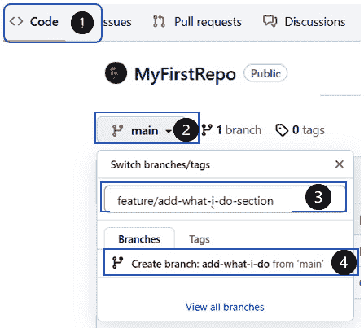
图 5.2 – 创建新分支

你会看到你的新分支已被创建。你将被自动切换到新创建的分支：

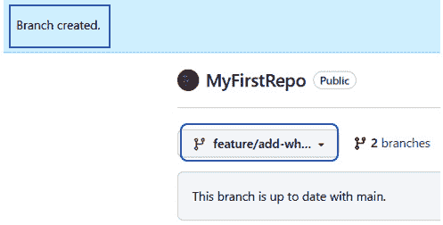
图 5.3 – 分支创建成功

在本地存储库的 Git Bash 或终端中，你可以输入 `git pull` 来获取你在 GitHub 上刚刚创建的分支：

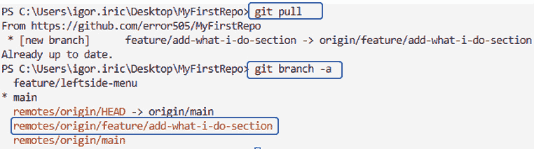
图 5.4 – git pull – 获取新分支

现在，你可以切换到你的 `add-what-i-do-section` 功能分支并开始为这个新部分编码。使用 `git switch feature/add-what-i-do-section` 命令切换到你的功能分支。我们将为该部分添加新的 HTML 代码并添加适当的样式。让我们进行这些更改：

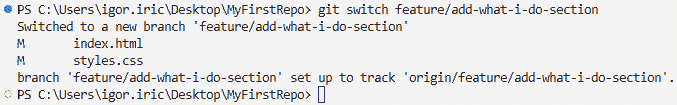
图 5.5 – 运行 git switch

#### 进行更改

在 *第 4 章* 中，在 *将你的新文件添加到 Git* 部分，我们谈到了如何添加新文件或更改现有文件，其中我们在你的 `index.html` 和 `styles.css` 文件中添加了新代码。为了继续进行新功能的工作，你可以使用你喜欢的代码编辑器对其进行更改。同样，我们可以使用 Visual Studio Code 编辑我们的文件。

要向你的单页作品集网站添加新部分。你可以在 `
` 内添加一个名为 `<section class="what-i-do-header">` 的 HTML 代码部分：

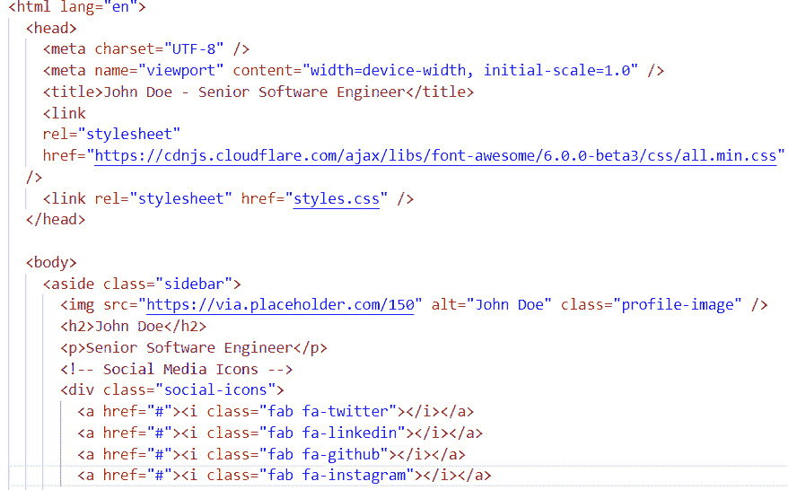
图 5.6 – HTML 代码

用你的名字替换 **John Doe** 并向名为 `styles.css` 的新文件添加一些 CSS。以下是你需要为 `styles.css` 文件使用的代码片段：

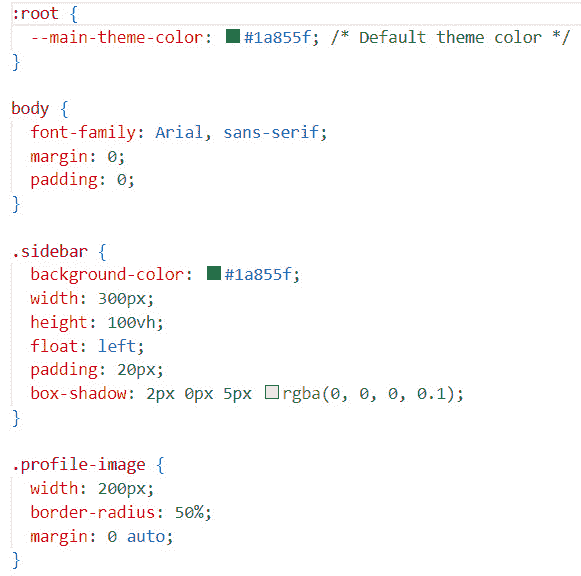
图 5.7 – CSS 样式

最后，在保存 `index.html` 和 `styles.css` 文件后，你可以在浏览器中运行网站并查看你所做的更改：

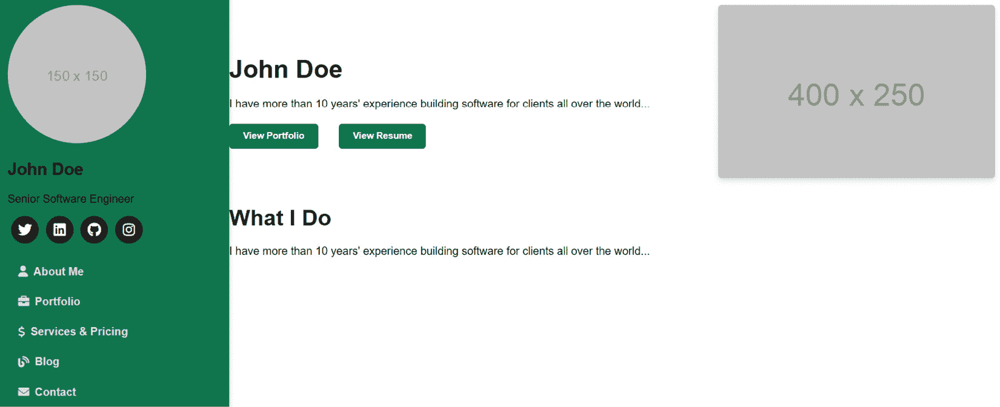
图 5.8 – 带有“我的工作”部分的作品集个人资料页面

#### 分享你的草稿

一旦你准备好与朋友分享你的想法，你就需要提交更改。这就像保存你的草稿。

你可以使用以下命令将更改添加到分支并提交：
* `git add .` （暂存所有更改）
* `git commit -m "Added a new what I do section"` （提交你的更改）

现在你已经学会了如何分享草稿更改，我们将看看如何有效地使用 GitHub PR 界面来提出草稿，讨论精心制作的 PR 至关重要的原因，并介绍一些在 GitHub 上创建完美 PR 的技巧。下一节将帮助你确保你的贡献清晰、对项目有用，并得到团队成员的认可。

### GitHub PR 界面 – 提出你的草稿

此时，你需要将分支推送到 GitHub 并创建 PR。这就像与朋友分享你的草稿并请求他们的反馈。让我们看看步骤：

1. 运行 `git push -u origin feature/add-what-i-do-section` 命令将你的新文件和更改推送到 GitHub 上的 `feature/add-what-i-do` 分支。这里，`-u` 选项为你推送的分支设置上游（或跟踪）引用：

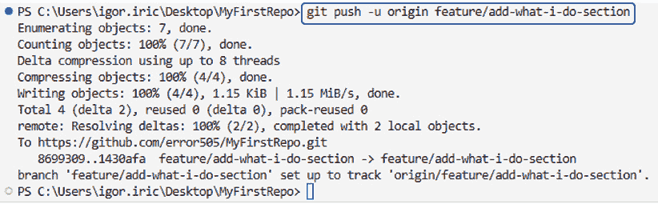
图 5.9 – git push 更改

1. 现在前往 GitHub，定位你的存储库，然后点击 **New Pull Request**。或者，你可以使用 **Compare & pull request** 按钮，它会自动检测某些分支中的新更改并允许你即时创建 PR：

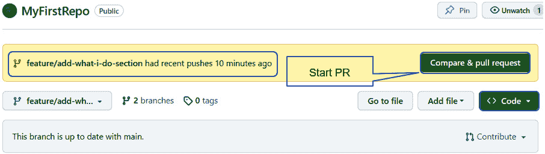
图 5.10 – 开始新的 PR

1. 当你点击 **Compare & pull request** 时，将打开一个新页面，你可以在其中开始你的 PR：

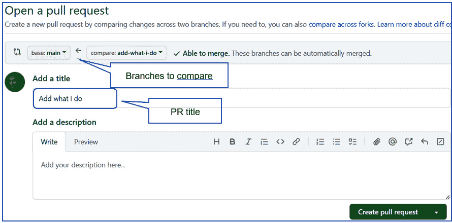
图 5.11 – 添加 PR 标题

### 为什么好的 PR 很重要？

使用 PR 是你展示所做工作并确保它与你正在创建的网站其余部分完美契合的机会。

精心制作的 PR 确保以下几点：
* **你的团队理解你的工作**：他们将确切知道你做了哪些更改以及原因。
* **顺利集成**：更容易将你的工作与其他人的工作合并而不会出现问题。

# 创建完美的 PR

## 更好的协作
你的团队可以提供有用的反馈，使最终项目更强大。

让我们看看如何在 GitHub 上创建完美的 PR：

### 从清晰的标题开始
你的标题应像报纸的标题一样——简短且描述性强。这样的标题示例是 *改进社交图标设计以 **提高可见性*：
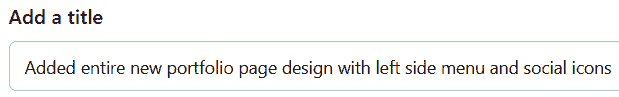
图 5.12 – PR 标题

### 编写详细描述
这就像讲述你所做的事情的故事。包括以下细节：
* **你做了哪些更改**：将其视为解释你对社交图标所做的修改
* **为什么这样做**：也许你读到某种形状有助于提高页面的可见性
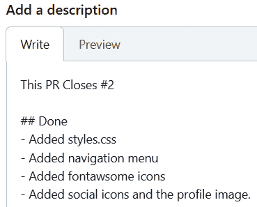
图 5.13 – PR 详细描述

### 链接到相关问题
如果你的工作是在解决之前讨论过的一个具体问题（例如之前社交图标设计的某个问题），请确保链接该讨论。这就像说，“*这是我们谈论过的问题的修复 **上周.*”
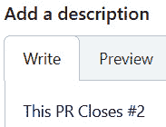
图 5.14 – 将 PR 链接到相关问题

### 概述待办事项
有时，你可能还没有完全完成。重要的是要注明仍在进行中的事项，例如如果仍需在不同分辨率和设备上测试图标：
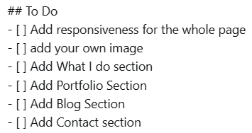
图 5.15 – PR 中的待办事项部分

### 添加标签以提高清晰度
标签就像便签，有助于对你的 PR 进行分类。你可以添加诸如 **bug fix**、**enhancement** 或 **needs review** 这样的标签：
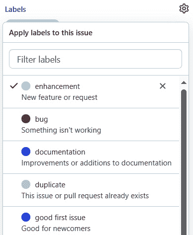
图 5.16 – PR 标签

### 请求审阅者
请具体同事查看你的工作。这就像请擅长 CSS 的朋友检查你的响应式设计：
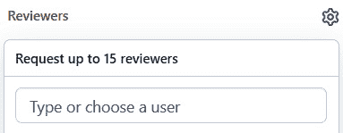
图 5.17 – PR 审阅者

### 保持响应
提交后，保持活跃。如果你的同事提出问题或建议更改，请及时回复。

### 保持最新
如果项目的其他部分发生变化（例如有人修改了页面的主体），请更新你的 PR，使其与这些更改保持一致。

### 创建拉取请求
最后，点击 **创建拉取请求** 按钮创建你的第一个 PR：
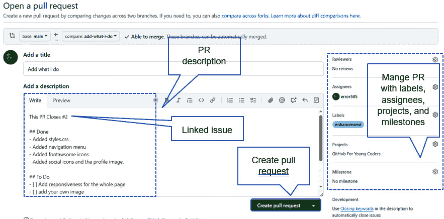
图 5.18 – 一个好的 PR 示例

在创建 PR 之前，你可以通过向下滚动来比较 main 分支上的文件和你想要与 PR 合并的分支。你将看到你有多少次提交，有多少文件被更改，以及有多少贡献者在这个分支上工作：
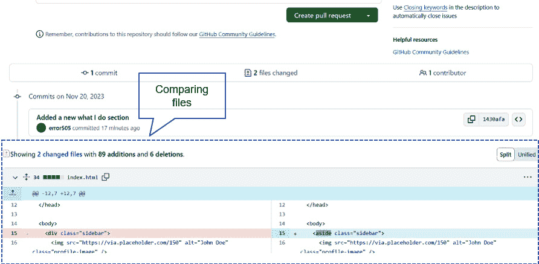
图 5.19 – 比较文件

在介绍了如何在 GitHub 上创建完美的 PR 之后，让我们转移焦点。在下一节中，我们将探讨如何有效地审阅 PR。这包括逐行审阅更改并确保贡献的质量。审阅后，我们将介绍如何合并这些更改以及合并后管理分支的最佳实践，包括为什么以及如何删除分支。此过程有助于保持干净的项目环境并确保你的仓库保持有序。

# 审阅 PR

你的同事现在可以在 GitHub 上看到你提出的更改。他们可以留下评论、建议修改，甚至添加更多代码。这就是代码审查流程。这就像向朋友展示你的工作并获得他们的反馈和想法。让我们看看如何在 GitHub 上完成此操作，同时关注 **Files changed** 选项卡：

图 5.20 – PR 审阅

## 什么是 Files changed 选项卡？
当你或你的朋友在 GitHub 上提交 PR 时，这意味着他们建议对网站进行一些更改。**Files changed** 选项卡是你可以看到确切更改内容的地方：
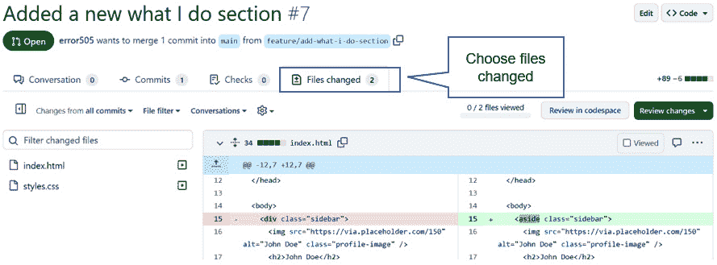
图 5.21 – GitHub 的 Files changed 选项卡
将其想象成一份高亮的文档，其中编辑内容清晰标记。

### 逐行审阅更改
以下是如何逐行详细审阅更改的方法：
1. 打开刚刚创建的 PR 并进入它。
2. 你会找到一个标记为 **Files changed** 的选项卡。
3. 点击此选项卡；你将看到已更改或添加的文件。GitHub 用两种颜色显示这些更改：**红色** 表示已删除的内容，**绿色** 表示已添加的内容。这就像在 Word 文档中跟踪更改——你可以轻松发现新内容和被删除的内容。
4. 如果你对更改的某个具体部分有疑问或建议，可以直接在那里评论。将鼠标悬停在代码行上；会出现一个蓝色加号。点击后，评论框将打开。
在这里，你可以输入你的想法或建议。也许你认为不同的颜色会让背景看起来更好，或者你对他们添加的新部分有疑问：
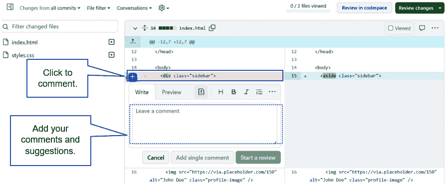
图 5.22 – 在 PR 上评论
5. 添加完所有评论后，你可以提交你的审阅。你将有诸如 **批准**（如果你认为一切看起来很棒）、**请求更改**（如果你认为某些内容需要更改）或仅留下评论而不做任何具体批准或请求的选项：
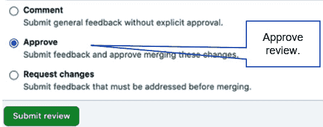
图 5.23 – 提交 PR 审阅

### 接下来会发生什么？
你的朋友将看到你的评论并可以回复。他们可能会根据你的反馈做出更多更改。这种来回交流将持续到你们双方都同意更改良好为止。

## 确保质量
PR 还确保代码符合项目的标准。代码是否干净且注释良好？是否遵循项目的编码规范？是否有测试来确保代码按预期工作？这一步就像确保你的新网页已在所有设备上测试并且可以为尽可能多的用户服务。
这可以通过使用 GitHub 工作流和操作来自动化。工作流将在你创建 PR 时自动启动，以确保代码已检查是否存在任何漏洞，并且单元测试正在正确运行。所有操作都在你的 PR 的 **Checks** 选项卡中进行。
目前，我们还没有任何操作来检查我们的代码。我们将在 *第 9 章* 中更详细地讨论这个问题：
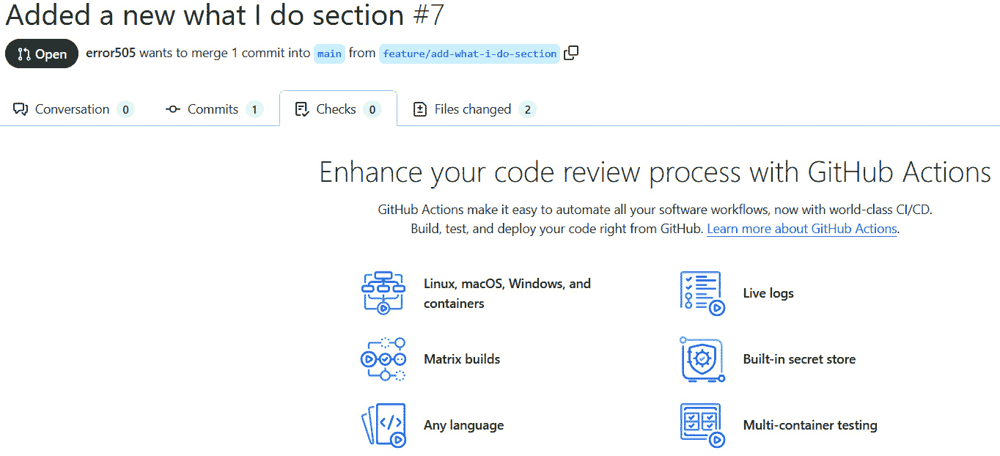
图 5.24 – PR 检查
一旦我们设置了操作，构建过程应如下所示：
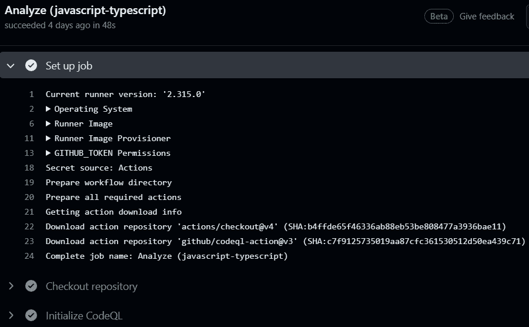
图 5.25 – PR 操作

## 学习与成长
通过讨论和对 PR 提供反馈，每个人都会学习和成长。你学习更好的编码方式，了解解决问题的不同方法，并沉浸在团队的集体智慧中。
根据此反馈，你可能会对分支做出更多更改。这些更新将自动成为同一 PR 的一部分：
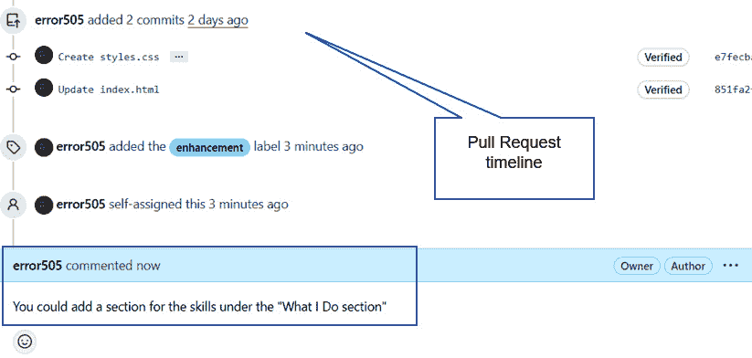
图 5.26 – 审阅 PR 评论

## 合并更改
PR 体现了软件开发中团队合作的精髓。它们确保每个人都在同一页面上，代码健壮且干净，构建伟大事物之旅是一场共享的冒险。
一旦每个人都对更改感到满意，同事或你（如果你有权限）可以将你的分支与 main 分支合并。这意味着你的更改现在是主网站的一部分。
现在，你可以通过点击 **合并拉取请求** 来完成 PR：
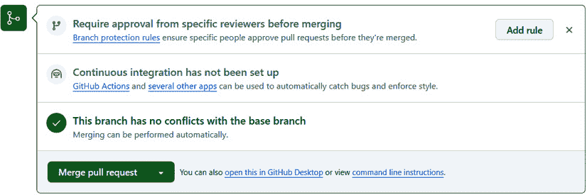
图 5.27 – 合并拉取请求
然后，点击 **确认合并**：

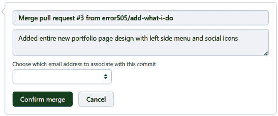

图 5.28 – 确认合并

# 删除 GitHub 分支

将你的 GitHub 仓库想象成社区工作坊中的一个工作空间。你创建的每个分支就像一个单独的工作台。当你完成一个项目（例如你的 **我所做的内容** 部分）并将其移至主展示区（合并到 main 分支）后，就不再需要那个工作台了。通过删除分支来清理，可以保持工作坊整洁，使你和其他人更容易看到当前正在进行的工作和已完成的工作。

PR 现已关闭，标志着此次协作的结束。在此阶段，你可以点击 **删除分支** 来从仓库中移除该分支。这将从你的 GitHub 仓库中移除 `feature/add-what-i-do-section` 分支：

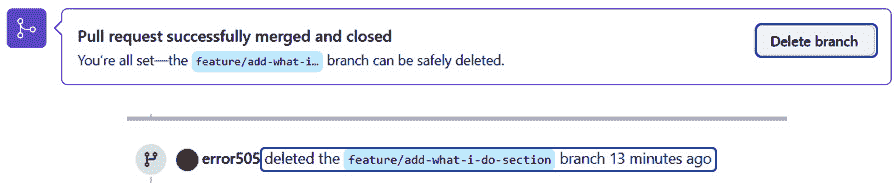

图 5.29 – 删除已合并的分支

## 为什么要删除分支很重要？

这是软件开发工作流程中的良好实践。一旦功能已集成，其分支就已完成使命，可以防止对哪些分支处于活动状态或需要进行持续工作产生混淆。删除分支后其 PR 已合并，可确保你维护一个干净、易懂且井然有序的 GitHub 仓库。在团队项目中，这一做法尤为重要，因为清晰和组织性可以节省时间并避免混淆。

## PR 获批后删除本地分支

现在，你想通过删除不再需要的特性分支来清理本地 Git 环境。

通过在 Git Bash 或终端中输入 `git switch main` 命令切换回 `main` 分支。此命令会将你从特性分支移出并返回到项目的 main 分支：

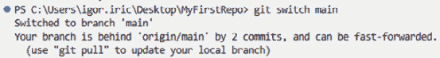

图 5.30 – Git 终端 – 切换到 main 分支

为什么需要切换回 `main` 分支？

你不能删除当前所在的分支。因此，你需要切换到另一个分支（本例中为 `main`）来删除 `feature/add-what-i-do-section` 分支。

## 更新你的本地 main 分支

现在，你可以使用 `git pull` 命令更新本地 `main` 分支，因为有提示称你的分支比 `origin/main` 落后两个提交。此命令（`git pull`）会使用 GitHub 上 `remote main` 分支的最新更改（包括最近合并的 PR 的更改）来更新你的本地 `main` 分支。

保持本地 main 分支与 `remote main` 分支同步是良好的实践，这样你就能拥有最新代码，确保一切同步：

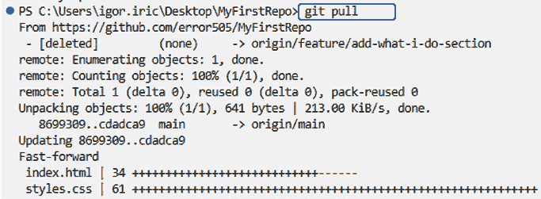

图 5.31 – Git 终端 – 拉取最新更改到 main 分支

## 修剪不需要的分支

在此阶段，你必须使用 `git pull --prune` 命令清理 GitHub 上已不存在的远程分支的引用。

为什么要这样做？

合并 PR 后，GitHub 上的特性分支可能会被删除（这是常见做法）。`--prune` 选项可确保你的本地 Git 知道该远程分支已不存在：

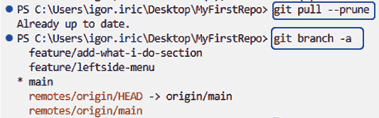

图 5.32 – Git 终端 – 修剪并检查分支

## 删除本地特性分支

现在，是时候从本地仓库中删除该分支了。你可以通过运行 `git branch -d feature/add-what-i-do-section` 命令来完成，这将从你的本地仓库中删除该分支：

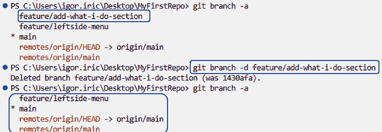

图 5.33 – Git 终端 – 从本地删除特性分支

现在你的更改已合并并且你已更新 main 分支，特性分支不再需要。删除它可以保持本地仓库干净整洁。此命令就像在完成项目部分后清理工作空间。在下一节中，我们将介绍使用 GitHub 的便捷编辑功能增强你的网站。你将学习如何在 GitHub 上直接编辑以进行快速更改，以及使用 `github.dev` 作为功能齐全的编辑器。这将帮助你高效有效地改进你的网站。

# 使用 GitHub 的便捷编辑功能增强你的网站

让我们更深入地探讨如何使用 GitHub 的便捷编辑功能编辑你的单页作品集网站。除了在电脑上编辑文件然后推送到 GitHub 的传统方式外，GitHub 上还有一些更快捷、更用户友好的选项！

## 在 GitHub 上直接编辑 – 快速简便

不必在电脑上编辑文件再推送到 GitHub，你可以使用 GitHub 的 **编辑文件** 功能。它就像为你的网站文件提供了一个快速编辑按钮。

那么，它是如何工作的？

只需在 GitHub 仓库中导航到你想要更改的文件即可——例如 `index.html` 或 `style.css`。点击铅笔图标即可在浏览器中开始编辑，或者更好的是，直接按键盘上的 *E* ——文件即可准备编辑：

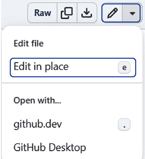

图 5.34 – 通过按 E 或点击铅笔图标在 GitHub 上编辑文件

对于快速修复或小幅添加非常方便，例如修改一句话或更改颜色：

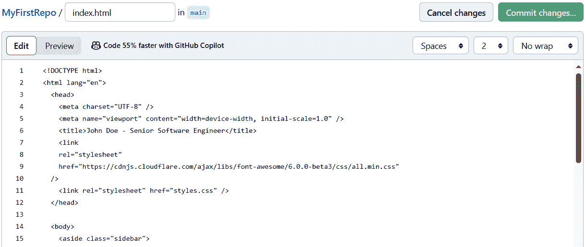

图 5.35 – 在 GitHub 上编辑文件

## 使用 github.dev – 你的完整编辑器

对于更广泛的编辑，GitHub 提供了 `github.dev`，它可在浏览器中提供 Visual Studio Code（一种流行的代码编辑器）的完整功能。

`github.dev` 是一个轻量级的浏览器内代码编辑器，允许你编辑仓库中的文件。它不提供任何计算资源，因此你无法在此环境中直接运行或调试代码。无需设置或配置，并且免费使用。

### 激活 github.dev

你可以在仓库中按 *.*（句点键）激活 `github.dev`，或点击铅笔图标附近的箭头，然后在 **使用…打开** 下点击 `github.dev`，如下所示：

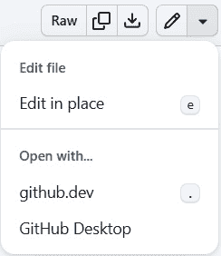

图 5.36 – 通过按 “.” 或点击铅笔图标在 GitHub 上编辑文件

一个功能强大的编辑器将打开，你可以在其中处理多个文件、运行命令，并直接将工作保存到你的分支。

### 为什么使用 github.dev？

当你远离常用的编码环境或想直接在 GitHub 上工作而不进行本地编辑的来回操作时，这非常完美。它就像随时随地拥有你的完整手工工作坊：

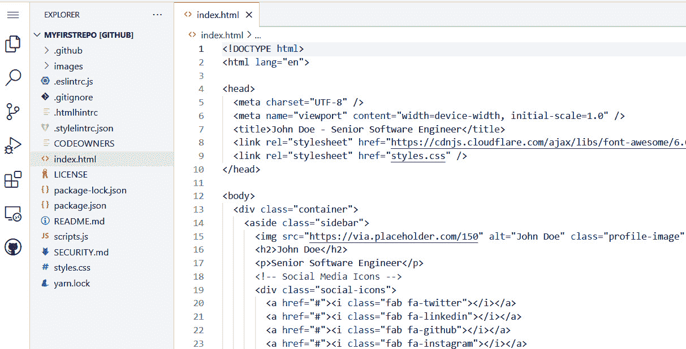

图 5.37 – 使用 github.dev 在 GitHub 上编辑文件

### 两全其美

根据你的操作，你可以选择最佳的编辑方法。快速更改？直接编辑非常完美。更复杂的工作？`github.dev` 就是你的朋友。

这些 GitHub 功能使协作编辑你的网站更快更简单。它就像拥有一套工具，适合快速修复或整天的开发工作。

# 总结

在本章中，你学习了如何通过 GitHub 上的 PR 有效协作。这涉及向项目提出更改、与团队成员一起审阅这些更改，并整合反馈以提高项目的整体质量。这些技能对于编码项目的团队合作至关重要，可确保清晰的沟通和新功能或修复的顺利集成。

在下一章中，我们将探讨在集成更改时出现冲突的处理方法。我们将学习如何使用 GitHub 的 UI 处理简单冲突、应对多个冲突问题，并本地解决冲突，以确保无缝协作和项目进展。

# 测验
回答以下问题：

1. GitHub 中的 PR 是什么？
    1. 从仓库拉取代码的请求
    2. 对项目的更改提案
    3. 删除代码的请求
    4. 给 GitHub 支持的消息
    *答案*: B. 对项目的更改提案

2. 真假题：PR 仅用于添加新功能。
    1. 真
    2. 假
    *答案*: B. 假

3. 在 GitHub 中制作 ________ 有助于你以便于团队成员审查的方式提出更改。
    *答案*: PRs

4. 为什么在 GitHub 上审查他人的工作很重要？
    *答案*: 审查他人的工作有助于识别潜在问题，确保质量，并促进协作，使项目更强大

5. 对 PR 提供反馈的目的是什么？
    1. 使项目更复杂
    2. 提高代码的质量和有效性
    3. 减慢项目进度
    4. 决定谁是最好的程序员
    *答案*: B. 提高代码的质量和有效性

6. 真假题：你可以为小更改和大更改创建 PR。
    1. 真
    2. 假
    *答案*: A. 真

7. GitHub 中用于快速更改的功能是什么？
    1. Issues
    2. Wiki
    3. Codespaces
    4. 直接编辑
    *答案*: D. 直接编辑

8. 对于更复杂的工作，________ 是一个有用的 GitHub 功能。
    *答案*: `github.dev`

9. 真假题：只有项目所有者才能创建 PR。
    1. 真
    2. 假
    *答案*: B. 假

10. 在 GitHub 中创建 PR 的一个最佳实践是什么？
    *答案*: 创建清晰、简洁且有效的 PR，便于团队成员理解和集成。

# 挑战 – Space Explorer 中的宇宙协作！
本章带你了解了在 GitHub 上创建和协作 PR 的要点。现在是时候将这些技能应用于我们的 *太空探索者* 游戏了。让我们添加一些璀璨的背景并优化障碍交互！

## 你的任务？
通过添加新背景和优化障碍交互来改进 *太空探索者* 游戏，使用 PR 进行协作和审查：

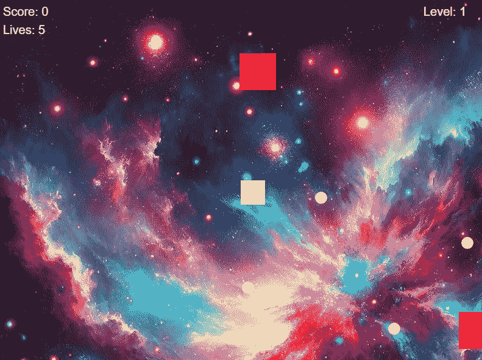
图 5.38 – 太空探索者 游戏

执行以下操作：
1. **为新背景创建分支**：在 GitHub 上，从主项目创建一个名为 `feature-new-background` 的新分支。此分支是绘制游戏宇宙背景的画布。
2. **集成新背景**：我已为你准备了一些很酷的太空背景。使用 `git pull` 命令将其获取到本地 `feature-new-background` 分支。将其集成到游戏中。感受宇宙的生动！
3. **改进障碍交互**：在另一个分支 `enhance-obstacle-interaction` 上，优化飞船与障碍物交互的方式。你能否在飞船撞到障碍物时添加一个很酷的声音效果？我已为你准备了一些声音供你使用。
4. **提交并打开 PR**：使用描述性的提交信息提交更改，例如 `Added cosmic background` 和 `Enhanced spaceship-obstacle interaction`。
5. 为每个分支向主项目打开 PR。描述你的更改并请求反馈。
6. **审查和协作**：邀请朋友或 fellow 程序员审查你的 PR。你的新背景和障碍交互是否超凡脱俗？
7. 讨论，必要时修改，然后当一切看起来都很棒时，将你的 PR 合并到主游戏中。
8. **清理你的空间**：成功合并后，从 GitHub 仓库中删除功能分支。保持整洁是成为优秀程序员的一部分！

## 奖励探索
尝试不同的背景或障碍效果。添加个人风格并在 PR 描述中分享你的想法。你为什么选择那个特定的背景或效果？
