## 6 解决合并冲突 – 在 GitHub 和本地
本章将作为一份指南，带你穿越有时具有挑战性的合并冲突领域，说明如何在 GitHub 和本地导航和解决这些问题。通过理解和解决合并冲突，你将确保编码项目中的更顺畅协作。

在本章中，我们将涵盖以下主要主题：
* 理解合并冲突及其发生方式
* 处理合并冲突

你将深入实践、动手的方法来解决这些冲突，确保你的网站体现两者的优点。

到本章结束时，你将具备像专业人士一样处理棘手技术情况的能力，确保你的协作编码项目顺利进行！

## 技术要求
你需要包括在计算机上安装 Git 和 GitHub 账户的基础设置。熟悉命令行操作和 GitHub 网页界面将有益。有关练习和代码示例，请访问 [`github.com/PacktPublishing/GitHub-for-Next-Generation-Coders/tree/main/Chapter%206`](https://github.com/PacktPublishing/GitHub-for-Next-Generation-Coders/tree/main/Chapter%206) 并在你的 GitHub 仓库中创建一个名为 `ch6` 的文件夹。你可以使用 `git clone https://github.com/PacktPublishing/GitHub-for-Next-Generation-Coders.git` Git 命令，然后从那里访问 `ch6` 文件夹。

## 理解合并冲突及其发生方式
你和你的团队同事都在更新一个单页作品集网站。你正在处理 **关于我** 部分，而你的同事正在为整个页面添加新字体和样式。这就是 **合并冲突** 发挥作用的地方：

图 6.1 – 合并冲突

### 什么是合并冲突？
把合并冲突想象成两个人同时在同一块画布上尝试绘制不同的画。你俩都有自己的想法，但它们在同一空间冲突：

图 6.2 – 什么是合并冲突？

### 合并冲突是如何发生的？
你和你的同事都从 `main` 分支拉取网站的最新版本以开始工作。你向 **关于我** 部分添加了详细的个人简介和一些图片，而你的同事更改了整个页面的字体样式和配色方案，包括 **关于我** 部分。*图 6**.3* 展示了这种冲突：

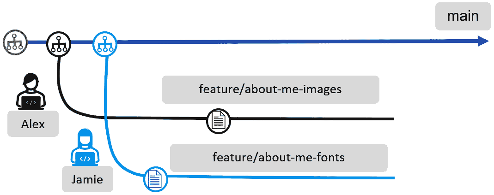
图 6.3 – 合并冲突功能分支

你俩大约在同一时间完成工作并将更改提交到各自的分支。你的同事先完成并将更改合并到 `main` 分支。`main` 分支现在具有你同事的新字体和配色方案。

现在，当你尝试合并你的 **关于我** 更改时，出现了问题。你工作的 **关于我** 部分没有你同事的新字体和颜色。Git 感到困惑，因为与 `main` 分支相比，同一部分网站在你的分支中看起来不同，如 *图 6**.4* 所示。这就是合并冲突的定义：

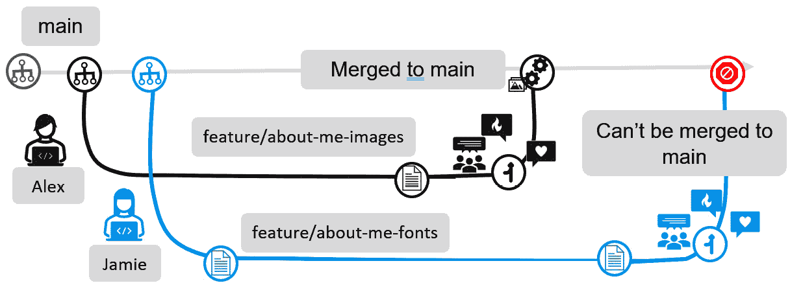
图 6.4 – PR 中的合并冲突

当你在 GitHub 上尝试为你的更改创建 PR，但你的分支存在冲突时，GitHub 会提示你正在尝试合并的分支存在合并冲突，应先解决。你可以在 *图 6**.5* 中看到这一点：

图 6.5 – 冲突的 PR 分支错误

如你现在已了解合并冲突可能如何发生在你身上，让我们用一个真实示例来演示它们。

# 处理合并冲突

如你和同事正在构建一个单页作品集网站，你们都开始更新 `Skills` 部分，但你们不小心对网页的同一部分做了不同的更改。你正在更改一项技能的标题，而你的同事同时也在更新标题、图标和描述：

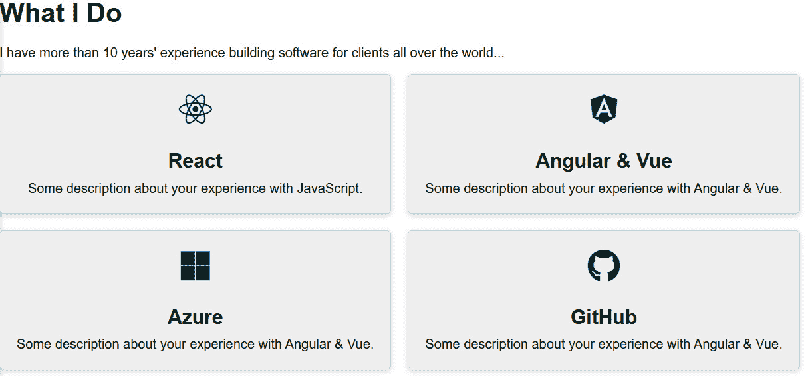

图 6.6 – 作品集网页的“我的服务”部分

## 合并冲突实战

你和同事都从 `main` 分支拉取网站的最新版本以开始工作。你将一项技能的标题从 *React* 更新为 *Web Development*，与此同时，你的同事将标题更改为 *Google Cloud Provider*，更改了同一技能的图标，并修改了其描述。

你们都将更改提交并推送到 GitHub。你先完成了工作并将更改推送到 `main` 分支。之后，你的同事尝试推送他们的更改。但现在，GitHub 提醒他们发生了合并冲突。为什么？因为自从同事上次从 `main` 分支拉取以来，你已经更改了他们编辑的那部分内容。

以下是你将与同事一起工作的示例 HTML 代码：

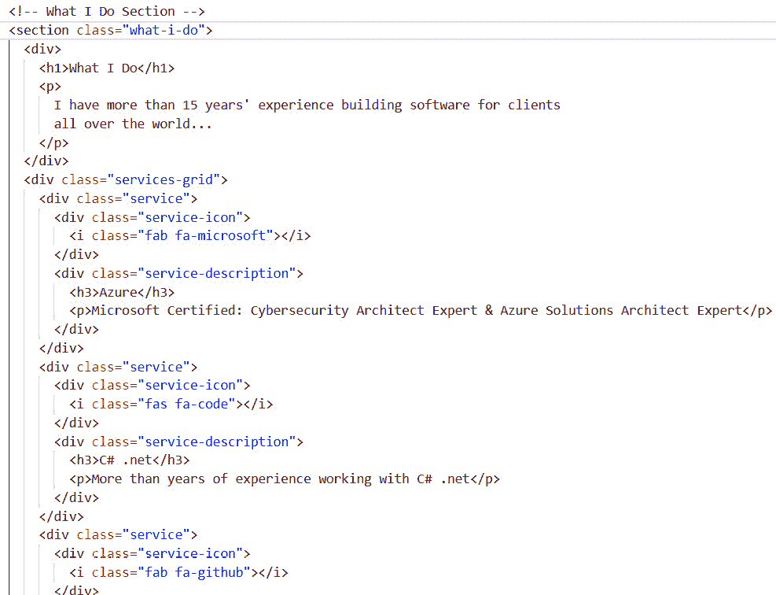

图 6.7 – 示例代码

以下是 `styles.css` 文件的更改：

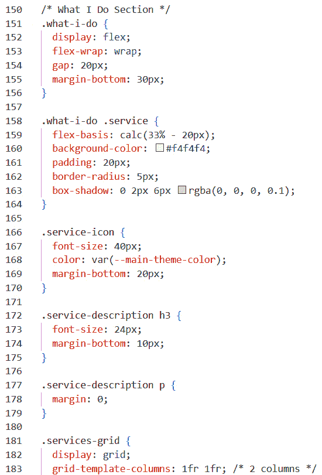

图 6.8 – styles.css 代码

因此，你们都编辑了 React 服务，但由于你已经将更改合并到 `main` 分支，你的同事将面临第一次合并冲突，并且在冲突解决之前无法合并 PR。

## 使用 GitHub 界面解决合并冲突

GitHub 准确显示给同事冲突所在的位置——在 `Skills` 部分。就像网站在说，“*嘿——两个人更改了同一部分，我不确定该保留哪个版本 **保留*”：

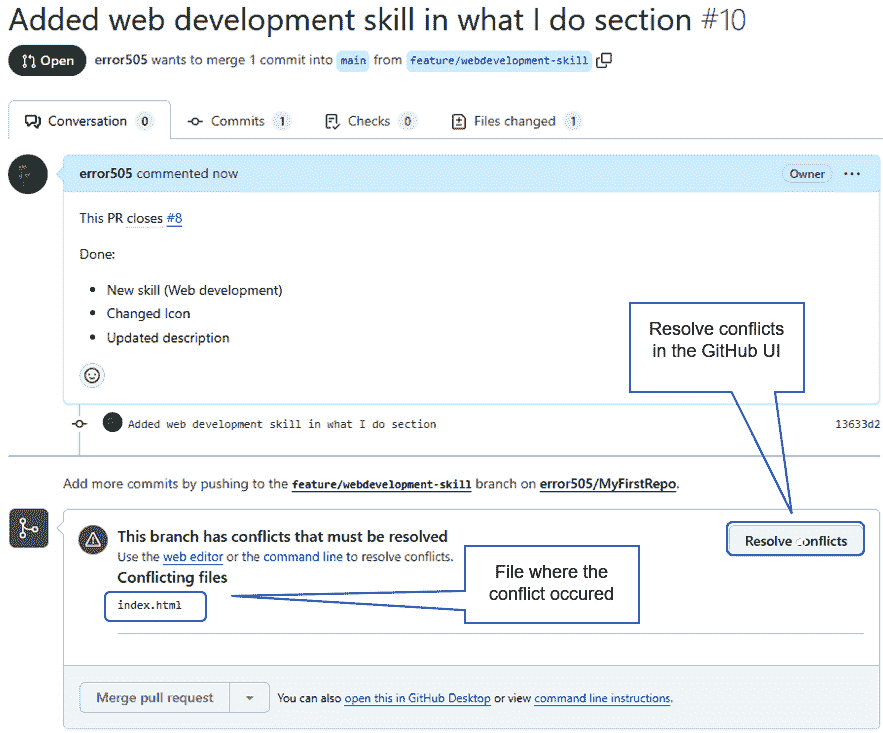

图 6.9 – 开始 PR 并解决冲突

现在，当同事点击 `Resolve conflicts` 按钮时，GitHub 编辑器中的文件将打开，其中冲突的更改会被清晰标记。然后，同事会看到他们的代码更改被标记为 `>`、`=` 和 `<` 符号，如 *图 6**.10* 所示：

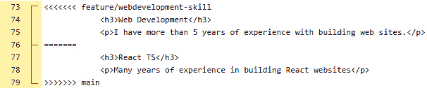

图 6.10 – GitHub 上标记的 PR 冲突

*   `>>>>>>> main` 部分显示当前 `main` 分支的更改，其中包含你之前所做的更改
*   `=======` 部分分隔两个冲突的更改
*   `<<<<<<< feature/webdevelopment-skill` 部分显示同事所做的更改

同事 Jamie 现在必须决定如何整合这两个更改。他们可能会选择保留新标题并纳入其图标和描述更新。

你可以通过点击 PR 部分中的 `Prev` 和 `Next` 按钮直接导航 PR 冲突，它会从一个冲突移动到另一个冲突。在那里，你还会看到当前文件中必须合并的冲突数量以红色标记：

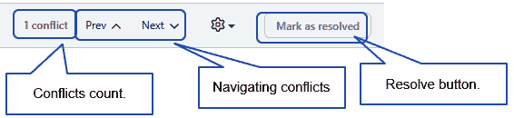

图 6.11 – 冲突导航菜单

在 `Conflicts` 菜单中，你可以选择如何配置 `Indent mode` 在空格和制表符之间，`Indent size` `2`、`4`、`8`，以及 `Line wrap mode` 在 `No wrap` 和 `Soft wrap` 之间。这已在 *图 6**.12* 中演示：

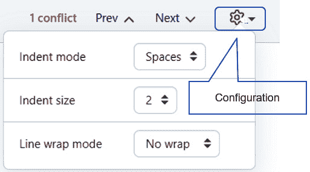

图 6.12 – 冲突配置菜单

Jamie 删除文件中的冲突标记和代码以解决合并冲突，并从 `Conflicts` 菜单中点击 `Mark as resolved` 按钮，以一种合理的方式合并更改：

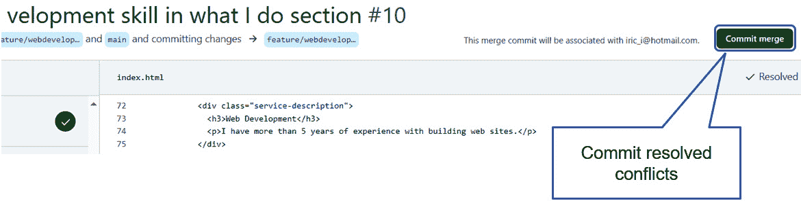

图 6.13 – 合并冲突已解决

在进行编辑并解决冲突后，Jamie 可以通过点击解决冲突后出现的 `Commit merge` 按钮来提交更新后的文件。此提交告诉 GitHub，“*好的——我们已修复冲突；这是我们想要 **保留* 的版本。”

冲突解决后，你和 Jamie 可能会聊天以确保你们同意 `Skills` 部分的最终版本。冲突解决后，作品集网站现在准确反映了对 `Skills` 部分的双方贡献。

该分支的 `Pull Request` 页面现在将检测到不再有冲突需要修复，并且你将有机会最终合并 PR。PR 现在可以通过将功能分支合并到 `main` 分支来完成：

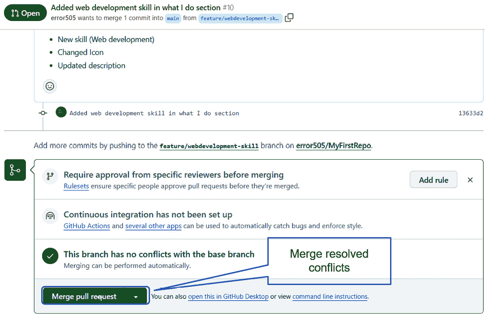

图 6.14 – 合并 PR 选项

## 处理多个合并冲突

这有点像一次修复群聊中的几个误会。它可能发生在有人不小心直接将合并冲突标记合并到 `main` 分支时：

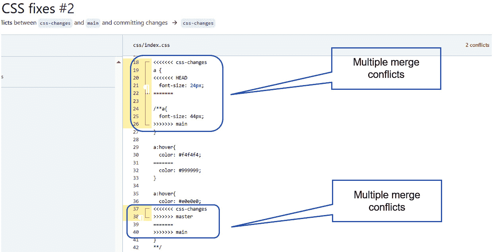

图 6.15 – 包含多个合并冲突的文件

在此示例中，不同的协作者对 CSS 文件的同一部分做了不同的更改。我们将按清理混乱的团队项目的方式逐步进行这些步骤。

要开始解决这些问题，你可以进入冲突文件的 `Pull Requests` 部分。点击 `Resolve conflicts` 按钮。这会将你带到浏览器中的编辑器，在那里你可以修复问题。

在编辑器中，你会看到诸如 `<<<<<<<`、`=======` 和 `>>>>>>>` 之类的标记。这些标记分隔不同的更改。就像你并排看到争论的双方一样：

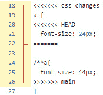

图 6.16 – 包含多个合并冲突的文件示例

在这里，一方 (`css-changes`) 希望字体大小为 `24px`，而另一方 (`main`) 希望为 `44px`。

### 选择正确的更改

现在，决定保留哪些更改。也许你认为 `24px` 看起来更好，或者 `44px`，或者完全不同的东西。

删除你不想要的标记和更改。如果你选择 `24px`，你将删除其他所有内容，包括标记，这样它看起来又像正常的 CSS 一样。

对文件中的每个冲突重复此操作。在每种情况下，你都在选择最佳选项，清理并确保它再次看起来像一段常规代码：

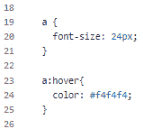

图 6.17 – 已解决多个冲突

### 解决冲突文件并完成 PR

修复所有冲突后，GitHub 将允许你通过点击我们之前使用的 `Mark as resolved` 按钮将文件标记为已解决。这就像说，“*好的——我们已解决 **这些问题*”：

图 6.18 – Mark as resolved 按钮

现在，你可以完成 PR 流程，这就像在团队项目中最终确定更改一样。在 GitHub 界面中解决多个合并冲突就像多次解决单个冲突一样。

## 像专业人士一样使用命令行解决合并冲突

你已经了解了合并冲突是什么、它是如何发生的，以及如何使用 GitHub 界面解决它，但使用命令行在本地解决冲突呢？

想象你和朋友都在编辑项目网站的同一部分——比如 `What I Do` 部分。你们都对该部分中的同一行做了不同的更改。

现在，当你们两人尝试将更改（或 *合并*）合并到主项目中时，GitHub 会感到困惑。这就像两个朋友同时在纸张的同一位置写不同的句子。GitHub 需要你的帮助来决定保留哪些更改。这时你可以使用命令行来解决冲突，并帮助 GitHub 知道要合并哪些更改。

## 前往 Pull Request 页面

在 GitHub **拉取请求** 页面上，你会看到一个我们已经在 *图 6.9* 中看到过的屏幕，其中显示该分支存在必须解决的冲突。从那里，你可以通过点击 **解决冲突** 按钮使用 UI，这将为你打开网页编辑器，但你也可以使用 *命令行* 来解决冲突。如果你点击命令行，你将获得有关如何使用命令行解决冲突的完整说明，按照 *图 6.19* 中的步骤进行：

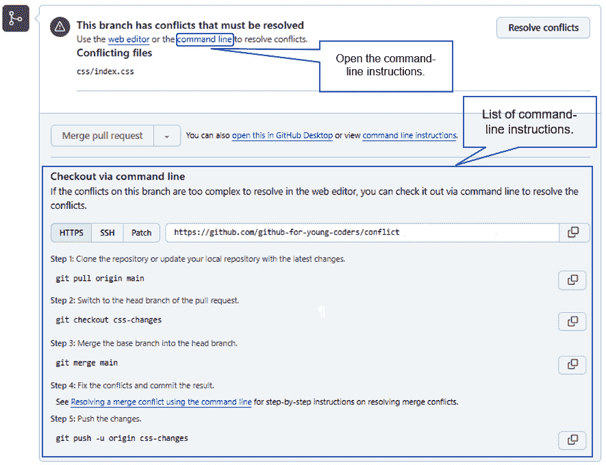
图 6.19 – GitHub 命令行说明

打开你喜欢的命令行工具，例如 Git Bash 或 PowerShell，并使用 `cd` 命令和仓库名称导航到存在合并冲突的本地项目仓库：

图 6.20 – 进入冲突仓库

## 从主分支拉取最新更改

在你的项目仓库文件夹中打开命令行并输入 `git pull origin main`。该命令告诉 GitHub，“*给我 **主项目** 的最新更新*”。

正如你所见，GitHub 已经会告诉你你的分支存在冲突，并且自动合并已失败，在你手动修复合并冲突之前是不可能的：

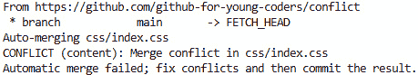
图 6.21 – 冲突消息

## 切换到冲突分支

在命令行中输入 `git checkout css-changes` 以切换到冲突分支。

一条消息会显示你分支中存在错误，告诉你合并更改到 **主** 分支之前需要修复的内容：

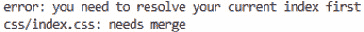
图 6.22 – 冲突分支上的错误

## 合并更改

现在，在命令行中输入 `git merge main`。这会尝试将你的更改与主项目的最新更改融合。如果存在冲突，它会通知你。

在这种情况下，由于必须先修复一些问题，合并将不会完成，如命令行所示：

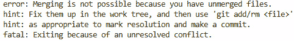
图 6.23 – 合并命令冲突

此外，你可以输入 `git status` 查看存在冲突的文件。

输入 `git status` 命令后，你将看到已更改且未合并的文件列表：

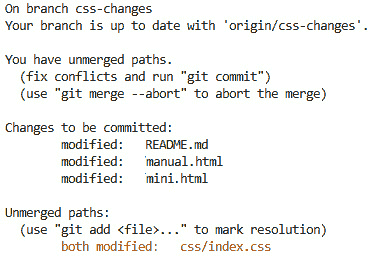
图 6.24 – Git 状态修改和冲突文件列表

在你的文本编辑器中打开这些文件，例如 Visual Studio Code 或你喜欢的任何其他编辑器。你会看到诸如 **<<<<<<<** 和 **>>>>>>>** 这样的标记，表示冲突的更改。通过删除冲突标记（**<<<<<<<**、**=======**、**>>>>>>>**）来编辑文件以保留你想要的更改：

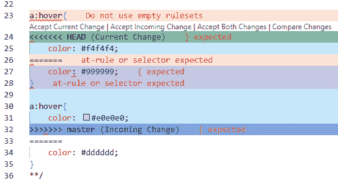
图 6.25 – 在 Visual Studio Code 中编辑合并冲突

现在，你可以保存文件并返回命令行输入 `git add .` 来暂存你的更改，并输入 `git commit -m "resolved conflict"` 来保存它们。

最后，输入 `git push origin your-branch-name` 将你解决的更改发送回 GitHub。

现在，合并冲突已解决，你可以返回 GitHub **拉取请求** 页面并通过点击 **合并拉取请求** 按钮完成 PR。

## 使用已删除文件解决冲突

假设你决定从项目中删除一个文件，因为你认为它不再需要。与此同时，你的朋友在他们版本的项目中对同一个文件做了一些更改。当你们两人尝试合并更改时，GitHub 会感到困惑。这就像，*嘿——你正试图更新一个文件，但它 **已经不在这里了！*：

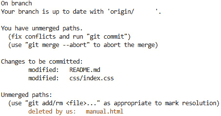
图 6.26 – 已删除文件的状态

要解决这种冲突，你可以按照我们之前主题中介绍的整个流程进行操作，在那里我们解释了如何使用命令行解决问题。

### 删除文件

现在，你必须决定是否要保留文件被删除（你的更改）或将其带回并包含你朋友的更改。

如果你想保留文件被删除，只需使用 `git rm file-name` 将此决定添加到项目中（将 **file-name** 替换为实际文件名）：

图 6.27 – 删除不需要的文件

然后，使用 `git commit -m "Decided to keep the file removed"` 提交此决定：

图 6.28 – 提交不需要的文件

### 想把文件带回来？

使用 `git checkout --theirs file-name` 将文件连同你朋友的更改一起带回，然后使用 `git add file-name` 将此文件重新添加到项目中。

它将使用之前被删除的文件更新仓库。使用 `git commit -m "Brought back the file with changes"` 提交此决定。现在，使用 `git merge` 完成合并过程。这就像告诉 GitHub，“*好的——我们已解决该问题；让我们 **继续吧！**”*

最后，使用 `git push origin branch-name` 用你解决的更改更新主项目。

你正在告知大家，“*都安排好了！项目现在已 **最新*”：

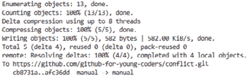
图 6.29 – 状态显示一切已最新

现在，你再次可以继续进行 PR 并关闭它。点击 **合并拉取请求** 按钮，最后，你已完成 PR：

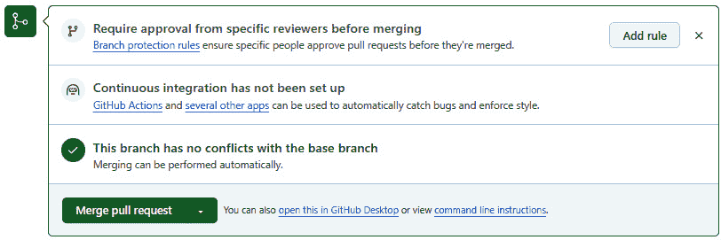
图 6.30 – 合并已解决的 PR

你现在已经学会如何处理合并冲突，包括合并冲突期间发生的情况、如何使用 GitHub 界面解决冲突以及如何处理多个冲突和已删除文件。这些知识可确保即使更改重叠，你的代码也能顺利集成。

# 摘要

恭喜你完成 *第 6 章*！你已穿越合并冲突的曲折，并变得更加熟练和自信。

本章全部关于掌握合并冲突。我们学习了合并冲突是什么以及如何通过各种方法和多种场景来解决它们。凭借这些技能，你现在可以做到以下几点：

*   识别合并冲突，将其理解为协作编码的自然组成部分

*   使用 GitHub 的 UI 和命令行解决冲突，将不同的更改融合为和谐的最终产品

*   成为更有效的团队成员，能够轻松且专业地处理项目中的冲突

在你继续构建单页作品集网站时，请记住合并冲突只是协同不同想法和改进的机会。在下一章中，你将学习如何在 Git 中导航、更改和理解你的编码项目的历史。你将研究各种关键概念和功能，例如 `git bisect`、`diff` 命令、`git reset` 和 cherry-picking。

# 测验

用以下问题测试你的知识：

1.  GitHub 中的合并冲突是什么？

    1.  下载文件时出现错误

    2.  团队成员之间的分歧

    3.  对同一文件部分所做的重叠更改

4. 网络连接问题
*Answer*: C. 对同一文件部分的重复更改

2. 合并冲突仅在两个人更改文件中的同一行时发生。
   1. 真
   2. 假
*Answer*: B. 假（它们也可能因文件删除、重命名等而发生）

3. 在 GitHub 中，你不能使用 ________ 手动解决合并冲突。
*Answer*: 命令行

4. 为什么在项目中解决合并冲突很重要？
*Answer*: 为了确保项目具有连贯且功能正常的代码库，反映所有贡献者的预期更改。

5. `git merge` 命令做什么？
   1. 删除分支
   2. 合并不同分支的更改
   3. 更改项目名称
   4. 创建新文件
*Answer*: B. 合并不同分支的更改

6. 合并冲突始终是编码错误的标志。
   1. 真
   2. 假
*Answer*: B. 假（它们是协作的自然组成部分）

7. 解决合并冲突后应该做什么？
   1. 删除项目
   2. 提交并将更改推送到远程
   3. 忽略更改
   4. 关闭 GitHub
*Answer*: B. 提交并将更改推送到远程

8. 当发生合并冲突时，GitHub 会用诸如 `<<<<<<<`、`=======` 和 `>>>>>>>` 这样的特殊符号标记冲突区域。这些符号被称为 ________。
*Answer*: 冲突标记

9. 你只能使用 GitHub 的网页界面解决合并冲突。
   1. 真
   2. 假
*Answer*: B. 假（它们也可以使用命令行解决）

10. 导致合并冲突的常见场景之一是什么？
*Answer*: 当两位贡献者对同一文件的同一部分做出不同更改，或当一方删除了另一方已修改的文件时。

# 挑战 – 在 Space Explorer 中进行星空增强！

太棒了！你在 *第 6 章* 中掌握了合并冲突！现在你已经掌握了在 GitHub 中处理不同更改的技巧，让我们将这些技能应用到我们的 *Space Explorer* 游戏中。是时候用星星、宇宙飞船和障碍物的图像增添一些宇宙风采了。

准备让你的游戏看起来与众不同吗？

## 你的任务

通过添加星星、宇宙飞船和障碍物的图像来增强 *Space Explorer* 游戏，同时管理并解决出现的任何合并冲突：

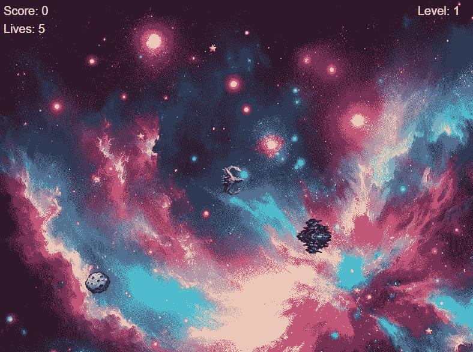
图 6.31 – Space Explorer 游戏

## 成功步骤

1. **创建新分支**：在 *Space Explorer* 游戏的 GitHub 仓库中，创建一个名为 **feature-stellar-graphics** 的新分支。
   该分支将是你添加酷炫太空图像的创意工作坊。
2. **获取图像**：我将为你提供星星、宇宙飞船和障碍物的精美图像。下载这些图像并准备将它们集成到你的游戏中。你可以在三个文件夹中找到它们：
   * 船舶图像：[`github.com/PacktPublishing/GitHub-for-Next-Generation-Coders/blob/main/Space%20Explorer%20Game/Game%20Obsticles%20-%20Ship%20Picture/rocket.png`](https://github.com/PacktPublishing/GitHub-for-Next-Generation-Coders/blob/main/Space%20Explorer%20Game/Game%20Obsticles%20-%20Ship%20Picture/rocket.png)
   * 星星图像：[`github.com/PacktPublishing/GitHub-for-Next-Generation-Coders/blob/main/Space%20Explorer%20Game/Game%20Obsticles%20-%20Stars%20Picture/star.png`](https://github.com/PacktPublishing/GitHub-for-Next-Generation-Coders/blob/main/Space%20Explorer%20Game/Game%20Obsticles%20-%20Stars%20Picture/star.png)
   * 障碍物图像：[`github.com/PacktPublishing/GitHub-for-Next-Generation-Coders/blob/main/Space%20Explorer%20Game/Game%20Obsticles%20-%20Obstacle%20Picture/asteroid.png`](https://github.com/PacktPublishing/GitHub-for-Next-Generation-Coders/blob/main/Space%20Explorer%20Game/Game%20Obsticles%20-%20Obstacle%20Picture/asteroid.png)
3. **集成图像**：用这些新图像替换游戏中现有的占位符或简单图形。调整其大小和位置，使其完美地融入你的宇宙景观中。
4. **提交你的更改**：集成每张图像后，提交你的更改。使用清晰的消息，例如 *添加星星图像* 或 *更新 **宇宙飞船图形***。
   定期提交有助于跟踪你的进度并使处理合并冲突变得更容易。
5. **模拟合并冲突**：为了真正体验解决冲突的感觉，在 **main** 分支中做出可能与你的新图形冲突的更改。例如，更改障碍物的位置或大小。
   然后，尝试将你的 **feature-stellar-graphics** 分支合并到 **main**。
6. **解决任何合并冲突**：如果出现合并冲突，使用你新获得的技能来解决它。决定保留哪些更改，更新文件并完成合并。
7. **最后润色和合并**：一旦一切看起来很棒并且运行顺畅，创建一个 PR 将 **feature-stellar-graphics** 合并到 **main** 分支。
   描述你的增强功能并请求反馈。

## 奖励挑战

为什么止步于此？
尝试为宇宙飞船的推进器添加动画图形或为星星创建闪烁效果。
