## 7 Git 历史记录和回滚提交

欢迎来到 *第 7 章*，在这里，我们即将踏上通过 Git 和 GitHub 指导的编码项目历史的迷人旅程。了解这些工具中历史的工作原理就像拥有触手可及的时间机器，让你有能力重新访问、分析和修改项目的过去。

首先，我们将使用 `git log` 和 `git reflog` 命令浏览历史记录。接下来，我们将学习如何使用 `git bisect` 命令精确定位代码中引入错误的确切时间和位置。然后，我们将掌握回滚提交、重置进度和挑选更改的艺术，以保持项目时间线干净高效。那么，让我们开始这场冒险吧！

本章你将学习以下内容：
* 了解 Git 和 GitHub 历史记录 – 跟踪网站的更改
* 解释 `git bisect` – 在干草堆中找到针
* 将提交回滚到以前的版本
* 用 `git diff` 解开谜团 – 看不见的更改的故事
* 使用 `git reset` 和 cherry-picking 撤销更改

到本章结束时，你将熟练地浏览项目的复杂时间线，确保你的编码历史尽可能顺畅无误。让我们开始这段激动人心的时间之旅吧！

### 了解 Git 和 GitHub 历史记录 – 跟踪网站的更改

GitHub 充当远程仓库，是你的 Git 历史记录在线存储的地方。这意味着它不仅仅在你的电脑上；它在云端，可以从任何地方访问，也可以由你允许的任何人访问。

GitHub 提供了一个可视化且用户友好的界面，你可以在其中查看项目的历史记录。你可以看到谁做了更改、何时做的以及更改了什么。这就像为你的项目拥有一个协作日记，每个人都在其中书写并分享他们故事的一部分。

想象你正在为你的单页作品集网站制作一本剪贴簿。你正在添加页面（例如一个新的 **我的作品集** 部分）、贴上照片并写下笔记。现在，如果你能随时翻阅这本剪贴簿，查看自己随时间所做的所有更改，那不是很棒吗？这正是 Git 和 GitHub 中的历史记录所做的事情！

图 7.1 – 将 Git 和 GitHub 历史解释为项目的剪贴簿

## 在 Git 仓库中本地查看历史记录

每次你在 Git 中进行更改（例如向你的网站添加 **我的作品集** 部分），就如同在剪贴簿中添加新条目并在特定时刻保存快照：

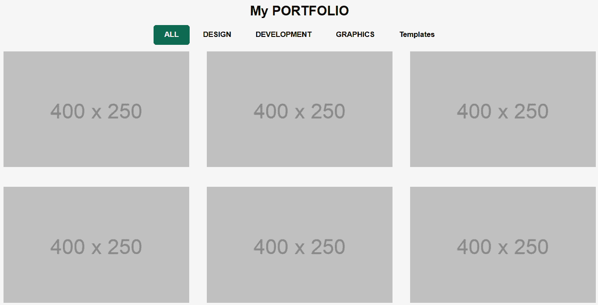
图 7.2 – 我的作品集 部分

### `git log`
要查看此历史记录，你可以使用 `git log` 命令。此命令就像打开你的剪贴簿。它显示所有更改（提交）的列表、谁做的以及何时做的。*图 7.3* 显示了该日志在 Git 中的外观：

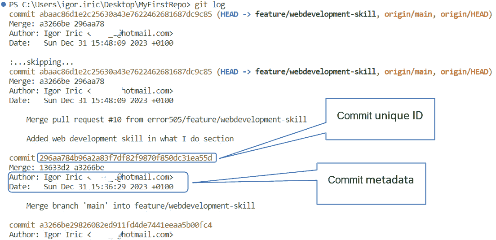
图 7.3 – Git 历史记录

每个快照（提交）都有一个唯一的 ID，就像指纹一样。此 ID 让你能够识别每个提交并将其与其他提交区分开来。 along with each snapshot, you write a message. 这就像解释你做了什么更改以及为什么。好的提交信息就像日记，帮助你（和其他人）了解项目的历史。

### `git log --oneline`
`git log --oneline` 命令也很有用，可用于显示项目的历史。
此命令简化了 `git log` 的输出。 它不会显示完整的提交信息和作者信息，而是以单行显示每个提交，只包含提交的 ID（缩写）和提交信息的标题，如 *图 7.4* 所示。把它想象成项目历史的摘要或 *标题*：

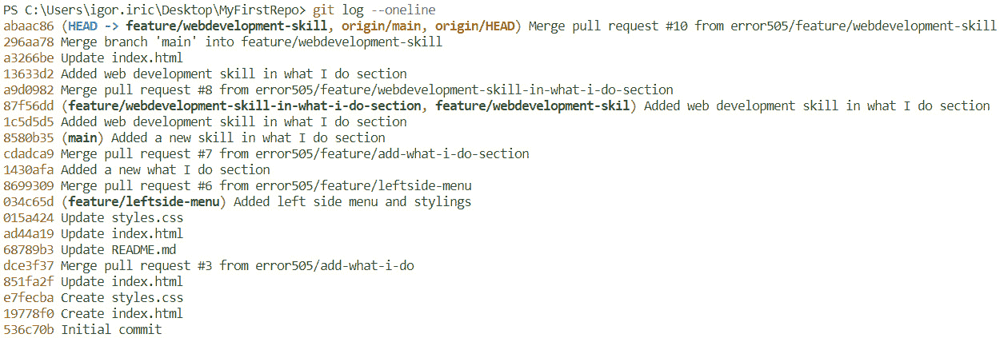
图 7.4 – 运行 git log --oneline 命令的结果

### `git log --oneline --graph`
如果你想要更图形化的 Git 历史视图，可以使用 `git log --oneline --graph` 命令。
此命令在 `--oneline` 的简洁性的基础上，添加了使用 ASCII 图表对提交历史的可视化表示。它有助于查看分支和合并的结构。想象它就像提交的家谱。*图 7.5* 显示了它的外观：

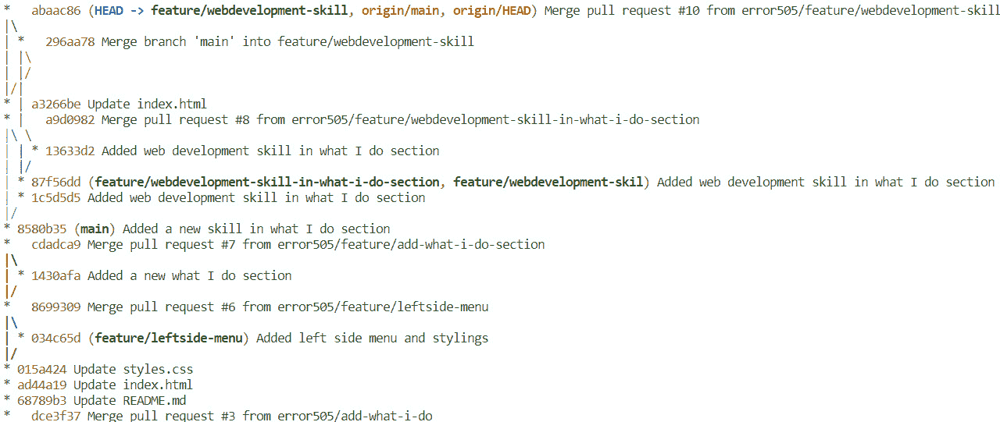
图 7.5 – 运行 git log --oneline --graph 命令的结果

### `git log --oneline --graph --decorate`
`git log --oneline --graph --decorate` 命令很有用，如果你想在历史中看到更多元数据。
此命令在前一个命令的基础上添加了 *装饰*。在 Git 中，装饰是指指向特定提交的引用，例如分支名称、标签或 `HEAD` 请求。使用此命令可以更轻松地查看分支相对于提交的位置。它就像在提交树中为分支贴上标签，以便你知道谁是谁：

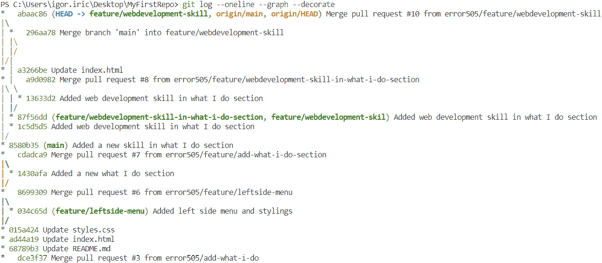
图 7.6 – 运行 git log --oneline --graph --decorate 命令的结果

### `git log --oneline --graph --decorate --all`
通过使用 `git log --oneline --graph --decorate --all` 命令，你可以显示更多元数据。
这是最全面的视图。它显示存储库中所有分支的所有提交，而不仅仅是从当前分支可达的提交。它提供了整个存储库历史的完整概览，包括所有分支和合并。它就像对代码森林的鸟瞰图。*图 7.7* 提供了此视图的快照：

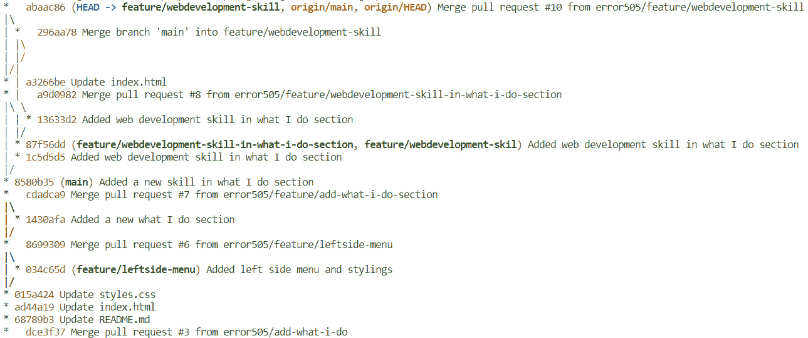
图 7.7 – 运行 git log --oneline --graph --decorate --all 命令的结果

### `git reflog`
最后，`git reflog` 提供了项目的详细历史书。它是一个显示所有最近更改的命令，每个更改都有自己的 SHA 代码。提交历史中的 **SHA 代码** 是一个唯一标识符，充当你对项目所做的每个更改的指纹，确保你在 Git 中工作的完整性和历史记录。当你需要找到项目历史中的特定点以重置或 cherry-pick 时，它很有帮助。你将在下一节 *使用 **cherry-picking** 挑选特定更改* 中了解更多关于 cherry-picking 的内容：

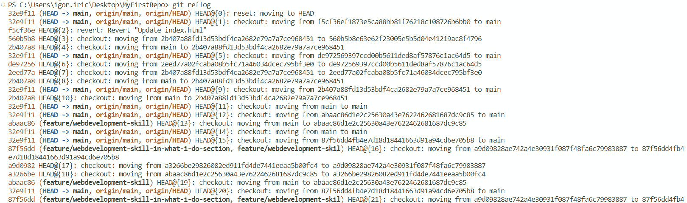
图 7.8 – 运行 git reflog 的结果

使用这些不同的 `git log` 变体，你可以根据当前需求获得合适的详细程度和概览类型，无论是浏览最近的更改还是深入研究项目的完整历史。

## 分支 – Git 历史的平行宇宙

在 Git 中，**分支** 允许你创建平行时间线。就像同时运行着你故事的多个替代版本。你可能有一个 *主* 时间线，其中一切都稳定，还有其他分支用于尝试新想法或功能：

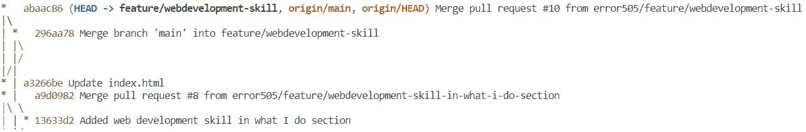
图 7.9 – git log 分支和合并

一旦你在满意的分支中写下了故事的一部分，你就可以将其带入主时间线。此合并过程有时会导致冲突，正如我们在上一章中所见，但它是将故事的不同线索编织在一起的强大方式。

## Activity 页面 – 你仓库旅程的编年史

GitHub 上的 **活动** 页面是一个所有操作和活动都可见的地方，你可以在此观察仓库生活的忙碌景象——从代码更改和讨论到每个团队成员的贡献。

*那么，如何到达那里？* 在 GitHub 上，前往你的网站的存储库并点击 **活动** 链接。这可以在右侧菜单中找到：

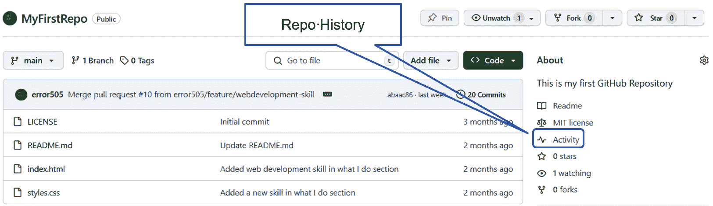
图 7.10 – GitHub 上的历史活动

你也可以点击 **分支**，然后选择特定分支以查看其独特的活动：

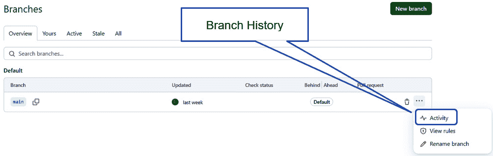
图 7.11 – GitHub 上的历史活动 – 分支

在这里，你会看到所有已进行的更改列表，就像在 Git 中一样，但方式更用户友好。

*但是在活动页面上能找到什么？* **活动** 页面显示了更改的详细历史，包括推送（更新）、合并（合并代码）等。每个更改都链接到特定的提交和做出更改的用户。这可以在 *图 7.12* 中看到：

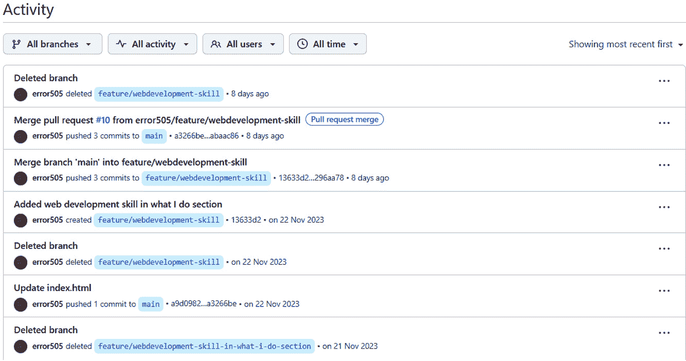
图 7.12 – GitHub 上的活动页面

你可以按分支、用户、时间段或活动类型筛选活动。这有助于你专注于与所需内容最相关的更改。例如，你可能只想查看过去一周内对 *develop* 分支所做的更改：

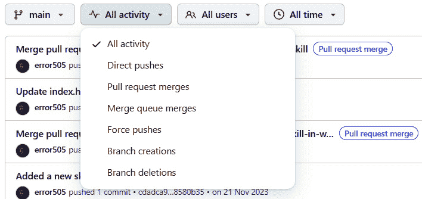
图 7.13 – 活动页面的筛选选项

对于每个活动，你都有查看所做确切更改的选项。点击 **比较更改** 会显示添加、删除或更改的内容，提供每次更新的清晰图景：

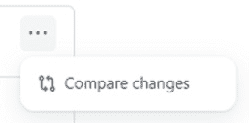
图 7.14 – 比较更改

有趣的是看到你的网站是如何演进的，从第一行代码到最新添加的内容——也就是 **My PORTFOLIO** 部分。如果你与朋友一起工作，你可以看到谁做了什么。

也许你的朋友为 **My PORTFOLIO** 部分添加了一个很酷的设计。如果出现问题，或者你只是好奇，你可以查看整个活动，准确地看到更改了什么以及何时更改。

在 GitHub 上拥有 **Activity** 页面就像拥有整个项目旅程的详细日记，让你和你的团队保持了解、一致和高效。掌握了这些知识，让我们来看另一个重要主题：`git bisect`。

# 解释 `git bisect` – 在干草堆中找针

你正在制作一个单页作品集网站，突然出了问题。网站的某个部分，比如 **My PORTFOLIO**，停止工作或消失了。你不确定问题是什么时候以及如何开始的。你知道它以前存在，但现在不见了。发生了什么？这就是 `git bisect` 派上用场的地方。它就像一场侦探游戏，用来找出项目中何时何地出了问题。

`git bisect` 命令就像一台时光机。它帮助你找到导致问题的项目中的确切更改（提交）。

让我们为单页作品集网站的 **My PORTFOLIO** 部分添加一些代码：

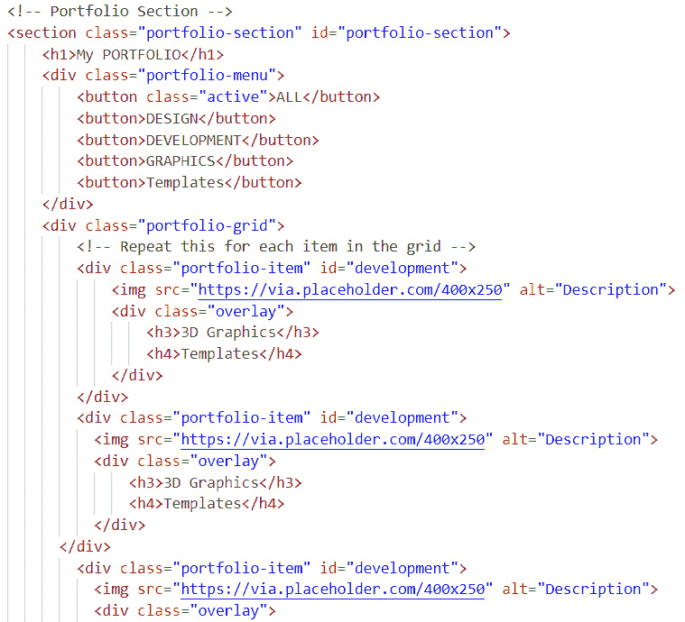 
图 7.15 – 网站的代码添加

现在，让我们为这个新部分添加一些 CSS 样式：

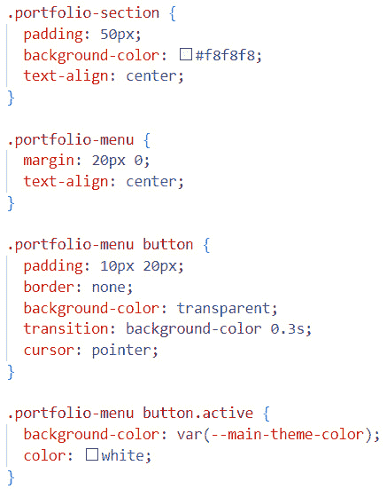 
图 7.16 – 添加到 My PORTFOLIO 部分的代码

该部分其余的 HTML 代码和样式可以在 [`github.com/PacktPublishing/GitHub-for-Next-Generation-Coders/tree/main/Chapter%207`](https://github.com/PacktPublishing/GitHub-for-Next-Generation-Coders/tree/main/Chapter%207) 找到。

## 一个 `git bisect` 谜案 – 缺失 CSS 样式的案件

你的任务：揭开网站 **My PORTFOLIO** 部分缺失 CSS 样式背后的谜团。它是你单页作品集网站的重要组成部分，而现在出了问题。曾经美观的样式部分现在看起来赤裸且未加样式。是时候用 `git bisect` 来解开这个谜团了：

 
图 7.17 – My PORTFOLIO 问题

这就是你开始调查的地方。首先通过输入 `git bisect start` 告诉 Git 你有一个谜团需要解决。这就像打开你的侦探工具箱。

你知道当前状态是坏的，因为 CSS 没有正确应用。你用 `git bisect bad <SHA-of-bad-commit>` 命令将其标记为坏提交。使用 `git log --oneline`，你可以开始查看提交历史，尝试指出坏提交。你知道上次拉取代码时出现了问题，所以你把最后一次提交作为坏的提交：

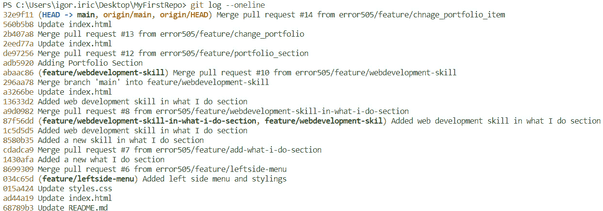 
图 7.18 – git bisect 日志

然后，你回忆起一个所有东西看起来都很完美且 CSS 恰到好处的提交。你通过运行 `git bisect good <SHA-of-good-commit>` 将其标记为好提交：

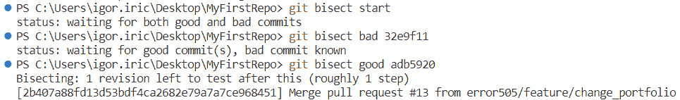 
图 7.19 – git bisect – 好与坏

就像一位值得信赖的助手，Git 将你传送到介于好与坏之间的一个提交。这就是你的第一个检查点，也可能成为犯罪现场。

是时候检查了。你打开 HTML 文件。这里的 **My PORTFOLIO** 部分好吗？如果它仍然显示不正确，那就是 *bad* 提交。如果样式正确，那么就是 *good*。

你可以根据发现的情况输入 `git bisect bad` 或 `git bisect good`。在我们的例子中，我们发现 **My PORTFOLIO** 部分仍然没有实现。

所以，继续输入 `git bisect bad`：

 
图 7.20 – git bisect bad

每次回应都有助于 Git 排除剩余嫌疑人的一半。这就像一场高风险的 *Guess Who?* 游戏。在这里，Git 将你带到另一个提交。经过几次回合，你到达了一个提交，在那里你看到类名第一次更改并导致 **My PORTFOLIO** 部分看起来很糟糕。“*Aha!*”，你惊呼道。这就是一切出错的地方：

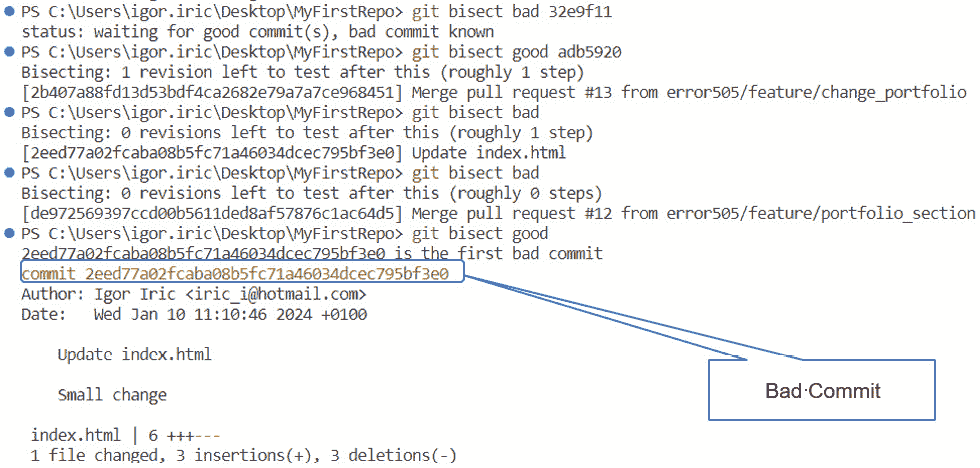 
图 7.21 – git bisect 找到一个坏提交

Git  triumphantly 宣布了第一个坏提交。你找到了罪魁祸首。提交信息透露了开发者的名字和时间戳，即不当行为的确切时刻。通过查看你的 index 页面 HTML，你发现 **My PORTFOLIO** 部分的类名已更改为 `portfolio-sections`，并且它不再匹配 CSS 样式。

你用 `git bisect reset` 结束调查，回到现在。谜团已经解开，但还有工作要做。是时候纠正那个类名并恢复 **My PORTFOLIO** 部分的秩序了。

一旦你修复了这些问题，你会发现你的 **My PORTFOLIO** 部分又看起来不错了，如 *图 7.22* 所示：

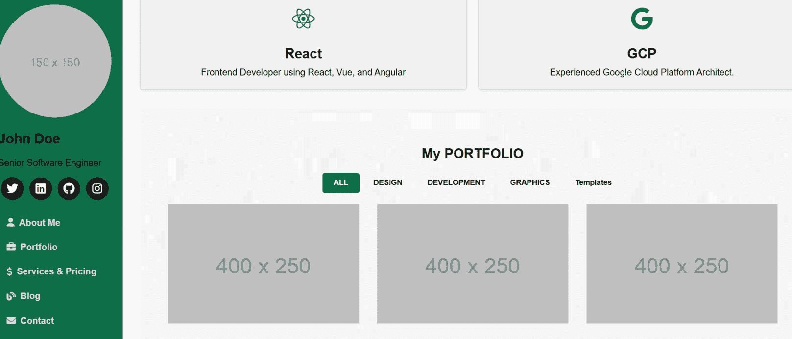 
图 7.22 – 修复坏代码

不仅你解开了谜团，而且你还掌握了开发者工具箱中的一个强大工具。**My PORTFOLIO** 部分再次闪耀，完全归功于你的侦探技巧和 `git bisect`。

## 使用 `git bisect` 的简便方法 – 让 Git 做侦探工作

你可以在一开始就用 `git bisect start <bad-SHA> <good-SHA>` 命令同时告诉 Git 坏提交和好提交。

你可以使用 `git bisect run ls index.html` 命令来自动化测试。Git 将使用它来检查每个提交。

如果 `index.html` 文件已更改，脚本将以 **0** 代码退出（一切正常）。如果没有，它将以 **1** 到 **127** 之间的代码退出（发现问题）：

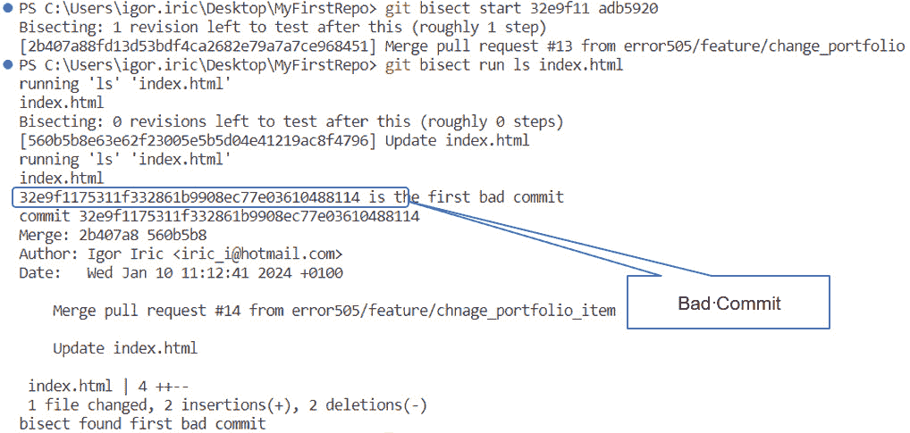 
图 7.23 – git bisect 找到一个坏提交

一旦 Git 找到第一个坏提交，就用 `git bisect reset` 重置一切。

而不是手动检查每一个更改，`git bisect` 快速识别问题。它找到导致问题的确切更改，当你处理大量代码和更新时，这非常有帮助。

使用 `git bisect` 就像带着时光机的侦探。对于你的作品集网站来说，这是一种快速找出问题何时开始并修复它的方法，确保你的网站始终展示你的最佳作品！接下来，让我们学习另一个很酷的功能。

# 回滚提交到以前的版本

想象自己是一个拥有秘密力量的程序员：能够在项目中穿越时空。你的任务：使用神奇的 `git revert` 来撤销 `portfolio-section` 命名错误造成的失误。这就像为你的代码提供了一个大范围的 *Ctrl* + *Z*，让你可以撤销错误并恢复到一切正常工作的状态：

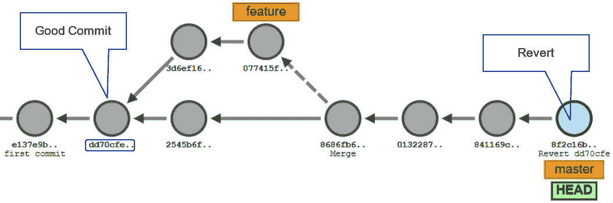 
图 7.24 – git revert

你最近与 `git bisect` 的冒险让你找到了类名被错误更改的确切时刻。现在，你决定使用 `git revert` 来倒回历史并纠正这个错误。

你与 `git bisect` 的侦探工作取得了回报。你拥有了提交 ID，在错误引入之前，一切都是最后完美的状态。

在你的终端——时光机的入口——输入 `git revert <SHA-of-bad-commit>`。

这个命令就像在时光机中设置坐标，精确指向你想要撤销的时刻：

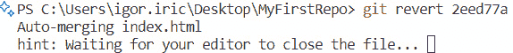 
图 7.25 – git revert SHA 提交

当你按下 `Enter` 时，`Git` 开始施展它的魔力。它不会删除那个错误的提交；相反，它会创建一个新的提交。这个新提交是错误的提交的镜像相反，有效地撤销了该更改：

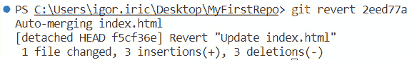

图 7.26 – git revert 完成

就像在小说中添加一个反段落来抵消你不喜欢的段落。如果在当前状态与你试图恢复的过去之间存在冲突，`Git` 会要求你解决它们。如果没有冲突，它会打开一个文本编辑器，在那里你可以更改提交信息：

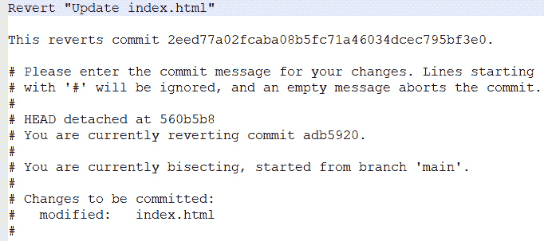

图 7.27 – Git 提交信息

解决后，你通过一次提交完成回退。这就像你在时光旅行日志簿中的笔记。回退完成后，你的代码现在就像过去的美好时光一样 – `portfolio-section` 回到了它原本的光辉。

你检查项目，一切看起来都和你记忆中一样，CSS 样式也完美就位：

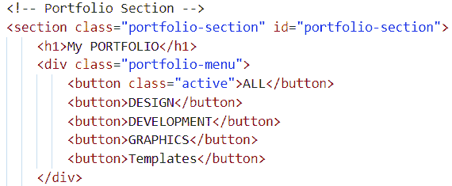

图 7.28 – Git 将代码恢复到之前的状态

你刚刚做了一件不可思议的事！你在不改变通往现在的旅程的情况下改变了过去。

`git revert` 的强大之处在于它能在保持历史完整的同时撤销操作。就像拥有一个安全网，确保无论项目进行到多远，你都可以随时回去修正错误。

你不仅修复了一个错误，还掌握了编程工具箱中一项至关重要的技能。`Git` 中的每个命令都像是一道咒语，让你掌控项目历史的脉络。有了 `git revert`，你亲身体验了编程中负责任的时光旅行的力量。

现在你已经掌握了 `git revert` 在不重写历史的情况下修复错误的能力，让我们继续探索 `git diff` 的强大功能，它可以帮助你查找代码之间的差异。

# 用 git diff 解开谜团——看不见的变更的故事

你在制作你的单页作品集网站，并且刚刚添加了一个名为 **My PORTFOLIO** 的新部分。现在，你好奇想看看与上一个版本相比你做了哪些更改。在 `Git` 的世界里，这就是 `diff` 命令发挥作用的地方。它就像一副放大镜，可以帮你发现 **My PORTFOLIO** 部分中旧网站和新网站之间的差异。

## diff 命令是什么？

`Git` 中的 `diff` 命令会显示你当前代码与上一次提交版本之间的差异。就像比较房间装修前后的两张照片，以确切地看到有什么变化。

命令行是你用来调查单页作品集网站更改的地方。确保你在电脑上位于网站项目的目录（文件夹）中。

输入 `git diff` 并按下 `Enter`。该命令要求 `Git` 显示你上次保存（提交）的版本与现在之间的差异。

你会看到一份更改列表：新增的行会用加号 (`+`) 标记，删除的行会有减号 (`-`)。输出结果乍一看可能有点 confusing，但它准确地显示了不同之处。

例如，如果你在 **My PORTFOLIO** 部分添加了一段关于你技能的新段落，`git diff` 会用加号显示这段新段落，如图 7.29 所示：

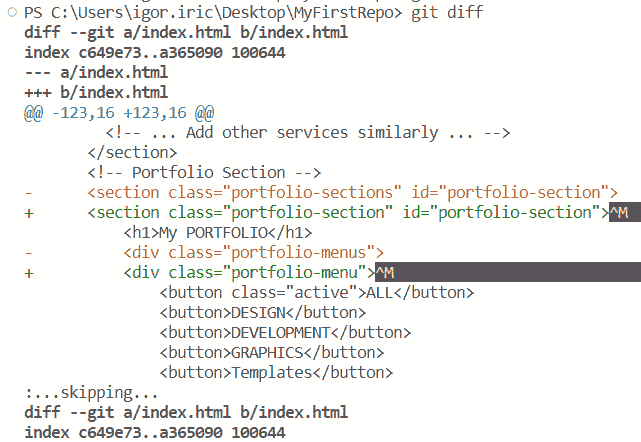

图 7.29 – 运行 git diff 命令的结果

## 其他 diff 命令

现在，让我们学习一些其他 `diff` 命令，它们可以帮助你辨别代码两个版本之间的差异：

* `git diff --staged`：该命令显示你已暂存（添加到下一次提交）但尚未提交的更改。就像查看你为旅行打包的物品清单，但还没有放进行李箱一样：

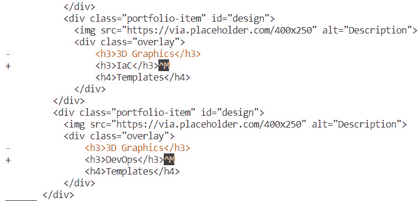

图 7.30 – 运行 git diff --staged 命令的结果

* `git diff HEAD`：显示自上次提交以来工作目录中的所有更改，无论是否已暂存。`HEAD` 指当前分支上的最新提交。就像退一步看看自上次打扫房间以来你在房间里做的所有更改。

* `git diff <REF-1> <REF-2>`：如果你想用两个引用（如提交 ID 或分支名称）将当前网站与旧版本进行比较，可以使用此命令。例如，`git diff main my-portfolio` 比较名为 `main` 的分支与名为 `my-portfolio` 的分支：

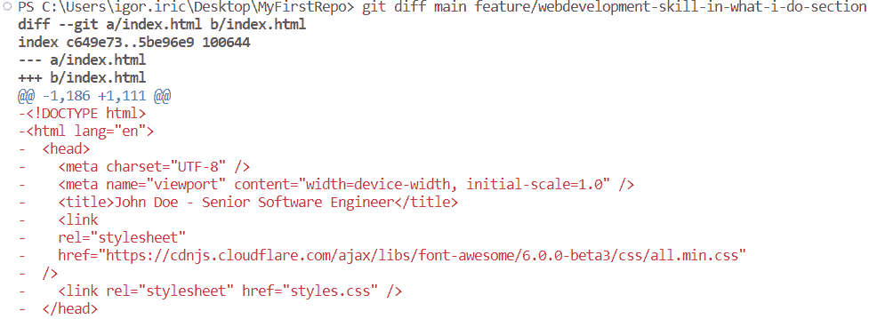

图 7.31 – 运行 git diff <REF-1> <REF-2> 命令的结果

* `git diff origin/main main`：该命令比较本地和远程分支，让你看到本地 `main` 分支与 GitHub（远程）上的 `main` 分支之间的差异。就像比较你手上的房屋蓝图（本地）和你发给建筑师的蓝图（远程）一样。

或者，假设你想比较特定的提交。有时，你想比较项目历史中两个特定点的差异。你可以使用它们的提交 ID（那些长字母数字代码）来查看这两个点之间发生了什么变化。

`git diff` 命令的每个变体都提供了一种独特的方式来检查单页作品集网站中的更改。无论你是在查看最近的编辑、为下一次大更新做准备，还是比较不同版本，这些命令都能帮助你掌握项目演变的脉络。你不仅揭开了代码中隐藏的谜团，还对项目的演变有了更深入的理解。

现在我们已经探索了如何使用 `git diff` 发现项目中的差异，让我们转换一下思路。接下来，我们将介绍如何使用 `git reset` 和 cherry-picking 回退并调整这些更改，甚至挑选出最好的更改。这是为了微调你的项目，确保每个新增内容都能完美融入网站的整体构图。

# 使用 git reset 和 cherry-picking 撤销更改

想象一下，你正在为单页网站添加 **My PORTFOLIO** 部分，但你意识到需要撤销一些更改或从项目历史中挑选特定更改。这时 `Git` 的 `reset` 和 `cherry-pick` 功能就派上用场了。它就像一台时光机，将你的项目带回到某些更改之前的一个特定历史点。

## git reset 的类型

有三种不同的 `git reset`。我们将全部解释：

* `Soft reset`：`git reset --soft` 命令将项目回退，但保留最近的更改在暂存区（就像保留未保存的工作）。之后你可以选择重新提交。

* `Mixed reset`：`git reset --mixed <SHA>` 命令是默认的重置。它将项目移回之前的状态（状态由一个称为 `SHA` 的唯一代码标识），并将更改放在工作目录中，未保存。你可以随后决定保留什么、丢弃什么。

* `Hard reset`：`git reset --hard <SHA>` 命令是完全回滚。它将项目带回之前的状态，并永久删除此点之后所做的所有更改。就像按下重置按钮并丢失未保存的更改一样。

## 使用 cherry-picking 挑选特定更改

想象一下翻阅相册并挑选出特定的照片。`Git` 中的 cherry-picking 让你可以从项目历史中选择特定更改并将其应用到当前版本。你可以通过运行 `git cherry-pick <SHA>` 使用想要应用的更改的唯一 `SHA` 代码。

让我们快速解释 Git 中 **cherry-picking** 的概念。它是一种用于跟踪文件更改并在多人之间协调工作的版本控制系统。图 7.32 进一步演示了这一点：

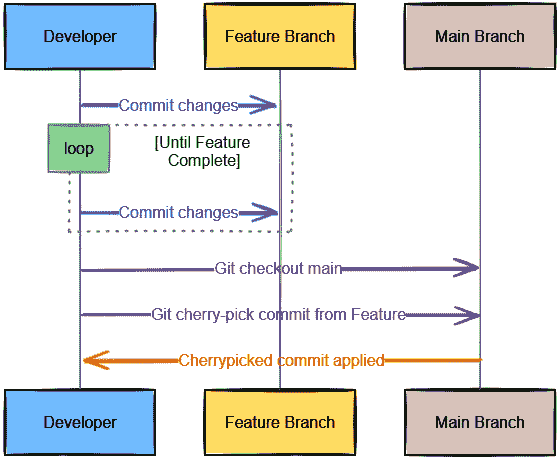

图 7.32 – Git cherry-picking

让我们详细解读前一幅图中显示的术语：

* **feature branch** 就像拥有一个单独的工作区或草稿本，开发者在其中绘制或编写新内容——在本例中，是您的一页式作品集网站的新功能。
* **main branch** 是每个人都能看到的网站最终稿。它是经过润色的版本，其中展示了所有完全完成的功能。

事件序列如下：

1. 开发者在其 feature branch 中工作，进行更改（称为 **commits**）。每个 commit 就像保存您网站设计的一个新版本。随着开发者进行更多更改，他们会保存更多 commits。他们处于一个 **loop** 中，不断进行更改并保存 commits，直到功能完成。
2. 在某个时候，开发者或其团队决定将 feature branch 中的一个特定更改（单个 commit）准备好添加到 main branch。
3. 开发者使用 `git switch main` 命令切换到 main branch。这就像说，“*好吧，让我们去 **最终稿。***”
4. 然后，他们使用 `git cherry-pick` 命令并指定来自 feature branch 的特定 commit。这就像说，“*让我们从我的草稿本中取出这个好主意并放入 **最终稿。***”
5. 被 cherry-pick 的 commit 应用到 main branch。这就像把草稿本上的贴纸粘到最终稿上。
6. main branch 现在有了新的更改，而 feature branch 仍然存在，其中包含所有可能仍在进行中的其他更改。

*loop* 表示开发过程是迭代的。开发者经常进行许多更改，并且可以在任何时候 cherry-pick 其中任何更改以添加到 main branch。

Cherry-picking 可用于从一系列 commits 中快速包含特定的修复或功能，而无需合并 feature branch 中的所有更改。这对于管理哪些内容准备好包含在您网站的 main branch 中非常有用。

## 摘要

恭喜您完成 *第 7 章*！您刚刚经历了 Git 中最强大的方面之一，学习如何控制和导航编码项目的历史。让我们花点时间回顾一下您掌握的关键技能和概念。

以下是您所取得的成果回顾。

* **理解 Git 的历史**：您深入研究了 `git log`，探索了查看项目时间线的各种方式。您已看到 `git log --oneline`、`git log --graph` 和 `git log --decorate` 如何将项目历史的理解从简单的列表转变为详细而信息丰富的地图。
* **git bisect – 侦探工具**：`git bisect` 命令成为您的侦探工具，帮助您高效地追踪引入 bug 的确切 commit。
* **回滚和重置**：您已学习使用 `git revert` 和 `git reset` 撤销更改的艺术。
* **使用 diff 探索更改**：`diff` 命令提供了在 commits、分支和工作目录之间比较更改的新方法。您获得了在细粒度级别上发现差异的能力，从而增强了对每次修改的洞察。
* **Cherry-picking – 选择性集成**：Cherry-picking 教会您从不同分支选择性地集成更改。

当您结束本章时，请记住您获得的技能不仅仅是管理代码——它们是关于管理时间和变化。

下一章将打开一座宝库的工具和命令，提升您的 Git 和 GitHub 体验。我们将涵盖一系列重要主题，例如 Sourcetree、GitHub Codespaces、GitHub Desktop、Visual Studio Code 和 DevHub 通知。

## 测验

请回答以下问题：

1. `git log` 在 Git 中做什么？
   1. 删除旧提交
   2. 显示提交历史
   3. 修改最新提交
   4. 创建新分支
   *Answer*: B. 显示提交历史。

2. 真或假：`git reflog` 命令可用于查看存储库中进行的操作（例如提交和合并）的列表。
   1. 真
   2. 假
   *Answer*: A. 真。

3. `git` ________ 是一个工具，通过自动测试提交来查找引入 bug 的提交。
   *Answer*: `bisect`.

4. 在 Git 中回滚提交的目的是什么？
   *Answer*: 回滚提交用于撤销特定提交所做的更改，将项目恢复到之前的状态，而不改变项目的历史记录。

5. `git diff` 命令显示什么？
   1. 分支之间的差异
   2. 提交之间的差异
   3. 工作目录中的当前更改
   4. 以上全部
   *Answer*: D. 以上全部。

6. 真或假：一旦提交被回滚，它就完全从项目的历史记录中删除。
   1. 真
   2. 假
   *Answer*: B. 假（提交仍在历史记录中，但其更改已被撤销）。

7. Git 中的 cherry-picking 是什么？
   1. 删除特定提交
   2. 从一个分支选择并应用特定提交到另一个分支
   3. 创建新存储库
   4. 重命名分支
   *Answer*: B. 从一个分支选择并应用特定提交到另一个分支。

8. 要撤销提交所做的更改并保留这些更改在工作目录中，您将使用 `git reset --`______。
   *Answer*: `soft`.

9. 真或假：`git bisect` 命令会自动修复它在代码中找到的 bug。
   1. 真
   2. 假
   *Answer*: B. 假（它有助于识别有问题的提交，但不会修复 bug）。

10. `git reset` 和 `git revert` 的主要区别是什么？
    *Answer*: `git reset` 命令用于通过将当前分支移动到特定提交来撤销更改，可能改变项目的历史记录，而 `git revert` 创建一个新的提交来撤销之前提交的更改，而不改变项目的历史记录。

## 增强挑战 – Space Explorer 启动屏幕、分数跟踪和掌握 Git 命令

在练习用于回滚、重置和 cherry-picking 的高级 Git 命令的同时，在 *Space Explorer* 中实现启动屏幕和分数跟踪：

图 7.33 – Space Explorer 启动屏幕

* 这里是您更新的成功步骤 **：
1. **初始设置**：与之前一样，创建一个新分支 (**feature-splash-and-score**) 并开始实现启动屏幕和分数跟踪。
2. **故意“错误”**：在初始实现之后，在代码中做一些故意的“错误”或次优更改。提交这些更改。
3. **使用 git revert**：找出您犯的一个故意错误并使用 `git revert` 撤销该特定提交。这将帮助您了解如何回退已记录在 Git 历史记录中的更改。
4. **尝试 git reset**：对于另一个错误，使用 `git reset` 撤销更改。您可以尝试使用 `git reset --soft` 或 `git reset --hard`（请注意 `--hard` 会永久删除您的更改），以了解它们在处理项目历史记录方面的差异。
5. **Cherry-pick 一个功能**：创建一个新分支（例如，**additional-feature**）并为启动屏幕或计分系统添加一个小但明显的新的功能或增强。

提交后，切换回你的 `feature-splash-and-score` 分支，并使用 `git cherry-pick` 从 `additional-feature` 选择性地将新功能应用到你的主工作分支。

### 6. 最终测试和合并
彻底测试所有功能，包括启动画面功能和分数追踪，以确保一切无缝运行。
如果在合并到主分支时出现合并冲突，请使用你新获得的技能解决它们。

### 7. 反思与文档
1. 在 README 文件或提交信息中记录你的流程和挑战。
2. 反思使用这些 Git 命令如何帮助了你的开发流程。

你可以在以下链接下载代码：[`github.com/PacktPublishing/GitHub-for-Next-Generation-Coders/tree/main/Space%20Explorer%20Game/Game%20Obsticles%20-%20Splash%20screen%20and%20player%20name`](https://github.com/PacktPublishing/GitHub-for-Next-Generation-Coders/tree/main/Space%20Explorer%20Game/Game%20Obsticles%20-%20Splash%20screen%20and%20player%20name)。

## 8 有用的工具和 Git 命令

## 有用的工具和 Git 命令
欢迎来到第 8 章，我们将深入 Git 和 GitHub 的世界，为你的单页作品集网站解锁新的效率和协作水平。你已经学习了基础知识，现在是时候发挥一些强大工具和命令的全部潜力了。
在本章中，我们将学习有用的 Git 命令，它们可以创建快捷方式、追踪文件的演变、重新排列提交并执行更多此类任务。然后我们将介绍 Sourcetree 以及它如何将 Git 的复杂性转变为项目旅程的可视化地图。我们将学习如何使用 Codespaces 在任何地方编码，使用 GitHub Desktop 管理存储库，并设置 DevHub，一个个人桌面助手，让你随时了解 GitHub 项目中的所有活动。
这里是我们将探索内容的预览：
* 打造快捷方式并保持整洁 – 高级 Git 命令
* 使用 Sourcetree 简化你的网站工作
* 使用 GitHub Desktop 导航你的网站项目
* 使用 GitHub Codespaces 打造你的网站
* 使用 DevHub 管理你的项目的动态

### 打造快捷方式并保持整洁 – 高级 Git 命令
在构建网站时，你可能会发现自己重复使用一些冗长的 Git 命令。拥有快捷方式不是更容易吗？或者只需一个命令就能清理不必要的文件？本节将介绍一些可以做到这一点甚至更多的高级命令。
在你的单页作品集网站上工作有时会感觉像在杂耍。你有想尝试的新想法，你正在修复错误，同时还要跟踪所有更改。以下是一些 Git 命令，它们就像巧妙的工具，帮助你更高效地杂耍。
* 使用 git alias 创建自己的快捷方式：使用 `git config --global alias.[alias_name] [git_command]` 为你经常使用的命令创建快捷方式。例如，如果你经常检查状态，可以设置一个别名，例如 `git config --global alias.st status`。
现在，不必每次都输入 `git status`，你只需输入 `git st`：
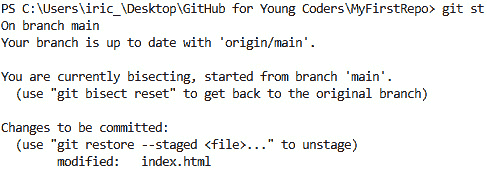
图 8.1 – Git 别名状态
* 使用 git log follow 跨更改追踪文件历史：当你想查看特定文件随时间所做的更改时，使用 `git log --follow [file]`。它就像为你网站代码的某一部分提供详细的 timeline。
例如，让我们查看 `index.html` 文件的日志并输入 `git log --follow index.html`。你将得到 `index.html` 文件的详细历史，如图 8.2 所示：
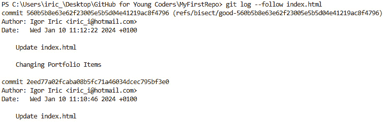
图 8.2 – git log follow
* 使用 git rebase 重新排列你的工作：`git rebase [branch]` 命令允许你将一系列提交移动或合并到新的基础提交。它有点像重新排列你网站故事中的页面，以使叙述更流畅。
* 使用 git clean 清理未跟踪文件：要从工作目录中删除未跟踪文件，`git clean -fd` 是你的首选命令。把它想象成通过删除所有未进入你网站的纸屑和未使用的草图来保持工作空间整洁。
* 使用 git stash 保存进行中的工作：想象一下，你正在为网站制作新设计，突然有人要求你添加新功能。你需要一种快速隐藏设计并清理本地仓库而不丢失已完成工作的方法。`git stash` 就像那个保存选项；它会获取所有更改并暂时隐藏它们，让你拥有一个干净的工作目录。
* 使用 git stash pop 恢复已暂存的更改：在功能实现后你想回到设计时，`git stash pop` 会移除覆盖层并恢复你的工作。它就像揭开你的 CSS 设计和图像，立即回到你离开的地方。
* 使用 git tag 标记里程碑：当你在网站开发中达到重要节点，例如完成关于部分时，你可能想标记它。`git tag [tagname]` 就像在时间线上那个点上贴一张便签，以便以后能轻松找到它。
* 使用 git blame 找出谁做了更改：如果注意到网站上的某些内容发生了变化而你不确定是谁做的，`git blame [file]` 会显示每个文件行最后由谁编辑以及何时编辑。它就像做侦探工作来弄清楚谁移动或删除了你的设计。
例如，让我们尝试 `index.html` 文件看看会得到什么结果。输入 `git blame index.html` 后，你将看到整个文件以及每一行和做出增添或更改的人员姓名：
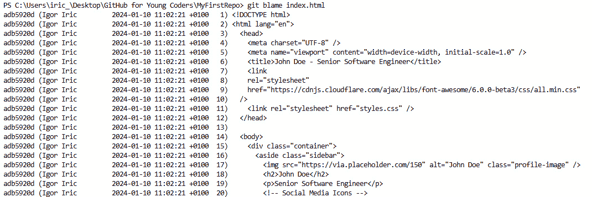
图 8.3 – git blame 结果
* 使用 git fetch --all 从所有分支获取更新：`git fetch --all` 命令就像检查所有邮箱是否有消息。它获取 GitHub 仓库中所有分支的最新更新，而不会将它们合并到你的工作中。你可以在决定将什么合并到自己的分支之前，查看其他人都在做什么。
* 使用 git remote 检查你的远程仓库：要查看你对仓库其他版本的远程连接列表，`git remote -v` 就像拥有一本地址簿。它显示了你可以推送更改或获取的位置。
这些高级命令为管理你的网站项目提供了更大的灵活性和效率。它们就像在你的工作坊中拥有一套电动工具，使你的工作更整洁，你的努力更高效。
它们确保你可以保存工作、跟踪贡献、标记重要里程碑并随时了解每个人的工作。
一切都是为了让你的网站开发过程尽可能顺畅无压力！在下一节中，我们将学习更多可以帮助我们管理 Git 和仓库的工具。

### 使用 Sourcetree 简化你的网站工作
在你创建单页作品集网站时，而不是使用命令行 Git 命令手动处理所有更新和更改，你有一个工具可以直观地为你展示一切。该工具是 Atlassian 的 Sourcetree。
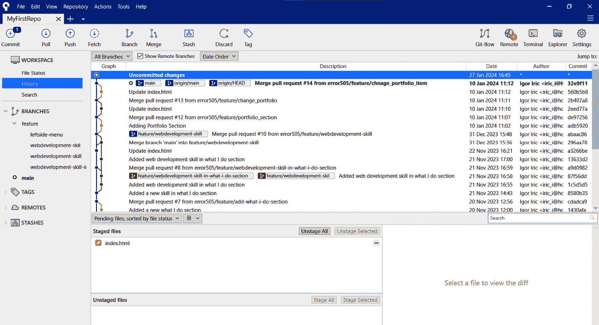
图 8.4 – Sourcetree

#### 为什么应该使用 Sourcetree？
Sourcetree 以易于理解的方式呈现你的项目。它就像拥有你所有工作的地图，从大局到细节。
如果输入 Git 命令感觉像在外语中点咖啡，Sourcetree 就像有一位友好的咖啡师知道你的常规订单。只需指向并点击即可。

# Sourcetree

在提交之前，你可以在 Sourcetree 中预览更改，确保你清楚正在更新的内容。Sourcetree 还能轻松查看谁在做什么，让团队协作变得轻松自如。

由于所有操作都直观清晰，出错的空间更小。你不太可能意外合并错误分支或提交错误文件。

Sourcetree 可以将复杂的 Git 命令网络转变为视觉上可管理的流程，非常适合专注于构建精美的单页作品集网站，而不会陷入命令行语法的困扰。它是一个工具，可以让管理项目的开发像在可视化编辑器中编辑网站设计一样简单直观。

## 使用 Sourcetree 入门

首先，你需要下载并安装它。你可以前往 Sourcetree 网站（[`www.sourcetreeapp.com/`](https://www.sourcetreeapp.com/)）下载应用程序，然后下载应用。安装过程就像在电脑上设置任何其他软件一样简单。

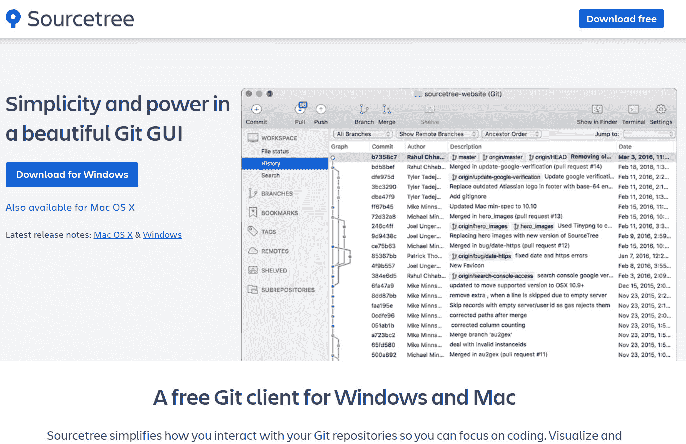
图 8.5 – 下载 Sourcetree

## 连接你的仓库

一旦 Sourcetree 运行起来，你就可以将其连接到你的 GitHub 账户，该账户存放着你的网站仓库。这就像告诉你的导航应用你想去哪里。

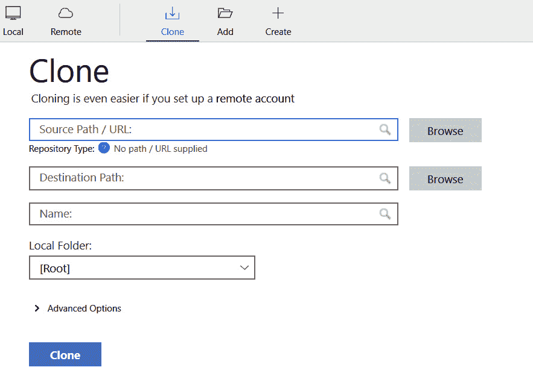
图 8.6 – 使用 Sourcetree 设置你的仓库

## 查看你的项目时间线

设置好仓库后，Sourcetree 会显示你的项目历史。每个提交、分支和标签都以交互式时间线显示。这就像拥有你网站开发的故事板。

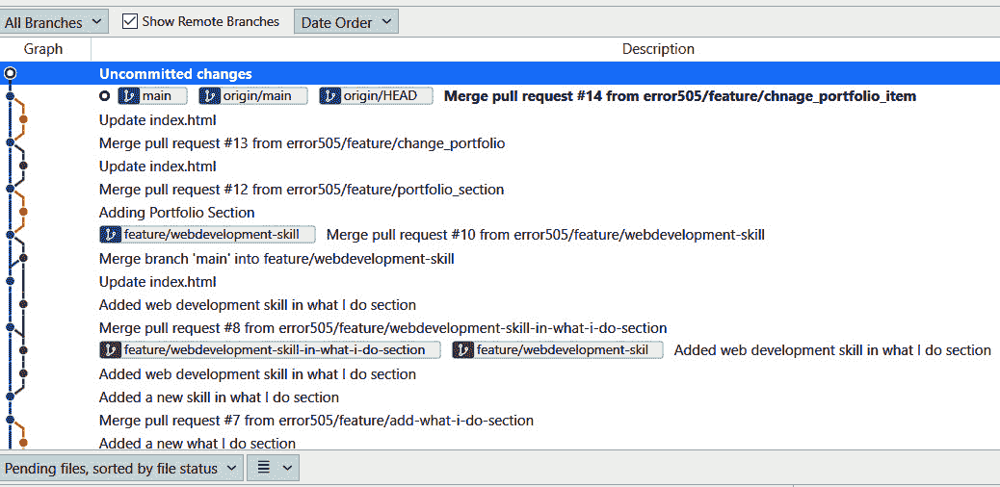
图 8.7 – Sourcetree 仓库历史

## 创建、合并和切换分支

想在新功能上工作或修复 bug 吗？执行 `create`、`merge` 和 `switch` 分支流程的选项很容易找到，如图 8.8 所示。

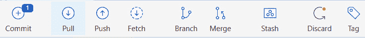
图 8.8 – Sourcetree 快速命令

在 Sourcetree 中，你可以通过点击 `Branch` 按钮创建新分支，如图 8.9 所示。

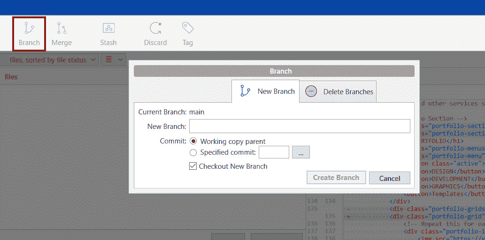
图 8.9 – 在 Sourcetree 中创建新分支

合并它们同样简单，只需右键点击你想要合并到当前分支的分支即可，如图 8.10 所示。

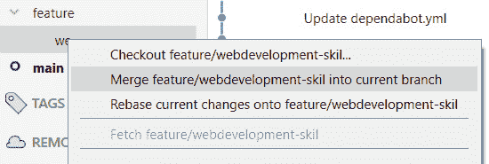
图 8.10 – 将目标分支合并到当前分支

在分支之间切换就像切换电视频道一样简单；你只需双击想要切换的分支即可。就这么简单。

## 暂存和提交更改

当你对网站进行更改时，例如添加新部分或更新图片，Sourcetree 帮助你以简单的方式组织这些更改。想象一下你在寄出前将物品分类放入盒子。Sourcetree 显示你所做的所有更改，允许你选择（或 `stage`）准备保留的更改。一旦你挑选了想要发送的所有项目，点击 Sourcetree 中的 `Commit` 按钮就像封箱并寄出一样。此操作会轻松高效地用你的最新更改更新项目。

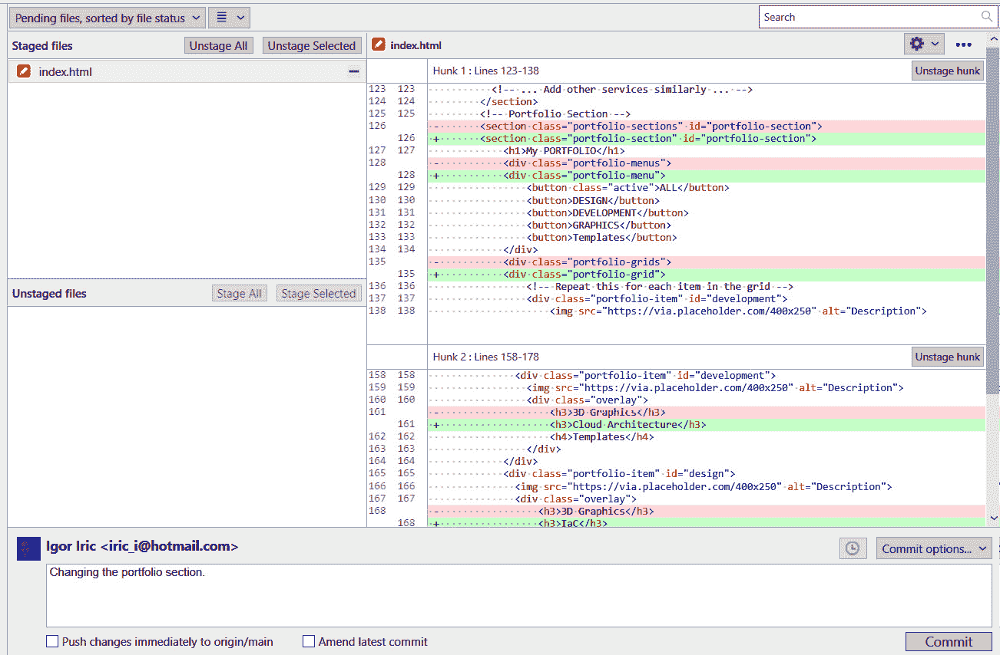
图 8.11 – Sourcetree 暂存和提交更改

## Pull、Fetch 和 Push

需要用他人的更改更新本地仓库？或将你的更新发送给团队？Sourcetree 将这些操作变成简单的按钮点击。

Sourcetree 中的 `Pull` 按钮执行的操作与在 Git Bash 中执行 `git pull` 命令相同，会用远程更改更新你的本地仓库。同样，`Push` 按钮自动化了 `git push` 命令，将你的本地更新发送到远程仓库。对于在不合并到本地分支的情况下检索更新，Sourcetree 中的 `Fetch` 按钮映射了 `git fetch` 命令，让你先查看有什么新内容，然后再决定是否集成这些更改。

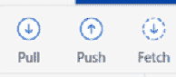
图 8.12 – Sourcetree Pull、Push 和 Fetch 按钮

现在你已经了解 Sourcetree 如何通过其可视化界面和直接控制简化管理你的单页作品集网站，让我们继续。接下来，我们将查看 GitHub Desktop，另一个旨在让导航项目开发更轻松的工具。

# 使用 GitHub Desktop 导航你的网站项目

花点时间想象一下你有一个单页作品集网站项目的遥控器。这可不是普通的遥控器；它让你能够像翻阅电视频道一样管理所有更新、更改和协作。这就是 GitHub Desktop 的感觉。

**GitHub Desktop** 就像 Git 世界中的友好向导。它去除了命令行复杂性，提供了一个干净、有组织的桌面应用程序，让你可以轻松管理项目。

## 设置 GitHub Desktop

访问 GitHub Desktop 网站（[`desktop.github.com/`](https://github.com/PacktPublishing/GitHub-for-Next-Generation-Coders/tree/main/Space%20Explorer%20Game/Game%20Obsticles%20-%20Game%20Over%20screen)）并下载应用。你可以像在电脑上安装任何新应用一样安装它。然后，按照以下步骤操作：

1. **连接到你的 GitHub 仓库**：安装后，打开 GitHub Desktop 并使用你的 GitHub 账户登录。这就像在新设备上登录你的电子邮件。

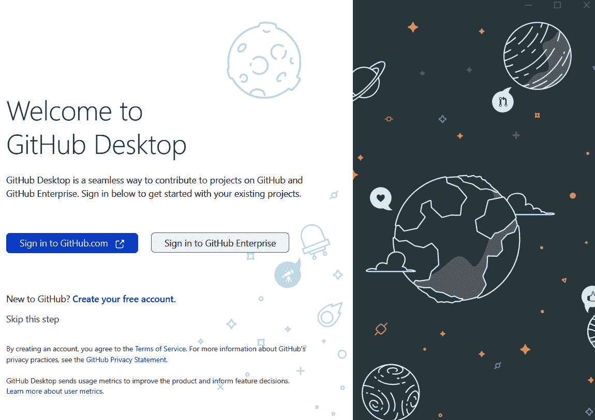
图 8.13 – 将 GitHub Desktop 与你的 GitHub 连接

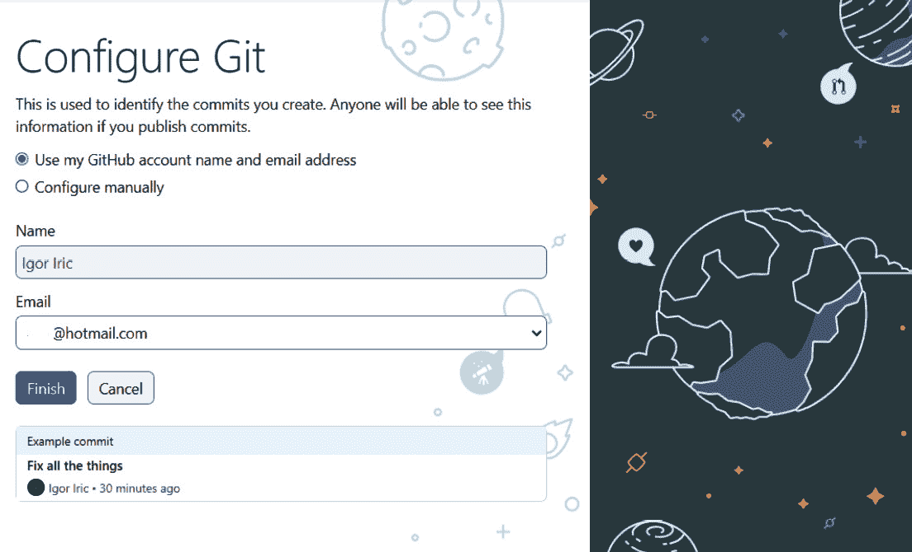
图 8.14 – 使用你的 Git 凭据配置 GitHub Desktop

1. **克隆你的仓库**：找到 **Clone a repository** 选项并选择你的单页作品集网站。这将在你的本地机器上创建项目的副本，就像保存文档以便离线工作一样。

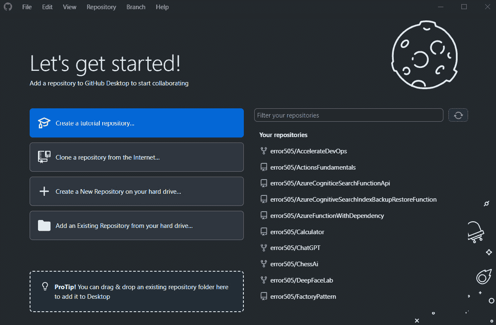
图 8.15 – 使用 GitHub Desktop 选择用于克隆的仓库

## 你可以用 GitHub Desktop 做什么？

GitHub Desktop 提供了众多功能。让我们看看其中一些：

* **检查你的更改**：你是否对网站进行了一些更新？GitHub Desktop 显示你更改的文件列表以及每个文件中的具体差异。这就像在 Word 文档中跟踪更改。

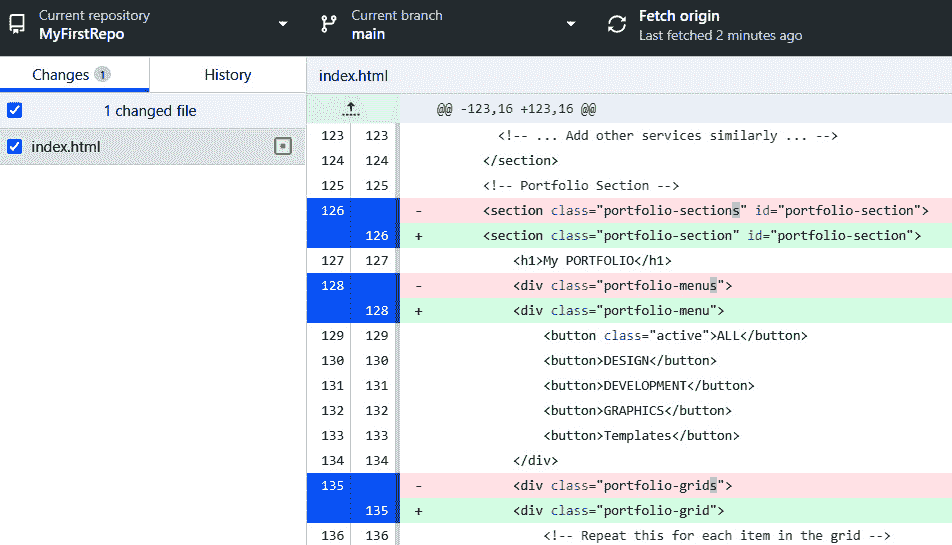
图 8.16 – 使用 GitHub Desktop 克隆仓库

* **提交到你的历史记录**：当你准备保存更改时，添加描述性消息并提交。这就像对你的工作签字，表示“这已准备好添加到项目中。”

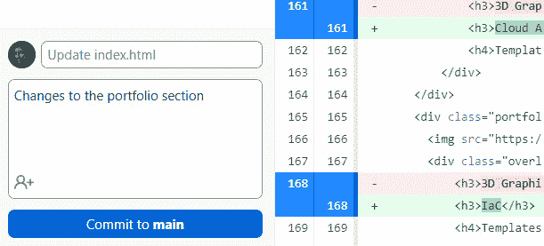
图 8.17 – 提交更改

* **与 GitHub 同步**：使用 `Fetch`、`Pull` 和 `Push` 按钮将本地工作与在线仓库同步。就像在设备间同步音乐库一样简单。

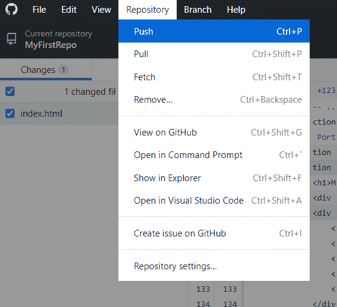
图 8.18 – 使用 GitHub Desktop 同步

* **分支、合并和收尾；保持协作**：想尝试新想法吗？在 GitHub Desktop 中创建新分支。这就像打开一个新的干净功能分支进行编码，同时保持原始代码安全。

当你的新功能准备就绪时，你可以将其合并到主项目中。GitHub Desktop 会指导你完成整个过程，以确保过渡顺利。

Pull request 是团队协作的关键部分。GitHub Desktop 集成了此功能，让你可以在应用内审阅、讨论并合并团队成员的工作。

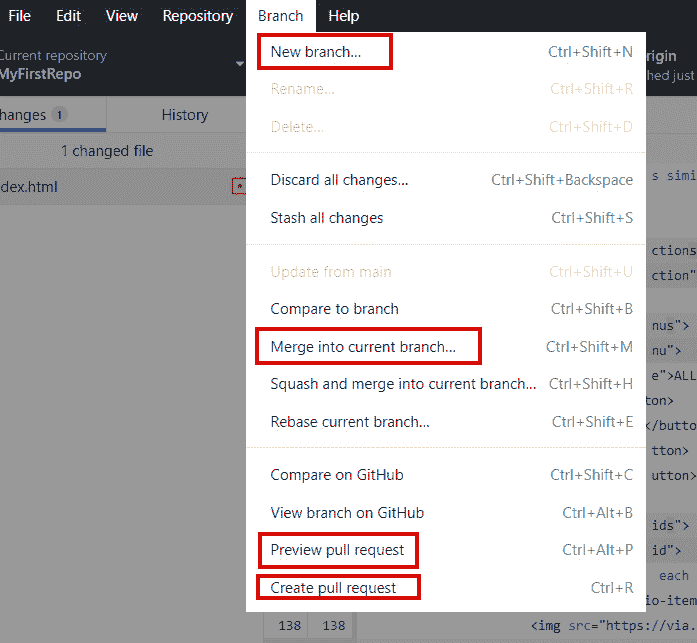
图 8.19 – GitHub Desktop 中的分支

接下来，让我们来看一下 GitHub Desktop 的一些优势：
* 它能让你以可视化方式查看项目的进展
* 你可以分享你的工作并整合他人的贡献，而无需接触命令行
* 其简洁的界面有助于防止在命令行中容易犯的错误

使用 GitHub Desktop 来制作你的单页作品集网站就是为了简化你的开发流程。它是一款工具，让版本控制感觉不像火箭科学，而更像你创作工作流程中的常规部分。它非常适合那些想要 Git 的强大功能，同时又希望拥有所见即所得界面的人。接下来，让我们继续看看如何使用 GitHub Codespaces 直接在浏览器中开发你的网站。这就像拥有一个完整的开发工作室在你的网页浏览器中，为你提供编写、运行和调试代码的工具，而无需切换应用程序。

# 使用 GitHub Codespaces 打造你的网站

花点时间想象一下走进一个设备齐全的工作坊，你可以在那里立即开始创作，无需设置任何工具或机器。这就是 GitHub Codespaces 为你的单页作品集网站项目提供的功能。它是一个完整、开箱即用的开发环境，直接在你的浏览器中运行。

## 为什么要使用 Codespaces？

无需花费时间在本地机器上设置开发环境，你可以从任何有网络连接的设备上工作你的网站。只要有浏览器，你就可以开始。你无需担心设备是否足够强大。Codespaces 为你提供了一个托管在网上的（云端）编码环境。

Codespaces 具备 **Visual Studio Code** 的功能，这是一款顶级的编辑器。就像拥有配备专业软件的高端电脑一样。

## 如何开始使用 Codespaces

实际上比你想象的更简单。只需一次点击，你就可以直接从你的仓库创建一个新的 codespace。只需前往你网站的 GitHub 仓库并点击 **<> 代码** 按钮。从那里，你可以为你的仓库创建新的 codespace。GitHub 会在后台完成所有设置。

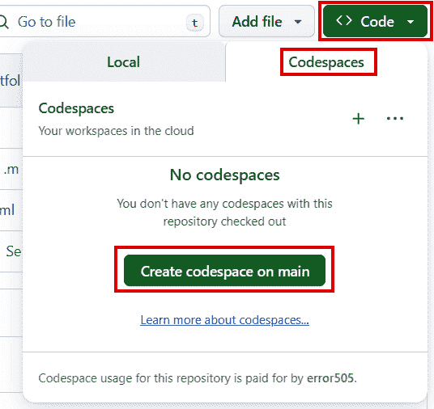
图 8.20 – 创建 GitHub Codespaces

一旦你的 codespace 准备就绪，你就可以在网页浏览器中访问完整的编码环境，其中包括终端、代码编辑器，甚至调试工具。

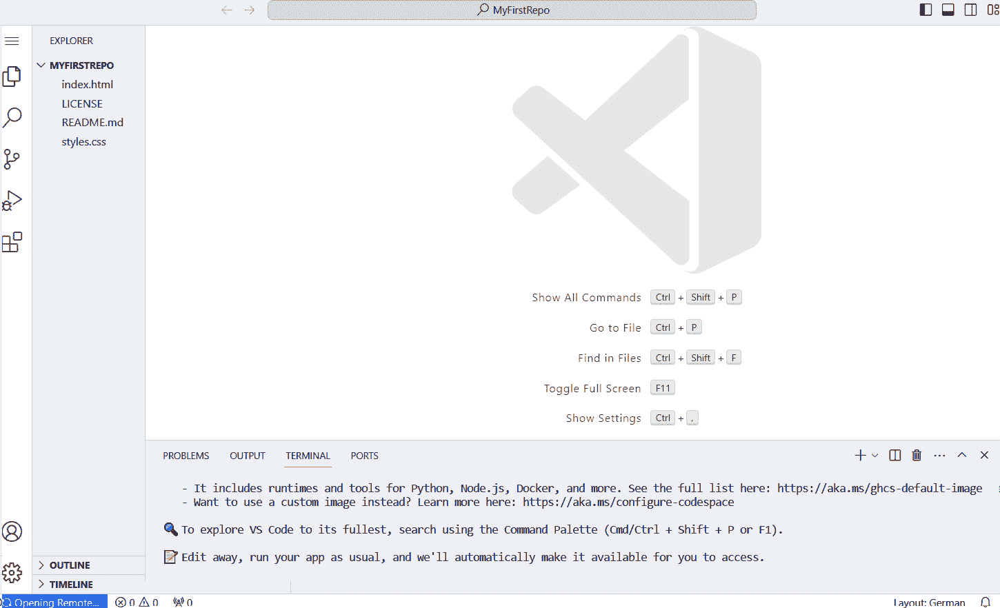
图 8.21 – 启动 Codespaces

现在，你可以像在本地电脑上一样工作你的网站。编辑文件、运行网站以测试更改，并提交你的更新。

你需要的一切都在浏览器中。分享你的 codespace 给协作者，让他们可以加入并与你一起编码。

图 8.22 – 与协作者共享你的 codespace

使用 Codespaces，你可以随时随地立即回到你的项目，继续上次中断的地方。

图 8.23 – Codespaces 源代码控制

GitHub Codespaces 就像拥有一个便携的虚拟工作坊，你可以从任何地方进入来工作你的单页作品集网站。它旨在使开发过程更顺畅，让你专注于创作和协作，而无需任何设置麻烦。

## 删除 Codespaces

GitHub Codespaces 如果你停止它或它在一段时间内保持非活动状态，总是会被自动删除，但你也可以随时通过点击按钮手动删除它，如 *图 8**.24* 所示。

图 8.24 – 删除 Codespaces

现在我们已经探讨了 GitHub Codespaces 如何将任何设备转变为网站的强大开发工作室，让我们继续前进。接下来，我们将看看如何跟踪所有项目更新和对话。有了 DevHub，你会发现管理项目的通知变得轻而易举，无论是在桌面还是网页浏览器中。

# 使用 DevHub 管理项目的动态

你的单页作品集网站已经上线，事情很多。朋友们在建议更改，有关于新功能讨论，并且正在进行更新。面对所有这些活动，你的 GitHub 通知蜂拥而至。这就是 DevHub 发挥作用的地方。它就像一个个人助理，帮助你管理这些动态。

图 8.25 – DevHub

**DevHub** 是一款工具，可将你所有的 GitHub 通知和活动直接带到你的桌面。你也可以使用网页版的控制面板，在无需登录 GitHub 的情况下查看项目中发生的一切。

图 8.26 – DevHub 仪表板

## 如何设置 DevHub？

你可以通过访问 `devhubapp.com/` 使用网页版，然后只需点击 **使用网页版** 按钮。你会看到 **使用 GitHub 登录** 按钮来将 DevHub 连接到你的 GitHub 账户。点击该按钮后，会弹出一个新窗口，你需要在其中登录你的 GitHub 账户。接下来，你需要同意将 DevHub 与你的 GitHub 账户连接。现在，你就可以在浏览器中使用 DevHub 了。

图 8.27 – DevHub 版本

如果你希望通知管理器直接在桌面上，那么点击 **下载 Windows 版** 按钮并下载 DevHub 到你的桌面。这就像获得一个新小工具，会让生活变得轻松许多。与设置网页版类似，你只需连接你的 GitHub 账户即可开始使用。

## 为什么应该在日常工作流程中使用 DevHub？

DevHub 按仓库和类型组织你的通知，就像有一个带有账单、信件和广告不同部分的邮箱，让你能轻松找到所需内容。将所有通知和活动集中在一个地方，你可以更快、更高效地处理事情。

你可以配置 DevHub 显示最重要的内容，只为你关心的通知提醒你。与其在 GitHub 的通知海洋中迷失，DevHub 帮助你专注于手头的任务。

无论是回复 pull request、查看 issue，还是合并更改，DevHub 都让你能在一个地方完成。DevHub 让你与团队的活动保持同步，使协作顺畅且持续，就像一个专门用于项目开发的群聊。

在了解了 DevHub 如何简化项目活动和通知的跟踪后，你现在准备好进入下一章，在那里你将学习大量关于 GitHub Actions 和构建自动化的有趣内容。

# 总结

恭喜你完成了 *第 8 章*！到现在为止，你已经扩展了工具箱，能够更轻松、更精细地管理你的单页作品集网站项目。让我们回顾一下你现在掌握的强大技能和工具。

在一些高级 Git 命令的帮助下，例如 `alias` 和 `rebase`，你学会了如何简化你的 Git 工作流程、追踪单个文件更改的详细历史记录，以及重新组织提交以获得更整洁的项目历史。然后，你发现了 Sourcetree 如何让复杂的历史记录一目了然。此外，你通过 Codespaces、Desktop 和 DevHub 提升了技能，将 GitHub 转变为友好的桌面界面并管理你的通知。

全章中，你不仅获得了新技能，还学会了这些工具如何使你的协作更有效、项目管理更高效。你现在已准备好自信地处理开发任务，知道自己拥有合适的工具来帮助你。

在下一章中，你将了解 GitHub Actions 如何自动化你的工作，如何设置称为工作流的自动化序列、设置自动运行的测试，以及排查工作流并对其进行微调以达到最佳性能。

*第 9 章* 全部关于让你的项目更智能地工作，而不是更辛苦。准备好通过自动化实现更高效、无压力的开发体验吧！

## 测验

回答以下问题：

1. `git config` 的主要用途是什么？

    1. 修改项目的设置

    2. 在 Git 中配置用户信息

    3. 创建新分支

    4. 合并两个分支

    *答案*: B. 在 Git 中配置用户信息

2. GitHub Desktop 是一个允许用户通过图形界面管理 Git 仓库的应用程序。

    1. 真

    2. 假

    *答案*: A. 真

3. 什么允许你直接在 GitHub 界面中创建、查看和编辑文件？

    *答案*: GitHub Codespaces

4. 使用 Visual Studio Code 与 Git 的目的是什么？

    *答案*: Visual Studio Code 与 Git 集成，允许用户直接从编辑器管理 Git 操作、查看更改并进行提交。

5. Sourcetree 用途是什么？

    1. 跟踪项目问题

    2. 可视化管理 Git 仓库

    3. 自动化代码测试

    4. 基于云的开发

    *答案*: B. 可视化管理 Git 仓库

6. DevHub Notifications 是用于管理 GitHub 上通知和活动的工具。

    1. 真

    2. 假

    *答案*: A. 真

7. `git blame` 用途是什么？

    1. 查找最后修改代码行的人

    2. 删除分支

    3. 重命名仓库中的文件

    4. 克隆仓库

    *答案*: A. 查找最后修改代码行的人

8. `git ________ -fd` 命令用于通过删除未跟踪文件来清理工作目录。

    *答案*: `clean`

9. `git stash` 命令用于永久删除分支中的更改。

    1. 真

    2. 假

    *答案*: B. 假（它暂时存储更改）

10. `git fetch --all` 的目的是什么？

    *答案*: 它从远程仓库获取所有分支，确保你拥有所有最新更新。

## 挑战 – 为 Space Explorer 打造游戏结束画面

在本章中，你已解锁了 Git 和 GitHub 工具的新技能。让我们通过为你的 *Space Explorer* 游戏创建一个引人注目的 **Game Over** 画面来检验这些技能，并配上酷炫的背景。

图 8.28 – Space Explorer 游戏结束画面

你的任务是使用新的 Git 命令和工具开发一个 **Game Over** 画面，并将独特的背景集成到此画面中。

你可以从这里下载代码：[`github.com/PacktPublishing/GitHub-for-Next-Generation-Coders/tree/main/Space%20Explorer%20Game/Game%20Obsticles%20-%20Game%20Over%20screen`](https://github.com/PacktPublishing/GitHub-for-Next-Generation-Coders/tree/main/Space%20Explorer%20Game/Game%20Obsticles%20-%20Game%20Over%20screen)。

*以下是你可以完成 **你的任务** 的方法：*

1. **分支创建**：使用 GitHub Desktop 或 Sourcetree，创建一个名为 **feature-game-over-screen** 的新分支。此可视化工具简化了分支流程。

2. **设计画面**：设计一个带有酷炫太空主题背景的 **Game Over** 画面。发挥创意设计——这是玩家冒险后的最后所见！

3. **实现画面**：

    1. 在项目中编码新画面。确保游戏结束时显示。

    2. 在工作时尝试使用 Codespaces 和 Git 功能提交更改。

4. **使用高级 Git 命令**：

    1. 如果你犯了错误或想尝试不同的设计，使用 `git revert` 或 `git reset` 撤销更改。

    2. 通过将分支推送到 GitHub 分享你的进度。

5. **拉取请求和评审**：

    1. 使用 GitHub Codespaces 或 GitHub Desktop 为你的新分支打开拉取请求。

    2. 请同伴提供反馈或自行评审更改，使用 GitHub 的拉取请求功能。

6. **合并你的更改**：一旦你对 **Game Over** 画面满意，就将分支合并到主项目中。使用你学到的技能处理可能出现的任何合并冲突。

7. **反思和记录**：在 README 文件或文档中写下你的经验。使用这些新工具和命令如何提升了你的开发流程？
