## 9 利用 GitHub Actions 进行自动化

### 利用 GitHub Actions 进行自动化

在本章中，我们将深入 GitHub Actions 的世界，这是一个自动化强力工具，可以显著简化你的项目工作流。无论你是独自开发个人项目，还是团队中开发复杂应用，了解并利用 GitHub Actions 都可以改变你构建、测试和部署软件的方式。

到本章结束时，你不仅会掌握 GitHub Actions 的基础知识，还会学习如何创建自己的工作流来自动化任务、进行自动化测试，并在 GitHub 中直接管理部署。

我们将创建你自己的 GitHub Actions 工作流，包含实用演示，并了解如何在工作流中安全地管理敏感信息以保护项目并简化配置。最后，我们将学习排查工作流的技巧和策略，并优化 GitHub Actions 以提高效率和效果。我们将探索实用示例来说明这些概念，为你提供将这些技术应用到项目中的知识。

在本章中，我们将涵盖以下主要主题：

* 了解 GitHub Actions 工作流

* 创建操作工作流

* 使用 GitHub Actions 进行自动化测试和部署

* 管理密钥和环境变量

* 排查和优化 GitHub Actions

#### 技术要求

对于某些活动，我们将使用 marketplace GitHub Actions。确保你熟悉 YAML 语法，因为它是自定义 GitHub Actions 的关键。


此外，从 [`github.com/PacktPublishing/GitHub-for-Next-Generation-Coders/tree/main/Chapter%209`](https://github.com/PacktPublishing/GitHub-for-Next-Generation-Coders/tree/main/Chapter%209) 下载名为 `Chapter 9` 的 GitHub 文件夹，其中在 `.github/workflow` 文件夹内可以找到 `static.yml` 文件，您可以用来跟随操作。

# 了解 GitHub Actions 工作流

你和朋友们已经搭建了一个很棒的单页作品集网站。现在，你想添加一个名为 **MY ARTICLES** 的新板块来展示你的博客文章。你可能听说过 GitHub Actions 可以帮助你自动化一些任务，但这是什么意思？让我们简单地拆解一下。


图 9.1 – MY ARTICLES 部分

*什么是 GitHub Actions？* 把 **GitHub Actions** 想成一个可以帮助你完成任务的有用机器人。例如，每当你想在 **MY ARTICLES** 板块中添加新文章时，这个机器人可以自动用新文章更新你的网站。就像有一个小助手帮你处理重复性任务，而无需你手动操作。但如果你不确定如何为我们刚才提到的那个有用的机器人编写指令怎么办？好消息是你不必从零开始。GitHub 有一个名为 **Marketplace** 的地方，你可以在那里找到其他聪明人已经制作好的操作。就像去商店挑选一个机器人，而不是自己建造一个。

GitHub Actions 工作流文件是用 **YAML** 编写的，其全称是 **YAML Ain’t Markup Language**。它是一种人类可读的数据序列化标准，这意味着它设计得易于人类阅读和编写。**workflow** 是你在 GitHub 仓库中定义并存储在仓库的 `.github/workflows` 目录中的自动化流程。工作流可以由不同的事件触发，例如向仓库推送代码、创建拉取请求或按计划执行。

让我们快速查看一下在 *图 9.2* 中部署网站到 GitHub Pages 的工作流语法。

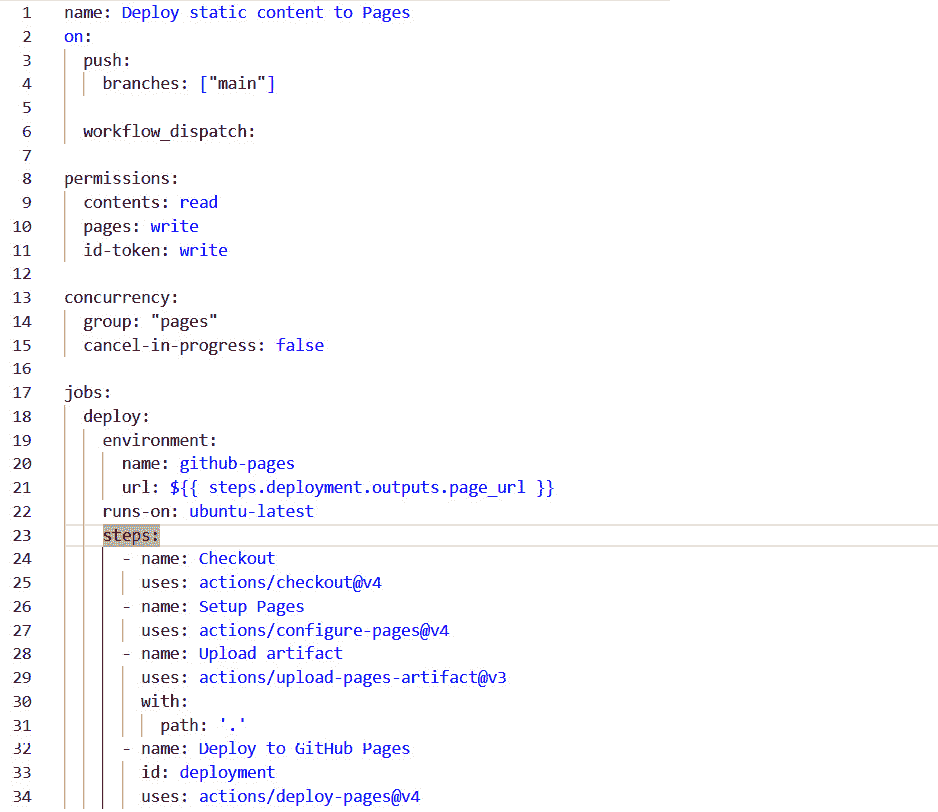
图 9.2 – GitHub Actions Marketplace

让我们更详细地了解前述图中的每个术语：

*   **事件**：GitHub Actions 中的事件是触发自动化工作流的特定活动。例如，当有人向仓库推送代码或创建拉取请求时，它可以自动启动诸如测试代码之类的操作。这就像引发多米诺骨牌效应，一个操作导致另一个操作。以下是你可以在 GitHub Actions 中使用的一些事件：
    *   `on`：这部分告诉我们何时运行此工作流。就像设定特定时间开始烹饪一样。
    *   `push`：这告诉 GitHub 操作，“*当有人向 main 分支推送代码时启动工作流*”。在烹饪的语境中，这就像说，“*当主菜准备好时，就该上菜了。*”
    *   `workflow_dispatch`：这允许你手动启动工作流。就像在厨房里有一个按钮，可以在你准备好时随时启动烤箱。
*   **作业**：这概述了需要完成的工作。
*   **运行器**：这告诉我们操作将在哪个系统上执行。
*   **步骤**：GitHub Actions 中的步骤是构成工作流中作业的单个任务。这就像食谱中的步骤，每个步骤做一件具体的事情，例如混合配料或烘烤它们，以实现制作蛋糕的整体目标。以下是你可以使用的一步：
    *   **检出**：
        *   **它做什么**：此步骤从你的仓库获取最新代码。
        *   **工作原理**：`uses: actions/checkout@v4` 行告诉 GitHub 使用 `checkout` 操作，这是一个来自 GitHub Marketplace 的预构建操作。此操作检出你的仓库，以便工作流可以访问代码。
    *   **设置 Pages**：
        *   **它做什么**：使用必要的设置准备 GitHub Pages。
        *   **工作原理**：`uses: actions/configure-pages@v4` 行表示使用来自 Marketplace 的 `configure-pages` 操作。此操作配置你的仓库以准备 GitHub Pages 部署。
    *   **上传制品**：
        *   **它做什么**：收集仓库中的所有文件以进行部署。
        *   **工作原理**：`uses: actions/upload-pages-artifact@v3` 行指定使用来自 marketplace 的 `upload-pages-artifact` 操作。此操作上传需要部署的文件。`with` 关键字允许你向此操作传递参数。在这里，`path: '.'` 意味着包含当前目录中的所有文件。
    *   **部署到 GitHub Pages**：
        *   **它做什么**：将你的网站部署到 GitHub Pages。
        *   **工作原理**：`uses: actions/deploy-pages@v4` 指定行使用来自 Marketplace 的 `deploy-pages` 操作，该操作处理部署。`id: deployment` 为此步骤提供一个标识符，如果需要以后引用，可以使用它。
*   **操作**：操作就像自动化助手，可以在你的 GitHub 项目中为你完成任务，我们将在下一节中更详细地学习。

此工作流是一组指令，告诉 GitHub 如何在你对项目进行更改时自动更新你的网站，具体来说是在你向 main 分支推送新更改或手动触发部署时。所有这些都是为了使更新网站的过程像按一个按钮一样简单。

现在你已经尝到了 GitHub Actions 可以如何简化更新你的单页作品集网站的滋味，是时候深入挖掘了。接下来，我们将探讨如何创建自己的操作工作流。在这里，你将学习如何为你的有用的机器人编写脚本，为其提供详细指令，以便在你添加新功能时自动构建你的网站。

# 创建操作工作流

在你的 GitHub 仓库页面上，有一个标签名为 **Actions**。点击它后，你会在 GitHub Starter 页面上看到搜索工作流的选项。你也可以在 GitHub Marketplace 上搜索 GitHub Actions 并配置你需要的操作。想象一下走进一家机器人商店，看到所有可以使用的不同机器人的目录。操作就像那些不同的小机器人，你可以用它们自动运行项目的不同部分，例如检查代码中的错误或在你对项目进行更改时将网站部署到网上。

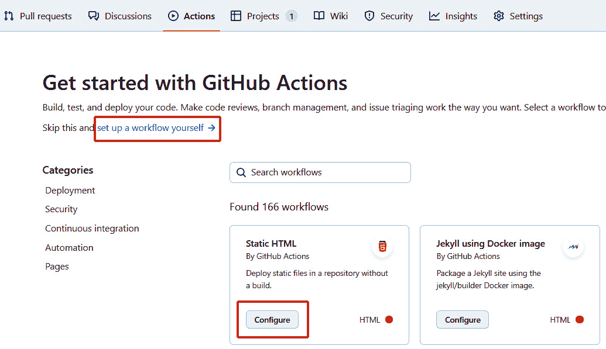
图 9.3 – GitHub Actions 启动页面

## 探索预构建操作

在 *图 9.4* 所示的 Marketplace UI 中，你会看到各种预构建操作。就像每个机器人都有特殊技能一样。有些擅长整理你的博客文章，有些擅长检查你的网站布局，等等。你正在寻找一个可以在你添加新博客文章时自动重建网站的操作。

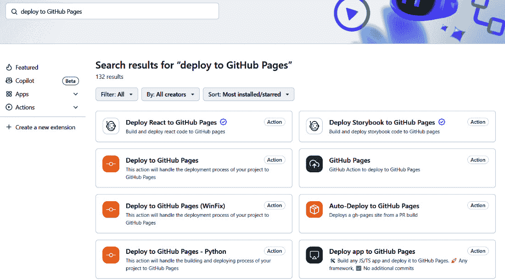
图 9.4 – GitHub Actions Marketplace 页面

以下是如何从 Marketplace 查找和使用操作的方法：
1.  搜索 **Actions**。
2.  前往 GitHub Marketplace (https://github.com/marketplace?type=actions)。
3.  使用搜索栏查找适合你需求的操作（例如，**deploy to GitHub Pages**），如 *图 9.4* 所示。
4.  复制使用代码片段。（Marketplace 中的每个操作都提供使用代码片段。）
5.  将此代码片段粘贴到你的工作流文件中。

Marketplace 中的每个操作都附带自己的说明和评论。就像阅读机器人包装盒背面以了解它能做什么，并查看在线评论以了解它对他人效果如何一样。


# 使用预构建的 GitHub Actions

一旦你找到了完美的预构建操作，就该通过点击 **使用最新版本** 按钮并将代码片段复制到你的工作流中来将其添加到你的工作流中。

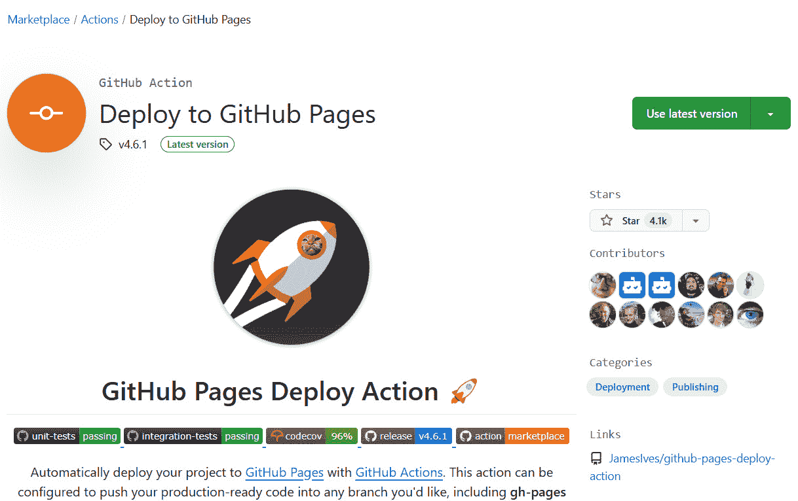
图 9.5 – 市场中的 GitHub Pages 部署操作

一些操作可能需要一些设置，例如告诉它你的网站存储的确切位置或你希望如何构建它。这就像给你的机器人提供具体的指令，以确保它能正确完成工作。

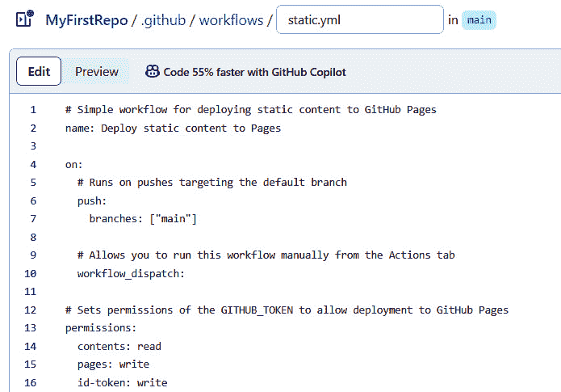
图 9.6 – 配置工作流

许多操作允许你使用 `with` 关键字传递参数。例如，如果你的项目是用 Node.js 构建的，你需要在运行测试或构建项目之前使用一个操作来设置 Node.js 环境。这通常看起来像这样：

```
steps:
- uses: actions/checkout@v2
- name: Set up Node.js
  uses: actions/setup-node@v2
  with:
    node-version: '14' # Specify the Node.js version you want to use
```

在添加并自定义所选操作后，你将保存对存储库的更改。这就像打开你的机器人并让它开始工作。

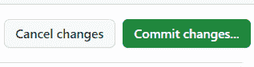
图 9.7 – 提交你的工作流

你的新工作流将被放置在存储库的 `.github/workflows` 文件夹中。你可以随时前往那里编辑工作流，如果需要的话。

## 了解 uses 关键字

`uses` 关键字在 GitHub Actions 工作流文件中指定某个步骤应使用某个操作。操作是可以跨工作流共享的可重用代码单元，使得自动化任务变得容易。`uses` 关键字指示在何处使用哪个操作以及从何处获取它。

以下是 `uses` 关键字的工作方式：

* **指定操作**：当你使用 `uses` 关键字时，你指定操作的位置。这可以是来自 GitHub Marketplace 的操作、公共存储库中的操作，甚至是存储库内的本地操作。
* **格式**：`uses` 关键字的格式通常包括操作所在的存储库和操作的版本。例如，`actions/checkout@v2` 指的是 `actions` 存储库版本 2 中的 checkout 操作。

## 实际操作

现在，每当你将新博客文章推送到你的存储库时，你从 Marketplace 中选择的操作就会开始工作，自动更新你网站上的 **我的文章** 部分。你实际上已经借助 GitHub 社区的帮助，部分自动化了维护你网站的任务。

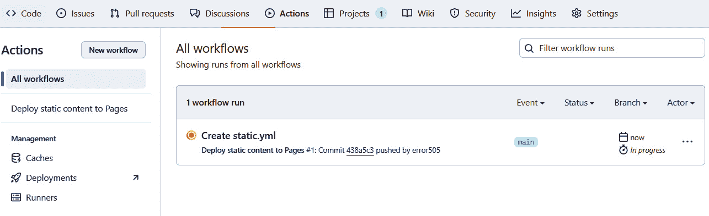
图 9.8 – 运行工作流

## GitHub Actions 中的可重用工作流是什么？

GitHub Actions 中的可重用工作流允许你一次性定义一组操作和步骤，然后在多个工作流和存储库中重复使用。这有助于保持一致性，减少重复，并简化跨项目工作流的管理。

使用可重用工作流有几个原因：

* **一致性**：确保在不同工作流中使用相同的步骤和操作，减少出错风险
* **效率**：节省时间，避免为不同工作流重写相同的步骤
* **可维护性**：更易于在一处更新和管理通用工作流

### 如何创建和使用可重用工作流

可重用工作流在存储库的 `.github/workflows` 目录中的单独 YAML 文件中定义，就像常规工作流一样。例如，你可能会创建一个名为 `reusable-workflow.yml` 的文件。

要在另一个工作流中使用此可重用工作流，你可以使用 `uses` 关键字调用它，就像我们对市场上的操作所做的那样。

现在你已经了解了如何从 GitHub Marketplace 中挑选并设置有用的操作来保持你的网站更新，让我们继续下一个令人兴奋的步骤。你将学习如何确保你的网站不仅自动更新，而且每次更改时都能完美运行。接下来，我们将探讨如何使用 GitHub Actions 进行自动化测试和部署。这意味着你将设置更多 *机器人助手* 来检查你的工作并将其发布到网上，确保你的网站始终看起来很棒并且功能完美。

# 使用 GitHub Actions 进行自动化测试和部署

让我们想象一下你再次在制作你的单页作品集网站。这次，你希望确保每次添加新内容时，例如用于博客文章的 **我的文章** 部分，一切在任何人看到之前都能完美运行。加上，一旦你确定一切都很好，你希望它在不做额外工作的情况下出现在你的网站上。这就是 GitHub Actions 可以成为你的超级英雄的地方，帮助进行自动化测试和部署。

## 什么是自动化测试？

把 **自动化测试** 想成有一个机器人检查你的新 **我的文章** 部分，以确保一切按预期工作。例如，它确保当有人点击一篇文章时，它确实会显示出来。这就像机器人替你点击网站各处，寻找错误。自动化测试为你节省大量时间，并大幅降低错误溜过去的风险，确保你的网站始终为访客提供最佳体验，而无需你手动检查每个细节。

## 部署

**部署** 是指你的机器人不仅检查你的工作，还会为你将其发布到你的网站上。因此，在机器人确认 **我的文章** 中的所有链接都有效后，它随后会用此新部分更新你的实时网站。这正是我们之前在选择构建和部署静态 HTML 的工作流时所做的。

## 我们如何使用 GitHub Actions 设置它？

为了确保你的单页作品集网站不仅部署顺畅，而且符合最佳编码实践，让我们将测试集成到你的 GitHub Actions 工作流中。我们将使用 ESLint 用于 JavaScript，Stylelint 用于 CSS，以及 HTMLHint 用于 HTML。此步骤确保你的代码在上线前干净、遵循既定规范，并且没有常见错误。

在进行设置之前，让我们先了解测试工具：

* **ESLint**：检查你的 JavaScript 文件 (`scripts.js`) 中的编码错误和样式问题。就像有一个 JavaScript 非常厉害的朋友指出改进之处。
* **Stylelint**：检查你的 CSS 文件 (`styles.css`)，确保它看起来不错并遵循最佳实践。想象一下时尚专家在为你搭配服装提供建议。
* **HTMLHint**：检查你的 HTML 文件 (`index.html`) 中的错误和最佳实践。它就像你 HTML 代码的语法检查。

现在你已经熟悉这些工具，让我们进入设置部分：

1. **编辑工作流并添加操作**：首先在你的 GitHub 存储库的 `.github/workflows` 目录中打开一个用于机器人的指令列表（工作流文件），名为 `static.yml`。

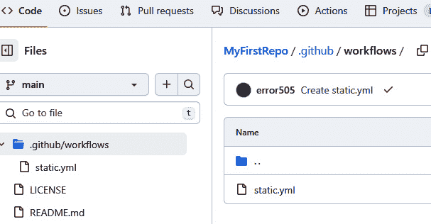
图 9.9 – 工作流 .yml 文件位置

1. **编写指令**：在你的 `static.yml` 文件中，你将写下你希望机器人做什么。

2. **调整工作流以包含测试**：在 `jobs` 部分，在部署之前，我们添加一个测试作业，该作业设置 Node.js（因为我们的 linter 需要 Node.js），安装 ESLint、Stylelint 和 HTMLHint 所需的包，然后在相应的文件中运行这些工具。

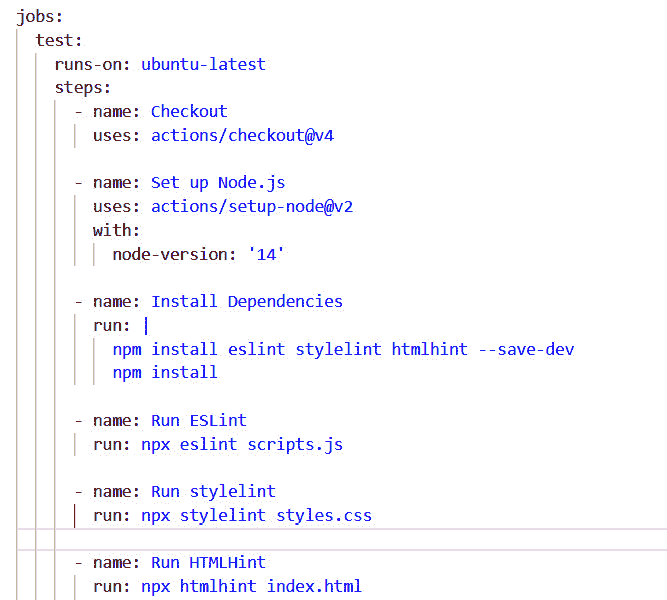
图 9.10 – 添加新步骤

1. `deploy` 作业现在需要在 `test` 作业成功后才能运行。这意味着如果 linter 捕获到问题，部署将不会继续，直到这些问题得到解决。


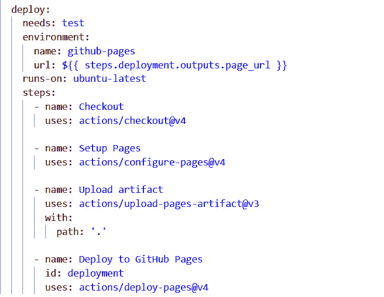
图 9.11 – 添加新操作
通过添加这些测试，你确保了你的 **MY ARTICLES** 部分以及你网站的其余部分不仅对访客看起来不错，而且背后还有干净、无错误的代码。此步骤对于保持专业且精致的网站至关重要。
现在，当你查看更新后的 GitHub Action 时，你会看到它已经在 CSS 文件中发现了一些错误，这些错误应该得到修复（*图 9.12*）。
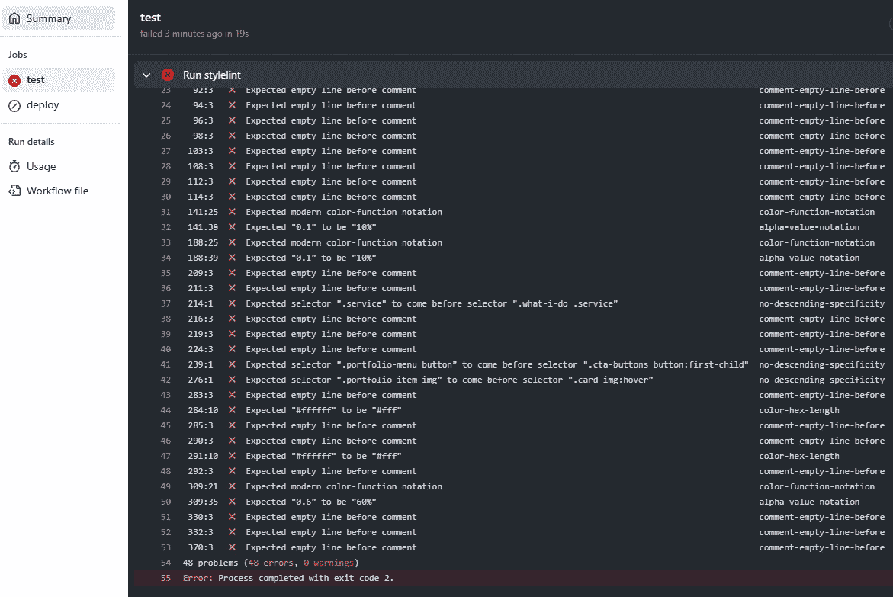
图 9.12 – 测试结果
你可以查看 `styles.css` 文件并修复错误。此外，你也可以直接在 Visual Studio 中使用 linter 来自动为你修复一些错误。
你现在已经了解了使用 GitHub Actions 进行自动化测试和部署如何使你的开发流程更加顺畅和可靠。这些工具有助于确保你的代码始终保持良好状态并可以自动部署。接下来，我们将学习如何管理密钥和环境变量。这对于在仍让工作流可访问的同时保护敏感信息（如密码和 API 密钥）非常重要。我们将探讨如何在项目中安全地处理这些元素。
# 管理密钥和环境变量
想象一下，你正在为你的单页作品集网站构建一个魔盒，专门用于名为 **MY ARTICLES** 的部分。这个魔盒可以自动用你撰写的文章更新你的网站。然而，要使其工作，它需要一个特殊密钥来访问你的博客文章，而不让任何人看到该密钥。这就是 GitHub Actions 中密钥和环境变量发挥作用的地方。
## 什么是密钥和环境变量？
**Secrets** 就像是你不希望他人找到的特殊密钥。对于你的网站来说，密钥可能是一个密码或一个特殊代码，让 GitHub Actions 可以安全地访问你的博客文章。
**Environment variables** 是在 GitHub Actions 运行期间可以根据不同条件而变化的设置。它们有助于在不更改实际代码的情况下自定义工作流的操作方式。
*为什么使用它们？*
使用密钥和环境变量具有以下好处：
* **保护敏感信息安全**：你不想把你的特殊密钥（密码和 API 密钥）公开让任何人拿走。密钥可以保护它们的安全。
* **灵活性**：环境变量允许你的魔盒（GitHub Actions）根据情况略有不同地工作，例如在主页上显示更多文章或更改其显示方式，而无需更改主要咒语（你的代码）。
## 为 MY ARTICLES 使用密钥和环境变量
在深入细节之前，让我们谈谈一种明智的方式，使用密钥和环境变量来更新 GitHub 上的 **MY ARTICLES** 部分。此过程有助于在允许网站自动用新内容更新的同时保护敏感信息。以下是你可以如何设置：
1. **设置密钥**：
1. 前往网站的 GitHub 仓库。
2. 找到 **Settings**，然后在左侧菜单的 **Security** 部分下查找 **Secrets and variables**。
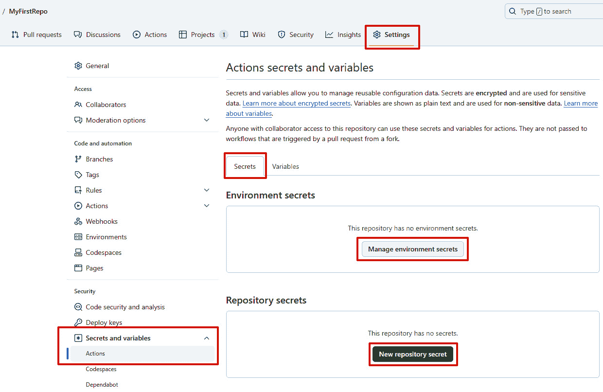
图 9.13 – 管理 GitHub Action 密钥
1. 点击 **New repository secret**。将其命名为类似 `BLOG_API_KEY` 的名称，并将你的特殊密钥（API 密钥）作为值输入。这就像把你的密钥藏在一个只有 GitHub Actions 能打开的秘密隔间里。
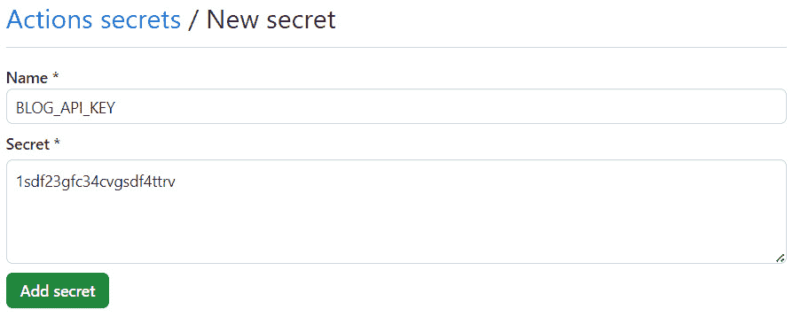
图 9.14 – 添加 GitHub Action 密钥
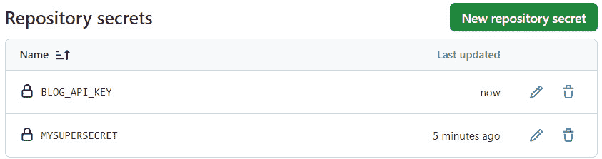
图 9.15 – 查看 GitHub Action 密钥
1. **使用环境变量**：在 `.github/workflows` 文件夹中，在你的 `static.yml` 工作流文件中，你可以设置环境变量。例如，你可以为在主页上显示的文章数量设置一个环境变量。
这就像告诉你的魔盒，“*使用这个咒语在 **home page** 上显示五篇文章。*”
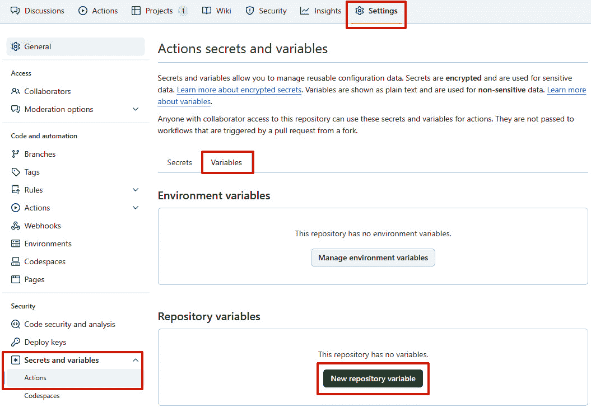
图 9.16 – 管理 GitHub Action 变量
1. **在工作流中访问密钥**：在你的 `static.yml` 文件中，你可以告诉 GitHub Actions 在需要密钥获取博客文章时使用你的密钥。你将通过其名称引用它，例如 `${{ secrets.BLOG_API_KEY }}`。
这就像你向魔盒低声透露你密钥的秘密位置，以便它可以安全地获取你的文章。
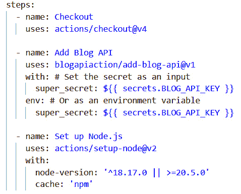
图 9.17 – 使用密钥和变量更新 GitHub Action
1. **根据需要调整环境变量**：你可以随时直接在工作流文件中更改这些变量。例如，如果你想展示更多文章，只需更新环境变量中的数字即可。
有了密钥和环境变量，你可以确保你的网站始终用你最新的作品保持更新，而不会暴露任何敏感信息，并且可以根据需要调整设置而无需重写整个咒语。这是一种智能且安全的方式，让你的作品集保持新鲜和吸引力。
现在你已经学会了如何使用密钥和环境变量安全地更新网站的 **MY ARTICLES** 部分，让我们继续前进。接下来，你将了解如何排查和优化你的 GitHub Actions，确保一切顺利高效地运行。把它想象成学习如何快速修复机器人上的任何问题。
# 排查和优化 GitHub Actions
假设你已经设置了 GitHub Actions，以便在你编写新代码行时自动更新、构建、测试和部署你的单页作品集网站。但如果它没有按预期工作，或者你希望它工作得更好怎么办？本节将解释你如何排查和优化它，就像你从未有过经验一样学习如何修自行车。
## 排查 GitHub Actions
想象一下，你尝试骑自行车，但它不动。你首先会检查是否有明显的问题。在 GitHub Actions 中，你有日志用于此目的。前往 GitHub 仓库中的 **Actions** 选项卡并找到未成功运行的任务。在这里，你可以看到它尝试执行的内容的详细日志以及可能出错的地方，就像注意到自行车链条脱落一样。
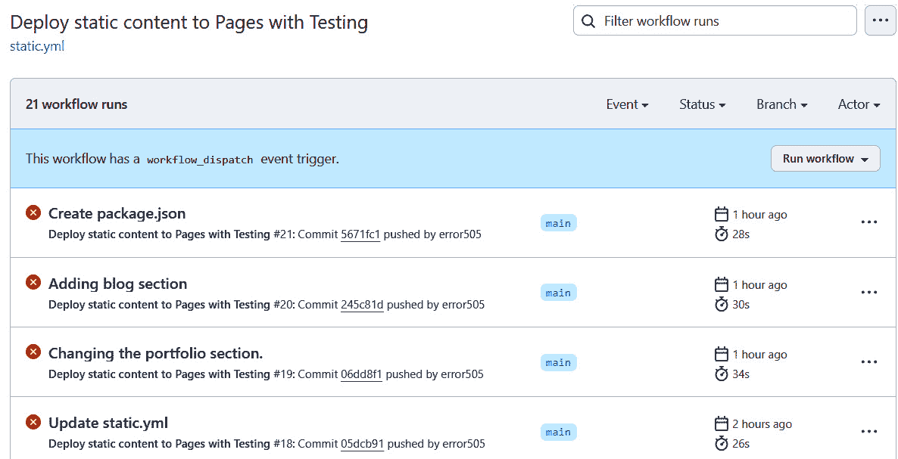
图 9.18 – 一个 GitHub Action 日志
## 需要查找的常见问题
注意常见的以下问题是个好主意：
* **语法错误**：检查你的 `.yml` 文件中的语法错误意味着确保你提供的指令清晰且使用 GitHub Action 理解的语言。
* **访问问题**：有时，GitHub Action 没有访问项目某些部分的正确密钥。在这种情况下，你应该检查权限问题。
* **外部服务**：如果你的脚本依赖于外部服务（例如从其他地方获取数据），请确保这些服务正在运行。这就像在计划骑自行车之前检查天气一样。
## 优化 GitHub Actions
了解如何优化 GitHub Actions 很重要，因为它有助于改进你的开发流程，节省时间和资源，并确保你的项目高效运行。以下是一些有助于实现此目的的方法：
* **减少运行时间**：如果你的工作流更新网站花费很长时间，请寻找使任务更简单或更直接的方法。也许你要求它检查太多东西。这就像规划自行车骑行最有效路线以节省时间一样。


*   **使用缓存**：GitHub Actions 可以记住上次的一些步骤（缓存它们），因此不必从头开始重复所有操作。如果你的更新每次都涉及下载相同的资源，缓存可以使过程更快。把它想象成把自行车放在外面，而不是每次骑行都要把它从地下室拿出来。
*   **优化成本**：如果你在 GitHub Actions 中使用付费服务或资源，请寻找减少使用的方法。这就像确保你不会走更长的自行车路线，而这些路线需要比必要更多的能量棒。
*   **定期更新和审查**：就像自行车设计会随着时间的推移而改进一样，GitHub Actions 及其使用的工具也会得到更新。定期检查是否有更新、更高效的做法。
不时地，退一步审查你的 GitHub Actions 设置，看看它是否仍然满足项目增长时的需求。
在本节中，你学习了如何发现和修复 GitHub Actions 的问题，就像排查一辆无法骑行的自行车一样。我们查看了检查日志以找出问题所在。我们还介绍了常见问题，例如语法错误、访问问题以及对外部服务的依赖，这些都可能导致 GitHub Actions 无法顺畅运行。就像让自行车准备好平稳骑行一样，优化你的 GitHub Actions 使开发过程更高效，节省时间和精力。
# 摘要
本章深入探讨了 GitHub Actions，展示了如何自动化项目工作流。它涵盖了创建工作流、自动化测试、部署、管理密钥以及优化技巧。学习 GitHub Actions 简化了构建、测试和部署代码的过程，这对高效的项目管理至关重要。本章获得的技能将帮助你简化协作并提高代码质量，使项目为顺畅部署做好准备。
*第 10 章*, *增强 GitHub 安全措施*，深入到保护你的编码环境。它将涵盖存储库权限、双因素身份验证、Dependabot 的漏洞扫描、安全编码实践以及保护分支，是保护你在 GitHub 上的项目的关键一步。
# 测验
回答以下问题：
1.  GitHub Actions 的主要目的是什么？
    1.  自动化工作流
    2.  存储代码
    3.  手动测试
    4.  社交网络
    *答案*：A. 自动化工作流
2.  GitHub Actions 可用于在有人向存储库推送代码时每次自动运行测试。
    1.  真
    2.  假
    *答案*：A. 真
3.  填空 – 在 GitHub Actions 中，a \_\_\_\_\_\_\_\_\_\_ 定义了一组响应 GitHub 事件而运行的作业。
    *答案*：workflow
4.  用于定义 GitHub Actions 工作流的文件格式是什么？
    1.  JSON
    2.  YAML
    3.  XML
    4.  HTML
    *答案*：B. YAML
5.  真或假 – 存储在 GitHub Actions 中的密钥是加密的，可在工作流中用于敏感操作。
    1.  真
    2.  假
    *答案*：A. 真
6.  当主分支更新时，哪个 GitHub 功能用于自动将代码部署到托管服务？
    1.  GitHub Codespaces
    2.  GitHub Pages
    3.  GitHub Actions
    4.  GitHub Desktop
    *答案*：C. GitHub Actions
7.  填空 – GitHub Actions 工作流由特定的 \_\_\_\_\_\_\_\_ 触发，例如推送到分支或打开拉取请求。
    *答案*：events
8.  哪个 GitHub Actions 功能允许在不同存储库之间重用工作流？
    1.  Actions Composer
    2.  Workflow Templates
    3.  Reusable Workflows
    4.  Shared Actions
    *答案*：C. Reusable Workflows
9.  真或假 – 你可以使用 GitHub Actions 自动更新项目中的依赖项。
    1.  真
    2.  假
    *答案*：A. 真
10.  触发 GitHub Actions 中的工作流需要什么？
     1.  对任何分支的提交
     2.  工作流文件中定义的具体事件
     3.  用户手动启动
     4.  拉取请求批准
     *答案*：B. 工作流文件中定义的具体事件
## 10 增强 GitHub 安全措施
## 增强 GitHub 安全措施
在本激动人心的章节中，我们将深入探讨在 GitHub 上保护我们的单页作品集网站的核心。随着我们继续与朋友合作完成此项目，了解和实施安全开发策略变得至关重要。我们不仅仅是在构建一个网站；我们正在确保它成为抵御潜在威胁的堡垒。你将学习如何设置权限，使用 **双因素身份验证** (**2FA**) 保护你的网站，利用 Dependabot 进行漏洞扫描，并使用 `CODEOWNERS` 增加保护。
到本章结束时，你将具备在 GitHub 上应用安全最佳实践的能力。你将知道如何保护网站数据安全，确保只有授权用户可以进行更改，并维护这些更改的历史记录。这些知识至关重要，不仅对项目的安全性，而且对访客信息的保护也很重要。
在本章中，我们将涵盖以下主要主题：
*   在你的网站仓库中设置协作
*   为你的作品集网站设置 2FA
*   保护你的网站 – 使用 Dependabot 进行漏洞扫描
*   使用 `CODEOWNERS` 保护你的单页网站
*   应用安全编码实践
## 技术要求
要跟随本章并实施讨论的安全功能，你需要以下内容：
*   一个 GitHub 账户
*   访问你在 GitHub 上的单页作品集网站存储库
*   基本熟悉 GitHub 界面的导航
有关代码示例和更详细的说明，请访问专门为本章创建的 GitHub 存储库：[`https://github.com/PacktPublishing/GitHub-for-Next-Generation-Coders/tree/main/Chapter%2010`](https://github.com/PacktPublishing/GitHub-for-Next-Generation-Coders/tree/main/Chapter%2010)。
该存储库将包含所有必要文件和进一步的解释，帮助你有效地保护你的单页作品集网站。
## 在你的网站仓库中设置协作
你仍然在与一些朋友一起制作一个单页作品集网站，但你有一些安全方面的顾虑。现在，并不是每个人都应该能够更改一切，对吧？也许你希望一些朋友提供想法和反馈，但不要直接搞乱网站的设计。这就是在你的 GitHub 存储库中设置权限和访问控制派上用场的地方。这类似于决定谁会拿到你家的钥匙，谁必须按门铃。
让我们先了解存储库权限。
*   **所有者**：那就是你。你可以在你的仓库上做任何事情，从邀请朋友帮忙、设置谁可以做什么的规则，到更改网站的任何部分。
*   **协作者**：这些是你邀请来帮助你的网站的朋友。你可以决定他们是拿到房子的钥匙（做大改动）还是只拿到院子的通行证（提出建议）。
*如何设置 **权限*
1.  前往你网站的 GitHub 页面存储库。
2.  找到存储库的 **设置** 按钮并点击它。通常，你会在右上角找到它。
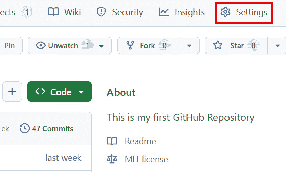
图 10.1 – GitHub 设置按钮
1.  **访问协作者和团队（组织账户仓库）**：在 **访问** 部分，点击 **协作者和团队**。这是与你一起在单页网站上协作的所有朋友及其权限的概览。
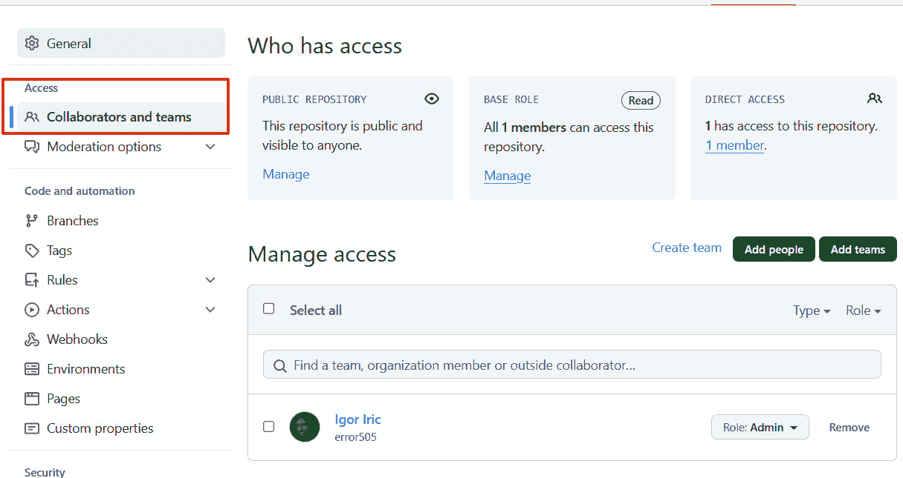
图 10.2 – GitHub 协作者和团队


## 查看和调整权限
在图 10.2 所示的屏幕截图中，你可以看到你也可以通过他们的 GitHub 用户名邀请朋友。对于每个朋友，你可以设置他们的仓库访问级别或移除访问权限。个人 GitHub 仓库只有两种权限：
* `Ownership`，它赋予对仓库的完全控制权。
* `Collaborators`，适用于可以读取仓库内容并通过提交拉取请求来写入的用户。

如果你需要对仓库进行更细粒度的访问控制，你应该将仓库转换为组织，后者拥有更多角色。

## 团队和其他内容（组织账户仓库）
如果你与很多人一起工作，你可以创建团队，例如设计团队或内容团队，并为每个团队分配不同的密钥。点击 `Create team` 开始创建新团队。

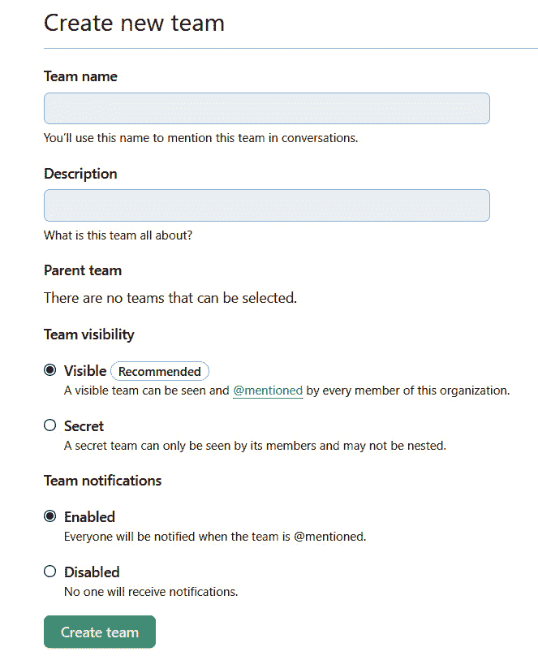
图 10.3 – 创建新团队

### 访问控制有什么用？
通过在你的仓库上设置访问控制，你可以确保只有合适的人才能进行更改。
访问控制还有助于保持项目有序，并了解谁负责其中的哪些任务。它会让你安心，知道帮助你项目的朋友不会意外删除你网站的主要部分。

现在你已经学会了如何管理谁可以在你的网站项目中做什么，让我们下一步学习如何让你的网站更加安全。我们将研究如何为你的作品集网站 GitHub 仓库设置 2FA。这就像在你的门上加一把双锁，确保只有合适的人才能进入，即使他们有钥匙。

# 为你的作品集网站设置 2FA
你已经构建了一个很棒的单页作品集网站并将其存储在 GitHub 上，那里可以安全地保存所有网站文件。然而，就像你希望房子有一把好锁来保护你的宝物一样，你也希望确保你的 GitHub 账户得到额外保护。那就是 2FA 发挥作用的地方。

## 什么是 2FA？
把 2FA 想成一个双重检查过程，以确保真的是你正在尝试访问你的 GitHub 账户。这就像有一扇装有两把锁的门。第一把锁用你的钥匙（你的密码）打开，第二把锁用一个特殊代码（第二因子）打开，该代码每次都会改变。

### 为什么要在你的网站仓库中使用 2FA？
额外安全没有缺点，使用 2FA 也是如此。其一些好处是：
* 2FA 使他人潜入你的 GitHub 账户并破坏你的网站项目变得困难得多
* 你可以更安心地知道你的网站代码和内容得到良好保护

## 如何设置 2FA
要在 GitHub 上设置 2FA，请按照以下步骤操作：
1. 进入你的 GitHub 账户设置：登录 GitHub 后，点击右上角的个人资料图片并选择 `Settings`。这就像进入你的账户控制面板。
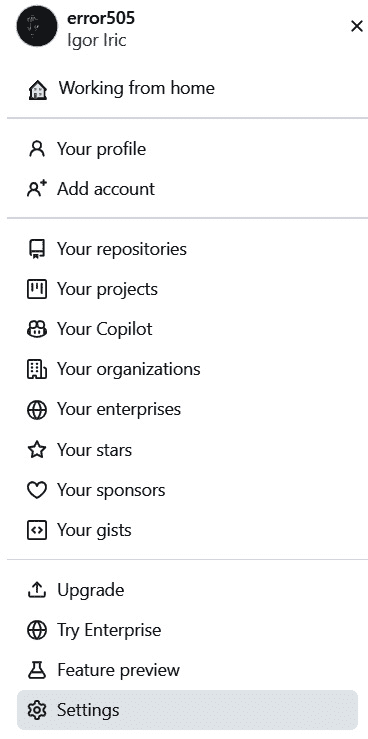
图 10.4 – GitHub 账户设置
2. 找到安全部分：在 `Settings` 菜单的侧边栏中，查找 `Password and authentication`。在这里你可以管理账户的防御。
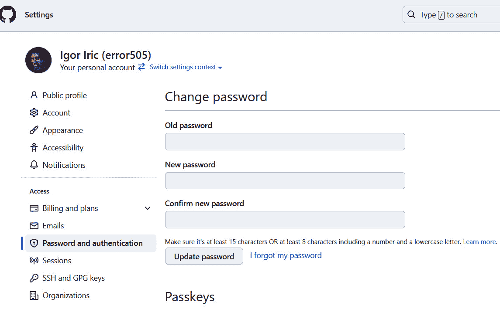
图 10.5 – GitHub 的 Password and authentication 部分
3. 开始 2FA 流程：
   1. 找到 `Two-Factor Authentication` 选项并点击 `Enable two-factor authentication`。这就像决定在你的门上加第二把锁。
   2. 扫描二维码，该二维码将由你的移动设备上的应用（如 Microsoft Authenticator）显示。扫描二维码后，应用会生成一个六位数字代码，你可以在 GitHub 上输入。
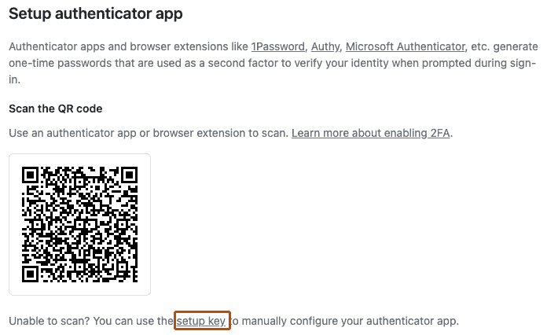
图 10.6 – 设置身份验证器应用
4. 选择你的 2FA 方法：
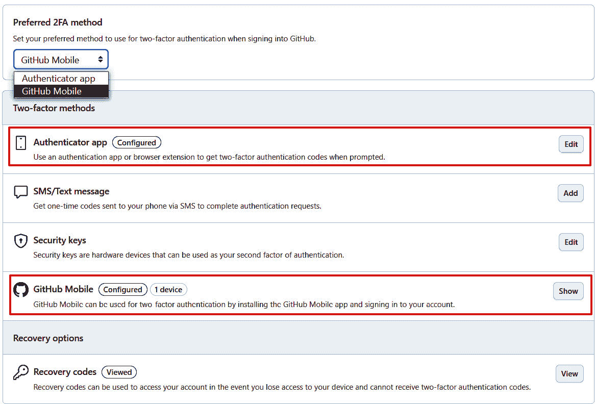
图 10.7 – 选择你的 2FA 方法
* `SMS/Text message`：你会通过短信形式将第二代码发送到你的手机。很简单，但需要你的手机在身边。
* `Authenticator app`：使用 Google Authenticator、Microsoft Authenticator 或 Authy 等应用。应用会为你生成代码。即使你的手机未连接互联网也能工作。
5. 按照设置说明操作：GitHub 会引导你完成设置过程。这涉及验证你的密码（第一把锁），然后设置你将如何接收你的 2FA 代码（第二把锁）。
6. 备份代码：在设置期间，GitHub 会为你提供备份代码。这些就像备用钥匙。点击 `Download` 将恢复代码下载到你的设备。将其保存在安全但易于访问的地方，以防你无法使用手机或身份验证应用。
7. 保存你的双因素恢复代码后，点击 `I have saved my recovery codes` 为你的账户启用 2FA。
8. 使用 GitHub Mobile 配置 2FA：你可以选择多种 2FA 选项，其中之一是在登录 GitHub 账户时使用 GitHub Mobile 应用。
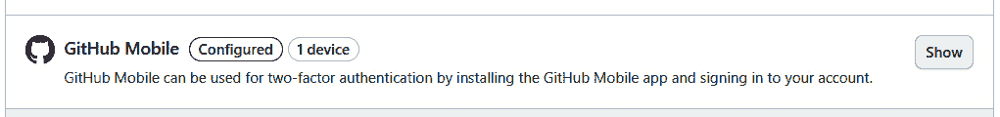
图 10.8 – 使用 GitHub Mobile 的 2FA 方法
你只需启用 2FA 并从移动应用商店安装 GitHub 移动应用即可登录你的 GitHub 账户。

设置 2FA 更像是为你的房子添加一套高科技安全系统。进入门需要多一点努力，但这意味着你的网站项目——以及你投入的所有辛苦工作——会更安全。接下来，我们将学习另一个可以帮助你增加安全的 GitHub 功能。

# 保持你的网站安全 – 使用 Dependabot 进行漏洞扫描
为了让你的网站运行流畅且外观良好，你可以使用各种工具和库来开发它，就像用不同的原料烘焙蛋糕一样。但如果其中一种原料变质了呢？它可能会毁掉你的蛋糕，对吧？在 Web 开发世界中，变质的原料就是你使用的工具和库中的漏洞，这可能会使你的网站不安全。这就是漏洞扫描和 Dependabot 在 GitHub 上发挥作用的地方。

## 什么是漏洞扫描？
使用 `Dependabot` 进行 `Vulnerability scanning` 就像拥有一台扫描所有原料以确保其安全使用的装置。在 GitHub 上，它会扫描你的网站使用的工具和库（称为 `dependencies`）以查找任何已知漏洞。

### 为什么重要？
就像你不希望在蛋糕中使用变质的原料一样，你也不希望使用可能使你的网站成为坏人易受攻击目标的易受攻击的 `dependencies`。它确保你的网站对所有访问者保持安全。

## 那 Dependabot 是什么？
`Dependabot` 就像你厨房里一个有用的机器人，它不仅会告诉你原料何时变质，还会自动将其替换为新鲜的原料。在 GitHub 上，如果 `Dependabot` 发现漏洞，它会自动更新你的 `dependencies`。

### 它是如何工作的？
如果 `Dependabot` 在你的网站的 `dependencies` 中发现漏洞，它会提醒你并可以自动创建 `pull request` 以将其更新为更新、更安全的版本。在这种情况下创建 `pull request` 就像用安全的依赖项替换易受攻击的依赖项。

### 设置 Dependabot
你在网站的 GitHub 仓库设置中启用 `Dependabot`。这就像在你的厨房里打开自动原料检查器。要导航到 Dependabot 设置，请转到 `Code`，然后转到 `Code security and analysis`。你可以参考图 10.9 来检查是否在正确的屏幕上。
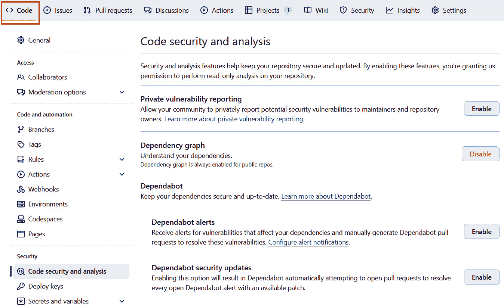
图 10.9 – 设置 Dependabot


要在你的仓库中启用 Dependabot，你应该启用 **Dependabot 警报** 和 **Dependabot 安全更新**，如图 10.10 所示。

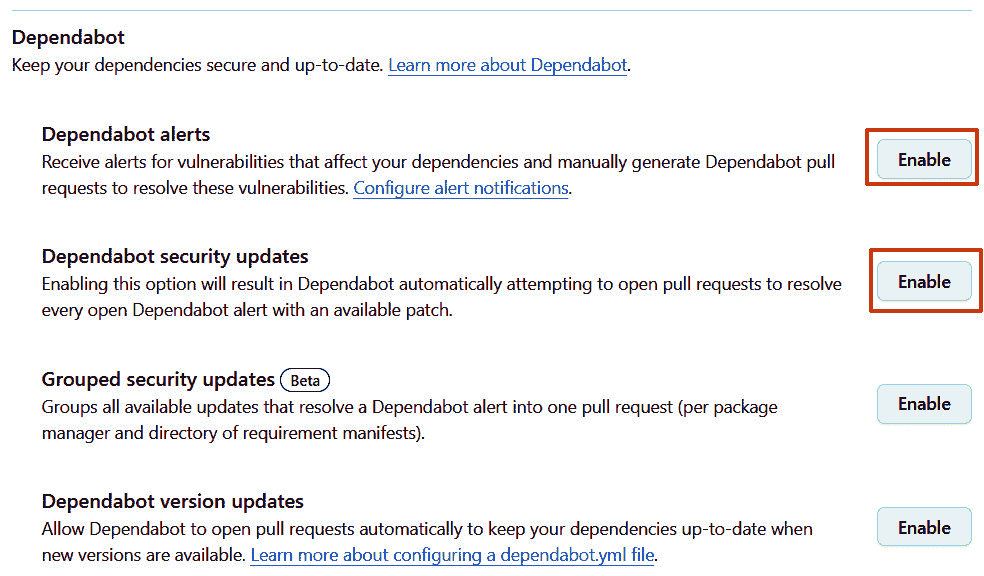

图 10.10 – 启用 Dependabot 警报

Dependabot 可在以下方面提升你的安全性：

* **扫描漏洞**：Dependabot 会定期检查你的网站使用的依赖项。当它发现问题时，会通过向你发送电子邮件并在 GitHub 上发出通知来提醒你，就像烟雾探测器在检测到异常时响起一样。

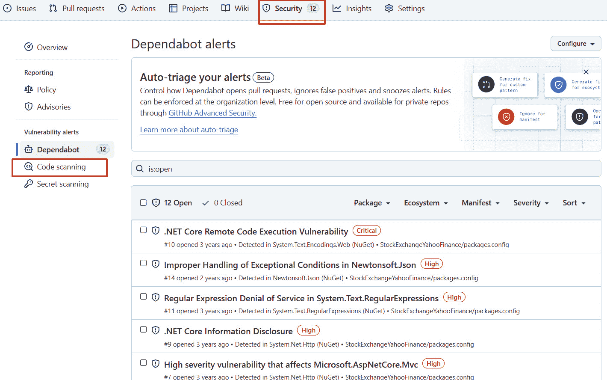

图 10.11 – Dependabot 警报实战

* **自动修复问题**：如果 Dependabot 发现有问题的依赖项存在更安全的版本，它会自动准备更新。就像它不仅告诉你牛奶变质了，还会去商店为你买新鲜牛奶一样。

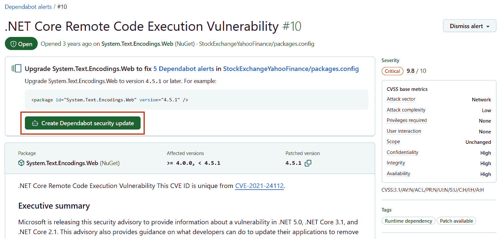

图 10.12 – 修复 Dependabot 发现的问题

* **审查和合并**：你可以审查 Dependabot 创建的更新（拉取请求）。如果一切看起来不错，就将其合并到你的项目中，更新依赖项。这就像检查新牛奶的质量，然后将其放入冰箱使用一样。

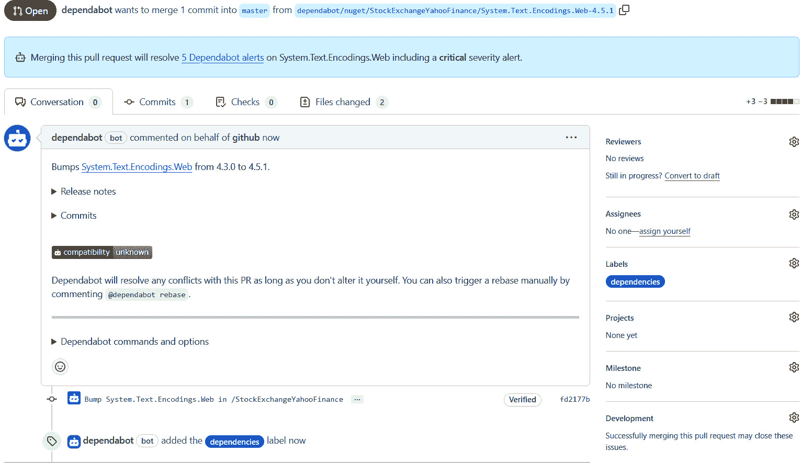

图 10.13 – 合并已修复的问题

定期扫描和更新意味着你的网站不太可能存在可被利用的漏洞。自动化更新流程节省了你手动检查和更新每个依赖项的麻烦。知道 Dependabot 在盯着这些事情，你就可以专注于网站的其他方面或新项目。

你已经学会了如何通过在 GitHub 上使用 Dependabot 进行漏洞扫描来保护你的网站安全。此工具可帮助你识别和修复项目依赖项中的安全问题，使你的网站更安全。接下来，我们将讨论如何使用 GitHub 上的 `CODEOWNERS` 保护你的单页网站。此功能允许你指定团队中的特定人员来审查和批准项目某些部分的更改，确保正确的团队成员监督代码。这有助于维护网站的质量和安全性。

# 使用 `CODEOWNERS` 保护你的单页网站

当你与朋友一起制作单页作品集网站时，你们各自负责网站的不同部分。现在，你希望确保对这些部分的任何更改在成为主网站的一部分之前都由合适的人检查。这就是 `CODEOWNERS` 在 GitHub 上发挥作用的地方。

## 什么是 `CODEOWNERS`？

把 `CODEOWNERS` 想成一份说明谁负责什么的清单。对于你的网站来说，它是一个添加到项目中的文件，列出谁监督网站的不同部分。因此，如果有人想更改某项内容，合适的人会先进行审查。

创建 `CODEOWNERS` 文件比你想象的要容易；你可以按以下几个简单步骤操作：

1. 首先，你创建一个名为 `CODEOWNERS` 的新文件，并将其放在仓库根目录或项目中的 `.github` 文件夹里。这就像把那份清单放在大家都能看到的地方。

2. 下一步你需要添加姓名以指定谁负责什么。在 `CODEOWNERS` 文件中，你写下每个人负责的网站部分。例如，如果你的朋友 Alex 在样式方面很擅长，你可以说 Alex 是 CSS 文件的所有者。

它可能看起来像这样 – `*.css @Alex`。这意味着 Alex 是 `styles.css` 文件的负责人。

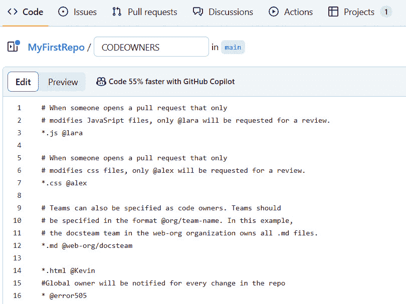

图 10.14 – CODEOWNERS 文件

## `CODEOWNERS` 有何帮助？

`CODEOWNERS` 添加了自动审查，这意味着当有人对 `CODEOWNERS` 中列出的网站部分进行更改时，GitHub 会自动知道在更改被添加到主项目之前请合适的人（例如 CSS 文件的 Alex）进行审查。

`CODEOWNERS` 使事情更安全，有助于防止错误或不必要的更改溜过去，因为最了解某部分的人会先检查它。

这样，你就可以组织谁负责什么，确保每个人都能顺畅地协作，互不干扰。

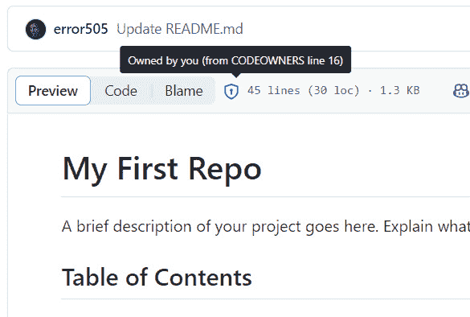

图 10.15 – 由 CODEOWNERS 保护的文件

假设你擅长编写文档，因此你是网站文档的 CODEOWNER。任何人想要更新网站文档时，你都会被要求审查。它确保网站的信息保持清晰，并忠实于你设想的内容。

你会在 `CODEOWNERS` 文件中添加一行，例如 `*.md` 或 `*.txt @YourUsername`，表示你负责内容目录。

通过使用 `CODEOWNERS`，你为网站项目的不同部分设置了一个友好的 *守卫*。就像在说：“*嘿，这部分我负责，但我很乐意在我们正式确定之前审阅你的想法。*” 它保持项目安全，并确保更改始终由熟悉情况的人检查。

因此，设置 `CODEOWNERS` 就像为你的单页作品集网站创建一个安全网，确保每项更改都得到合适的人的认可，保持项目顺利进行并保持最佳状态。

现在你已经设置了 `CODEOWNERS` 来确保合适的人审查我们网站的更改，让我们专注于让你的网站更安全。接下来，我们将学习如何应用安全编码实践。这就像学习夜间如何最好地锁好我们的网站，确保它免受任何不速之客的侵害。你将确保你的网站不仅组织良好，而且编写精良且安全。

# 应用安全编码实践

在你搭建好单页作品集网站并使用 GitHub 管理和分享代码后，你会希望在线上保护好你的个人信息。保护网站代码免受潜在威胁至关重要。

在 GitHub 上搭建单页作品集网站令人兴奋，但确保其安全至关重要。这就像邀请客人进入你的数字家园；你希望确保对每个人来说都是安全可靠的。

让我们深入了解如何使用 GitHub 功能应用安全编码实践。

## 为什么安全开发很重要

把你的网站想象成一本带锁的日记。你不希望陌生人读你的秘密，对吧？同样，在开发软件时，你需要保护它免受未经授权的访问或更改。这意味着确保只有合适的人才能查看或修改你的网站代码和内容。

## 规划安全开发策略

我们将查看几个关键实践，它们作为安全层，从将敏感数据排除在公开视野之外到规范谁可以对项目进行更改：

* **使用 `.gitignore` 保护信息**：就像你不会把日记敞开让所有人阅读一样，你需要将网站数据保护起来，防止不应看到的人访问。想象你有一把通往秘密页面的钥匙，在那里存放敏感信息以免被窥探。在你的 GitHub 仓库中，`.gitignore` 文件就像这页秘密纸，告诉 Git 忽略哪些文件或目录而不上传到 GitHub。这可能包括包含密码或 API 密钥的配置文件。此文件可以创建在仓库根目录，用于告诉 Git 在提交时忽略哪些文件和目录。图 10.16 显示了 `.gitignore` 的使用情况。

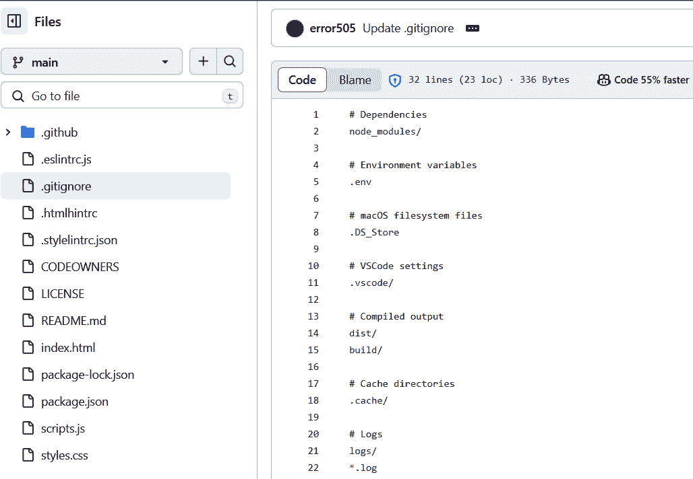

图 10.16 – .gitignore 文件


GitHub 提供了一种使用 `secrets` 安全存储敏感信息（如 API 密钥）的方法。它就像在你的 GitHub 仓库内拥有一个数字保险箱，只有你和授权的协作者才能访问其密码组合。要访问这个安全位置，你只需在 GitHub 上导航到你的仓库，点击 `Settings`，然后在侧边栏找到 `Secrets and variables` 部分。在这里，你可以添加、更新或删除密钥。

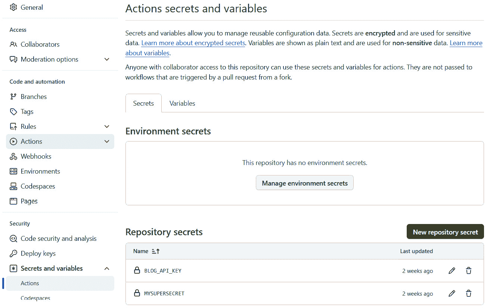
图 10.17 – 仓库密钥和环境变量

### `Who’s knocking?`
检查谁在访问你的网站很重要，就像开门前通过猫眼查看一样。这涉及确保任何访问你网站的人都有权利这样做，并且在进行任何更改之前必须遵守规则：
好吧，但我们如何确定他们拥有适当的权限？只需设置 `branch protection rules` 即可轻松完成。`Figure 10.18` 显示了你可以在哪里找到此设置。

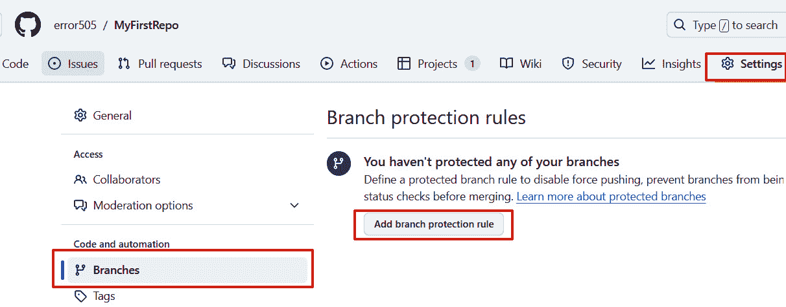
图 10.18 – 分支保护规则

设置分支保护规则就像在门上安装安全系统。它确保只有拥有正确权限的人才能对你的网站进行更改。你可以强制执行诸如在更改合并前要求审查以及确保只有受信任的更新才能进入你的网站等规则。

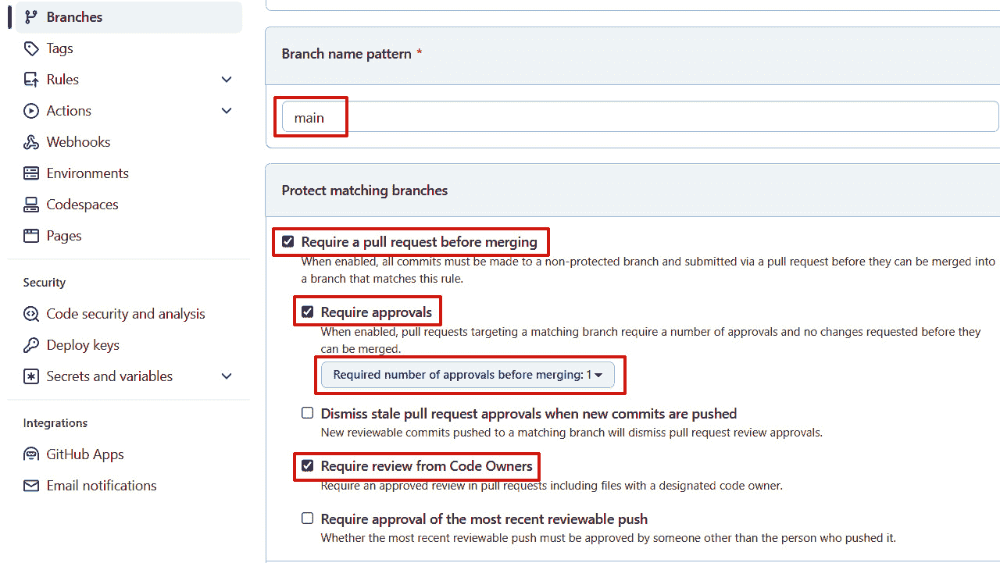
图 10.19 – 创建分支保护规则

设置身份验证和权限对项目的 f 安全至关重要。当有人想要为你的网站贡献内容时，请确保他们就是他们所声称的人。这涉及在你的网站和 GitHub 内设置适当的身份验证机制，确保贡献者拥有正确的访问级别。

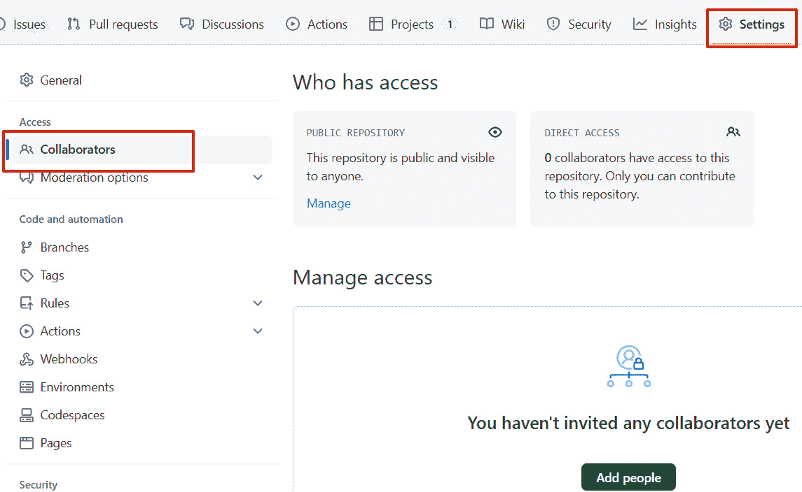
图 10.20 – 向仓库添加协作者

### `Keeping a history`
想象一下你发现日记里被撕掉了一页。你会想知道它何时发生，也许是谁做的。保留网站上发生的事情的日志或记录可以帮助你发现并理解何时出了问题。
对你网站所做的每一次更改都会记录在提交历史中，就像日记条目一样。它是详细记录了谁在何时做了什么的日志簿。如果出现问题，你可以查阅这段历史来寻找线索并在必要时回滚更改。

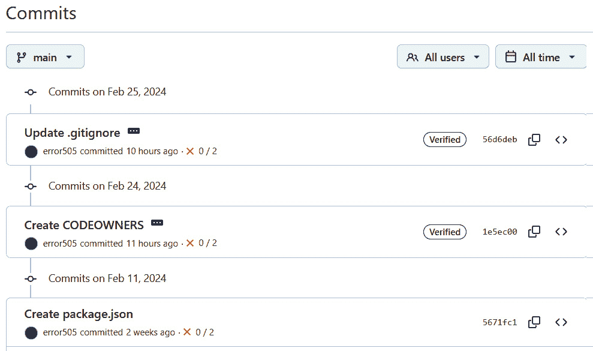
图 10.21 – Git 历史记录

### `GitHub’s security features`
GitHub 具有内置工具来帮助保护你的项目安全，就像数字家庭的安全系统一样：
`Security` 选项卡是管理安全功能的地方。它就像家庭安全系统的控制面板。
借助 GitHub Actions，你可以自动化工作流程，包括安全检查和测试。它就像有一名守卫自动在门口检查访客（代码更改），确保它们安全后再放行。你可以设置操作来扫描代码中的漏洞，或在更改合并前确保符合编码标准。

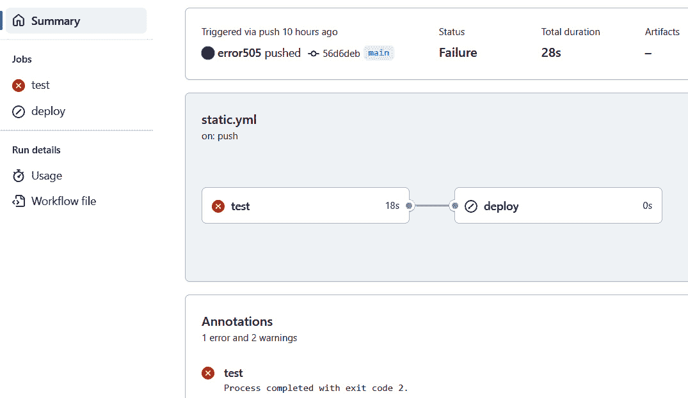
图 10.22 – GitHub Actions 测试

GitHub 的 Dependabot 安全警报就像一座瞭望塔，扫描地平线上的来袭威胁。它会在发现项目使用的依赖项存在漏洞时提醒你。如果 Dependabot 发现了问题，它甚至可以建议或创建拉取请求来将易受攻击的依赖项更新为更安全的版本。

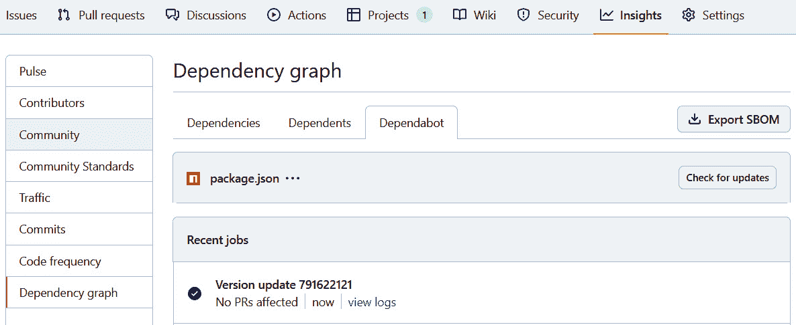
图 10.23 – Dependabot 警报

通过向你的仓库添加 `security policies` 和 `SECURITY.md` 文件来提高安全性。有了这个文件，你可以告诉他人如何负责任地报告安全问题，就像竖起一个牌子写着：“迷路？这里是如何 `get help`。”

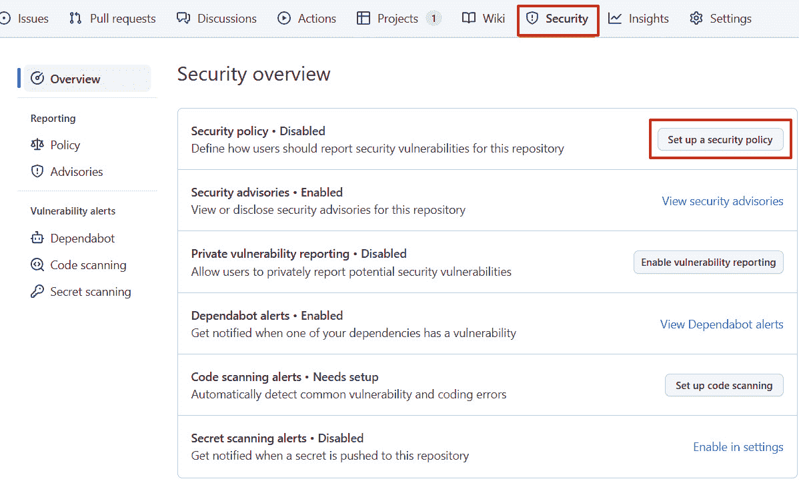
图 10.24 – 启用安全策略

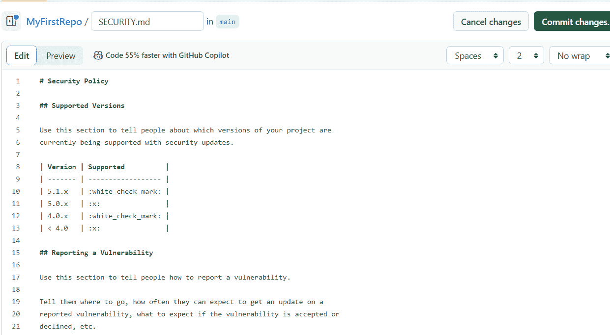
图 10.25 – 创建 security.md 文件

使用 `CodeQL` 功能进行代码扫描会扫描你的代码是否存在安全问题，类似于出门前检查门窗。

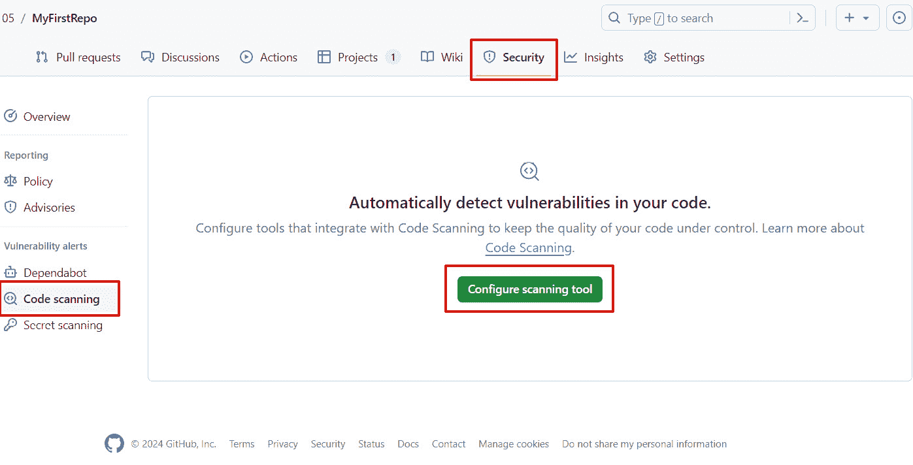
图 10.26 – 配置代码扫描

`CodeQL` 支持编译型和解释型语言，如果你的代码是用以下受支持的语言编写的，它会查找其中的漏洞和错误：
* C/C++
* C#
* Go
* Java/Kotlin
* JavaScript/TypeScript
* Python
* Ruby
* Swift

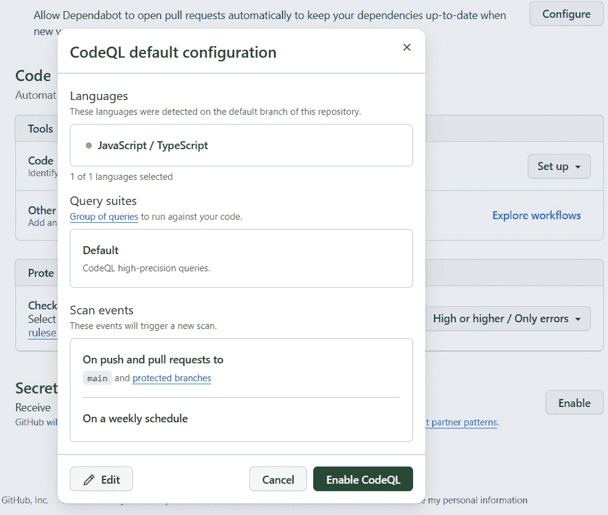
图 10.27 – 配置 CodeQL

当我们谈论安全时，下一个需要考虑的事情是 `Secret Scanning` 功能。假如你弄丢了日记本，它是锁着的，但你把秘密密码写在了封面上？这不是好主意，因为现在任何找到它的人都可以毫无问题地打开它并在那里开始阅读你的日记。在 Web 开发的世界里，尤其是在构建你的单页作品集网站时，这样的密钥（例如 API 令牌或密码）可能会意外地暴露在你的代码中，如果别有用心的人发现它们，就会带来风险。Secret scanning on GitHub scans your code for any secrets. 如果发现任何密钥，它会提醒你，以便你可以在它们被滥用之前取回并保护它们。只需再次进入仓库的 `Secrets` 选项卡并启用 `Secret scanning` 功能即可：

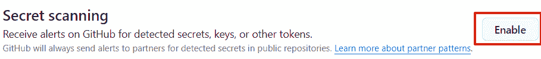
图 10.28 – 启用 Secret scanning

`Secret scanning` 功能将自动提醒你，如果你的代码中存在应该安全保存的密钥。如果没有，你可能会遇到像 `Figure 10.29` 所示的屏幕。

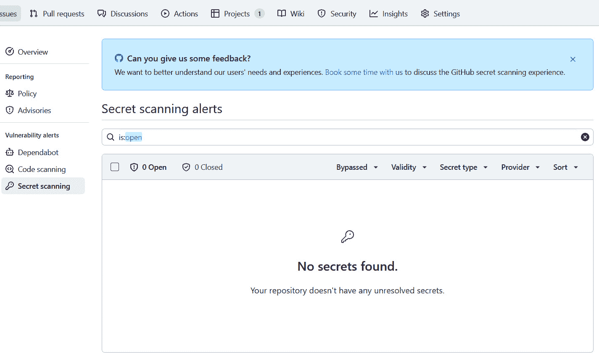
图 10.29 – Secret scanning 运行中

## Building and deploying securely
随着我们阅读本章，我们重点介绍如何安全地构建和部署你的单页作品集网站。这至关重要，因为它不仅仅是让网站看起来好看；还必须确保它对所有访问者都是安全的。以下是你应继续做的事情：
* `Continuous learning`: 网络安全就像规则不断变化的游戏。你和你的团队需要不断学习以保持领先。
* `Writing safe code`: 就像遵循食谱能确保你的蛋糕不失败一样，正确编写代码可确保你的网站按预期工作，同时不会为黑客打开大门。
* `Following the rules`: 你的网站需要遵守法律法规，就像某些配料需要在食品包装上声明一样。

通过将这些安全实践纳入你单页作品集网站的 GitHub 工作流程，你不仅仅是在构建一个项目；你还在确保它成为所有团队成员安全且受欢迎的地方。

# Summary
在 `Chapter 10` 中，我们深入探讨了为你的单页作品集网站增强 GitHub 安全措施，重点关注设置权限、启用 2FA 以及利用漏洞扫描和 Dependabot 等功能来保护你的项目。这些实践可确保只有授权用户才能进行更改、为你的账户提供额外的安全层，并自动更新易受攻击的依赖项。


我们了解到引入 `CODEOWNERS` 文件可以让你指定谁来审查项目某些部分的更改，从而进一步保护你的工作。我们还介绍了安全编码实践的重要性，包括使用 `.gitignore` 来保护敏感信息以及设置分支保护规则。

在下一章中，我们将探讨在项目中设置 **持续集成** 和 **持续部署** (**CI**/**CD**) 工作流，这是从保护代码库到为效率和可靠性自动化和优化开发流程的自然进展。

# Quiz

基于本章关于在 GitHub 上保护单页作品集网站的介绍，以下是一些测验问题，概括了应用安全开发实践的关键要点：

1. 在 GitHub 仓库中设置权限和访问控制的目的是什么？
    1. 决定谁可以贡献代码
    2. 将仓库对所有人锁定
    3. 删除不需要的用户
    4. 自动化代码部署
    *Answer*: A. 决定谁可以贡献代码

2. 真或假 – GitHub 上的 2FA 通过要求第二种验证形式为你的账户增加了一层额外的安全保护。
    1. 真
    2. 假
    *Answer*: A. 真

3. 填空：___________ 会自动更新你的依赖项以修复漏洞。
    *Answer*: Dependabot

4. 哪个文件有助于指定谁可以在 GitHub 上审查和批准项目某些部分的更改？
    1. `README.md`
    2. `.gitignore`
    3. `CODEOWNERS`
    4. `.gitconfig`
    *Answer*: C. `CODEOWNERS`

5. 真或假 – 分支保护规则可以帮助确保只有具有正确权限的个人才能对你的网站进行更改。
    1. 真
    2. 假
    *Answer*: A. 真

6. 将安全编码实践应用于你的 GitHub 项目的一个关键好处是什么？
    1. 更快的部署
    2. 项目规模增大
    3. 增强的安全性
    4. 更轻松的协作
    *Answer*: C. 增强的安全性

7. 填空 – GitHub 的 ___________ 功能会扫描你的项目中暴露的密钥并提醒你对其进行保护。
    *Answer*: secret scanning

8. 哪个 GitHub 功能允许你传达如何在项目中报告安全漏洞？
    1. Pull requests
    2. Issues
    3. Security policies
    4. Wiki
    *Answer*: C. Security policies

9. 真或假 – 保留更改历史和日志以发现并了解网站出现问题时很重要。
    1. 真
    2. 假
    *Answer*: A. 真

10. Dependabot 如何帮助维护你的单页作品集网站的安全性？
     1. 通过为你的网站撰写新内容
     2. 通过自动更新有漏洞的依赖项
     3. 通过更改你的网站设计
     4. 通过在社交媒体上推广你的网站
     *Answer*: B. 通过自动更新有漏洞的依赖项

## 11 与开源社区互动

## 与开源社区互动

欢迎踏上进入开源社区核心的激动人心之旅！在本章中，我们将深入开源项目的充满活力的生态系统，在那里创新、协作和学习交汇。开源软件驱动着我们周围数字世界的很大一部分，了解如何与这个社区互动可以为成长、学习和贡献带来无数机会。

到本章结束时，你将知道如何探索和选择与你的兴趣相符的开源项目，做出得到认可和重视的有意义的贡献，并驾驭许可和法律考虑的复杂格局。你还将学习如何应用开源礼仪和最佳实践，确保你的贡献不仅被接受而且被欣赏。无论你是要为第一个项目做出贡献还是旨在启动自己的项目，本章都将为你在开源社区中蓬勃发展提供所需的知识和技能。

在本章中，我们将涵盖以下主要主题：
* 探索开源项目
* 结合实际示例做出有意义的贡献
* 驾驭许可和法律考虑
* 为你的 GitHub 仓库创建许可证
* 开源礼仪和最佳实践

## 技术要求

在深入本章之前，请确保你对常见的编程语言（JavaScript 和 Python）以及与你感兴趣的项目相关的工具有基本了解。你可以访问 [www.w3schools.com](http://www.w3schools.com) 以快速了解 GitHub 上使用的许多编程语言。要访问本章中提到的代码示例和资源，请访问我们的 GitHub 仓库 at [`github.com/PacktPublishing/GitHub-for-Next-Generation-Coders/tree/main/Space%20Explorer%20Game/Game-final`](https://github.com/PacktPublishing/GitHub-for-Next-Generation-Coders/tree/main/Space%20Explorer%20Game/Game-final)。

## 探索开源项目

欢迎来到开源的世界！在编程世界中，通过互联网在项目上共同工作不仅很常见；它也是大多数酷炫事物诞生的方式！开源项目就像大型数字游乐场，世界各地的程序员都来这里一起玩耍、学习和创造。

想象一下搭建一个巨大的乐高套装，其中每一块都是代码行，任何人都可以添加一块，建议更改，或找到更好的连接方式。

### 听起来很有趣，但从哪里开始？

首先，你会从寻找你喜欢的项目开始。先想想你喜欢什么。你喜欢电子游戏、绘画，还是也许帮助地球？几乎肯定有一个开源项目符合你的兴趣。GitHub 允许你使用关键词搜索项目，就像在线搜索你最喜欢的视频一样。你需要做的就是使用搜索栏，如 *图 11.1* 所示。

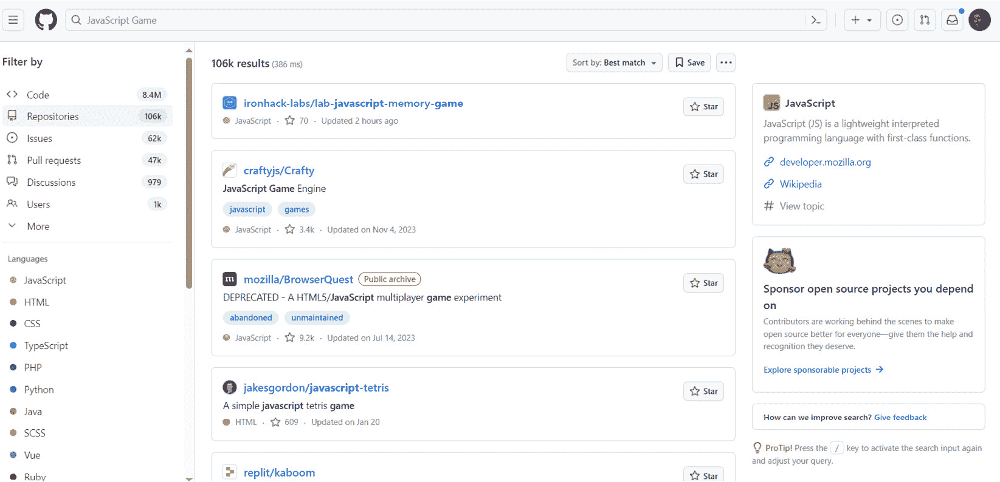
图 11.1 – 在 GitHub 上搜索项目

### 了解项目页面

当你找到喜欢的项目时，点击它以导航到其页面，它将作为你的地图。它展示了项目的一切信息。

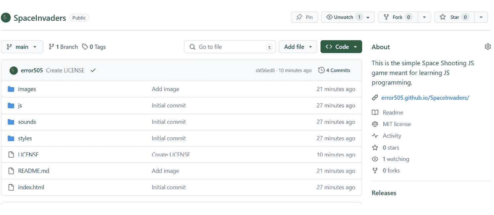
图 11.2 – GitHub 上的一个开源项目

在项目的页面上，你会找到以下内容：
* `README` 文件，它就像一本书的介绍页。它告诉你项目是什么、如何使用它以及如何提供帮助。

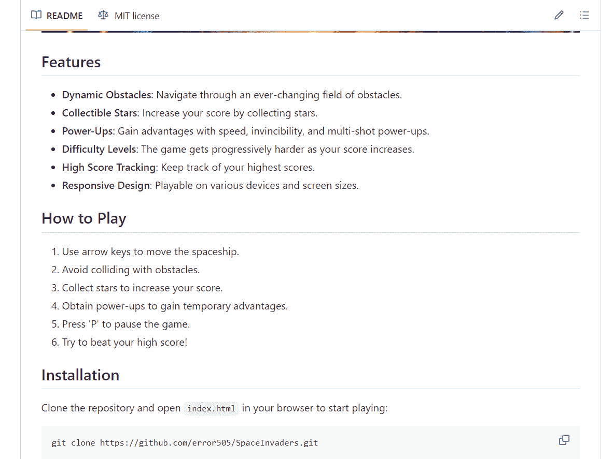
图 11.3 – README 文件

* **Issues** 标签，它就像待办清单。它显示需要修复或添加到项目中的内容。如果你想提供帮助并进一步为开源项目建设贡献力量，这是一个很好的起点。一些任务非常适合初学者，甚至会写上 **good first issue** 来提醒你。

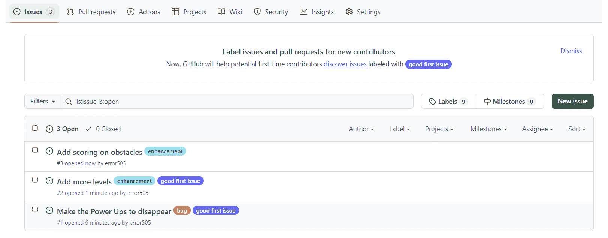
图 11.4 – 项目问题

* *贡献指南*，它们是关于如何提供帮助的说明。它们就像游戏规则，展示了如何在项目中与其他人一起协作。


图 11.5 – 贡献指南

### 入门

开始参与开源项目时应注意以下几点：
* **打个招呼！**：在开始之前，向项目所有者问好是很好的。许多项目都有讨论区或聊天区。你可以自我介绍，告诉大家你喜欢项目的哪些方面，并询问如何提供帮助。这就像加入学校的新班级并交朋友一样。


图 11.6 – 项目讨论


### 小步前进
不必担心一开始就做大事。小贡献同样重要。也许你会在某些说明中发现拼写错误，或是有想法让某些东西看起来更美观。这些小建议是开始的好方式。

在前面的插图中展示的示例项目中，你可以看到游戏暂停功能尚未实现，因此你的贡献可以是实现该功能，或更新 `README` 文件，删除 `5. Press ‘P’ to pause the game` 这一行。


图 11.7 – 缺失功能的《如何游玩》README

### 学习与成长
当你探索并为开源项目做出贡献时，你会学到新东西，犯错并不断改进。请记住，每位程序员，甚至专家，都曾像你一样起步。

通过加入开源社区，你正朝着成为一名优秀程序员、创造酷炫事物并帮助他人的道路上前进。

你已经体会到探索和为开源项目做出贡献是多么有趣且有回报的事情，所以让我们迈出下一步。在接下来的章节中，我们将了解你如何开始做出有意义的贡献。你将看到一些虽小却影响巨大的改动示例，并学习到每一点帮助都很重要。

# 通过真实示例做出有意义的贡献
在这里，你将学习如何在 GitHub 上为真实项目做出贡献。我们将以 *Space Invaders* 游戏作为示例。目前游戏中有一个小错误——标题写的是 *Space Explorer*，而应该是 *Space Invaders*。让我们一起修复它！


图 11.8 – 在 GitHub 上搜索项目

按以下步骤修复问题：

1. **查找问题**：首先，你需要确保该问题已列在项目的 GitHub 页面上。如果没有，你可以创建一个新问题，让大家知道你计划修复的内容。


图 11.9 – 查找要处理的问题

如你所见，关于重命名游戏的问题已经打开。现在，你可以继续下一步。

1. **Fork 仓库**：接下来，通过 `forking` 仓库来制作游戏代码的自己的副本。


图 11.10 – Fork 仓库

这意味着你将在自己的 GitHub 账户上拥有一个可以随意更改的版本。


图 11.11 – 创建仓库的 fork

1. **克隆仓库**：现在，你将把 fork 后的游戏版本下载到你的电脑上。这称为 `cloning`。这样做是为了让你可以在自己的电脑上对代码进行更改。


图 11.12 – 克隆仓库

1. **在问题上评论**：在问题上留言总是很好的，这样其他人就知道你将要处理它。


图 11.13 – 在问题上评论

1. **进行更改**：让我们找到代码中游戏标题错误的部分。


图 11.14 – 进行更改

你需要将 *Space Explorer* 改为 *Space Invaders*。这可能在名为 `index.html` 的文件中，具体取决于游戏的制作方式。

1. **测试更改**：在与大家分享更改之前，你需要确保它能正常工作。让我们在电脑上运行游戏，通过在浏览器中打开 `index.html` 文件，看看标题是否已更改为 *Space Invaders*。


图 11.15 – 测试更改是否已正确应用

1. **提交并推送你的更改**：测试后，你将 `commit` 你的更改，这意味着将它们保存到你在 GitHub 上的游戏版本中。然后，你 `push` 这些更改，将它们从你的电脑发送到 GitHub。


图 11.16 – 推送你的更改

1. **创建拉取请求**：最后，你请求游戏的原始创建者接受你的更改。你可以通过创建 `pull request` 来实现。


图 11.17 – 创建拉取请求

1. 他们会审查你所做的工作，如果他们喜欢，就会将你的更改合并到官方游戏中。

恭喜！你刚刚为真实项目做出了有意义的贡献。这就是程序员协作使项目变得更好的方式。

现在你已经通过修复 *Space Invaders* 游戏中的标题完成了第一次真正的编码协作，让我们继续前进。接下来，我们将探讨这类项目工作中的一个重要方面——了解许可和法律问题。这可能听起来没有编码那么令人兴奋，但确保你可以在没有法律问题的情况下分享你的作品非常重要。

# 导航许可和法律注意事项
当你创造出很酷的东西，比如游戏或应用时，你可能想与社区分享以寻求贡献并加快开发。GitHub 是个很好的地方，但在上传项目之前，考虑许可和法律问题很重要。这可能听起来很无聊，但实际上是为了保护你的项目并决定他人如何使用它。


图 11.18 – 仓库上的 LICENSE

*什么是 **许可证？*
**许可证** 就像你项目的规则集。它告诉人们可以用你的代码做什么、不能做什么。例如，他们可以免费使用吗？需要给你署名吗？可以更改并分享自己的版本吗？选择合适的许可证有助于你按自己的方式分享作品。

*为什么 **许可证很重要？*
许可证可以保护你和你的作品免受可能出现的任何法律问题。它们也可以保护使用你项目的人，让他们知道什么可以做什么不可以做。没有许可证，你的项目就像没有攻略的游戏；没人知道规则是什么！这可能导致误解或人们害怕使用或为你的项目做出贡献。

## 选择许可证
有很多许可证可供选择，选择适合自己需求的许可证可能非常令人困惑。GitHub 文档页面上列出了大量许可证，如 *图 11.19* 所示。


图 11.19 – 许可证列表

但你很幸运，因为有几种对像你这样的年轻程序员很友好的许可证。如下所示：

* `MIT license`：这个非常简单。它允许其他人几乎可以对你的项目做任何他们想做的事情，例如使用、更改和分享，只要他们给你署名。


图 11.20 – MIT 许可证

* `GNU General Public License` (`GPL`)：它规定如果有人更改你的项目并分享它，他们必须分享他们所做更改的说明。这关乎分享改进。


图 11.21 – GNU 许可证

* `Creative Commons licenses`：这些不仅适用于代码；这些许可证也适用于图片、游戏和故事等创意作品。它们让你选择他人如何使用你的作品。你可以在下图中找到更多信息。


图 11.22 – Creative Commons 许可证

## 需要更多帮助？


如果选择许可证让你感到困惑，没关系，可以寻求帮助。有一个很棒的网站在 [`choosealicense.com`](https://choosealicense.com) 可以帮助你选择合适的许可证。在那里，你可以轻松看到差异并挑选合适的。你也可以找一位你信任的人来提供必要的指导。他们可以帮助你了解在保持安全的前提下分享项目的最佳方式。

在 GitHub 上分享你的作品是学习和成长的好方法。只要确保你思考好想要如何分享，这样每个人都知道规则，你的项目也能得到保护。

# 为你的 GitHub 仓库创建许可证

那么，现在你已经创建了仓库，想要与社区分享，但如何为仓库创建许可证呢？

在本节中，我们将用几个简单的步骤来解释如何操作：

1. 在 GitHub 上创建新仓库时，在输入仓库名称和描述后，你会找到添加许可证的选项。


图 11.23 – 在创建仓库时创建许可证

1. 要选择许可证，只需点击 `Choose a license` 下拉菜单。


图 11.24 – 选择许可证

GitHub 提供了一份可供选择的许可证列表。选择最符合项目需求的许可证。如果你不确定，GitHub 会为每个许可证提供简短说明以帮助你决定。

如果你已经创建了仓库但忘记添加合适的许可证怎么办？不用担心——有一个快速技巧可以轻松完成。让我们看看怎么做：

1. 进入你的 GitHub 仓库，点击 `Add file` 按钮，然后选择 `Create new file`。


图 11.25 – 添加新的许可证文件

1. 将此文件命名为 `LICENSE` 或 `LICENSE.md`，然后会自动显示一个新选项，可在此从模板中选择许可证。选择此名称对于确保它在 `License` 部分正确显示至关重要。


图 11.26 – 选择许可证模板

1. 点击 `Choose a license template`，将为你打开一个新页面，在那里你可以选择最符合需求的许可证。


图 11.27 – 提交许可证

1. 选择好合适的许可证后，点击 `Review and submit` 按钮将其添加到你的仓库。

正如你所见，添加新许可证非常容易，并且能明确他人可以和不可以对你的项目做什么。现在，让我们学习一些与开源相关的最佳实践。

## 开源礼仪和最佳实践

正如你所知，开源是一个可以分享编程项目给他人并帮助改进他人分享的项目的地方。然而，就像任何社区一样，也有成为一个良好且受人尊重的成员的方式。在本节中，我们将讨论在与他人合作进行编程项目时如何保持礼貌和乐于助人。

这里是你应该记住的内容：

* **尊重且友善**：与其他程序员交流时，始终保持友善和尊重。记住，屏幕另一端是一个真实的人。如果你建议对某人的项目进行更改，请以友好的方式表达。想想如果有人对 *你* 的 *你的* 项目这样谈论，你会有什么感受。

* **先问后动**：如果你找到一个想要帮助的项目，那很棒！但首先，检查项目所有者是否想要帮助以及他们想要哪种帮助。一些项目对此有指南，因此请在项目的根文件夹或 `README` 文件中查找名为 `CONTRIBUTING` 的文件。

* **做出清晰的更改**：当你对项目进行更改时，解释你为什么这样做。这有助于项目所有者理解你的思路，并使他们更容易决定是否要包含你的更改。如果你修复了错误或添加了新功能，请在你的信息中说明。

* **从反馈中学习**：有时，项目所有者可能会要求你在贡献中更改某些内容。那没关系！这是过程的一部分。倾听他们的反馈并尝试从中学习。这是一个成为更好程序员的好方法。

* **说谢谢**：如果有人帮助你的项目，不要忘记说谢谢。一点善意就能让开源社区变得友好和受欢迎。

遵循这些简单规则，你将顺利成为开源社区中优秀且受人尊重的成员。祝编程愉快！

## 摘要

在本章中，我们探讨了参与开源社区的核心方面，包括如何有意义地探索和贡献开源项目、理解许可、为项目创建许可证以及遵守最佳实践和礼仪。这些课程为你提供了负责任和有效地为开源世界做出贡献的知识，同时提升你的技能和更广泛的编程社区。

在下一章中，我们将把重点转向打造你的 GitHub 个人资料。这将是一个自然的进展，强调如何以最佳方式展示自己和你的贡献，进一步与社区和潜在协作者互动。

## 测验

请回答以下问题：

1. 在贡献之前探索开源项目的重要性是什么？

1. 找到最简单的项目
2. 将你的兴趣和技能与合适的项目匹配
3. 查看项目的星标数量
4. 以上都不是

*Answer*: B. 将你的兴趣和技能与合适的项目匹配

2. 真假——做出有意义的贡献需要理解项目的需求和社区准则。

1. 真
2. 假

*Answer*: A. 真

3. 填空——理解 \_\_\_\_\_\_\_\_\_\_ 对于确保你的贡献不违反任何法律或道德标准至关重要。

*Answer*: 许可和法律考虑

4. 为你的 GitHub 仓库创建许可证的第一步是什么？

1. 选择限制所有用途的许可证（限制在未经许可的情况下使用代码）
2. 咨询律师
3. 了解可用的许可证类型
4. 以上皆可

*Answer*: C. 了解可用的许可证类型

5. 真假——开源礼仪涉及尊重项目的文化和沟通规范。

1. 真
2. 假

*Answer*: A. 真

6. 开源贡献的关键要素是什么？

1. 保持你的工作私密
2. 做大改动以展示你的技能
3. 为你的代码提供清晰且有帮助的文档
4. 只贡献代码

*Answer*: C. 为你的代码提供清晰且有帮助的文档

7. 填空——在处理许可时，了解 \_\_\_\_\_\_\_\_\_\_ 与宽松许可证之间的区别很重要。

*Answer*: 限制性

8. 以下哪项不是参与开源社区的良好做法？

1. 未经测试就提交代码
2. 阅读项目的贡献指南
3. 遇到疑问时提问
4. 提供建设性反馈

*Answer*: A. 未经测试就提交代码

9. 真假——为你的 GitHub 仓库创建许可证是可选的但推荐的。

1. 真
2. 假

*Answer*: A. 真

10. 你如何对开源项目做出有意义的贡献？

1. 只是在 `README` 文件中修正错别字
2. 在未与维护者讨论的情况下添加新功能


3. 通过参与建设性讨论并提交高质量的拉取请求
4. 通过观察项目而不做贡献
*答案*: C. 通过参与建设性讨论并提交高质量的拉取请求
