## 12 打造你的 GitHub 个人资料

### 打造你的 GitHub 个人资料

本章中，我们将学习如何打造有影响力的 GitHub 个人资料，以展示你的项目和贡献，从而突出你作为程序员的技能、奉献精神和多才多艺。通过优化你的个人资料，你可以给访客留下深刻的第一印象，包括潜在的合作者、雇主和同行开发者。本章旨在提供实用指导，帮助你让 GitHub 个人资料不仅反映你的编码之旅，也成为职业机会的平台。
本章中，我们将涵盖以下主要主题：
* 优化你的 GitHub 个人资料概览
* 展示技能和专业知识
* 在个人资料中添加统计数据和成就
* 战略性地展示项目和贡献

#### 技术要求

对于某些活动，我们将使用外部工具和服务，例如 [`shields.io/`](https://shields.io/) 和 [`github-readme-streak-stats.herokuapp.com`](https://github-readme-streak-stats.herokuapp.com)。请确保你熟悉 `Markdown`，因为它是自定义 README 个人资料的必备条件。
此外，从 [`github.com/PacktPublishing/GitHub-for-Next-Generation-Coders/tree/main/Chapter%2012`](https://github.com/PacktPublishing/GitHub-for-Next-Generation-Coders/tree/main/Chapter%2012) 下载名为 `Chapter 12` 的 GitHub 文件夹，其中包含可供你跟随使用的 `README` 模板。

#### 优化你的 GitHub 个人资料概览

你的 GitHub 个人资料就像你的在线编码传记——一个展示你的技能、项目和对编码世界的贡献的地方。正如你希望在现实生活中给人留下良好的第一印象一样，拥有经过优化和个性化的 GitHub 个人资料会产生很大的不同。在本节中，我们将学习一些很酷的技巧，让你的个人资料看起来很棒！
让我们开始：
* **添加个人资料图片和简介**：首先使用一个清晰的自己照片，背景为漂亮的单色。它让你的个人资料更具个人特色。写一个简短但能透露很多关于你信息的简介。你是网页开发者、Python 开发者还是游戏设计爱好者？在这里提及！
    *示例*：**你好！我是 Igor Iric，我对编码如何将想法变为现实着迷。我喜欢学习新的编程语言并与其他程序员合作。现在，我正在构建一个有趣的 ****新游戏！**
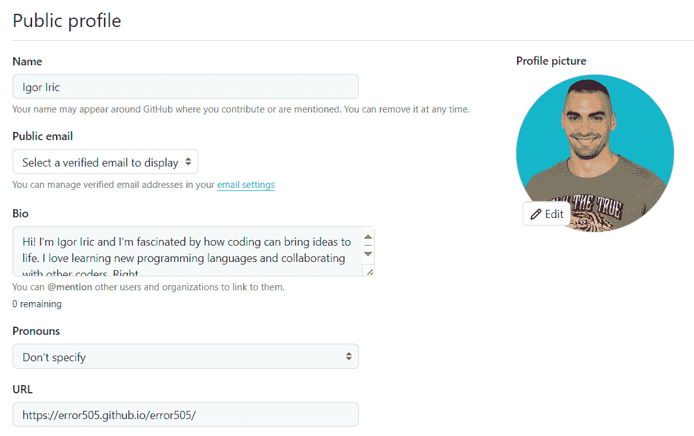
图 12.1 – GitHub 配置文件
* **固定仓库**：GitHub 允许你将仓库固定到个人资料上。选择展示你的技能和你喜欢从事的工作的项目。它可以是你构建的网站、游戏或让某事变得更简单的工具。如你在 *图 12.2* 中所见，你可以点击 **自定义你的固定项目** 并选择想要展示的仓库：
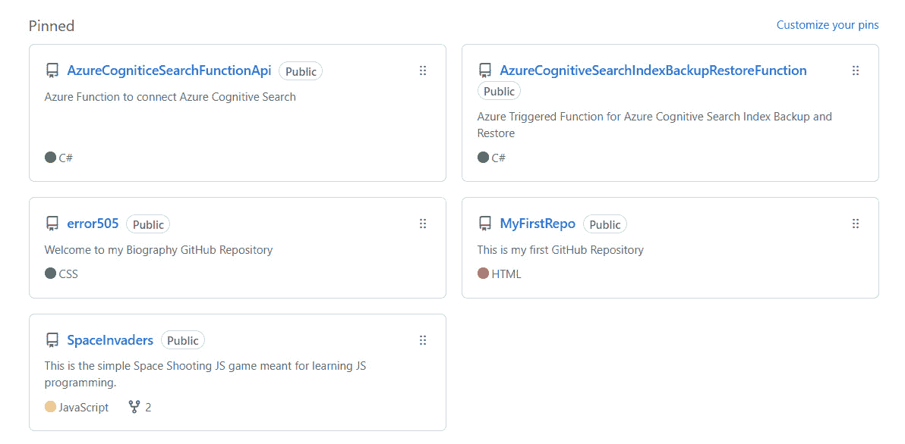
图 12.2 – 已固定项目
* **贡献图**：这是告诉你 GitHub 活动的地方，所以保持活跃！你的贡献图显示了你编码的多少。尝试定期为你的项目或其他人的项目做出贡献。它表明你一直在学习和改进：
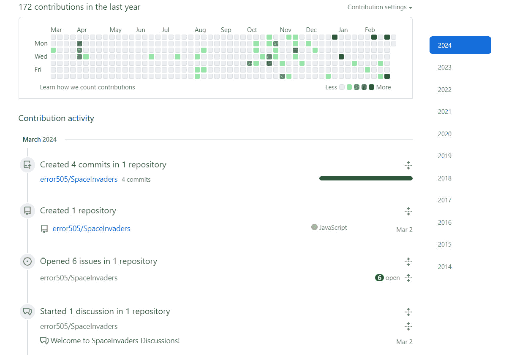
图 12.3 – 贡献图
* **徽章**：这些是展示你的编码技能和贡献的小成就。尝试通过参与编码挑战或为开源项目做出贡献来获得徽章。它们增添了一点乐趣，并向他人表明你是一个活跃的程序员：
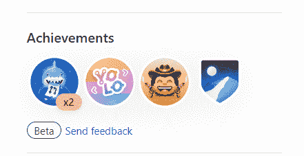
图 12.4 – 徽章
现在你已经掌握了让 GitHub 个人资料看起来不错并脱颖而出的基础知识，让我们继续前进。接下来，我们将重点关注如何真正突出你的技能和专业知识。我们将探索如何强调你的擅长之处，以及如何让他人轻松看到你的编码优势。这是你展示自己最自豪的项目和成就的机会！

#### 展示技能和专业知识

在本节中，我们将探索 GitHub 上一个名为 **GitHub README profile** 的特殊功能！这就像你在 GitHub 上的完整传记或简历——一个空间，你可以在其中向社区介绍你自己、你正在从事的有趣项目以及关于你的许多其他细节。听起来很棒，但你如何创建自己的 README 个人资料？

##### 创建你的 README 个人资料

创建一个完全关于你的 GitHub 特殊仓库非常简单。只需创建一个与你的 GitHub 用户名同名的新仓库。是的——它必须完全相同。在我的例子中，仓库名为 `error505`：
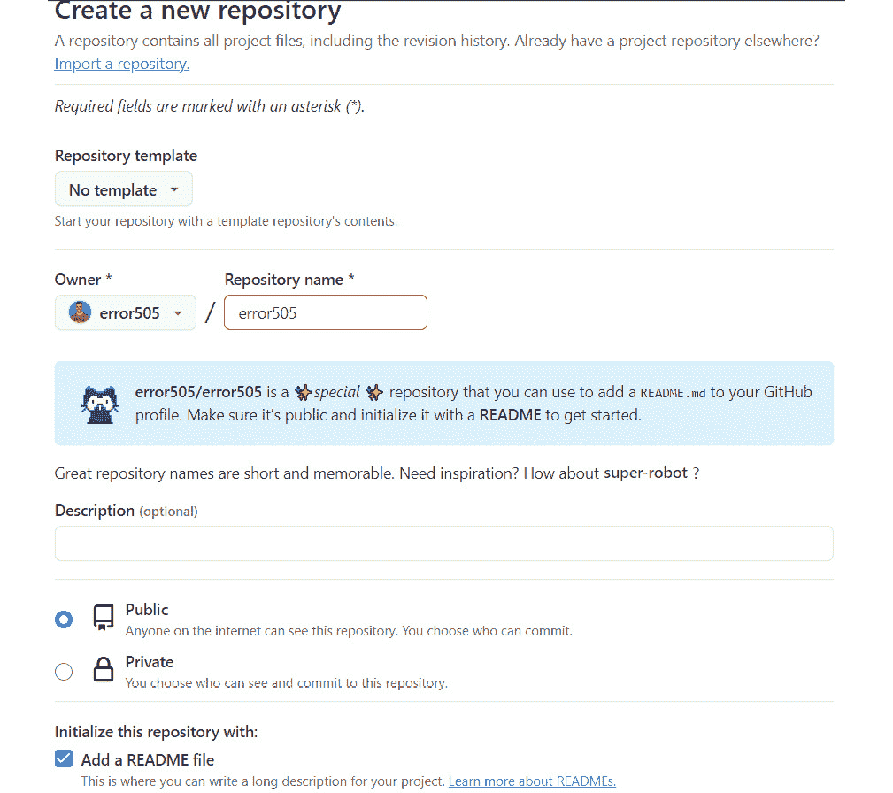
图 12.5 – 创建个人资料仓库
如你在 *图 12.5* 中所见，在输入用户名作为仓库名称后，会自动显示一条消息。该消息显示此仓库将是特殊的，并询问你是否希望创建 README 文件并将其设为公开。
一旦你这样做，GitHub 会做一件很酷的事情。它会在你的个人资料上显示此仓库中的 README 文件供所有人查看。现在，你可以开始编辑你的 README 文件并添加一些关于你自己和你的成就的有趣信息：
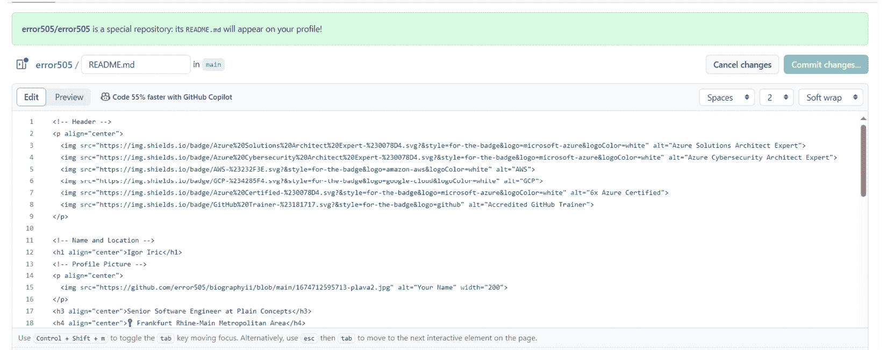
图 12.6 – 添加 README

##### README 文件中应包含什么？

像往常一样，你可以先分享你的名字、自己的照片以及你居住的地方。此外，你可以添加很酷的徽章来展示你的关键技能。你可以在 *图 12.7* 中查看我的个人资料：
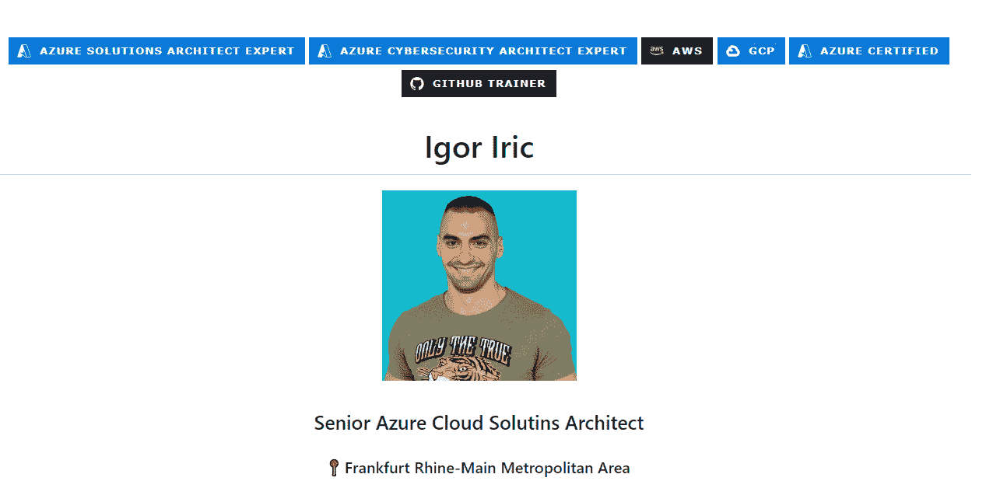
图 12.7 – 为个人资料添加标题
以下代码块旨在增强你的 GitHub 个人资料，将其转变为关于你、你的技能和你的位置的视觉吸引力和信息丰富的页面。它就像设置一个数字名片或简历，任何访问你 GitHub 个人资料的人都可以立即看到。
这里是对存储库中 `README` 模板的分解（[`github.com/PacktPublishing/GitHub-for-Next-Generation-Coders/tree/main/Chapter%2012`](https://github.com/PacktPublishing/GitHub-for-Next-Generation-Coders/tree/main/Chapter%2012)）以及每个部分的作用：
* **添加徽章**：此部分在你的个人资料中添加一个徽章，展示你作为 Azure 解决方案架构师专家的认证。它是向访客快速传达你专业知识的视觉提示：
```
<!-- Header -->
<p align="center">
  
</p>
```


### 设置姓名
以下代码以大字体设置您的姓名并将其居中显示在页面上，使其对访客立即可见。在姓名下方，它添加了您的职位，**Senior Azure Cloud Solutions Architect**，以及您的位置，**📍 Frankfurt Rhine-Main Metropolitan Area**，同样居中以便阅读。这提供了关于您的快速、基本信息：
```
<!-- Name and Location -->
<h1 align="center">Your Name</h1>
<h3 align="center">Senior Azure Cloud Solutions Architect</h3>
<h4 align="center">📍 Frankfurt Rhine-Main Metropolitan Area</h4>
```

### 个人头像
这为您的个人头像预留了空间，使个人资料更具个人特色和亲和力。该图像从特定的 GitHub 仓库中提取，并以中等尺寸显示：
```
<!-- Profile Picture -->
<p align="center">
  
</p>
```

### 简介
接下来，您可以继续添加一段简短的个人简介，在其中解释您喜欢编程的原因以及您现在正在学习的内容。您还可以写下您接下来打算学习的内容，这能向他人展示您对成长的热情。您可以在以下图中查看我的 **About Me** 部分：
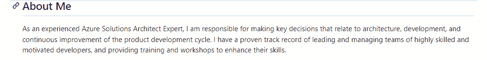
图 12.8 – 关于我 部分

### 关于我
以下代码片段介绍了 **About Me** 部分，您可以在其中分享有关您的专业背景、专业知识以及您希望突出的任何其他个人见解的信息。在此部分中，您可能会讨论您作为年轻程序员的旅程、您的成就、推动您职业发展的动力，或您如何应对挑战。这是一个讲述您的故事、与访客建立联系并为 GitHub 上展示的工作提供背景的机会：
```
<!-- About Me -->
## About Me
As an experienced Azure Solutions...
```

### 技能
您还可以以徽章和图片的形式添加您的技能、证书和专业知识：
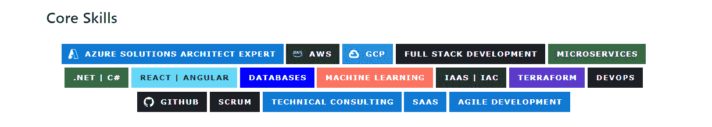
图 12.9 – 核心技能 部分
以下代码块旨在直接在您的 GitHub 个人资料上展示您的核心技能，通过具有视觉吸引力的徽章突出您的技术能力。就像将微服务、.NET、C# 以及 React 和 Angular 框架等技能的奖牌别在您的数字个人资料上一样。将这些徽章居中排列可创建引人注目的展示，能让访客快速了解您的专业领域。这种设置非常适合希望直观展示技能组合的开发人员，使其 GitHub 个人资料不仅是代码存放地，也是其在关键技术方面熟练程度的证明：
```
<!-- Core Skills -->
## Core Skills
<p align="center">
  
  
  
</p>
```
正如您所见，`shields.io` 网站已被用于展示您最重要的技能。[`shields.io/docs/logos`](https://shields.io/docs/logos) 是一个开源的徽章服务，您可以轻松将其包含在您的 GitHub README 个人资料或任何其他仓库的 README 中：
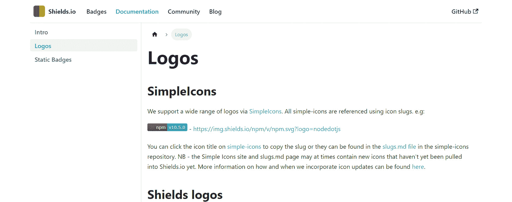
图 12.10 – Shields.io

### 图像
如果您愿意，您还可以使用来自各种来源的其他图像来展示您的证书、技能、社交图标或类似内容。只需在图像标签中指定您想要引用的图像的来源，它就会显示在您的个人资料上：
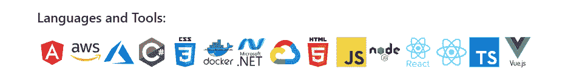
图 12.11 – Custom showcase icons

### 认证
以下代码块在您的 GitHub 个人资料上展示特定的认证，证明了您的成就和专业知识。通过将这些徽章居中排列，布局确保它们能吸引访问您个人资料的任何人的注意：
```
<!-- Certifications -->
## Certifications
<p align="center">
  
</p>
<p align="center">
  <a href="https://www.credly.com/badges/70f4339c-6104-4d19-b0cf-40471e7cef1f/public_url" target="_blank">
    
  </a>
  <br>
</p>
```
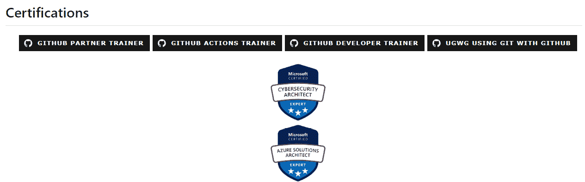
图 12.12 – Adding images

现在您已经学会如何使用徽章自定义 GitHub README 个人资料并展示您的技能和认证，是时候更进一步了。接下来，我们将研究如何向您的个人资料添加统计数据和成就。这就像在房间里挂上您的高分和奖杯，展示您所取得的成就以及您在编程之旅中表现出的活跃程度。让我们让您的 GitHub 个人资料不仅反映您的技能，也成为您成就的庆祝。

# 向您的个人资料添加统计数据和成就
您的 GitHub 个人资料就像您的超级英雄服装。它告诉人们关于您的能力（技能）、您的冒险（项目）以及您一路获得的荣誉徽章（成就）。但是如何确保人们一次就能看到您做过的所有酷炫的东西呢？这就是小部件发挥作用的地方！

## 这些小部件是什么？
**Widgets** 就像您可以添加到 GitHub 个人资料的 README 文件中的小展示窗口（一份介绍您和您的工作的特殊文档）。这些小部件可以展示您的 GitHub 统计数据，例如您参与了多少项目或使用了多少编程语言。这是一种以有趣且直观的方式展示您的编程之旅和成就的方式。

以下是一些小部件示例：
* **GitHub Stats**：此小部件显示您做出的贡献数量、为您的项目点星的人数等。它就像您 GitHub 活动的迷你成绩单。
* **Top Languages**：此小部件显示您最常使用的编程语言，让观众了解您的编程偏好。
* **Streak Stats**：这突出了您连续贡献的天数，展示了您的奉献精神。

让我们将所有这些 **GitHub Stats** 小部件添加到您的个人资料中。您可以使用 https://github.com/anuraghazra/github-readme-stats API 来显示状态和使用的主要语言。在那里，在 `github-readme-stats` 的 GitHub 仓库中，您可以找到许多演示并非常轻松地配置您自己的统计小部件：
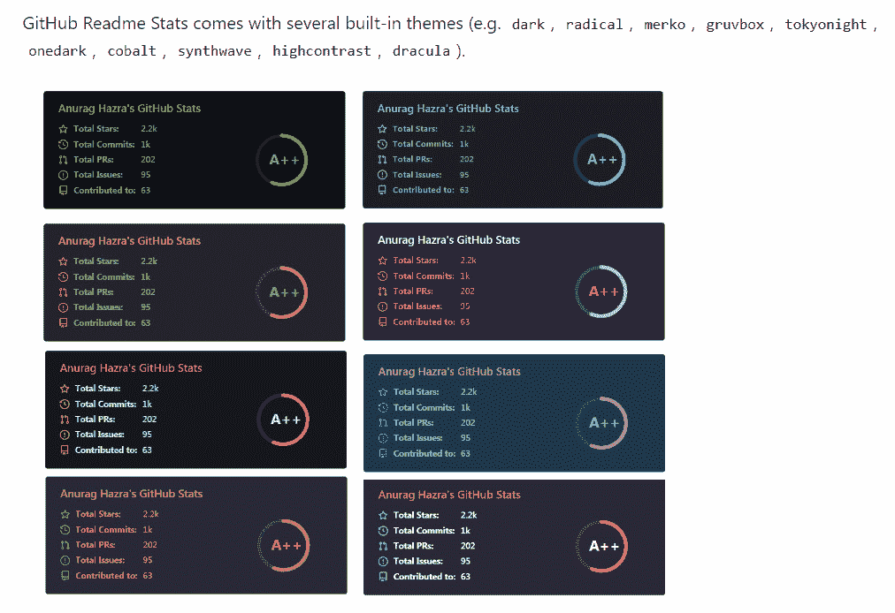
图 12.13 – GitHub Stats 小部件

这就是您可以让每个人了解您的编程偏好以及您在 GitHub 上取得的成就的方式。通过将这些小部件添加到您的 GitHub README 个人资料中，您可以分享您最常用的编程语言并突出显示您的 GitHub 活动，例如贡献、提交等。只需在 URL 中将 `[your-username]` 替换为您实际的 GitHub 用户名，这些图表就会自动更新以展示您的统计数据。这是一种有趣且动态的方式，向访问您个人资料的任何人展示您的技能和辛勤工作：


```
# 📊 GitHub Stats:
<p></p>
<p>&nbsp;</p>
```
同样地，你可以使用 https://github-readme-streak-stats.herokuapp.com/demo/ 来展示你的连续提交统计。**连续提交统计** 小部件可以通过他们网站上的配置 UI 轻松配置：
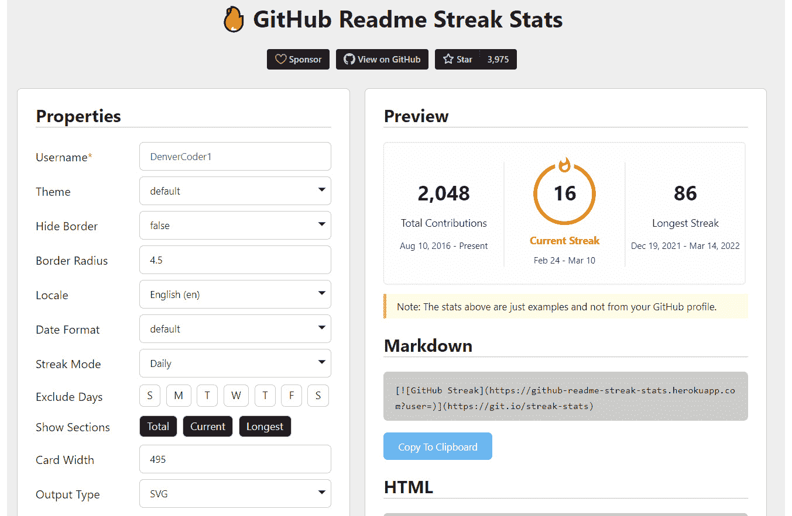
图 12.14 – GitHub 连续提交统计小部件配置
以下代码片段会在你的个人资料中添加一个动态图表，突出显示你的 GitHub 活动连续提交情况。它就像你编码一致性的视觉日记，让人一窥你定期为项目提交的频率，并展示你作为开发者的承诺和进步。只需将 `\[your-username\]` 替换为你的实际 GitHub 用户名即可个性化设置：
```
<p></p>
```
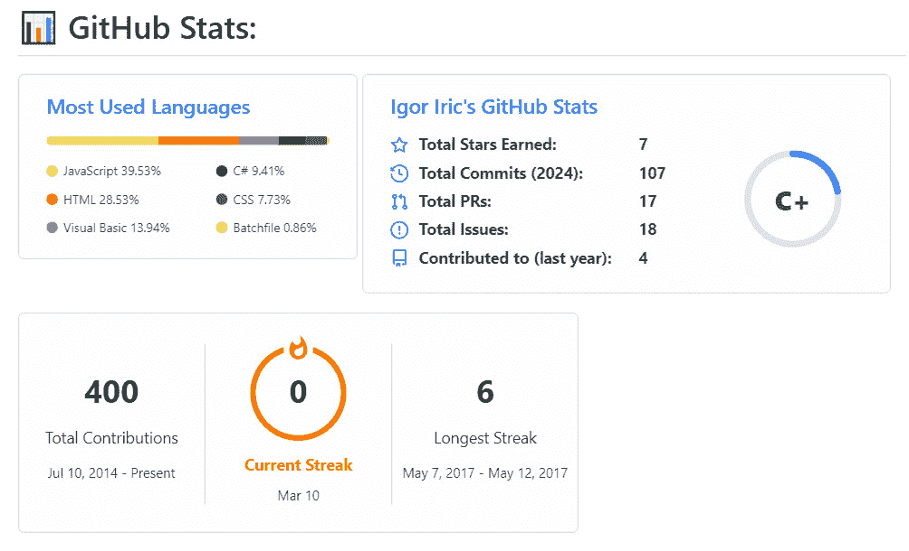
图 12.15 – GitHub 统计部分
## 为什么应该添加统计数据和成就？
在个人资料上添加统计数据和成就具有以下优势：
* 这是展示你的技能并让访客了解你正在从事工作的快速方式。
* 带有彩色小部件和统计数据的个人资料比纯文本更具吸引力。它能让你的个人资料在其他资料中脱颖而出。
* 当人们看到你的成就和贡献时，你可能会激励他们开始自己的编程之旅。
## 展示你的 GitHub 奖杯
将你的 GitHub 个人资料想象成一个展示架，上面陈列着你的成就。架子上的每一个奖杯都讲述着你所面对并征服的挑战的故事。GitHub 奖杯就是这样！它们是有趣、色彩鲜艳的徽章，庆祝你的成就并向任何访问你个人资料的人展示你的成就。
*什么是 **GitHub 奖杯**？
**GitHub 奖杯** 就像你在 GitHub 上为不同成就获得的虚拟奖牌。例如，你可能因为使用多种编程语言或为项目做出大量贡献而获得一个。
*它们如何为 **你的个人资料** 增添价值？
它们可以突出你在使用语言方面的多才多艺（例如 `MultiLanguage` 奖杯）或你为项目做出贡献的热情（例如 `Commits` 奖杯）。奖杯可以激励你更多地参与社区。当你看到 `PullRequest` 或 `Issues` 奖杯时，这是一个继续协作和解决问题的推动。获得第一个关注者或有人为你的项目点星是令人兴奋的。`Followers` 和 `Stars` 的奖杯庆祝了你在编程冒险中的这些社交里程碑：
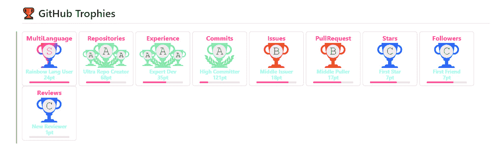
图 12.16 – GitHub 奖杯部分
以下代码块介绍了一种在个人资料上直接展示你的 GitHub 成就的有趣方式。通过添加 **GitHub 奖杯** 部分，你本质上是在展示你在 GitHub 上为各种成就所获得的奖杯集合。提供的图像链接会根据你的活动和成就生成一组个性化奖杯，采用 `radical` 主题样式，使你的个人资料脱颖而出。这是一种以创意格式突出你的辛勤工作和贡献的好方法。只需将 `\[your-username\]` 替换为你的实际 GitHub 用户名即可查看你的独特奖杯：
```
## 🏆 GitHub Trophies

```
将这些奖杯添加到你的 README 个人资料中，可以将你的 GitHub 页面从简单的个人简介转变为成就的故事书。它增添了个人色彩和一点竞争精神，使你的个人资料不仅信息丰富而且有趣。
现在你已经用统计数据、成就和奖杯提升了你的 GitHub 个人资料，让我们继续前进。接下来，我们将学习如何组织你的项目和贡献，以便任何访问你个人资料的人都能轻松看到你所做的出色工作。这不仅仅是让你的个人资料成为令人印象深刻的统计数据集合，而是一个组织良好的作品集，讲述着你的开发冒险故事。
# 战略性地展示项目和贡献
为了让你的个人资料更专业，你可以提及你最自豪的项目。这样，你就可以将访客引导至你正在从事的最重要的项目：
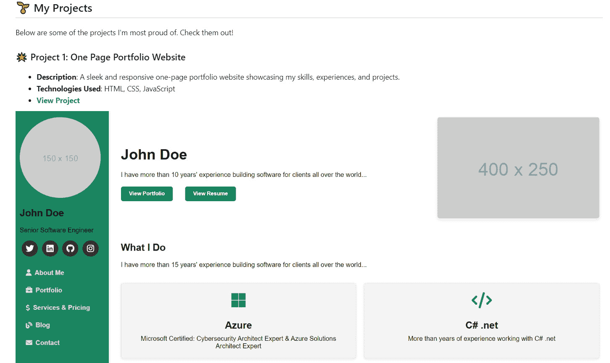
图 12.17 – 展示项目
以下是一个在你的 GitHub README 个人资料中引入 **项目** 部分的代码片段。此部分是你突出显示你所从事并特别自豪的项目的机会。这也是你展示技能和创造力的机会，让其他人看到你所取得的成就。每个项目条目提供简要概述，列出所使用的技术，并提供查看项目及其屏幕截图的链接。这样，访客可以快速了解你的工作，甚至深入了解引起他们兴趣的项目：
```
<!-- Projects -->
## 🌱 My Projects
Below are some of the projects I'm most proud of. Check them out!
### 🌟 Project 1: One Page Portfolio Website
- **Description**: A sleek and responsive one-page portfolio website showcasing my skills, experiences, and projects.
- **Technologies Used**: HTML, CSS, JavaScript
- **View Project**

### 📚 Project 2: Space Invaders
- **Description**: A dynamic, exciting and challenging shooting game set in space.
- **Technologies Used**: HTML, CSS, JavaScript, GitHub Actions
- **View Project**

```
为了让你的项目在 GitHub 个人资料上脱颖而出，请为每个列出的项目遵循以下简单步骤：
* 对于 `\View Project\`，将 `link-to-your-project` 替换为指向你的项目的实际 URL。这可以是实时网站或 GitHub 仓库。
* 要显示图像（例如你项目的屏幕截图），请将 `link-to-screenshot-of-your-project` 替换为指向你的图像的实际 URL。如果不确定如何托管图像，可以直接将屏幕截图上传到你的 GitHub 仓库并链接到那里。
* 自定义 **Technologies Used** 部分，以反映你在每个项目中实际使用过的技术。
## 添加贡献和亮点
如果你为其他项目做出了贡献，请确保这些贡献在你的 GitHub 个人资料上易于找到。你可以通过在个人资料的 README 中添加一个列出所有贡献的小部件来实现。这表明你不仅在从事自己的项目，还在帮助他人完成他们的项目。
以下是一个代码片段，你可以用它来包含此功能。只需记住将 `\[your-username\]` 替换为你的实际 GitHub 用户名。这将生成一个动态图像（*图 12**.18*），根据你设定的标准显示你的顶级贡献，例如显示的仓库数量限制和合并所有年度贡献。这是一种直观地展示你对项目的辛勤工作和奉献精神的好方法：
```
### 🔝 Top Contributed Repo

```
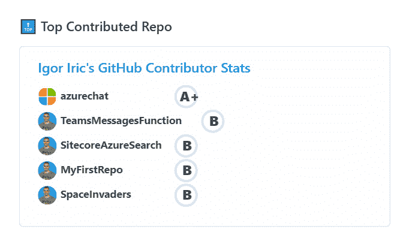
图 12.18 – 贡献仓库
接下来你可以做的就是添加你的个人网站和社交网络，以便与社区建立联系：
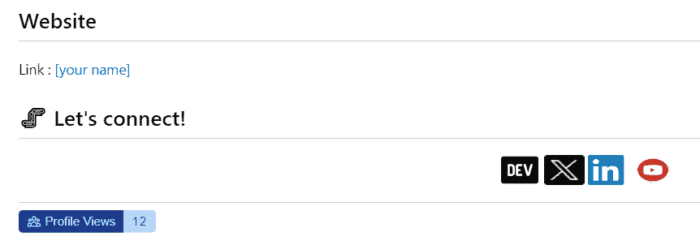


## 图 12.19 – 社交网络

以下代码片段旨在为你的 README 增加一个专门的部分，用于个人或项目网站以及社交媒体链接。此增添不仅提升了个人资料的视觉吸引力，还使访客更容易在各个平台上与你联系：

```
<!-- Website -->
## Website
Link : [[your name]](https://[your-username].github.io/[your-username]/)
<!-- Social Media Links -->
## 🖇️ Let's connect!
<p align="center">
  <a href="https://dev.to/[your-username]" target="blank"></a>
<a href="https://twitter.com/[your-username]" target="blank"></a>
<a href="https://linkedin.com/in/[your-username]" target="blank"></a>
<a href="https://www.youtube.com/c/[your-username]" target="blank"></a>
</p>
```

在前面的代码片段中，我们有以下内容：
* **网站** 部分允许你插入指向个人或项目网站的直接链接，邀请访客探索更多你的作品。
* **让我们连接！** 部分被设计为社交媒体链接的集中枢纽。每个图标都是一个可点击的链接，可将访客引导至你在 dev.to、X（前称 Twitter）、LinkedIn 和 YouTube 等平台上的个人资料。

请将 `\[your-username\]` 替换为你在这些平台上的实际用户名，并将 `\[your name\]` 替换为你希望为网站链接显示的名称。这种个性化的方法不仅展示了你的项目和技能，还为专业网络和个人联系开辟了渠道。

## 使用 GitHub Pages 展示你的作品

正如你在 *第 9 章* 中学到的，GitHub Pages 允许你免费将仓库转变为实时网站。这是一个展示个人资料页作为网站的绝佳方式。就像拥有自己的数字作品集，可以与朋友、家人甚至潜在雇主分享。

通过遵循这些提示，你可以让你的 GitHub 个人资料成为编程之旅的精彩展示。井然有序的 GitHub README 个人资料不仅能给人留下良好的第一印象，还能引导访客（如潜在协作者或雇主）查看你的最佳作品并了解你作为开发者的历程。

通过这些步骤，你学会了如何将 GitHub 个人资料转变为动态作品集，不仅展示你的项目，还能让你与更广泛的社区和潜在机会建立联系。通过突出你引以为傲的成就、分享你的贡献，并链接到你的社交网络和个人网站，你创建了专业自我的全面快照。

## 摘要

在本章中，我们探讨了如何在 GitHub 个人资料上战略性地展示项目和贡献，以最好地展示你的技能、经验和成就。我们涵盖了优化个人资料概览、展示你的专业知识，以及通过统计数据和成就让个人资料脱颖而出。这些努力不仅增强了个人资料的吸引力，还向潜在协作者和雇主强调了你的能力。

在下一章中，我们将重点介绍如何利用 Copilot 进行代码补全、建议、确保代码整洁和最佳实践、协作编码以及优化工作流程。本章将通过介绍工具和策略来进一步提高你的编码效率和生产力，从而自然地扩展我们的讨论。

## 测验

回答以下问题：
1. 优化你的 GitHub 个人资料概览的主要目标是什么？
    1. 显示你的联系信息
    2. 突出你的编程技能
    3. 展示你的爱好
    4. 列出你的教育背景
    *答案*: B. 突出你的编程技能
2. 真假：为你的 GitHub 个人资料添加自定义 README 允许你展示你的项目和贡献。
    1. 真
    2. 假
    *答案*: A. 真
3. 填空：在你的 GitHub 个人资料上展示 ______________ 有助于突出你在特定领域的专业知识。
    *答案*: 技能
4. 哪个功能可以通过显示你的编码活动让你的 GitHub 个人资料脱颖而出？
    1. 个人资料浏览计数器
    2. **GitHub 统计**
    3. 关注者列表
    4. 已加星仓库
    *答案*: B. **GitHub 统计**
5. 真假：战略性地在 GitHub 个人资料上展示项目对于吸引潜在协作者和雇主很重要。
    1. 真
    2. 假
    *答案*: A. 真
6. 添加项目 README 包含什么内容对访客有益？
    1. 你的简历
    2. 仅代码片段
    3. 详细的项目描述以及如何使用它
    4. 仅截图
    *答案*: C. 详细的项目描述以及如何使用它
7. 填空：在你的 GitHub 个人资料上包含 ______________ 成就可以证明你对开源项目的贡献。
    *答案*: 编程
8. GitHub Pages 如何与你的 GitHub 个人资料相关联使用？
    1. 创建个人博客
    2. 主持静态项目作品集网站
    3. 跟踪你的日常活动
    4. 出售商品
    *答案*: B. 主持静态项目作品集网站
9. 个人资料中包含什么元素可以增强其吸引力并提供对你个人编程之旅的洞察？
    1. 猫的动画 GIF
    2. 详细的旅行日志
    3. GitHub 活动的视觉图表
    4. 随机名言
    *答案*: C. GitHub 活动的视觉图表
10. 真假：定期更新 GitHub 个人资料上的项目是不必要的。
     1. 真
     2. 假
     *答案*: B. 假
